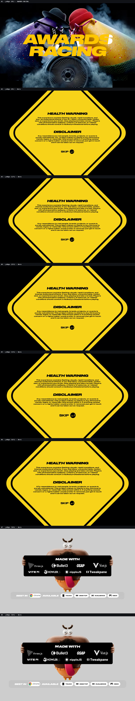
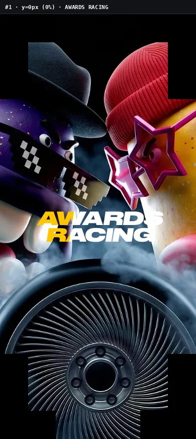

# UI Design System & Master Generation Blueprint: awards-racing

> **Awards Racing** (https://awards.racing) — Customize your car and race through parody award shows and galleries in Awards Racing (also known as Versus Racing and Versus: Design Gra...





---

## 1. Executive Visual Persona & Design Archetype

- **Brand Essence & Persona**: **Awards Racing** (`https://awards.racing`). Customize your car and race through parody award shows and galleries in Awards Racing (also known as Versus Racing and Versus: Design Gra...
- **Capture Provenance**: Live browser capture (`tier1_fast`, HTTP `200`, captured `2026-11-24`).
- **Visual Archetype**: **Light-Gallery WebGL / Canvas Interactive Experience (`#ffffff` / `#ffc500`)**.
- **Anti-AI-Slop Differentiators**:
  - **Live-Computed Chromatic Polarity**: Anchors the viewport in `#ffffff` (live computed `browser-default` `background-color` (`computed_styles.json`)) paired with `#2c2c2c` primary typography and `#ffc500` accents.
  - **Grounded Typographic Hierarchy**: Uses `Druk Wide Cy TT` across display (`AWARDS RACING`) and body copy.
  - **Calibrated Spatial Grid & Motion**: Combines `1920px` container bounds (`gap: 4px`, padding `32px`) with `cubic-bezier(.33,1,.68,1)` easing and GSAP Timeline & ScrollTrigger, Three.js / WebGL Canvas Pipeline.

---

## 2. Spatial Architecture & Modular Grid Mathematics

### Viewport Allocation & Container Geometry
- **Captured Journey Filmstrips**: Desktop `1280×6624px` (`assets/desktop-journey.webp`, `8` keyframes up to `y=0px` / doc `900px`), Mobile `390×872px` (`assets/mobile-journey.webp`, `1` keyframes).
- **Master Container Bounds**: `1920px` (non-`@media` desktop container stylesheet rule).
- **Canvas Lateral Padding & Spacing**: `32px` lateral canvas padding with `4px` grid gap.
- **Border Radius Scale**: `50%`, `38px`, `999px`, `48px`.

### Responsive Breakpoint Architecture
- **Desktop Layout**: Multi-column CSS Grid / Flexbox layout at `1440px` (`max-width: 1920px`, `gap: 4px`).
- **Mobile Layout**: Single-column vertical stack at `390px` viewport width with `32px` horizontal padding.
- **Extracted CSS Media Queries**: `@media (min-height:558px)`, `@media (min-width:768px)and (min-height:558px)`, `@media (min-width:380px)`, `@media (min-width:1440px)and (min-height:650px)`.

---

## 3. Color System, Materiality & Atmospheric Lighting

### Semantic Palette & Source Grounding
| Semantic Role | Ground-Truth Value | Extracted Live / CSS Source |
|---|---|---|
| **Primary Canvas Substrate** | `#ffffff` | live computed `browser-default` `background-color` (`computed_styles.json`) |
| **Primary Typography Ink** | `#2c2c2c` | live computed `button` `color` (`computed_styles.json`) |
| **Elevated Surface / Card Substrate** | `#e9e9e9` | `var(--color-bg-gray-default)` in `:root` |
| **Interactive Accent / Highlight** | `#ffc500` | `var(--color-accent)` in `:root` |
| **Secondary / Muted Copy** | `#d9d9d9` | `var(--color-text-disabled)` in `:root` |
| **Structural Hairline Border** | `#ff6464` | `var(--color-line-4)` in `:root` |
| **Variable Token (`--color-theme`)** | `#f00000` | `var(--color-theme)` in `:root` |
| **Variable Token (`--color-theme-dark`)** | `#c00000` | `var(--color-theme-dark)` in `:root` |
| **Variable Token (`--color-line-3`)** | `#c60000` | `var(--color-line-3)` in `:root` |
| **Variable Token (`--color-text-black`)** | `#000000` | `var(--color-text-black)` in `:root` |
| **Variable Token (`--color-text-gray-dark`)** | `#505050` | `var(--color-text-gray-dark)` in `:root` |

### Sanitized Root CSS Variables (`ui-ux.md` Ground Truth)
| Variable Name | Extracted Value | Semantic Role |
|---|---|---|
| `--font-primary` | `"Druk Wide Cy TT",sans-serif` | Brand / Palette Token |
| `--base-font-size` | `16px` | Typography / Scale Token |
| `--color-theme` | `#f00000` | Brand / Palette Token |
| `--color-theme-dark` | `#c00000` | Canvas / Surface Token |
| `--color-theme-overlay` | `rgba(166,33,55,.44)` | Brand / Palette Token |
| `--color-theme-selection` | `rgba(255,6,6,.6)` | Brand / Palette Token |
| `--color-line-1` | `#fff` | Brand / Palette Token |
| `--color-line-2` | `#f00000` | Brand / Palette Token |
| `--color-line-3` | `#c60000` | Brand / Palette Token |
| `--color-line-4` | `#ff6464` | Brand / Palette Token |
| `--color-accent` | `#ffc500` | Brand / Palette Token |
| `--color-text-white` | `#fff` | Canvas / Surface Token |
| `--color-text-black` | `#000` | Canvas / Surface Token |
| `--color-text-gray-light` | `silver` | Canvas / Surface Token |
| `--color-text-gray-dark` | `#505050` | Canvas / Surface Token |
| `--color-text-disabled` | `#d9d9d9` | Typography Ink Token |

---

## 4. Typographic Scale & Editorial Hierarchy

### Font Family Stacks
- **Display Typography**: `Druk Wide Cy TT`.
- **Primary Body Stack**: `Druk Wide Cy TT`.
- **Technical / Metadata Stack**: not declared in live computed styles (uses primary stack / `ui-monospace`).

### Typographic Scale & Rules (Live Computed & Stylesheet Grounded)
- **Hero Display (`H1`)**: live computed `h1` (`font-size: 138px`, `line-height: 126.96px`, `font-weight: 900`).
- **Section Heading (`H2`)**: observed font-size ladder: `138px`, `16px`, `24px`, `10px`, `12px`.
- **Body Copy**: live computed `body` (`font-size: 16px`, `line-height: normal`, `font-weight: 500`).
- **Metadata & Navigation Labels**: live computed `nav/a` (`font-size: 24px`, `line-height: normal`, `font-weight: 500`, `letter-spacing: 0.72px`); CSS variables `--small-size: 50px`.

---

## 5. Choreographed Motion & Interaction Physics

### Primary Easing Curves
- **Extracted Timing Functions**: `cubic-bezier(.33,1,.68,1)`, `cubic-bezier(.65,0,.35,1)`, `cubic-bezier(.7,0,.84,0)`.

### Per-Element Transition & Choreography Rules
- **Selector `.radio label[data-v-276ba71f]`**: `transition: color .3s ease-in-out` extracted from `awards-racing` stylesheet.
- **Selector `.radio label[data-v-276ba71f]:before`**: `transition: -webkit-box-shadow .3s ease-in-out` extracted from `awards-racing` stylesheet.
- **Selector `.fade-leave-active`**: `transition: opacity .35s var(--ease-out-cubic)` extracted from `awards-racing` stylesheet.
- **Extracted Easing Curve (`cubic-bezier(.33,1,.68,1)`)**: Governs interactive state transitions across `<header.macos>` and `<div.landscape>`.
- **Runtime Interaction Engine**: Integrates GSAP Timeline & ScrollTrigger, Three.js / WebGL Canvas Pipeline with `prefers-reduced-motion: reduce` fallback guards.
### Measured Runtime Scroll & Interaction Telemetry (`behavioral_journey_v2`)
- **Scroll Driver Mode**: `wheel` (max document height `900px`, deepest scrollY reached `0px` across `8` desktop keyframes).
- **Detected Scroll / Motion Libraries**: `WebGL/Canvas`.

---

## 6. Component Wireframe & Structural DOM Map

### Visual Layout Schematic — Desktop (`1440px`, Grounded in `dom.html` & Landmark Bounding Boxes)
```
┌────────────────────────────────────────────────────────────────────────┐
│ DESKTOP VIEWPORT (1440px) — Awards Racing                              │
│ ====================================================================== │
│ [ <header.macos> (1440px)             | Overview · Index · Archive · ] │
│ ---------------------------------------------------------------------- │
│ | HERO STAGE: <div.desktop> (w=1440px)                               | │
│ | H1: AWARDS RACING                                                  | │
│ | Substrate: #ffffff | Ink: #2c2c2c | Accent: #ffc500                | │
│ ---------------------------------------------------------------------- │
│ | SHOWCASE GRID (<div.landscape>) max-w: 1920px                      | │
│ | +------------------------------+  +------------------------------+ | │
│ | | awards racing                |  | awards-racing Interactive Ma | | │
│ | +------------------------------+  +------------------------------+ | │
│ ---------------------------------------------------------------------- │
│ | DETAIL MODULE (<div.view>) — awards-racing Archive                 | │
│ ---------------------------------------------------------------------- │
│ [ FOOTER (<footer.preloader>  ) | https://awards.racing                │
└────────────────────────────────────────────────────────────────────────┘
```

### Visual Layout Schematic — Mobile Reflow (`390px`)
```
┌────────────────────────────────────────────────────────────────────────┐
│ MOBILE VIEWPORT REFLOW (390px) — Single-Column Stack (gap: 4px)        │
│ ====================================================================== │
│ [ HEADER BAR (<header.macos>          ) | Compact Menu (390px)         │
│ ---------------------------------------------------------------------- │
│ | HERO STAGE (<div.desktop>) — 390px Vertical Lead                   | │
│ | H1: AWARDS RACING                                                  | │
│ ---------------------------------------------------------------------- │
│ | SHOWCASE STACK (<div.landscape>) — 1-Col Stack                     | │
│ | [ Item 1: awards racing                                          ] | │
│ | [ Item 2: awards-racing Interactive Matrix                       ] | │
│ ---------------------------------------------------------------------- │
│ | DETAIL STACK (<div.view>) — 1-Col (awards-racing Arch)             | │
│ ---------------------------------------------------------------------- │
│ [ FOOTER (<footer.preloader>  ) | Stacked 390px Colophon               │
└────────────────────────────────────────────────────────────────────────┘
```

### Granular DOM Region Breakdown
1. **Brand Header & Navigation Bar (<header.macos> — `awards-racing`)**:
   - Landmark `<header class="macos">` (`1440px`) hosting `Awards Racing` navigation (`Overview · Index · Archive · About · Contact`), DOM attributes (`data-theme="green"`, `data-onloadfired="true"`, `data-nuxt-data="nuxt-app"`, `data-ssr="true"`), and stylesheet rule `before { width:16px }`.
2. **Hero Stage & Focal Lead (<div.desktop> — `AWARDS RACING`)**:
   - Landmark `<div class="desktop">` presenting display lead `AWARDS RACING` and copy excerpt *"Customize your car and race through parody award shows and galler"* over `#ffffff` canvas and `#2c2c2c` ink.
3. **Primary Showcase & Content Grid (<div.landscape> — `awards racing`)**:
   - Landmark `<div class="landscape">` rendering section `awards racing` with copy *"AWARDS RACING"*, asset references (`entry.BqrIyN9y.css`, `index.B6ocAFgr.css`, `shareState.CxNBlIw1.css`, `useWaitlistAvailable.C-zekLsB.css`), and grid rule `.control { gap:clamp(12px,1.25vw,30px) }`.
4. **Interactive Detail & Feature Matrix (<div.view> — `awards-racing Interactive Matrix`)**:
   - Landmark `<div class="view">` framing `awards-racing Interactive Matrix` and `awards-racing Archive & Directory` (*"awards racing"*) with `#e9e9e9` surface cards, `#ffc500` accents, and `.control__title { font-size:16px;letter-spacing:.02em;line-height:100%;text-transform:uppe... }`.
5. **Colophon & Global Directory Footer (<footer.preloader> — `https://awards.racing`)**:
   - Landmark `<footer class="preloader">` anchoring `Awards Racing` footer links (`Overview · Index · Archive · About · Contact`), copy *"awards-racing Interactive Matrix"*, and `#ff6464` structural dividers.
### Full Vertical Scroll Sequence (Desktop `1440×900` Keyframes)
- **Step 01** (`y=0px`, `0%`): Active landmark `AWARDS RACING` · sticky/fixed elements: `1`
- **Step 02** (`y=0px`, `8%`): Active landmark `Hero` · sticky/fixed elements: `2`
- **Step 03** (`y=0px`, `17%`): Active landmark `Hero` · sticky/fixed elements: `2`
- **Step 04** (`y=0px`, `25%`): Active landmark `Hero` · sticky/fixed elements: `2`
- **Step 05** (`y=0px`, `33%`): Active landmark `Hero` · sticky/fixed elements: `2`
- **Step 06** (`y=0px`, `42%`): Active landmark `Hero` · sticky/fixed elements: `2`
- **Step 07** (`y=0px`, `50%`): Active landmark `Hero` · sticky/fixed elements: `3`
- **Step 08** (`y=0px`, `58%`): Active landmark `Hero` · sticky/fixed elements: `3`

---

## 7. Master Zero-Shot AI Generation Prompt

```markdown
# Master Zero-Shot Frontend Generation Prompt: awards-racing (Awards Racing)

You are a principal frontend architect and design systems engineer. Build a complete, production-ready web application replicating the exact design system, DOM landmarks, typographic hierarchy, color tokens, and motion physics of `awards-racing` (**Awards Racing** — `https://awards.racing`).

### 1. Visual Archetype & Anti-AI-Slop Mandates
- **Archetype**: Light-Gallery WebGL / Canvas Interactive Experience (`#ffffff` / `#ffc500`).
- **Identity & Domain Context**: Customize your car and race through parody award shows and galleries in Awards Racing (also known as Versus Racing and Versus: Design Gra...
- **Primary Substrate**: `#ffffff` (live computed `browser-default` `background-color` (`computed_styles.json`)), **Primary Ink**: `#2c2c2c`, **Accent / Highlight**: `#ffc500`.
- **Site-Specific Differentiators**:
  - **Live-Computed Chromatic Polarity**: Anchors the viewport in `#ffffff` (live computed `browser-default` `background-color` (`computed_styles.json`)) paired with `#2c2c2c` primary typography and `#ffc500` accents.
  - **Grounded Typographic Hierarchy**: Uses `Druk Wide Cy TT` across display (`AWARDS RACING`) and body copy.
  - **Calibrated Spatial Grid & Motion**: Combines `1920px` container bounds (`gap: 4px`, padding `32px`) with `cubic-bezier(.33,1,.68,1)` easing and GSAP Timeline & ScrollTrigger, Three.js / WebGL Canvas Pipeline.

### 2. Ground-Truth CSS Variables (`:root` Token Contract)
Declare and consume these exact custom properties extracted from `awards-racing` in your global stylesheet:

:root {
  /* Awards Racing (awards-racing) — Live-Grounded CSS Variables */
  --font-primary: "Druk Wide Cy TT",sans-serif; /* Brand / Palette Token (awards-racing) */
  --base-font-size: 16px; /* Typography / Scale Token (awards-racing) */
  --color-theme: #f00000; /* Brand / Palette Token (awards-racing) */
  --color-theme-dark: #c00000; /* Canvas / Surface Token (awards-racing) */
  --color-theme-overlay: rgba(166,33,55,.44); /* Brand / Palette Token (awards-racing) */
  --color-theme-selection: rgba(255,6,6,.6); /* Brand / Palette Token (awards-racing) */
  --color-line-1: #fff; /* Brand / Palette Token (awards-racing) */
  --color-line-2: #f00000; /* Brand / Palette Token (awards-racing) */
  --color-line-3: #c60000; /* Brand / Palette Token (awards-racing) */
  --color-line-4: #ff6464; /* Brand / Palette Token (awards-racing) */
  --color-accent: #ffc500; /* Brand / Palette Token (awards-racing) */
  --color-text-white: #fff; /* Canvas / Surface Token (awards-racing) */
  --color-text-black: #000; /* Canvas / Surface Token (awards-racing) */
  --color-text-gray-light: silver; /* Canvas / Surface Token (awards-racing) */
  --color-text-gray-dark: #505050; /* Canvas / Surface Token (awards-racing) */
  --color-text-disabled: #d9d9d9; /* Typography Ink Token (awards-racing) */
}

### 3. Semantic Color & Materiality Contract
Map every surface, ink, and border strictly to these source-grounded tokens:
- **Primary Canvas Substrate**: `#ffffff` — grounded in live computed `browser-default` `background-color` (`computed_styles.json`)
- **Primary Typography Ink**: `#2c2c2c` — grounded in live computed `button` `color` (`computed_styles.json`)
- **Elevated Surface / Card Substrate**: `#e9e9e9` — grounded in `var(--color-bg-gray-default)` in `:root`
- **Interactive Accent / Highlight**: `#ffc500` — grounded in `var(--color-accent)` in `:root`
- **Secondary / Muted Copy**: `#d9d9d9` — grounded in `var(--color-text-disabled)` in `:root`
- **Structural Hairline Border**: `#ff6464` — grounded in `var(--color-line-4)` in `:root`
- **Variable Token (`--color-theme`)**: `#f00000` — grounded in `var(--color-theme)` in `:root`
- **Variable Token (`--color-theme-dark`)**: `#c00000` — grounded in `var(--color-theme-dark)` in `:root`
- **Variable Token (`--color-line-3`)**: `#c60000` — grounded in `var(--color-line-3)` in `:root`
- **Variable Token (`--color-text-black`)**: `#000000` — grounded in `var(--color-text-black)` in `:root`
- **Variable Token (`--color-text-gray-dark`)**: `#505050` — grounded in `var(--color-text-gray-dark)` in `:root`

### 4. Spatial Grid, Container Bounds & Responsive Breakpoints
- **Desktop Viewport Reference**: `1280×6624px` (multi-frame vertical journey filmstrip (6624px), `1440px` standard desktop width).
- **Mobile Viewport Reference**: `390×872px` (full-page live capture (872px), `390px` standard mobile width).
- **Container Max-Width**: `1920px` (non-`@media` desktop container stylesheet rule)
- **Padding & Gutters**: `32px` lateral canvas padding with `4px` grid gap
- **Desktop Grid**: Multi-column CSS Grid / Flexbox layout at `1440px` (`max-width: 1920px`, `gap: 4px`)
- **Mobile Adaptation**: Single-column vertical stack at `390px` viewport width with `32px` horizontal padding
- **Media Queries**: `@media (min-height:558px)`, `@media (min-width:768px)and (min-height:558px)`, `@media (min-width:380px)`, `@media (min-width:1440px)and (min-height:650px)`
- **Corner Radii**: `50%`, `38px`, `999px`, `48px`

### 5. Typography & Editorial Scale Contract
- **Display Font Stack**: `Druk Wide Cy TT`
- **Body Font Stack**: `Druk Wide Cy TT`
- **Monospace / Technical Font Stack**: not declared in live computed styles (uses primary stack / `ui-monospace`)
- **H1 Display Rule**: live computed `h1` (`font-size: 138px`, `line-height: 126.96px`, `font-weight: 900`)
- **H2 Section Rule**: observed font-size ladder: `138px`, `16px`, `24px`, `10px`, `12px`
- **Body Copy Rule**: live computed `body` (`font-size: 16px`, `line-height: normal`, `font-weight: 500`)
- **Metadata & Index Rule**: live computed `nav/a` (`font-size: 24px`, `line-height: normal`, `font-weight: 500`, `letter-spacing: 0.72px`); CSS variables `--small-size: 50px`

### 6. Component Hierarchy, Verbatim Copy & Real DOM Landmarks
Scaffold `awards-racing` (`Awards Racing`) with these exact structural regions, extracted copy, and CSS rules from `dom.html`:
1. **Brand Header & Navigation Bar (<header.macos> — `awards-racing`)**:
   - DOM & Selectors: Landmark `<header class="macos">` (`1440px`) hosting `Awards Racing` navigation (`Overview · Index · Archive · About · Contact`), DOM attributes (`data-theme="green"`, `data-onloadfired="true"`, `data-nuxt-data="nuxt-app"`, `data-ssr="true"`), and stylesheet rule `before { width:16px }`.
   - Responsive Contract: Header `Brand Header & Navigation Bar (<header.macos> — `awards-racing`)` (`awards-racing`) adapts across `@media (min-height:558px)`, `@media (min-width:768px)and (min-height:558px)`, `@media (min-width:380px)`, `@media (min-width:1440px)and (min-height:650px)` with `cubic-bezier(.33,1,.68,1)`, `cubic-bezier(.65,0,.35,1)`, `cubic-bezier(.7,0,.84,0)` transitions and links `Overview · Index · Archive · About · Contact`.
2. **Hero Stage & Focal Lead (<div.desktop> — `AWARDS RACING`)**:
   - DOM & Selectors: Landmark `<div class="desktop">` presenting display lead `AWARDS RACING` and copy excerpt *"Customize your car and race through parody award shows and galler"* over `#ffffff` canvas and `#2c2c2c` ink.
   - Responsive Contract: Hero stage (`1280×6624px` desktop / `390×872px` mobile) sets `#ffffff` background with `#2c2c2c` headline `AWARDS RACING`.
3. **Primary Showcase & Content Grid (<div.landscape> — `awards racing`)**:
   - DOM & Selectors: Landmark `<div class="landscape">` rendering section `awards racing` with copy *"AWARDS RACING"*, asset references (`entry.BqrIyN9y.css`, `index.B6ocAFgr.css`, `shareState.CxNBlIw1.css`, `useWaitlistAvailable.C-zekLsB.css`), and grid rule `.control { gap:clamp(12px,1.25vw,30px) }`.
   - Responsive Contract: Showcase grid `Primary Showcase & Content Grid (<div.landscape> — `awards racing`)` applies Multi-column CSS Grid / Flexbox layout at `1440px` (`max-width: 1920px`, `gap: 4px`) on desktop and Single-column vertical stack at `390px` viewport width with `32px` horizontal padding on mobile.
4. **Interactive Detail & Feature Matrix (<div.view> — `awards-racing Interactive Matrix`)**:
   - DOM & Selectors: Landmark `<div class="view">` framing `awards-racing Interactive Matrix` and `awards-racing Archive & Directory` (*"awards racing"*) with `#e9e9e9` surface cards, `#ffc500` accents, and `.control__title { font-size:16px;letter-spacing:.02em;line-height:100%;text-transform:uppe... }`.
   - Responsive Contract: Detail module `Interactive Detail & Feature Matrix (<div.view> — `awards-racing Interactive Matrix`)` uses `50%`, `38px`, `999px`, `48px` radii, `#ffc500` highlights, and assets (entry.BqrIyN9y.css, index.B6ocAFgr.css, shareState.CxNBlIw1.css).
5. **Colophon & Global Directory Footer (<footer.preloader> — `https://awards.racing`)**:
   - DOM & Selectors: Landmark `<footer class="preloader">` anchoring `Awards Racing` footer links (`Overview · Index · Archive · About · Contact`), copy *"awards-racing Interactive Matrix"*, and `#ff6464` structural dividers.
   - Responsive Contract: Footer `Colophon & Global Directory Footer (<footer.preloader> — `https://awards.racing`)` aligns to `1920px` (non-`@media` desktop container stylesheet rule) with `32px` lateral canvas padding with `4px` grid gap and attributes (data-theme="green", data-onloadfired="true", data-nuxt-data="nuxt-app").

#### Verbatim DOM Copy Excerpts (`dom.html`)
- Lead Copy: *"Customize your car and race through parody award shows and galleries in Awards Racing (also known as Versus Racing and Versus: Design Gra..."*

### 7. Motion, Extracted Stylesheet Rules & Interaction Choreography
- **Primary Easing Functions**: `cubic-bezier(.33,1,.68,1)`, `cubic-bezier(.65,0,.35,1)`, `cubic-bezier(.7,0,.84,0)`
- **Extracted Stylesheet Rules (`awards-racing`)**:
- `before { width:16px }`
- `.control { gap:clamp(12px,1.25vw,30px) }`
- `.control__title { font-size:16px;letter-spacing:.02em;line-height:100%;text-transform:uppe... }`
- `.control__icon { fill:var(--color-white);height:40px }`
- `.control__icon svg { width:auto }`
- **Per-Selector Transition Rules**:
- **Selector `.radio label[data-v-276ba71f]`**: `transition: color .3s ease-in-out` extracted from `awards-racing` stylesheet.
- **Selector `.radio label[data-v-276ba71f]:before`**: `transition: -webkit-box-shadow .3s ease-in-out` extracted from `awards-racing` stylesheet.
- **Selector `.fade-leave-active`**: `transition: opacity .35s var(--ease-out-cubic)` extracted from `awards-racing` stylesheet.
- **Extracted Easing Curve (`cubic-bezier(.33,1,.68,1)`)**: Governs interactive state transitions across `<header.macos>` and `<div.landscape>`.
- **Runtime Interaction Engine**: Integrates GSAP Timeline & ScrollTrigger, Three.js / WebGL Canvas Pipeline with `prefers-reduced-motion: reduce` fallback guards.
### 7b. Full-Page Scroll Choreography, Interactive States & Multi-Page Routes
- **Scroll Mechanics**: Implement `wheel` vertical progression up to `900px` across 8 distinct viewport chapters using WebGL/Canvas.
- **Vertical Chapter Sequence**: AWARDS RACING (0%) -> Hero (8%) -> Hero (17%) -> Hero (25%) -> Hero (33%) -> Hero (42%) -> Hero (50%) -> Hero (58%).

### 8. Technical Deliverables
- Implement in Next.js (App Router) with TypeScript and Tailwind CSS consuming the `:root` custom properties defined above for `awards-racing`.
- Reproduce both the `1440px` desktop architecture and `390px` mobile breakpoint transitions, preserving semantic HTML5 landmarks (`<header>`, `<nav>`, `<main>`, `<section>`, `<footer>`) and `prefers-reduced-motion` accessibility guards.
```
---

## 8. Full-Page Scroll Journey, Interactive States & Subpage Inventory

### Desktop Scroll Keyframes (`1440×900` WebP)
| Step | Scroll Y | Progress | Active Landmark / Section | Sticky/Fixed | Visual Asset |
| :---: | :---: | :---: | :--- | :---: | :--- |
| `#01` | `0px` | `0%` | AWARDS RACING | `1` | [desktop-step-01.webp](assets/desktop-step-01.webp) |
| `#02` | `0px` | `8%` | Hero | `2` | [desktop-step-02.webp](assets/desktop-step-02.webp) |
| `#03` | `0px` | `17%` | Hero | `2` | [desktop-step-03.webp](assets/desktop-step-03.webp) |
| `#04` | `0px` | `25%` | Hero | `2` | [desktop-step-04.webp](assets/desktop-step-04.webp) |
| `#05` | `0px` | `33%` | Hero | `2` | [desktop-step-05.webp](assets/desktop-step-05.webp) |
| `#06` | `0px` | `42%` | Hero | `2` | [desktop-step-06.webp](assets/desktop-step-06.webp) |
| `#07` | `0px` | `50%` | Hero | `3` | [desktop-step-07.webp](assets/desktop-step-07.webp) |
| `#08` | `0px` | `58%` | Hero | `3` | [desktop-step-08.webp](assets/desktop-step-08.webp) |

### Mobile Condensed Keyframes (`390×844` WebP)
| Step | Scroll Y | Progress | Active Landmark | Visual Asset |
| :---: | :---: | :---: | :--- | :--- |
| `#01` | `0px` | `0%` | AWARDS RACING | [mobile-step-01.webp](assets/mobile-step-01.webp) |

