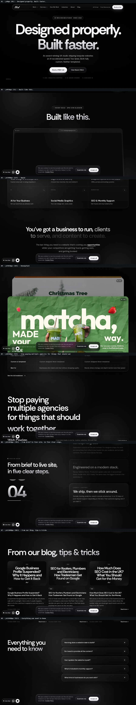
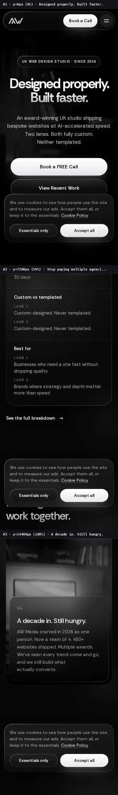

# UI Design System & Master Generation Blueprint: awmedia-marketing

> **AW Media & Marketing · UK Web Design Studio** (https://awmedia.marketing/) — Award-winning web design for ambitious UK businesses. Sheffield-based, UK-wide. Bespoke when the project demands it, AI-accelerated when...





---

## 1. Executive Visual Persona & Design Archetype

- **Brand Essence & Persona**: **AW Media & Marketing · UK Web Design Studio** (`https://awmedia.marketing/`). Award-winning web design for ambitious UK businesses. Sheffield-based, UK-wide. Bespoke when the project demands it, AI-accelerated when...
- **Capture Provenance**: Live browser capture (`tier1_fast`, HTTP `200`, captured `2026-11-24`).
- **Visual Archetype**: **High-Contrast Obsidian / Atmospheric Design System (`#000000` canvas, `#f5f5f7` ink, `#ffffff` accent)**.
- **Anti-AI-Slop Differentiators**:
  - **Live-Computed Chromatic Polarity**: Anchors the viewport in `#000000` (live computed `html` `background-color` (`computed_styles.json`)) paired with `#f5f5f7` primary typography and `#ffffff` accents.
  - **Grounded Typographic Hierarchy**: Uses `Rethink Sans` across display (`Designed properly. Built faster.`) and body copy, paired with `SFMono-Regular` for monospace/code.
  - **Calibrated Spatial Grid & Motion**: Combines `1408px` container bounds (`gap: 2px`, padding `14px`) with `cubic-bezier(.4,0,.2,1)` easing and Lenis Smooth Scroll (`data-lenis`), GSAP Timeline & ScrollTrigger.

---

## 2. Spatial Architecture & Modular Grid Mathematics

### Viewport Allocation & Container Geometry
- **Captured Journey Filmstrips**: Desktop `1280×6624px` (`assets/desktop-journey.webp`, `8` keyframes up to `y=14400px` / doc `16653px`), Mobile `390×2616px` (`assets/mobile-journey.webp`, `3` keyframes).
- **Master Container Bounds**: `1408px` (measured widest bounded `<section>` landmark width on `1440px` desktop).
- **Canvas Lateral Padding & Spacing**: `14px` lateral canvas padding with `2px` grid gap.
- **Border Radius Scale**: `999px`, `.25rem`, `var(--radius-2xl)`, `var(--radius-xl)`.

### Responsive Breakpoint Architecture
- **Desktop Layout**: Multi-column CSS Grid / Flexbox layout at `1440px` (`max-width: 1408px`, `gap: 2px`).
- **Mobile Layout**: Single-column vertical stack at `390px` viewport width with `14px` horizontal padding.
- **Extracted CSS Media Queries**: `@media (max-width:760px)`, `@media (min-width:40rem)`, `@media (min-width:48rem)`, `@media (min-width:64rem)`.

---

## 3. Color System, Materiality & Atmospheric Lighting

### Semantic Palette & Source Grounding
| Semantic Role | Ground-Truth Value | Extracted Live / CSS Source |
|---|---|---|
| **Primary Canvas Substrate** | `#000000` | live computed `html` `background-color` (`computed_styles.json`) |
| **Primary Typography Ink** | `#f5f5f7` | live computed `h1` `color` (`computed_styles.json`) |
| **Elevated Surface / Card Substrate** | `#111111` | `var(--card-bg)` in `:root` |
| **Interactive Accent / Highlight** | `#ffffff` | `.cta-title.nf-num { background: #ffffff }` |
| **Secondary / Muted Copy** | `#888888` | `var(--muted)` in `:root` |
| **Structural Hairline Border** | `#1a1a1a` | `var(--card-border)` in `:root` |
| **Variable Token (`--foreground`)** | `#ededed` | `var(--foreground)` in `:root` |
| **Variable Token (`--pink-dark`)** | `#d4d4d9` | `var(--pink-dark)` in `:root` |

### Sanitized Root CSS Variables (`ui-ux.md` Ground Truth)
| Variable Name | Extracted Value | Semantic Role |
|---|---|---|
| `--background` | `#000` | Canvas / Surface Token |
| `--foreground` | `#ededed` | Typography Ink Token |
| `--pink` | `#fff` | Typography Ink Token |
| `--pink-dark` | `#d4d4d9` | Canvas / Surface Token |
| `--card-bg` | `#111` | Canvas / Surface Token |
| `--card-border` | `#1a1a1a` | Elevation / Border Token |
| `--muted` | `#888` | Color / Atmospheric Token |
| `--bg` | `#000` | Canvas / Surface Token |
| `--ink` | `#f5f5f7` | Typography Ink Token |
| `--ink-2` | `#f5f5f7a8` | Typography Ink Token |
| `--ink-3` | `#f5f5f76b` | Typography Ink Token |
| `--line` | `#ffffff17` | Color / Atmospheric Token |
| `--maxw` | `1280px` | Dimension / Scale Token |
| `--gutter` | `clamp(20px,4.6vw,64px)` | Layout / Spatial Grid Token |
| `--ease` | `cubic-bezier(.16,1,.3,1)` | Motion / Easing Token |
| `--r-xl` | `32px` | Dimension / Scale Token |

---

## 4. Typographic Scale & Editorial Hierarchy

### Font Family Stacks
- **Display Typography**: `Rethink Sans`.
- **Primary Body Stack**: `Rethink Sans`.
- **Technical / Metadata Stack**: `SFMono-Regular`.

### Typographic Scale & Rules (Live Computed & Stylesheet Grounded)
- **Hero Display (`H1`)**: live computed `h1` (`font-size: 152.64px`, `line-height: 137.376px`, `font-weight: 700`, `letter-spacing: -8.3952px`); CSS variables `--text-4xl: 2.25rem`, `--text-4xl--line-height: calc(2.5 / 2.25)`, `--text-5xl: 3rem`.
- **Section Heading (`H2`)**: live computed `h2` (`font-size: 89.28px`, `line-height: 87.4944px`, `font-weight: 600`, `letter-spacing: -4.0176px`); CSS variables `--text-2xl: 1.5rem`, `--text-2xl--line-height: calc(2 / 1.5)`, `--text-3xl: 1.875rem`; rule `h2` (`font-size: clamp(38px,4.6vw,72px)`).
- **Body Copy**: live computed `body` (`font-size: 17px`, `line-height: 25.5px`, `font-weight: 400`); CSS variables `--text-base: 1rem`, `--text-base--line-height: calc(1.5 / 1)`; rule `p` (`font-size: 16.5px`, `line-height: 1.62`).
- **Metadata & Navigation Labels**: live computed `nav/a` (`font-size: 17px`, `line-height: 25.5px`, `font-weight: 400`); CSS variables `--text-xs: .75rem`, `--text-xs--line-height: calc(1 / .75)`, `--text-sm: .875rem`.

---

## 5. Choreographed Motion & Interaction Physics

### Primary Easing Curves
- **Extracted Timing Functions**: `cubic-bezier(.4,0,.2,1)`, `cubic-bezier(.16,1,.3,1)`, `cubic-bezier(.22,1,.36,1)`.

### Per-Element Transition & Choreography Rules
- **Selector `.nf-links .chip`**: `transition: color .25s` extracted from `awmedia-marketing` stylesheet.
- **Selector `layer theme`**: `transition: .15s` extracted from `awmedia-marketing` stylesheet.
- **Selector `.transition`**: `transition: var(--tw-ease,var(--default-transition-timing-function))` extracted from `awmedia-marketing` stylesheet.
- **Extracted Easing Curve (`cubic-bezier(.4,0,.2,1)`)**: Governs interactive state transitions across `<header.nav>` and `<section.built>`.
- **Runtime Interaction Engine**: Integrates Lenis Smooth Scroll (`data-lenis`), GSAP Timeline & ScrollTrigger with `prefers-reduced-motion: reduce` fallback guards.
### Measured Runtime Scroll & Interaction Telemetry (`behavioral_journey_v2`)
- **Scroll Driver Mode**: `native` (max document height `16653px`, deepest scrollY reached `14400px` across `8` desktop keyframes).
- **Detected Scroll / Motion Libraries**: `Lenis`, `GSAP/ScrollTrigger`.
- **Nav / Drawer Probe (`Work`)**: Triggered visual change (pixel diff `25.605`, captured in `assets/state-nav.webp`); revealed links: Renewafuel Solar, Hea..., Christmas Tree Collec..., MADE Independent Açaí..., RankSauce SEO & AI Vi..., View all work →.
- **Hover Physics (`primary_cta` · `View Recent Work`)**: `transform`: `none` -> `matrix(1, 0, 0, 1, 0, 0)` (`transition-duration: 0.6s, 0.6s, 0.3s`, `timing: cubic-bezier(0.16, 1, 0.3, 1), cubic-bezier(0.16, 1, 0.3, 1), ease`).
- **Interactive Control Probe (`accordion`)**: Tested `How long does a website take to b...` (diff `3.802`).
- **Route Transition Architecture**: First internal navigation (`/blog`) measured as `direct` in `787ms`.

---

## 6. Component Wireframe & Structural DOM Map

### Visual Layout Schematic — Desktop (`1440px`, Grounded in `dom.html` & Landmark Bounding Boxes)
```
┌────────────────────────────────────────────────────────────────────────┐
│ DESKTOP VIEWPORT (1440px) — AW Media & Marketing · UK Web Design Studi │
│ ====================================================================== │
│ [ <header.nav> (1440x60px)            | How We Work · Industries · A ] │
│ ---------------------------------------------------------------------- │
│ | HERO STAGE: <section.hero> (w=1440px)                              | │
│ | H1: Designed properly. Built faster.                               | │
│ | Substrate: #000000 | Ink: #f5f5f7 | Accent: #ffffff                | │
│ ---------------------------------------------------------------------- │
│ | SHOWCASE GRID (<section.built>) max-w: 1408px                      | │
│ | +------------------------------+  +------------------------------+ | │
│ | | Built like this.             |  | Award-winning design, AI-acc | | │
│ | +------------------------------+  +------------------------------+ | │
│ ---------------------------------------------------------------------- │
│ | DETAIL MODULE (<section.trusted>) — From idea to live. Si          | │
│ ---------------------------------------------------------------------- │
│ [ FOOTER (<footer.footer>     ) | https://awmedia.marketing/           │
└────────────────────────────────────────────────────────────────────────┘
```

### Visual Layout Schematic — Mobile Reflow (`390px`)
```
┌────────────────────────────────────────────────────────────────────────┐
│ MOBILE VIEWPORT REFLOW (390px) — Single-Column Stack (gap: 2px)        │
│ ====================================================================== │
│ [ HEADER BAR (<header.nav>            ) | Compact Menu (390px)         │
│ ---------------------------------------------------------------------- │
│ | HERO STAGE (<section.hero>) — 390px Vertical Lead                  | │
│ | H1: Designed properly. Built faster.                               | │
│ ---------------------------------------------------------------------- │
│ | SHOWCASE STACK (<section.built>) — 1-Col Stack                     | │
│ | [ Item 1: Built like this.                                       ] | │
│ | [ Item 2: Award-winning design, AI-accelerated where it cou...   ] | │
│ ---------------------------------------------------------------------- │
│ | DETAIL STACK (<section.trusted>) — 1-Col (From idea to live.)      | │
│ ---------------------------------------------------------------------- │
│ [ FOOTER (<footer.footer>     ) | Stacked 390px Colophon               │
└────────────────────────────────────────────────────────────────────────┘
```

### Granular DOM Region Breakdown
1. **Brand Header & Navigation Bar (<header.nav> — `awmedia-marketing`)**:
   - Landmark `<header class="nav">` (`1440x60px`) hosting `AW Media & Marketing · UK Web Design` navigation (`How We Work · Industries · About · Blog`), DOM attributes (`data-precedence="next"`, `data-precedence="next"`, `data-liquid="cursor"`, `data-liquid="pill"`), and stylesheet rule `.cta.nf { min-height:100svh;padding:calc(var(--nav-h) + 9vh) 0 12vh;place-items:ce... }`.
2. **Hero Stage & Focal Lead (<section.hero> — `Designed properly. Built faster.`)**:
   - Landmark `<section class="hero">` presenting display lead `Designed properly. Built faster.` and copy excerpt *"An award-⁠winning UK studio shipping bespoke websites at AI-⁠acce"* over `#000000` canvas and `#f5f5f7` ink.
3. **Primary Showcase & Content Grid (<section.built> — `Built like this.`)**:
   - Landmark `<section class="built">` rendering section `Built like this.` with copy *"UK Web Design Studio · Since 2016"*, asset references (`0dc02305a3505331-s.p.045lmq4bb63o...`, `aw-logo.png`, `04rv9lq_~p.97.css`, `0yrizplp3s9dt.css`), and grid rule `.hero-title.nf-title { letter-spacing:-.05em;margin-top:3vh;font-size:clamp(38px,4.6vw,76px);li... }`.
4. **Interactive Detail & Feature Matrix (<section.trusted> — `Award-winning design, AI-accelerat`)**:
   - Landmark `<section class="trusted">` framing `Award-winning design, AI-accelerated where it cou...` and `From idea to live. Sites that ship.` (*"Designed properly."*) with `#111111` surface cards, `#ffffff` accents, and `.hero-sub.nf-sub { max-width:520px;margin-top:28px }`.
5. **Colophon & Global Directory Footer (<footer.footer> — `https://awmedia.marketing/`)**:
   - Landmark `<footer class="footer">` anchoring `AW Media & Marketing · UK Web De` footer links (`How We Work · Industries · About · Blog`), copy *"An award-winning UK studio shipping bespoke websites at AI-a"*, and `#1a1a1a` structural dividers.
### Full Vertical Scroll Sequence (Desktop `1440×900` Keyframes)
- **Step 01** (`y=0px`, `0%`): Active landmark `Designed properly. Built faster.` · sticky/fixed elements: `3`
- **Step 02** (`y=850px`, `5%`): Active landmark `Built like this.` · sticky/fixed elements: `4`
- **Step 03** (`y=3400px`, `22%`): Active landmark `#pain` · sticky/fixed elements: `4`
- **Step 04** (`y=5950px`, `38%`): Active landmark `Renewafuel` · sticky/fixed elements: `4`
- **Step 05** (`y=8500px`, `54%`): Active landmark `Stop paying multiple agencies for things that sho...` · sticky/fixed elements: `4`
- **Step 06** (`y=11050px`, `70%`): Active landmark `From brief to live site, in five clear steps.` · sticky/fixed elements: `5`
- **Step 07** (`y=13600px`, `86%`): Active landmark `From our blog, tips & tricks` · sticky/fixed elements: `4`
- **Step 08** (`y=14400px`, `91%`): Active landmark `Everything you need to know` · sticky/fixed elements: `4`

### Multi-Page Internal Route Map
- **Listing Route (`/blog`)**: `https://awmedia.marketing/blog` — H1: `Tips, tricks & honest advice.`, scrollHeight `45865px`, transition `direct` (`787ms`)
- **Detail Route (`/work/apex-gym-glasgow`)**: `https://awmedia.marketing/work/apex-gym-glasgow` — H1: `Apex Gym Glasgow`, scrollHeight `11162px`, transition `direct` (`429ms`)
- **About Route (`/about`)**: `https://awmedia.marketing/about` — H1: `We're not your typical web design agency.`, scrollHeight `5185px`, transition `direct` (`321ms`)

---

## 7. Master Zero-Shot AI Generation Prompt

```markdown
# Master Zero-Shot Frontend Generation Prompt: awmedia-marketing (AW Media & Marketing · UK Web Design Studio)

You are a principal frontend architect and design systems engineer. Build a complete, production-ready web application replicating the exact design system, DOM landmarks, typographic hierarchy, color tokens, and motion physics of `awmedia-marketing` (**AW Media & Marketing · UK Web Design Studio** — `https://awmedia.marketing/`).

### 1. Visual Archetype & Anti-AI-Slop Mandates
- **Archetype**: High-Contrast Obsidian / Atmospheric Design System (`#000000` canvas, `#f5f5f7` ink, `#ffffff` accent).
- **Identity & Domain Context**: Award-winning web design for ambitious UK businesses. Sheffield-based, UK-wide. Bespoke when the project demands it, AI-accelerated when...
- **Primary Substrate**: `#000000` (live computed `html` `background-color` (`computed_styles.json`)), **Primary Ink**: `#f5f5f7`, **Accent / Highlight**: `#ffffff`.
- **Site-Specific Differentiators**:
  - **Live-Computed Chromatic Polarity**: Anchors the viewport in `#000000` (live computed `html` `background-color` (`computed_styles.json`)) paired with `#f5f5f7` primary typography and `#ffffff` accents.
  - **Grounded Typographic Hierarchy**: Uses `Rethink Sans` across display (`Designed properly. Built faster.`) and body copy, paired with `SFMono-Regular` for monospace/code.
  - **Calibrated Spatial Grid & Motion**: Combines `1408px` container bounds (`gap: 2px`, padding `14px`) with `cubic-bezier(.4,0,.2,1)` easing and Lenis Smooth Scroll (`data-lenis`), GSAP Timeline & ScrollTrigger.

### 2. Ground-Truth CSS Variables (`:root` Token Contract)
Declare and consume these exact custom properties extracted from `awmedia-marketing` in your global stylesheet:

:root {
  /* AW Media & Marketing · UK Web Design Studio (awmedia-marketing) — Live-Grounded CSS Variables */
  --background: #000; /* Canvas / Surface Token (awmedia-marketing) */
  --foreground: #ededed; /* Typography Ink Token (awmedia-marketing) */
  --pink: #fff; /* Typography Ink Token (awmedia-marketing) */
  --pink-dark: #d4d4d9; /* Canvas / Surface Token (awmedia-marketing) */
  --card-bg: #111; /* Canvas / Surface Token (awmedia-marketing) */
  --card-border: #1a1a1a; /* Elevation / Border Token (awmedia-marketing) */
  --muted: #888; /* Color / Atmospheric Token (awmedia-marketing) */
  --bg: #000; /* Canvas / Surface Token (awmedia-marketing) */
  --ink: #f5f5f7; /* Typography Ink Token (awmedia-marketing) */
  --ink-2: #f5f5f7a8; /* Typography Ink Token (awmedia-marketing) */
  --ink-3: #f5f5f76b; /* Typography Ink Token (awmedia-marketing) */
  --line: #ffffff17; /* Color / Atmospheric Token (awmedia-marketing) */
  --maxw: 1280px; /* Dimension / Scale Token (awmedia-marketing) */
  --gutter: clamp(20px,4.6vw,64px); /* Layout / Spatial Grid Token (awmedia-marketing) */
  --ease: cubic-bezier(.16,1,.3,1); /* Motion / Easing Token (awmedia-marketing) */
  --r-xl: 32px; /* Dimension / Scale Token (awmedia-marketing) */
}

### 3. Semantic Color & Materiality Contract
Map every surface, ink, and border strictly to these source-grounded tokens:
- **Primary Canvas Substrate**: `#000000` — grounded in live computed `html` `background-color` (`computed_styles.json`)
- **Primary Typography Ink**: `#f5f5f7` — grounded in live computed `h1` `color` (`computed_styles.json`)
- **Elevated Surface / Card Substrate**: `#111111` — grounded in `var(--card-bg)` in `:root`
- **Interactive Accent / Highlight**: `#ffffff` — grounded in `.cta-title.nf-num { background: #ffffff }`
- **Secondary / Muted Copy**: `#888888` — grounded in `var(--muted)` in `:root`
- **Structural Hairline Border**: `#1a1a1a` — grounded in `var(--card-border)` in `:root`
- **Variable Token (`--foreground`)**: `#ededed` — grounded in `var(--foreground)` in `:root`
- **Variable Token (`--pink-dark`)**: `#d4d4d9` — grounded in `var(--pink-dark)` in `:root`

### 4. Spatial Grid, Container Bounds & Responsive Breakpoints
- **Desktop Viewport Reference**: `1280×6624px` (multi-frame vertical journey filmstrip (6624px), `1440px` standard desktop width).
- **Mobile Viewport Reference**: `390×2616px` (multi-frame vertical journey filmstrip (2616px), `390px` standard mobile width).
- **Container Max-Width**: `1408px` (measured widest bounded `<section>` landmark width on `1440px` desktop)
- **Padding & Gutters**: `14px` lateral canvas padding with `2px` grid gap
- **Desktop Grid**: Multi-column CSS Grid / Flexbox layout at `1440px` (`max-width: 1408px`, `gap: 2px`)
- **Mobile Adaptation**: Single-column vertical stack at `390px` viewport width with `14px` horizontal padding
- **Media Queries**: `@media (max-width:760px)`, `@media (min-width:40rem)`, `@media (min-width:48rem)`, `@media (min-width:64rem)`
- **Corner Radii**: `999px`, `.25rem`, `var(--radius-2xl)`, `var(--radius-xl)`

### 5. Typography & Editorial Scale Contract
- **Display Font Stack**: `Rethink Sans`
- **Body Font Stack**: `Rethink Sans`
- **Monospace / Technical Font Stack**: `SFMono-Regular`
- **H1 Display Rule**: live computed `h1` (`font-size: 152.64px`, `line-height: 137.376px`, `font-weight: 700`, `letter-spacing: -8.3952px`); CSS variables `--text-4xl: 2.25rem`, `--text-4xl--line-height: calc(2.5 / 2.25)`, `--text-5xl: 3rem`
- **H2 Section Rule**: live computed `h2` (`font-size: 89.28px`, `line-height: 87.4944px`, `font-weight: 600`, `letter-spacing: -4.0176px`); CSS variables `--text-2xl: 1.5rem`, `--text-2xl--line-height: calc(2 / 1.5)`, `--text-3xl: 1.875rem`; rule `h2` (`font-size: clamp(38px,4.6vw,72px)`)
- **Body Copy Rule**: live computed `body` (`font-size: 17px`, `line-height: 25.5px`, `font-weight: 400`); CSS variables `--text-base: 1rem`, `--text-base--line-height: calc(1.5 / 1)`; rule `p` (`font-size: 16.5px`, `line-height: 1.62`)
- **Metadata & Index Rule**: live computed `nav/a` (`font-size: 17px`, `line-height: 25.5px`, `font-weight: 400`); CSS variables `--text-xs: .75rem`, `--text-xs--line-height: calc(1 / .75)`, `--text-sm: .875rem`

### 6. Component Hierarchy, Verbatim Copy & Real DOM Landmarks
Scaffold `awmedia-marketing` (`AW Media & Marketing · UK Web Design Studio`) with these exact structural regions, extracted copy, and CSS rules from `dom.html`:
1. **Brand Header & Navigation Bar (<header.nav> — `awmedia-marketing`)**:
   - DOM & Selectors: Landmark `<header class="nav">` (`1440x60px`) hosting `AW Media & Marketing · UK Web Design` navigation (`How We Work · Industries · About · Blog`), DOM attributes (`data-precedence="next"`, `data-precedence="next"`, `data-liquid="cursor"`, `data-liquid="pill"`), and stylesheet rule `.cta.nf { min-height:100svh;padding:calc(var(--nav-h) + 9vh) 0 12vh;place-items:ce... }`.
   - Responsive Contract: Header `Brand Header & Navigation Bar (<header.nav> — `awmedia-marketing`)` (`awmedia-marketing`) adapts across `@media (max-width:760px)`, `@media (min-width:40rem)`, `@media (min-width:48rem)`, `@media (min-width:64rem)` with `cubic-bezier(.4,0,.2,1)`, `cubic-bezier(.16,1,.3,1)`, `cubic-bezier(.22,1,.36,1)` transitions and links `How We Work · Industries · About · Blog`.
2. **Hero Stage & Focal Lead (<section.hero> — `Designed properly. Built faster.`)**:
   - DOM & Selectors: Landmark `<section class="hero">` presenting display lead `Designed properly. Built faster.` and copy excerpt *"An award-⁠winning UK studio shipping bespoke websites at AI-⁠acce"* over `#000000` canvas and `#f5f5f7` ink.
   - Responsive Contract: Hero stage (`1280×6624px` desktop / `390×2616px` mobile) sets `#000000` background with `#f5f5f7` headline `Designed properly. Built faster.`.
3. **Primary Showcase & Content Grid (<section.built> — `Built like this.`)**:
   - DOM & Selectors: Landmark `<section class="built">` rendering section `Built like this.` with copy *"UK Web Design Studio · Since 2016"*, asset references (`0dc02305a3505331-s.p.045lmq4bb63o...`, `aw-logo.png`, `04rv9lq_~p.97.css`, `0yrizplp3s9dt.css`), and grid rule `.hero-title.nf-title { letter-spacing:-.05em;margin-top:3vh;font-size:clamp(38px,4.6vw,76px);li... }`.
   - Responsive Contract: Showcase grid `Primary Showcase & Content Grid (<section.built> — `Built like this.`)` applies Multi-column CSS Grid / Flexbox layout at `1440px` (`max-width: 1408px`, `gap: 2px`) on desktop and Single-column vertical stack at `390px` viewport width with `14px` horizontal padding on mobile.
4. **Interactive Detail & Feature Matrix (<section.trusted> — `Award-winning design, AI-accelerat`)**:
   - DOM & Selectors: Landmark `<section class="trusted">` framing `Award-winning design, AI-accelerated where it cou...` and `From idea to live. Sites that ship.` (*"Designed properly."*) with `#111111` surface cards, `#ffffff` accents, and `.hero-sub.nf-sub { max-width:520px;margin-top:28px }`.
   - Responsive Contract: Detail module `Interactive Detail & Feature Matrix (<section.trusted> — `Award-winning design, AI-accelerat`)` uses `999px`, `.25rem`, `var(--radius-2xl)`, `var(--radius-xl)` radii, `#ffffff` highlights, and assets (0dc02305a3505331-s.p.045lmq4bb63o..., aw-logo.png, 04rv9lq_~p.97.css).
5. **Colophon & Global Directory Footer (<footer.footer> — `https://awmedia.marketing/`)**:
   - DOM & Selectors: Landmark `<footer class="footer">` anchoring `AW Media & Marketing · UK Web De` footer links (`How We Work · Industries · About · Blog`), copy *"An award-winning UK studio shipping bespoke websites at AI-a"*, and `#1a1a1a` structural dividers.
   - Responsive Contract: Footer `Colophon & Global Directory Footer (<footer.footer> — `https://awmedia.marketing/`)` aligns to `1408px` (measured widest bounded `<section>` landmark width on `1440px` desktop) with `14px` lateral canvas padding with `2px` grid gap and attributes (data-precedence="next", data-precedence="next", data-liquid="cursor").

#### Verbatim DOM Copy Excerpts (`dom.html`)
- Copy Excerpt 1: *"An award-⁠winning UK studio shipping bespoke websites at AI-⁠accelerated speed. Tw..."*
- Copy Excerpt 2: *"UK Web Design Studio · Since 2016"*
- Copy Excerpt 3: *"Designed properly."*
- Copy Excerpt 4: *"An award-winning UK studio shipping bespoke websites at AI-accelerated speed. Two..."*

### 7. Motion, Extracted Stylesheet Rules & Interaction Choreography
- **Primary Easing Functions**: `cubic-bezier(.4,0,.2,1)`, `cubic-bezier(.16,1,.3,1)`, `cubic-bezier(.22,1,.36,1)`
- **Extracted Stylesheet Rules (`awmedia-marketing`)**:
- `.cta.nf { min-height:100svh;padding:calc(var(--nav-h) + 9vh) 0 12vh;place-items:ce... }`
- `.hero-title.nf-title { letter-spacing:-.05em;margin-top:3vh;font-size:clamp(38px,4.6vw,76px);li... }`
- `.hero-sub.nf-sub { max-width:520px;margin-top:28px }`
- `.nf-popular { margin-top:8vh }`
- `.nf-popular .eyebrow { margin-bottom:18px }`
- **Per-Selector Transition Rules**:
- **Selector `.nf-links .chip`**: `transition: color .25s` extracted from `awmedia-marketing` stylesheet.
- **Selector `layer theme`**: `transition: .15s` extracted from `awmedia-marketing` stylesheet.
- **Selector `.transition`**: `transition: var(--tw-ease,var(--default-transition-timing-function))` extracted from `awmedia-marketing` stylesheet.
- **Extracted Easing Curve (`cubic-bezier(.4,0,.2,1)`)**: Governs interactive state transitions across `<header.nav>` and `<section.built>`.
- **Runtime Interaction Engine**: Integrates Lenis Smooth Scroll (`data-lenis`), GSAP Timeline & ScrollTrigger with `prefers-reduced-motion: reduce` fallback guards.
### 7b. Full-Page Scroll Choreography, Interactive States & Multi-Page Routes
- **Scroll Mechanics**: Implement `native` vertical progression up to `16653px` across 8 distinct viewport chapters using Lenis, GSAP/ScrollTrigger.
- **Vertical Chapter Sequence**: Designed properly. Built fa... (0%) -> Built like this. (5%) -> #pain (22%) -> Renewafuel (38%) -> Stop paying multiple agenci... (54%) -> From brief to live site, in... (70%) -> From our blog, tips & tricks (86%) -> Everything you need to know (91%).
- **Navigation Drawer / Menu State**: Replicate interactive menu toggle (`Work`) with Escape-to-close keyboard handling.
- **Hover Micro-Interaction (`primary_cta`)**: Animate `transform` with `0.6s, 0.6s, 0.3s cubic-bezier(0.16, 1, 0.3, 1), cubic-bezier(0.16, 1, 0.3, 1), ease`.
- **Multi-Page Routes**: Scaffold internal routes `/blog` (listing, direct), `/work/apex-gym-glasgow` (detail, direct), `/about` (about, direct) sharing the global header/footer shell and design tokens.

### 8. Technical Deliverables
- Implement in Next.js (App Router) with TypeScript and Tailwind CSS consuming the `:root` custom properties defined above for `awmedia-marketing`.
- Reproduce both the `1440px` desktop architecture and `390px` mobile breakpoint transitions, preserving semantic HTML5 landmarks (`<header>`, `<nav>`, `<main>`, `<section>`, `<footer>`) and `prefers-reduced-motion` accessibility guards.
```
---

## 8. Full-Page Scroll Journey, Interactive States & Subpage Inventory

### Desktop Scroll Keyframes (`1440×900` WebP)
| Step | Scroll Y | Progress | Active Landmark / Section | Sticky/Fixed | Visual Asset |
| :---: | :---: | :---: | :--- | :---: | :--- |
| `#01` | `0px` | `0%` | Designed properly. Built faster. | `3` | [desktop-step-01.webp](assets/desktop-step-01.webp) |
| `#02` | `850px` | `5%` | Built like this. | `4` | [desktop-step-02.webp](assets/desktop-step-02.webp) |
| `#03` | `3400px` | `22%` | #pain | `4` | [desktop-step-03.webp](assets/desktop-step-03.webp) |
| `#04` | `5950px` | `38%` | Renewafuel | `4` | [desktop-step-04.webp](assets/desktop-step-04.webp) |
| `#05` | `8500px` | `54%` | Stop paying multiple agencies for things that... | `4` | [desktop-step-05.webp](assets/desktop-step-05.webp) |
| `#06` | `11050px` | `70%` | From brief to live site, in five clear steps. | `5` | [desktop-step-06.webp](assets/desktop-step-06.webp) |
| `#07` | `13600px` | `86%` | From our blog, tips & tricks | `4` | [desktop-step-07.webp](assets/desktop-step-07.webp) |
| `#08` | `14400px` | `91%` | Everything you need to know | `4` | [desktop-step-08.webp](assets/desktop-step-08.webp) |

### Mobile Condensed Keyframes (`390×844` WebP)
| Step | Scroll Y | Progress | Active Landmark | Visual Asset |
| :---: | :---: | :---: | :--- | :--- |
| `#01` | `0px` | `0%` | Designed properly. Built faster. | [mobile-step-01.webp](assets/mobile-step-01.webp) |
| `#02` | `7200px` | `50%` | Stop paying multiple agencies for things... | [mobile-step-02.webp](assets/mobile-step-02.webp) |
| `#03` | `14400px` | `100%` | A decade in. Still hungry. | [mobile-step-03.webp](assets/mobile-step-03.webp) |

### Interactive UI State Captures (`1440×900` WebP)
| State Type | Trigger / Observation | Visual Asset |
| :--- | :--- | :--- |
| `nav_menu` | Nav/Menu opened (`Work`, diff `25.605`) | [state-nav.webp](assets/state-nav.webp) |

### Internal Subpage Filmstrips (`1080px` Wide WebP)
| # | Template | Route URL | H1 / Title | Scroll Height | Transition | Filmstrip Asset |
| :-: | :---: | :--- | :--- | :---: | :---: | :--- |
| `1` | `listing` | `https://awmedia.marketing/blog` | Tips, tricks & honest advice. | `45865px` | `direct` (`787ms`) | [subpage-01-blog.webp](assets/subpage-01-blog.webp) |
| `2` | `detail` | `https://awmedia.marketing/work/apex-gym-glasgow` | Apex Gym Glasgow | `11162px` | `direct` (`429ms`) | [subpage-02-work-apex-gym-glasgow.webp](assets/subpage-02-work-apex-gym-glasgow.webp) |
| `3` | `about` | `https://awmedia.marketing/about` | We're not your typical web design age... | `5185px` | `direct` (`321ms`) | [subpage-03-about.webp](assets/subpage-03-about.webp) |

