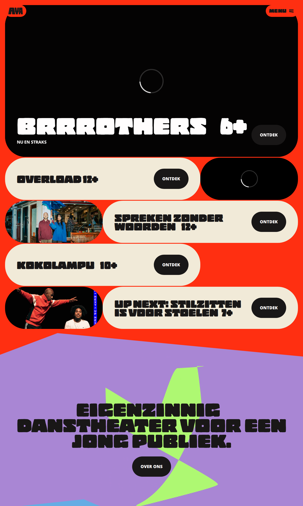
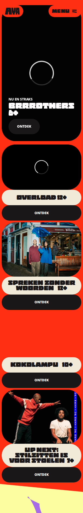

# UI Design System & Master Generation Blueprint: aya-nl

> **Danstheater AYA - eigenzinnige voorstellingen voor jong publiek** (https://aya.nl) — AYA voorstellingen voor kinderen en jongeren spelen in theaters en op scholen. Met een spannende mix van dans, spel, zang en livemuziek u...



---

## 1. Executive Visual Persona & Design Archetype

- **Brand Essence & Persona**: **Danstheater AYA - eigenzinnige voorstellingen voor jong publiek** (`https://aya.nl`). AYA voorstellingen voor kinderen en jongeren spelen in theaters en op scholen. Met een spannende mix van dans, spel, zang en livemuziek u...
- **Capture Provenance**: Live browser capture (`tier1_fast`, HTTP `200`, captured `2026-11-23`).
- **Visual Archetype**: **High-Contrast Obsidian / Atmospheric Design System (`#ff2f11` canvas, `#fffdfd` ink, `#0000ee` accent)**.
- **Anti-AI-Slop Differentiators**:
  - **Live-Computed Chromatic Polarity**: Anchors the viewport in `#ff2f11` (live computed `body` `background-color` (`computed_styles.json`)) paired with `#fffdfd` primary typography and `#0000ee` accents.
  - **Grounded Typographic Hierarchy**: Pairs `Copal Std Solid` for display copy (`BRRROTHERS 6+`) with `Copal Std Solid Placeholder` and `Fragment Mono`.
  - **Calibrated Spatial Grid & Motion**: Combines `1440px` container bounds (`gap: 4px`, padding `24px`) with `cubic-bezier(.44,0,.56,1)` easing and Framer Motion Layout Physics.

---

## 2. Spatial Architecture & Modular Grid Mathematics



### Viewport Allocation & Container Geometry
- **Captured Viewport Dimensions**: Desktop `1440×2400px` (`assets/desktop.png`, clamped at 2400px live multi-section capture), Mobile `390×2400px` (`assets/mobile.png`, clamped at 2400px live multi-section capture).
- **Master Container Bounds**: `1440px` (full-bleed `100%` desktop stage measured on `1440px` viewport).
- **Canvas Lateral Padding & Spacing**: `24px` lateral canvas padding with `4px` grid gap.
- **Border Radius Scale**: `400px`, `96px`, `8px`, `6px`.

### Responsive Breakpoint Architecture
- **Desktop Layout**: Multi-column CSS Grid / Flexbox layout at `1440px` (`max-width: 1440px`, `gap: 4px`).
- **Mobile Layout**: Single-column vertical stack at `390px` viewport width with `24px` horizontal padding.
- **Extracted CSS Media Queries**: `@media (min-width: 1440px)`, `@media (min-width: 810px) and (max-width: 1439.98px)`, `@media (max-width: 809.98px)`, `@media (max-width:1439px) and (min-width:810px)`.

---

## 3. Color System, Materiality & Atmospheric Lighting

### Semantic Palette & Source Grounding
| Semantic Role | Ground-Truth Value | Extracted Live / CSS Source |
|---|---|---|
| **Primary Canvas Substrate** | `#ff2f11` | live computed `body` `background-color` (`computed_styles.json`) |
| **Primary Typography Ink** | `#fffdfd` | live computed `h1` `color` (`computed_styles.json`) |
| **Elevated Surface / Card Substrate** | `#191717` | `-n7gQ8 .framer-styles-preset-zd... { background-color: #191717 }` |
| **Interactive Accent / Highlight** | `#0000ee` | live computed `a` `color` (`computed_styles.json`) |
| **Secondary / Muted Copy** | `#000000` | live computed `nav` `color` (`computed_styles.json`) |
| **Structural Hairline Border** | `#f02c10` | `var(--border-color)` in `:root` (`rgba(0, 0, 0, 0.06)`) |
| **Variable Token (`--token-663e5150-46d2-40b1-95af-592c05b7fae4`)** | `#f1ead8` | `var(--token-663e5150-46d2-40b1-95af-592c05b7fae4)` in `:root` |
| **Variable Token (`--token-0af63665-dda9-44b8-ad7f-2dd784961186`)** | `#948a8a` | `var(--token-0af63665-dda9-44b8-ad7f-2dd784961186)` in `:root` |
| **Variable Token (`--token-52487f1d-1e6b-4aed-b3c9-9be3b54f4138`)** | `#c3b5f9` | `var(--token-52487f1d-1e6b-4aed-b3c9-9be3b54f4138)` in `:root` |
| **Variable Token (`--token-3bf58b77-e2f0-4be9-9dc5-677a4ffe590d`)** | `#b185dc` | `var(--token-3bf58b77-e2f0-4be9-9dc5-677a4ffe590d)` in `:root` |
| **Variable Token (`--token-d2bc2ea8-f8c3-4125-b01e-8ddfab04ae3e`)** | `#9759de` | `var(--token-d2bc2ea8-f8c3-4125-b01e-8ddfab04ae3e)` in `:root` |
| **Variable Token (`--token-cdc1cd47-38f4-40aa-a3b4-638453d43e33`)** | `#740180` | `var(--token-cdc1cd47-38f4-40aa-a3b4-638453d43e33)` in `:root` |
| **Variable Token (`--token-7164b3b8-4b85-4deb-9335-cef9eefdbce4`)** | `#e4fc51` | `var(--token-7164b3b8-4b85-4deb-9335-cef9eefdbce4)` in `:root` |
| **Variable Token (`--token-fea6ee1e-8ef0-442e-a2a0-c12d9de040df`)** | `#6dfe1f` | `var(--token-fea6ee1e-8ef0-442e-a2a0-c12d9de040df)` in `:root` |
| **Variable Token (`--token-8916fd57-bc64-4336-8d71-cd1b8ea49a35`)** | `#79b18d` | `var(--token-8916fd57-bc64-4336-8d71-cd1b8ea49a35)` in `:root` |
| **Variable Token (`--token-dbf88913-7943-413d-87e4-f9ef23a07d87`)** | `#5a5e25` | `var(--token-dbf88913-7943-413d-87e4-f9ef23a07d87)` in `:root` |
| **Variable Token (`--token-ec796718-9e9b-44e7-9bfe-925cd88b05d8`)** | `#01a127` | `var(--token-ec796718-9e9b-44e7-9bfe-925cd88b05d8)` in `:root` |
| **Variable Token (`--token-6cd2dfce-0dc1-457b-ad40-6aff16787638`)** | `#2e5745` | `var(--token-6cd2dfce-0dc1-457b-ad40-6aff16787638)` in `:root` |
| **Variable Token (`--token-bde3f413-9fb1-4992-8a57-31caf08869e1`)** | `#eac4c8` | `var(--token-bde3f413-9fb1-4992-8a57-31caf08869e1)` in `:root` |

### Sanitized Root CSS Variables (`ui-ux.md` Ground Truth)
| Variable Name | Extracted Value | Semantic Role |
|---|---|---|
| `--token-721acf4f-d590-43e6-b5df-f984cd027c07` | `#191717` | Color / Atmospheric Token |
| `--token-62705c1f-74ca-4581-86e6-11f8a22c6ec9` | `#ff2f11` | Color / Atmospheric Token |
| `--token-663e5150-46d2-40b1-95af-592c05b7fae4` | `#f1ead8` | Color / Atmospheric Token |
| `--token-d7cd2efb-fc4c-4268-93d0-66c609851248` | `#fffdfd` | Color / Atmospheric Token |
| `--token-0af63665-dda9-44b8-ad7f-2dd784961186` | `#948a8a` | Color / Atmospheric Token |
| `--token-52487f1d-1e6b-4aed-b3c9-9be3b54f4138` | `#c3b5f9` | Color / Atmospheric Token |
| `--token-3bf58b77-e2f0-4be9-9dc5-677a4ffe590d` | `#b185dc` | Color / Atmospheric Token |
| `--token-d2bc2ea8-f8c3-4125-b01e-8ddfab04ae3e` | `#9759de` | Color / Atmospheric Token |
| `--token-cdc1cd47-38f4-40aa-a3b4-638453d43e33` | `#740180` | Color / Atmospheric Token |
| `--token-7164b3b8-4b85-4deb-9335-cef9eefdbce4` | `#e4fc51` | Color / Atmospheric Token |
| `--token-fea6ee1e-8ef0-442e-a2a0-c12d9de040df` | `#6dfe1f` | Color / Atmospheric Token |
| `--token-8916fd57-bc64-4336-8d71-cd1b8ea49a35` | `#79b18d` | Color / Atmospheric Token |
| `--token-dbf88913-7943-413d-87e4-f9ef23a07d87` | `#5a5e25` | Color / Atmospheric Token |
| `--token-ec796718-9e9b-44e7-9bfe-925cd88b05d8` | `#01a127` | Color / Atmospheric Token |
| `--token-6cd2dfce-0dc1-457b-ad40-6aff16787638` | `#2e5745` | Color / Atmospheric Token |
| `--token-bde3f413-9fb1-4992-8a57-31caf08869e1` | `#eac4c8` | Color / Atmospheric Token |

---

## 4. Typographic Scale & Editorial Hierarchy

### Font Family Stacks
- **Display Typography**: `Copal Std Solid`.
- **Primary Body Stack**: `Copal Std Solid Placeholder`.
- **Technical / Metadata Stack**: `Fragment Mono`.

### Typographic Scale & Rules (Live Computed & Stylesheet Grounded)
- **Hero Display (`H1`)**: live computed `h1` (`font-size: 104px`, `line-height: 93.6px`, `font-weight: 400`); rule `h1` (`font-size: 64px`, `line-height: 90%`, `letter-spacing: 0em`, `font-weight: 400`).
- **Section Heading (`H2`)**: live computed `h2` (`font-size: 82px`, `line-height: 73.8px`, `font-weight: 400`); rule `h2` (`font-size: 56px`, `line-height: 90%`, `letter-spacing: 0em`, `font-weight: 400`).
- **Body Copy**: live computed `body` (`font-size: 12px`, `line-height: normal`, `font-weight: 400`); rule `p` (`font-size: 18px`, `line-height: 140%`, `letter-spacing: -.01em`, `font-weight: 400`).
- **Metadata & Navigation Labels**: live computed `nav/a` (`font-size: 12px`, `line-height: normal`, `font-weight: 400`); CSS variables `--letter-spacing: var(--framer-letter-spacing)`.

---

## 5. Choreographed Motion & Interaction Physics

### Primary Easing Curves
- **Extracted Timing Functions**: `cubic-bezier(.44,0,.56,1)`.

### Per-Element Transition & Choreography Rules
- **Selector `r-styles-preset-126pksw.rich-text...`**: `transition: color .1s cubic-bezier(.44,0,.56,1)` extracted from `aya-nl` stylesheet.
- **Selector `#__framer-editorbar-label`**: `transition: opacity 0.4s ease-out` extracted from `aya-nl` stylesheet.
- **Extracted Easing Curve (`cubic-bezier(.44,0,.56,1)`)**: Governs interactive state transitions across `<header.framer-pbvui3>` and `<section.framer-NxIXs>`.
- **Runtime Interaction Engine**: Integrates Framer Motion Layout Physics with `prefers-reduced-motion: reduce` fallback guards.

---

## 6. Component Wireframe & Structural DOM Map

### Visual Layout Schematic — Desktop (`1440px`, Grounded in `dom.html` & Landmark Bounding Boxes)
```
┌────────────────────────────────────────────────────────────────────────┐
│ DESKTOP VIEWPORT (1440px) — Danstheater AYA - eigenzinnige voorstellin │
│ ====================================================================== │
│ [ <header.framer-pbvui3> (1440x54px)  | Agenda · Voorstellingen · Ed ] │
│ ---------------------------------------------------------------------- │
│ | HERO STAGE: <section.framer-Z9U3S> (w=1440px)                      | │
│ | H1: BRRROTHERS 6+                                                  | │
│ | Substrate: #ff2f11 | Ink: #fffdfd | Accent: #0000ee                | │
│ ---------------------------------------------------------------------- │
│ | SHOWCASE GRID (<section.framer-NxIXs>) max-w: 1440px               | │
│ | +------------------------------+  +------------------------------+ | │
│ | | Eigenzinnig danstheater voor |  | Spreken zonder woorden 12+ O | | │
│ | +------------------------------+  +------------------------------+ | │
│ ---------------------------------------------------------------------- │
│ | DETAIL MODULE (<section.framer-T1bJL>) — Kokolampu 10+ Ontdek      | │
│ ---------------------------------------------------------------------- │
│ [ FOOTER (<footer.framer-Ysu5g) | https://aya.nl                       │
└────────────────────────────────────────────────────────────────────────┘
```

### Visual Layout Schematic — Mobile Reflow (`390px`)
```
┌────────────────────────────────────────────────────────────────────────┐
│ MOBILE VIEWPORT REFLOW (390px) — Single-Column Stack (gap: 4px)        │
│ ====================================================================== │
│ [ HEADER BAR (<header.framer-pbvui3>  ) | Compact Menu (390px)         │
│ ---------------------------------------------------------------------- │
│ | HERO STAGE (<section.framer-Z9U3S>) — 390px Vertical Lead          | │
│ | H1: BRRROTHERS 6+                                                  | │
│ ---------------------------------------------------------------------- │
│ | SHOWCASE STACK (<section.framer-NxIXs>) — 1-Col Stack              | │
│ | [ Item 1: Eigenzinnig danstheater voor een jong publiek.         ] | │
│ | [ Item 2: Spreken zonder woorden 12+ Ontdek                      ] | │
│ ---------------------------------------------------------------------- │
│ | DETAIL STACK (<section.framer-T1bJL>) — 1-Col (Kokolampu 10+ Ontd) | │
│ ---------------------------------------------------------------------- │
│ [ FOOTER (<footer.framer-Ysu5g) | Stacked 390px Colophon               │
└────────────────────────────────────────────────────────────────────────┘
```

### Granular DOM Region Breakdown
1. **Brand Header & Navigation Bar (<header.framer-pbvui3> — `aya-nl`)**:
   - Landmark `<header class="framer-pbvui3">` (`1440x54px`) hosting `Danstheater AYA - eigenzinnige voors` navigation (`Agenda · Voorstellingen · Educatie · Over Aya · Nieuws`), DOM attributes (`data-framer-generated-canonical`, `data-framer-font-css`, `data-framer-breakpoint-css`, `data-framer-css-ssr-minified`), and stylesheet rule `font-face { font-family: "Copal Std Solid"; src: url("https://framerusercontent.com/... }`.
2. **Hero Stage & Focal Lead (<section.framer-Z9U3S> — `BRRROTHERS 6+`)**:
   - Landmark `<section class="framer-Z9U3S framer-cwJq3">` presenting display lead `BRRROTHERS 6+` and copy excerpt *"Overload 12+ Ontdek"* over `#ff2f11` canvas and `#fffdfd` ink.
3. **Primary Showcase & Content Grid (<section.framer-NxIXs> — `Eigenzinnig danstheater voor een j`)**:
   - Landmark `<section class="framer-NxIXs framer-X0WqL">` rendering section `Eigenzinnig danstheater voor een jong publiek.` with copy *"Spreken zonder woorden 12+ Ontdek"*, asset references (`Or12pwiuyAgiMvRWdQLIcZMcr0.svg`, `LLqEU4Zu3OKa98ycxXoQ6T8bHQ.png`, `476311956316258`, `fbevents.js`), and grid rule `.hidden-72rtr7 { display:none!important }`.
4. **Interactive Detail & Feature Matrix (<section.framer-T1bJL> — `Spreken zonder woorden 12+ Ontdek`)**:
   - Landmark `<section class="framer-T1bJL framer-X0WqL">` framing `Spreken zonder woorden 12+ Ontdek` and `Kokolampu 10+ Ontdek` (*"Kokolampu 10+ Ontdek"*) with `#191717` surface cards, `#0000ee` accents, and `.hidden-rjvtpu { display:none!important }`.
5. **Colophon & Global Directory Footer (<footer.framer-Ysu5g> — `https://aya.nl`)**:
   - Landmark `<footer class="framer-Ysu5g framer-QSpah">` anchoring `Danstheater AYA - eigenzinnige v` footer links (`Agenda · Voorstellingen · Educatie · Over Aya · Nieuws`), copy *"UP NEXT: Stilzitten is voor stoelen 7+ Ontdek"*, and `#f02c10` structural dividers.

---

## 7. Master Zero-Shot AI Generation Prompt

```markdown
# Master Zero-Shot Frontend Generation Prompt: aya-nl (Danstheater AYA - eigenzinnige voorstellingen voor jong publiek)

You are a principal frontend architect and design systems engineer. Build a complete, production-ready web application replicating the exact design system, DOM landmarks, typographic hierarchy, color tokens, and motion physics of `aya-nl` (**Danstheater AYA - eigenzinnige voorstellingen voor jong publiek** — `https://aya.nl`).

### 1. Visual Archetype & Anti-AI-Slop Mandates
- **Archetype**: High-Contrast Obsidian / Atmospheric Design System (`#ff2f11` canvas, `#fffdfd` ink, `#0000ee` accent).
- **Identity & Domain Context**: AYA voorstellingen voor kinderen en jongeren spelen in theaters en op scholen. Met een spannende mix van dans, spel, zang en livemuziek u...
- **Primary Substrate**: `#ff2f11` (live computed `body` `background-color` (`computed_styles.json`)), **Primary Ink**: `#fffdfd`, **Accent / Highlight**: `#0000ee`.
- **Site-Specific Differentiators**:
  - **Live-Computed Chromatic Polarity**: Anchors the viewport in `#ff2f11` (live computed `body` `background-color` (`computed_styles.json`)) paired with `#fffdfd` primary typography and `#0000ee` accents.
  - **Grounded Typographic Hierarchy**: Pairs `Copal Std Solid` for display copy (`BRRROTHERS 6+`) with `Copal Std Solid Placeholder` and `Fragment Mono`.
  - **Calibrated Spatial Grid & Motion**: Combines `1440px` container bounds (`gap: 4px`, padding `24px`) with `cubic-bezier(.44,0,.56,1)` easing and Framer Motion Layout Physics.

### 2. Ground-Truth CSS Variables (`:root` Token Contract)
Declare and consume these exact custom properties extracted from `aya-nl` in your global stylesheet:

:root {
  /* Danstheater AYA - eigenzinnige voorstellingen voor jong publiek (aya-nl) — Live-Grounded CSS Variables */
  --token-721acf4f-d590-43e6-b5df-f984cd027c07: #191717; /* Color / Atmospheric Token (aya-nl) */
  --token-62705c1f-74ca-4581-86e6-11f8a22c6ec9: #ff2f11; /* Color / Atmospheric Token (aya-nl) */
  --token-663e5150-46d2-40b1-95af-592c05b7fae4: #f1ead8; /* Color / Atmospheric Token (aya-nl) */
  --token-d7cd2efb-fc4c-4268-93d0-66c609851248: #fffdfd; /* Color / Atmospheric Token (aya-nl) */
  --token-0af63665-dda9-44b8-ad7f-2dd784961186: #948a8a; /* Color / Atmospheric Token (aya-nl) */
  --token-52487f1d-1e6b-4aed-b3c9-9be3b54f4138: #c3b5f9; /* Color / Atmospheric Token (aya-nl) */
  --token-3bf58b77-e2f0-4be9-9dc5-677a4ffe590d: #b185dc; /* Color / Atmospheric Token (aya-nl) */
  --token-d2bc2ea8-f8c3-4125-b01e-8ddfab04ae3e: #9759de; /* Color / Atmospheric Token (aya-nl) */
  --token-cdc1cd47-38f4-40aa-a3b4-638453d43e33: #740180; /* Color / Atmospheric Token (aya-nl) */
  --token-7164b3b8-4b85-4deb-9335-cef9eefdbce4: #e4fc51; /* Color / Atmospheric Token (aya-nl) */
  --token-fea6ee1e-8ef0-442e-a2a0-c12d9de040df: #6dfe1f; /* Color / Atmospheric Token (aya-nl) */
  --token-8916fd57-bc64-4336-8d71-cd1b8ea49a35: #79b18d; /* Color / Atmospheric Token (aya-nl) */
  --token-dbf88913-7943-413d-87e4-f9ef23a07d87: #5a5e25; /* Color / Atmospheric Token (aya-nl) */
  --token-ec796718-9e9b-44e7-9bfe-925cd88b05d8: #01a127; /* Color / Atmospheric Token (aya-nl) */
  --token-6cd2dfce-0dc1-457b-ad40-6aff16787638: #2e5745; /* Color / Atmospheric Token (aya-nl) */
  --token-bde3f413-9fb1-4992-8a57-31caf08869e1: #eac4c8; /* Color / Atmospheric Token (aya-nl) */
}

### 3. Semantic Color & Materiality Contract
Map every surface, ink, and border strictly to these source-grounded tokens:
- **Primary Canvas Substrate**: `#ff2f11` — grounded in live computed `body` `background-color` (`computed_styles.json`)
- **Primary Typography Ink**: `#fffdfd` — grounded in live computed `h1` `color` (`computed_styles.json`)
- **Elevated Surface / Card Substrate**: `#191717` — grounded in `-n7gQ8 .framer-styles-preset-zd... { background-color: #191717 }`
- **Interactive Accent / Highlight**: `#0000ee` — grounded in live computed `a` `color` (`computed_styles.json`)
- **Secondary / Muted Copy**: `#000000` — grounded in live computed `nav` `color` (`computed_styles.json`)
- **Structural Hairline Border**: `#f02c10` — grounded in `var(--border-color)` in `:root` (`rgba(0, 0, 0, 0.06)`)
- **Variable Token (`--token-663e5150-46d2-40b1-95af-592c05b7fae4`)**: `#f1ead8` — grounded in `var(--token-663e5150-46d2-40b1-95af-592c05b7fae4)` in `:root`
- **Variable Token (`--token-0af63665-dda9-44b8-ad7f-2dd784961186`)**: `#948a8a` — grounded in `var(--token-0af63665-dda9-44b8-ad7f-2dd784961186)` in `:root`
- **Variable Token (`--token-52487f1d-1e6b-4aed-b3c9-9be3b54f4138`)**: `#c3b5f9` — grounded in `var(--token-52487f1d-1e6b-4aed-b3c9-9be3b54f4138)` in `:root`
- **Variable Token (`--token-3bf58b77-e2f0-4be9-9dc5-677a4ffe590d`)**: `#b185dc` — grounded in `var(--token-3bf58b77-e2f0-4be9-9dc5-677a4ffe590d)` in `:root`
- **Variable Token (`--token-d2bc2ea8-f8c3-4125-b01e-8ddfab04ae3e`)**: `#9759de` — grounded in `var(--token-d2bc2ea8-f8c3-4125-b01e-8ddfab04ae3e)` in `:root`
- **Variable Token (`--token-cdc1cd47-38f4-40aa-a3b4-638453d43e33`)**: `#740180` — grounded in `var(--token-cdc1cd47-38f4-40aa-a3b4-638453d43e33)` in `:root`
- **Variable Token (`--token-7164b3b8-4b85-4deb-9335-cef9eefdbce4`)**: `#e4fc51` — grounded in `var(--token-7164b3b8-4b85-4deb-9335-cef9eefdbce4)` in `:root`
- **Variable Token (`--token-fea6ee1e-8ef0-442e-a2a0-c12d9de040df`)**: `#6dfe1f` — grounded in `var(--token-fea6ee1e-8ef0-442e-a2a0-c12d9de040df)` in `:root`
- **Variable Token (`--token-8916fd57-bc64-4336-8d71-cd1b8ea49a35`)**: `#79b18d` — grounded in `var(--token-8916fd57-bc64-4336-8d71-cd1b8ea49a35)` in `:root`
- **Variable Token (`--token-dbf88913-7943-413d-87e4-f9ef23a07d87`)**: `#5a5e25` — grounded in `var(--token-dbf88913-7943-413d-87e4-f9ef23a07d87)` in `:root`
- **Variable Token (`--token-ec796718-9e9b-44e7-9bfe-925cd88b05d8`)**: `#01a127` — grounded in `var(--token-ec796718-9e9b-44e7-9bfe-925cd88b05d8)` in `:root`
- **Variable Token (`--token-6cd2dfce-0dc1-457b-ad40-6aff16787638`)**: `#2e5745` — grounded in `var(--token-6cd2dfce-0dc1-457b-ad40-6aff16787638)` in `:root`
- **Variable Token (`--token-bde3f413-9fb1-4992-8a57-31caf08869e1`)**: `#eac4c8` — grounded in `var(--token-bde3f413-9fb1-4992-8a57-31caf08869e1)` in `:root`

### 4. Spatial Grid, Container Bounds & Responsive Breakpoints
- **Desktop Viewport Reference**: `1440×2400px` (clamped at 2400px live multi-section capture, `1440px` standard desktop width).
- **Mobile Viewport Reference**: `390×2400px` (clamped at 2400px live multi-section capture, `390px` standard mobile width).
- **Container Max-Width**: `1440px` (full-bleed `100%` desktop stage measured on `1440px` viewport)
- **Padding & Gutters**: `24px` lateral canvas padding with `4px` grid gap
- **Desktop Grid**: Multi-column CSS Grid / Flexbox layout at `1440px` (`max-width: 1440px`, `gap: 4px`)
- **Mobile Adaptation**: Single-column vertical stack at `390px` viewport width with `24px` horizontal padding
- **Media Queries**: `@media (min-width: 1440px)`, `@media (min-width: 810px) and (max-width: 1439.98px)`, `@media (max-width: 809.98px)`, `@media (max-width:1439px) and (min-width:810px)`
- **Corner Radii**: `400px`, `96px`, `8px`, `6px`

### 5. Typography & Editorial Scale Contract
- **Display Font Stack**: `Copal Std Solid`
- **Body Font Stack**: `Copal Std Solid Placeholder`
- **Monospace / Technical Font Stack**: `Fragment Mono`
- **H1 Display Rule**: live computed `h1` (`font-size: 104px`, `line-height: 93.6px`, `font-weight: 400`); rule `h1` (`font-size: 64px`, `line-height: 90%`, `letter-spacing: 0em`, `font-weight: 400`)
- **H2 Section Rule**: live computed `h2` (`font-size: 82px`, `line-height: 73.8px`, `font-weight: 400`); rule `h2` (`font-size: 56px`, `line-height: 90%`, `letter-spacing: 0em`, `font-weight: 400`)
- **Body Copy Rule**: live computed `body` (`font-size: 12px`, `line-height: normal`, `font-weight: 400`); rule `p` (`font-size: 18px`, `line-height: 140%`, `letter-spacing: -.01em`, `font-weight: 400`)
- **Metadata & Index Rule**: live computed `nav/a` (`font-size: 12px`, `line-height: normal`, `font-weight: 400`); CSS variables `--letter-spacing: var(--framer-letter-spacing)`

### 6. Component Hierarchy, Verbatim Copy & Real DOM Landmarks
Scaffold `aya-nl` (`Danstheater AYA - eigenzinnige voorstellingen voor jong publiek`) with these exact structural regions, extracted copy, and CSS rules from `dom.html`:
1. **Brand Header & Navigation Bar (<header.framer-pbvui3> — `aya-nl`)**:
   - DOM & Selectors: Landmark `<header class="framer-pbvui3">` (`1440x54px`) hosting `Danstheater AYA - eigenzinnige voors` navigation (`Agenda · Voorstellingen · Educatie · Over Aya · Nieuws`), DOM attributes (`data-framer-generated-canonical`, `data-framer-font-css`, `data-framer-breakpoint-css`, `data-framer-css-ssr-minified`), and stylesheet rule `font-face { font-family: "Copal Std Solid"; src: url("https://framerusercontent.com/... }`.
   - Responsive Contract: Header `Brand Header & Navigation Bar (<header.framer-pbvui3> — `aya-nl`)` (`aya-nl`) adapts across `@media (min-width: 1440px)`, `@media (min-width: 810px) and (max-width: 1439.98px)`, `@media (max-width: 809.98px)`, `@media (max-width:1439px) and (min-width:810px)` with `cubic-bezier(.44,0,.56,1)` transitions and links `Agenda · Voorstellingen · Educatie · Over Aya · Nieuws`.
2. **Hero Stage & Focal Lead (<section.framer-Z9U3S> — `BRRROTHERS 6+`)**:
   - DOM & Selectors: Landmark `<section class="framer-Z9U3S framer-cwJq3">` presenting display lead `BRRROTHERS 6+` and copy excerpt *"Overload 12+ Ontdek"* over `#ff2f11` canvas and `#fffdfd` ink.
   - Responsive Contract: Hero stage (`1440×2400px` desktop / `390×2400px` mobile) sets `#ff2f11` background with `#fffdfd` headline `BRRROTHERS 6+`.
3. **Primary Showcase & Content Grid (<section.framer-NxIXs> — `Eigenzinnig danstheater voor een j`)**:
   - DOM & Selectors: Landmark `<section class="framer-NxIXs framer-X0WqL">` rendering section `Eigenzinnig danstheater voor een jong publiek.` with copy *"Spreken zonder woorden 12+ Ontdek"*, asset references (`Or12pwiuyAgiMvRWdQLIcZMcr0.svg`, `LLqEU4Zu3OKa98ycxXoQ6T8bHQ.png`, `476311956316258`, `fbevents.js`), and grid rule `.hidden-72rtr7 { display:none!important }`.
   - Responsive Contract: Showcase grid `Primary Showcase & Content Grid (<section.framer-NxIXs> — `Eigenzinnig danstheater voor een j`)` applies Multi-column CSS Grid / Flexbox layout at `1440px` (`max-width: 1440px`, `gap: 4px`) on desktop and Single-column vertical stack at `390px` viewport width with `24px` horizontal padding on mobile.
4. **Interactive Detail & Feature Matrix (<section.framer-T1bJL> — `Spreken zonder woorden 12+ Ontdek`)**:
   - DOM & Selectors: Landmark `<section class="framer-T1bJL framer-X0WqL">` framing `Spreken zonder woorden 12+ Ontdek` and `Kokolampu 10+ Ontdek` (*"Kokolampu 10+ Ontdek"*) with `#191717` surface cards, `#0000ee` accents, and `.hidden-rjvtpu { display:none!important }`.
   - Responsive Contract: Detail module `Interactive Detail & Feature Matrix (<section.framer-T1bJL> — `Spreken zonder woorden 12+ Ontdek`)` uses `400px`, `96px`, `8px`, `6px` radii, `#0000ee` highlights, and assets (Or12pwiuyAgiMvRWdQLIcZMcr0.svg, LLqEU4Zu3OKa98ycxXoQ6T8bHQ.png, 476311956316258).
5. **Colophon & Global Directory Footer (<footer.framer-Ysu5g> — `https://aya.nl`)**:
   - DOM & Selectors: Landmark `<footer class="framer-Ysu5g framer-QSpah">` anchoring `Danstheater AYA - eigenzinnige v` footer links (`Agenda · Voorstellingen · Educatie · Over Aya · Nieuws`), copy *"UP NEXT: Stilzitten is voor stoelen 7+ Ontdek"*, and `#f02c10` structural dividers.
   - Responsive Contract: Footer `Colophon & Global Directory Footer (<footer.framer-Ysu5g> — `https://aya.nl`)` aligns to `1440px` (full-bleed `100%` desktop stage measured on `1440px` viewport) with `24px` lateral canvas padding with `4px` grid gap and attributes (data-framer-generated-canonical, data-framer-font-css, data-framer-breakpoint-css).

#### Verbatim DOM Copy Excerpts (`dom.html`)
- Copy Excerpt 1: *"Overload 12+ Ontdek"*
- Copy Excerpt 2: *"Spreken zonder woorden 12+ Ontdek"*
- Copy Excerpt 3: *"Kokolampu 10+ Ontdek"*
- Copy Excerpt 4: *"UP NEXT: Stilzitten is voor stoelen 7+ Ontdek"*

### 7. Motion, Extracted Stylesheet Rules & Interaction Choreography
- **Primary Easing Functions**: `cubic-bezier(.44,0,.56,1)`
- **Extracted Stylesheet Rules (`aya-nl`)**:
- `font-face { font-family: "Copal Std Solid"; src: url("https://framerusercontent.com/... }`
- `.hidden-72rtr7 { display:none!important }`
- `.hidden-rjvtpu { display:none!important }`
- `.hidden-1nhk5d5 { display:none!important }`
- `main { box-sizing:border-box;margin:0;padding:0 }`
- **Per-Selector Transition Rules**:
- **Selector `r-styles-preset-126pksw.rich-text...`**: `transition: color .1s cubic-bezier(.44,0,.56,1)` extracted from `aya-nl` stylesheet.
- **Selector `#__framer-editorbar-label`**: `transition: opacity 0.4s ease-out` extracted from `aya-nl` stylesheet.
- **Extracted Easing Curve (`cubic-bezier(.44,0,.56,1)`)**: Governs interactive state transitions across `<header.framer-pbvui3>` and `<section.framer-NxIXs>`.
- **Runtime Interaction Engine**: Integrates Framer Motion Layout Physics with `prefers-reduced-motion: reduce` fallback guards.

### 8. Technical Deliverables
- Implement in Next.js (App Router) with TypeScript and Tailwind CSS consuming the `:root` custom properties defined above for `aya-nl`.
- Reproduce both the `1440px` desktop architecture and `390px` mobile breakpoint transitions, preserving semantic HTML5 landmarks (`<header>`, `<nav>`, `<main>`, `<section>`, `<footer>`) and `prefers-reduced-motion` accessibility guards.
```
