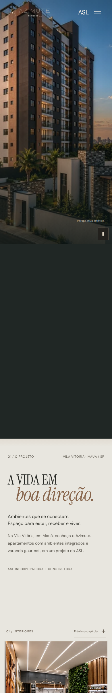

# UI Design System & Master Generation Blueprint: azimuteresidencial-com-br

> **Azimute — Seu próximo horizonte · ASL** (https://azimuteresidencial.com.br/) — Conheça o Residencial Azimute, da ASL, na Vila Vitória, em Mauá. Apartamentos de 63 e 67 m², com 2 dormitórios, 1 suíte e varanda gourmet.


---

## 1. Executive Visual Persona & Design Archetype

- **Brand Essence & Persona**: **Azimute — Seu próximo horizonte · ASL** (`https://azimuteresidencial.com.br/`). Conheça o Residencial Azimute, da ASL, na Vila Vitória, em Mauá. Apartamentos de 63 e 67 m², com 2 dormitórios, 1 suíte e varanda gourmet.
- **Capture Provenance**: Live browser capture (`tier1_fast`, HTTP `200`, captured `2026-11-23`).
- **Visual Archetype**: **High-Contrast Obsidian / Atmospheric Design System (`#202725` canvas, `#fff8ec` ink, `#f4d7af` accent)**.
- **Anti-AI-Slop Differentiators**:
  - **Live-Computed Chromatic Polarity**: Anchors the viewport in `#202725` (live computed `body` `background-color` (`computed_styles.json`)) paired with `#fff8ec` primary typography and `#f4d7af` accents.
  - **Grounded Typographic Hierarchy**: Pairs `Instrument Serif` for display copy (`SEU PRÓXIMO horizonte.`) with `DM Sans` and not declared in live computed styles (uses primary stack / `ui-monospace`).
  - **Calibrated Spatial Grid & Motion**: Combines `1500px` container bounds (`gap: 28.8px`, padding `90px`) with `cubic-bezier(.2,.55,.35,1)` easing and GSAP Timeline & ScrollTrigger.

---

## 2. Spatial Architecture & Modular Grid Mathematics



### Viewport Allocation & Container Geometry
- **Captured Viewport Dimensions**: Desktop `1440×2400px` (`assets/desktop.png`, clamped at 2400px live multi-section capture), Mobile `390×2400px` (`assets/mobile.png`, clamped at 2400px live multi-section capture).
- **Master Container Bounds**: `1500px` (non-`@media` desktop container stylesheet rule).
- **Canvas Lateral Padding & Spacing**: `90px` lateral canvas padding with `28.8px` grid gap.
- **Border Radius Scale**: `50%`.

### Responsive Breakpoint Architecture
- **Desktop Layout**: Multi-column CSS Grid / Flexbox layout at `1440px` (`max-width: 1500px`, `gap: 28.8px`).
- **Mobile Layout**: Single-column vertical stack at `390px` viewport width with `90px` horizontal padding.
- **Extracted CSS Media Queries**: `@media (min-width:2200px)`, `@media (max-width:1100px)`, `@media (max-width:700px)`, `@media (max-height:650px) and (min-width:701px)`.

---

## 3. Color System, Materiality & Atmospheric Lighting

### Semantic Palette & Source Grounding
| Semantic Role | Ground-Truth Value | Extracted Live / CSS Source |
|---|---|---|
| **Primary Canvas Substrate** | `#202725` | live computed `body` `background-color` (`computed_styles.json`) |
| **Primary Typography Ink** | `#fff8ec` | live computed `button` `color` (`computed_styles.json`) |
| **Elevated Surface / Card Substrate** | `#1f2623` | live computed `footer` `background-color` (`computed_styles.json`) |
| **Interactive Accent / Highlight** | `#f4d7af` | `photo-viewer__formats button:fo... { color: #f4d7af }` |
| **Secondary / Muted Copy** | `#68665e` | `var(--muted)` in `:root` |
| **Structural Hairline Border** | `#292e2a` | `var(--line)` in `:root` (`534d432d`) |
| **Variable Token (`--paper`)** | `#f3f0e9` | `var(--paper)` in `:root` |
| **Variable Token (`--ink`)** | `#262825` | `var(--ink)` in `:root` |
| **Variable Token (`--copper`)** | `#87654c` | `var(--copper)` in `:root` |
| **Variable Token (`--line`)** | `#534d43` | `var(--line)` in `:root` |
| **Variable Token (`--az-crystal-white`)** | `#f6f0e5` | `var(--az-crystal-white)` in `:root` |
| **Variable Token (`--az-crystal-bronze`)** | `#ccb494` | `var(--az-crystal-bronze)` in `:root` |
| **Variable Token (`--az-crystal-ink`)** | `#272925` | `var(--az-crystal-ink)` in `:root` |
| **Variable Token (`--journey-ink`)** | `#292b27` | `var(--journey-ink)` in `:root` |
| **Variable Token (`--journey-muted`)** | `#655b4f` | `var(--journey-muted)` in `:root` |
| **Variable Token (`--journey-line`)** | `#776958` | `var(--journey-line)` in `:root` |

### Sanitized Root CSS Variables (`ui-ux.md` Ground Truth)
| Variable Name | Extracted Value | Semantic Role |
|---|---|---|
| `--paper` | `#f3f0e9` | Canvas / Surface Token |
| `--ink` | `#262825` | Typography Ink Token |
| `--muted` | `#68665e` | Color / Atmospheric Token |
| `--copper` | `#87654c` | Color / Atmospheric Token |
| `--line` | `#534d432d` | Color / Atmospheric Token |
| `--gutter` | `6.25vw` | Layout / Spatial Grid Token |
| `--serif` | `'Instrument Serif',Georgia,serif` | Typography / Scale Token |
| `--sans` | `'DM Sans',Arial,sans-serif` | Typography / Scale Token |
| `--az-crystal-white` | `#f6f0e5` | Canvas / Surface Token |
| `--az-crystal-bronze` | `#ccb494` | Elevation / Border Token |
| `--az-crystal-ink` | `#272925` | Typography Ink Token |
| `--sculpture-expansion` | `0` | Design System Custom Token |
| `--journey-ink` | `#292b27` | Typography Ink Token |
| `--journey-muted` | `#655b4f` | Color / Atmospheric Token |
| `--journey-line` | `#77695840` | Color / Atmospheric Token |
| `--hero-presence` | `1` | Design System Custom Token |

---

## 4. Typographic Scale & Editorial Hierarchy

### Font Family Stacks
- **Display Typography**: `Instrument Serif`.
- **Primary Body Stack**: `DM Sans`.
- **Technical / Metadata Stack**: not declared in live computed styles (uses primary stack / `ui-monospace`).

### Typographic Scale & Rules (Live Computed & Stylesheet Grounded)
- **Hero Display (`H1`)**: live computed `h1` (`font-size: 141.12px`, `line-height: 132.653px`, `font-weight: 400`, `letter-spacing: -3.528px`); rule `h1` (`letter-spacing: -.025em`).
- **Section Heading (`H2`)**: live computed `h2` (`font-size: 144px`, `line-height: 129.6px`, `font-weight: 400`, `letter-spacing: -2.16px`); rule `h2` (`letter-spacing: -.045em`).
- **Body Copy**: live computed `body` (`font-size: 16px`, `line-height: normal`, `font-weight: 400`); rule `p` (`font-size: 1rem`, `line-height: 1.7`).
- **Metadata & Navigation Labels**: live computed `nav/a` (`font-size: 14px`, `line-height: normal`, `font-weight: 400`); rule `small` (`font-size: .875rem`).

---

## 5. Choreographed Motion & Interaction Physics

### Primary Easing Curves
- **Extracted Timing Functions**: `cubic-bezier(.2,.55,.35,1)`, `cubic-bezier(.2,.7,.2,1)`.

### Per-Element Transition & Choreography Rules
- **Selector `.header`**: `transition: background .35s,padding .35s` extracted from `azimuteresidencial-com-br` stylesheet.
- **Selector `.nav a:after`**: `transition: transform .25s` extracted from `azimuteresidencial-com-br` stylesheet.
- **Selector `.menu-toggle span`**: `transition: transform .3s` extracted from `azimuteresidencial-com-br` stylesheet.
- **Extracted Easing Curve (`cubic-bezier(.2,.55,.35,1)`)**: Governs interactive state transitions across `<header.header>` and `<section.project>`.
- **Runtime Interaction Engine**: Integrates GSAP Timeline & ScrollTrigger with `prefers-reduced-motion: reduce` fallback guards.

---

## 6. Component Wireframe & Structural DOM Map

### Visual Layout Schematic — Desktop (`1440px`, Grounded in `dom.html` & Landmark Bounding Boxes)
```
┌────────────────────────────────────────────────────────────────────────┐
│ DESKTOP VIEWPORT (1440px) — Azimute — Seu próximo horizonte · ASL      │
│ ====================================================================== │
│ [ <header.header> (1440x107px)        | O projeto · Perspectiva · Es ] │
│ ---------------------------------------------------------------------- │
│ | HERO STAGE: <section.hero> (w=1440px)                              | │
│ | H1: SEU PRÓXIMO horizonte.                                         | │
│ | Substrate: #202725 | Ink: #fff8ec | Accent: #f4d7af                | │
│ ---------------------------------------------------------------------- │
│ | SHOWCASE GRID (<section.project>) max-w: 1500px                    | │
│ | +------------------------------+  +------------------------------+ | │
│ | | A VIDA EM boa direção.       |  | Ambientes que se conectam    | | │
│ | +------------------------------+  +------------------------------+ | │
│ ---------------------------------------------------------------------- │
│ | DETAIL MODULE (<section.architecture-chap) — Uma nova perspectiva. | │
│ ---------------------------------------------------------------------- │
│ [ FOOTER (<footer.footer>     ) | https://azimuteresidencial.com.br/   │
└────────────────────────────────────────────────────────────────────────┘
```

### Visual Layout Schematic — Mobile Reflow (`390px`)
```
┌────────────────────────────────────────────────────────────────────────┐
│ MOBILE VIEWPORT REFLOW (390px) — Single-Column Stack (gap: 28.8px)     │
│ ====================================================================== │
│ [ HEADER BAR (<header.header>         ) | Compact Menu (390px)         │
│ ---------------------------------------------------------------------- │
│ | HERO STAGE (<section.hero>) — 390px Vertical Lead                  | │
│ | H1: SEU PRÓXIMO horizonte.                                         | │
│ ---------------------------------------------------------------------- │
│ | SHOWCASE STACK (<section.project>) — 1-Col Stack                   | │
│ | [ Item 1: A VIDA EM boa direção.                                 ] | │
│ | [ Item 2: Ambientes que se conectam                              ] | │
│ ---------------------------------------------------------------------- │
│ | DETAIL STACK (<section.architecture-ch) — 1-Col (Uma nova perspecti) │
│ ---------------------------------------------------------------------- │
│ [ FOOTER (<footer.footer>     ) | Stacked 390px Colophon               │
└────────────────────────────────────────────────────────────────────────┘
```

### Granular DOM Region Breakdown
1. **Brand Header & Navigation Bar (<header.header> — `azimuteresidencial-com-br`)**:
   - Landmark `<header class="header">` (`1440x107px`) hosting `Azimute — Seu próximo horizonte · AS` navigation (`O projeto · Perspectiva · Essência · Residências · Espaços`), DOM attributes (`data-atmosphere-bound="true"`, `data-svg-origin="44 56"`, `data-active-index="0"`, `data-scroll-start="2170"`), and stylesheet rule `font-face { font-family:Marcellus;src:url(assets/fonts/marcellus.ttf) format('truety... }`.
2. **Hero Stage & Focal Lead (<section.hero> — `SEU PRÓXIMO horizonte.`)**:
   - Landmark `<section class="hero">` presenting display lead `SEU PRÓXIMO horizonte.` and copy excerpt *"VILA VITÓRIA · MAUÁ"* over `#202725` canvas and `#fff8ec` ink.
3. **Primary Showcase & Content Grid (<section.project> — `A VIDA EM boa direção.`)**:
   - Landmark `<section class="project">` rendering section `A VIDA EM boa direção.` with copy *"Uma nova direção para morar. Um empreendimento ASL."*, asset references (`azimute-symbol-crystal.svg`, `instrument-serif.ttf`, `fachada-azimute-1920.webp`, `azimute.css`), and grid rule `body { margin:0;overflow-x:clip }`.
4. **Interactive Detail & Feature Matrix (<section.architecture-chapter> — `Ambientes que se conectam`)**:
   - Landmark `<section class="architecture-chapter cinema-tour">` framing `Ambientes que se conectam` and `Uma nova perspectiva.` (*"UMA NOVA DIREÇÃO PARA MORAR"*) with `#1f2623` surface cards, `#f4d7af` accents, and `button { font:inherit;cursor:pointer }`.
5. **Colophon & Global Directory Footer (<footer.footer> — `https://azimuteresidencial.com.br/`)**:
   - Landmark `<footer class="footer section-wrap">` anchoring `Azimute — Seu próximo horizonte ` footer links (`O projeto · Perspectiva · Essência · Residências · Espaços`), copy *"VILA VITÓRIA · MAUÁ / SP"*, and `#292e2a` structural dividers.

---

## 7. Master Zero-Shot AI Generation Prompt

```markdown
# Master Zero-Shot Frontend Generation Prompt: azimuteresidencial-com-br (Azimute — Seu próximo horizonte · ASL)

You are a principal frontend architect and design systems engineer. Build a complete, production-ready web application replicating the exact design system, DOM landmarks, typographic hierarchy, color tokens, and motion physics of `azimuteresidencial-com-br` (**Azimute — Seu próximo horizonte · ASL** — `https://azimuteresidencial.com.br/`).

### 1. Visual Archetype & Anti-AI-Slop Mandates
- **Archetype**: High-Contrast Obsidian / Atmospheric Design System (`#202725` canvas, `#fff8ec` ink, `#f4d7af` accent).
- **Identity & Domain Context**: Conheça o Residencial Azimute, da ASL, na Vila Vitória, em Mauá. Apartamentos de 63 e 67 m², com 2 dormitórios, 1 suíte e varanda gourmet.
- **Primary Substrate**: `#202725` (live computed `body` `background-color` (`computed_styles.json`)), **Primary Ink**: `#fff8ec`, **Accent / Highlight**: `#f4d7af`.
- **Site-Specific Differentiators**:
  - **Live-Computed Chromatic Polarity**: Anchors the viewport in `#202725` (live computed `body` `background-color` (`computed_styles.json`)) paired with `#fff8ec` primary typography and `#f4d7af` accents.
  - **Grounded Typographic Hierarchy**: Pairs `Instrument Serif` for display copy (`SEU PRÓXIMO horizonte.`) with `DM Sans` and not declared in live computed styles (uses primary stack / `ui-monospace`).
  - **Calibrated Spatial Grid & Motion**: Combines `1500px` container bounds (`gap: 28.8px`, padding `90px`) with `cubic-bezier(.2,.55,.35,1)` easing and GSAP Timeline & ScrollTrigger.

### 2. Ground-Truth CSS Variables (`:root` Token Contract)
Declare and consume these exact custom properties extracted from `azimuteresidencial-com-br` in your global stylesheet:

:root {
  /* Azimute — Seu próximo horizonte · ASL (azimuteresidencial-com-br) — Live-Grounded CSS Variables */
  --paper: #f3f0e9; /* Canvas / Surface Token (azimuteresidencial-com-br) */
  --ink: #262825; /* Typography Ink Token (azimuteresidencial-com-br) */
  --muted: #68665e; /* Color / Atmospheric Token (azimuteresidencial-com-br) */
  --copper: #87654c; /* Color / Atmospheric Token (azimuteresidencial-com-br) */
  --line: #534d432d; /* Color / Atmospheric Token (azimuteresidencial-com-br) */
  --gutter: 6.25vw; /* Layout / Spatial Grid Token (azimuteresidencial-com-br) */
  --serif: 'Instrument Serif',Georgia,serif; /* Typography / Scale Token (azimuteresidencial-com-br) */
  --sans: 'DM Sans',Arial,sans-serif; /* Typography / Scale Token (azimuteresidencial-com-br) */
  --az-crystal-white: #f6f0e5; /* Canvas / Surface Token (azimuteresidencial-com-br) */
  --az-crystal-bronze: #ccb494; /* Elevation / Border Token (azimuteresidencial-com-br) */
  --az-crystal-ink: #272925; /* Typography Ink Token (azimuteresidencial-com-br) */
  --sculpture-expansion: 0; /* Design System Custom Token (azimuteresidencial-com-br) */
  --journey-ink: #292b27; /* Typography Ink Token (azimuteresidencial-com-br) */
  --journey-muted: #655b4f; /* Color / Atmospheric Token (azimuteresidencial-com-br) */
  --journey-line: #77695840; /* Color / Atmospheric Token (azimuteresidencial-com-br) */
  --hero-presence: 1; /* Design System Custom Token (azimuteresidencial-com-br) */
}

### 3. Semantic Color & Materiality Contract
Map every surface, ink, and border strictly to these source-grounded tokens:
- **Primary Canvas Substrate**: `#202725` — grounded in live computed `body` `background-color` (`computed_styles.json`)
- **Primary Typography Ink**: `#fff8ec` — grounded in live computed `button` `color` (`computed_styles.json`)
- **Elevated Surface / Card Substrate**: `#1f2623` — grounded in live computed `footer` `background-color` (`computed_styles.json`)
- **Interactive Accent / Highlight**: `#f4d7af` — grounded in `photo-viewer__formats button:fo... { color: #f4d7af }`
- **Secondary / Muted Copy**: `#68665e` — grounded in `var(--muted)` in `:root`
- **Structural Hairline Border**: `#292e2a` — grounded in `var(--line)` in `:root` (`534d432d`)
- **Variable Token (`--paper`)**: `#f3f0e9` — grounded in `var(--paper)` in `:root`
- **Variable Token (`--ink`)**: `#262825` — grounded in `var(--ink)` in `:root`
- **Variable Token (`--copper`)**: `#87654c` — grounded in `var(--copper)` in `:root`
- **Variable Token (`--line`)**: `#534d43` — grounded in `var(--line)` in `:root`
- **Variable Token (`--az-crystal-white`)**: `#f6f0e5` — grounded in `var(--az-crystal-white)` in `:root`
- **Variable Token (`--az-crystal-bronze`)**: `#ccb494` — grounded in `var(--az-crystal-bronze)` in `:root`
- **Variable Token (`--az-crystal-ink`)**: `#272925` — grounded in `var(--az-crystal-ink)` in `:root`
- **Variable Token (`--journey-ink`)**: `#292b27` — grounded in `var(--journey-ink)` in `:root`
- **Variable Token (`--journey-muted`)**: `#655b4f` — grounded in `var(--journey-muted)` in `:root`
- **Variable Token (`--journey-line`)**: `#776958` — grounded in `var(--journey-line)` in `:root`

### 4. Spatial Grid, Container Bounds & Responsive Breakpoints
- **Desktop Viewport Reference**: `1440×2400px` (clamped at 2400px live multi-section capture, `1440px` standard desktop width).
- **Mobile Viewport Reference**: `390×2400px` (clamped at 2400px live multi-section capture, `390px` standard mobile width).
- **Container Max-Width**: `1500px` (non-`@media` desktop container stylesheet rule)
- **Padding & Gutters**: `90px` lateral canvas padding with `28.8px` grid gap
- **Desktop Grid**: Multi-column CSS Grid / Flexbox layout at `1440px` (`max-width: 1500px`, `gap: 28.8px`)
- **Mobile Adaptation**: Single-column vertical stack at `390px` viewport width with `90px` horizontal padding
- **Media Queries**: `@media (min-width:2200px)`, `@media (max-width:1100px)`, `@media (max-width:700px)`, `@media (max-height:650px) and (min-width:701px)`
- **Corner Radii**: `50%`

### 5. Typography & Editorial Scale Contract
- **Display Font Stack**: `Instrument Serif`
- **Body Font Stack**: `DM Sans`
- **Monospace / Technical Font Stack**: not declared in live computed styles (uses primary stack / `ui-monospace`)
- **H1 Display Rule**: live computed `h1` (`font-size: 141.12px`, `line-height: 132.653px`, `font-weight: 400`, `letter-spacing: -3.528px`); rule `h1` (`letter-spacing: -.025em`)
- **H2 Section Rule**: live computed `h2` (`font-size: 144px`, `line-height: 129.6px`, `font-weight: 400`, `letter-spacing: -2.16px`); rule `h2` (`letter-spacing: -.045em`)
- **Body Copy Rule**: live computed `body` (`font-size: 16px`, `line-height: normal`, `font-weight: 400`); rule `p` (`font-size: 1rem`, `line-height: 1.7`)
- **Metadata & Index Rule**: live computed `nav/a` (`font-size: 14px`, `line-height: normal`, `font-weight: 400`); rule `small` (`font-size: .875rem`)

### 6. Component Hierarchy, Verbatim Copy & Real DOM Landmarks
Scaffold `azimuteresidencial-com-br` (`Azimute — Seu próximo horizonte · ASL`) with these exact structural regions, extracted copy, and CSS rules from `dom.html`:
1. **Brand Header & Navigation Bar (<header.header> — `azimuteresidencial-com-br`)**:
   - DOM & Selectors: Landmark `<header class="header">` (`1440x107px`) hosting `Azimute — Seu próximo horizonte · AS` navigation (`O projeto · Perspectiva · Essência · Residências · Espaços`), DOM attributes (`data-atmosphere-bound="true"`, `data-svg-origin="44 56"`, `data-active-index="0"`, `data-scroll-start="2170"`), and stylesheet rule `font-face { font-family:Marcellus;src:url(assets/fonts/marcellus.ttf) format('truety... }`.
   - Responsive Contract: Header `Brand Header & Navigation Bar (<header.header> — `azimuteresidencial-com-br`)` (`azimuteresidencial-com-br`) adapts across `@media (min-width:2200px)`, `@media (max-width:1100px)`, `@media (max-width:700px)`, `@media (max-height:650px) and (min-width:701px)` with `cubic-bezier(.2,.55,.35,1)`, `cubic-bezier(.2,.7,.2,1)` transitions and links `O projeto · Perspectiva · Essência · Residências · Espaços`.
2. **Hero Stage & Focal Lead (<section.hero> — `SEU PRÓXIMO horizonte.`)**:
   - DOM & Selectors: Landmark `<section class="hero">` presenting display lead `SEU PRÓXIMO horizonte.` and copy excerpt *"VILA VITÓRIA · MAUÁ"* over `#202725` canvas and `#fff8ec` ink.
   - Responsive Contract: Hero stage (`1440×2400px` desktop / `390×2400px` mobile) sets `#202725` background with `#fff8ec` headline `SEU PRÓXIMO horizonte.`.
3. **Primary Showcase & Content Grid (<section.project> — `A VIDA EM boa direção.`)**:
   - DOM & Selectors: Landmark `<section class="project">` rendering section `A VIDA EM boa direção.` with copy *"Uma nova direção para morar. Um empreendimento ASL."*, asset references (`azimute-symbol-crystal.svg`, `instrument-serif.ttf`, `fachada-azimute-1920.webp`, `azimute.css`), and grid rule `body { margin:0;overflow-x:clip }`.
   - Responsive Contract: Showcase grid `Primary Showcase & Content Grid (<section.project> — `A VIDA EM boa direção.`)` applies Multi-column CSS Grid / Flexbox layout at `1440px` (`max-width: 1500px`, `gap: 28.8px`) on desktop and Single-column vertical stack at `390px` viewport width with `90px` horizontal padding on mobile.
4. **Interactive Detail & Feature Matrix (<section.architecture-chapter> — `Ambientes que se conectam`)**:
   - DOM & Selectors: Landmark `<section class="architecture-chapter cinema-tour">` framing `Ambientes que se conectam` and `Uma nova perspectiva.` (*"UMA NOVA DIREÇÃO PARA MORAR"*) with `#1f2623` surface cards, `#f4d7af` accents, and `button { font:inherit;cursor:pointer }`.
   - Responsive Contract: Detail module `Interactive Detail & Feature Matrix (<section.architecture-chapter> — `Ambientes que se conectam`)` uses `50%` radii, `#f4d7af` highlights, and assets (azimute-symbol-crystal.svg, instrument-serif.ttf, fachada-azimute-1920.webp).
5. **Colophon & Global Directory Footer (<footer.footer> — `https://azimuteresidencial.com.br/`)**:
   - DOM & Selectors: Landmark `<footer class="footer section-wrap">` anchoring `Azimute — Seu próximo horizonte ` footer links (`O projeto · Perspectiva · Essência · Residências · Espaços`), copy *"VILA VITÓRIA · MAUÁ / SP"*, and `#292e2a` structural dividers.
   - Responsive Contract: Footer `Colophon & Global Directory Footer (<footer.footer> — `https://azimuteresidencial.com.br/`)` aligns to `1500px` (non-`@media` desktop container stylesheet rule) with `90px` lateral canvas padding with `28.8px` grid gap and attributes (data-atmosphere-bound="true", data-svg-origin="44 56", data-active-index="0").

#### Verbatim DOM Copy Excerpts (`dom.html`)
- Copy Excerpt 1: *"VILA VITÓRIA · MAUÁ"*
- Copy Excerpt 2: *"Uma nova direção para morar. Um empreendimento ASL."*
- Copy Excerpt 3: *"UMA NOVA DIREÇÃO PARA MORAR"*
- Copy Excerpt 4: *"VILA VITÓRIA · MAUÁ / SP"*

### 7. Motion, Extracted Stylesheet Rules & Interaction Choreography
- **Primary Easing Functions**: `cubic-bezier(.2,.55,.35,1)`, `cubic-bezier(.2,.7,.2,1)`
- **Extracted Stylesheet Rules (`azimuteresidencial-com-br`)**:
- `font-face { font-family:Marcellus;src:url(assets/fonts/marcellus.ttf) format('truety... }`
- `body { margin:0;overflow-x:clip }`
- `button { font:inherit;cursor:pointer }`
- `img { max-width:100%;display:block }`
- `a:focus-visible { outline:2px solid c5a78a;outline-offset:7px }`
- **Per-Selector Transition Rules**:
- **Selector `.header`**: `transition: background .35s,padding .35s` extracted from `azimuteresidencial-com-br` stylesheet.
- **Selector `.nav a:after`**: `transition: transform .25s` extracted from `azimuteresidencial-com-br` stylesheet.
- **Selector `.menu-toggle span`**: `transition: transform .3s` extracted from `azimuteresidencial-com-br` stylesheet.
- **Extracted Easing Curve (`cubic-bezier(.2,.55,.35,1)`)**: Governs interactive state transitions across `<header.header>` and `<section.project>`.
- **Runtime Interaction Engine**: Integrates GSAP Timeline & ScrollTrigger with `prefers-reduced-motion: reduce` fallback guards.

### 8. Technical Deliverables
- Implement in Next.js (App Router) with TypeScript and Tailwind CSS consuming the `:root` custom properties defined above for `azimuteresidencial-com-br`.
- Reproduce both the `1440px` desktop architecture and `390px` mobile breakpoint transitions, preserving semantic HTML5 landmarks (`<header>`, `<nav>`, `<main>`, `<section>`, `<footer>`) and `prefers-reduced-motion` accessibility guards.
```
