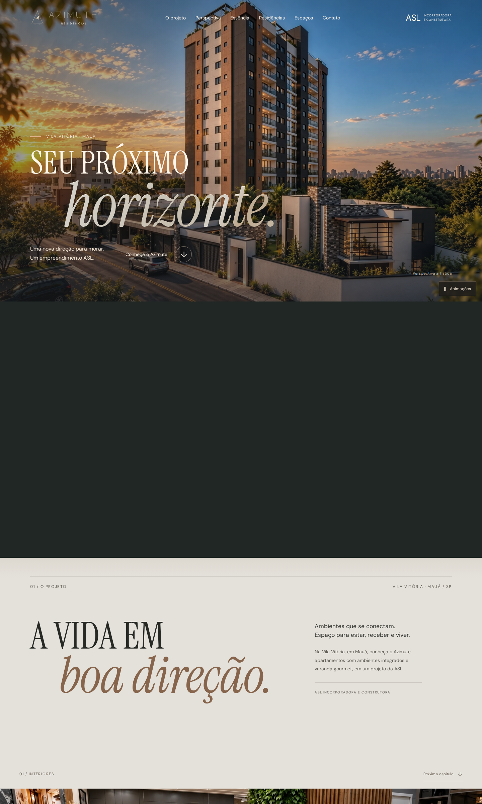

# UI Design System & Master Generation Blueprint: azimuteresidencial-com-br

> **Azimute — Seu próximo horizonte · ASL** (https://azimuteresidencial.com.br/) — Conheça o Residencial Azimute, da ASL, na Vila Vitória, em Mauá. Apartamentos de 63 e 67 m², com 2 dormitórios, 1 suíte e varanda gourmet.



---

## 1. Executive Visual Persona & Design Archetype

- **Brand Essence & Persona**: **Azimute — Seu próximo horizonte · ASL** (`https://azimuteresidencial.com.br/`). Conheça o Residencial Azimute, da ASL, na Vila Vitória, em Mauá. Apartamentos de 63 e 67 m², com 2 dormitórios, 1 suíte e varanda gourmet.
- **Visual Archetype**: **High-Contrast Obsidian / Atmospheric Design System (`#625e55` canvas, `#f6f0e5` ink, `#ccb494` accent)**.
- **Anti-AI-Slop Differentiators**:
  - **Source-Grounded Chromatic Polarity**: Anchors the viewport in `#625e55` (`var(--muted)` in `:root`) paired with `#f6f0e5` primary typography and `#ccb494` accents.
  - **Extracted Typographic Hierarchy**: Pairs `Instrument Serif` for display copy (`SEU PRÓXIMO horizonte.`) with `Marcellus` and not declared in static CSS (uses primary stack / `ui-monospace`).
  - **Calibrated Spatial Grid & Motion**: Combines `700px` container bounds (`gap: 18px`, padding `40px`) with `cubic-bezier(.2,.55,.35,1)` easing and GSAP Timeline & ScrollTrigger.

---

## 2. Spatial Architecture & Modular Grid Mathematics


### Viewport Allocation & Container Geometry
- **Captured Viewport Dimensions**: Desktop `1440×29619px` (`assets/desktop.png`, full-page scroll capture), Mobile `390×2400px` (`assets/mobile.png`, capped at 2400px multi-section capture).
- **Master Container Bounds**: `700px` extracted from `azimuteresidencial-com-br` stylesheet.
- **Canvas Lateral Padding & Spacing**: `40px` lateral canvas padding with `18px` grid gap.
- **Border Radius Scale**: `50%`.

### Responsive Breakpoint Architecture
- **Desktop Layout**: Multi-column CSS Grid / Flexbox layout at `1440px` (`max-width: 700px`, `gap: 18px`).
- **Mobile Layout**: Single-column vertical stack at `390px` viewport width with `40px` horizontal padding.
- **Extracted CSS Media Queries**: `@media (max-width:700px)`, `@media (prefers-reduced-motion:reduce)`, `@media (prefers-reduced-motion: reduce)`, `@media (min-width:1800px)`.

---

## 3. Color System, Materiality & Atmospheric Lighting

### Semantic Palette & Source Grounding
| Semantic Role | Ground-Truth Value | Extracted CSS Source / Selector |
|---|---|---|
| **Primary Canvas Substrate** | `#625e55` | `var(--muted)` in `:root` |
| **Primary Typography Ink** | `#79573f` | `var(--copper)` in `:root` |
| **Elevated Surface / Card Substrate** | `#f6f0e5` | `var(--az-crystal-white)` in `:root` |
| **Interactive Accent / Highlight** | `#ccb494` | `var(--az-crystal-bronze)` in `:root` |
| **Secondary / Muted Copy** | `#272925` | `var(--az-crystal-ink)` in `:root` |
| **Structural Hairline Border** | `#292b27` | `var(--journey-ink)` in `:root` |
| **Variable Token (`--line`)** | `#534d432d` | `var(--line)` in `:root` |
| **Variable Token (`--journey-muted`)** | `#655b4f` | `var(--journey-muted)` in `:root` |
| **Variable Token (`--journey-line`)** | `#77695840` | `var(--journey-line)` in `:root` |
| **Variable Token (`--paper`)** | `#f3f0e9` | `var(--paper)` in `:root` |
| **Variable Token (`--ink`)** | `#262825` | `var(--ink)` in `:root` |

### Sanitized Root CSS Variables (`ui-ux.md` Ground Truth)
| Variable Name | Extracted Value | Semantic Role |
|---|---|---|
| `--muted` | `#625e55` | Color / Atmospheric Token |
| `--copper` | `#79573f` | Color / Atmospheric Token |
| `--line` | `#534d432d` | Color / Atmospheric Token |
| `--az-crystal-white` | `#f6f0e5` | Canvas / Surface Token |
| `--az-crystal-bronze` | `#ccb494` | Elevation / Border Token |
| `--az-crystal-ink` | `#272925` | Typography Ink Token |
| `--journey-ink` | `#292b27` | Typography Ink Token |
| `--journey-muted` | `#655b4f` | Color / Atmospheric Token |
| `--journey-line` | `#77695840` | Color / Atmospheric Token |
| `--sculpture-expansion` | `0` | Design System Custom Token |
| `--paper` | `#f3f0e9` | Canvas / Surface Token |
| `--ink` | `#262825` | Typography Ink Token |
| `--gutter` | `6.25vw` | Layout / Spatial Grid Token |
| `--serif` | `'Instrument Serif',Georgia,serif` | Typography / Scale Token |
| `--sans` | `'DM Sans',Arial,sans-serif` | Typography / Scale Token |
| `--hero-presence` | `1` | Design System Custom Token |

---

## 4. Typographic Scale & Editorial Hierarchy

### Font Family Stacks
- **Display Typography**: `Instrument Serif`.
- **Primary Body Stack**: `Marcellus`.
- **Technical / Metadata Stack**: not declared in static CSS (uses primary stack / `ui-monospace`).

### Typographic Scale & Rules (Extracted from Stylesheet & Variables)
- **Hero Display (`H1`)**: rule `h1` (`letter-spacing: -.025em`).
- **Section Heading (`H2`)**: rule `h2` (`font-size: clamp(62px,7.4vw,118px)`, `line-height: .94`, `letter-spacing: -.045em`, `font-weight: 400`).
- **Body Copy**: rule `p` (`font-size: 15px`, `line-height: 1.75`).
- **Metadata & Navigation Labels**: rule `small` (`font-size: .875rem`).

---

## 5. Choreographed Motion & Interaction Physics

### Primary Easing Curves
- **Extracted Timing Functions**: `cubic-bezier(.2,.55,.35,1)`, `cubic-bezier(.2,.7,.2,1)`.

### Per-Element Transition & Choreography Rules
- **Selector `.essence-switcher button`**: `transition: color .3s,background .3s` extracted from `azimuteresidencial-com-br` stylesheet.
- **Selector `.essence-switcher button:after`**: `transition: transform .5s cubic-bezier(.2,.55,.35,1)` extracted from `azimuteresidencial-com-br` stylesheet.
- **Selector `media(prefers-reduced-motion:reduce)`**: `transition: none` extracted from `azimuteresidencial-com-br` stylesheet.
- **Extracted Easing Curve (`cubic-bezier(.2,.55,.35,1)`)**: Governs interactive state transitions across `<header.header>` and `<section.project>`.
- **Runtime Interaction Engine**: Integrates GSAP Timeline & ScrollTrigger with `prefers-reduced-motion: reduce` fallback guards.

---

## 6. Component Wireframe & Structural DOM Map

### Visual Layout Schematic (Grounded in `dom.html` — `1440px` Desktop & `390px` Mobile Reflow)
```
┌────────────────────────────────────────────────────────────────────────┐
│ DESKTOP VIEWPORT (1440px) — Azimute — Seu próximo horizonte · ASL      │
│ ====================================================================== │
│ [ <header.header>          | O projeto · Perspectiva · Essência · R ]  │
│ ---------------------------------------------------------------------- │
│ | HERO STAGE: <section.hero>                                       |   │
│ | H1: SEU PRÓXIMO horizonte.                                       |   │
│ | Substrate: #625e55    | Ink: #f6f0e5    | Accent: #ccb494        |   │
│ ---------------------------------------------------------------------- │
│ | SHOWCASE GRID (<section.project>         ) max-w: 700px          |   │
│ | +------------------------------+  +------------------------------+ | │
│ | | A VIDA EM boa direção.       |  | Ambientes que se conectam    | | │
│ | +------------------------------+  +------------------------------+ | │
│ ---------------------------------------------------------------------- │
│ | MOBILE VIEWPORT REFLOW (390px) — Single-Column Stack (gap: 18px  ) | │
│ | [<header.header>] -> [<section.hero>] -> [<section.project>] |       │
│ ---------------------------------------------------------------------- │
│ [ FOOTER (<footer.footer>       ) | https://azimuteresidencial.com.br/ │
└────────────────────────────────────────────────────────────────────────┘
```

### Granular DOM Region Breakdown
1. **Brand Header & Navigation Bar (<header.header> — `azimuteresidencial-com-br`)**:
   - Landmark `<header class="header">` hosting `Azimute — Seu próximo horizonte · AS` navigation (`O projeto · Perspectiva · Essência · Residências · Espaços`), DOM attributes (`data-atmosphere-bound="true"`, `data-svg-origin="44 56"`, `data-active-index="0"`, `data-scroll-start="2170"`), and stylesheet rule `body { isolation:isolate;background:202725 }`.
2. **Hero Stage & Focal Lead (<section.hero> — `SEU PRÓXIMO horizonte.`)**:
   - Landmark `<section class="hero">` presenting display lead `SEU PRÓXIMO horizonte.` and copy excerpt *"Ir para o conteúdo"* over `#625e55` canvas and `#f6f0e5` ink.
3. **Primary Showcase & Content Grid (<section.project> — `A VIDA EM boa direção.`)**:
   - Landmark `<section class="project">` rendering section `A VIDA EM boa direção.` with copy *"UMA NOVA DIREÇÃO PARA MORAR"*, asset references (`azimute-symbol-crystal.svg`, `instrument-serif.ttf`, `fachada-azimute-1920.webp`, `azimute.css`), and grid rule `body>.footer { position:relative;z-index:1 }`.
4. **Interactive Detail & Feature Matrix (<section.architecture-chapter> — `Ambientes que se conectam`)**:
   - Landmark `<section class="architecture-chapter cinema-tour">` framing `Ambientes que se conectam` and `Uma nova perspectiva.` (*"ASL INCORPORADORA E CONSTRUTORA"*) with `#f6f0e5` surface cards, `#ccb494` accents, and `.site-atmosphere.is-resting>div { will-change:auto }`.
5. **Colophon & Global Directory Footer (<footer.footer> — `https://azimuteresidencial.com.br/`)**:
   - Landmark `<footer class="footer section-wrap">` anchoring `Azimute — Seu próximo horizonte ` footer links (`O projeto · Perspectiva · Essência · Residências · Espaços`), copy *"INCORPORADORA E CONSTRUTORA"*, and `#292b27` structural dividers.

---

## 7. Master Zero-Shot AI Generation Prompt

```markdown
# Master Zero-Shot Frontend Generation Prompt: azimuteresidencial-com-br (Azimute — Seu próximo horizonte · ASL)

You are a principal frontend architect and design systems engineer. Build a complete, production-ready web application replicating the exact design system, DOM landmarks, typographic hierarchy, color tokens, and motion physics of `azimuteresidencial-com-br` (**Azimute — Seu próximo horizonte · ASL** — `https://azimuteresidencial.com.br/`).

### 1. Visual Archetype & Anti-AI-Slop Mandates
- **Archetype**: High-Contrast Obsidian / Atmospheric Design System (`#625e55` canvas, `#f6f0e5` ink, `#ccb494` accent).
- **Identity & Domain Context**: Conheça o Residencial Azimute, da ASL, na Vila Vitória, em Mauá. Apartamentos de 63 e 67 m², com 2 dormitórios, 1 suíte e varanda gourmet.
- **Primary Substrate**: `#625e55` (`var(--muted)` in `:root`), **Primary Ink**: `#f6f0e5`, **Accent / Highlight**: `#ccb494`.
- **Site-Specific Differentiators**:
  - **Source-Grounded Chromatic Polarity**: Anchors the viewport in `#625e55` (`var(--muted)` in `:root`) paired with `#f6f0e5` primary typography and `#ccb494` accents.
  - **Extracted Typographic Hierarchy**: Pairs `Instrument Serif` for display copy (`SEU PRÓXIMO horizonte.`) with `Marcellus` and not declared in static CSS (uses primary stack / `ui-monospace`).
  - **Calibrated Spatial Grid & Motion**: Combines `700px` container bounds (`gap: 18px`, padding `40px`) with `cubic-bezier(.2,.55,.35,1)` easing and GSAP Timeline & ScrollTrigger.

### 2. Ground-Truth CSS Variables (`:root` Token Contract)
Declare and consume these exact custom properties extracted from `azimuteresidencial-com-br` in your global stylesheet:

:root {
  /* Azimute — Seu próximo horizonte · ASL (azimuteresidencial-com-br) — Ground-Truth Extracted CSS Variables */
  --muted: #625e55; /* Color / Atmospheric Token (azimuteresidencial-com-br) */
  --copper: #79573f; /* Color / Atmospheric Token (azimuteresidencial-com-br) */
  --line: #534d432d; /* Color / Atmospheric Token (azimuteresidencial-com-br) */
  --az-crystal-white: #f6f0e5; /* Canvas / Surface Token (azimuteresidencial-com-br) */
  --az-crystal-bronze: #ccb494; /* Elevation / Border Token (azimuteresidencial-com-br) */
  --az-crystal-ink: #272925; /* Typography Ink Token (azimuteresidencial-com-br) */
  --journey-ink: #292b27; /* Typography Ink Token (azimuteresidencial-com-br) */
  --journey-muted: #655b4f; /* Color / Atmospheric Token (azimuteresidencial-com-br) */
  --journey-line: #77695840; /* Color / Atmospheric Token (azimuteresidencial-com-br) */
  --sculpture-expansion: 0; /* Design System Custom Token (azimuteresidencial-com-br) */
  --paper: #f3f0e9; /* Canvas / Surface Token (azimuteresidencial-com-br) */
  --ink: #262825; /* Typography Ink Token (azimuteresidencial-com-br) */
  --gutter: 6.25vw; /* Layout / Spatial Grid Token (azimuteresidencial-com-br) */
  --serif: 'Instrument Serif',Georgia,serif; /* Typography / Scale Token (azimuteresidencial-com-br) */
  --sans: 'DM Sans',Arial,sans-serif; /* Typography / Scale Token (azimuteresidencial-com-br) */
  --hero-presence: 1; /* Design System Custom Token (azimuteresidencial-com-br) */
}

### 3. Semantic Color & Materiality Contract
Map every surface, ink, and border strictly to these source-grounded tokens:
- **Primary Canvas Substrate**: `#625e55` — grounded in `var(--muted)` in `:root`
- **Primary Typography Ink**: `#79573f` — grounded in `var(--copper)` in `:root`
- **Elevated Surface / Card Substrate**: `#f6f0e5` — grounded in `var(--az-crystal-white)` in `:root`
- **Interactive Accent / Highlight**: `#ccb494` — grounded in `var(--az-crystal-bronze)` in `:root`
- **Secondary / Muted Copy**: `#272925` — grounded in `var(--az-crystal-ink)` in `:root`
- **Structural Hairline Border**: `#292b27` — grounded in `var(--journey-ink)` in `:root`
- **Variable Token (`--line`)**: `#534d432d` — grounded in `var(--line)` in `:root`
- **Variable Token (`--journey-muted`)**: `#655b4f` — grounded in `var(--journey-muted)` in `:root`
- **Variable Token (`--journey-line`)**: `#77695840` — grounded in `var(--journey-line)` in `:root`
- **Variable Token (`--paper`)**: `#f3f0e9` — grounded in `var(--paper)` in `:root`
- **Variable Token (`--ink`)**: `#262825` — grounded in `var(--ink)` in `:root`

### 4. Spatial Grid, Container Bounds & Responsive Breakpoints
- **Desktop Viewport Reference**: `1440×29619px` (full-page scroll capture, `1440px` standard desktop width).
- **Mobile Viewport Reference**: `390×2400px` (capped at 2400px multi-section capture, `390px` standard mobile width).
- **Container Max-Width**: `700px` extracted from `azimuteresidencial-com-br` stylesheet
- **Padding & Gutters**: `40px` lateral canvas padding with `18px` grid gap
- **Desktop Grid**: Multi-column CSS Grid / Flexbox layout at `1440px` (`max-width: 700px`, `gap: 18px`)
- **Mobile Adaptation**: Single-column vertical stack at `390px` viewport width with `40px` horizontal padding
- **Media Queries**: `@media (max-width:700px)`, `@media (prefers-reduced-motion:reduce)`, `@media (prefers-reduced-motion: reduce)`, `@media (min-width:1800px)`
- **Corner Radii**: `50%`

### 5. Typography & Editorial Scale Contract
- **Display Font Stack**: `Instrument Serif`
- **Body Font Stack**: `Marcellus`
- **Monospace / Technical Font Stack**: not declared in static CSS (uses primary stack / `ui-monospace`)
- **H1 Display Rule**: rule `h1` (`letter-spacing: -.025em`)
- **H2 Section Rule**: rule `h2` (`font-size: clamp(62px,7.4vw,118px)`, `line-height: .94`, `letter-spacing: -.045em`, `font-weight: 400`)
- **Body Copy Rule**: rule `p` (`font-size: 15px`, `line-height: 1.75`)
- **Metadata & Index Rule**: rule `small` (`font-size: .875rem`)

### 6. Component Hierarchy, Verbatim Copy & Real DOM Landmarks
Scaffold `azimuteresidencial-com-br` (`Azimute — Seu próximo horizonte · ASL`) with these exact structural regions, extracted copy, and CSS rules from `dom.html`:
1. **Brand Header & Navigation Bar (<header.header> — `azimuteresidencial-com-br`)**:
   - DOM & Selectors: Landmark `<header class="header">` hosting `Azimute — Seu próximo horizonte · AS` navigation (`O projeto · Perspectiva · Essência · Residências · Espaços`), DOM attributes (`data-atmosphere-bound="true"`, `data-svg-origin="44 56"`, `data-active-index="0"`, `data-scroll-start="2170"`), and stylesheet rule `body { isolation:isolate;background:202725 }`.
   - Responsive Contract: Header `Brand Header & Navigation Bar (<header.header> — `azimuteresidencial-com-br`)` (`azimuteresidencial-com-br`) adapts across `@media (max-width:700px)`, `@media (prefers-reduced-motion:reduce)`, `@media (prefers-reduced-motion: reduce)`, `@media (min-width:1800px)` with `cubic-bezier(.2,.55,.35,1)`, `cubic-bezier(.2,.7,.2,1)` transitions and links `O projeto · Perspectiva · Essência · Residências · Espaços`.
2. **Hero Stage & Focal Lead (<section.hero> — `SEU PRÓXIMO horizonte.`)**:
   - DOM & Selectors: Landmark `<section class="hero">` presenting display lead `SEU PRÓXIMO horizonte.` and copy excerpt *"Ir para o conteúdo"* over `#625e55` canvas and `#f6f0e5` ink.
   - Responsive Contract: Hero stage (`1440×29619px` desktop / `390×2400px` mobile) sets `#625e55` background with `#f6f0e5` headline `SEU PRÓXIMO horizonte.`.
3. **Primary Showcase & Content Grid (<section.project> — `A VIDA EM boa direção.`)**:
   - DOM & Selectors: Landmark `<section class="project">` rendering section `A VIDA EM boa direção.` with copy *"UMA NOVA DIREÇÃO PARA MORAR"*, asset references (`azimute-symbol-crystal.svg`, `instrument-serif.ttf`, `fachada-azimute-1920.webp`, `azimute.css`), and grid rule `body>.footer { position:relative;z-index:1 }`.
   - Responsive Contract: Showcase grid `Primary Showcase & Content Grid (<section.project> — `A VIDA EM boa direção.`)` applies Multi-column CSS Grid / Flexbox layout at `1440px` (`max-width: 700px`, `gap: 18px`) on desktop and Single-column vertical stack at `390px` viewport width with `40px` horizontal padding on mobile.
4. **Interactive Detail & Feature Matrix (<section.architecture-chapter> — `Ambientes que se conectam`)**:
   - DOM & Selectors: Landmark `<section class="architecture-chapter cinema-tour">` framing `Ambientes que se conectam` and `Uma nova perspectiva.` (*"ASL INCORPORADORA E CONSTRUTORA"*) with `#f6f0e5` surface cards, `#ccb494` accents, and `.site-atmosphere.is-resting>div { will-change:auto }`.
   - Responsive Contract: Detail module `Interactive Detail & Feature Matrix (<section.architecture-chapter> — `Ambientes que se conectam`)` uses `50%` radii, `#ccb494` highlights, and assets (azimute-symbol-crystal.svg, instrument-serif.ttf, fachada-azimute-1920.webp).
5. **Colophon & Global Directory Footer (<footer.footer> — `https://azimuteresidencial.com.br/`)**:
   - DOM & Selectors: Landmark `<footer class="footer section-wrap">` anchoring `Azimute — Seu próximo horizonte ` footer links (`O projeto · Perspectiva · Essência · Residências · Espaços`), copy *"INCORPORADORA E CONSTRUTORA"*, and `#292b27` structural dividers.
   - Responsive Contract: Footer `Colophon & Global Directory Footer (<footer.footer> — `https://azimuteresidencial.com.br/`)` aligns to `700px` extracted from `azimuteresidencial-com-br` stylesheet with `40px` lateral canvas padding with `18px` grid gap and attributes (data-atmosphere-bound="true", data-svg-origin="44 56", data-active-index="0").

#### Verbatim DOM Copy Excerpts (`dom.html`)
- Copy Excerpt 1: *"Ir para o conteúdo"*
- Copy Excerpt 2: *"UMA NOVA DIREÇÃO PARA MORAR"*
- Copy Excerpt 3: *"ASL INCORPORADORA E CONSTRUTORA"*
- Copy Excerpt 4: *"INCORPORADORA E CONSTRUTORA"*

### 7. Motion, Extracted Stylesheet Rules & Interaction Choreography
- **Primary Easing Functions**: `cubic-bezier(.2,.55,.35,1)`, `cubic-bezier(.2,.7,.2,1)`
- **Extracted Stylesheet Rules (`azimuteresidencial-com-br`)**:
- `body { isolation:isolate;background:202725 }`
- `body>.footer { position:relative;z-index:1 }`
- `.site-atmosphere.is-resting>div { will-change:auto }`
- `body>main>.residences { background:rgba(243,240,233,.925) }`
- `body>main>.spaces { background:rgba(243,240,233,.935) }`
- **Per-Selector Transition Rules**:
- **Selector `.essence-switcher button`**: `transition: color .3s,background .3s` extracted from `azimuteresidencial-com-br` stylesheet.
- **Selector `.essence-switcher button:after`**: `transition: transform .5s cubic-bezier(.2,.55,.35,1)` extracted from `azimuteresidencial-com-br` stylesheet.
- **Selector `media(prefers-reduced-motion:reduce)`**: `transition: none` extracted from `azimuteresidencial-com-br` stylesheet.
- **Extracted Easing Curve (`cubic-bezier(.2,.55,.35,1)`)**: Governs interactive state transitions across `<header.header>` and `<section.project>`.
- **Runtime Interaction Engine**: Integrates GSAP Timeline & ScrollTrigger with `prefers-reduced-motion: reduce` fallback guards.

### 8. Technical Deliverables
- Implement in Next.js (App Router) with TypeScript and Tailwind CSS consuming the `:root` custom properties defined above for `azimuteresidencial-com-br`.
- Reproduce both the `1440px` desktop architecture and `390px` mobile breakpoint transitions, preserving semantic HTML5 landmarks (`<header>`, `<nav>`, `<main>`, `<section>`, `<footer>`) and `prefers-reduced-motion` accessibility guards.
```
