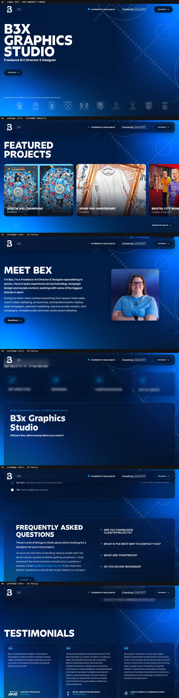
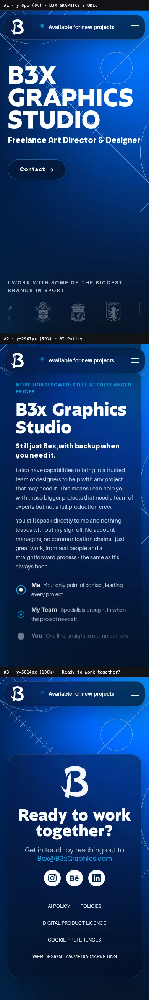

# UI Design System & Master Generation Blueprint: b3xgraphics-com

> **B3X Graphics · Freelance Sports Art Director & Designer** (https://b3xgraphics.com/) — B3X Graphics: freelance art direction and design specialising in sport. Branding, campaign design and socials content for some of the big...





---

## 1. Executive Visual Persona & Design Archetype

- **Brand Essence & Persona**: **B3X Graphics · Freelance Sports Art Director & Designer** (`https://b3xgraphics.com/`). B3X Graphics: freelance art direction and design specialising in sport. Branding, campaign design and socials content for some of the big...
- **Capture Provenance**: Live browser capture (`tier1_fast`, HTTP `200`, captured `2026-11-24`).
- **Visual Archetype**: **High-Contrast Obsidian / Atmospheric Design System (`#02132c` canvas, `#ffffff` ink, `#0073ff` accent)**.
- **Anti-AI-Slop Differentiators**:
  - **Live-Computed Chromatic Polarity**: Anchors the viewport in `#02132c` (live computed `body` `background-color` (`computed_styles.json`)) paired with `#ffffff` primary typography and `#0073ff` accents.
  - **Grounded Typographic Hierarchy**: Pairs `Palma Heavy` for display copy (`B3X GRAPHICS STUDIO`) with `Aileron`.
  - **Calibrated Spatial Grid & Motion**: Combines `1377px` container bounds (`gap: 2px`, padding `18px`) with `cubic-bezier(.16,1,.3,1)` easing and Three.js / WebGL Canvas Pipeline, Swiper Touch Carousel Engine.

---

## 2. Spatial Architecture & Modular Grid Mathematics

### Viewport Allocation & Container Geometry
- **Captured Journey Filmstrips**: Desktop `1280×4968px` (`assets/desktop-journey.webp`, `6` keyframes up to `y=4250px` / doc `5914px`), Mobile `390×2616px` (`assets/mobile-journey.webp`, `3` keyframes).
- **Master Container Bounds**: `1377px` (measured widest bounded `<section>` landmark width on `1440px` desktop).
- **Canvas Lateral Padding & Spacing**: `18px` lateral canvas padding with `2px` grid gap.
- **Border Radius Scale**: `26px`, `100px`, `22px`, `16px`.

### Responsive Breakpoint Architecture
- **Desktop Layout**: Multi-column CSS Grid / Flexbox layout at `1440px` (`max-width: 1377px`, `gap: 2px`).
- **Mobile Layout**: Single-column vertical stack at `390px` viewport width with `18px` horizontal padding.
- **Extracted CSS Media Queries**: `@media (min-width:768px)`, `@media (max-width:1366px) and (min-width:768px)`, `@media (max-width:1024px) and (min-width:768px)`, `@media (max-width:1024px)`.

---

## 3. Color System, Materiality & Atmospheric Lighting

### Semantic Palette & Source Grounding
| Semantic Role | Ground-Truth Value | Extracted Live / CSS Source |
|---|---|---|
| **Primary Canvas Substrate** | `#02132c` | live computed `body` `background-color` (`computed_styles.json`) |
| **Primary Typography Ink** | `#ffffff` | live computed `h1` `color` (`computed_styles.json`) |
| **Elevated Surface / Card Substrate** | `#061a3a` | `var(--proj-bg-2)` in `:root` |
| **Interactive Accent / Highlight** | `#0073ff` | `var(--e-global-color-accent)` in `:root` |
| **Secondary / Muted Copy** | `#767676` | `var(--wc-subtext)` in `:root` |
| **Structural Hairline Border** | `#25344a` | `var(--line)` in `:root` (`rgba(255,255,255,.14)`) |
| **Variable Token (`--cc-ink`)** | `#031b3d` | `var(--cc-ink)` in `:root` |
| **Variable Token (`--cc-bone`)** | `#eaf2ff` | `var(--cc-bone)` in `:root` |
| **Variable Token (`--cc-steel`)** | `#606060` | `var(--cc-steel)` in `:root` |
| **Variable Token (`--cc-red`)** | `#0474ff` | `var(--cc-red)` in `:root` |
| **Variable Token (`--cc-gold`)** | `#04b5ff` | `var(--cc-gold)` in `:root` |
| **Variable Token (`--cc-ui-raised`)** | `#0a2347` | `var(--cc-ui-raised)` in `:root` |
| **Variable Token (`--cc-ui-raised-2`)** | `#0d2b57` | `var(--cc-ui-raised-2)` in `:root` |

### Sanitized Root CSS Variables (`ui-ux.md` Ground Truth)
| Variable Name | Extracted Value | Semantic Role |
|---|---|---|
| `--cc-ink` | `#031B3D` | Typography Ink Token |
| `--cc-bone` | `#EAF2FF` | Color / Atmospheric Token |
| `--cc-steel` | `#606060` | Color / Atmospheric Token |
| `--cc-red` | `#0474FF` | Color / Atmospheric Token |
| `--cc-gold` | `#04B5FF` | Color / Atmospheric Token |
| `--cc-navy` | `#031B3D` | Layout / Spatial Grid Token |
| `--cc-sky` | `#04B5FF` | Color / Atmospheric Token |
| `--cc-deep` | `#02132C` | Color / Atmospheric Token |
| `--cc-ui-bg` | `#02132C` | Canvas / Surface Token |
| `--cc-ui-raised` | `#0A2347` | Color / Atmospheric Token |
| `--cc-ui-raised-2` | `#0D2B57` | Color / Atmospheric Token |
| `--cc-ui-on-accent` | `#FFFFFF` | Brand / Palette Token |
| `--cc-font-display` | `'Palma Heavy', sans-serif` | Typography / Scale Token |
| `--cc-font-body` | `'Aileron', sans-serif` | Typography / Scale Token |
| `--navy` | `#031b3d` | Layout / Spatial Grid Token |
| `--sky` | `#04b5ff` | Color / Atmospheric Token |

---

## 4. Typographic Scale & Editorial Hierarchy

### Font Family Stacks
- **Display Typography**: `Palma Heavy`.
- **Primary Body Stack**: `Aileron`.
- **Technical / Metadata Stack**: not declared in live computed styles (uses primary stack / `ui-monospace`).

### Typographic Scale & Rules (Live Computed & Stylesheet Grounded)
- **Hero Display (`H1`)**: live computed `h1` (`font-size: 110.88px`, `line-height: 110.88px`, `font-weight: 600`); CSS variables `--cc-font-display: 'Palma Heavy', sans-serif`, `--page-title-display: block`, `--display: flex`; rule `h1` (`font-size: clamp(44px,7vw,96px)`, `line-height: 1.08`).
- **Section Heading (`H2`)**: live computed `h2` (`font-size: 78px`, `line-height: 82.68px`, `font-weight: 400`); rule `h2` (`font-size: 2rem`).
- **Body Copy**: live computed `body` (`font-size: 16px`, `line-height: 24px`, `font-weight: 400`); CSS variables `--cc-font-body: 'Aileron', sans-serif`; rule `body` (`font-weight: 400`).
- **Metadata & Navigation Labels**: live computed `nav/a` (`font-size: 16px`, `line-height: 24px`, `font-weight: 400`).

---

## 5. Choreographed Motion & Interaction Physics

### Primary Easing Curves
- **Extracted Timing Functions**: `cubic-bezier(.16,1,.3,1)`, `cubic-bezier(.4,0,.2,1)`, `cubic-bezier(.45,0,.25,1)`.

### Per-Element Transition & Choreography Rules
- **Selector `.b3xh .b3xh-bar`**: `transition: left .45s cubic-bezier(.16,1,.3,1),right .45s cubic-bezier(.16...` extracted from `b3xgraphics-com` stylesheet.
- **Selector `.b3xh .b3xh-burger`**: `transition: .4s` extracted from `b3xgraphics-com` stylesheet.
- **Selector `.b3xh .b3xh-lines`**: `transition: all .4s ease` extracted from `b3xgraphics-com` stylesheet.
- **Extracted Easing Curve (`cubic-bezier(.16,1,.3,1)`)**: Governs interactive state transitions across `<header.b3xh-bar>` and `<section.b3xt>`.
- **Runtime Interaction Engine**: Integrates Three.js / WebGL Canvas Pipeline, Swiper Touch Carousel Engine with `prefers-reduced-motion: reduce` fallback guards.
### Measured Runtime Scroll & Interaction Telemetry (`behavioral_journey_v2`)
- **Scroll Driver Mode**: `native` (max document height `5914px`, deepest scrollY reached `4250px` across `6` desktop keyframes).
- **Detected Scroll / Motion Libraries**: Native browser scroll / standard CSS transitions.
- **Nav / Drawer Probe (`Menu`)**: Triggered visual change (pixel diff `10.344`, captured in `assets/state-nav.webp`); revealed links: HOME, PROJECTS, THE LAB, ABOUT, SHOP, CONTACT.
- **Hover Physics (`primary_cta` · `Contact`)**: Computed transition `0.5s` / `ease` (no static color/transform shift captured at rest).
- **Route Transition Architecture**: First internal navigation (`/projects/`) measured as `direct` in `7190ms`.

---

## 6. Component Wireframe & Structural DOM Map

### Visual Layout Schematic — Desktop (`1440px`, Grounded in `dom.html` & Landmark Bounding Boxes)
```
┌────────────────────────────────────────────────────────────────────────┐
│ DESKTOP VIEWPORT (1440px) — B3X Graphics · Freelance Sports Art Direct │
│ ====================================================================== │
│ [ <header.b3xh-bar> (1377x88px)       | Home · Projects · The Lab ·  ] │
│ ---------------------------------------------------------------------- │
│ | HERO STAGE: <section.b3xr-feat> (w=1440px)                         | │
│ | H1: B3X GRAPHICS STUDIO                                            | │
│ | Substrate: #02132c | Ink: #ffffff | Accent: #0073ff                | │
│ ---------------------------------------------------------------------- │
│ | SHOWCASE GRID (<section.b3xt>) max-w: 1377px                       | │
│ | +------------------------------+  +------------------------------+ | │
│ | | B3X Graphics Studio          |  | Freelance Art Director & Des | | │
│ | +------------------------------+  +------------------------------+ | │
│ ---------------------------------------------------------------------- │
│ | DETAIL MODULE (<section.b3xt-armed>) — Featured projects           | │
│ ---------------------------------------------------------------------- │
│ [ FOOTER (<footer.site-footer>) | https://b3xgraphics.com/             │
└────────────────────────────────────────────────────────────────────────┘
```

### Visual Layout Schematic — Mobile Reflow (`390px`)
```
┌────────────────────────────────────────────────────────────────────────┐
│ MOBILE VIEWPORT REFLOW (390px) — Single-Column Stack (gap: 2px)        │
│ ====================================================================== │
│ [ HEADER BAR (<header.b3xh-bar>       ) | Compact Menu (390px)         │
│ ---------------------------------------------------------------------- │
│ | HERO STAGE (<section.b3xr-feat>) — 390px Vertical Lead             | │
│ | H1: B3X GRAPHICS STUDIO                                            | │
│ ---------------------------------------------------------------------- │
│ | SHOWCASE STACK (<section.b3xt>) — 1-Col Stack                      | │
│ | [ Item 1: B3X Graphics Studio                                    ] | │
│ | [ Item 2: Freelance Art Director & Designer                      ] | │
│ ---------------------------------------------------------------------- │
│ | DETAIL STACK (<section.b3xt-armed>) — 1-Col (Featured projects)    | │
│ ---------------------------------------------------------------------- │
│ [ FOOTER (<footer.site-footer>) | Stacked 390px Colophon               │
└────────────────────────────────────────────────────────────────────────┘
```

### Granular DOM Region Breakdown
1. **Brand Header & Navigation Bar (<header.b3xh-bar> — `b3xgraphics-com`)**:
   - Landmark `<header class="b3xh-bar">` (`1377x88px`) hosting `B3X Graphics · Freelance Sports Art ` navigation (`Home · Projects · The Lab · About · Shop`), DOM attributes (`data-b3xh-page="home"`, `data-b3xh-bound="1"`, `data-elementor-type="wp-page"`, `data-elementor-id="1301"`), and stylesheet rule `after { box-sizing:border-box; }`.
2. **Hero Stage & Focal Lead (<section.b3xr-feat> — `B3X GRAPHICS STUDIO`)**:
   - Landmark `<section class="b3xr-feat">` presenting display lead `B3X GRAPHICS STUDIO` and copy excerpt *"I WORK WITH SOME OF THE BIGGEST BRANDS IN SPORT"* over `#02132c` canvas and `#ffffff` ink.
3. **Primary Showcase & Content Grid (<section.b3xt> — `B3X Graphics Studio`)**:
   - Landmark `<section class="b3xt b3xt-armed">` rendering section `B3X Graphics Studio` with copy *"I work with some of the biggest brands in sport"*, asset references (`favicon.svg`, `chrome.css`, `fonts.css,qv==1791378108+styles.c...`, `home.css`), and grid rule `.b3xh .b3xh-defs { position:absolute;width:0;height:0;overflow:hidden;pointer-events:none; }`.
4. **Interactive Detail & Feature Matrix (<section.b3xt-armed> — `Freelance Art Director & Designer`)**:
   - Landmark `<section class="b3xt b3xt-armed">` framing `Freelance Art Director & Designer` and `Featured projects` (*"2025/26 WSL Champions Social Media"*) with `#061a3a` surface cards, `#0073ff` accents, and `.b3xh .b3xh-burger:active { background:transparent;color:fff;border:0; }`.
5. **Colophon & Global Directory Footer (<footer.site-footer> — `https://b3xgraphics.com/`)**:
   - Landmark `<footer class="site-footer">` anchoring `B3X Graphics · Freelance Sports ` footer links (`Home · Projects · The Lab · About · Shop`), copy *"Spurs 1901 Anniversary Social Media"*, and `#25344a` structural dividers.
### Full Vertical Scroll Sequence (Desktop `1440×900` Keyframes)
- **Step 01** (`y=0px`, `0%`): Active landmark `B3X GRAPHICS STUDIO` · sticky/fixed elements: `2`
- **Step 02** (`y=850px`, `17%`): Active landmark `FEATURED PROJECTS` · sticky/fixed elements: `2`
- **Step 03** (`y=1700px`, `34%`): Active landmark `AI Policy` · sticky/fixed elements: `2`
- **Step 04** (`y=2550px`, `51%`): Active landmark `AI Policy` · sticky/fixed elements: `2`
- **Step 05** (`y=3400px`, `68%`): Active landmark `AI Policy` · sticky/fixed elements: `2`
- **Step 06** (`y=4250px`, `85%`): Active landmark `AI Policy` · sticky/fixed elements: `2`

### Multi-Page Internal Route Map
- **Listing Route (`/projects/`)**: `https://b3xgraphics.com/projects/` — H1: `Recent Projects`, scrollHeight `1551px`, transition `direct` (`7190ms`)
- **Detail Route (`/work/wsl-champions/`)**: `https://b3xgraphics.com/work/wsl-champions/` — H1: `2025/26 WSL Champions`, scrollHeight `7951px`, transition `direct` (`328ms`)
- **About Route (`/contact/`)**: `https://b3xgraphics.com/contact/` — H1: `Have a project in mind?`, scrollHeight `1436px`, transition `direct` (`313ms`)

---

## 7. Master Zero-Shot AI Generation Prompt

```markdown
# Master Zero-Shot Frontend Generation Prompt: b3xgraphics-com (B3X Graphics · Freelance Sports Art Director & Designer)

You are a principal frontend architect and design systems engineer. Build a complete, production-ready web application replicating the exact design system, DOM landmarks, typographic hierarchy, color tokens, and motion physics of `b3xgraphics-com` (**B3X Graphics · Freelance Sports Art Director & Designer** — `https://b3xgraphics.com/`).

### 1. Visual Archetype & Anti-AI-Slop Mandates
- **Archetype**: High-Contrast Obsidian / Atmospheric Design System (`#02132c` canvas, `#ffffff` ink, `#0073ff` accent).
- **Identity & Domain Context**: B3X Graphics: freelance art direction and design specialising in sport. Branding, campaign design and socials content for some of the big...
- **Primary Substrate**: `#02132c` (live computed `body` `background-color` (`computed_styles.json`)), **Primary Ink**: `#ffffff`, **Accent / Highlight**: `#0073ff`.
- **Site-Specific Differentiators**:
  - **Live-Computed Chromatic Polarity**: Anchors the viewport in `#02132c` (live computed `body` `background-color` (`computed_styles.json`)) paired with `#ffffff` primary typography and `#0073ff` accents.
  - **Grounded Typographic Hierarchy**: Pairs `Palma Heavy` for display copy (`B3X GRAPHICS STUDIO`) with `Aileron`.
  - **Calibrated Spatial Grid & Motion**: Combines `1377px` container bounds (`gap: 2px`, padding `18px`) with `cubic-bezier(.16,1,.3,1)` easing and Three.js / WebGL Canvas Pipeline, Swiper Touch Carousel Engine.

### 2. Ground-Truth CSS Variables (`:root` Token Contract)
Declare and consume these exact custom properties extracted from `b3xgraphics-com` in your global stylesheet:

:root {
  /* B3X Graphics · Freelance Sports Art Director & Designer (b3xgraphics-com) — Live-Grounded CSS Variables */
  --cc-ink: #031B3D; /* Typography Ink Token (b3xgraphics-com) */
  --cc-bone: #EAF2FF; /* Color / Atmospheric Token (b3xgraphics-com) */
  --cc-steel: #606060; /* Color / Atmospheric Token (b3xgraphics-com) */
  --cc-red: #0474FF; /* Color / Atmospheric Token (b3xgraphics-com) */
  --cc-gold: #04B5FF; /* Color / Atmospheric Token (b3xgraphics-com) */
  --cc-navy: #031B3D; /* Layout / Spatial Grid Token (b3xgraphics-com) */
  --cc-sky: #04B5FF; /* Color / Atmospheric Token (b3xgraphics-com) */
  --cc-deep: #02132C; /* Color / Atmospheric Token (b3xgraphics-com) */
  --cc-ui-bg: #02132C; /* Canvas / Surface Token (b3xgraphics-com) */
  --cc-ui-raised: #0A2347; /* Color / Atmospheric Token (b3xgraphics-com) */
  --cc-ui-raised-2: #0D2B57; /* Color / Atmospheric Token (b3xgraphics-com) */
  --cc-ui-on-accent: #FFFFFF; /* Brand / Palette Token (b3xgraphics-com) */
  --cc-font-display: 'Palma Heavy', sans-serif; /* Typography / Scale Token (b3xgraphics-com) */
  --cc-font-body: 'Aileron', sans-serif; /* Typography / Scale Token (b3xgraphics-com) */
  --navy: #031b3d; /* Layout / Spatial Grid Token (b3xgraphics-com) */
  --sky: #04b5ff; /* Color / Atmospheric Token (b3xgraphics-com) */
}

### 3. Semantic Color & Materiality Contract
Map every surface, ink, and border strictly to these source-grounded tokens:
- **Primary Canvas Substrate**: `#02132c` — grounded in live computed `body` `background-color` (`computed_styles.json`)
- **Primary Typography Ink**: `#ffffff` — grounded in live computed `h1` `color` (`computed_styles.json`)
- **Elevated Surface / Card Substrate**: `#061a3a` — grounded in `var(--proj-bg-2)` in `:root`
- **Interactive Accent / Highlight**: `#0073ff` — grounded in `var(--e-global-color-accent)` in `:root`
- **Secondary / Muted Copy**: `#767676` — grounded in `var(--wc-subtext)` in `:root`
- **Structural Hairline Border**: `#25344a` — grounded in `var(--line)` in `:root` (`rgba(255,255,255,.14)`)
- **Variable Token (`--cc-ink`)**: `#031b3d` — grounded in `var(--cc-ink)` in `:root`
- **Variable Token (`--cc-bone`)**: `#eaf2ff` — grounded in `var(--cc-bone)` in `:root`
- **Variable Token (`--cc-steel`)**: `#606060` — grounded in `var(--cc-steel)` in `:root`
- **Variable Token (`--cc-red`)**: `#0474ff` — grounded in `var(--cc-red)` in `:root`
- **Variable Token (`--cc-gold`)**: `#04b5ff` — grounded in `var(--cc-gold)` in `:root`
- **Variable Token (`--cc-ui-raised`)**: `#0a2347` — grounded in `var(--cc-ui-raised)` in `:root`
- **Variable Token (`--cc-ui-raised-2`)**: `#0d2b57` — grounded in `var(--cc-ui-raised-2)` in `:root`

### 4. Spatial Grid, Container Bounds & Responsive Breakpoints
- **Desktop Viewport Reference**: `1280×4968px` (multi-frame vertical journey filmstrip (4968px), `1440px` standard desktop width).
- **Mobile Viewport Reference**: `390×2616px` (multi-frame vertical journey filmstrip (2616px), `390px` standard mobile width).
- **Container Max-Width**: `1377px` (measured widest bounded `<section>` landmark width on `1440px` desktop)
- **Padding & Gutters**: `18px` lateral canvas padding with `2px` grid gap
- **Desktop Grid**: Multi-column CSS Grid / Flexbox layout at `1440px` (`max-width: 1377px`, `gap: 2px`)
- **Mobile Adaptation**: Single-column vertical stack at `390px` viewport width with `18px` horizontal padding
- **Media Queries**: `@media (min-width:768px)`, `@media (max-width:1366px) and (min-width:768px)`, `@media (max-width:1024px) and (min-width:768px)`, `@media (max-width:1024px)`
- **Corner Radii**: `26px`, `100px`, `22px`, `16px`

### 5. Typography & Editorial Scale Contract
- **Display Font Stack**: `Palma Heavy`
- **Body Font Stack**: `Aileron`
- **Monospace / Technical Font Stack**: not declared in live computed styles (uses primary stack / `ui-monospace`)
- **H1 Display Rule**: live computed `h1` (`font-size: 110.88px`, `line-height: 110.88px`, `font-weight: 600`); CSS variables `--cc-font-display: 'Palma Heavy', sans-serif`, `--page-title-display: block`, `--display: flex`; rule `h1` (`font-size: clamp(44px,7vw,96px)`, `line-height: 1.08`)
- **H2 Section Rule**: live computed `h2` (`font-size: 78px`, `line-height: 82.68px`, `font-weight: 400`); rule `h2` (`font-size: 2rem`)
- **Body Copy Rule**: live computed `body` (`font-size: 16px`, `line-height: 24px`, `font-weight: 400`); CSS variables `--cc-font-body: 'Aileron', sans-serif`; rule `body` (`font-weight: 400`)
- **Metadata & Index Rule**: live computed `nav/a` (`font-size: 16px`, `line-height: 24px`, `font-weight: 400`)

### 6. Component Hierarchy, Verbatim Copy & Real DOM Landmarks
Scaffold `b3xgraphics-com` (`B3X Graphics · Freelance Sports Art Director & Designer`) with these exact structural regions, extracted copy, and CSS rules from `dom.html`:
1. **Brand Header & Navigation Bar (<header.b3xh-bar> — `b3xgraphics-com`)**:
   - DOM & Selectors: Landmark `<header class="b3xh-bar">` (`1377x88px`) hosting `B3X Graphics · Freelance Sports Art ` navigation (`Home · Projects · The Lab · About · Shop`), DOM attributes (`data-b3xh-page="home"`, `data-b3xh-bound="1"`, `data-elementor-type="wp-page"`, `data-elementor-id="1301"`), and stylesheet rule `after { box-sizing:border-box; }`.
   - Responsive Contract: Header `Brand Header & Navigation Bar (<header.b3xh-bar> — `b3xgraphics-com`)` (`b3xgraphics-com`) adapts across `@media (min-width:768px)`, `@media (max-width:1366px) and (min-width:768px)`, `@media (max-width:1024px) and (min-width:768px)`, `@media (max-width:1024px)` with `cubic-bezier(.16,1,.3,1)`, `cubic-bezier(.4,0,.2,1)`, `cubic-bezier(.45,0,.25,1)` transitions and links `Home · Projects · The Lab · About · Shop`.
2. **Hero Stage & Focal Lead (<section.b3xr-feat> — `B3X GRAPHICS STUDIO`)**:
   - DOM & Selectors: Landmark `<section class="b3xr-feat">` presenting display lead `B3X GRAPHICS STUDIO` and copy excerpt *"I WORK WITH SOME OF THE BIGGEST BRANDS IN SPORT"* over `#02132c` canvas and `#ffffff` ink.
   - Responsive Contract: Hero stage (`1280×4968px` desktop / `390×2616px` mobile) sets `#02132c` background with `#ffffff` headline `B3X GRAPHICS STUDIO`.
3. **Primary Showcase & Content Grid (<section.b3xt> — `B3X Graphics Studio`)**:
   - DOM & Selectors: Landmark `<section class="b3xt b3xt-armed">` rendering section `B3X Graphics Studio` with copy *"I work with some of the biggest brands in sport"*, asset references (`favicon.svg`, `chrome.css`, `fonts.css,qv==1791378108+styles.c...`, `home.css`), and grid rule `.b3xh .b3xh-defs { position:absolute;width:0;height:0;overflow:hidden;pointer-events:none; }`.
   - Responsive Contract: Showcase grid `Primary Showcase & Content Grid (<section.b3xt> — `B3X Graphics Studio`)` applies Multi-column CSS Grid / Flexbox layout at `1440px` (`max-width: 1377px`, `gap: 2px`) on desktop and Single-column vertical stack at `390px` viewport width with `18px` horizontal padding on mobile.
4. **Interactive Detail & Feature Matrix (<section.b3xt-armed> — `Freelance Art Director & Designer`)**:
   - DOM & Selectors: Landmark `<section class="b3xt b3xt-armed">` framing `Freelance Art Director & Designer` and `Featured projects` (*"2025/26 WSL Champions Social Media"*) with `#061a3a` surface cards, `#0073ff` accents, and `.b3xh .b3xh-burger:active { background:transparent;color:fff;border:0; }`.
   - Responsive Contract: Detail module `Interactive Detail & Feature Matrix (<section.b3xt-armed> — `Freelance Art Director & Designer`)` uses `26px`, `100px`, `22px`, `16px` radii, `#0073ff` highlights, and assets (favicon.svg, chrome.css, fonts.css,qv==1791378108+styles.c...).
5. **Colophon & Global Directory Footer (<footer.site-footer> — `https://b3xgraphics.com/`)**:
   - DOM & Selectors: Landmark `<footer class="site-footer">` anchoring `B3X Graphics · Freelance Sports ` footer links (`Home · Projects · The Lab · About · Shop`), copy *"Spurs 1901 Anniversary Social Media"*, and `#25344a` structural dividers.
   - Responsive Contract: Footer `Colophon & Global Directory Footer (<footer.site-footer> — `https://b3xgraphics.com/`)` aligns to `1377px` (measured widest bounded `<section>` landmark width on `1440px` desktop) with `18px` lateral canvas padding with `2px` grid gap and attributes (data-b3xh-page="home", data-b3xh-bound="1", data-elementor-type="wp-page").

#### Verbatim DOM Copy Excerpts (`dom.html`)
- Copy Excerpt 1: *"I WORK WITH SOME OF THE BIGGEST BRANDS IN SPORT"*
- Copy Excerpt 2: *"I work with some of the biggest brands in sport"*
- Copy Excerpt 3: *"2025/26 WSL Champions Social Media"*
- Copy Excerpt 4: *"Spurs 1901 Anniversary Social Media"*

### 7. Motion, Extracted Stylesheet Rules & Interaction Choreography
- **Primary Easing Functions**: `cubic-bezier(.16,1,.3,1)`, `cubic-bezier(.4,0,.2,1)`, `cubic-bezier(.45,0,.25,1)`
- **Extracted Stylesheet Rules (`b3xgraphics-com`)**:
- `after { box-sizing:border-box; }`
- `.b3xh .b3xh-defs { position:absolute;width:0;height:0;overflow:hidden;pointer-events:none; }`
- `.b3xh .b3xh-burger:active { background:transparent;color:fff;border:0; }`
- `.b3xh.is-open .b3xh-lines::before { top:0;transform:rotate(45deg); }`
- `.b3xh.is-open .b3xh-lines::after { top:0;transform:rotate(-45deg); }`
- **Per-Selector Transition Rules**:
- **Selector `.b3xh .b3xh-bar`**: `transition: left .45s cubic-bezier(.16,1,.3,1),right .45s cubic-bezier(.16...` extracted from `b3xgraphics-com` stylesheet.
- **Selector `.b3xh .b3xh-burger`**: `transition: .4s` extracted from `b3xgraphics-com` stylesheet.
- **Selector `.b3xh .b3xh-lines`**: `transition: all .4s ease` extracted from `b3xgraphics-com` stylesheet.
- **Extracted Easing Curve (`cubic-bezier(.16,1,.3,1)`)**: Governs interactive state transitions across `<header.b3xh-bar>` and `<section.b3xt>`.
- **Runtime Interaction Engine**: Integrates Three.js / WebGL Canvas Pipeline, Swiper Touch Carousel Engine with `prefers-reduced-motion: reduce` fallback guards.
### 7b. Full-Page Scroll Choreography, Interactive States & Multi-Page Routes
- **Scroll Mechanics**: Implement `native` vertical progression up to `5914px` across 6 distinct viewport chapters.
- **Vertical Chapter Sequence**: B3X GRAPHICS STUDIO (0%) -> FEATURED PROJECTS (17%) -> AI Policy (34%) -> AI Policy (51%) -> AI Policy (68%) -> AI Policy (85%).
- **Navigation Drawer / Menu State**: Replicate interactive menu toggle (`Menu`) with Escape-to-close keyboard handling.
- **Multi-Page Routes**: Scaffold internal routes `/projects/` (listing, direct), `/work/wsl-champions/` (detail, direct), `/contact/` (about, direct) sharing the global header/footer shell and design tokens.

### 8. Technical Deliverables
- Implement in Next.js (App Router) with TypeScript and Tailwind CSS consuming the `:root` custom properties defined above for `b3xgraphics-com`.
- Reproduce both the `1440px` desktop architecture and `390px` mobile breakpoint transitions, preserving semantic HTML5 landmarks (`<header>`, `<nav>`, `<main>`, `<section>`, `<footer>`) and `prefers-reduced-motion` accessibility guards.
```
---

## 8. Full-Page Scroll Journey, Interactive States & Subpage Inventory

### Desktop Scroll Keyframes (`1440×900` WebP)
| Step | Scroll Y | Progress | Active Landmark / Section | Sticky/Fixed | Visual Asset |
| :---: | :---: | :---: | :--- | :---: | :--- |
| `#01` | `0px` | `0%` | B3X GRAPHICS STUDIO | `2` | [desktop-step-01.webp](assets/desktop-step-01.webp) |
| `#02` | `850px` | `17%` | FEATURED PROJECTS | `2` | [desktop-step-02.webp](assets/desktop-step-02.webp) |
| `#03` | `1700px` | `34%` | AI Policy | `2` | [desktop-step-03.webp](assets/desktop-step-03.webp) |
| `#04` | `2550px` | `51%` | AI Policy | `2` | [desktop-step-04.webp](assets/desktop-step-04.webp) |
| `#05` | `3400px` | `68%` | AI Policy | `2` | [desktop-step-05.webp](assets/desktop-step-05.webp) |
| `#06` | `4250px` | `85%` | AI Policy | `2` | [desktop-step-06.webp](assets/desktop-step-06.webp) |

### Mobile Condensed Keyframes (`390×844` WebP)
| Step | Scroll Y | Progress | Active Landmark | Visual Asset |
| :---: | :---: | :---: | :--- | :--- |
| `#01` | `0px` | `0%` | B3X GRAPHICS STUDIO | [mobile-step-01.webp](assets/mobile-step-01.webp) |
| `#02` | `2907px` | `50%` | AI Policy | [mobile-step-02.webp](assets/mobile-step-02.webp) |
| `#03` | `5814px` | `100%` | Ready to work together? | [mobile-step-03.webp](assets/mobile-step-03.webp) |

### Interactive UI State Captures (`1440×900` WebP)
| State Type | Trigger / Observation | Visual Asset |
| :--- | :--- | :--- |
| `nav_menu` | Nav/Menu opened (`Menu`, diff `10.344`) | [state-nav.webp](assets/state-nav.webp) |

### Internal Subpage Filmstrips (`1080px` Wide WebP)
| # | Template | Route URL | H1 / Title | Scroll Height | Transition | Filmstrip Asset |
| :-: | :---: | :--- | :--- | :---: | :---: | :--- |
| `1` | `listing` | `https://b3xgraphics.com/projects/` | Recent Projects | `1551px` | `direct` (`7190ms`) | [subpage-01-projects.webp](assets/subpage-01-projects.webp) |
| `2` | `detail` | `https://b3xgraphics.com/work/wsl-champions/` | 2025/26 WSL Champions | `7951px` | `direct` (`328ms`) | [subpage-02-work-wsl-champions.webp](assets/subpage-02-work-wsl-champions.webp) |
| `3` | `about` | `https://b3xgraphics.com/contact/` | Have a project in mind? | `1436px` | `direct` (`313ms`) | [subpage-03-contact.webp](assets/subpage-03-contact.webp) |

