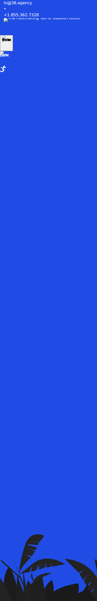

# UI Design System & Master Generation Blueprint: baboonbutts-com

> **Baboon Butts - The redder the better!** (https://baboonbutts.com/) — This Cheeky ad campaign to show how effective a little strategy – and a lot of raunchy visuals and messaging – can be.


---

## 1. Executive Visual Persona & Design Archetype

- **Brand Essence & Persona**: **Baboon Butts - The redder the better!** (`https://baboonbutts.com/`). This Cheeky ad campaign to show how effective a little strategy – and a lot of raunchy visuals and messaging – can be.
- **Visual Archetype**: **High-Contrast Obsidian / Atmospheric Design System (`#204ce5` canvas, `#fff` ink, `#112337` accent)**.
- **Anti-AI-Slop Differentiators**:
  - **Source-Grounded Chromatic Polarity**: Anchors the viewport in `#204ce5` (`var(--gf-color-primary)` in `:root`) paired with `#fff` primary typography and `#112337` accents.
  - **Extracted Typographic Hierarchy**: Pairs `mono45-headline` for display copy (`The Fascinating Tail of Baboon Butts`) with `inline-block` and `mono45-headline`.
  - **Calibrated Spatial Grid & Motion**: Combines `80vw` container bounds (`gap: 8px`, padding `1px`) with `cubic-bezier(.45,.05,.55,.95)` easing and Lenis Smooth Scroll (`data-lenis`), Three.js / WebGL Canvas Pipeline.

---

## 2. Spatial Architecture & Modular Grid Mathematics



### Viewport Allocation & Container Geometry
- **Captured Viewport Dimensions**: Desktop `1440×10778px` (`assets/desktop.png`, full-page scroll capture), Mobile `390×2400px` (`assets/mobile.png`, capped at 2400px multi-section capture).
- **Master Container Bounds**: `80vw` extracted from `baboonbutts-com` stylesheet.
- **Canvas Lateral Padding & Spacing**: `1px` lateral canvas padding with `8px` grid gap.
- **Border Radius Scale**: `5px`, `3px`, `50%`, `var(--gf-ctrl-radius)`.

### Responsive Breakpoint Architecture
- **Desktop Layout**: Multi-column CSS Grid / Flexbox layout at `1440px` (`max-width: 80vw`, `gap: 8px`).
- **Mobile Layout**: Single-column vertical stack at `390px` viewport width with `1px` horizontal padding.
- **Extracted CSS Media Queries**: `@media (min-width:640px)`, `@media only screen and (min-resolution:144dpi),only screen and (...`, `@media (min-resolution:192dpi)`, `@media (prefers-reduced-motion: no-preference)`.

---

## 3. Color System, Materiality & Atmospheric Lighting

### Semantic Palette & Source Grounding
| Semantic Role | Ground-Truth Value | Extracted CSS Source / Selector |
|---|---|---|
| **Primary Canvas Substrate** | `#204ce5` | `var(--gf-color-primary)` in `:root` |
| **Primary Typography Ink** | `#fff` | `var(--gf-color-primary-contrast)` in `:root` |
| **Elevated Surface / Card Substrate** | `#044ad3` | `var(--gf-color-primary-darker)` in `:root` |
| **Interactive Accent / Highlight** | `#112337` | `var(--gf-color-secondary-contrast)` in `:root` |
| **Secondary / Muted Copy** | `#f2f3f5` | `var(--gf-color-secondary-darker)` in `:root` |
| **Structural Hairline Border** | `#585e6a` | `var(--gf-color-out-ctrl-dark)` in `:root` |

### Sanitized Root CSS Variables (`ui-ux.md` Ground Truth)
| Variable Name | Extracted Value | Semantic Role |
|---|---|---|
| `--gf-form-gap-x` | `16px` | Layout / Spatial Grid Token |
| `--gf-form-gap-y` | `40px` | Layout / Spatial Grid Token |
| `--gf-form-footer-margin-y-start` | `24px` | Layout / Spatial Grid Token |
| `--gf-form-footer-gap` | `8px` | Layout / Spatial Grid Token |
| `--gf-field-gap-x` | `12px` | Layout / Spatial Grid Token |
| `--gf-field-gap-y` | `12px` | Layout / Spatial Grid Token |
| `--gf-field-date-width` | `168px` | Layout / Spatial Grid Token |
| `--gf-field-time-width` | `110px` | Layout / Spatial Grid Token |
| `--gf-field-list-btns-gap` | `8px` | Layout / Spatial Grid Token |
| `--gf-field-list-btns-width` | `calc(32px + var(--gf-field-list-btns-gap) + var(--gf-field-gap-x))` | Layout / Spatial Grid Token |
| `--gf-field-pg-steps-gap-y` | `8px` | Layout / Spatial Grid Token |
| `--gf-field-pg-steps-gap-x` | `24px` | Layout / Spatial Grid Token |
| `--gf-label-width` | `30%` | Layout / Spatial Grid Token |
| `--gf-label-req-gap` | `6px` | Layout / Spatial Grid Token |
| `--header-height` | `90px` | Layout / Spatial Grid Token |
| `--gf-radius` | `3px` | Elevation / Border Token |

---

## 4. Typographic Scale & Editorial Hierarchy

### Font Family Stacks
- **Display Typography**: `mono45-headline`.
- **Primary Body Stack**: `inline-block`.
- **Technical / Metadata Stack**: `mono45-headline`.

### Typographic Scale & Rules (Extracted from Stylesheet & Variables)
- **Hero Display (`H1`)**: CSS variables `--gf-field-pwd-str-ind-display: inline-block`, `--gf-local-display: block`; rule `h1` (`font-size: clamp(3rem, -3.3099rem + 13.1...`, `line-height: 0.8`).
- **Section Heading (`H2`)**: rule `h2` (`font-size: clamp(2.1875rem, 1.7493rem +...`, `line-height: 0.8421052632`).
- **Body Copy**: rule `body` (`line-height: 1.5`).
- **Metadata & Navigation Labels**: CSS variables `--gf-label-width: 30%`, `--gf-label-req-gap: 6px`, `--gf-label-space-primary: 8px`.

---

## 5. Choreographed Motion & Interaction Physics

### Primary Easing Curves
- **Extracted Timing Functions**: `cubic-bezier(.45,.05,.55,.95)`, `cubic-bezier(.16,1,.3,1)`, `cubic-bezier(.34,1.56,.64,1)`.

### Per-Element Transition & Choreography Rules
- **Selector `a`**: `transition: color 0.3s ease-out` extracted from `baboonbutts-com` stylesheet.
- **Selector `.observable .molecule`**: `transition: opacity 0.3s ease-in` extracted from `baboonbutts-com` stylesheet.
- **Selector `.observable .in-view .molecule`**: `transition: opacity 0.1s linear` extracted from `baboonbutts-com` stylesheet.
- **Extracted Easing Curve (`cubic-bezier(.45,.05,.55,.95)`)**: Governs interactive state transitions across `<header.wp-block-thirtysixblocks-header>` and `<section.wp-block-thirtysixblocks-image>`.
- **Runtime Interaction Engine**: Integrates Lenis Smooth Scroll (`data-lenis`), Three.js / WebGL Canvas Pipeline, Barba.js Page Transition Router with `prefers-reduced-motion: reduce` fallback guards.

---

## 6. Component Wireframe & Structural DOM Map

### Visual Layout Schematic (Grounded in `dom.html` — `1440px` Desktop & `390px` Mobile Reflow)
```
┌────────────────────────────────────────────────────────────────────────┐
│ DESKTOP VIEWPORT (1440px) — Baboon Butts - The redder the better!      │
│ ====================================================================== │
│ [ <header.wp-block-thirtys | Get a Hold of Us                       ]  │
│ ---------------------------------------------------------------------- │
│ | HERO STAGE: <section.wp-block-thirtysixblocks-slide>             |   │
│ | H1: The Fascinating Tail of Baboon Butts                         |   │
│ | Substrate: #204ce5    | Ink: #fff       | Accent: #112337        |   │
│ ---------------------------------------------------------------------- │
│ | SHOWCASE GRID (<section.wp-block-thirtysi) max-w: 80vw           |   │
│ | +------------------------------+  +------------------------------+ | │
│ | | Before billboards, branding, |  | Meet one of nature’s most ey | | │
│ | +------------------------------+  +------------------------------+ | │
│ ---------------------------------------------------------------------- │
│ | MOBILE VIEWPORT REFLOW (390px) — Single-Column Stack (gap: 8px   ) | │
│ | [<header.wp-block-t] -> [<section.wp-block-] -> [<section.wp-block-] │
│ ---------------------------------------------------------------------- │
│ [ FOOTER (<footer.wp-block-thirt) | https://baboonbutts.com/           │
└────────────────────────────────────────────────────────────────────────┘
```

### Granular DOM Region Breakdown
1. **Brand Header & Navigation Bar (<header.wp-block-thirtysixblocks-header> — `baboonbutts-com`)**:
   - Landmark `<header class="wp-block-thirtysixblocks-header">` hosting `Baboon Butts - The redder the better` navigation (`Get a Hold of Us`), DOM attributes (`data-magnet`, `data-magnet-movement="80"`, `data-magnet-rotation="15"`, `data-magnet-smooth="0.5"`), and stylesheet rule `.gform-theme--foundation ::before { box-sizing:border-box }`.
2. **Hero Stage & Focal Lead (<section.wp-block-thirtysixblocks-slide> — `The Fascinating Tail of Baboon But`)**:
   - Landmark `<section class="wp-block-thirtysixblocks-slide slide-intro">` presenting display lead `The Fascinating Tail of Baboon Butts` and copy excerpt *"A cheeky look at one of nature’s most successful forms of adverti"* over `#204ce5` canvas and `#fff` ink.
3. **Primary Showcase & Content Grid (<section.wp-block-thirtysixblocks-image> — `Before billboards, branding, and b`)**:
   - Landmark `<section class="wp-block-thirtysixblocks-image">` rendering section `Before billboards, branding, and billion-dollar a...` with copy *"Before billboards, branding, and billion-dollar ad campaigns, nat"*, asset references (`insight.min.js`, `use.typekit.net`, `style-index.css`, `bmx2okd.css`), and grid rule `.gform-theme--foundation legend { background:0 0;padding:0 }`.
4. **Interactive Detail & Feature Matrix (<section.wp-block-thirtysixblocks-slide> — `Meet one of nature’s most eye-catc`)**:
   - Landmark `<section class="wp-block-thirtysixblocks-slide">` framing `Meet one of nature’s most eye-catching advertisin...` and `The baboon’s brilliantly bold backside. T h e b a...` (*"B e f o r e b i l l b o a r d s , b r a n d i n g , a n d b i l l"*) with `#044ad3` surface cards, `#112337` accents, and `.gform-theme--foundation fieldset { border:none;display:block;margin:0 }`.
5. **Colophon & Global Directory Footer (<footer.wp-block-thirtysixblocks-footer> — `https://baboonbutts.com/`)**:
   - Landmark `<footer class="wp-block-thirtysixblocks-footer">` anchoring `Baboon Butts - The redder the be` footer links (`Get a Hold of Us`), copy *"b i l l b o a r d s ,"*, and `#585e6a` structural dividers.

---

## 7. Master Zero-Shot AI Generation Prompt

```markdown
# Master Zero-Shot Frontend Generation Prompt: baboonbutts-com (Baboon Butts - The redder the better!)

You are a principal frontend architect and design systems engineer. Build a complete, production-ready web application replicating the exact design system, DOM landmarks, typographic hierarchy, color tokens, and motion physics of `baboonbutts-com` (**Baboon Butts - The redder the better!** — `https://baboonbutts.com/`).

### 1. Visual Archetype & Anti-AI-Slop Mandates
- **Archetype**: High-Contrast Obsidian / Atmospheric Design System (`#204ce5` canvas, `#fff` ink, `#112337` accent).
- **Identity & Domain Context**: This Cheeky ad campaign to show how effective a little strategy – and a lot of raunchy visuals and messaging – can be.
- **Primary Substrate**: `#204ce5` (`var(--gf-color-primary)` in `:root`), **Primary Ink**: `#fff`, **Accent / Highlight**: `#112337`.
- **Site-Specific Differentiators**:
  - **Source-Grounded Chromatic Polarity**: Anchors the viewport in `#204ce5` (`var(--gf-color-primary)` in `:root`) paired with `#fff` primary typography and `#112337` accents.
  - **Extracted Typographic Hierarchy**: Pairs `mono45-headline` for display copy (`The Fascinating Tail of Baboon Butts`) with `inline-block` and `mono45-headline`.
  - **Calibrated Spatial Grid & Motion**: Combines `80vw` container bounds (`gap: 8px`, padding `1px`) with `cubic-bezier(.45,.05,.55,.95)` easing and Lenis Smooth Scroll (`data-lenis`), Three.js / WebGL Canvas Pipeline.

### 2. Ground-Truth CSS Variables (`:root` Token Contract)
Declare and consume these exact custom properties extracted from `baboonbutts-com` in your global stylesheet:

:root {
  /* Baboon Butts - The redder the better! (baboonbutts-com) — Ground-Truth Extracted CSS Variables */
  --gf-form-gap-x: 16px; /* Layout / Spatial Grid Token (baboonbutts-com) */
  --gf-form-gap-y: 40px; /* Layout / Spatial Grid Token (baboonbutts-com) */
  --gf-form-footer-margin-y-start: 24px; /* Layout / Spatial Grid Token (baboonbutts-com) */
  --gf-form-footer-gap: 8px; /* Layout / Spatial Grid Token (baboonbutts-com) */
  --gf-field-gap-x: 12px; /* Layout / Spatial Grid Token (baboonbutts-com) */
  --gf-field-gap-y: 12px; /* Layout / Spatial Grid Token (baboonbutts-com) */
  --gf-field-date-width: 168px; /* Layout / Spatial Grid Token (baboonbutts-com) */
  --gf-field-time-width: 110px; /* Layout / Spatial Grid Token (baboonbutts-com) */
  --gf-field-list-btns-gap: 8px; /* Layout / Spatial Grid Token (baboonbutts-com) */
  --gf-field-list-btns-width: calc(32px + var(--gf-field-list-btns-gap) + var(--gf-field-gap-x)); /* Layout / Spatial Grid Token (baboonbutts-com) */
  --gf-field-pg-steps-gap-y: 8px; /* Layout / Spatial Grid Token (baboonbutts-com) */
  --gf-field-pg-steps-gap-x: 24px; /* Layout / Spatial Grid Token (baboonbutts-com) */
  --gf-label-width: 30%; /* Layout / Spatial Grid Token (baboonbutts-com) */
  --gf-label-req-gap: 6px; /* Layout / Spatial Grid Token (baboonbutts-com) */
  --header-height: 90px; /* Layout / Spatial Grid Token (baboonbutts-com) */
  --gf-radius: 3px; /* Elevation / Border Token (baboonbutts-com) */
}

### 3. Semantic Color & Materiality Contract
Map every surface, ink, and border strictly to these source-grounded tokens:
- **Primary Canvas Substrate**: `#204ce5` — grounded in `var(--gf-color-primary)` in `:root`
- **Primary Typography Ink**: `#fff` — grounded in `var(--gf-color-primary-contrast)` in `:root`
- **Elevated Surface / Card Substrate**: `#044ad3` — grounded in `var(--gf-color-primary-darker)` in `:root`
- **Interactive Accent / Highlight**: `#112337` — grounded in `var(--gf-color-secondary-contrast)` in `:root`
- **Secondary / Muted Copy**: `#f2f3f5` — grounded in `var(--gf-color-secondary-darker)` in `:root`
- **Structural Hairline Border**: `#585e6a` — grounded in `var(--gf-color-out-ctrl-dark)` in `:root`

### 4. Spatial Grid, Container Bounds & Responsive Breakpoints
- **Desktop Viewport Reference**: `1440×10778px` (full-page scroll capture, `1440px` standard desktop width).
- **Mobile Viewport Reference**: `390×2400px` (capped at 2400px multi-section capture, `390px` standard mobile width).
- **Container Max-Width**: `80vw` extracted from `baboonbutts-com` stylesheet
- **Padding & Gutters**: `1px` lateral canvas padding with `8px` grid gap
- **Desktop Grid**: Multi-column CSS Grid / Flexbox layout at `1440px` (`max-width: 80vw`, `gap: 8px`)
- **Mobile Adaptation**: Single-column vertical stack at `390px` viewport width with `1px` horizontal padding
- **Media Queries**: `@media (min-width:640px)`, `@media only screen and (min-resolution:144dpi),only screen and (...`, `@media (min-resolution:192dpi)`, `@media (prefers-reduced-motion: no-preference)`
- **Corner Radii**: `5px`, `3px`, `50%`, `var(--gf-ctrl-radius)`

### 5. Typography & Editorial Scale Contract
- **Display Font Stack**: `mono45-headline`
- **Body Font Stack**: `inline-block`
- **Monospace / Technical Font Stack**: `mono45-headline`
- **H1 Display Rule**: CSS variables `--gf-field-pwd-str-ind-display: inline-block`, `--gf-local-display: block`; rule `h1` (`font-size: clamp(3rem, -3.3099rem + 13.1...`, `line-height: 0.8`)
- **H2 Section Rule**: rule `h2` (`font-size: clamp(2.1875rem, 1.7493rem +...`, `line-height: 0.8421052632`)
- **Body Copy Rule**: rule `body` (`line-height: 1.5`)
- **Metadata & Index Rule**: CSS variables `--gf-label-width: 30%`, `--gf-label-req-gap: 6px`, `--gf-label-space-primary: 8px`

### 6. Component Hierarchy, Verbatim Copy & Real DOM Landmarks
Scaffold `baboonbutts-com` (`Baboon Butts - The redder the better!`) with these exact structural regions, extracted copy, and CSS rules from `dom.html`:
1. **Brand Header & Navigation Bar (<header.wp-block-thirtysixblocks-header> — `baboonbutts-com`)**:
   - DOM & Selectors: Landmark `<header class="wp-block-thirtysixblocks-header">` hosting `Baboon Butts - The redder the better` navigation (`Get a Hold of Us`), DOM attributes (`data-magnet`, `data-magnet-movement="80"`, `data-magnet-rotation="15"`, `data-magnet-smooth="0.5"`), and stylesheet rule `.gform-theme--foundation ::before { box-sizing:border-box }`.
   - Responsive Contract: Header `Brand Header & Navigation Bar (<header.wp-block-thirtysixblocks-header> — `baboonbutts-com`)` (`baboonbutts-com`) adapts across `@media (min-width:640px)`, `@media only screen and (min-resolution:144dpi),only screen and (...`, `@media (min-resolution:192dpi)`, `@media (prefers-reduced-motion: no-preference)` with `cubic-bezier(.45,.05,.55,.95)`, `cubic-bezier(.16,1,.3,1)`, `cubic-bezier(.34,1.56,.64,1)` transitions and links `Get a Hold of Us`.
2. **Hero Stage & Focal Lead (<section.wp-block-thirtysixblocks-slide> — `The Fascinating Tail of Baboon But`)**:
   - DOM & Selectors: Landmark `<section class="wp-block-thirtysixblocks-slide slide-intro">` presenting display lead `The Fascinating Tail of Baboon Butts` and copy excerpt *"A cheeky look at one of nature’s most successful forms of adverti"* over `#204ce5` canvas and `#fff` ink.
   - Responsive Contract: Hero stage (`1440×10778px` desktop / `390×2400px` mobile) sets `#204ce5` background with `#fff` headline `The Fascinating Tail of Baboon Butts`.
3. **Primary Showcase & Content Grid (<section.wp-block-thirtysixblocks-image> — `Before billboards, branding, and b`)**:
   - DOM & Selectors: Landmark `<section class="wp-block-thirtysixblocks-image">` rendering section `Before billboards, branding, and billion-dollar a...` with copy *"Before billboards, branding, and billion-dollar ad campaigns, nat"*, asset references (`insight.min.js`, `use.typekit.net`, `style-index.css`, `bmx2okd.css`), and grid rule `.gform-theme--foundation legend { background:0 0;padding:0 }`.
   - Responsive Contract: Showcase grid `Primary Showcase & Content Grid (<section.wp-block-thirtysixblocks-image> — `Before billboards, branding, and b`)` applies Multi-column CSS Grid / Flexbox layout at `1440px` (`max-width: 80vw`, `gap: 8px`) on desktop and Single-column vertical stack at `390px` viewport width with `1px` horizontal padding on mobile.
4. **Interactive Detail & Feature Matrix (<section.wp-block-thirtysixblocks-slide> — `Meet one of nature’s most eye-catc`)**:
   - DOM & Selectors: Landmark `<section class="wp-block-thirtysixblocks-slide">` framing `Meet one of nature’s most eye-catching advertisin...` and `The baboon’s brilliantly bold backside. T h e b a...` (*"B e f o r e b i l l b o a r d s , b r a n d i n g , a n d b i l l"*) with `#044ad3` surface cards, `#112337` accents, and `.gform-theme--foundation fieldset { border:none;display:block;margin:0 }`.
   - Responsive Contract: Detail module `Interactive Detail & Feature Matrix (<section.wp-block-thirtysixblocks-slide> — `Meet one of nature’s most eye-catc`)` uses `5px`, `3px`, `50%`, `var(--gf-ctrl-radius)` radii, `#112337` highlights, and assets (insight.min.js, use.typekit.net, style-index.css).
5. **Colophon & Global Directory Footer (<footer.wp-block-thirtysixblocks-footer> — `https://baboonbutts.com/`)**:
   - DOM & Selectors: Landmark `<footer class="wp-block-thirtysixblocks-footer">` anchoring `Baboon Butts - The redder the be` footer links (`Get a Hold of Us`), copy *"b i l l b o a r d s ,"*, and `#585e6a` structural dividers.
   - Responsive Contract: Footer `Colophon & Global Directory Footer (<footer.wp-block-thirtysixblocks-footer> — `https://baboonbutts.com/`)` aligns to `80vw` extracted from `baboonbutts-com` stylesheet with `1px` lateral canvas padding with `8px` grid gap and attributes (data-magnet, data-magnet-movement="80", data-magnet-rotation="15").

#### Verbatim DOM Copy Excerpts (`dom.html`)
- Copy Excerpt 1: *"A cheeky look at one of nature’s most successful forms of advertising."*
- Copy Excerpt 2: *"Before billboards, branding, and billion-dollar ad campaigns, nature was already t..."*
- Copy Excerpt 3: *"B e f o r e b i l l b o a r d s , b r a n d i n g , a n d b i l l i o n – d o l l..."*
- Copy Excerpt 4: *"b i l l b o a r d s ,"*

### 7. Motion, Extracted Stylesheet Rules & Interaction Choreography
- **Primary Easing Functions**: `cubic-bezier(.45,.05,.55,.95)`, `cubic-bezier(.16,1,.3,1)`, `cubic-bezier(.34,1.56,.64,1)`
- **Extracted Stylesheet Rules (`baboonbutts-com`)**:
- `.gform-theme--foundation ::before { box-sizing:border-box }`
- `.gform-theme--foundation legend { background:0 0;padding:0 }`
- `.gform-theme--foundation fieldset { border:none;display:block;margin:0 }`
- `ndation button.screen-reader-text... { border:0;clip:auto;clip-path:none;height:auto;margin:0;position:static!i... }`
- `gform-theme--foundation .gform-ul... { list-style-type:none;margin:0;padding:0 }`
- **Per-Selector Transition Rules**:
- **Selector `a`**: `transition: color 0.3s ease-out` extracted from `baboonbutts-com` stylesheet.
- **Selector `.observable .molecule`**: `transition: opacity 0.3s ease-in` extracted from `baboonbutts-com` stylesheet.
- **Selector `.observable .in-view .molecule`**: `transition: opacity 0.1s linear` extracted from `baboonbutts-com` stylesheet.
- **Extracted Easing Curve (`cubic-bezier(.45,.05,.55,.95)`)**: Governs interactive state transitions across `<header.wp-block-thirtysixblocks-header>` and `<section.wp-block-thirtysixblocks-image>`.
- **Runtime Interaction Engine**: Integrates Lenis Smooth Scroll (`data-lenis`), Three.js / WebGL Canvas Pipeline, Barba.js Page Transition Router with `prefers-reduced-motion: reduce` fallback guards.

### 8. Technical Deliverables
- Implement in Next.js (App Router) with TypeScript and Tailwind CSS consuming the `:root` custom properties defined above for `baboonbutts-com`.
- Reproduce both the `1440px` desktop architecture and `390px` mobile breakpoint transitions, preserving semantic HTML5 landmarks (`<header>`, `<nav>`, `<main>`, `<section>`, `<footer>`) and `prefers-reduced-motion` accessibility guards.
```
