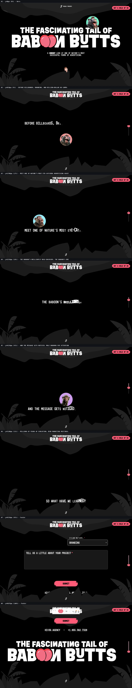
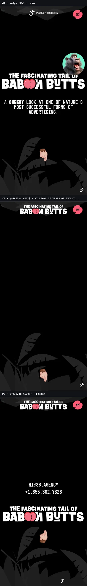

# UI Design System & Master Generation Blueprint: baboonbutts-com

> **Baboon Butts - The redder the better!** (https://baboonbutts.com/) — This Cheeky ad campaign to show how effective a little strategy – and a lot of raunchy visuals and messaging – can be.





---

## 1. Executive Visual Persona & Design Archetype

- **Brand Essence & Persona**: **Baboon Butts - The redder the better!** (`https://baboonbutts.com/`). This Cheeky ad campaign to show how effective a little strategy – and a lot of raunchy visuals and messaging – can be.
- **Capture Provenance**: Live browser capture (`tier1_fast`, HTTP `200`, captured `2026-11-24`).
- **Visual Archetype**: **High-Contrast Obsidian / Atmospheric Design System (`#000000` canvas, `#ffffff` ink, `#00c2ff` accent)**.
- **Anti-AI-Slop Differentiators**:
  - **Live-Computed Chromatic Polarity**: Anchors the viewport in `#000000` (live computed `body` `background-color` (`computed_styles.json`)) paired with `#ffffff` primary typography and `#00c2ff` accents.
  - **Grounded Typographic Hierarchy**: Uses `mono45-headline` across display (`Before billboards, branding, and bil`) and body copy, paired with `mono45-headline` for monospace/code.
  - **Calibrated Spatial Grid & Motion**: Combines `1314px` container bounds (`gap: 8px`, padding `10px`) with `cubic-bezier(.45,.05,.55,.95)` easing and Lenis Smooth Scroll (`data-lenis`), Three.js / WebGL Canvas Pipeline.

---

## 2. Spatial Architecture & Modular Grid Mathematics

### Viewport Allocation & Container Geometry
- **Captured Journey Filmstrips**: Desktop `1280×6624px` (`assets/desktop-journey.webp`, `8` keyframes up to `y=9878px` / doc `10778px`), Mobile `390×2616px` (`assets/mobile-journey.webp`, `3` keyframes).
- **Master Container Bounds**: `1314px` (live computed `main` `max-width`).
- **Canvas Lateral Padding & Spacing**: `10px` lateral canvas padding with `8px` grid gap.
- **Border Radius Scale**: `1440px`, `.5rem`, `5px`, `3px`.

### Responsive Breakpoint Architecture
- **Desktop Layout**: Multi-column CSS Grid / Flexbox layout at `1440px` (`max-width: 1314px`, `gap: 8px`).
- **Mobile Layout**: Single-column vertical stack at `390px` viewport width with `10px` horizontal padding.
- **Extracted CSS Media Queries**: `@media (prefers-reduced-motion: no-preference)`, `@media screen and (max-height: 600px)`, `@media screen and (min-width: 420px)`, `@media screen and (min-width: 768px)`.

---

## 3. Color System, Materiality & Atmospheric Lighting

### Semantic Palette & Source Grounding
| Semantic Role | Ground-Truth Value | Extracted Live / CSS Source |
|---|---|---|
| **Primary Canvas Substrate** | `#000000` | live computed `body` `background-color` (`computed_styles.json`) |
| **Primary Typography Ink** | `#ffffff` | live computed `h1` `color` (`computed_styles.json`) |
| **Elevated Surface / Card Substrate** | `#204ce5` | `var(--gf-field-pg-prog-bar-bg-color-blue)` in `:root` |
| **Interactive Accent / Highlight** | `#00c2ff` | `var(--gf-field-pg-prog-bar-bg-gradient-blues)` in `:root` |
| **Secondary / Muted Copy** | `#112337` | `var(--gf-color-secondary-contrast)` in `:root` |
| **Structural Hairline Border** | `#204ce5` | `gform-datepicker-calendar td.se... { border: #204ce5 }` |
| **Variable Token (`--wp-block-synced-color`)** | `#7a00df` | `var(--wp-block-synced-color)` in `:root` |
| **Variable Token (`--wp-editor-canvas-background`)** | `#dddddd` | `var(--wp-editor-canvas-background)` in `:root` |
| **Variable Token (`--wp-admin-theme-color`)** | `#007cba` | `var(--wp-admin-theme-color)` in `:root` |
| **Variable Token (`--wp-admin-theme-color-darker-10`)** | `#006ba1` | `var(--wp-admin-theme-color-darker-10)` in `:root` |
| **Variable Token (`--wp-admin-theme-color-darker-20`)** | `#005a87` | `var(--wp-admin-theme-color-darker-20)` in `:root` |

### Sanitized Root CSS Variables (`ui-ux.md` Ground Truth)
| Variable Name | Extracted Value | Semantic Role |
|---|---|---|
| `--wp-block-synced-color` | `#7a00df` | Brand / Palette Token |
| `--wp-block-synced-color--rgb` | `122,0,223` | Brand / Palette Token |
| `--wp-bound-block-color` | `var(--wp-block-synced-color)` | Brand / Palette Token |
| `--wp-editor-canvas-background` | `#ddd` | Canvas / Surface Token |
| `--wp-admin-theme-color` | `#007cba` | Brand / Palette Token |
| `--wp-admin-theme-color--rgb` | `0,124,186` | Brand / Palette Token |
| `--wp-admin-theme-color-darker-10` | `#006ba1` | Canvas / Surface Token |
| `--wp-admin-theme-color-darker-10--rgb` | `0,107,160.5` | Canvas / Surface Token |
| `--wp-admin-theme-color-darker-20` | `#005a87` | Canvas / Surface Token |
| `--wp-admin-theme-color-darker-20--rgb` | `0,90,135` | Canvas / Surface Token |
| `--wp-admin-border-width-focus` | `2px` | Layout / Spatial Grid Token |
| `--wp-admin--admin-bar--position-offset` | `var(--wp-admin--admin-bar--height,0px)` | Dimension / Scale Token |
| `--wp--style--global--content-size` | `82.125rem` | Layout / Spatial Grid Token |
| `--wp--style--global--wide-size` | `82.125rem` | Layout / Spatial Grid Token |
| `--header-height` | `90px` | Layout / Spatial Grid Token |
| `--gf-form-gap-x` | `32px` | Layout / Spatial Grid Token |

---

## 4. Typographic Scale & Editorial Hierarchy

### Font Family Stacks
- **Display Typography**: `mono45-headline`.
- **Primary Body Stack**: `mono45-headline`.
- **Technical / Metadata Stack**: `mono45-headline`.

### Typographic Scale & Rules (Live Computed & Stylesheet Grounded)
- **Hero Display (`H1`)**: live computed `h1` (`font-size: 120px`, `line-height: 96px`, `font-weight: 400`); CSS variables `--gf-field-pwd-str-ind-display: inline-block`, `--gf-local-display: block`; rule `h1` (`font-size: clamp(3rem, -3.3099rem + 13.1...`, `line-height: 0.8`).
- **Section Heading (`H2`)**: live computed `h2` (`font-size: 40px`, `line-height: 33.6842px`, `font-weight: 400`); rule `h2` (`font-size: clamp(2.1875rem, 1.7493rem +...`, `line-height: 0.8421052632`).
- **Body Copy**: live computed `body` (`font-size: 16px`, `line-height: 24px`, `font-weight: 400`); rule `body` (`line-height: 1.5`).
- **Metadata & Navigation Labels**: live computed `nav/a` (`font-size: 32px`, `line-height: 26.88px`, `font-weight: 400`); CSS variables `--gf-ctrl-label-font-size-primary: var(--wp--preset--font-size--32-px)`, `--gf-ctrl-label-font-size-req: var(--wp--preset--font-size--32-px)`, `--gf-ctrl-label-font-weight-req: 700`.

---

## 5. Choreographed Motion & Interaction Physics

### Primary Easing Curves
- **Extracted Timing Functions**: `cubic-bezier(.45,.05,.55,.95)`, `cubic-bezier(.16,1,.3,1)`, `cubic-bezier(.34,1.56,.64,1)`.

### Per-Element Transition & Choreography Rules
- **Selector `a`**: `transition: color 0.3s ease-out` extracted from `baboonbutts-com` stylesheet.
- **Selector `.observable .molecule`**: `transition: opacity 0.3s ease-in` extracted from `baboonbutts-com` stylesheet.
- **Selector `.observable .in-view .molecule`**: `transition: opacity 0.1s linear` extracted from `baboonbutts-com` stylesheet.
- **Extracted Easing Curve (`cubic-bezier(.45,.05,.55,.95)`)**: Governs interactive state transitions across `<header.wp-block-thirtysixblocks-header>` and `<section.wp-block-thirtysixblocks-image>`.
- **Runtime Interaction Engine**: Integrates Lenis Smooth Scroll (`data-lenis`), Three.js / WebGL Canvas Pipeline, Barba.js Page Transition Router with `prefers-reduced-motion: reduce` fallback guards.
### Measured Runtime Scroll & Interaction Telemetry (`behavioral_journey_v2`)
- **Scroll Driver Mode**: `native` (max document height `10778px`, deepest scrollY reached `9878px` across `8` desktop keyframes).
- **Detected Scroll / Motion Libraries**: `Lenis`.
- **Hover Physics (`primary_cta` · `GET A HOLD OF US`)**: `color`: `rgb(0, 0, 0)` -> `rgb(255, 255, 255)`; `backgroundColor`: `rgb(255, 91, 118)` -> `rgb(239, 64, 73)`; `borderColor`: `rgb(0, 0, 0)` -> `rgb(255, 255, 255)` (`transition-duration: 0.3s, 0.3s`, `timing: ease-out, ease-out`).

---

## 6. Component Wireframe & Structural DOM Map

### Visual Layout Schematic — Desktop (`1440px`, Grounded in `dom.html` & Landmark Bounding Boxes)
```
┌────────────────────────────────────────────────────────────────────────┐
│ DESKTOP VIEWPORT (1440px) — Baboon Butts - The redder the better!      │
│ ====================================================================== │
│ [ <header.wp-block-thirt (1440x90px)  | Get a Hold of Us             ] │
│ ---------------------------------------------------------------------- │
│ | HERO STAGE: <section.wp-block-thirtysixblocks-sl (w=1314px)        | │
│ | H1: Before billboards, branding, and billion-dollar a...           | │
│ | Substrate: #000000 | Ink: #ffffff | Accent: #00c2ff                | │
│ ---------------------------------------------------------------------- │
│ | SHOWCASE GRID (<section.wp-block-thirtysi) max-w: 1314px           | │
│ | +------------------------------+  +------------------------------+ | │
│ | | Meet one of nature’s most ey |  | The baboon’s brilliantly bol | | │
│ | +------------------------------+  +------------------------------+ | │
│ ---------------------------------------------------------------------- │
│ | DETAIL MODULE (<section.wp-block-thirtysi) — For female baboons, a | │
│ ---------------------------------------------------------------------- │
│ [ FOOTER (<footer.wp-block-thi) | https://baboonbutts.com/             │
└────────────────────────────────────────────────────────────────────────┘
```

### Visual Layout Schematic — Mobile Reflow (`390px`)
```
┌────────────────────────────────────────────────────────────────────────┐
│ MOBILE VIEWPORT REFLOW (390px) — Single-Column Stack (gap: 8px)        │
│ ====================================================================== │
│ [ HEADER BAR (<header.wp-block-thirtys) | Compact Menu (390px)         │
│ ---------------------------------------------------------------------- │
│ | HERO STAGE (<section.wp-block-thirty) — 390px Vertical Lead        | │
│ | H1: Before billboards, branding, and billion-dollar a...           | │
│ ---------------------------------------------------------------------- │
│ | SHOWCASE STACK (<section.wp-block-thir) — 1-Col Stack              | │
│ | [ Item 1: Meet one of nature’s most eye-catching advertisin...   ] | │
│ | [ Item 2: The baboon’s brilliantly bold backside. T h e b a...   ] | │
│ ---------------------------------------------------------------------- │
│ | DETAIL STACK (<section.wp-block-thirty) — 1-Col (For female baboons) │
│ ---------------------------------------------------------------------- │
│ [ FOOTER (<footer.wp-block-thi) | Stacked 390px Colophon               │
└────────────────────────────────────────────────────────────────────────┘
```

### Granular DOM Region Breakdown
1. **Brand Header & Navigation Bar (<header.wp-block-thirtysixblocks-header> — `baboonbutts-com`)**:
   - Landmark `<header class="wp-block-thirtysixblocks-header">` (`1440x90px`) hosting `Baboon Butts - The redder the better` navigation (`Get a Hold of Us`), DOM attributes (`data-magnet`, `data-magnet-movement="80"`, `data-magnet-rotation="15"`, `data-magnet-smooth="0.5"`), and stylesheet rule `.gform-theme--framework ::before { box-sizing:border-box }`.
2. **Hero Stage & Focal Lead (<section.wp-block-thirtysixblocks-slide> — `Before billboards, branding, and b`)**:
   - Landmark `<section class="wp-block-thirtysixblocks-slide slide-intro">` presenting display lead `Before billboards, branding, and billion-dollar a...` and copy excerpt *"“*” indicates required fields"* over `#000000` canvas and `#ffffff` ink.
3. **Primary Showcase & Content Grid (<section.wp-block-thirtysixblocks-image> — `Meet one of nature’s most eye-catc`)**:
   - Landmark `<section class="wp-block-thirtysixblocks-image">` rendering section `Meet one of nature’s most eye-catching advertisin...` with copy *"A cheeky look at one of nature’s most successful forms of adverti"*, asset references (`insight.min.js`, `use.typekit.net`, `style-index.css`, `bmx2okd.css`), and grid rule `.gform-theme--framework button { cursor:revert }`.
4. **Interactive Detail & Feature Matrix (<section.wp-block-thirtysixblocks-slide:nth(2)> — `The baboon’s brilliantly bold back`)**:
   - Landmark `<section class="wp-block-thirtysixblocks-slide">` framing `The baboon’s brilliantly bold backside. T h e b a...` and `For female baboons, a bright, swollen backside is...` (*"Before billboards, branding, and billion-dollar ad campaigns, nat"*) with `#204ce5` surface cards, `#00c2ff` accents, and `.gform-theme--framework img { max-inline-size:100%;max-block-size:100% }`.
5. **Colophon & Global Directory Footer (<footer.wp-block-thirtysixblocks-footer> — `https://baboonbutts.com/`)**:
   - Landmark `<footer class="wp-block-thirtysixblocks-footer">` anchoring `Baboon Butts - The redder the be` footer links (`Get a Hold of Us`), copy *"B e f o r e b i l l b o a r d s , b r a n d i n g , a n d b "*, and `#204ce5` structural dividers.
### Full Vertical Scroll Sequence (Desktop `1440×900` Keyframes)
- **Step 01** (`y=0px`, `0%`): Active landmark `Hero` · sticky/fixed elements: `3`
- **Step 02** (`y=850px`, `9%`): Active landmark `BEFORE BILLBOARDS, BRANDING, AND BILLION-DOLLAR A...` · sticky/fixed elements: `4`
- **Step 03** (`y=1700px`, `17%`): Active landmark `MEET ONE OF NATURE’S MOST EYE-CATCHING ADVERTISIN...` · sticky/fixed elements: `4`
- **Step 04** (`y=2550px`, `26%`): Active landmark `THE BABOON’S BRILLIANTLY BOLD BACKSIDE. THE BABOO...` · sticky/fixed elements: `4`
- **Step 05** (`y=4250px`, `43%`): Active landmark `AND THE MESSAGE GETS NOTICED. MALE BABOONS PAY AT...` · sticky/fixed elements: `4`
- **Step 06** (`y=5100px`, `52%`): Active landmark `MILLIONS OF YEARS OF EVOLUTION. ZERO MARKETING ME...` · sticky/fixed elements: `4`
- **Step 07** (`y=9350px`, `95%`): Active landmark `Footer` · sticky/fixed elements: `4`
- **Step 08** (`y=9878px`, `100%`): Active landmark `Footer` · sticky/fixed elements: `4`

---

## 7. Master Zero-Shot AI Generation Prompt

```markdown
# Master Zero-Shot Frontend Generation Prompt: baboonbutts-com (Baboon Butts - The redder the better!)

You are a principal frontend architect and design systems engineer. Build a complete, production-ready web application replicating the exact design system, DOM landmarks, typographic hierarchy, color tokens, and motion physics of `baboonbutts-com` (**Baboon Butts - The redder the better!** — `https://baboonbutts.com/`).

### 1. Visual Archetype & Anti-AI-Slop Mandates
- **Archetype**: High-Contrast Obsidian / Atmospheric Design System (`#000000` canvas, `#ffffff` ink, `#00c2ff` accent).
- **Identity & Domain Context**: This Cheeky ad campaign to show how effective a little strategy – and a lot of raunchy visuals and messaging – can be.
- **Primary Substrate**: `#000000` (live computed `body` `background-color` (`computed_styles.json`)), **Primary Ink**: `#ffffff`, **Accent / Highlight**: `#00c2ff`.
- **Site-Specific Differentiators**:
  - **Live-Computed Chromatic Polarity**: Anchors the viewport in `#000000` (live computed `body` `background-color` (`computed_styles.json`)) paired with `#ffffff` primary typography and `#00c2ff` accents.
  - **Grounded Typographic Hierarchy**: Uses `mono45-headline` across display (`Before billboards, branding, and bil`) and body copy, paired with `mono45-headline` for monospace/code.
  - **Calibrated Spatial Grid & Motion**: Combines `1314px` container bounds (`gap: 8px`, padding `10px`) with `cubic-bezier(.45,.05,.55,.95)` easing and Lenis Smooth Scroll (`data-lenis`), Three.js / WebGL Canvas Pipeline.

### 2. Ground-Truth CSS Variables (`:root` Token Contract)
Declare and consume these exact custom properties extracted from `baboonbutts-com` in your global stylesheet:

:root {
  /* Baboon Butts - The redder the better! (baboonbutts-com) — Live-Grounded CSS Variables */
  --wp-block-synced-color: #7a00df; /* Brand / Palette Token (baboonbutts-com) */
  --wp-block-synced-color--rgb: 122,0,223; /* Brand / Palette Token (baboonbutts-com) */
  --wp-bound-block-color: var(--wp-block-synced-color); /* Brand / Palette Token (baboonbutts-com) */
  --wp-editor-canvas-background: #ddd; /* Canvas / Surface Token (baboonbutts-com) */
  --wp-admin-theme-color: #007cba; /* Brand / Palette Token (baboonbutts-com) */
  --wp-admin-theme-color--rgb: 0,124,186; /* Brand / Palette Token (baboonbutts-com) */
  --wp-admin-theme-color-darker-10: #006ba1; /* Canvas / Surface Token (baboonbutts-com) */
  --wp-admin-theme-color-darker-10--rgb: 0,107,160.5; /* Canvas / Surface Token (baboonbutts-com) */
  --wp-admin-theme-color-darker-20: #005a87; /* Canvas / Surface Token (baboonbutts-com) */
  --wp-admin-theme-color-darker-20--rgb: 0,90,135; /* Canvas / Surface Token (baboonbutts-com) */
  --wp-admin-border-width-focus: 2px; /* Layout / Spatial Grid Token (baboonbutts-com) */
  --wp-admin--admin-bar--position-offset: var(--wp-admin--admin-bar--height,0px); /* Dimension / Scale Token (baboonbutts-com) */
  --wp--style--global--content-size: 82.125rem; /* Layout / Spatial Grid Token (baboonbutts-com) */
  --wp--style--global--wide-size: 82.125rem; /* Layout / Spatial Grid Token (baboonbutts-com) */
  --header-height: 90px; /* Layout / Spatial Grid Token (baboonbutts-com) */
  --gf-form-gap-x: 32px; /* Layout / Spatial Grid Token (baboonbutts-com) */
}

### 3. Semantic Color & Materiality Contract
Map every surface, ink, and border strictly to these source-grounded tokens:
- **Primary Canvas Substrate**: `#000000` — grounded in live computed `body` `background-color` (`computed_styles.json`)
- **Primary Typography Ink**: `#ffffff` — grounded in live computed `h1` `color` (`computed_styles.json`)
- **Elevated Surface / Card Substrate**: `#204ce5` — grounded in `var(--gf-field-pg-prog-bar-bg-color-blue)` in `:root`
- **Interactive Accent / Highlight**: `#00c2ff` — grounded in `var(--gf-field-pg-prog-bar-bg-gradient-blues)` in `:root`
- **Secondary / Muted Copy**: `#112337` — grounded in `var(--gf-color-secondary-contrast)` in `:root`
- **Structural Hairline Border**: `#204ce5` — grounded in `gform-datepicker-calendar td.se... { border: #204ce5 }`
- **Variable Token (`--wp-block-synced-color`)**: `#7a00df` — grounded in `var(--wp-block-synced-color)` in `:root`
- **Variable Token (`--wp-editor-canvas-background`)**: `#dddddd` — grounded in `var(--wp-editor-canvas-background)` in `:root`
- **Variable Token (`--wp-admin-theme-color`)**: `#007cba` — grounded in `var(--wp-admin-theme-color)` in `:root`
- **Variable Token (`--wp-admin-theme-color-darker-10`)**: `#006ba1` — grounded in `var(--wp-admin-theme-color-darker-10)` in `:root`
- **Variable Token (`--wp-admin-theme-color-darker-20`)**: `#005a87` — grounded in `var(--wp-admin-theme-color-darker-20)` in `:root`

### 4. Spatial Grid, Container Bounds & Responsive Breakpoints
- **Desktop Viewport Reference**: `1280×6624px` (multi-frame vertical journey filmstrip (6624px), `1440px` standard desktop width).
- **Mobile Viewport Reference**: `390×2616px` (multi-frame vertical journey filmstrip (2616px), `390px` standard mobile width).
- **Container Max-Width**: `1314px` (live computed `main` `max-width`)
- **Padding & Gutters**: `10px` lateral canvas padding with `8px` grid gap
- **Desktop Grid**: Multi-column CSS Grid / Flexbox layout at `1440px` (`max-width: 1314px`, `gap: 8px`)
- **Mobile Adaptation**: Single-column vertical stack at `390px` viewport width with `10px` horizontal padding
- **Media Queries**: `@media (prefers-reduced-motion: no-preference)`, `@media screen and (max-height: 600px)`, `@media screen and (min-width: 420px)`, `@media screen and (min-width: 768px)`
- **Corner Radii**: `1440px`, `.5rem`, `5px`, `3px`

### 5. Typography & Editorial Scale Contract
- **Display Font Stack**: `mono45-headline`
- **Body Font Stack**: `mono45-headline`
- **Monospace / Technical Font Stack**: `mono45-headline`
- **H1 Display Rule**: live computed `h1` (`font-size: 120px`, `line-height: 96px`, `font-weight: 400`); CSS variables `--gf-field-pwd-str-ind-display: inline-block`, `--gf-local-display: block`; rule `h1` (`font-size: clamp(3rem, -3.3099rem + 13.1...`, `line-height: 0.8`)
- **H2 Section Rule**: live computed `h2` (`font-size: 40px`, `line-height: 33.6842px`, `font-weight: 400`); rule `h2` (`font-size: clamp(2.1875rem, 1.7493rem +...`, `line-height: 0.8421052632`)
- **Body Copy Rule**: live computed `body` (`font-size: 16px`, `line-height: 24px`, `font-weight: 400`); rule `body` (`line-height: 1.5`)
- **Metadata & Index Rule**: live computed `nav/a` (`font-size: 32px`, `line-height: 26.88px`, `font-weight: 400`); CSS variables `--gf-ctrl-label-font-size-primary: var(--wp--preset--font-size--32-px)`, `--gf-ctrl-label-font-size-req: var(--wp--preset--font-size--32-px)`, `--gf-ctrl-label-font-weight-req: 700`

### 6. Component Hierarchy, Verbatim Copy & Real DOM Landmarks
Scaffold `baboonbutts-com` (`Baboon Butts - The redder the better!`) with these exact structural regions, extracted copy, and CSS rules from `dom.html`:
1. **Brand Header & Navigation Bar (<header.wp-block-thirtysixblocks-header> — `baboonbutts-com`)**:
   - DOM & Selectors: Landmark `<header class="wp-block-thirtysixblocks-header">` (`1440x90px`) hosting `Baboon Butts - The redder the better` navigation (`Get a Hold of Us`), DOM attributes (`data-magnet`, `data-magnet-movement="80"`, `data-magnet-rotation="15"`, `data-magnet-smooth="0.5"`), and stylesheet rule `.gform-theme--framework ::before { box-sizing:border-box }`.
   - Responsive Contract: Header `Brand Header & Navigation Bar (<header.wp-block-thirtysixblocks-header> — `baboonbutts-com`)` (`baboonbutts-com`) adapts across `@media (prefers-reduced-motion: no-preference)`, `@media screen and (max-height: 600px)`, `@media screen and (min-width: 420px)`, `@media screen and (min-width: 768px)` with `cubic-bezier(.45,.05,.55,.95)`, `cubic-bezier(.16,1,.3,1)`, `cubic-bezier(.34,1.56,.64,1)` transitions and links `Get a Hold of Us`.
2. **Hero Stage & Focal Lead (<section.wp-block-thirtysixblocks-slide> — `Before billboards, branding, and b`)**:
   - DOM & Selectors: Landmark `<section class="wp-block-thirtysixblocks-slide slide-intro">` presenting display lead `Before billboards, branding, and billion-dollar a...` and copy excerpt *"“*” indicates required fields"* over `#000000` canvas and `#ffffff` ink.
   - Responsive Contract: Hero stage (`1280×6624px` desktop / `390×2616px` mobile) sets `#000000` background with `#ffffff` headline `Before billboards, branding, and billion-dollar a...`.
3. **Primary Showcase & Content Grid (<section.wp-block-thirtysixblocks-image> — `Meet one of nature’s most eye-catc`)**:
   - DOM & Selectors: Landmark `<section class="wp-block-thirtysixblocks-image">` rendering section `Meet one of nature’s most eye-catching advertisin...` with copy *"A cheeky look at one of nature’s most successful forms of adverti"*, asset references (`insight.min.js`, `use.typekit.net`, `style-index.css`, `bmx2okd.css`), and grid rule `.gform-theme--framework button { cursor:revert }`.
   - Responsive Contract: Showcase grid `Primary Showcase & Content Grid (<section.wp-block-thirtysixblocks-image> — `Meet one of nature’s most eye-catc`)` applies Multi-column CSS Grid / Flexbox layout at `1440px` (`max-width: 1314px`, `gap: 8px`) on desktop and Single-column vertical stack at `390px` viewport width with `10px` horizontal padding on mobile.
4. **Interactive Detail & Feature Matrix (<section.wp-block-thirtysixblocks-slide:nth(2)> — `The baboon’s brilliantly bold back`)**:
   - DOM & Selectors: Landmark `<section class="wp-block-thirtysixblocks-slide">` framing `The baboon’s brilliantly bold backside. T h e b a...` and `For female baboons, a bright, swollen backside is...` (*"Before billboards, branding, and billion-dollar ad campaigns, nat"*) with `#204ce5` surface cards, `#00c2ff` accents, and `.gform-theme--framework img { max-inline-size:100%;max-block-size:100% }`.
   - Responsive Contract: Detail module `Interactive Detail & Feature Matrix (<section.wp-block-thirtysixblocks-slide:nth(2)> — `The baboon’s brilliantly bold back`)` uses `1440px`, `.5rem`, `5px`, `3px` radii, `#00c2ff` highlights, and assets (insight.min.js, use.typekit.net, style-index.css).
5. **Colophon & Global Directory Footer (<footer.wp-block-thirtysixblocks-footer> — `https://baboonbutts.com/`)**:
   - DOM & Selectors: Landmark `<footer class="wp-block-thirtysixblocks-footer">` anchoring `Baboon Butts - The redder the be` footer links (`Get a Hold of Us`), copy *"B e f o r e b i l l b o a r d s , b r a n d i n g , a n d b "*, and `#204ce5` structural dividers.
   - Responsive Contract: Footer `Colophon & Global Directory Footer (<footer.wp-block-thirtysixblocks-footer> — `https://baboonbutts.com/`)` aligns to `1314px` (live computed `main` `max-width`) with `10px` lateral canvas padding with `8px` grid gap and attributes (data-magnet, data-magnet-movement="80", data-magnet-rotation="15").

#### Verbatim DOM Copy Excerpts (`dom.html`)
- Copy Excerpt 1: *"“*” indicates required fields"*
- Copy Excerpt 2: *"A cheeky look at one of nature’s most successful forms of advertising."*
- Copy Excerpt 3: *"Before billboards, branding, and billion-dollar ad campaigns, nature was already t..."*
- Copy Excerpt 4: *"B e f o r e b i l l b o a r d s , b r a n d i n g , a n d b i l l i o n – d o l l..."*

### 7. Motion, Extracted Stylesheet Rules & Interaction Choreography
- **Primary Easing Functions**: `cubic-bezier(.45,.05,.55,.95)`, `cubic-bezier(.16,1,.3,1)`, `cubic-bezier(.34,1.56,.64,1)`
- **Extracted Stylesheet Rules (`baboonbutts-com`)**:
- `.gform-theme--framework ::before { box-sizing:border-box }`
- `.gform-theme--framework button { cursor:revert }`
- `.gform-theme--framework img { max-inline-size:100%;max-block-size:100% }`
- `.gform-theme--framework table { border-collapse:collapse }`
- `.gform-theme--framework textarea { -webkit-user-select:auto }`
- **Per-Selector Transition Rules**:
- **Selector `a`**: `transition: color 0.3s ease-out` extracted from `baboonbutts-com` stylesheet.
- **Selector `.observable .molecule`**: `transition: opacity 0.3s ease-in` extracted from `baboonbutts-com` stylesheet.
- **Selector `.observable .in-view .molecule`**: `transition: opacity 0.1s linear` extracted from `baboonbutts-com` stylesheet.
- **Extracted Easing Curve (`cubic-bezier(.45,.05,.55,.95)`)**: Governs interactive state transitions across `<header.wp-block-thirtysixblocks-header>` and `<section.wp-block-thirtysixblocks-image>`.
- **Runtime Interaction Engine**: Integrates Lenis Smooth Scroll (`data-lenis`), Three.js / WebGL Canvas Pipeline, Barba.js Page Transition Router with `prefers-reduced-motion: reduce` fallback guards.
### 7b. Full-Page Scroll Choreography, Interactive States & Multi-Page Routes
- **Scroll Mechanics**: Implement `native` vertical progression up to `10778px` across 8 distinct viewport chapters using Lenis.
- **Vertical Chapter Sequence**: Hero (0%) -> BEFORE BILLBOARDS, BRANDING... (9%) -> MEET ONE OF NATURE’S MOST E... (17%) -> THE BABOON’S BRILLIANTLY BO... (26%) -> AND THE MESSAGE GETS NOTICE... (43%) -> MILLIONS OF YEARS OF EVOLUT... (52%) -> Footer (95%) -> Footer (100%).
- **Hover Micro-Interaction (`primary_cta`)**: Animate `color, backgroundColor, borderColor` with `0.3s, 0.3s ease-out, ease-out`.

### 8. Technical Deliverables
- Implement in Next.js (App Router) with TypeScript and Tailwind CSS consuming the `:root` custom properties defined above for `baboonbutts-com`.
- Reproduce both the `1440px` desktop architecture and `390px` mobile breakpoint transitions, preserving semantic HTML5 landmarks (`<header>`, `<nav>`, `<main>`, `<section>`, `<footer>`) and `prefers-reduced-motion` accessibility guards.
```
---

## 8. Full-Page Scroll Journey, Interactive States & Subpage Inventory

### Desktop Scroll Keyframes (`1440×900` WebP)
| Step | Scroll Y | Progress | Active Landmark / Section | Sticky/Fixed | Visual Asset |
| :---: | :---: | :---: | :--- | :---: | :--- |
| `#01` | `0px` | `0%` | Hero | `3` | [desktop-step-01.webp](assets/desktop-step-01.webp) |
| `#02` | `850px` | `9%` | BEFORE BILLBOARDS, BRANDING, AND BILLION-DOLL... | `4` | [desktop-step-02.webp](assets/desktop-step-02.webp) |
| `#03` | `1700px` | `17%` | MEET ONE OF NATURE’S MOST EYE-CATCHING ADVERT... | `4` | [desktop-step-03.webp](assets/desktop-step-03.webp) |
| `#04` | `2550px` | `26%` | THE BABOON’S BRILLIANTLY BOLD BACKSIDE. THE B... | `4` | [desktop-step-04.webp](assets/desktop-step-04.webp) |
| `#05` | `4250px` | `43%` | AND THE MESSAGE GETS NOTICED. MALE BABOONS PA... | `4` | [desktop-step-05.webp](assets/desktop-step-05.webp) |
| `#06` | `5100px` | `52%` | MILLIONS OF YEARS OF EVOLUTION. ZERO MARKETIN... | `4` | [desktop-step-06.webp](assets/desktop-step-06.webp) |
| `#07` | `9350px` | `95%` | Footer | `4` | [desktop-step-07.webp](assets/desktop-step-07.webp) |
| `#08` | `9878px` | `100%` | Footer | `4` | [desktop-step-08.webp](assets/desktop-step-08.webp) |

### Mobile Condensed Keyframes (`390×844` WebP)
| Step | Scroll Y | Progress | Active Landmark | Visual Asset |
| :---: | :---: | :---: | :--- | :--- |
| `#01` | `0px` | `0%` | Hero | [mobile-step-01.webp](assets/mobile-step-01.webp) |
| `#02` | `4663px` | `50%` | MILLIONS OF YEARS OF EVOLUTION. ZERO MARK... | [mobile-step-02.webp](assets/mobile-step-02.webp) |
| `#03` | `9327px` | `100%` | Footer | [mobile-step-03.webp](assets/mobile-step-03.webp) |

