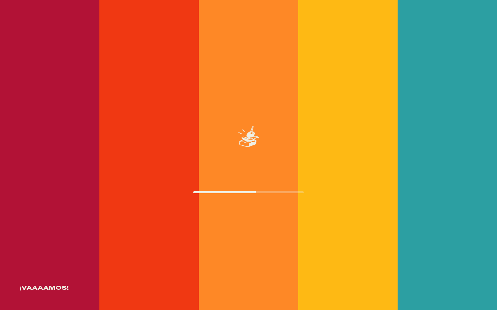
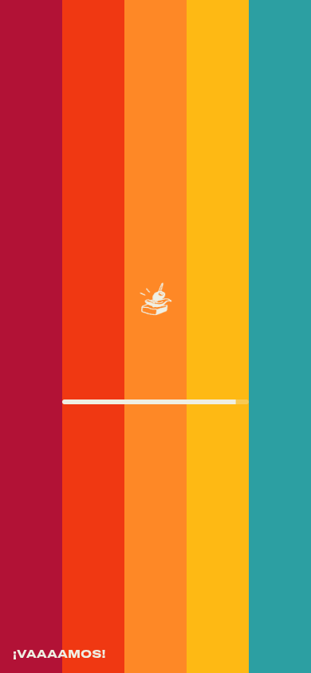

# UI Design System & Master Generation Blueprint: bar-topas-ch

> **Tòpas - bar-topas.ch** (https://bar-topas.ch/) — Tòpas by Topaze — Tapas & Bar. Découvrez la nouvelle cuisine hispano-suisse du Topaze.



---

## 1. Executive Visual Persona & Design Archetype

- **Brand Essence & Persona**: **Tòpas - bar-topas.ch** (`https://bar-topas.ch/`). Tòpas by Topaze — Tapas & Bar. Découvrez la nouvelle cuisine hispano-suisse du Topaze.
- **Capture Provenance**: Live browser capture (`tier2_webgl`, HTTP `200`, captured `2026-11-23`).
- **Visual Archetype**: **Dark-Substrate WebGL / Canvas Interactive Experience (`#b21236` / `#feb914`)**.
- **Anti-AI-Slop Differentiators**:
  - **Live-Computed Chromatic Polarity**: Anchors the viewport in `#b21236` (live computed `body` `background-color` (`computed_styles.json`)) paired with `#efefe3` primary typography and `#feb914` accents.
  - **Grounded Typographic Hierarchy**: Pairs `Source Sans 3` for display copy (`Tòpas by Topaze — Tapas & Bar à Vicq`) with `Source Sans 3` and not declared in live computed styles (uses primary stack / `ui-monospace`).
  - **Calibrated Spatial Grid & Motion**: Combines `1440px` container bounds (`gap: 12px`, padding `56px`) with `cubic-bezier(.2,.8,.2,1)` easing and Lenis Smooth Scroll (`data-lenis`), GSAP Timeline & ScrollTrigger.

---

## 2. Spatial Architecture & Modular Grid Mathematics



### Viewport Allocation & Container Geometry
- **Captured Viewport Dimensions**: Desktop `1440×900px` (`assets/desktop.png`, single-viewport 100vh live capture (900px)), Mobile `390×844px` (`assets/mobile.png`, single-viewport 100vh live capture (844px)).
- **Master Container Bounds**: `1440px` (full-bleed `100%` desktop stage measured on `1440px` viewport).
- **Canvas Lateral Padding & Spacing**: `56px` lateral canvas padding with `12px` grid gap.
- **Border Radius Scale**: `999px`, `6px`, `50%`, `var(--radius)`.

### Responsive Breakpoint Architecture
- **Desktop Layout**: Multi-column CSS Grid / Flexbox layout at `1440px` (`max-width: 1440px`, `gap: 12px`).
- **Mobile Layout**: Single-column vertical stack at `390px` viewport width with `56px` horizontal padding.
- **Extracted CSS Media Queries**: `@media (max-width: 760px)`, `@media (max-width: 960px)`, `@media (prefers-reduced-motion: reduce)`.

---

## 3. Color System, Materiality & Atmospheric Lighting

### Semantic Palette & Source Grounding
| Semantic Role | Ground-Truth Value | Extracted Live / CSS Source |
|---|---|---|
| **Primary Canvas Substrate** | `#b21236` | live computed `body` `background-color` (`computed_styles.json`) |
| **Primary Typography Ink** | `#efefe3` | live computed `h1` `color` (`computed_styles.json`) |
| **Elevated Surface / Card Substrate** | `#1d5f61` | `.vmap__frame { background: #1d5f61 }` |
| **Interactive Accent / Highlight** | `#feb914` | live computed `a` `background-color` (`computed_styles.json`) |
| **Secondary / Muted Copy** | `#808080` | `.has-cyan-bluish-gray-color { color: gray }` (`#808080`) |
| **Structural Hairline Border** | `#bf435c` | `.s-visit__marquee-track { stroke: #bf435c }` |
| **Variable Token (`--creme-fond`)** | `#edeae0` | `var(--creme-fond)` in `:root` |
| **Variable Token (`--orange`)** | `#fe8826` | `var(--orange)` in `:root` |
| **Variable Token (`--orange-rouge`)** | `#f03812` | `var(--orange-rouge)` in `:root` |
| **Variable Token (`--bleu`)** | `#2c9fa2` | `var(--bleu)` in `:root` |
| **Variable Token (`--bordeaux`)** | `#7c1820` | `var(--bordeaux)` in `:root` |
| **Variable Token (`--brun`)** | `#60150d` | `var(--brun)` in `:root` |

### Sanitized Root CSS Variables (`ui-ux.md` Ground Truth)
| Variable Name | Extracted Value | Semantic Role |
|---|---|---|
| `--rouge` | `#B21236` | Color / Atmospheric Token |
| `--creme` | `#EFEFE3` | Color / Atmospheric Token |
| `--creme-fond` | `#EDEAE0` | Color / Atmospheric Token |
| `--jaune` | `#FEB914` | Color / Atmospheric Token |
| `--orange` | `#FE8826` | Color / Atmospheric Token |
| `--orange-rouge` | `#F03812` | Color / Atmospheric Token |
| `--bleu` | `#2C9FA2` | Color / Atmospheric Token |
| `--bordeaux` | `#7C1820` | Color / Atmospheric Token |
| `--brun` | `#60150D` | Color / Atmospheric Token |
| `--f-title` | `"Archivo", "Arial Black", system-ui, sans-serif` | Dimension / Scale Token |
| `--f-cond` | `"Barlow Condensed", "Arial Narrow", system-ui, sans-serif` | Dimension / Scale Token |
| `--f-text` | `"Source Sans 3", Arial, system-ui, sans-serif` | Typography Ink Token |
| `--gutter` | `clamp(16px, 4vw, 56px)` | Layout / Spatial Grid Token |
| `--radius` | `22px` | Elevation / Border Token |
| `--ease` | `cubic-bezier(.2, .8, .2, 1)` | Motion / Easing Token |
| `--topbar-h` | `76px` | Dimension / Scale Token |

---

## 4. Typographic Scale & Editorial Hierarchy

### Font Family Stacks
- **Display Typography**: `Source Sans 3`.
- **Primary Body Stack**: `Source Sans 3`.
- **Technical / Metadata Stack**: not declared in live computed styles (uses primary stack / `ui-monospace`).

### Typographic Scale & Rules (Live Computed & Stylesheet Grounded)
- **Hero Display (`H1`)**: live computed `h1` (`font-size: 42px`, `line-height: 60.9px`, `font-weight: 700`).
- **Section Heading (`H2`)**: live computed `h2` (`font-size: 115.2px`, `line-height: 97.92px`, `font-weight: 800`).
- **Body Copy**: live computed `body` (`font-size: 21px`, `line-height: 30.45px`, `font-weight: 400`); rule `body` (`font-size: clamp(17px, 1.05vw + 10px, 21px)`, `line-height: 1.45`).
- **Metadata & Navigation Labels**: live computed `nav/a` (`font-size: 14px`, `line-height: 14px`, `font-weight: 800`).

---

## 5. Choreographed Motion & Interaction Physics

### Primary Easing Curves
- **Extracted Timing Functions**: `cubic-bezier(.2,.8,.2,1)`, `cubic-bezier(.3,.0,.3,1)`, `cubic-bezier(.3,.7,.3,1)`.

### Per-Element Transition & Choreography Rules
- **Selector `.skip`**: `transition: transform .3s var(--ease)` extracted from `bar-topas-ch` stylesheet.
- **Selector `.btn`**: `transition: color .4s var(--ease)` extracted from `bar-topas-ch` stylesheet.
- **Selector `.btn::before`**: `transition: transform .5s var(--ease)` extracted from `bar-topas-ch` stylesheet.
- **Extracted Easing Curve (`cubic-bezier(.2,.8,.2,1)`)**: Governs interactive state transitions across `<header.topbar>` and `<section.s-marquee>`.
- **Runtime Interaction Engine**: Integrates Lenis Smooth Scroll (`data-lenis`), GSAP Timeline & ScrollTrigger, Three.js / WebGL Canvas Pipeline with `prefers-reduced-motion: reduce` fallback guards.

---

## 6. Component Wireframe & Structural DOM Map

### Visual Layout Schematic — Desktop (`1440px`, Grounded in `dom.html` & Landmark Bounding Boxes)
```
┌────────────────────────────────────────────────────────────────────────┐
│ DESKTOP VIEWPORT (1440px) — Tòpas - bar-topas.ch                       │
│ ====================================================================== │
│ [ <header.topbar> (1440x76px)         | Bar Le Topaze                ] │
│ ---------------------------------------------------------------------- │
│ | HERO STAGE: <section.s-hero> (w=1440px)                            | │
│ | H1: Tòpas by Topaze — Tapas & Bar à Vicques                        | │
│ | Substrate: #b21236 | Ink: #efefe3 | Accent: #feb914                | │
│ ---------------------------------------------------------------------- │
│ | SHOWCASE GRID (<section.s-marquee>) max-w: 1440px                  | │
│ | +------------------------------+  +------------------------------+ | │
│ | | Un pincho, c’est simple.     |  | Mucho délicieuse.            | | │
│ | +------------------------------+  +------------------------------+ | │
│ ---------------------------------------------------------------------- │
│ | DETAIL MODULE (<section.s-def>) — Seize noms, un seul c            | │
│ ---------------------------------------------------------------------- │
│ [ FOOTER (<footer.s-end>      ) | https://bar-topas.ch/                │
└────────────────────────────────────────────────────────────────────────┘
```

### Visual Layout Schematic — Mobile Reflow (`390px`)
```
┌────────────────────────────────────────────────────────────────────────┐
│ MOBILE VIEWPORT REFLOW (390px) — Single-Column Stack (gap: 12px)       │
│ ====================================================================== │
│ [ HEADER BAR (<header.topbar>         ) | Compact Menu (390px)         │
│ ---------------------------------------------------------------------- │
│ | HERO STAGE (<section.s-hero>) — 390px Vertical Lead                | │
│ | H1: Tòpas by Topaze — Tapas & Bar à Vicques                        | │
│ ---------------------------------------------------------------------- │
│ | SHOWCASE STACK (<section.s-marquee>) — 1-Col Stack                 | │
│ | [ Item 1: Un pincho, c’est simple.                               ] | │
│ | [ Item 2: Mucho délicieuse.                                      ] | │
│ ---------------------------------------------------------------------- │
│ | DETAIL STACK (<section.s-def>) — 1-Col (Seize noms, un seu)        | │
│ ---------------------------------------------------------------------- │
│ [ FOOTER (<footer.s-end>      ) | Stacked 390px Colophon               │
└────────────────────────────────────────────────────────────────────────┘
```

### Granular DOM Region Breakdown
1. **Brand Header & Navigation Bar (<header.topbar> — `bar-topas-ch`)**:
   - Landmark `<header class="topbar">` (`1440x76px`) hosting `Tòpas - bar-topas.ch` navigation (`Bar Le Topaze`), DOM attributes (`data-intro`, `data-intro-bar`, `data-intro-done`, `data-cursor`), and stylesheet rule `after { box-sizing: border-box; }`.
2. **Hero Stage & Focal Lead (<section.s-hero> — `Tòpas by Topaze — Tapas & Bar à Vi`)**:
   - Landmark `<section class="s-hero">` presenting display lead `Tòpas by Topaze — Tapas & Bar à Vicques` and copy excerpt *"Tapas & Bar by Topaze Vicques · JU"* over `#b21236` canvas and `#efefe3` ink.
3. **Primary Showcase & Content Grid (<section.s-marquee> — `Un pincho, c’est simple.`)**:
   - Landmark `<section class="s-marquee">` rendering section `Un pincho, c’est simple.` with copy *"Tòpas by Topaze — Tapas & Bar à Vicques"*, asset references (`1640559617463684`, `fbevents.js`, `gtm.js`, `archivo-var-latin.woff2`), and grid rule `html.lenis body { height: auto; }`.
4. **Interactive Detail & Feature Matrix (<section.s-def> — `Mucho délicieuse.`)**:
   - Landmark `<section class="s-def">` framing `Mucho délicieuse.` and `Seize noms, un seul conseil :` (*"Découvrez la nouvelle cuisine hispano-suisse du Topaze."*) with `#1d5f61` surface cards, `#feb914` accents, and `.lenis.lenis-smooth { scroll-behavior: auto !important; }`.
5. **Colophon & Global Directory Footer (<footer.s-end> — `https://bar-topas.ch/`)**:
   - Landmark `<footer class="s-end edge-wave">` anchoring `Tòpas - bar-topas.ch` footer links (`Bar Le Topaze`), copy *"MER & JEU dès 18H30 · VEN dès 17H00"*, and `#bf435c` structural dividers.

---

## 7. Master Zero-Shot AI Generation Prompt

```markdown
# Master Zero-Shot Frontend Generation Prompt: bar-topas-ch (Tòpas - bar-topas.ch)

You are a principal frontend architect and design systems engineer. Build a complete, production-ready web application replicating the exact design system, DOM landmarks, typographic hierarchy, color tokens, and motion physics of `bar-topas-ch` (**Tòpas - bar-topas.ch** — `https://bar-topas.ch/`).

### 1. Visual Archetype & Anti-AI-Slop Mandates
- **Archetype**: Dark-Substrate WebGL / Canvas Interactive Experience (`#b21236` / `#feb914`).
- **Identity & Domain Context**: Tòpas by Topaze — Tapas & Bar. Découvrez la nouvelle cuisine hispano-suisse du Topaze.
- **Primary Substrate**: `#b21236` (live computed `body` `background-color` (`computed_styles.json`)), **Primary Ink**: `#efefe3`, **Accent / Highlight**: `#feb914`.
- **Site-Specific Differentiators**:
  - **Live-Computed Chromatic Polarity**: Anchors the viewport in `#b21236` (live computed `body` `background-color` (`computed_styles.json`)) paired with `#efefe3` primary typography and `#feb914` accents.
  - **Grounded Typographic Hierarchy**: Pairs `Source Sans 3` for display copy (`Tòpas by Topaze — Tapas & Bar à Vicq`) with `Source Sans 3` and not declared in live computed styles (uses primary stack / `ui-monospace`).
  - **Calibrated Spatial Grid & Motion**: Combines `1440px` container bounds (`gap: 12px`, padding `56px`) with `cubic-bezier(.2,.8,.2,1)` easing and Lenis Smooth Scroll (`data-lenis`), GSAP Timeline & ScrollTrigger.

### 2. Ground-Truth CSS Variables (`:root` Token Contract)
Declare and consume these exact custom properties extracted from `bar-topas-ch` in your global stylesheet:

:root {
  /* Tòpas - bar-topas.ch (bar-topas-ch) — Live-Grounded CSS Variables */
  --rouge: #B21236; /* Color / Atmospheric Token (bar-topas-ch) */
  --creme: #EFEFE3; /* Color / Atmospheric Token (bar-topas-ch) */
  --creme-fond: #EDEAE0; /* Color / Atmospheric Token (bar-topas-ch) */
  --jaune: #FEB914; /* Color / Atmospheric Token (bar-topas-ch) */
  --orange: #FE8826; /* Color / Atmospheric Token (bar-topas-ch) */
  --orange-rouge: #F03812; /* Color / Atmospheric Token (bar-topas-ch) */
  --bleu: #2C9FA2; /* Color / Atmospheric Token (bar-topas-ch) */
  --bordeaux: #7C1820; /* Color / Atmospheric Token (bar-topas-ch) */
  --brun: #60150D; /* Color / Atmospheric Token (bar-topas-ch) */
  --f-title: "Archivo", "Arial Black", system-ui, sans-serif; /* Dimension / Scale Token (bar-topas-ch) */
  --f-cond: "Barlow Condensed", "Arial Narrow", system-ui, sans-serif; /* Dimension / Scale Token (bar-topas-ch) */
  --f-text: "Source Sans 3", Arial, system-ui, sans-serif; /* Typography Ink Token (bar-topas-ch) */
  --gutter: clamp(16px, 4vw, 56px); /* Layout / Spatial Grid Token (bar-topas-ch) */
  --radius: 22px; /* Elevation / Border Token (bar-topas-ch) */
  --ease: cubic-bezier(.2, .8, .2, 1); /* Motion / Easing Token (bar-topas-ch) */
  --topbar-h: 76px; /* Dimension / Scale Token (bar-topas-ch) */
}

### 3. Semantic Color & Materiality Contract
Map every surface, ink, and border strictly to these source-grounded tokens:
- **Primary Canvas Substrate**: `#b21236` — grounded in live computed `body` `background-color` (`computed_styles.json`)
- **Primary Typography Ink**: `#efefe3` — grounded in live computed `h1` `color` (`computed_styles.json`)
- **Elevated Surface / Card Substrate**: `#1d5f61` — grounded in `.vmap__frame { background: #1d5f61 }`
- **Interactive Accent / Highlight**: `#feb914` — grounded in live computed `a` `background-color` (`computed_styles.json`)
- **Secondary / Muted Copy**: `#808080` — grounded in `.has-cyan-bluish-gray-color { color: gray }` (`#808080`)
- **Structural Hairline Border**: `#bf435c` — grounded in `.s-visit__marquee-track { stroke: #bf435c }`
- **Variable Token (`--creme-fond`)**: `#edeae0` — grounded in `var(--creme-fond)` in `:root`
- **Variable Token (`--orange`)**: `#fe8826` — grounded in `var(--orange)` in `:root`
- **Variable Token (`--orange-rouge`)**: `#f03812` — grounded in `var(--orange-rouge)` in `:root`
- **Variable Token (`--bleu`)**: `#2c9fa2` — grounded in `var(--bleu)` in `:root`
- **Variable Token (`--bordeaux`)**: `#7c1820` — grounded in `var(--bordeaux)` in `:root`
- **Variable Token (`--brun`)**: `#60150d` — grounded in `var(--brun)` in `:root`

### 4. Spatial Grid, Container Bounds & Responsive Breakpoints
- **Desktop Viewport Reference**: `1440×900px` (single-viewport 100vh live capture (900px), `1440px` standard desktop width).
- **Mobile Viewport Reference**: `390×844px` (single-viewport 100vh live capture (844px), `390px` standard mobile width).
- **Container Max-Width**: `1440px` (full-bleed `100%` desktop stage measured on `1440px` viewport)
- **Padding & Gutters**: `56px` lateral canvas padding with `12px` grid gap
- **Desktop Grid**: Multi-column CSS Grid / Flexbox layout at `1440px` (`max-width: 1440px`, `gap: 12px`)
- **Mobile Adaptation**: Single-column vertical stack at `390px` viewport width with `56px` horizontal padding
- **Media Queries**: `@media (max-width: 760px)`, `@media (max-width: 960px)`, `@media (prefers-reduced-motion: reduce)`
- **Corner Radii**: `999px`, `6px`, `50%`, `var(--radius)`

### 5. Typography & Editorial Scale Contract
- **Display Font Stack**: `Source Sans 3`
- **Body Font Stack**: `Source Sans 3`
- **Monospace / Technical Font Stack**: not declared in live computed styles (uses primary stack / `ui-monospace`)
- **H1 Display Rule**: live computed `h1` (`font-size: 42px`, `line-height: 60.9px`, `font-weight: 700`)
- **H2 Section Rule**: live computed `h2` (`font-size: 115.2px`, `line-height: 97.92px`, `font-weight: 800`)
- **Body Copy Rule**: live computed `body` (`font-size: 21px`, `line-height: 30.45px`, `font-weight: 400`); rule `body` (`font-size: clamp(17px, 1.05vw + 10px, 21px)`, `line-height: 1.45`)
- **Metadata & Index Rule**: live computed `nav/a` (`font-size: 14px`, `line-height: 14px`, `font-weight: 800`)

### 6. Component Hierarchy, Verbatim Copy & Real DOM Landmarks
Scaffold `bar-topas-ch` (`Tòpas - bar-topas.ch`) with these exact structural regions, extracted copy, and CSS rules from `dom.html`:
1. **Brand Header & Navigation Bar (<header.topbar> — `bar-topas-ch`)**:
   - DOM & Selectors: Landmark `<header class="topbar">` (`1440x76px`) hosting `Tòpas - bar-topas.ch` navigation (`Bar Le Topaze`), DOM attributes (`data-intro`, `data-intro-bar`, `data-intro-done`, `data-cursor`), and stylesheet rule `after { box-sizing: border-box; }`.
   - Responsive Contract: Header `Brand Header & Navigation Bar (<header.topbar> — `bar-topas-ch`)` (`bar-topas-ch`) adapts across `@media (max-width: 760px)`, `@media (max-width: 960px)`, `@media (prefers-reduced-motion: reduce)` with `cubic-bezier(.2,.8,.2,1)`, `cubic-bezier(.3,.0,.3,1)`, `cubic-bezier(.3,.7,.3,1)` transitions and links `Bar Le Topaze`.
2. **Hero Stage & Focal Lead (<section.s-hero> — `Tòpas by Topaze — Tapas & Bar à Vi`)**:
   - DOM & Selectors: Landmark `<section class="s-hero">` presenting display lead `Tòpas by Topaze — Tapas & Bar à Vicques` and copy excerpt *"Tapas & Bar by Topaze Vicques · JU"* over `#b21236` canvas and `#efefe3` ink.
   - Responsive Contract: Hero stage (`1440×900px` desktop / `390×844px` mobile) sets `#b21236` background with `#efefe3` headline `Tòpas by Topaze — Tapas & Bar à Vicques`.
3. **Primary Showcase & Content Grid (<section.s-marquee> — `Un pincho, c’est simple.`)**:
   - DOM & Selectors: Landmark `<section class="s-marquee">` rendering section `Un pincho, c’est simple.` with copy *"Tòpas by Topaze — Tapas & Bar à Vicques"*, asset references (`1640559617463684`, `fbevents.js`, `gtm.js`, `archivo-var-latin.woff2`), and grid rule `html.lenis body { height: auto; }`.
   - Responsive Contract: Showcase grid `Primary Showcase & Content Grid (<section.s-marquee> — `Un pincho, c’est simple.`)` applies Multi-column CSS Grid / Flexbox layout at `1440px` (`max-width: 1440px`, `gap: 12px`) on desktop and Single-column vertical stack at `390px` viewport width with `56px` horizontal padding on mobile.
4. **Interactive Detail & Feature Matrix (<section.s-def> — `Mucho délicieuse.`)**:
   - DOM & Selectors: Landmark `<section class="s-def">` framing `Mucho délicieuse.` and `Seize noms, un seul conseil :` (*"Découvrez la nouvelle cuisine hispano-suisse du Topaze."*) with `#1d5f61` surface cards, `#feb914` accents, and `.lenis.lenis-smooth { scroll-behavior: auto !important; }`.
   - Responsive Contract: Detail module `Interactive Detail & Feature Matrix (<section.s-def> — `Mucho délicieuse.`)` uses `999px`, `6px`, `50%`, `var(--radius)` radii, `#feb914` highlights, and assets (1640559617463684, fbevents.js, gtm.js).
5. **Colophon & Global Directory Footer (<footer.s-end> — `https://bar-topas.ch/`)**:
   - DOM & Selectors: Landmark `<footer class="s-end edge-wave">` anchoring `Tòpas - bar-topas.ch` footer links (`Bar Le Topaze`), copy *"MER & JEU dès 18H30 · VEN dès 17H00"*, and `#bf435c` structural dividers.
   - Responsive Contract: Footer `Colophon & Global Directory Footer (<footer.s-end> — `https://bar-topas.ch/`)` aligns to `1440px` (full-bleed `100%` desktop stage measured on `1440px` viewport) with `56px` lateral canvas padding with `12px` grid gap and attributes (data-intro, data-intro-bar, data-intro-done).

#### Verbatim DOM Copy Excerpts (`dom.html`)
- Copy Excerpt 1: *"Tapas & Bar by Topaze Vicques · JU"*
- Copy Excerpt 2: *"Tòpas by Topaze — Tapas & Bar à Vicques"*
- Copy Excerpt 3: *"Découvrez la nouvelle cuisine hispano-suisse du Topaze."*
- Copy Excerpt 4: *"MER & JEU dès 18H30 · VEN dès 17H00"*

### 7. Motion, Extracted Stylesheet Rules & Interaction Choreography
- **Primary Easing Functions**: `cubic-bezier(.2,.8,.2,1)`, `cubic-bezier(.3,.0,.3,1)`, `cubic-bezier(.3,.7,.3,1)`
- **Extracted Stylesheet Rules (`bar-topas-ch`)**:
- `after { box-sizing: border-box; }`
- `html.lenis body { height: auto; }`
- `.lenis.lenis-smooth { scroll-behavior: auto !important; }`
- `.lenis.lenis-stopped { overflow: hidden; }`
- `svg { display: block; max-width: 100%; }`
- **Per-Selector Transition Rules**:
- **Selector `.skip`**: `transition: transform .3s var(--ease)` extracted from `bar-topas-ch` stylesheet.
- **Selector `.btn`**: `transition: color .4s var(--ease)` extracted from `bar-topas-ch` stylesheet.
- **Selector `.btn::before`**: `transition: transform .5s var(--ease)` extracted from `bar-topas-ch` stylesheet.
- **Extracted Easing Curve (`cubic-bezier(.2,.8,.2,1)`)**: Governs interactive state transitions across `<header.topbar>` and `<section.s-marquee>`.
- **Runtime Interaction Engine**: Integrates Lenis Smooth Scroll (`data-lenis`), GSAP Timeline & ScrollTrigger, Three.js / WebGL Canvas Pipeline with `prefers-reduced-motion: reduce` fallback guards.

### 8. Technical Deliverables
- Implement in Next.js (App Router) with TypeScript and Tailwind CSS consuming the `:root` custom properties defined above for `bar-topas-ch`.
- Reproduce both the `1440px` desktop architecture and `390px` mobile breakpoint transitions, preserving semantic HTML5 landmarks (`<header>`, `<nav>`, `<main>`, `<section>`, `<footer>`) and `prefers-reduced-motion` accessibility guards.
```
