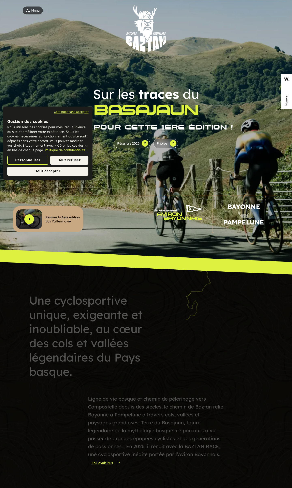
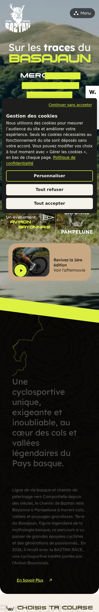

# UI Design System & Master Generation Blueprint: baztan-race-com

> **Baztan Race** (https://baztan-race.com) — Venez affronter la route mythique de la vallée du Baztan entre Bayonne et Pampelune. Entre cols somptueux et forêts mystérieuses, vivez l...



---

## 1. Executive Visual Persona & Design Archetype

- **Brand Essence & Persona**: **Baztan Race** (`https://baztan-race.com`). Venez affronter la route mythique de la vallée du Baztan entre Bayonne et Pampelune. Entre cols somptueux et forêts mystérieuses, vivez l...
- **Visual Archetype**: **High-Contrast Obsidian / Atmospheric Design System (`#000000` canvas, `#FFFFFF` ink, `#DDF240` accent)**.
- **Anti-AI-Slop Differentiators**:
  - **Source-Grounded Chromatic Polarity**: Anchors the viewport in `#000000` (`var(--color-black)` in `:root`) paired with `#FFFFFF` primary typography and `#DDF240` accents.
  - **Extracted Typographic Hierarchy**: Pairs `Outfit Bold` for display copy (`suivez-nous`) with `Outfit Light` and not declared in static CSS (uses primary stack / `ui-monospace`).
  - **Calibrated Spatial Grid & Motion**: Combines `100vw` container bounds (`gap: .5rem`, padding `1rem`) with `cubic-bezier(0.16,1,0.3,1)` easing and GSAP Timeline & ScrollTrigger, Swiper Touch Carousel Engine.

---

## 2. Spatial Architecture & Modular Grid Mathematics



### Viewport Allocation & Container Geometry
- **Captured Viewport Dimensions**: Desktop `1440×11395px` (`assets/desktop.png`, full-page scroll capture), Mobile `390×2400px` (`assets/mobile.png`, capped at 2400px multi-section capture).
- **Master Container Bounds**: `100vw` extracted from `baztan-race-com` stylesheet.
- **Canvas Lateral Padding & Spacing**: `1rem` lateral canvas padding with `.5rem` grid gap.
- **Border Radius Scale**: `20px`, `50%`, `9999px`, `14px`.

### Responsive Breakpoint Architecture
- **Desktop Layout**: Multi-column CSS Grid / Flexbox layout at `1440px` (`max-width: 100vw`, `gap: .5rem`).
- **Mobile Layout**: Single-column vertical stack at `390px` viewport width with `1rem` horizontal padding.
- **Extracted CSS Media Queries**: `@media screen and (max-width:1023px)`, `@media (prefers-reduced-motion:reduce)`, `@media screen and (max-width:1280px)`, `@media screen and (max-width:1024px)`.

---

## 3. Color System, Materiality & Atmospheric Lighting

### Semantic Palette & Source Grounding
| Semantic Role | Ground-Truth Value | Extracted CSS Source / Selector |
|---|---|---|
| **Primary Canvas Substrate** | `#000000` | `var(--color-black)` in `:root` |
| **Primary Typography Ink** | `#FFFFFF` | `var(--color-white)` in `:root` |
| **Elevated Surface / Card Substrate** | `#0D0D0D` | `var(--color-primary)` in `:root` |
| **Interactive Accent / Highlight** | `#DDF240` | `var(--color-green-flash)` in `:root` |
| **Secondary / Muted Copy** | `#C7A882` | `var(--color-brown)` in `:root` |
| **Structural Hairline Border** | `#6B654B` | `var(--color-green-deep)` in `:root` |

### Sanitized Root CSS Variables (`ui-ux.md` Ground Truth)
| Variable Name | Extracted Value | Semantic Role |
|---|---|---|
| `--menu-ease-out` | `cubic-bezier(0.16, 1, 0.3, 1)` | Motion / Easing Token |
| `--menu-ease-in-out` | `cubic-bezier(0.65, 0, 0.35, 1)` | Motion / Easing Token |
| `--menu-ease-in` | `cubic-bezier(0.5, 0, 0.75, 0)` | Motion / Easing Token |
| `--menu-btn-r` | `calc(var(--menu-btn-h, 44px) / 2)` | Dimension / Scale Token |
| `--gradient-progress` | `0%` | Dimension / Scale Token |
| `--hero-ease-out` | `cubic-bezier(0.16, 1, 0.3, 1)` | Motion / Easing Token |
| `--hero-ease-in-out` | `cubic-bezier(0.87, 0, 0.13, 1)` | Motion / Easing Token |
| `--hero-ease-back` | `cubic-bezier(0.34, 1.56, 0.64, 1)` | Motion / Easing Token |
| `--m2ccb-gap` | `1rem` | Layout / Spatial Grid Token |
| `--font-sans` | `ui-sans-serif, system-ui, sans-serif, "Apple Color Emoji",` | Typography / Scale Token |
| `--font-mono` | `ui-monospace, SFMono-Regular, Menlo, Monaco, Consolas, "Liberation Mono",` | Typography / Scale Token |
| `--color-red-500` | `oklch(63.7% 0.237 25.331)` | Brand / Palette Token |
| `--color-gray-200` | `oklch(92.8% 0.006 264.531)` | Brand / Palette Token |
| `--color-gray-300` | `oklch(87.2% 0.01 258.338)` | Brand / Palette Token |
| `--color-gray-400` | `oklch(70.7% 0.022 261.325)` | Brand / Palette Token |
| `--color-gray-500` | `oklch(55.1% 0.027 264.364)` | Brand / Palette Token |

---

## 4. Typographic Scale & Editorial Hierarchy

### Font Family Stacks
- **Display Typography**: `Outfit Bold`.
- **Primary Body Stack**: `Outfit Light`.
- **Technical / Metadata Stack**: not declared in static CSS (uses primary stack / `ui-monospace`).

### Typographic Scale & Rules (Extracted from Stylesheet & Variables)
- **Hero Display (`H1`)**: CSS variables `--text-4xl: 3.5rem`, `--text-4xl--line-height: calc(2.5 / 2.25)`, `--text-5xl: 4rem`.
- **Section Heading (`H2`)**: CSS variables `--text-2xl: 2.5rem`, `--text-2xl--line-height: calc(2 / 1.5)`, `--text-3xl: 3rem`.
- **Body Copy**: CSS variables `--text-base: 1rem`, `--text-base--line-height: calc(1.5 / 1)`; rule `p` (`font-size: 14px!important`, `font-weight: 300!important`).
- **Metadata & Navigation Labels**: CSS variables `--font-mono: ui-monospace, SFMono-Regular, Menlo, Monaco, Consolas, "Liberation Mono",`, `--text-xs: 0.875rem`, `--text-xs--line-height: calc(1 / 0.75)`.

---

## 5. Choreographed Motion & Interaction Physics

### Primary Easing Curves
- **Extracted Timing Functions**: `cubic-bezier(0.16,1,0.3,1)`, `cubic-bezier(0.65,0,0.35,1)`, `cubic-bezier(0.5,0,0.75,0)`.

### Per-Element Transition & Choreography Rules
- **Selector `#main-menu`**: `transition: clip-path 0.6s var(--menu-ease-in-out) 0.12s,visibility 0s lin...` extracted from `baztan-race-com` stylesheet.
- **Selector `#main-menu.is-open`**: `transition: clip-path 0.95s var(--menu-ease-out),visibility 0s` extracted from `baztan-race-com` stylesheet.
- **Selector `.header-logo`**: `transition: opacity 0.5s ease 0.45s,visibility 0s linear 0.45s` extracted from `baztan-race-com` stylesheet.
- **Extracted Easing Curve (`cubic-bezier(0.16,1,0.3,1)`)**: Governs interactive state transitions across `<header.main-header>` and `<section.text-intro>`.
- **Runtime Interaction Engine**: Integrates GSAP Timeline & ScrollTrigger, Swiper Touch Carousel Engine with `prefers-reduced-motion: reduce` fallback guards.

---

## 6. Component Wireframe & Structural DOM Map

### Visual Layout Schematic (Grounded in `dom.html` — `1440px` Desktop & `390px` Mobile Reflow)
```
┌────────────────────────────────────────────────────────────────────────┐
│ DESKTOP VIEWPORT (1440px) — Baztan Race                                │
│ ====================================================================== │
│ [ <header.main-header>     | L’épreuve · Les parcours · Galerie · I ]  │
│ ---------------------------------------------------------------------- │
│ | HERO STAGE: <section.hero-full>                                  |   │
│ | H1: suivez-nous                                                  |   │
│ | Substrate: #000000    | Ink: #FFFFFF    | Accent: #DDF240        |   │
│ ---------------------------------------------------------------------- │
│ | SHOWCASE GRID (<section.text-intro>      ) max-w: 100vw          |   │
│ | +------------------------------+  +------------------------------+ | │
│ | | Sur les traces du B a s a j  |  | Choisis ta course            | | │
│ | +------------------------------+  +------------------------------+ | │
│ ---------------------------------------------------------------------- │
│ | MOBILE VIEWPORT REFLOW (390px) — Single-Column Stack (gap: .5rem ) | │
│ | [<header.main-heade] -> [<section.hero-full] -> [<section.text-intr] │
│ ---------------------------------------------------------------------- │
│ [ FOOTER (<footer.bg-dark-1>    ) | https://baztan-race.com            │
└────────────────────────────────────────────────────────────────────────┘
```

### Granular DOM Region Breakdown
1. **Brand Header & Navigation Bar (<header.main-header> — `baztan-race-com`)**:
   - Landmark `<header class="main-header fixed">` hosting `Baztan Race` navigation (`L’épreuve · Les parcours · Galerie · Infos pratiques · Français`), DOM attributes (`data-rocket-prefetch`, `data-rocket-preload`, `data-nowprocket`, `data-cfasync="false"`), and stylesheet rule `html { overflow-x:hidden;max-width:100vw }`.
2. **Hero Stage & Focal Lead (<section.hero-full> — `suivez-nous`)**:
   - Landmark `<section class="hero-full relative">` presenting display lead `suivez-nous` and copy excerpt *"Cartes et Profils GPX"* over `#000000` canvas and `#FFFFFF` ink.
3. **Primary Showcase & Content Grid (<section.text-intro> — `Sur les traces du B a s a j a u n`)**:
   - Landmark `<section class="text-intro relative">` rendering section `Sur les traces du B a s a j a u n` with copy *"Français English Español Euskara"*, asset references (`fonts.googleapis.com`, `fonts.gstatic.com`, `connect.facebook.net`, `matomo.mak2com.fr`), and grid rule `body { max-width:100vw;position:relative }`.
4. **Interactive Detail & Feature Matrix (<section.title-section> — `Choisis ta course`)**:
   - Landmark `<section class="title-section relative">` framing `Choisis ta course` and `BAZTAN REAL #1` (*"MERCI POUR CETTE 1ÈRE ÉDITION !"*) with `#0D0D0D` surface cards, `#DDF240` accents, and `header { pointer-events:none }`.
5. **Colophon & Global Directory Footer (<footer.bg-dark-1> — `https://baztan-race.com`)**:
   - Landmark `<footer class="bg-dark-1 pb-16">` anchoring `Baztan Race` footer links (`L’épreuve · Les parcours · Galerie · Infos pratiques · Français`), copy *"Revivez la 1ère édition Voir l'aftermovie"*, and `#6B654B` structural dividers.

---

## 7. Master Zero-Shot AI Generation Prompt

```markdown
# Master Zero-Shot Frontend Generation Prompt: baztan-race-com (Baztan Race)

You are a principal frontend architect and design systems engineer. Build a complete, production-ready web application replicating the exact design system, DOM landmarks, typographic hierarchy, color tokens, and motion physics of `baztan-race-com` (**Baztan Race** — `https://baztan-race.com`).

### 1. Visual Archetype & Anti-AI-Slop Mandates
- **Archetype**: High-Contrast Obsidian / Atmospheric Design System (`#000000` canvas, `#FFFFFF` ink, `#DDF240` accent).
- **Identity & Domain Context**: Venez affronter la route mythique de la vallée du Baztan entre Bayonne et Pampelune. Entre cols somptueux et forêts mystérieuses, vivez l...
- **Primary Substrate**: `#000000` (`var(--color-black)` in `:root`), **Primary Ink**: `#FFFFFF`, **Accent / Highlight**: `#DDF240`.
- **Site-Specific Differentiators**:
  - **Source-Grounded Chromatic Polarity**: Anchors the viewport in `#000000` (`var(--color-black)` in `:root`) paired with `#FFFFFF` primary typography and `#DDF240` accents.
  - **Extracted Typographic Hierarchy**: Pairs `Outfit Bold` for display copy (`suivez-nous`) with `Outfit Light` and not declared in static CSS (uses primary stack / `ui-monospace`).
  - **Calibrated Spatial Grid & Motion**: Combines `100vw` container bounds (`gap: .5rem`, padding `1rem`) with `cubic-bezier(0.16,1,0.3,1)` easing and GSAP Timeline & ScrollTrigger, Swiper Touch Carousel Engine.

### 2. Ground-Truth CSS Variables (`:root` Token Contract)
Declare and consume these exact custom properties extracted from `baztan-race-com` in your global stylesheet:

:root {
  /* Baztan Race (baztan-race-com) — Ground-Truth Extracted CSS Variables */
  --menu-ease-out: cubic-bezier(0.16, 1, 0.3, 1); /* Motion / Easing Token (baztan-race-com) */
  --menu-ease-in-out: cubic-bezier(0.65, 0, 0.35, 1); /* Motion / Easing Token (baztan-race-com) */
  --menu-ease-in: cubic-bezier(0.5, 0, 0.75, 0); /* Motion / Easing Token (baztan-race-com) */
  --menu-btn-r: calc(var(--menu-btn-h, 44px) / 2); /* Dimension / Scale Token (baztan-race-com) */
  --gradient-progress: 0%; /* Dimension / Scale Token (baztan-race-com) */
  --hero-ease-out: cubic-bezier(0.16, 1, 0.3, 1); /* Motion / Easing Token (baztan-race-com) */
  --hero-ease-in-out: cubic-bezier(0.87, 0, 0.13, 1); /* Motion / Easing Token (baztan-race-com) */
  --hero-ease-back: cubic-bezier(0.34, 1.56, 0.64, 1); /* Motion / Easing Token (baztan-race-com) */
  --m2ccb-gap: 1rem; /* Layout / Spatial Grid Token (baztan-race-com) */
  --font-sans: ui-sans-serif, system-ui, sans-serif, "Apple Color Emoji",; /* Typography / Scale Token (baztan-race-com) */
  --font-mono: ui-monospace, SFMono-Regular, Menlo, Monaco, Consolas, "Liberation Mono",; /* Typography / Scale Token (baztan-race-com) */
  --color-red-500: oklch(63.7% 0.237 25.331); /* Brand / Palette Token (baztan-race-com) */
  --color-gray-200: oklch(92.8% 0.006 264.531); /* Brand / Palette Token (baztan-race-com) */
  --color-gray-300: oklch(87.2% 0.01 258.338); /* Brand / Palette Token (baztan-race-com) */
  --color-gray-400: oklch(70.7% 0.022 261.325); /* Brand / Palette Token (baztan-race-com) */
  --color-gray-500: oklch(55.1% 0.027 264.364); /* Brand / Palette Token (baztan-race-com) */
}

### 3. Semantic Color & Materiality Contract
Map every surface, ink, and border strictly to these source-grounded tokens:
- **Primary Canvas Substrate**: `#000000` — grounded in `var(--color-black)` in `:root`
- **Primary Typography Ink**: `#FFFFFF` — grounded in `var(--color-white)` in `:root`
- **Elevated Surface / Card Substrate**: `#0D0D0D` — grounded in `var(--color-primary)` in `:root`
- **Interactive Accent / Highlight**: `#DDF240` — grounded in `var(--color-green-flash)` in `:root`
- **Secondary / Muted Copy**: `#C7A882` — grounded in `var(--color-brown)` in `:root`
- **Structural Hairline Border**: `#6B654B` — grounded in `var(--color-green-deep)` in `:root`

### 4. Spatial Grid, Container Bounds & Responsive Breakpoints
- **Desktop Viewport Reference**: `1440×11395px` (full-page scroll capture, `1440px` standard desktop width).
- **Mobile Viewport Reference**: `390×2400px` (capped at 2400px multi-section capture, `390px` standard mobile width).
- **Container Max-Width**: `100vw` extracted from `baztan-race-com` stylesheet
- **Padding & Gutters**: `1rem` lateral canvas padding with `.5rem` grid gap
- **Desktop Grid**: Multi-column CSS Grid / Flexbox layout at `1440px` (`max-width: 100vw`, `gap: .5rem`)
- **Mobile Adaptation**: Single-column vertical stack at `390px` viewport width with `1rem` horizontal padding
- **Media Queries**: `@media screen and (max-width:1023px)`, `@media (prefers-reduced-motion:reduce)`, `@media screen and (max-width:1280px)`, `@media screen and (max-width:1024px)`
- **Corner Radii**: `20px`, `50%`, `9999px`, `14px`

### 5. Typography & Editorial Scale Contract
- **Display Font Stack**: `Outfit Bold`
- **Body Font Stack**: `Outfit Light`
- **Monospace / Technical Font Stack**: not declared in static CSS (uses primary stack / `ui-monospace`)
- **H1 Display Rule**: CSS variables `--text-4xl: 3.5rem`, `--text-4xl--line-height: calc(2.5 / 2.25)`, `--text-5xl: 4rem`
- **H2 Section Rule**: CSS variables `--text-2xl: 2.5rem`, `--text-2xl--line-height: calc(2 / 1.5)`, `--text-3xl: 3rem`
- **Body Copy Rule**: CSS variables `--text-base: 1rem`, `--text-base--line-height: calc(1.5 / 1)`; rule `p` (`font-size: 14px!important`, `font-weight: 300!important`)
- **Metadata & Index Rule**: CSS variables `--font-mono: ui-monospace, SFMono-Regular, Menlo, Monaco, Consolas, "Liberation Mono",`, `--text-xs: 0.875rem`, `--text-xs--line-height: calc(1 / 0.75)`

### 6. Component Hierarchy, Verbatim Copy & Real DOM Landmarks
Scaffold `baztan-race-com` (`Baztan Race`) with these exact structural regions, extracted copy, and CSS rules from `dom.html`:
1. **Brand Header & Navigation Bar (<header.main-header> — `baztan-race-com`)**:
   - DOM & Selectors: Landmark `<header class="main-header fixed">` hosting `Baztan Race` navigation (`L’épreuve · Les parcours · Galerie · Infos pratiques · Français`), DOM attributes (`data-rocket-prefetch`, `data-rocket-preload`, `data-nowprocket`, `data-cfasync="false"`), and stylesheet rule `html { overflow-x:hidden;max-width:100vw }`.
   - Responsive Contract: Header `Brand Header & Navigation Bar (<header.main-header> — `baztan-race-com`)` (`baztan-race-com`) adapts across `@media screen and (max-width:1023px)`, `@media (prefers-reduced-motion:reduce)`, `@media screen and (max-width:1280px)`, `@media screen and (max-width:1024px)` with `cubic-bezier(0.16,1,0.3,1)`, `cubic-bezier(0.65,0,0.35,1)`, `cubic-bezier(0.5,0,0.75,0)` transitions and links `L’épreuve · Les parcours · Galerie · Infos pratiques · Français`.
2. **Hero Stage & Focal Lead (<section.hero-full> — `suivez-nous`)**:
   - DOM & Selectors: Landmark `<section class="hero-full relative">` presenting display lead `suivez-nous` and copy excerpt *"Cartes et Profils GPX"* over `#000000` canvas and `#FFFFFF` ink.
   - Responsive Contract: Hero stage (`1440×11395px` desktop / `390×2400px` mobile) sets `#000000` background with `#FFFFFF` headline `suivez-nous`.
3. **Primary Showcase & Content Grid (<section.text-intro> — `Sur les traces du B a s a j a u n`)**:
   - DOM & Selectors: Landmark `<section class="text-intro relative">` rendering section `Sur les traces du B a s a j a u n` with copy *"Français English Español Euskara"*, asset references (`fonts.googleapis.com`, `fonts.gstatic.com`, `connect.facebook.net`, `matomo.mak2com.fr`), and grid rule `body { max-width:100vw;position:relative }`.
   - Responsive Contract: Showcase grid `Primary Showcase & Content Grid (<section.text-intro> — `Sur les traces du B a s a j a u n`)` applies Multi-column CSS Grid / Flexbox layout at `1440px` (`max-width: 100vw`, `gap: .5rem`) on desktop and Single-column vertical stack at `390px` viewport width with `1rem` horizontal padding on mobile.
4. **Interactive Detail & Feature Matrix (<section.title-section> — `Choisis ta course`)**:
   - DOM & Selectors: Landmark `<section class="title-section relative">` framing `Choisis ta course` and `BAZTAN REAL #1` (*"MERCI POUR CETTE 1ÈRE ÉDITION !"*) with `#0D0D0D` surface cards, `#DDF240` accents, and `header { pointer-events:none }`.
   - Responsive Contract: Detail module `Interactive Detail & Feature Matrix (<section.title-section> — `Choisis ta course`)` uses `20px`, `50%`, `9999px`, `14px` radii, `#DDF240` highlights, and assets (fonts.googleapis.com, fonts.gstatic.com, connect.facebook.net).
5. **Colophon & Global Directory Footer (<footer.bg-dark-1> — `https://baztan-race.com`)**:
   - DOM & Selectors: Landmark `<footer class="bg-dark-1 pb-16">` anchoring `Baztan Race` footer links (`L’épreuve · Les parcours · Galerie · Infos pratiques · Français`), copy *"Revivez la 1ère édition Voir l'aftermovie"*, and `#6B654B` structural dividers.
   - Responsive Contract: Footer `Colophon & Global Directory Footer (<footer.bg-dark-1> — `https://baztan-race.com`)` aligns to `100vw` extracted from `baztan-race-com` stylesheet with `1rem` lateral canvas padding with `.5rem` grid gap and attributes (data-rocket-prefetch, data-rocket-preload, data-nowprocket).

#### Verbatim DOM Copy Excerpts (`dom.html`)
- Copy Excerpt 1: *"Cartes et Profils GPX"*
- Copy Excerpt 2: *"Français English Español Euskara"*
- Copy Excerpt 3: *"MERCI POUR CETTE 1ÈRE ÉDITION !"*
- Copy Excerpt 4: *"Revivez la 1ère édition Voir l'aftermovie"*

### 7. Motion, Extracted Stylesheet Rules & Interaction Choreography
- **Primary Easing Functions**: `cubic-bezier(0.16,1,0.3,1)`, `cubic-bezier(0.65,0,0.35,1)`, `cubic-bezier(0.5,0,0.75,0)`
- **Extracted Stylesheet Rules (`baztan-race-com`)**:
- `html { overflow-x:hidden;max-width:100vw }`
- `body { max-width:100vw;position:relative }`
- `header { pointer-events:none }`
- `header .header-right { pointer-events:auto }`
- `menu-content { overflow-y:auto;overscroll-behavior:contain }`
- **Per-Selector Transition Rules**:
- **Selector `#main-menu`**: `transition: clip-path 0.6s var(--menu-ease-in-out) 0.12s,visibility 0s lin...` extracted from `baztan-race-com` stylesheet.
- **Selector `#main-menu.is-open`**: `transition: clip-path 0.95s var(--menu-ease-out),visibility 0s` extracted from `baztan-race-com` stylesheet.
- **Selector `.header-logo`**: `transition: opacity 0.5s ease 0.45s,visibility 0s linear 0.45s` extracted from `baztan-race-com` stylesheet.
- **Extracted Easing Curve (`cubic-bezier(0.16,1,0.3,1)`)**: Governs interactive state transitions across `<header.main-header>` and `<section.text-intro>`.
- **Runtime Interaction Engine**: Integrates GSAP Timeline & ScrollTrigger, Swiper Touch Carousel Engine with `prefers-reduced-motion: reduce` fallback guards.

### 8. Technical Deliverables
- Implement in Next.js (App Router) with TypeScript and Tailwind CSS consuming the `:root` custom properties defined above for `baztan-race-com`.
- Reproduce both the `1440px` desktop architecture and `390px` mobile breakpoint transitions, preserving semantic HTML5 landmarks (`<header>`, `<nav>`, `<main>`, `<section>`, `<footer>`) and `prefers-reduced-motion` accessibility guards.
```
