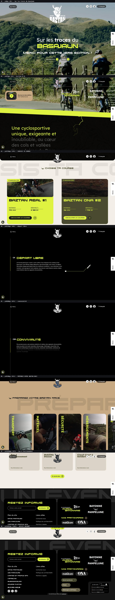
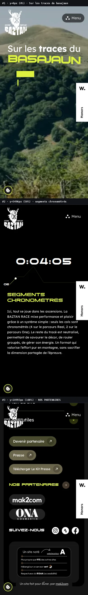

# UI Design System & Master Generation Blueprint: baztan-race-com

> **Baztan Race** (https://baztan-race.com) — Venez affronter la route mythique de la vallée du Baztan entre Bayonne et Pampelune. Entre cols somptueux et forêts mystérieuses, vivez l...





---

## 1. Executive Visual Persona & Design Archetype

- **Brand Essence & Persona**: **Baztan Race** (`https://baztan-race.com`). Venez affronter la route mythique de la vallée du Baztan entre Bayonne et Pampelune. Entre cols somptueux et forêts mystérieuses, vivez l...
- **Capture Provenance**: Live browser capture (`tier1_fast`, HTTP `200`, captured `2026-11-24`).
- **Visual Archetype**: **Light-Substrate Editorial & Modular Grid System (`#ffffff` canvas, `#000000` ink, `#1ea9ea` accent)**.
- **Anti-AI-Slop Differentiators**:
  - **Live-Computed Chromatic Polarity**: Anchors the viewport in `#ffffff` (live computed `body` `background-color` (`computed_styles.json`)) paired with `#000000` primary typography and `#1ea9ea` accents.
  - **Grounded Typographic Hierarchy**: Uses `Apple Color Emoji` across display (`Sur les traces du basajaun`) and body copy, paired with `SFMono-Regular` for monospace/code.
  - **Calibrated Spatial Grid & Motion**: Combines `1440px` container bounds (`gap: 12px`, padding `1.25rem`) with `cubic-bezier(0.16,1,0.3,1)` easing and GSAP Timeline & ScrollTrigger, Three.js / WebGL Canvas Pipeline.

---

## 2. Spatial Architecture & Modular Grid Mathematics

### Viewport Allocation & Container Geometry
- **Captured Journey Filmstrips**: Desktop `1280×6624px` (`assets/desktop-journey.webp`, `8` keyframes up to `y=10495px` / doc `11395px`), Mobile `390×2616px` (`assets/mobile-journey.webp`, `3` keyframes).
- **Master Container Bounds**: `1440px` (live computed `body` `max-width`).
- **Canvas Lateral Padding & Spacing**: `1.25rem` lateral canvas padding with `12px` grid gap.
- **Border Radius Scale**: `3.35544e+07px`, `50%`, `20px`, `9999px`.

### Responsive Breakpoint Architecture
- **Desktop Layout**: Multi-column CSS Grid / Flexbox layout at `1440px` (`max-width: 1440px`, `gap: 12px`).
- **Mobile Layout**: Single-column vertical stack at `390px` viewport width with `1.25rem` horizontal padding.
- **Extracted CSS Media Queries**: `@media (max-height:32em),(max-width:20em)`, `@media (max-width:40em)`, `@media (prefers-reduced-motion:no-preference)`, `@media screen and (max-width:1023px)`.

---

## 3. Color System, Materiality & Atmospheric Lighting

### Semantic Palette & Source Grounding
| Semantic Role | Ground-Truth Value | Extracted Live / CSS Source |
|---|---|---|
| **Primary Canvas Substrate** | `#ffffff` | live computed `body` `background-color` (`computed_styles.json`) |
| **Primary Typography Ink** | `#000000` | live computed `h1` `color` (`computed_styles.json`) |
| **Elevated Surface / Card Substrate** | `#eeeeee` | `.wpml-ls-legacy-dropdown a:hover { background: #eeeeee }` |
| **Interactive Accent / Highlight** | `#1ea9ea` | `.jBox-content .nf-button.primary { background: #1ea9ea }` |
| **Secondary / Muted Copy** | `#979797` | `var(--color-text-secondary)` in `:root` |
| **Structural Hairline Border** | `#dcf241` | `var(--m2ccb-border)` in `:root` |
| **Variable Token (`--m2ccb-bg`)** | `#1d1d1b` | `var(--m2ccb-bg)` in `:root` |
| **Variable Token (`--m2ccb-text`)** | `#f4f2e9` | `var(--m2ccb-text)` in `:root` |

### Sanitized Root CSS Variables (`ui-ux.md` Ground Truth)
| Variable Name | Extracted Value | Semantic Role |
|---|---|---|
| `--m2ccb-bg` | `#1d1d1b` | Canvas / Surface Token |
| `--m2ccb-text` | `#f4f2e9` | Typography Ink Token |
| `--m2ccb-primary-bg` | `#f4f2e9` | Canvas / Surface Token |
| `--m2ccb-primary-text` | `#1d1d1b` | Typography Ink Token |
| `--m2ccb-secondary-bg` | `#1d1d1b` | Canvas / Surface Token |
| `--m2ccb-secondary-text` | `#f4f2e9` | Typography Ink Token |
| `--m2ccb-link` | `#dcf241` | Typography Ink Token |
| `--m2ccb-border` | `#dcf241` | Elevation / Border Token |
| `--m2ccb-switch-on` | `#dcf241` | Color / Atmospheric Token |
| `--m2ccb-focus` | `#dcf241` | Color / Atmospheric Token |
| `--m2ccb-radius` | `8px` | Elevation / Border Token |
| `--m2ccb-btn-radius` | `6px` | Elevation / Border Token |
| `--m2ccb-bar` | `1200px` | Dimension / Scale Token |
| `--m2ccb-box` | `440px` | Dimension / Scale Token |
| `--m2ccb-font` | `inherit` | Typography / Scale Token |
| `--m2ccb-scale` | `1` | Design System Custom Token |

---

## 4. Typographic Scale & Editorial Hierarchy

### Font Family Stacks
- **Display Typography**: `Apple Color Emoji`.
- **Primary Body Stack**: `Apple Color Emoji`.
- **Technical / Metadata Stack**: `SFMono-Regular`.

### Typographic Scale & Rules (Live Computed & Stylesheet Grounded)
- **Hero Display (`H1`)**: live computed `h1` (`font-size: 16px`, `line-height: 24px`, `font-weight: 400`); CSS variables `--text-4xl: 3.5rem`, `--text-4xl--line-height: calc(2.5 / 2.25)`, `--text-5xl: 4rem`.
- **Section Heading (`H2`)**: live computed `h2` (`font-size: 220px`, `line-height: 220px`, `font-weight: 400`); CSS variables `--text-2xl: 2.5rem`, `--text-2xl--line-height: calc(2 / 1.5)`, `--text-3xl: 3rem`.
- **Body Copy**: live computed `body` (`font-size: 16px`, `line-height: 24px`, `font-weight: 400`); CSS variables `--text-base: 1rem`, `--text-base--line-height: calc(1.5 / 1)`; rule `p` (`font-size: 14px`, `font-weight: 300`).
- **Metadata & Navigation Labels**: live computed `nav/a` (`font-size: 16px`, `line-height: 24px`, `font-weight: 400`); CSS variables `--font-mono: ui-monospace, SFMono-Regular, Menlo, Monaco, Consolas, "Liberation Mono",`, `--text-xs: 0.875rem`, `--text-xs--line-height: calc(1 / 0.75)`.

---

## 5. Choreographed Motion & Interaction Physics

### Primary Easing Curves
- **Extracted Timing Functions**: `cubic-bezier(0.16,1,0.3,1)`, `cubic-bezier(0.65,0,0.35,1)`, `cubic-bezier(0.5,0,0.75,0)`.

### Per-Element Transition & Choreography Rules
- **Selector `media(prefers-reduced-motion:no-p...`**: `transition: left .15s,right .15s` extracted from `baztan-race-com` stylesheet.
- **Selector `.swiper-wrapper`**: `transition: var(--swiper-wrapper-transition-timing-function,initial)` extracted from `baztan-race-com` stylesheet.
- **Selector `.swiper-pagination`**: `transition: .3s opacity` extracted from `baztan-race-com` stylesheet.
- **Extracted Easing Curve (`cubic-bezier(0.16,1,0.3,1)`)**: Governs interactive state transitions across `<header.main-header>` and `<section.text-intro>`.
- **Runtime Interaction Engine**: Integrates GSAP Timeline & ScrollTrigger, Three.js / WebGL Canvas Pipeline, Swiper Touch Carousel Engine with `prefers-reduced-motion: reduce` fallback guards.
### Measured Runtime Scroll & Interaction Telemetry (`behavioral_journey_v2`)
- **Scroll Driver Mode**: `native` (max document height `11395px`, deepest scrollY reached `10495px` across `8` desktop keyframes).
- **Detected Scroll / Motion Libraries**: `GSAP/ScrollTrigger`.
- **Nav / Drawer Probe (`Menu`)**: Triggered visual change (pixel diff `54.217`, captured in `assets/state-nav.webp`); revealed links: l’épreuve, les parcours, cartes et profils gpx, galerie, infos pratiques.
- **Hover Physics (`primary_cta` · `Résultats 2026`)**: `color`: `rgb(255, 255, 255)` -> `rgb(0, 0, 0)`; `backgroundColor`: `rgba(0, 0, 0, 0.2)` -> `rgb(221, 242, 64)`; `borderColor`: `rgb(255, 255, 255)` -> `rgb(221, 242, 64)`; `opacity`: `1` -> `0.9` (`transition-duration: 0.3s`, `timing: cubic-bezier(0.4, 0, 0.2, 1)`).
- **Route Transition Architecture**: First internal navigation (`/course/baztan-real/`) measured as `direct` in `1052ms`.

---

## 6. Component Wireframe & Structural DOM Map

### Visual Layout Schematic — Desktop (`1440px`, Grounded in `dom.html` & Landmark Bounding Boxes)
```
┌────────────────────────────────────────────────────────────────────────┐
│ DESKTOP VIEWPORT (1440px) — Baztan Race                                │
│ ====================================================================== │
│ [ <header.main-header> (1440x87px)    | L’épreuve · Les parcours · G ] │
│ ---------------------------------------------------------------------- │
│ | HERO STAGE: <section.hero-full> (w=1440px)                         | │
│ | H1: Sur les traces du basajaun                                     | │
│ | Substrate: #ffffff | Ink: #000000 | Accent: #1ea9ea                | │
│ ---------------------------------------------------------------------- │
│ | SHOWCASE GRID (<section.text-intro>) max-w: 1440px                 | │
│ | +------------------------------+  +------------------------------+ | │
│ | | Sur les traces du B a s a j  |  | Choisis ta course            | | │
│ | +------------------------------+  +------------------------------+ | │
│ ---------------------------------------------------------------------- │
│ | DETAIL MODULE (<section.title-section>) — BAZTAN REAL #1           | │
│ ---------------------------------------------------------------------- │
│ [ FOOTER (<footer.bg-dark-1>  ) | https://baztan-race.com              │
└────────────────────────────────────────────────────────────────────────┘
```

### Visual Layout Schematic — Mobile Reflow (`390px`)
```
┌────────────────────────────────────────────────────────────────────────┐
│ MOBILE VIEWPORT REFLOW (390px) — Single-Column Stack (gap: 12px)       │
│ ====================================================================== │
│ [ HEADER BAR (<header.main-header>    ) | Compact Menu (390px)         │
│ ---------------------------------------------------------------------- │
│ | HERO STAGE (<section.hero-full>) — 390px Vertical Lead             | │
│ | H1: Sur les traces du basajaun                                     | │
│ ---------------------------------------------------------------------- │
│ | SHOWCASE STACK (<section.text-intro>) — 1-Col Stack                | │
│ | [ Item 1: Sur les traces du B a s a j a u n                      ] | │
│ | [ Item 2: Choisis ta course                                      ] | │
│ ---------------------------------------------------------------------- │
│ | DETAIL STACK (<section.title-section>) — 1-Col (BAZTAN REAL #1)    | │
│ ---------------------------------------------------------------------- │
│ [ FOOTER (<footer.bg-dark-1>  ) | Stacked 390px Colophon               │
└────────────────────────────────────────────────────────────────────────┘
```

### Granular DOM Region Breakdown
1. **Brand Header & Navigation Bar (<header.main-header> — `baztan-race-com`)**:
   - Landmark `<header class="main-header top-0">` (`1440x87px`) hosting `Baztan Race` navigation (`L’épreuve · Les parcours · Galerie · Infos pratiques · Français`), DOM attributes (`data-rocket-prefetch`, `data-rocket-preload`, `data-nowprocket`, `data-cfasync="false"`), and stylesheet rule `m2ccb:focus { outline:none }`.
2. **Hero Stage & Focal Lead (<section.hero-full> — `Sur les traces du basajaun`)**:
   - Landmark `<section class="hero-full z-100">` presenting display lead `Sur les traces du basajaun` and copy excerpt *"MERCI POUR CETTE 1ÈRE ÉDITION !"* over `#ffffff` canvas and `#000000` ink.
3. **Primary Showcase & Content Grid (<section.text-intro> — `Sur les traces du B a s a j a u n`)**:
   - Landmark `<section class="text-intro py-8">` rendering section `Sur les traces du B a s a j a u n` with copy *"Revivez la 1ère édition Voir l'aftermovie"*, asset references (`fonts.googleapis.com`, `fonts.gstatic.com`, `1323232575844849`, `fbevents.js`), and grid rule `.m2ccb-ph a { color:var(--m2ccb-link, inherit);text-decoration:underline;text-underlin... }`.
4. **Interactive Detail & Feature Matrix (<section.title-section> — `Choisis ta course`)**:
   - Landmark `<section class="title-section relative">` framing `Choisis ta course` and `BAZTAN REAL #1` (*"Une cyclosportive unique, exigeante et inoubliable, au cœur des c"*) with `#eeeeee` surface cards, `#1ea9ea` accents, and `.m2ccb-ph a:hover { text-decoration-thickness:.125em }`.
5. **Colophon & Global Directory Footer (<footer.bg-dark-1> — `https://baztan-race.com`)**:
   - Landmark `<footer class="bg-dark-1 pb-16">` anchoring `Baztan Race` footer links (`L’épreuve · Les parcours · Galerie · Infos pratiques · Français`), copy *"Ligne de vie basque et chemin de pèlerinage vers Compostelle"*, and `#dcf241` structural dividers.
### Full Vertical Scroll Sequence (Desktop `1440×900` Keyframes)
- **Step 01** (`y=0px`, `0%`): Active landmark `Sur les traces du basajaun` · sticky/fixed elements: `2`
- **Step 02** (`y=850px`, `8%`): Active landmark `Section @ 8%` · sticky/fixed elements: `2`
- **Step 03** (`y=2550px`, `24%`): Active landmark `CHOISIS TA COURSE` · sticky/fixed elements: `2`
- **Step 04** (`y=4250px`, `40%`): Active landmark `départ libre` · sticky/fixed elements: `3`
- **Step 05** (`y=6800px`, `65%`): Active landmark `convivialité` · sticky/fixed elements: `2`
- **Step 06** (`y=8500px`, `81%`): Active landmark `PRÉPAREZ VOTRE BAZTAN RACE` · sticky/fixed elements: `2`
- **Step 07** (`y=10200px`, `97%`): Active landmark `Eau & Environnement` · sticky/fixed elements: `2`
- **Step 08** (`y=10495px`, `100%`): Active landmark `RESTEZ INFORMÉ` · sticky/fixed elements: `2`

### Multi-Page Internal Route Map
- **Detail Route (`/course/baztan-real/`)**: `https://baztan-race.com/course/baztan-real/` — H1: `baztan real`, scrollHeight `4995px`, transition `direct` (`1052ms`)
- **About Route (`/contact/`)**: `https://baztan-race.com/contact/` — H1: `contactez-nous`, scrollHeight `2563px`, transition `direct` (`1052ms`)
- **Detail Route (`/course/baztan-ona/`)**: `https://baztan-race.com/course/baztan-ona/` — H1: `baztan ona`, scrollHeight `4851px`, transition `direct` (`1777ms`)

---

## 7. Master Zero-Shot AI Generation Prompt

```markdown
# Master Zero-Shot Frontend Generation Prompt: baztan-race-com (Baztan Race)

You are a principal frontend architect and design systems engineer. Build a complete, production-ready web application replicating the exact design system, DOM landmarks, typographic hierarchy, color tokens, and motion physics of `baztan-race-com` (**Baztan Race** — `https://baztan-race.com`).

### 1. Visual Archetype & Anti-AI-Slop Mandates
- **Archetype**: Light-Substrate Editorial & Modular Grid System (`#ffffff` canvas, `#000000` ink, `#1ea9ea` accent).
- **Identity & Domain Context**: Venez affronter la route mythique de la vallée du Baztan entre Bayonne et Pampelune. Entre cols somptueux et forêts mystérieuses, vivez l...
- **Primary Substrate**: `#ffffff` (live computed `body` `background-color` (`computed_styles.json`)), **Primary Ink**: `#000000`, **Accent / Highlight**: `#1ea9ea`.
- **Site-Specific Differentiators**:
  - **Live-Computed Chromatic Polarity**: Anchors the viewport in `#ffffff` (live computed `body` `background-color` (`computed_styles.json`)) paired with `#000000` primary typography and `#1ea9ea` accents.
  - **Grounded Typographic Hierarchy**: Uses `Apple Color Emoji` across display (`Sur les traces du basajaun`) and body copy, paired with `SFMono-Regular` for monospace/code.
  - **Calibrated Spatial Grid & Motion**: Combines `1440px` container bounds (`gap: 12px`, padding `1.25rem`) with `cubic-bezier(0.16,1,0.3,1)` easing and GSAP Timeline & ScrollTrigger, Three.js / WebGL Canvas Pipeline.

### 2. Ground-Truth CSS Variables (`:root` Token Contract)
Declare and consume these exact custom properties extracted from `baztan-race-com` in your global stylesheet:

:root {
  /* Baztan Race (baztan-race-com) — Live-Grounded CSS Variables */
  --m2ccb-bg: #1d1d1b; /* Canvas / Surface Token (baztan-race-com) */
  --m2ccb-text: #f4f2e9; /* Typography Ink Token (baztan-race-com) */
  --m2ccb-primary-bg: #f4f2e9; /* Canvas / Surface Token (baztan-race-com) */
  --m2ccb-primary-text: #1d1d1b; /* Typography Ink Token (baztan-race-com) */
  --m2ccb-secondary-bg: #1d1d1b; /* Canvas / Surface Token (baztan-race-com) */
  --m2ccb-secondary-text: #f4f2e9; /* Typography Ink Token (baztan-race-com) */
  --m2ccb-link: #dcf241; /* Typography Ink Token (baztan-race-com) */
  --m2ccb-border: #dcf241; /* Elevation / Border Token (baztan-race-com) */
  --m2ccb-switch-on: #dcf241; /* Color / Atmospheric Token (baztan-race-com) */
  --m2ccb-focus: #dcf241; /* Color / Atmospheric Token (baztan-race-com) */
  --m2ccb-radius: 8px; /* Elevation / Border Token (baztan-race-com) */
  --m2ccb-btn-radius: 6px; /* Elevation / Border Token (baztan-race-com) */
  --m2ccb-bar: 1200px; /* Dimension / Scale Token (baztan-race-com) */
  --m2ccb-box: 440px; /* Dimension / Scale Token (baztan-race-com) */
  --m2ccb-font: inherit; /* Typography / Scale Token (baztan-race-com) */
  --m2ccb-scale: 1; /* Design System Custom Token (baztan-race-com) */
}

### 3. Semantic Color & Materiality Contract
Map every surface, ink, and border strictly to these source-grounded tokens:
- **Primary Canvas Substrate**: `#ffffff` — grounded in live computed `body` `background-color` (`computed_styles.json`)
- **Primary Typography Ink**: `#000000` — grounded in live computed `h1` `color` (`computed_styles.json`)
- **Elevated Surface / Card Substrate**: `#eeeeee` — grounded in `.wpml-ls-legacy-dropdown a:hover { background: #eeeeee }`
- **Interactive Accent / Highlight**: `#1ea9ea` — grounded in `.jBox-content .nf-button.primary { background: #1ea9ea }`
- **Secondary / Muted Copy**: `#979797` — grounded in `var(--color-text-secondary)` in `:root`
- **Structural Hairline Border**: `#dcf241` — grounded in `var(--m2ccb-border)` in `:root`
- **Variable Token (`--m2ccb-bg`)**: `#1d1d1b` — grounded in `var(--m2ccb-bg)` in `:root`
- **Variable Token (`--m2ccb-text`)**: `#f4f2e9` — grounded in `var(--m2ccb-text)` in `:root`

### 4. Spatial Grid, Container Bounds & Responsive Breakpoints
- **Desktop Viewport Reference**: `1280×6624px` (multi-frame vertical journey filmstrip (6624px), `1440px` standard desktop width).
- **Mobile Viewport Reference**: `390×2616px` (multi-frame vertical journey filmstrip (2616px), `390px` standard mobile width).
- **Container Max-Width**: `1440px` (live computed `body` `max-width`)
- **Padding & Gutters**: `1.25rem` lateral canvas padding with `12px` grid gap
- **Desktop Grid**: Multi-column CSS Grid / Flexbox layout at `1440px` (`max-width: 1440px`, `gap: 12px`)
- **Mobile Adaptation**: Single-column vertical stack at `390px` viewport width with `1.25rem` horizontal padding
- **Media Queries**: `@media (max-height:32em),(max-width:20em)`, `@media (max-width:40em)`, `@media (prefers-reduced-motion:no-preference)`, `@media screen and (max-width:1023px)`
- **Corner Radii**: `3.35544e+07px`, `50%`, `20px`, `9999px`

### 5. Typography & Editorial Scale Contract
- **Display Font Stack**: `Apple Color Emoji`
- **Body Font Stack**: `Apple Color Emoji`
- **Monospace / Technical Font Stack**: `SFMono-Regular`
- **H1 Display Rule**: live computed `h1` (`font-size: 16px`, `line-height: 24px`, `font-weight: 400`); CSS variables `--text-4xl: 3.5rem`, `--text-4xl--line-height: calc(2.5 / 2.25)`, `--text-5xl: 4rem`
- **H2 Section Rule**: live computed `h2` (`font-size: 220px`, `line-height: 220px`, `font-weight: 400`); CSS variables `--text-2xl: 2.5rem`, `--text-2xl--line-height: calc(2 / 1.5)`, `--text-3xl: 3rem`
- **Body Copy Rule**: live computed `body` (`font-size: 16px`, `line-height: 24px`, `font-weight: 400`); CSS variables `--text-base: 1rem`, `--text-base--line-height: calc(1.5 / 1)`; rule `p` (`font-size: 14px`, `font-weight: 300`)
- **Metadata & Index Rule**: live computed `nav/a` (`font-size: 16px`, `line-height: 24px`, `font-weight: 400`); CSS variables `--font-mono: ui-monospace, SFMono-Regular, Menlo, Monaco, Consolas, "Liberation Mono",`, `--text-xs: 0.875rem`, `--text-xs--line-height: calc(1 / 0.75)`

### 6. Component Hierarchy, Verbatim Copy & Real DOM Landmarks
Scaffold `baztan-race-com` (`Baztan Race`) with these exact structural regions, extracted copy, and CSS rules from `dom.html`:
1. **Brand Header & Navigation Bar (<header.main-header> — `baztan-race-com`)**:
   - DOM & Selectors: Landmark `<header class="main-header top-0">` (`1440x87px`) hosting `Baztan Race` navigation (`L’épreuve · Les parcours · Galerie · Infos pratiques · Français`), DOM attributes (`data-rocket-prefetch`, `data-rocket-preload`, `data-nowprocket`, `data-cfasync="false"`), and stylesheet rule `m2ccb:focus { outline:none }`.
   - Responsive Contract: Header `Brand Header & Navigation Bar (<header.main-header> — `baztan-race-com`)` (`baztan-race-com`) adapts across `@media (max-height:32em),(max-width:20em)`, `@media (max-width:40em)`, `@media (prefers-reduced-motion:no-preference)`, `@media screen and (max-width:1023px)` with `cubic-bezier(0.16,1,0.3,1)`, `cubic-bezier(0.65,0,0.35,1)`, `cubic-bezier(0.5,0,0.75,0)` transitions and links `L’épreuve · Les parcours · Galerie · Infos pratiques · Français`.
2. **Hero Stage & Focal Lead (<section.hero-full> — `Sur les traces du basajaun`)**:
   - DOM & Selectors: Landmark `<section class="hero-full z-100">` presenting display lead `Sur les traces du basajaun` and copy excerpt *"MERCI POUR CETTE 1ÈRE ÉDITION !"* over `#ffffff` canvas and `#000000` ink.
   - Responsive Contract: Hero stage (`1280×6624px` desktop / `390×2616px` mobile) sets `#ffffff` background with `#000000` headline `Sur les traces du basajaun`.
3. **Primary Showcase & Content Grid (<section.text-intro> — `Sur les traces du B a s a j a u n`)**:
   - DOM & Selectors: Landmark `<section class="text-intro py-8">` rendering section `Sur les traces du B a s a j a u n` with copy *"Revivez la 1ère édition Voir l'aftermovie"*, asset references (`fonts.googleapis.com`, `fonts.gstatic.com`, `1323232575844849`, `fbevents.js`), and grid rule `.m2ccb-ph a { color:var(--m2ccb-link, inherit);text-decoration:underline;text-underlin... }`.
   - Responsive Contract: Showcase grid `Primary Showcase & Content Grid (<section.text-intro> — `Sur les traces du B a s a j a u n`)` applies Multi-column CSS Grid / Flexbox layout at `1440px` (`max-width: 1440px`, `gap: 12px`) on desktop and Single-column vertical stack at `390px` viewport width with `1.25rem` horizontal padding on mobile.
4. **Interactive Detail & Feature Matrix (<section.title-section> — `Choisis ta course`)**:
   - DOM & Selectors: Landmark `<section class="title-section relative">` framing `Choisis ta course` and `BAZTAN REAL #1` (*"Une cyclosportive unique, exigeante et inoubliable, au cœur des c"*) with `#eeeeee` surface cards, `#1ea9ea` accents, and `.m2ccb-ph a:hover { text-decoration-thickness:.125em }`.
   - Responsive Contract: Detail module `Interactive Detail & Feature Matrix (<section.title-section> — `Choisis ta course`)` uses `3.35544e+07px`, `50%`, `20px`, `9999px` radii, `#1ea9ea` highlights, and assets (fonts.googleapis.com, fonts.gstatic.com, 1323232575844849).
5. **Colophon & Global Directory Footer (<footer.bg-dark-1> — `https://baztan-race.com`)**:
   - DOM & Selectors: Landmark `<footer class="bg-dark-1 pb-16">` anchoring `Baztan Race` footer links (`L’épreuve · Les parcours · Galerie · Infos pratiques · Français`), copy *"Ligne de vie basque et chemin de pèlerinage vers Compostelle"*, and `#dcf241` structural dividers.
   - Responsive Contract: Footer `Colophon & Global Directory Footer (<footer.bg-dark-1> — `https://baztan-race.com`)` aligns to `1440px` (live computed `body` `max-width`) with `1.25rem` lateral canvas padding with `12px` grid gap and attributes (data-rocket-prefetch, data-rocket-preload, data-nowprocket).

#### Verbatim DOM Copy Excerpts (`dom.html`)
- Copy Excerpt 1: *"MERCI POUR CETTE 1ÈRE ÉDITION !"*
- Copy Excerpt 2: *"Revivez la 1ère édition Voir l'aftermovie"*
- Copy Excerpt 3: *"Une cyclosportive unique, exigeante et inoubliable, au cœur des cols et vallées lé..."*
- Copy Excerpt 4: *"Ligne de vie basque et chemin de pèlerinage vers Compostelle depuis des siècles, l..."*

### 7. Motion, Extracted Stylesheet Rules & Interaction Choreography
- **Primary Easing Functions**: `cubic-bezier(0.16,1,0.3,1)`, `cubic-bezier(0.65,0,0.35,1)`, `cubic-bezier(0.5,0,0.75,0)`
- **Extracted Stylesheet Rules (`baztan-race-com`)**:
- `m2ccb:focus { outline:none }`
- `.m2ccb-ph a { color:var(--m2ccb-link, inherit);text-decoration:underline;text-underlin... }`
- `.m2ccb-ph a:hover { text-decoration-thickness:.125em }`
- `.m2ccb-open-btn:focus-visible { outline:3px solid var(--m2ccb-focus, currentColor);outline-offset:2px }`
- `.m2ccb-btn:hover { text-decoration:underline;text-underline-offset:.15em }`
- **Per-Selector Transition Rules**:
- **Selector `media(prefers-reduced-motion:no-p...`**: `transition: left .15s,right .15s` extracted from `baztan-race-com` stylesheet.
- **Selector `.swiper-wrapper`**: `transition: var(--swiper-wrapper-transition-timing-function,initial)` extracted from `baztan-race-com` stylesheet.
- **Selector `.swiper-pagination`**: `transition: .3s opacity` extracted from `baztan-race-com` stylesheet.
- **Extracted Easing Curve (`cubic-bezier(0.16,1,0.3,1)`)**: Governs interactive state transitions across `<header.main-header>` and `<section.text-intro>`.
- **Runtime Interaction Engine**: Integrates GSAP Timeline & ScrollTrigger, Three.js / WebGL Canvas Pipeline, Swiper Touch Carousel Engine with `prefers-reduced-motion: reduce` fallback guards.
### 7b. Full-Page Scroll Choreography, Interactive States & Multi-Page Routes
- **Scroll Mechanics**: Implement `native` vertical progression up to `11395px` across 8 distinct viewport chapters using GSAP/ScrollTrigger.
- **Vertical Chapter Sequence**: Sur les traces du basajaun (0%) -> Section @ 8% (8%) -> CHOISIS TA COURSE (24%) -> départ libre (40%) -> convivialité (65%) -> PRÉPAREZ VOTRE BAZTAN RACE (81%) -> Eau & Environnement (97%) -> RESTEZ INFORMÉ (100%).
- **Navigation Drawer / Menu State**: Replicate interactive menu toggle (`Menu`) with Escape-to-close keyboard handling.
- **Hover Micro-Interaction (`primary_cta`)**: Animate `color, backgroundColor, borderColor, opacity` with `0.3s cubic-bezier(0.4, 0, 0.2, 1)`.
- **Multi-Page Routes**: Scaffold internal routes `/course/baztan-real/` (detail, direct), `/contact/` (about, direct), `/course/baztan-ona/` (detail, direct) sharing the global header/footer shell and design tokens.

### 8. Technical Deliverables
- Implement in Next.js (App Router) with TypeScript and Tailwind CSS consuming the `:root` custom properties defined above for `baztan-race-com`.
- Reproduce both the `1440px` desktop architecture and `390px` mobile breakpoint transitions, preserving semantic HTML5 landmarks (`<header>`, `<nav>`, `<main>`, `<section>`, `<footer>`) and `prefers-reduced-motion` accessibility guards.
```
---

## 8. Full-Page Scroll Journey, Interactive States & Subpage Inventory

### Desktop Scroll Keyframes (`1440×900` WebP)
| Step | Scroll Y | Progress | Active Landmark / Section | Sticky/Fixed | Visual Asset |
| :---: | :---: | :---: | :--- | :---: | :--- |
| `#01` | `0px` | `0%` | Sur les traces du basajaun | `2` | [desktop-step-01.webp](assets/desktop-step-01.webp) |
| `#02` | `850px` | `8%` | Section @ 8% | `2` | [desktop-step-02.webp](assets/desktop-step-02.webp) |
| `#03` | `2550px` | `24%` | CHOISIS TA COURSE | `2` | [desktop-step-03.webp](assets/desktop-step-03.webp) |
| `#04` | `4250px` | `40%` | départ libre | `3` | [desktop-step-04.webp](assets/desktop-step-04.webp) |
| `#05` | `6800px` | `65%` | convivialité | `2` | [desktop-step-05.webp](assets/desktop-step-05.webp) |
| `#06` | `8500px` | `81%` | PRÉPAREZ VOTRE BAZTAN RACE | `2` | [desktop-step-06.webp](assets/desktop-step-06.webp) |
| `#07` | `10200px` | `97%` | Eau & Environnement | `2` | [desktop-step-07.webp](assets/desktop-step-07.webp) |
| `#08` | `10495px` | `100%` | RESTEZ INFORMÉ | `2` | [desktop-step-08.webp](assets/desktop-step-08.webp) |

### Mobile Condensed Keyframes (`390×844` WebP)
| Step | Scroll Y | Progress | Active Landmark | Visual Asset |
| :---: | :---: | :---: | :--- | :--- |
| `#01` | `0px` | `0%` | Sur les traces du basajaun | [mobile-step-01.webp](assets/mobile-step-01.webp) |
| `#02` | `5496px` | `50%` | segments chronométrés | [mobile-step-02.webp](assets/mobile-step-02.webp) |
| `#03` | `10993px` | `100%` | NOS PARTENAIRES | [mobile-step-03.webp](assets/mobile-step-03.webp) |

### Interactive UI State Captures (`1440×900` WebP)
| State Type | Trigger / Observation | Visual Asset |
| :--- | :--- | :--- |
| `nav_menu` | Nav/Menu opened (`Menu`, diff `54.217`) | [state-nav.webp](assets/state-nav.webp) |

### Internal Subpage Filmstrips (`1080px` Wide WebP)
| # | Template | Route URL | H1 / Title | Scroll Height | Transition | Filmstrip Asset |
| :-: | :---: | :--- | :--- | :---: | :---: | :--- |
| `1` | `detail` | `https://baztan-race.com/course/baztan-real/` | baztan real | `4995px` | `direct` (`1052ms`) | [subpage-01-course-baztan-real.webp](assets/subpage-01-course-baztan-real.webp) |
| `2` | `about` | `https://baztan-race.com/contact/` | contactez-nous | `2563px` | `direct` (`1052ms`) | [subpage-02-contact.webp](assets/subpage-02-contact.webp) |
| `3` | `detail` | `https://baztan-race.com/course/baztan-ona/` | baztan ona | `4851px` | `direct` (`1777ms`) | [subpage-03-course-baztan-ona.webp](assets/subpage-03-course-baztan-ona.webp) |

