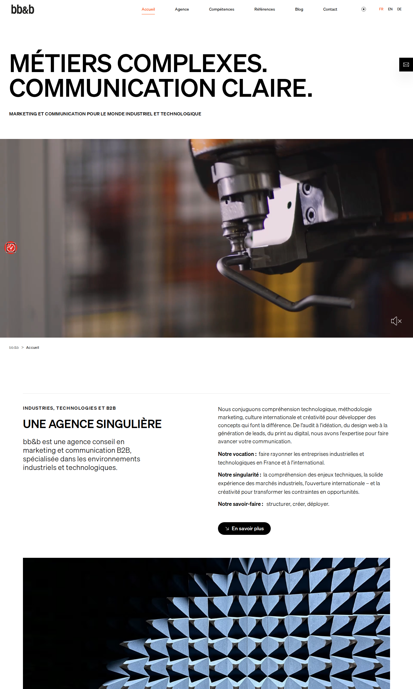

# UI Design System & Master Generation Blueprint: bb-b-net

> **Agence de Communication b2b et Marketing Industriel- bb&b** (https://bb-b.net) — bb&b agence conseil en marketing industriel et communication B2B, basée à Paris. Contactez-nous pour tous vos projets !



---

## 1. Executive Visual Persona & Design Archetype

- **Brand Essence & Persona**: **Agence de Communication b2b et Marketing Industriel- bb&b** (`https://bb-b.net`). bb&b agence conseil en marketing industriel et communication B2B, basée à Paris. Contactez-nous pour tous vos projets !
- **Final Redirected URL**: [https://www.bb-b.net/](https://www.bb-b.net/)
- **Capture Provenance**: Live browser capture (`tier1_fast`, HTTP `200`, captured `2026-11-23`).
- **Visual Archetype**: **Light-Substrate Editorial & Modular Grid System (`#ffffff` canvas, `#000000` ink, `#fa4500` accent)**.
- **Anti-AI-Slop Differentiators**:
  - **Live-Computed Chromatic Polarity**: Anchors the viewport in `#ffffff` (live computed `main` `background-color` (`computed_styles.json`)) paired with `#000000` primary typography and `#fa4500` accents.
  - **Grounded Typographic Hierarchy**: Pairs `Söhne Kraftig` for display copy (`MARKETING ET COMMUNICATION POUR LE M`) with `Söhne` and `SFMono-Regular`.
  - **Calibrated Spatial Grid & Motion**: Combines `1392px` container bounds (`gap: .25rem`, padding `14px`) with `cubic-bezier(.215,.61,.355,1)` easing.

---

## 2. Spatial Architecture & Modular Grid Mathematics


### Viewport Allocation & Container Geometry
- **Captured Viewport Dimensions**: Desktop `1440×2400px` (`assets/desktop.png`, clamped at 2400px live multi-section capture), Mobile `390×2400px` (`assets/mobile.png`, clamped at 2400px live multi-section capture).
- **Master Container Bounds**: `1392px` (measured widest bounded `<section>` landmark width on `1440px` desktop).
- **Canvas Lateral Padding & Spacing**: `14px` lateral canvas padding with `.25rem` grid gap.
- **Border Radius Scale**: `var(--toastify-toast-bd-radius)`, `100%`, `var(--radius-lg)`, `var(--radius-md)`.

### Responsive Breakpoint Architecture
- **Desktop Layout**: Multi-column CSS Grid / Flexbox layout at `1440px` (`max-width: 1392px`, `gap: .25rem`).
- **Mobile Layout**: Single-column vertical stack at `390px` viewport width with `14px` horizontal padding.
- **Extracted CSS Media Queries**: `@media only screen and (max-width: 480px)`, `@media (min-width:640px)`, `@media (min-width:968px)`, `@media (min-width:1024px)`.

---

## 3. Color System, Materiality & Atmospheric Lighting

### Semantic Palette & Source Grounding
| Semantic Role | Ground-Truth Value | Extracted Live / CSS Source |
|---|---|---|
| **Primary Canvas Substrate** | `#ffffff` | live computed `main` `background-color` (`computed_styles.json`) |
| **Primary Typography Ink** | `#000000` | live computed `h1` `color` (`computed_styles.json`) |
| **Elevated Surface / Card Substrate** | `#f0efeb` | `.bg-gray-light { background-color: #f0efeb }` |
| **Interactive Accent / Highlight** | `#fa4500` | `var(--bbb-link-color-hover)` in `:root` |
| **Secondary / Muted Copy** | `#808080` | `.text-gray-400 { color: gray }` (`#808080`) |
| **Structural Hairline Border** | `#f0efeb` | `.border-border-light { border-color: #f0efeb }` |
| **Variable Token (`--bbb-link-color-active`)** | `#8b0000` | `var(--bbb-link-color-active)` in `:root` |

### Sanitized Root CSS Variables (`ui-ux.md` Ground Truth)
| Variable Name | Extracted Value | Semantic Role |
|---|---|---|
| `--bbb-list-bullet` | `url(/bbb-list-bullet.svg)` | Design System Custom Token |
| `--bbb-link-color` | `#000` | Typography Ink Token |
| `--bbb-link-color-hover` | `#fa4500` | Typography Ink Token |
| `--bbb-link-color-active` | `#8b0000` | Typography Ink Token |
| `--color-red-400` | `oklch(70.4% .191 22.216)` | Brand / Palette Token |
| `--color-red-500` | `oklch(63.7% .237 25.331)` | Brand / Palette Token |
| `--color-orange-400` | `oklch(75% .183 55.934)` | Brand / Palette Token |
| `--color-orange-500` | `oklch(70.5% .213 47.604)` | Brand / Palette Token |
| `--color-green-400` | `oklch(79.2% .209 151.711)` | Brand / Palette Token |
| `--color-green-600` | `oklch(62.7% .194 149.214)` | Brand / Palette Token |
| `--color-gray-300` | `oklch(87.2% .01 258.338)` | Brand / Palette Token |
| `--color-gray-400` | `oklch(70.7% .022 261.325)` | Brand / Palette Token |
| `--color-gray-500` | `oklch(55.1% .027 264.364)` | Brand / Palette Token |
| `--color-gray-600` | `oklch(44.6% .03 256.802)` | Brand / Palette Token |
| `--color-gray-700` | `oklch(37.3% .034 259.733)` | Brand / Palette Token |
| `--color-neutral-100` | `oklch(97% 0 0)` | Brand / Palette Token |

---

## 4. Typographic Scale & Editorial Hierarchy

### Font Family Stacks
- **Display Typography**: `Söhne Kraftig`.
- **Primary Body Stack**: `Söhne`.
- **Technical / Metadata Stack**: `SFMono-Regular`.

### Typographic Scale & Rules (Live Computed & Stylesheet Grounded)
- **Hero Display (`H1`)**: live computed `h1` (`font-size: 16px`, `line-height: 16px`, `font-weight: 400`, `letter-spacing: 0.4px`); CSS variables `--text-4xl: 2.25rem`, `--text-4xl--line-height: calc(2.5 / 2.25)`, `--text-6xl: 3.75rem`.
- **Section Heading (`H2`)**: live computed `h3 (primary section heading)` (`font-size: 40px`, `line-height: 50px`, `font-weight: 400`); CSS variables `--text-3xl: 1.875rem`, `--text-3xl--line-height: calc(2.25 / 1.875)`.
- **Body Copy**: live computed `body` (`font-size: 16px`, `line-height: 24px`, `font-weight: 400`); CSS variables `--text-base: 1rem`, `--text-base--line-height: calc(1.5 / 1)`.
- **Metadata & Navigation Labels**: live computed `nav/a` (`font-size: 16px`, `line-height: 24px`, `font-weight: 400`); CSS variables `--text-xs: .75rem`, `--text-xs--line-height: calc(1 / .75)`, `--text-sm: .875rem`.

---

## 5. Choreographed Motion & Interaction Physics

### Primary Easing Curves
- **Extracted Timing Functions**: `cubic-bezier(.215,.61,.355,1)`, `cubic-bezier(0,0,.2,1)`, `cubic-bezier(.4,0,.2,1)`.

### Per-Element Transition & Choreography Rules
- **Selector `.Toastify__toast--stacked`**: `transition: transform .3s` extracted from `bb-b-net` stylesheet.
- **Selector `ked[data-collapsed] .Toastify__cl...`**: `transition: opacity .1s` extracted from `bb-b-net` stylesheet.
- **Selector `.Toastify__close-button`**: `transition: .3s ease` extracted from `bb-b-net` stylesheet.
- **Extracted Easing Curve (`cubic-bezier(.215,.61,.355,1)`)**: Governs interactive state transitions across `<nav.inset-x-0>` and `<section.w-full>`.
- **State & Hover Choreography**: Opacity and transform transitions on `<section.relative>` and `<section.w-full>` interactive targets.

---

## 6. Component Wireframe & Structural DOM Map

### Visual Layout Schematic — Desktop (`1440px`, Grounded in `dom.html` & Landmark Bounding Boxes)
```
┌────────────────────────────────────────────────────────────────────────┐
│ DESKTOP VIEWPORT (1440px) — Agence de Communication b2b et Marketing I │
│ ====================================================================== │
│ [ <nav.inset-x-0> (1440x64px)         | Accueil · Agence · Compétenc ] │
│ ---------------------------------------------------------------------- │
│ | HERO STAGE: <section.relative> (w=1440px)                          | │
│ | H1: MARKETING ET COMMUNICATION POUR LE MONDE INDUSTRI...           | │
│ | Substrate: #ffffff | Ink: #000000 | Accent: #fa4500                | │
│ ---------------------------------------------------------------------- │
│ | SHOWCASE GRID (<section.w-full>) max-w: 1392px                     | │
│ | +------------------------------+  +------------------------------+ | │
│ | | Marketing et communication p |  | Industries, technologies et  | | │
│ | +------------------------------+  +------------------------------+ | │
│ ---------------------------------------------------------------------- │
│ | DETAIL MODULE (<section.pt-6>) — Une agence singulière             | │
│ ---------------------------------------------------------------------- │
│ [ FOOTER (<footer.w-full>     ) | https://bb-b.net                     │
└────────────────────────────────────────────────────────────────────────┘
```

### Visual Layout Schematic — Mobile Reflow (`390px`)
```
┌────────────────────────────────────────────────────────────────────────┐
│ MOBILE VIEWPORT REFLOW (390px) — Single-Column Stack (gap: .25rem)     │
│ ====================================================================== │
│ [ HEADER BAR (<nav.inset-x-0>         ) | Compact Menu (390px)         │
│ ---------------------------------------------------------------------- │
│ | HERO STAGE (<section.relative>) — 390px Vertical Lead              | │
│ | H1: MARKETING ET COMMUNICATION POUR LE MONDE INDUSTRI...           | │
│ ---------------------------------------------------------------------- │
│ | SHOWCASE STACK (<section.w-full>) — 1-Col Stack                    | │
│ | [ Item 1: Marketing et communication pour le monde industri...   ] | │
│ | [ Item 2: Industries, technologies et b2b                        ] | │
│ ---------------------------------------------------------------------- │
│ | DETAIL STACK (<section.pt-6>) — 1-Col (Une agence singuli)         | │
│ ---------------------------------------------------------------------- │
│ [ FOOTER (<footer.w-full>     ) | Stacked 390px Colophon               │
└────────────────────────────────────────────────────────────────────────┘
```

### Granular DOM Region Breakdown
1. **Brand Header & Navigation Bar (<nav.inset-x-0> — `bb-b-net`)**:
   - Landmark `<nav class="inset-x-0 top-0">` (`1440x64px`) hosting `Agence de Communication b2b et Marke` navigation (`Accueil · Agence · Compétences · Références · Blog`), DOM attributes (`data-precedence="next"`, `data-href="/_next/static/css/653..."`, `data-ueto="ueto_a4b03d3947"`, `data-cky-tag="revisit-consent"`), and stylesheet rule `font-face { font-family: 'Söhne Kraftig'; src: url('/fonts/soehne-kraftig.woff2') fo... }`.
2. **Hero Stage & Focal Lead (<section.relative> — `MARKETING ET COMMUNICATION POUR LE`)**:
   - Landmark `<section class="relative flex">` presenting display lead `MARKETING ET COMMUNICATION POUR LE MONDE INDUSTRI...` and copy excerpt *"bb&b est une agence conseil en marketing et communication B2B, sp"* over `#ffffff` canvas and `#000000` ink.
3. **Primary Showcase & Content Grid (<section.w-full> — `Marketing et communication pour le`)**:
   - Landmark `<section class="relative w-full">` rendering section `Marketing et communication pour le monde industri...` with copy *"faire rayonner les entreprises industrielles et technologiques en"*, asset references (`webpack-4e4475af75d05841.js`, `813956296145205`, `fbevents.js`, `lftracker_v1_YEgkB8lB6dx4ep3Z.js`), and grid rule `.Toastify__toast-container--top-left { top:var(--toastify-toast-top);left:var(--toastify-toast-left) }`.
4. **Interactive Detail & Feature Matrix (<section.pt-6> — `Industries, technologies et b2b`)**:
   - Landmark `<section class="pt-6 bg-white">` framing `Industries, technologies et b2b` and `Une agence singulière` (*"la compréhension des enjeux techniques, la solide expérience des "*) with `#f0efeb` surface cards, `#fa4500` accents, and `.Toastify__toast-container--top-c... { top:var(--toastify-toast-top);left:50%;transform:translate(-50%);align-i... }`.
5. **Colophon & Global Directory Footer (<footer.w-full> — `https://bb-b.net`)**:
   - Landmark `<footer class="w-full flex">` anchoring `Agence de Communication b2b et M` footer links (`Accueil · Agence · Compétences · Références · Blog`), copy *"structurer, créer, déployer."*, and `#f0efeb` structural dividers.

---

## 7. Master Zero-Shot AI Generation Prompt

```markdown
# Master Zero-Shot Frontend Generation Prompt: bb-b-net (Agence de Communication b2b et Marketing Industriel- bb&b)

You are a principal frontend architect and design systems engineer. Build a complete, production-ready web application replicating the exact design system, DOM landmarks, typographic hierarchy, color tokens, and motion physics of `bb-b-net` (**Agence de Communication b2b et Marketing Industriel- bb&b** — `https://bb-b.net`).

### 1. Visual Archetype & Anti-AI-Slop Mandates
- **Archetype**: Light-Substrate Editorial & Modular Grid System (`#ffffff` canvas, `#000000` ink, `#fa4500` accent).
- **Identity & Domain Context**: bb&b agence conseil en marketing industriel et communication B2B, basée à Paris. Contactez-nous pour tous vos projets !
- **Primary Substrate**: `#ffffff` (live computed `main` `background-color` (`computed_styles.json`)), **Primary Ink**: `#000000`, **Accent / Highlight**: `#fa4500`.
- **Site-Specific Differentiators**:
  - **Live-Computed Chromatic Polarity**: Anchors the viewport in `#ffffff` (live computed `main` `background-color` (`computed_styles.json`)) paired with `#000000` primary typography and `#fa4500` accents.
  - **Grounded Typographic Hierarchy**: Pairs `Söhne Kraftig` for display copy (`MARKETING ET COMMUNICATION POUR LE M`) with `Söhne` and `SFMono-Regular`.
  - **Calibrated Spatial Grid & Motion**: Combines `1392px` container bounds (`gap: .25rem`, padding `14px`) with `cubic-bezier(.215,.61,.355,1)` easing.

### 2. Ground-Truth CSS Variables (`:root` Token Contract)
Declare and consume these exact custom properties extracted from `bb-b-net` in your global stylesheet:

:root {
  /* Agence de Communication b2b et Marketing Industriel- bb&b (bb-b-net) — Live-Grounded CSS Variables */
  --bbb-list-bullet: url(/bbb-list-bullet.svg); /* Design System Custom Token (bb-b-net) */
  --bbb-link-color: #000; /* Typography Ink Token (bb-b-net) */
  --bbb-link-color-hover: #fa4500; /* Typography Ink Token (bb-b-net) */
  --bbb-link-color-active: #8b0000; /* Typography Ink Token (bb-b-net) */
  --color-red-400: oklch(70.4% .191 22.216); /* Brand / Palette Token (bb-b-net) */
  --color-red-500: oklch(63.7% .237 25.331); /* Brand / Palette Token (bb-b-net) */
  --color-orange-400: oklch(75% .183 55.934); /* Brand / Palette Token (bb-b-net) */
  --color-orange-500: oklch(70.5% .213 47.604); /* Brand / Palette Token (bb-b-net) */
  --color-green-400: oklch(79.2% .209 151.711); /* Brand / Palette Token (bb-b-net) */
  --color-green-600: oklch(62.7% .194 149.214); /* Brand / Palette Token (bb-b-net) */
  --color-gray-300: oklch(87.2% .01 258.338); /* Brand / Palette Token (bb-b-net) */
  --color-gray-400: oklch(70.7% .022 261.325); /* Brand / Palette Token (bb-b-net) */
  --color-gray-500: oklch(55.1% .027 264.364); /* Brand / Palette Token (bb-b-net) */
  --color-gray-600: oklch(44.6% .03 256.802); /* Brand / Palette Token (bb-b-net) */
  --color-gray-700: oklch(37.3% .034 259.733); /* Brand / Palette Token (bb-b-net) */
  --color-neutral-100: oklch(97% 0 0); /* Brand / Palette Token (bb-b-net) */
}

### 3. Semantic Color & Materiality Contract
Map every surface, ink, and border strictly to these source-grounded tokens:
- **Primary Canvas Substrate**: `#ffffff` — grounded in live computed `main` `background-color` (`computed_styles.json`)
- **Primary Typography Ink**: `#000000` — grounded in live computed `h1` `color` (`computed_styles.json`)
- **Elevated Surface / Card Substrate**: `#f0efeb` — grounded in `.bg-gray-light { background-color: #f0efeb }`
- **Interactive Accent / Highlight**: `#fa4500` — grounded in `var(--bbb-link-color-hover)` in `:root`
- **Secondary / Muted Copy**: `#808080` — grounded in `.text-gray-400 { color: gray }` (`#808080`)
- **Structural Hairline Border**: `#f0efeb` — grounded in `.border-border-light { border-color: #f0efeb }`
- **Variable Token (`--bbb-link-color-active`)**: `#8b0000` — grounded in `var(--bbb-link-color-active)` in `:root`

### 4. Spatial Grid, Container Bounds & Responsive Breakpoints
- **Desktop Viewport Reference**: `1440×2400px` (clamped at 2400px live multi-section capture, `1440px` standard desktop width).
- **Mobile Viewport Reference**: `390×2400px` (clamped at 2400px live multi-section capture, `390px` standard mobile width).
- **Container Max-Width**: `1392px` (measured widest bounded `<section>` landmark width on `1440px` desktop)
- **Padding & Gutters**: `14px` lateral canvas padding with `.25rem` grid gap
- **Desktop Grid**: Multi-column CSS Grid / Flexbox layout at `1440px` (`max-width: 1392px`, `gap: .25rem`)
- **Mobile Adaptation**: Single-column vertical stack at `390px` viewport width with `14px` horizontal padding
- **Media Queries**: `@media only screen and (max-width: 480px)`, `@media (min-width:640px)`, `@media (min-width:968px)`, `@media (min-width:1024px)`
- **Corner Radii**: `var(--toastify-toast-bd-radius)`, `100%`, `var(--radius-lg)`, `var(--radius-md)`

### 5. Typography & Editorial Scale Contract
- **Display Font Stack**: `Söhne Kraftig`
- **Body Font Stack**: `Söhne`
- **Monospace / Technical Font Stack**: `SFMono-Regular`
- **H1 Display Rule**: live computed `h1` (`font-size: 16px`, `line-height: 16px`, `font-weight: 400`, `letter-spacing: 0.4px`); CSS variables `--text-4xl: 2.25rem`, `--text-4xl--line-height: calc(2.5 / 2.25)`, `--text-6xl: 3.75rem`
- **H2 Section Rule**: live computed `h3 (primary section heading)` (`font-size: 40px`, `line-height: 50px`, `font-weight: 400`); CSS variables `--text-3xl: 1.875rem`, `--text-3xl--line-height: calc(2.25 / 1.875)`
- **Body Copy Rule**: live computed `body` (`font-size: 16px`, `line-height: 24px`, `font-weight: 400`); CSS variables `--text-base: 1rem`, `--text-base--line-height: calc(1.5 / 1)`
- **Metadata & Index Rule**: live computed `nav/a` (`font-size: 16px`, `line-height: 24px`, `font-weight: 400`); CSS variables `--text-xs: .75rem`, `--text-xs--line-height: calc(1 / .75)`, `--text-sm: .875rem`

### 6. Component Hierarchy, Verbatim Copy & Real DOM Landmarks
Scaffold `bb-b-net` (`Agence de Communication b2b et Marketing Industriel- bb&b`) with these exact structural regions, extracted copy, and CSS rules from `dom.html`:
1. **Brand Header & Navigation Bar (<nav.inset-x-0> — `bb-b-net`)**:
   - DOM & Selectors: Landmark `<nav class="inset-x-0 top-0">` (`1440x64px`) hosting `Agence de Communication b2b et Marke` navigation (`Accueil · Agence · Compétences · Références · Blog`), DOM attributes (`data-precedence="next"`, `data-href="/_next/static/css/653..."`, `data-ueto="ueto_a4b03d3947"`, `data-cky-tag="revisit-consent"`), and stylesheet rule `font-face { font-family: 'Söhne Kraftig'; src: url('/fonts/soehne-kraftig.woff2') fo... }`.
   - Responsive Contract: Header `Brand Header & Navigation Bar (<nav.inset-x-0> — `bb-b-net`)` (`bb-b-net`) adapts across `@media only screen and (max-width: 480px)`, `@media (min-width:640px)`, `@media (min-width:968px)`, `@media (min-width:1024px)` with `cubic-bezier(.215,.61,.355,1)`, `cubic-bezier(0,0,.2,1)`, `cubic-bezier(.4,0,.2,1)` transitions and links `Accueil · Agence · Compétences · Références · Blog`.
2. **Hero Stage & Focal Lead (<section.relative> — `MARKETING ET COMMUNICATION POUR LE`)**:
   - DOM & Selectors: Landmark `<section class="relative flex">` presenting display lead `MARKETING ET COMMUNICATION POUR LE MONDE INDUSTRI...` and copy excerpt *"bb&b est une agence conseil en marketing et communication B2B, sp"* over `#ffffff` canvas and `#000000` ink.
   - Responsive Contract: Hero stage (`1440×2400px` desktop / `390×2400px` mobile) sets `#ffffff` background with `#000000` headline `MARKETING ET COMMUNICATION POUR LE MONDE INDUSTRI...`.
3. **Primary Showcase & Content Grid (<section.w-full> — `Marketing et communication pour le`)**:
   - DOM & Selectors: Landmark `<section class="relative w-full">` rendering section `Marketing et communication pour le monde industri...` with copy *"faire rayonner les entreprises industrielles et technologiques en"*, asset references (`webpack-4e4475af75d05841.js`, `813956296145205`, `fbevents.js`, `lftracker_v1_YEgkB8lB6dx4ep3Z.js`), and grid rule `.Toastify__toast-container--top-left { top:var(--toastify-toast-top);left:var(--toastify-toast-left) }`.
   - Responsive Contract: Showcase grid `Primary Showcase & Content Grid (<section.w-full> — `Marketing et communication pour le`)` applies Multi-column CSS Grid / Flexbox layout at `1440px` (`max-width: 1392px`, `gap: .25rem`) on desktop and Single-column vertical stack at `390px` viewport width with `14px` horizontal padding on mobile.
4. **Interactive Detail & Feature Matrix (<section.pt-6> — `Industries, technologies et b2b`)**:
   - DOM & Selectors: Landmark `<section class="pt-6 bg-white">` framing `Industries, technologies et b2b` and `Une agence singulière` (*"la compréhension des enjeux techniques, la solide expérience des "*) with `#f0efeb` surface cards, `#fa4500` accents, and `.Toastify__toast-container--top-c... { top:var(--toastify-toast-top);left:50%;transform:translate(-50%);align-i... }`.
   - Responsive Contract: Detail module `Interactive Detail & Feature Matrix (<section.pt-6> — `Industries, technologies et b2b`)` uses `var(--toastify-toast-bd-radius)`, `100%`, `var(--radius-lg)`, `var(--radius-md)` radii, `#fa4500` highlights, and assets (webpack-4e4475af75d05841.js, 813956296145205, fbevents.js).
5. **Colophon & Global Directory Footer (<footer.w-full> — `https://bb-b.net`)**:
   - DOM & Selectors: Landmark `<footer class="w-full flex">` anchoring `Agence de Communication b2b et M` footer links (`Accueil · Agence · Compétences · Références · Blog`), copy *"structurer, créer, déployer."*, and `#f0efeb` structural dividers.
   - Responsive Contract: Footer `Colophon & Global Directory Footer (<footer.w-full> — `https://bb-b.net`)` aligns to `1392px` (measured widest bounded `<section>` landmark width on `1440px` desktop) with `14px` lateral canvas padding with `.25rem` grid gap and attributes (data-precedence="next", data-href="/_next/static/css/653...", data-ueto="ueto_a4b03d3947").

#### Verbatim DOM Copy Excerpts (`dom.html`)
- Copy Excerpt 1: *"bb&b est une agence conseil en marketing et communication B2B, spécialisée dans le..."*
- Copy Excerpt 2: *"faire rayonner les entreprises industrielles et technologiques en France et à l’in..."*
- Copy Excerpt 3: *"la compréhension des enjeux techniques, la solide expérience des marchés industrie..."*
- Copy Excerpt 4: *"structurer, créer, déployer."*

### 7. Motion, Extracted Stylesheet Rules & Interaction Choreography
- **Primary Easing Functions**: `cubic-bezier(.215,.61,.355,1)`, `cubic-bezier(0,0,.2,1)`, `cubic-bezier(.4,0,.2,1)`
- **Extracted Stylesheet Rules (`bb-b-net`)**:
- `font-face { font-family: 'Söhne Kraftig'; src: url('/fonts/soehne-kraftig.woff2') fo... }`
- `.Toastify__toast-container--top-left { top:var(--toastify-toast-top);left:var(--toastify-toast-left) }`
- `.Toastify__toast-container--top-c... { top:var(--toastify-toast-top);left:50%;transform:translate(-50%);align-i... }`
- `.Toastify__toast-container--top-r... { top:var(--toastify-toast-top);right:var(--toastify-toast-right);align-it... }`
- `.Toastify__toast-container--botto... { bottom:var(--toastify-toast-bottom);left:var(--toastify-toast-left) }`
- **Per-Selector Transition Rules**:
- **Selector `.Toastify__toast--stacked`**: `transition: transform .3s` extracted from `bb-b-net` stylesheet.
- **Selector `ked[data-collapsed] .Toastify__cl...`**: `transition: opacity .1s` extracted from `bb-b-net` stylesheet.
- **Selector `.Toastify__close-button`**: `transition: .3s ease` extracted from `bb-b-net` stylesheet.
- **Extracted Easing Curve (`cubic-bezier(.215,.61,.355,1)`)**: Governs interactive state transitions across `<nav.inset-x-0>` and `<section.w-full>`.
- **State & Hover Choreography**: Opacity and transform transitions on `<section.relative>` and `<section.w-full>` interactive targets.

### 8. Technical Deliverables
- Implement in Next.js (App Router) with TypeScript and Tailwind CSS consuming the `:root` custom properties defined above for `bb-b-net`.
- Reproduce both the `1440px` desktop architecture and `390px` mobile breakpoint transitions, preserving semantic HTML5 landmarks (`<header>`, `<nav>`, `<main>`, `<section>`, `<footer>`) and `prefers-reduced-motion` accessibility guards.
```
