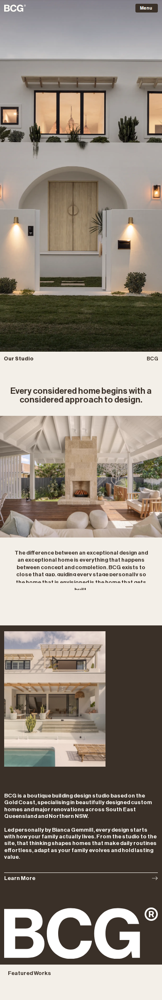

# UI Design System & Master Generation Blueprint: bcgbuildingdesign-com-au

> **Building Designer Gold Coast · BCG Building Design** (https://bcgbuildingdesign.com.au/) — Boutique building design studio in Gold Coast crafting high-end custom homes and major renovations, personally led from concept to constr...


---

## 1. Executive Visual Persona & Design Archetype

- **Brand Essence & Persona**: **Building Designer Gold Coast · BCG Building Design** (`https://bcgbuildingdesign.com.au/`). Boutique building design studio in Gold Coast crafting high-end custom homes and major renovations, personally led from concept to constr...
- **Final Redirected URL**: [https://www.bcgbuildingdesign.com.au/](https://www.bcgbuildingdesign.com.au/)
- **Capture Provenance**: Live browser capture (`tier1_fast`, HTTP `200`, captured `2026-11-23`).
- **Visual Archetype**: **Light-Substrate Editorial & Modular Grid System (`#f3efe8` canvas, `#3a3028` ink, `#0082f3` accent)**.
- **Anti-AI-Slop Differentiators**:
  - **Live-Computed Chromatic Polarity**: Anchors the viewport in `#f3efe8` (live computed `body` `background-color` (`computed_styles.json`)) paired with `#3a3028` primary typography and `#0082f3` accents.
  - **Grounded Typographic Hierarchy**: Pairs `NeueHaasDisplay Pro` for display copy (`Building Designer Gold Coast`) with `NeueHaasDisplay Pro` and not declared in live computed styles (uses primary stack / `ui-monospace`).
  - **Calibrated Spatial Grid & Motion**: Combines `80rem` container bounds (`gap: 16px`, padding `9px`) with `cubic-bezier(0.25,0.46,0.45,0.94)` easing and Lenis Smooth Scroll (`data-lenis`), GSAP Timeline & ScrollTrigger.

---

## 2. Spatial Architecture & Modular Grid Mathematics



### Viewport Allocation & Container Geometry
- **Captured Viewport Dimensions**: Desktop `1440×2400px` (`assets/desktop.png`, clamped at 2400px live multi-section capture), Mobile `390×2400px` (`assets/mobile.png`, clamped at 2400px live multi-section capture).
- **Master Container Bounds**: `80rem` (non-`@media` desktop container stylesheet rule).
- **Canvas Lateral Padding & Spacing**: `9px` lateral canvas padding with `16px` grid gap.
- **Border Radius Scale**: `3px`, `100%`, `50%`, `.125rem`.

### Responsive Breakpoint Architecture
- **Desktop Layout**: Multi-column CSS Grid / Flexbox layout at `1440px` (`max-width: 80rem`, `gap: 16px`).
- **Mobile Layout**: Single-column vertical stack at `390px` viewport width with `9px` horizontal padding.
- **Extracted CSS Media Queries**: `@media screen and (max-width:991px)`, `@media screen and (max-width:767px)`, `@media screen and (max-width:479px)`, `@media (min-width:768px)`.

---

## 3. Color System, Materiality & Atmospheric Lighting

### Semantic Palette & Source Grounding
| Semantic Role | Ground-Truth Value | Extracted Live / CSS Source |
|---|---|---|
| **Primary Canvas Substrate** | `#f3efe8` | live computed `body` `background-color` (`computed_styles.json`) |
| **Primary Typography Ink** | `#3a3028` | live computed `main` `color` (`computed_styles.json`) |
| **Elevated Surface / Card Substrate** | `#ffff00` | `mark { background: #ffff00 }` |
| **Interactive Accent / Highlight** | `#0082f3` | `.w-dropdown-link.w--current { color: #0082f3 }` |
| **Secondary / Muted Copy** | `#fffdf8` | live computed `p` `color` (`computed_styles.json`) |
| **Structural Hairline Border** | `#e2e2e2` | `blockquote { border-left: #e2e2e2 }` |

### Sanitized Root CSS Variables (`ui-ux.md` Ground Truth)
| Variable Name | Extracted Value | Semantic Role |
|---|---|---|
| `--brand--beige` | `#f3efe8` | Brand / Palette Token |
| `--font-family--body` | `"NeueHaasDisplay Pro",Arial,sans-serif` | Typography / Scale Token |
| `--_theme---text-color--primary` | `var(--neutral--black)` | Typography Ink Token |
| `--_typography---body--body-line-height` | `var(--_typography---font-height--medium)` | Typography / Scale Token |
| `--font-weight--semi-bold` | `600` | Typography / Scale Token |
| `--_typography---body--body-letter-spacing` | `var(--_typography---letter-spacing--default)` | Typography / Scale Token |
| `--font-family--heading` | `"NeueHaasDisplay Pro",Arial,sans-serif` | Typography Ink Token |
| `--_typography---h1--h1-font-size` | `3.5rem` | Typography / Scale Token |
| `--_typography---h1--h1-line-height` | `var(--_typography---font-height--tiny)` | Typography / Scale Token |
| `--_typography---h1--h1-font-weight` | `var(--font-weight--semi-bold)` | Typography / Scale Token |
| `--_typography---h1--h1-letter-spacing` | `var(--_typography---letter-spacing--default)` | Typography / Scale Token |
| `--_typography---h2--h2-font-size` | `3em` | Typography / Scale Token |
| `--_typography---h2--h2-line-height` | `var(--_typography---font-height--medium)` | Typography / Scale Token |
| `--_typography---h2--h2-font-weight` | `var(--font-weight--bold)` | Typography / Scale Token |
| `--_typography---h2--h2-letter-spacing` | `var(--_typography---letter-spacing--default)` | Typography / Scale Token |
| `--_typography---h3--h3-font-size` | `2.5rem` | Typography / Scale Token |

---

## 4. Typographic Scale & Editorial Hierarchy

### Font Family Stacks
- **Display Typography**: `NeueHaasDisplay Pro`.
- **Primary Body Stack**: `NeueHaasDisplay Pro`.
- **Technical / Metadata Stack**: not declared in live computed styles (uses primary stack / `ui-monospace`).

### Typographic Scale & Rules (Live Computed & Stylesheet Grounded)
- **Hero Display (`H1`)**: live computed `h1` (`font-size: 16px`, `line-height: 14.4px`, `font-weight: 500`); CSS variables `--_typography---h1--h1-font-size: 3.5rem`, `--_typography---h1--h1-line-height: var(--_typography---font-height--tiny)`, `--_typography---h1--h1-font-weight: var(--font-weight--semi-bold)`.
- **Section Heading (`H2`)**: live computed `h2` (`font-size: 40px`, `line-height: 40px`, `font-weight: 600`); CSS variables `--_typography---h2--h2-font-size: 3em`, `--_typography---h2--h2-line-height: var(--_typography---font-height--medium)`, `--_typography---h2--h2-font-weight: var(--font-weight--bold)`.
- **Body Copy**: live computed `body` (`font-size: 16px`, `line-height: 19.2px`, `font-weight: 600`); CSS variables `--font-family--body: "NeueHaasDisplay Pro",Arial,sans-serif`, `--_typography---body--body-line-height: var(--_typography---font-height--medium)`, `--_typography---body--body-letter-spacing: var(--_typography---letter-spacing--default)`.
- **Metadata & Navigation Labels**: live computed `nav/a` (`font-size: 16px`, `line-height: 19.2px`, `font-weight: 600`); CSS variables `--_typography---body--body-letter-spacing: var(--_typography---letter-spacing--default)`, `--_typography---h1--h1-letter-spacing: var(--_typography---letter-spacing--default)`, `--_typography---h2--h2-letter-spacing: var(--_typography---letter-spacing--default)`.

---

## 5. Choreographed Motion & Interaction Physics

### Primary Easing Curves
- **Extracted Timing Functions**: `cubic-bezier(0.25,0.46,0.45,0.94)`.

### Per-Element Transition & Choreography Rules
- **Selector `.w-webflow-badge>img`**: `transition: unset` extracted from `bcgbuildingdesign-com-au` stylesheet.
- **Selector `.w-slider-dot`**: `transition: background-color .1s,color .1s` extracted from `bcgbuildingdesign-com-au` stylesheet.
- **Selector `.w-lightbox-control`**: `transition: all .3s` extracted from `bcgbuildingdesign-com-au` stylesheet.
- **Extracted Easing Curve (`cubic-bezier(0.25,0.46,0.45,0.94)`)**: Governs interactive state transitions across `<nav.navbar>` and `<section.is-sticky>`.
- **Runtime Interaction Engine**: Integrates Lenis Smooth Scroll (`data-lenis`), GSAP Timeline & ScrollTrigger, Barba.js Page Transition Router with `prefers-reduced-motion: reduce` fallback guards.

---

## 6. Component Wireframe & Structural DOM Map

### Visual Layout Schematic — Desktop (`1440px`, Grounded in `dom.html` & Landmark Bounding Boxes)
```
┌────────────────────────────────────────────────────────────────────────┐
│ DESKTOP VIEWPORT (1440px) — Building Designer Gold Coast · BCG Buildin │
│ ====================================================================== │
│ [ <nav.navbar> (1440x40px)            | Home · Studio · Process · Pr ] │
│ ---------------------------------------------------------------------- │
│ | HERO STAGE: <section.section> (w=1440px)                           | │
│ | H1: Building Designer Gold Coast                                   | │
│ | Substrate: #f3efe8 | Ink: #3a3028 | Accent: #0082f3                | │
│ ---------------------------------------------------------------------- │
│ | SHOWCASE GRID (<section.is-sticky>) max-w: 80rem                   | │
│ | +------------------------------+  +------------------------------+ | │
│ | | Every considered home begins |  | Featured Works               | | │
│ | +------------------------------+  +------------------------------+ | │
│ ---------------------------------------------------------------------- │
│ | DETAIL MODULE (<section.section-brown>) — Thoughtful home desig    | │
│ ---------------------------------------------------------------------- │
│ [ FOOTER (<footer.section_foot) | https://bcgbuildingdesign.com.au/    │
└────────────────────────────────────────────────────────────────────────┘
```

### Visual Layout Schematic — Mobile Reflow (`390px`)
```
┌────────────────────────────────────────────────────────────────────────┐
│ MOBILE VIEWPORT REFLOW (390px) — Single-Column Stack (gap: 16px)       │
│ ====================================================================== │
│ [ HEADER BAR (<nav.navbar>            ) | Compact Menu (390px)         │
│ ---------------------------------------------------------------------- │
│ | HERO STAGE (<section.section>) — 390px Vertical Lead               | │
│ | H1: Building Designer Gold Coast                                   | │
│ ---------------------------------------------------------------------- │
│ | SHOWCASE STACK (<section.is-sticky>) — 1-Col Stack                 | │
│ | [ Item 1: Every considered home begins with a considered ap...   ] | │
│ | [ Item 2: Featured Works                                         ] | │
│ ---------------------------------------------------------------------- │
│ | DETAIL STACK (<section.section-brown>) — 1-Col (Thoughtful home de)  │
│ ---------------------------------------------------------------------- │
│ [ FOOTER (<footer.section_foot) | Stacked 390px Colophon               │
└────────────────────────────────────────────────────────────────────────┘
```

### Granular DOM Region Breakdown
1. **Brand Header & Navigation Bar (<nav.navbar> — `bcgbuildingdesign-com-au`)**:
   - Landmark `<nav class="navbar">` (`1440x40px`) hosting `Building Designer Gold Coast · BCG B` navigation (`Home · Studio · Process · Projects · Project Enquiry`), DOM attributes (`data-wf-domain="www.bcgbuildingdesign..."`, `data-wf-page="6a794e5aeebba97e3ac774a5"`, `data-wf-site="6a794e5aeebba97e3ac774ae"`, `data-barba="wrapper"`), and stylesheet rule `html { -webkit-text-size-adjust:100%;-ms-text-size-adjust:100%;font-family:sans... }`.
2. **Hero Stage & Focal Lead (<section.section> — `Building Designer Gold Coast`)**:
   - Landmark `<section class="section is-relative">` presenting display lead `Building Designer Gold Coast` and copy excerpt *"BCG is a boutique building design studio based on the Gold Coast,"* over `#f3efe8` canvas and `#3a3028` ink.
3. **Primary Showcase & Content Grid (<section.is-sticky> — `Every considered home begins with `)**:
   - Landmark `<section class="section is-sticky">` rendering section `Every considered home begins with a considered ap...` with copy *"We’ve had a great experience with BCG designs. We approached Bian"*, asset references (`cdn.prod.website-files.com`, `bcg-staging.webflow.shared.4c5b11...`, `gtm.js`, `recaptcha__en.js`), and grid rule `summary { display:block }`.
4. **Interactive Detail & Feature Matrix (<section.section-brown> — `Featured Works`)**:
   - Landmark `<section class="section-brown">` framing `Featured Works` and `Thoughtful home design requires everyone working...` (*"We have had the opportunity of working collaboratively on a few p"*) with `#ffff00` surface cards, `#0082f3` accents, and `video { vertical-align:baseline;display:inline-block }`.
5. **Colophon & Global Directory Footer (<footer.section_footer> — `https://bcgbuildingdesign.com.au/`)**:
   - Landmark `<footer class="section_footer">` anchoring `Building Designer Gold Coast · B` footer links (`Home · Studio · Process · Projects · Project Enquiry`), copy *"Davey Constructions"*, and `#e2e2e2` structural dividers.

---

## 7. Master Zero-Shot AI Generation Prompt

```markdown
# Master Zero-Shot Frontend Generation Prompt: bcgbuildingdesign-com-au (Building Designer Gold Coast · BCG Building Design)

You are a principal frontend architect and design systems engineer. Build a complete, production-ready web application replicating the exact design system, DOM landmarks, typographic hierarchy, color tokens, and motion physics of `bcgbuildingdesign-com-au` (**Building Designer Gold Coast · BCG Building Design** — `https://bcgbuildingdesign.com.au/`).

### 1. Visual Archetype & Anti-AI-Slop Mandates
- **Archetype**: Light-Substrate Editorial & Modular Grid System (`#f3efe8` canvas, `#3a3028` ink, `#0082f3` accent).
- **Identity & Domain Context**: Boutique building design studio in Gold Coast crafting high-end custom homes and major renovations, personally led from concept to constr...
- **Primary Substrate**: `#f3efe8` (live computed `body` `background-color` (`computed_styles.json`)), **Primary Ink**: `#3a3028`, **Accent / Highlight**: `#0082f3`.
- **Site-Specific Differentiators**:
  - **Live-Computed Chromatic Polarity**: Anchors the viewport in `#f3efe8` (live computed `body` `background-color` (`computed_styles.json`)) paired with `#3a3028` primary typography and `#0082f3` accents.
  - **Grounded Typographic Hierarchy**: Pairs `NeueHaasDisplay Pro` for display copy (`Building Designer Gold Coast`) with `NeueHaasDisplay Pro` and not declared in live computed styles (uses primary stack / `ui-monospace`).
  - **Calibrated Spatial Grid & Motion**: Combines `80rem` container bounds (`gap: 16px`, padding `9px`) with `cubic-bezier(0.25,0.46,0.45,0.94)` easing and Lenis Smooth Scroll (`data-lenis`), GSAP Timeline & ScrollTrigger.

### 2. Ground-Truth CSS Variables (`:root` Token Contract)
Declare and consume these exact custom properties extracted from `bcgbuildingdesign-com-au` in your global stylesheet:

:root {
  /* Building Designer Gold Coast · BCG Building Design (bcgbuildingdesign-com-au) — Live-Grounded CSS Variables */
  --brand--beige: #f3efe8; /* Brand / Palette Token (bcgbuildingdesign-com-au) */
  --font-family--body: "NeueHaasDisplay Pro",Arial,sans-serif; /* Typography / Scale Token (bcgbuildingdesign-com-au) */
  --_theme---text-color--primary: var(--neutral--black); /* Typography Ink Token (bcgbuildingdesign-com-au) */
  --_typography---body--body-line-height: var(--_typography---font-height--medium); /* Typography / Scale Token (bcgbuildingdesign-com-au) */
  --font-weight--semi-bold: 600; /* Typography / Scale Token (bcgbuildingdesign-com-au) */
  --_typography---body--body-letter-spacing: var(--_typography---letter-spacing--default); /* Typography / Scale Token (bcgbuildingdesign-com-au) */
  --font-family--heading: "NeueHaasDisplay Pro",Arial,sans-serif; /* Typography Ink Token (bcgbuildingdesign-com-au) */
  --_typography---h1--h1-font-size: 3.5rem; /* Typography / Scale Token (bcgbuildingdesign-com-au) */
  --_typography---h1--h1-line-height: var(--_typography---font-height--tiny); /* Typography / Scale Token (bcgbuildingdesign-com-au) */
  --_typography---h1--h1-font-weight: var(--font-weight--semi-bold); /* Typography / Scale Token (bcgbuildingdesign-com-au) */
  --_typography---h1--h1-letter-spacing: var(--_typography---letter-spacing--default); /* Typography / Scale Token (bcgbuildingdesign-com-au) */
  --_typography---h2--h2-font-size: 3em; /* Typography / Scale Token (bcgbuildingdesign-com-au) */
  --_typography---h2--h2-line-height: var(--_typography---font-height--medium); /* Typography / Scale Token (bcgbuildingdesign-com-au) */
  --_typography---h2--h2-font-weight: var(--font-weight--bold); /* Typography / Scale Token (bcgbuildingdesign-com-au) */
  --_typography---h2--h2-letter-spacing: var(--_typography---letter-spacing--default); /* Typography / Scale Token (bcgbuildingdesign-com-au) */
  --_typography---h3--h3-font-size: 2.5rem; /* Typography / Scale Token (bcgbuildingdesign-com-au) */
}

### 3. Semantic Color & Materiality Contract
Map every surface, ink, and border strictly to these source-grounded tokens:
- **Primary Canvas Substrate**: `#f3efe8` — grounded in live computed `body` `background-color` (`computed_styles.json`)
- **Primary Typography Ink**: `#3a3028` — grounded in live computed `main` `color` (`computed_styles.json`)
- **Elevated Surface / Card Substrate**: `#ffff00` — grounded in `mark { background: #ffff00 }`
- **Interactive Accent / Highlight**: `#0082f3` — grounded in `.w-dropdown-link.w--current { color: #0082f3 }`
- **Secondary / Muted Copy**: `#fffdf8` — grounded in live computed `p` `color` (`computed_styles.json`)
- **Structural Hairline Border**: `#e2e2e2` — grounded in `blockquote { border-left: #e2e2e2 }`

### 4. Spatial Grid, Container Bounds & Responsive Breakpoints
- **Desktop Viewport Reference**: `1440×2400px` (clamped at 2400px live multi-section capture, `1440px` standard desktop width).
- **Mobile Viewport Reference**: `390×2400px` (clamped at 2400px live multi-section capture, `390px` standard mobile width).
- **Container Max-Width**: `80rem` (non-`@media` desktop container stylesheet rule)
- **Padding & Gutters**: `9px` lateral canvas padding with `16px` grid gap
- **Desktop Grid**: Multi-column CSS Grid / Flexbox layout at `1440px` (`max-width: 80rem`, `gap: 16px`)
- **Mobile Adaptation**: Single-column vertical stack at `390px` viewport width with `9px` horizontal padding
- **Media Queries**: `@media screen and (max-width:991px)`, `@media screen and (max-width:767px)`, `@media screen and (max-width:479px)`, `@media (min-width:768px)`
- **Corner Radii**: `3px`, `100%`, `50%`, `.125rem`

### 5. Typography & Editorial Scale Contract
- **Display Font Stack**: `NeueHaasDisplay Pro`
- **Body Font Stack**: `NeueHaasDisplay Pro`
- **Monospace / Technical Font Stack**: not declared in live computed styles (uses primary stack / `ui-monospace`)
- **H1 Display Rule**: live computed `h1` (`font-size: 16px`, `line-height: 14.4px`, `font-weight: 500`); CSS variables `--_typography---h1--h1-font-size: 3.5rem`, `--_typography---h1--h1-line-height: var(--_typography---font-height--tiny)`, `--_typography---h1--h1-font-weight: var(--font-weight--semi-bold)`
- **H2 Section Rule**: live computed `h2` (`font-size: 40px`, `line-height: 40px`, `font-weight: 600`); CSS variables `--_typography---h2--h2-font-size: 3em`, `--_typography---h2--h2-line-height: var(--_typography---font-height--medium)`, `--_typography---h2--h2-font-weight: var(--font-weight--bold)`
- **Body Copy Rule**: live computed `body` (`font-size: 16px`, `line-height: 19.2px`, `font-weight: 600`); CSS variables `--font-family--body: "NeueHaasDisplay Pro",Arial,sans-serif`, `--_typography---body--body-line-height: var(--_typography---font-height--medium)`, `--_typography---body--body-letter-spacing: var(--_typography---letter-spacing--default)`
- **Metadata & Index Rule**: live computed `nav/a` (`font-size: 16px`, `line-height: 19.2px`, `font-weight: 600`); CSS variables `--_typography---body--body-letter-spacing: var(--_typography---letter-spacing--default)`, `--_typography---h1--h1-letter-spacing: var(--_typography---letter-spacing--default)`, `--_typography---h2--h2-letter-spacing: var(--_typography---letter-spacing--default)`

### 6. Component Hierarchy, Verbatim Copy & Real DOM Landmarks
Scaffold `bcgbuildingdesign-com-au` (`Building Designer Gold Coast · BCG Building Design`) with these exact structural regions, extracted copy, and CSS rules from `dom.html`:
1. **Brand Header & Navigation Bar (<nav.navbar> — `bcgbuildingdesign-com-au`)**:
   - DOM & Selectors: Landmark `<nav class="navbar">` (`1440x40px`) hosting `Building Designer Gold Coast · BCG B` navigation (`Home · Studio · Process · Projects · Project Enquiry`), DOM attributes (`data-wf-domain="www.bcgbuildingdesign..."`, `data-wf-page="6a794e5aeebba97e3ac774a5"`, `data-wf-site="6a794e5aeebba97e3ac774ae"`, `data-barba="wrapper"`), and stylesheet rule `html { -webkit-text-size-adjust:100%;-ms-text-size-adjust:100%;font-family:sans... }`.
   - Responsive Contract: Header `Brand Header & Navigation Bar (<nav.navbar> — `bcgbuildingdesign-com-au`)` (`bcgbuildingdesign-com-au`) adapts across `@media screen and (max-width:991px)`, `@media screen and (max-width:767px)`, `@media screen and (max-width:479px)`, `@media (min-width:768px)` with `cubic-bezier(0.25,0.46,0.45,0.94)` transitions and links `Home · Studio · Process · Projects · Project Enquiry`.
2. **Hero Stage & Focal Lead (<section.section> — `Building Designer Gold Coast`)**:
   - DOM & Selectors: Landmark `<section class="section is-relative">` presenting display lead `Building Designer Gold Coast` and copy excerpt *"BCG is a boutique building design studio based on the Gold Coast,"* over `#f3efe8` canvas and `#3a3028` ink.
   - Responsive Contract: Hero stage (`1440×2400px` desktop / `390×2400px` mobile) sets `#f3efe8` background with `#3a3028` headline `Building Designer Gold Coast`.
3. **Primary Showcase & Content Grid (<section.is-sticky> — `Every considered home begins with `)**:
   - DOM & Selectors: Landmark `<section class="section is-sticky">` rendering section `Every considered home begins with a considered ap...` with copy *"We’ve had a great experience with BCG designs. We approached Bian"*, asset references (`cdn.prod.website-files.com`, `bcg-staging.webflow.shared.4c5b11...`, `gtm.js`, `recaptcha__en.js`), and grid rule `summary { display:block }`.
   - Responsive Contract: Showcase grid `Primary Showcase & Content Grid (<section.is-sticky> — `Every considered home begins with `)` applies Multi-column CSS Grid / Flexbox layout at `1440px` (`max-width: 80rem`, `gap: 16px`) on desktop and Single-column vertical stack at `390px` viewport width with `9px` horizontal padding on mobile.
4. **Interactive Detail & Feature Matrix (<section.section-brown> — `Featured Works`)**:
   - DOM & Selectors: Landmark `<section class="section-brown">` framing `Featured Works` and `Thoughtful home design requires everyone working...` (*"We have had the opportunity of working collaboratively on a few p"*) with `#ffff00` surface cards, `#0082f3` accents, and `video { vertical-align:baseline;display:inline-block }`.
   - Responsive Contract: Detail module `Interactive Detail & Feature Matrix (<section.section-brown> — `Featured Works`)` uses `3px`, `100%`, `50%`, `.125rem` radii, `#0082f3` highlights, and assets (cdn.prod.website-files.com, bcg-staging.webflow.shared.4c5b11..., gtm.js).
5. **Colophon & Global Directory Footer (<footer.section_footer> — `https://bcgbuildingdesign.com.au/`)**:
   - DOM & Selectors: Landmark `<footer class="section_footer">` anchoring `Building Designer Gold Coast · B` footer links (`Home · Studio · Process · Projects · Project Enquiry`), copy *"Davey Constructions"*, and `#e2e2e2` structural dividers.
   - Responsive Contract: Footer `Colophon & Global Directory Footer (<footer.section_footer> — `https://bcgbuildingdesign.com.au/`)` aligns to `80rem` (non-`@media` desktop container stylesheet rule) with `9px` lateral canvas padding with `16px` grid gap and attributes (data-wf-domain="www.bcgbuildingdesign...", data-wf-page="6a794e5aeebba97e3ac774a5", data-wf-site="6a794e5aeebba97e3ac774ae").

#### Verbatim DOM Copy Excerpts (`dom.html`)
- Copy Excerpt 1: *"BCG is a boutique building design studio based on the Gold Coast, specialising in..."*
- Copy Excerpt 2: *"We’ve had a great experience with BCG designs. We approached Bianca because we wer..."*
- Copy Excerpt 3: *"We have had the opportunity of working collaboratively on a few projects with BCG..."*
- Copy Excerpt 4: *"Davey Constructions"*

### 7. Motion, Extracted Stylesheet Rules & Interaction Choreography
- **Primary Easing Functions**: `cubic-bezier(0.25,0.46,0.45,0.94)`
- **Extracted Stylesheet Rules (`bcgbuildingdesign-com-au`)**:
- `html { -webkit-text-size-adjust:100%;-ms-text-size-adjust:100%;font-family:sans... }`
- `summary { display:block }`
- `video { vertical-align:baseline;display:inline-block }`
- `template { display:none }`
- `strong { font-weight:700 }`
- **Per-Selector Transition Rules**:
- **Selector `.w-webflow-badge>img`**: `transition: unset` extracted from `bcgbuildingdesign-com-au` stylesheet.
- **Selector `.w-slider-dot`**: `transition: background-color .1s,color .1s` extracted from `bcgbuildingdesign-com-au` stylesheet.
- **Selector `.w-lightbox-control`**: `transition: all .3s` extracted from `bcgbuildingdesign-com-au` stylesheet.
- **Extracted Easing Curve (`cubic-bezier(0.25,0.46,0.45,0.94)`)**: Governs interactive state transitions across `<nav.navbar>` and `<section.is-sticky>`.
- **Runtime Interaction Engine**: Integrates Lenis Smooth Scroll (`data-lenis`), GSAP Timeline & ScrollTrigger, Barba.js Page Transition Router with `prefers-reduced-motion: reduce` fallback guards.

### 8. Technical Deliverables
- Implement in Next.js (App Router) with TypeScript and Tailwind CSS consuming the `:root` custom properties defined above for `bcgbuildingdesign-com-au`.
- Reproduce both the `1440px` desktop architecture and `390px` mobile breakpoint transitions, preserving semantic HTML5 landmarks (`<header>`, `<nav>`, `<main>`, `<section>`, `<footer>`) and `prefers-reduced-motion` accessibility guards.
```
