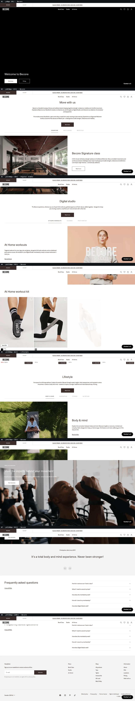
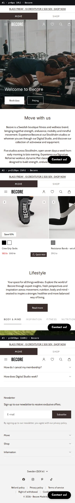

# UI Design System & Master Generation Blueprint: becore-se

> **Becore** (https://becore.se/) — Experience the latest in activewear from our new Becore collection





---

## 1. Executive Visual Persona & Design Archetype

- **Brand Essence & Persona**: **Becore** (`https://becore.se/`). Experience the latest in activewear from our new Becore collection
- **Capture Provenance**: Live browser capture (`tier1_fast`, HTTP `200`, captured `2026-11-24`).
- **Visual Archetype**: **Light-Substrate Editorial & Modular Grid System (`#ffffff` canvas, `#000000` ink, `#007bff` accent)**.
- **Anti-AI-Slop Differentiators**:
  - **Live-Computed Chromatic Polarity**: Anchors the viewport in `#ffffff` (live computed `section` `background-color` (`computed_styles.json`)) paired with `#000000` primary typography and `#007bff` accents.
  - **Grounded Typographic Hierarchy**: Pairs `Inter` for display copy (`Welcome to Becore`) with `Cabin` and `SFMono-Regular`.
  - **Calibrated Spatial Grid & Motion**: Combines `78rem` container bounds (`gap: .75rem`, padding `.875rem`) with `cubic-bezier(.19,1,.22,1)` easing and Three.js / WebGL Canvas Pipeline.

---

## 2. Spatial Architecture & Modular Grid Mathematics

### Viewport Allocation & Container Geometry
- **Captured Journey Filmstrips**: Desktop `1280×6624px` (`assets/desktop-journey.webp`, `8` keyframes up to `y=5589px` / doc `6489px`), Mobile `390×2616px` (`assets/mobile-journey.webp`, `3` keyframes).
- **Master Container Bounds**: `78rem` (non-`@media` desktop container stylesheet rule).
- **Canvas Lateral Padding & Spacing**: `.875rem` lateral canvas padding with `.75rem` grid gap.
- **Border Radius Scale**: `var(--button-border-radius)`, `100%`, `20px`, `var(--rounded-full)`.

### Responsive Breakpoint Architecture
- **Desktop Layout**: Multi-column CSS Grid / Flexbox layout at `1440px` (`max-width: 78rem`, `gap: .75rem`).
- **Mobile Layout**: Single-column vertical stack at `390px` viewport width with `.875rem` horizontal padding.
- **Extracted CSS Media Queries**: `@media screen and (min-width:700px)`, `@media screen and (pointer:fine)`, `@media screen and (min-width:1000px)`, `@media screen and (min-width:1150px)`.

---

## 3. Color System, Materiality & Atmospheric Lighting

### Semantic Palette & Source Grounding
| Semantic Role | Ground-Truth Value | Extracted Live / CSS Source |
|---|---|---|
| **Primary Canvas Substrate** | `#ffffff` | live computed `section` `background-color` (`computed_styles.json`) |
| **Primary Typography Ink** | `#000000` | live computed `main` `color` (`computed_styles.json`) |
| **Elevated Surface / Card Substrate** | `#56b6c2` | `.spinner>div { background-color: #56b6c2 }` |
| **Interactive Accent / Highlight** | `#007bff` | `.btn-primary { background-color: #007bff }` |
| **Secondary / Muted Copy** | `#808080` | live computed `hr` `color` (`computed_styles.json`) |
| **Structural Hairline Border** | `#007bff` | `.btn-primary { border-color: #007bff }` |

### Sanitized Root CSS Variables (`ui-ux.md` Ground Truth)
| Variable Name | Extracted Value | Semantic Role |
|---|---|---|
| `--container-max-width` | `100%` | Layout / Spatial Grid Token |
| `--container-gutter` | `1.25rem` | Layout / Spatial Grid Token |
| `--section-vertical-spacing` | `2rem` | Layout / Spatial Grid Token |
| `--section-stack-row-gap` | `1.5rem` | Layout / Spatial Grid Token |
| `--form-gap` | `1rem` | Layout / Spatial Grid Token |
| `--fieldset-gap` | `0.5rem` | Layout / Spatial Grid Token |
| `--form-control-gap` | `0.5rem` | Layout / Spatial Grid Token |
| `--checkbox-control-gap` | `0.75rem` | Layout / Spatial Grid Token |
| `--input-padding-block` | `0.65rem` | Layout / Spatial Grid Token |
| `--input-padding-inline` | `1rem` | Layout / Spatial Grid Token |
| `--checkbox-size` | `0.875rem` | Layout / Spatial Grid Token |
| `--product-list-column-gap` | `0.125rem` | Layout / Spatial Grid Token |
| `--product-list-row-gap` | `1.5rem` | Layout / Spatial Grid Token |
| `--transform-logical-flip` | `1` | Design System Custom Token |
| `--transform-origin-start` | `left` | Design System Custom Token |
| `--transform-origin-end` | `right` | Design System Custom Token |

---

## 4. Typographic Scale & Editorial Hierarchy

### Font Family Stacks
- **Display Typography**: `Inter`.
- **Primary Body Stack**: `Cabin`.
- **Technical / Metadata Stack**: `SFMono-Regular`.

### Typographic Scale & Rules (Live Computed & Stylesheet Grounded)
- **Hero Display (`H1`)**: live computed `h1` (`font-size: 28.8925px`, `line-height: 37.5602px`, `font-weight: 400`, `letter-spacing: 0.288925px`).
- **Section Heading (`H2`)**: live computed `h2` (`font-size: 28.8925px`, `line-height: 37.5602px`, `font-weight: 400`, `letter-spacing: 0.288925px`); rule `h2` (`font-size: 120%`, `font-weight: bold`).
- **Body Copy**: live computed `body` (`font-size: 14px`, `line-height: 19.6px`, `font-weight: 400`, `letter-spacing: -0.14px`); CSS variables `--text-base: 0.875rem`, `--drawer-body-padding-block: min(2rem, var(--container-gutter))`, `--drawer-body-padding-inline: min(2rem, var(--container-gutter))`; rule `p` (`line-height: 1.3`).
- **Metadata & Navigation Labels**: live computed `nav/a` (`font-size: 14px`, `line-height: 19.6px`, `font-weight: 400`, `letter-spacing: -0.14px`); CSS variables `--subheading-letter-spacing: -0.01em`, `--heading-letter-spacing: 0.01em`, `--text-letter-spacing: -0.01em`.

---

## 5. Choreographed Motion & Interaction Physics

### Primary Easing Curves
- **Extracted Timing Functions**: `cubic-bezier(.19,1,.22,1)`, `cubic-bezier(.4,0,.22,1)`, `cubic-bezier(.4,0,.2,1)`.

### Per-Element Transition & Choreography Rules
- **Selector `.accordion`**: `transition: color .2s` extracted from `becore-se` stylesheet.
- **Selector `.accordion__summary`**: `transition: color .2s` extracted from `becore-se` stylesheet.
- **Selector `ordion__summary .icon-accordion-s...`**: `transition: transform .3s ease-in-out` extracted from `becore-se` stylesheet.
- **Extracted Easing Curve (`cubic-bezier(.19,1,.22,1)`)**: Governs interactive state transitions across `<header.hydrated>` and `<section.shopify-section--vg-media-tabs>`.
- **Runtime Interaction Engine**: Integrates Three.js / WebGL Canvas Pipeline with `prefers-reduced-motion: reduce` fallback guards.
### Measured Runtime Scroll & Interaction Telemetry (`behavioral_journey_v2`)
- **Scroll Driver Mode**: `native` (max document height `6489px`, deepest scrollY reached `5589px` across `8` desktop keyframes).
- **Detected Scroll / Motion Libraries**: Native browser scroll / standard CSS transitions.
- **Nav / Drawer Probe (`Favourites`)**: Triggered visual change (pixel diff `107.627`, captured in `assets/state-nav.webp`); revealed links: MOVE, SHOP, BLACK FRIDAY · 10 CRE..., Becore, Book Class, Studio.
- **Hover Physics (`primary_cta` · `Book class`)**: Computed transition `0.2s` / `ease-in-out` (no static color/transform shift captured at rest).
- **Interactive Control Probe (`tab` · `MAT CLASSES`)**: Triggered visual diff `12.811` (attr `false -> true`, captured in `assets/state-interactive.webp`).
- **Route Transition Architecture**: First internal navigation (`/pages/book-a-class`) measured as `MPA` in `1519ms`.

---

## 6. Component Wireframe & Structural DOM Map

### Visual Layout Schematic — Desktop (`1440px`, Grounded in `dom.html` & Landmark Bounding Boxes)
```
┌────────────────────────────────────────────────────────────────────────┐
│ DESKTOP VIEWPORT (1440px) — Becore                                     │
│ ====================================================================== │
│ [ <header.hydrated> (1440x48px)       | Overview · Index · Archive · ] │
│ ---------------------------------------------------------------------- │
│ | HERO STAGE: <section.shopify-section> (w=1440px)                   | │
│ | H1: Welcome to Becore                                              | │
│ | Substrate: #ffffff | Ink: #000000 | Accent: #007bff                | │
│ ---------------------------------------------------------------------- │
│ | SHOWCASE GRID (<section.shopify-section--) max-w: 78rem            | │
│ | +------------------------------+  +------------------------------+ | │
│ | | Move with us                 |  | Digital studio               | | │
│ | +------------------------------+  +------------------------------+ | │
│ ---------------------------------------------------------------------- │
│ | DETAIL MODULE (<section.shopify-section:n) — Frequently asked ques | │
│ ---------------------------------------------------------------------- │
│ [ FOOTER (<footer.shopify-pc__) | https://becore.se/                   │
└────────────────────────────────────────────────────────────────────────┘
```

### Visual Layout Schematic — Mobile Reflow (`390px`)
```
┌────────────────────────────────────────────────────────────────────────┐
│ MOBILE VIEWPORT REFLOW (390px) — Single-Column Stack (gap: .75rem)     │
│ ====================================================================== │
│ [ HEADER BAR (<header.hydrated>       ) | Compact Menu (390px)         │
│ ---------------------------------------------------------------------- │
│ | HERO STAGE (<section.shopify-section) — 390px Vertical Lead        | │
│ | H1: Welcome to Becore                                              | │
│ ---------------------------------------------------------------------- │
│ | SHOWCASE STACK (<section.shopify-secti) — 1-Col Stack              | │
│ | [ Item 1: Move with us                                           ] | │
│ | [ Item 2: Digital studio                                         ] | │
│ ---------------------------------------------------------------------- │
│ | DETAIL STACK (<section.shopify-section) — 1-Col (Frequently asked q) │
│ ---------------------------------------------------------------------- │
│ [ FOOTER (<footer.shopify-pc__) | Stacked 390px Colophon               │
└────────────────────────────────────────────────────────────────────────┘
```

### Granular DOM Region Breakdown
1. **Brand Header & Navigation Bar (<header.hydrated> — `becore-se`)**:
   - Landmark `<header class="hydrated">` (`1440x48px`) hosting `Becore` navigation (`Overview · Index · Archive · About · Contact`), DOM attributes (`data-source-attribution="shopify.exit_intersti..."`, `data-locksmith`, `data-styles`, `data-shop-id="85529952592"`), and stylesheet rule `after { box-sizing:border-box;border-style:solid;border-width:0;border-color:rgb... }`.
2. **Hero Stage & Focal Lead (<section.shopify-section> — `Welcome to Becore`)**:
   - Landmark `<section class="shopify-section shopify-section--slideshow">` presenting display lead `Welcome to Becore` and copy excerpt *"Becore is a Swedish boutique fitness and wellness brand, bringing"* over `#ffffff` canvas and `#000000` ink.
3. **Primary Showcase & Content Grid (<section.shopify-section--vg-media-tabs> — `Move with us`)**:
   - Landmark `<section class="shopify-section shopify-section--vg-media-tabs">` rendering section `Move with us` with copy *"Five studios across Stockholm, open seven days a week from early "*, asset references (`255516463088201`, `fbevents.js`, `jquery-3.6.4.min-dad6fdf250e31dfa...`, `jquery-migrate-3.4.1.min-6a381abc...`), and grid rule `hr.horizontal-separator { border-width:0 0 0 1px;width:1px;height:100% }`.
4. **Interactive Detail & Feature Matrix (<section.shopify-section:nth(2)> — `Digital studio`)**:
   - Landmark `<section class="shopify-section shopify-section--vg-media-tabs">` framing `Digital studio` and `Frequently asked questions` (*"Becore Signature class"*) with `#56b6c2` surface cards, `#007bff` accents, and `strong { font-weight:bolder }`.
5. **Colophon & Global Directory Footer (<footer.shopify-pc__banner__wrapper> — `https://becore.se/`)**:
   - Landmark `<footer class="shopify-pc__banner__wrapper">` anchoring `Becore` footer links (`Overview · Index · Archive · About · Contact`), copy *"A 50-minute, full-body strength workout on the Becore Reform"*, and `#007bff` structural dividers.
### Full Vertical Scroll Sequence (Desktop `1440×900` Keyframes)
- **Step 01** (`y=0px`, `0%`): Active landmark `Becore` · sticky/fixed elements: `2`
- **Step 02** (`y=850px`, `15%`): Active landmark `Becore` · sticky/fixed elements: `2`
- **Step 03** (`y=1700px`, `30%`): Active landmark `Digital studio` · sticky/fixed elements: `2`
- **Step 04** (`y=2550px`, `46%`): Active landmark `Becore` · sticky/fixed elements: `2`
- **Step 05** (`y=3400px`, `61%`): Active landmark `Lifestyle` · sticky/fixed elements: `2`
- **Step 06** (`y=4250px`, `76%`): Active landmark `Becore` · sticky/fixed elements: `2`
- **Step 07** (`y=5100px`, `91%`): Active landmark `Becore` · sticky/fixed elements: `2`
- **Step 08** (`y=5589px`, `100%`): Active landmark `Becore` · sticky/fixed elements: `2`

### Multi-Page Internal Route Map
- **Detail Route (`/pages/book-a-class`)**: `https://becore.se/pages/book-a-class` — H1: `Book a class`, scrollHeight `4293px`, transition `MPA` (`1519ms`)
- **Detail Route (`/pages/our-locations`)**: `https://becore.se/pages/our-locations` — H1: `Our locations`, scrollHeight `3271px`, transition `direct` (`2165ms`)
- **Detail Route (`/pages/digital-studio`)**: `https://becore.se/pages/digital-studio` — H1: `Digital Studio`, scrollHeight `5044px`, transition `direct` (`1737ms`)

---

## 7. Master Zero-Shot AI Generation Prompt

```markdown
# Master Zero-Shot Frontend Generation Prompt: becore-se (Becore)

You are a principal frontend architect and design systems engineer. Build a complete, production-ready web application replicating the exact design system, DOM landmarks, typographic hierarchy, color tokens, and motion physics of `becore-se` (**Becore** — `https://becore.se/`).

### 1. Visual Archetype & Anti-AI-Slop Mandates
- **Archetype**: Light-Substrate Editorial & Modular Grid System (`#ffffff` canvas, `#000000` ink, `#007bff` accent).
- **Identity & Domain Context**: Experience the latest in activewear from our new Becore collection
- **Primary Substrate**: `#ffffff` (live computed `section` `background-color` (`computed_styles.json`)), **Primary Ink**: `#000000`, **Accent / Highlight**: `#007bff`.
- **Site-Specific Differentiators**:
  - **Live-Computed Chromatic Polarity**: Anchors the viewport in `#ffffff` (live computed `section` `background-color` (`computed_styles.json`)) paired with `#000000` primary typography and `#007bff` accents.
  - **Grounded Typographic Hierarchy**: Pairs `Inter` for display copy (`Welcome to Becore`) with `Cabin` and `SFMono-Regular`.
  - **Calibrated Spatial Grid & Motion**: Combines `78rem` container bounds (`gap: .75rem`, padding `.875rem`) with `cubic-bezier(.19,1,.22,1)` easing and Three.js / WebGL Canvas Pipeline.

### 2. Ground-Truth CSS Variables (`:root` Token Contract)
Declare and consume these exact custom properties extracted from `becore-se` in your global stylesheet:

:root {
  /* Becore (becore-se) — Live-Grounded CSS Variables */
  --container-max-width: 100%; /* Layout / Spatial Grid Token (becore-se) */
  --container-gutter: 1.25rem; /* Layout / Spatial Grid Token (becore-se) */
  --section-vertical-spacing: 2rem; /* Layout / Spatial Grid Token (becore-se) */
  --section-stack-row-gap: 1.5rem; /* Layout / Spatial Grid Token (becore-se) */
  --form-gap: 1rem; /* Layout / Spatial Grid Token (becore-se) */
  --fieldset-gap: 0.5rem; /* Layout / Spatial Grid Token (becore-se) */
  --form-control-gap: 0.5rem; /* Layout / Spatial Grid Token (becore-se) */
  --checkbox-control-gap: 0.75rem; /* Layout / Spatial Grid Token (becore-se) */
  --input-padding-block: 0.65rem; /* Layout / Spatial Grid Token (becore-se) */
  --input-padding-inline: 1rem; /* Layout / Spatial Grid Token (becore-se) */
  --checkbox-size: 0.875rem; /* Layout / Spatial Grid Token (becore-se) */
  --product-list-column-gap: 0.125rem; /* Layout / Spatial Grid Token (becore-se) */
  --product-list-row-gap: 1.5rem; /* Layout / Spatial Grid Token (becore-se) */
  --transform-logical-flip: 1; /* Design System Custom Token (becore-se) */
  --transform-origin-start: left; /* Design System Custom Token (becore-se) */
  --transform-origin-end: right; /* Design System Custom Token (becore-se) */
}

### 3. Semantic Color & Materiality Contract
Map every surface, ink, and border strictly to these source-grounded tokens:
- **Primary Canvas Substrate**: `#ffffff` — grounded in live computed `section` `background-color` (`computed_styles.json`)
- **Primary Typography Ink**: `#000000` — grounded in live computed `main` `color` (`computed_styles.json`)
- **Elevated Surface / Card Substrate**: `#56b6c2` — grounded in `.spinner>div { background-color: #56b6c2 }`
- **Interactive Accent / Highlight**: `#007bff` — grounded in `.btn-primary { background-color: #007bff }`
- **Secondary / Muted Copy**: `#808080` — grounded in live computed `hr` `color` (`computed_styles.json`)
- **Structural Hairline Border**: `#007bff` — grounded in `.btn-primary { border-color: #007bff }`

### 4. Spatial Grid, Container Bounds & Responsive Breakpoints
- **Desktop Viewport Reference**: `1280×6624px` (multi-frame vertical journey filmstrip (6624px), `1440px` standard desktop width).
- **Mobile Viewport Reference**: `390×2616px` (multi-frame vertical journey filmstrip (2616px), `390px` standard mobile width).
- **Container Max-Width**: `78rem` (non-`@media` desktop container stylesheet rule)
- **Padding & Gutters**: `.875rem` lateral canvas padding with `.75rem` grid gap
- **Desktop Grid**: Multi-column CSS Grid / Flexbox layout at `1440px` (`max-width: 78rem`, `gap: .75rem`)
- **Mobile Adaptation**: Single-column vertical stack at `390px` viewport width with `.875rem` horizontal padding
- **Media Queries**: `@media screen and (min-width:700px)`, `@media screen and (pointer:fine)`, `@media screen and (min-width:1000px)`, `@media screen and (min-width:1150px)`
- **Corner Radii**: `var(--button-border-radius)`, `100%`, `20px`, `var(--rounded-full)`

### 5. Typography & Editorial Scale Contract
- **Display Font Stack**: `Inter`
- **Body Font Stack**: `Cabin`
- **Monospace / Technical Font Stack**: `SFMono-Regular`
- **H1 Display Rule**: live computed `h1` (`font-size: 28.8925px`, `line-height: 37.5602px`, `font-weight: 400`, `letter-spacing: 0.288925px`)
- **H2 Section Rule**: live computed `h2` (`font-size: 28.8925px`, `line-height: 37.5602px`, `font-weight: 400`, `letter-spacing: 0.288925px`); rule `h2` (`font-size: 120%`, `font-weight: bold`)
- **Body Copy Rule**: live computed `body` (`font-size: 14px`, `line-height: 19.6px`, `font-weight: 400`, `letter-spacing: -0.14px`); CSS variables `--text-base: 0.875rem`, `--drawer-body-padding-block: min(2rem, var(--container-gutter))`, `--drawer-body-padding-inline: min(2rem, var(--container-gutter))`; rule `p` (`line-height: 1.3`)
- **Metadata & Index Rule**: live computed `nav/a` (`font-size: 14px`, `line-height: 19.6px`, `font-weight: 400`, `letter-spacing: -0.14px`); CSS variables `--subheading-letter-spacing: -0.01em`, `--heading-letter-spacing: 0.01em`, `--text-letter-spacing: -0.01em`

### 6. Component Hierarchy, Verbatim Copy & Real DOM Landmarks
Scaffold `becore-se` (`Becore`) with these exact structural regions, extracted copy, and CSS rules from `dom.html`:
1. **Brand Header & Navigation Bar (<header.hydrated> — `becore-se`)**:
   - DOM & Selectors: Landmark `<header class="hydrated">` (`1440x48px`) hosting `Becore` navigation (`Overview · Index · Archive · About · Contact`), DOM attributes (`data-source-attribution="shopify.exit_intersti..."`, `data-locksmith`, `data-styles`, `data-shop-id="85529952592"`), and stylesheet rule `after { box-sizing:border-box;border-style:solid;border-width:0;border-color:rgb... }`.
   - Responsive Contract: Header `Brand Header & Navigation Bar (<header.hydrated> — `becore-se`)` (`becore-se`) adapts across `@media screen and (min-width:700px)`, `@media screen and (pointer:fine)`, `@media screen and (min-width:1000px)`, `@media screen and (min-width:1150px)` with `cubic-bezier(.19,1,.22,1)`, `cubic-bezier(.4,0,.22,1)`, `cubic-bezier(.4,0,.2,1)` transitions and links `Overview · Index · Archive · About · Contact`.
2. **Hero Stage & Focal Lead (<section.shopify-section> — `Welcome to Becore`)**:
   - DOM & Selectors: Landmark `<section class="shopify-section shopify-section--slideshow">` presenting display lead `Welcome to Becore` and copy excerpt *"Becore is a Swedish boutique fitness and wellness brand, bringing"* over `#ffffff` canvas and `#000000` ink.
   - Responsive Contract: Hero stage (`1280×6624px` desktop / `390×2616px` mobile) sets `#ffffff` background with `#000000` headline `Welcome to Becore`.
3. **Primary Showcase & Content Grid (<section.shopify-section--vg-media-tabs> — `Move with us`)**:
   - DOM & Selectors: Landmark `<section class="shopify-section shopify-section--vg-media-tabs">` rendering section `Move with us` with copy *"Five studios across Stockholm, open seven days a week from early "*, asset references (`255516463088201`, `fbevents.js`, `jquery-3.6.4.min-dad6fdf250e31dfa...`, `jquery-migrate-3.4.1.min-6a381abc...`), and grid rule `hr.horizontal-separator { border-width:0 0 0 1px;width:1px;height:100% }`.
   - Responsive Contract: Showcase grid `Primary Showcase & Content Grid (<section.shopify-section--vg-media-tabs> — `Move with us`)` applies Multi-column CSS Grid / Flexbox layout at `1440px` (`max-width: 78rem`, `gap: .75rem`) on desktop and Single-column vertical stack at `390px` viewport width with `.875rem` horizontal padding on mobile.
4. **Interactive Detail & Feature Matrix (<section.shopify-section:nth(2)> — `Digital studio`)**:
   - DOM & Selectors: Landmark `<section class="shopify-section shopify-section--vg-media-tabs">` framing `Digital studio` and `Frequently asked questions` (*"Becore Signature class"*) with `#56b6c2` surface cards, `#007bff` accents, and `strong { font-weight:bolder }`.
   - Responsive Contract: Detail module `Interactive Detail & Feature Matrix (<section.shopify-section:nth(2)> — `Digital studio`)` uses `var(--button-border-radius)`, `100%`, `20px`, `var(--rounded-full)` radii, `#007bff` highlights, and assets (255516463088201, fbevents.js, jquery-3.6.4.min-dad6fdf250e31dfa...).
5. **Colophon & Global Directory Footer (<footer.shopify-pc__banner__wrapper> — `https://becore.se/`)**:
   - DOM & Selectors: Landmark `<footer class="shopify-pc__banner__wrapper">` anchoring `Becore` footer links (`Overview · Index · Archive · About · Contact`), copy *"A 50-minute, full-body strength workout on the Becore Reform"*, and `#007bff` structural dividers.
   - Responsive Contract: Footer `Colophon & Global Directory Footer (<footer.shopify-pc__banner__wrapper> — `https://becore.se/`)` aligns to `78rem` (non-`@media` desktop container stylesheet rule) with `.875rem` lateral canvas padding with `.75rem` grid gap and attributes (data-source-attribution="shopify.exit_intersti...", data-locksmith, data-styles).

#### Verbatim DOM Copy Excerpts (`dom.html`)
- Copy Excerpt 1: *"Becore is a Swedish boutique fitness and wellness brand, bringing together strengt..."*
- Copy Excerpt 2: *"Five studios across Stockholm, open seven days a week from early morning to late e..."*
- Copy Excerpt 3: *"Becore Signature class"*
- Copy Excerpt 4: *"A 50-minute, full-body strength workout on the Becore Reformer. Slow, controlled m..."*

### 7. Motion, Extracted Stylesheet Rules & Interaction Choreography
- **Primary Easing Functions**: `cubic-bezier(.19,1,.22,1)`, `cubic-bezier(.4,0,.22,1)`, `cubic-bezier(.4,0,.2,1)`
- **Extracted Stylesheet Rules (`becore-se`)**:
- `after { box-sizing:border-box;border-style:solid;border-width:0;border-color:rgb... }`
- `hr.horizontal-separator { border-width:0 0 0 1px;width:1px;height:100% }`
- `strong { font-weight:bolder }`
- `pre { font-family:ui-monospace,SFMono-Regular,Menlo,Monaco,Consolas,Liberation... }`
- `table { text-indent:0;border-color:inherit;border-collapse:collapse }`
- **Per-Selector Transition Rules**:
- **Selector `.accordion`**: `transition: color .2s` extracted from `becore-se` stylesheet.
- **Selector `.accordion__summary`**: `transition: color .2s` extracted from `becore-se` stylesheet.
- **Selector `ordion__summary .icon-accordion-s...`**: `transition: transform .3s ease-in-out` extracted from `becore-se` stylesheet.
- **Extracted Easing Curve (`cubic-bezier(.19,1,.22,1)`)**: Governs interactive state transitions across `<header.hydrated>` and `<section.shopify-section--vg-media-tabs>`.
- **Runtime Interaction Engine**: Integrates Three.js / WebGL Canvas Pipeline with `prefers-reduced-motion: reduce` fallback guards.
### 7b. Full-Page Scroll Choreography, Interactive States & Multi-Page Routes
- **Scroll Mechanics**: Implement `native` vertical progression up to `6489px` across 8 distinct viewport chapters.
- **Vertical Chapter Sequence**: Becore (0%) -> Becore (15%) -> Digital studio (30%) -> Becore (46%) -> Lifestyle (61%) -> Becore (76%) -> Becore (91%) -> Becore (100%).
- **Navigation Drawer / Menu State**: Replicate interactive menu toggle (`Favourites`) with Escape-to-close keyboard handling.
- **Multi-Page Routes**: Scaffold internal routes `/pages/book-a-class` (detail, MPA), `/pages/our-locations` (detail, direct), `/pages/digital-studio` (detail, direct) sharing the global header/footer shell and design tokens.

### 8. Technical Deliverables
- Implement in Next.js (App Router) with TypeScript and Tailwind CSS consuming the `:root` custom properties defined above for `becore-se`.
- Reproduce both the `1440px` desktop architecture and `390px` mobile breakpoint transitions, preserving semantic HTML5 landmarks (`<header>`, `<nav>`, `<main>`, `<section>`, `<footer>`) and `prefers-reduced-motion` accessibility guards.
```
---

## 8. Full-Page Scroll Journey, Interactive States & Subpage Inventory

### Desktop Scroll Keyframes (`1440×900` WebP)
| Step | Scroll Y | Progress | Active Landmark / Section | Sticky/Fixed | Visual Asset |
| :---: | :---: | :---: | :--- | :---: | :--- |
| `#01` | `0px` | `0%` | Becore | `2` | [desktop-step-01.webp](assets/desktop-step-01.webp) |
| `#02` | `850px` | `15%` | Becore | `2` | [desktop-step-02.webp](assets/desktop-step-02.webp) |
| `#03` | `1700px` | `30%` | Digital studio | `2` | [desktop-step-03.webp](assets/desktop-step-03.webp) |
| `#04` | `2550px` | `46%` | Becore | `2` | [desktop-step-04.webp](assets/desktop-step-04.webp) |
| `#05` | `3400px` | `61%` | Lifestyle | `2` | [desktop-step-05.webp](assets/desktop-step-05.webp) |
| `#06` | `4250px` | `76%` | Becore | `2` | [desktop-step-06.webp](assets/desktop-step-06.webp) |
| `#07` | `5100px` | `91%` | Becore | `2` | [desktop-step-07.webp](assets/desktop-step-07.webp) |
| `#08` | `5589px` | `100%` | Becore | `2` | [desktop-step-08.webp](assets/desktop-step-08.webp) |

### Mobile Condensed Keyframes (`390×844` WebP)
| Step | Scroll Y | Progress | Active Landmark | Visual Asset |
| :---: | :---: | :---: | :--- | :--- |
| `#01` | `0px` | `0%` | Becore | [mobile-step-01.webp](assets/mobile-step-01.webp) |
| `#02` | `2529px` | `50%` | Becore | [mobile-step-02.webp](assets/mobile-step-02.webp) |
| `#03` | `5059px` | `100%` | Becore | [mobile-step-03.webp](assets/mobile-step-03.webp) |

### Interactive UI State Captures (`1440×900` WebP)
| State Type | Trigger / Observation | Visual Asset |
| :--- | :--- | :--- |
| `nav_menu` | Nav/Menu opened (`Favourites`, diff `107.627`) | [state-nav.webp](assets/state-nav.webp) |
| `interactive_control` | Control `tab` (`MAT CLASSES`, diff `12.811`) | [state-interactive.webp](assets/state-interactive.webp) |

### Internal Subpage Filmstrips (`1080px` Wide WebP)
| # | Template | Route URL | H1 / Title | Scroll Height | Transition | Filmstrip Asset |
| :-: | :---: | :--- | :--- | :---: | :---: | :--- |
| `1` | `detail` | `https://becore.se/pages/book-a-class` | Book a class | `4293px` | `MPA` (`1519ms`) | [subpage-01-pages-book-a-class.webp](assets/subpage-01-pages-book-a-class.webp) |
| `2` | `detail` | `https://becore.se/pages/our-locations` | Our locations | `3271px` | `direct` (`2165ms`) | [subpage-02-pages-our-locations.webp](assets/subpage-02-pages-our-locations.webp) |
| `3` | `detail` | `https://becore.se/pages/digital-studio` | Digital Studio | `5044px` | `direct` (`1737ms`) | [subpage-03-pages-digital-studio.webp](assets/subpage-03-pages-digital-studio.webp) |

