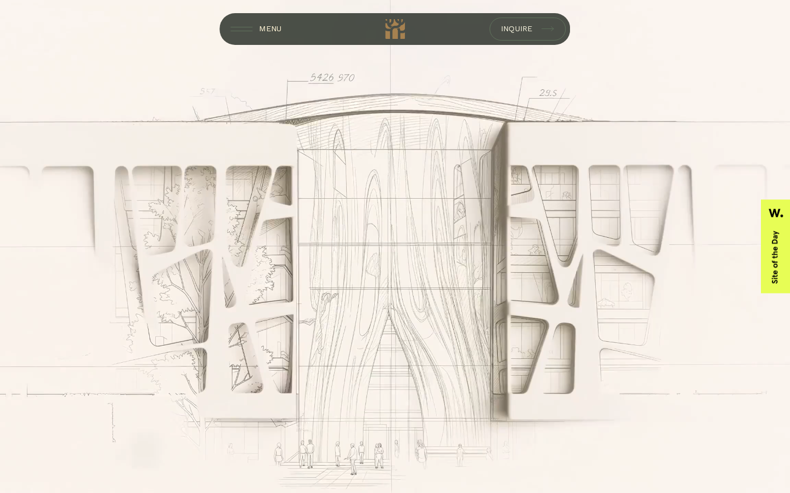
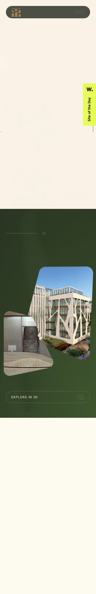

# UI Design System & Master Generation Blueprint: belgradearbor-rs_en

> **Belgrade Arbor · Residential & Business Complex in New Belgrade** (https://belgradearbor.rs/en) — Discover Belgrade Arbor - premium apartments and business spaces in New Belgrade. Explore residences, amenities, location, and availability.



---

## 1. Executive Visual Persona & Design Archetype

- **Brand Essence & Persona**: **Belgrade Arbor · Residential & Business Complex in New Belgrade** (`https://belgradearbor.rs/en`). Discover Belgrade Arbor - premium apartments and business spaces in New Belgrade. Explore residences, amenities, location, and availability.
- **Capture Provenance**: Live browser capture (`tier1_fast`, HTTP `200`, captured `2026-11-23`).
- **Visual Archetype**: **Light-Gallery WebGL / Canvas Interactive Experience (`#fdfbef` / `#e7fd55`)**.
- **Anti-AI-Slop Differentiators**:
  - **Live-Computed Chromatic Polarity**: Anchors the viewport in `#fdfbef` (live computed `body` `background-color` (`computed_styles.json`)) paired with `#2e3a26` primary typography and `#e7fd55` accents.
  - **Grounded Typographic Hierarchy**: Pairs `editorialOld` for display copy (`BELGRADE ARBOR`) with `Apple Color Emoji` and `SFMono-Regular`.
  - **Calibrated Spatial Grid & Motion**: Combines `1601px` container bounds (`gap: 0px (flush layout)`, padding `0px`) with `cubic-bezier(.4,0,.2,1)` easing and Lenis Smooth Scroll (`data-lenis`), Three.js / WebGL Canvas Pipeline.

---

## 2. Spatial Architecture & Modular Grid Mathematics



### Viewport Allocation & Container Geometry
- **Captured Viewport Dimensions**: Desktop `1440×900px` (`assets/desktop.png`, single-viewport 100vh live capture (900px)), Mobile `390×2400px` (`assets/mobile.png`, clamped at 2400px live multi-section capture).
- **Master Container Bounds**: `1601px` (non-`@media` desktop container stylesheet rule).
- **Canvas Lateral Padding & Spacing**: `0px` lateral canvas padding with `0px (flush layout)` grid gap.
- **Border Radius Scale**: `.25rem`, `1.25rem`, `1.75rem`, `2147483647px`.

### Responsive Breakpoint Architecture
- **Desktop Layout**: Multi-column CSS Grid / Flexbox layout at `1440px` (`max-width: 1601px`, `gap: 0px (flush layout)`).
- **Mobile Layout**: Single-column vertical stack at `390px` viewport width with `0px` horizontal padding.
- **Extracted CSS Media Queries**: `@media not all and (min-width:1121px)`, `@media not all and (min-width:601px)`, `@media (min-width:481px)`, `@media (min-width:601px)`.

---

## 3. Color System, Materiality & Atmospheric Lighting

### Semantic Palette & Source Grounding
| Semantic Role | Ground-Truth Value | Extracted Live / CSS Source |
|---|---|---|
| **Primary Canvas Substrate** | `#fdfbef` | live computed `body` `background-color` (`computed_styles.json`) |
| **Primary Typography Ink** | `#2e3a26` | live computed `main` `color` (`computed_styles.json`) |
| **Elevated Surface / Card Substrate** | `#ffffff` | `var(--card)` in `:root` |
| **Interactive Accent / Highlight** | `#e7fd55` | `.bg-accent { background-color: #e7fd55 }` |
| **Secondary / Muted Copy** | `#737373` | `var(--muted-foreground)` in `:root` |
| **Structural Hairline Border** | `#e5e5e5` | `var(--border)` in `:root` |
| **Variable Token (`--card-foreground`)** | `#0a0a0a` | `var(--card-foreground)` in `:root` |
| **Variable Token (`--primary`)** | `#171717` | `var(--primary)` in `:root` |
| **Variable Token (`--primary-foreground`)** | `#fafafa` | `var(--primary-foreground)` in `:root` |
| **Variable Token (`--secondary`)** | `#f5f5f5` | `var(--secondary)` in `:root` |
| **Variable Token (`--destructive`)** | `#e40014` | `var(--destructive)` in `:root` |

### Sanitized Root CSS Variables (`ui-ux.md` Ground Truth)
| Variable Name | Extracted Value | Semantic Role |
|---|---|---|
| `--radius` | `.625rem` | Elevation / Border Token |
| `--background` | `var(--color-vanilla)` | Canvas / Surface Token |
| `--foreground` | `var(--color-pine-green)` | Typography Ink Token |
| `--card` | `#fff` | Color / Atmospheric Token |
| `--card-foreground` | `#0a0a0a` | Typography Ink Token |
| `--popover` | `#fff` | Color / Atmospheric Token |
| `--popover-foreground` | `#0a0a0a` | Typography Ink Token |
| `--primary` | `#171717` | Brand / Palette Token |
| `--primary-foreground` | `#fafafa` | Typography Ink Token |
| `--secondary` | `#f5f5f5` | Brand / Palette Token |
| `--secondary-foreground` | `#171717` | Typography Ink Token |
| `--muted` | `#f5f5f5` | Color / Atmospheric Token |
| `--muted-foreground` | `#737373` | Typography Ink Token |
| `--accent` | `#f5f5f5` | Brand / Palette Token |
| `--accent-foreground` | `#171717` | Typography Ink Token |
| `--destructive` | `#e40014` | Color / Atmospheric Token |

---

## 4. Typographic Scale & Editorial Hierarchy

### Font Family Stacks
- **Display Typography**: `editorialOld`.
- **Primary Body Stack**: `Apple Color Emoji`.
- **Technical / Metadata Stack**: `SFMono-Regular`.

### Typographic Scale & Rules (Live Computed & Stylesheet Grounded)
- **Hero Display (`H1`)**: live computed `h1` (`font-size: 151.2px`, `line-height: 151.2px`, `font-weight: 400`).
- **Section Heading (`H2`)**: live computed `h2` (`font-size: 55.944px`, `line-height: 61.5384px`, `font-weight: 300`, `letter-spacing: 1.11888px`).
- **Body Copy**: live computed `body` (`font-size: 15.984px`, `line-height: 23.976px`, `font-weight: 400`); CSS variables `--text-base: 1rem`, `--text-base--line-height: calc(1.5 / 1)`.
- **Metadata & Navigation Labels**: live computed `nav/a` (`font-size: 15.984px`, `line-height: 23.976px`, `font-weight: 400`); CSS variables `--text-xs: .75rem`, `--text-xs--line-height: calc(1 / .75)`, `--text-sm: .875rem`.

---

## 5. Choreographed Motion & Interaction Physics

### Primary Easing Curves
- **Extracted Timing Functions**: `cubic-bezier(.4,0,.2,1)`.

### Per-Element Transition & Choreography Rules
- **Selector `layer theme`**: `transition: cubic-bezier(.4,0,.2,1)` extracted from `belgradearbor-rs_en` stylesheet.
- **Selector `.transition`**: `transition: var(--tw-ease,var(--default-transition-timing-function))` extracted from `belgradearbor-rs_en` stylesheet.
- **Selector `box-shadow\]`**: `transition: var(--tw-ease,var(--default-transition-timing-function))` extracted from `belgradearbor-rs_en` stylesheet.
- **Extracted Easing Curve (`cubic-bezier(.4,0,.2,1)`)**: Governs interactive state transitions across `<nav.mt-12>` and `<section.introduction-mobile>`.
- **Runtime Interaction Engine**: Integrates Lenis Smooth Scroll (`data-lenis`), Three.js / WebGL Canvas Pipeline with `prefers-reduced-motion: reduce` fallback guards.

---

## 6. Component Wireframe & Structural DOM Map

### Visual Layout Schematic — Desktop (`1440px`, Grounded in `dom.html` & Landmark Bounding Boxes)
```
┌────────────────────────────────────────────────────────────────────────┐
│ DESKTOP VIEWPORT (1440px) — Belgrade Arbor · Residential & Business Co │
│ ====================================================================== │
│ [ <nav.mt-12> (220x431px)             | Home Home · Business Busines ] │
│ ---------------------------------------------------------------------- │
│ | HERO STAGE: <section.relative> (w=1440px)                          | │
│ | H1: BELGRADE ARBOR                                                 | │
│ | Substrate: #fdfbef | Ink: #2e3a26 | Accent: #e7fd55                | │
│ ---------------------------------------------------------------------- │
│ | SHOWCASE GRID (<section.introduction-mobi) max-w: 1601px           | │
│ | +------------------------------+  +------------------------------+ | │
│ | | Belgrade Arbor               |  | The visual identity of Belgr | | │
│ | +------------------------------+  +------------------------------+ | │
│ ---------------------------------------------------------------------- │
│ | DETAIL MODULE (<section.z-1>) — Belgrade Arbor isn't               | │
│ ---------------------------------------------------------------------- │
│ [ FOOTER (<footer.to-vanilla> ) | https://belgradearbor.rs/en          │
└────────────────────────────────────────────────────────────────────────┘
```

### Visual Layout Schematic — Mobile Reflow (`390px`)
```
┌────────────────────────────────────────────────────────────────────────┐
│ MOBILE VIEWPORT REFLOW (390px) — Single-Column Stack (gap: 0px (flu)   │
│ ====================================================================== │
│ [ HEADER BAR (<nav.mt-12>             ) | Compact Menu (390px)         │
│ ---------------------------------------------------------------------- │
│ | HERO STAGE (<section.relative>) — 390px Vertical Lead              | │
│ | H1: BELGRADE ARBOR                                                 | │
│ ---------------------------------------------------------------------- │
│ | SHOWCASE STACK (<section.introduction-) — 1-Col Stack              | │
│ | [ Item 1: Belgrade Arbor                                         ] | │
│ | [ Item 2: The visual identity of Belgrade Arbor is defined...    ] | │
│ ---------------------------------------------------------------------- │
│ | DETAIL STACK (<section.z-1>) — 1-Col (Belgrade Arbor isn)          | │
│ ---------------------------------------------------------------------- │
│ [ FOOTER (<footer.to-vanilla> ) | Stacked 390px Colophon               │
└────────────────────────────────────────────────────────────────────────┘
```

### Granular DOM Region Breakdown
1. **Brand Header & Navigation Bar (<nav.mt-12> — `belgradearbor-rs_en`)**:
   - Landmark `<nav class="mt-12 flex">` (`220x431px`) hosting `Belgrade Arbor · Residential & Busin` navigation (`Home Home · Business Business · Location Location · Amenities Amenities · Contact Contact`), DOM attributes (`data-precedence="next"`, `data-precedence="next"`, `data-precedence="next"`, `data-cookieconsent="ignore"`), and stylesheet rule `.VqkbDq_className { font-family:Work Sans,Work Sans Fallback;font-style:normal }`.
2. **Hero Stage & Focal Lead (<section.relative> — `BELGRADE ARBOR`)**:
   - Landmark `<section class="relative">` presenting display lead `BELGRADE ARBOR` and copy excerpt *"BELGRADE ARBOR DESIGN"* over `#fdfbef` canvas and `#2e3a26` ink.
3. **Primary Showcase & Content Grid (<section.introduction-mobile> — `Belgrade Arbor`)**:
   - Landmark `<section class="introduction-mobile relative">` rendering section `Belgrade Arbor` with copy *"B E L G R A D E A R B O R D E S I G N"*, asset references (`0kbue0j55e2ep.css`, `2l_3j-qfad4j4.css`, `2zlpkz7lx5tcy.css`, `07bpw61iauvjs.js`), and grid rule `.VqkbDq_variable { --font-workSans:"Work Sans", "Work Sans Fallback" }`.
4. **Interactive Detail & Feature Matrix (<section.z-1> — `The visual identity of Belgrade Ar`)**:
   - Landmark `<section class="z-1 relative">` framing `The visual identity of Belgrade Arbor is defined...` and `Belgrade Arbor isn't just another addition to the...` (*"Explore in 3d Explore in 3d"*) with `#ffffff` surface cards, `#e7fd55` accents, and `.UoXJ4a_className { font-family:editorialOld,editorialOld Fallback }`.
5. **Colophon & Global Directory Footer (<footer.to-vanilla> — `https://belgradearbor.rs/en`)**:
   - Landmark `<footer class="to-vanilla bg-linear-to-t">` anchoring `Belgrade Arbor · Residential & B` footer links (`Home Home · Business Business · Location Location · Amenities Amenities · Contact Contact`), copy *"A clear architectural vision, a carefully selected location,"*, and `#e5e5e5` structural dividers.

---

## 7. Master Zero-Shot AI Generation Prompt

```markdown
# Master Zero-Shot Frontend Generation Prompt: belgradearbor-rs_en (Belgrade Arbor · Residential & Business Complex in New Belgrade)

You are a principal frontend architect and design systems engineer. Build a complete, production-ready web application replicating the exact design system, DOM landmarks, typographic hierarchy, color tokens, and motion physics of `belgradearbor-rs_en` (**Belgrade Arbor · Residential & Business Complex in New Belgrade** — `https://belgradearbor.rs/en`).

### 1. Visual Archetype & Anti-AI-Slop Mandates
- **Archetype**: Light-Gallery WebGL / Canvas Interactive Experience (`#fdfbef` / `#e7fd55`).
- **Identity & Domain Context**: Discover Belgrade Arbor - premium apartments and business spaces in New Belgrade. Explore residences, amenities, location, and availability.
- **Primary Substrate**: `#fdfbef` (live computed `body` `background-color` (`computed_styles.json`)), **Primary Ink**: `#2e3a26`, **Accent / Highlight**: `#e7fd55`.
- **Site-Specific Differentiators**:
  - **Live-Computed Chromatic Polarity**: Anchors the viewport in `#fdfbef` (live computed `body` `background-color` (`computed_styles.json`)) paired with `#2e3a26` primary typography and `#e7fd55` accents.
  - **Grounded Typographic Hierarchy**: Pairs `editorialOld` for display copy (`BELGRADE ARBOR`) with `Apple Color Emoji` and `SFMono-Regular`.
  - **Calibrated Spatial Grid & Motion**: Combines `1601px` container bounds (`gap: 0px (flush layout)`, padding `0px`) with `cubic-bezier(.4,0,.2,1)` easing and Lenis Smooth Scroll (`data-lenis`), Three.js / WebGL Canvas Pipeline.

### 2. Ground-Truth CSS Variables (`:root` Token Contract)
Declare and consume these exact custom properties extracted from `belgradearbor-rs_en` in your global stylesheet:

:root {
  /* Belgrade Arbor · Residential & Business Complex in New Belgrade (belgradearbor-rs_en) — Live-Grounded CSS Variables */
  --radius: .625rem; /* Elevation / Border Token (belgradearbor-rs_en) */
  --background: var(--color-vanilla); /* Canvas / Surface Token (belgradearbor-rs_en) */
  --foreground: var(--color-pine-green); /* Typography Ink Token (belgradearbor-rs_en) */
  --card: #fff; /* Color / Atmospheric Token (belgradearbor-rs_en) */
  --card-foreground: #0a0a0a; /* Typography Ink Token (belgradearbor-rs_en) */
  --popover: #fff; /* Color / Atmospheric Token (belgradearbor-rs_en) */
  --popover-foreground: #0a0a0a; /* Typography Ink Token (belgradearbor-rs_en) */
  --primary: #171717; /* Brand / Palette Token (belgradearbor-rs_en) */
  --primary-foreground: #fafafa; /* Typography Ink Token (belgradearbor-rs_en) */
  --secondary: #f5f5f5; /* Brand / Palette Token (belgradearbor-rs_en) */
  --secondary-foreground: #171717; /* Typography Ink Token (belgradearbor-rs_en) */
  --muted: #f5f5f5; /* Color / Atmospheric Token (belgradearbor-rs_en) */
  --muted-foreground: #737373; /* Typography Ink Token (belgradearbor-rs_en) */
  --accent: #f5f5f5; /* Brand / Palette Token (belgradearbor-rs_en) */
  --accent-foreground: #171717; /* Typography Ink Token (belgradearbor-rs_en) */
  --destructive: #e40014; /* Color / Atmospheric Token (belgradearbor-rs_en) */
}

### 3. Semantic Color & Materiality Contract
Map every surface, ink, and border strictly to these source-grounded tokens:
- **Primary Canvas Substrate**: `#fdfbef` — grounded in live computed `body` `background-color` (`computed_styles.json`)
- **Primary Typography Ink**: `#2e3a26` — grounded in live computed `main` `color` (`computed_styles.json`)
- **Elevated Surface / Card Substrate**: `#ffffff` — grounded in `var(--card)` in `:root`
- **Interactive Accent / Highlight**: `#e7fd55` — grounded in `.bg-accent { background-color: #e7fd55 }`
- **Secondary / Muted Copy**: `#737373` — grounded in `var(--muted-foreground)` in `:root`
- **Structural Hairline Border**: `#e5e5e5` — grounded in `var(--border)` in `:root`
- **Variable Token (`--card-foreground`)**: `#0a0a0a` — grounded in `var(--card-foreground)` in `:root`
- **Variable Token (`--primary`)**: `#171717` — grounded in `var(--primary)` in `:root`
- **Variable Token (`--primary-foreground`)**: `#fafafa` — grounded in `var(--primary-foreground)` in `:root`
- **Variable Token (`--secondary`)**: `#f5f5f5` — grounded in `var(--secondary)` in `:root`
- **Variable Token (`--destructive`)**: `#e40014` — grounded in `var(--destructive)` in `:root`

### 4. Spatial Grid, Container Bounds & Responsive Breakpoints
- **Desktop Viewport Reference**: `1440×900px` (single-viewport 100vh live capture (900px), `1440px` standard desktop width).
- **Mobile Viewport Reference**: `390×2400px` (clamped at 2400px live multi-section capture, `390px` standard mobile width).
- **Container Max-Width**: `1601px` (non-`@media` desktop container stylesheet rule)
- **Padding & Gutters**: `0px` lateral canvas padding with `0px (flush layout)` grid gap
- **Desktop Grid**: Multi-column CSS Grid / Flexbox layout at `1440px` (`max-width: 1601px`, `gap: 0px (flush layout)`)
- **Mobile Adaptation**: Single-column vertical stack at `390px` viewport width with `0px` horizontal padding
- **Media Queries**: `@media not all and (min-width:1121px)`, `@media not all and (min-width:601px)`, `@media (min-width:481px)`, `@media (min-width:601px)`
- **Corner Radii**: `.25rem`, `1.25rem`, `1.75rem`, `2147483647px`

### 5. Typography & Editorial Scale Contract
- **Display Font Stack**: `editorialOld`
- **Body Font Stack**: `Apple Color Emoji`
- **Monospace / Technical Font Stack**: `SFMono-Regular`
- **H1 Display Rule**: live computed `h1` (`font-size: 151.2px`, `line-height: 151.2px`, `font-weight: 400`)
- **H2 Section Rule**: live computed `h2` (`font-size: 55.944px`, `line-height: 61.5384px`, `font-weight: 300`, `letter-spacing: 1.11888px`)
- **Body Copy Rule**: live computed `body` (`font-size: 15.984px`, `line-height: 23.976px`, `font-weight: 400`); CSS variables `--text-base: 1rem`, `--text-base--line-height: calc(1.5 / 1)`
- **Metadata & Index Rule**: live computed `nav/a` (`font-size: 15.984px`, `line-height: 23.976px`, `font-weight: 400`); CSS variables `--text-xs: .75rem`, `--text-xs--line-height: calc(1 / .75)`, `--text-sm: .875rem`

### 6. Component Hierarchy, Verbatim Copy & Real DOM Landmarks
Scaffold `belgradearbor-rs_en` (`Belgrade Arbor · Residential & Business Complex in New Belgrade`) with these exact structural regions, extracted copy, and CSS rules from `dom.html`:
1. **Brand Header & Navigation Bar (<nav.mt-12> — `belgradearbor-rs_en`)**:
   - DOM & Selectors: Landmark `<nav class="mt-12 flex">` (`220x431px`) hosting `Belgrade Arbor · Residential & Busin` navigation (`Home Home · Business Business · Location Location · Amenities Amenities · Contact Contact`), DOM attributes (`data-precedence="next"`, `data-precedence="next"`, `data-precedence="next"`, `data-cookieconsent="ignore"`), and stylesheet rule `.VqkbDq_className { font-family:Work Sans,Work Sans Fallback;font-style:normal }`.
   - Responsive Contract: Header `Brand Header & Navigation Bar (<nav.mt-12> — `belgradearbor-rs_en`)` (`belgradearbor-rs_en`) adapts across `@media not all and (min-width:1121px)`, `@media not all and (min-width:601px)`, `@media (min-width:481px)`, `@media (min-width:601px)` with `cubic-bezier(.4,0,.2,1)` transitions and links `Home Home · Business Business · Location Location · Amenities Amenities · Contact Contact`.
2. **Hero Stage & Focal Lead (<section.relative> — `BELGRADE ARBOR`)**:
   - DOM & Selectors: Landmark `<section class="relative">` presenting display lead `BELGRADE ARBOR` and copy excerpt *"BELGRADE ARBOR DESIGN"* over `#fdfbef` canvas and `#2e3a26` ink.
   - Responsive Contract: Hero stage (`1440×900px` desktop / `390×2400px` mobile) sets `#fdfbef` background with `#2e3a26` headline `BELGRADE ARBOR`.
3. **Primary Showcase & Content Grid (<section.introduction-mobile> — `Belgrade Arbor`)**:
   - DOM & Selectors: Landmark `<section class="introduction-mobile relative">` rendering section `Belgrade Arbor` with copy *"B E L G R A D E A R B O R D E S I G N"*, asset references (`0kbue0j55e2ep.css`, `2l_3j-qfad4j4.css`, `2zlpkz7lx5tcy.css`, `07bpw61iauvjs.js`), and grid rule `.VqkbDq_variable { --font-workSans:"Work Sans", "Work Sans Fallback" }`.
   - Responsive Contract: Showcase grid `Primary Showcase & Content Grid (<section.introduction-mobile> — `Belgrade Arbor`)` applies Multi-column CSS Grid / Flexbox layout at `1440px` (`max-width: 1601px`, `gap: 0px (flush layout)`) on desktop and Single-column vertical stack at `390px` viewport width with `0px` horizontal padding on mobile.
4. **Interactive Detail & Feature Matrix (<section.z-1> — `The visual identity of Belgrade Ar`)**:
   - DOM & Selectors: Landmark `<section class="z-1 relative">` framing `The visual identity of Belgrade Arbor is defined...` and `Belgrade Arbor isn't just another addition to the...` (*"Explore in 3d Explore in 3d"*) with `#ffffff` surface cards, `#e7fd55` accents, and `.UoXJ4a_className { font-family:editorialOld,editorialOld Fallback }`.
   - Responsive Contract: Detail module `Interactive Detail & Feature Matrix (<section.z-1> — `The visual identity of Belgrade Ar`)` uses `.25rem`, `1.25rem`, `1.75rem`, `2147483647px` radii, `#e7fd55` highlights, and assets (0kbue0j55e2ep.css, 2l_3j-qfad4j4.css, 2zlpkz7lx5tcy.css).
5. **Colophon & Global Directory Footer (<footer.to-vanilla> — `https://belgradearbor.rs/en`)**:
   - DOM & Selectors: Landmark `<footer class="to-vanilla bg-linear-to-t">` anchoring `Belgrade Arbor · Residential & B` footer links (`Home Home · Business Business · Location Location · Amenities Amenities · Contact Contact`), copy *"A clear architectural vision, a carefully selected location,"*, and `#e5e5e5` structural dividers.
   - Responsive Contract: Footer `Colophon & Global Directory Footer (<footer.to-vanilla> — `https://belgradearbor.rs/en`)` aligns to `1601px` (non-`@media` desktop container stylesheet rule) with `0px` lateral canvas padding with `0px (flush layout)` grid gap and attributes (data-precedence="next", data-precedence="next", data-precedence="next").

#### Verbatim DOM Copy Excerpts (`dom.html`)
- Copy Excerpt 1: *"BELGRADE ARBOR DESIGN"*
- Copy Excerpt 2: *"B E L G R A D E A R B O R D E S I G N"*
- Copy Excerpt 3: *"Explore in 3d Explore in 3d"*
- Copy Excerpt 4: *"A clear architectural vision, a carefully selected location, and thoughtfully cura..."*

### 7. Motion, Extracted Stylesheet Rules & Interaction Choreography
- **Primary Easing Functions**: `cubic-bezier(.4,0,.2,1)`
- **Extracted Stylesheet Rules (`belgradearbor-rs_en`)**:
- `.VqkbDq_className { font-family:Work Sans,Work Sans Fallback;font-style:normal }`
- `.VqkbDq_variable { --font-workSans:"Work Sans", "Work Sans Fallback" }`
- `.UoXJ4a_className { font-family:editorialOld,editorialOld Fallback }`
- `.UoXJ4a_variable { --font-editorialOld:"editorialOld", "editorialOld Fallback" }`
- `host { --color-red-500:lab(55.4814% 75.0732 48.8528) }`
- **Per-Selector Transition Rules**:
- **Selector `layer theme`**: `transition: cubic-bezier(.4,0,.2,1)` extracted from `belgradearbor-rs_en` stylesheet.
- **Selector `.transition`**: `transition: var(--tw-ease,var(--default-transition-timing-function))` extracted from `belgradearbor-rs_en` stylesheet.
- **Selector `box-shadow\]`**: `transition: var(--tw-ease,var(--default-transition-timing-function))` extracted from `belgradearbor-rs_en` stylesheet.
- **Extracted Easing Curve (`cubic-bezier(.4,0,.2,1)`)**: Governs interactive state transitions across `<nav.mt-12>` and `<section.introduction-mobile>`.
- **Runtime Interaction Engine**: Integrates Lenis Smooth Scroll (`data-lenis`), Three.js / WebGL Canvas Pipeline with `prefers-reduced-motion: reduce` fallback guards.

### 8. Technical Deliverables
- Implement in Next.js (App Router) with TypeScript and Tailwind CSS consuming the `:root` custom properties defined above for `belgradearbor-rs_en`.
- Reproduce both the `1440px` desktop architecture and `390px` mobile breakpoint transitions, preserving semantic HTML5 landmarks (`<header>`, `<nav>`, `<main>`, `<section>`, `<footer>`) and `prefers-reduced-motion` accessibility guards.
```
