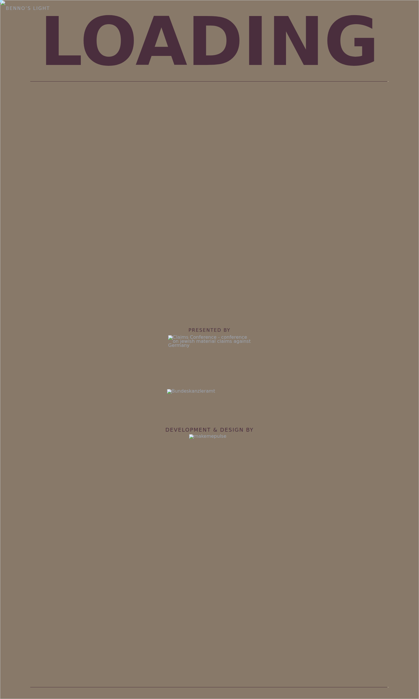
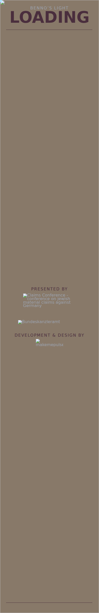

# UI Design System & Master Generation Blueprint: bennos-light-org

> **Benno's Light** (https://bennos-light.org/) — Benno Kern, one of only a few Holocaust survivors still alive in Austria, tells his heartbreaking story of survival in the latest experie...



---

## 1. Executive Visual Persona & Design Archetype

- **Brand Essence & Persona**: **Benno's Light** (`https://bennos-light.org/`). Benno Kern, one of only a few Holocaust survivors still alive in Austria, tells his heartbreaking story of survival in the latest experie...
- **Visual Archetype**: **Light-Gallery WebGL / Canvas Interactive Experience (`#9ca3af` / `#000000`)**.
- **Anti-AI-Slop Differentiators**:
  - **Source-Grounded Chromatic Polarity**: Anchors the viewport in `#9ca3af` (`textarea::-moz-placeholder { color: #9ca3af }`) paired with `#000000` primary typography and `#000000` accents.
  - **Extracted Typographic Hierarchy**: Pairs `Acumin Pro Wide` for display copy (`Benno's Light`) with `La Belle Aurore` and `SFMono-Regular`.
  - **Calibrated Spatial Grid & Motion**: Combines `87.6923076923077vw` container bounds (`gap: var(--container-gutter-width)`, padding `.625rem`) with `cubic-bezier(0.25,0.1,0.25,1)` easing and Barba.js Page Transition Router, HTML5 `<canvas>` Interactive Viewport Surface.

---

## 2. Spatial Architecture & Modular Grid Mathematics



### Viewport Allocation & Container Geometry
- **Captured Viewport Dimensions**: Desktop `1440×2400px` (`assets/desktop.png`, capped at 2400px multi-section capture), Mobile `390×2400px` (`assets/mobile.png`, capped at 2400px multi-section capture).
- **Master Container Bounds**: `87.6923076923077vw` extracted from `bennos-light-org` stylesheet.
- **Canvas Lateral Padding & Spacing**: `.625rem` lateral canvas padding with `var(--container-gutter-width)` grid gap.
- **Border Radius Scale**: `.5rem`, `1rem`, `9999px`.

### Responsive Breakpoint Architecture
- **Desktop Layout**: Multi-column CSS Grid / Flexbox layout at `1440px` (`max-width: 87.6923076923077vw`, `gap: var(--container-gutter-width)`).
- **Mobile Layout**: Single-column vertical stack at `390px` viewport width with `.625rem` horizontal padding.
- **Extracted CSS Media Queries**: `@media (min-width: 1024px)`, `@media (min-width: 1536px)`, `@media (min-width: 768px)`, `@media (min-width: 1280px)`.

---

## 3. Color System, Materiality & Atmospheric Lighting

### Semantic Palette & Source Grounding
| Semantic Role | Ground-Truth Value | Extracted CSS Source / Selector |
|---|---|---|
| **Primary Canvas Substrate** | `#9ca3af` | `textarea::-moz-placeholder { color: #9ca3af }` |
| **Primary Typography Ink** | `#000000` | `body { background-color: black }` (`#000000`) |
| **Elevated Surface / Card Substrate** | `#ffffff` | `body { color: white }` (`#ffffff`) |

### Sanitized Root CSS Variables (`ui-ux.md` Ground Truth)
| Variable Name | Extracted Value | Semantic Role |
|---|---|---|
| `--colors-true-black` | `0,0,0` | Canvas / Surface Token |
| `--colors-true-white` | `255,255,255` | Canvas / Surface Token |
| `--colors-black` | `74,46,61` | Canvas / Surface Token |
| `--colors-white` | `244,235,214` | Canvas / Surface Token |
| `--colors-primary` | `74,46,61` | Brand / Palette Token |
| `--colors-secondary` | `244,235,214` | Brand / Palette Token |
| `--colors-accent` | `171,223,251` | Brand / Palette Token |
| `--colors-dark-beige` | `136,121,105` | Canvas / Surface Token |
| `--colors-mid-beige` | `202,192,168` | Brand / Palette Token |
| `--colors-themeClassnames-light` | `theme-light` | Canvas / Surface Token |
| `--colors-themeClassnames-dark` | `theme-dark` | Canvas / Surface Token |
| `--colors-THEME-COLORS-light-primary` | `244,235,214` | Canvas / Surface Token |
| `--colors-THEME-COLORS-light-secondary` | `74,46,61` | Canvas / Surface Token |
| `--colors-THEME-COLORS-dark-primary` | `74,46,61` | Canvas / Surface Token |
| `--colors-THEME-COLORS-dark-secondary` | `244,235,214` | Canvas / Surface Token |
| `--container-max-width` | `87.6923076923077vw` | Layout / Spatial Grid Token |

---

## 4. Typographic Scale & Editorial Hierarchy

### Font Family Stacks
- **Display Typography**: `Acumin Pro Wide`.
- **Primary Body Stack**: `La Belle Aurore`.
- **Technical / Metadata Stack**: `SFMono-Regular`.

### Typographic Scale & Rules (Extracted from Stylesheet & Variables)
- **Hero Display (`H1`)**: not explicitly declared on tag in static CSS (stylesheet font-size ladder: `1em`, `80%`, `75%`, `100%`, `1rem`).
- **Section Heading (`H2`)**: not explicitly declared on tag in static CSS (stylesheet font-size ladder: `1em`, `80%`, `75%`, `100%`, `1rem`).
- **Body Copy**: not explicitly declared on tag in static CSS (stylesheet font-size ladder: `1em`, `80%`, `75%`, `100%`, `1rem`).
- **Metadata & Navigation Labels**: not explicitly declared on tag in static CSS (stylesheet font-size ladder: `1em`, `80%`, `75%`, `100%`, `1rem`).

---

## 5. Choreographed Motion & Interaction Physics

### Primary Easing Curves
- **Extracted Timing Functions**: `cubic-bezier(0.25,0.1,0.25,1)`.

### Per-Element Transition & Choreography Rules
- **Selector `.\!transition`**: `transition: ease!important` extracted from `bennos-light-org` stylesheet.
- **Selector `.transition`**: `transition: ease` extracted from `bennos-light-org` stylesheet.
- **Selector `.transition-transform`**: `transition: ease` extracted from `bennos-light-org` stylesheet.
- **Standard CSS Easing (`cubic-bezier(0.25,0.1,0.25,1)`)**: Default timing curve (no custom `cubic-bezier()` declared in static CSS).
- **Runtime Interaction Engine**: Integrates Barba.js Page Transition Router, HTML5 `<canvas>` Interactive Viewport Surface with `prefers-reduced-motion: reduce` fallback guards.

---

## 6. Component Wireframe & Structural DOM Map

### Visual Layout Schematic (Grounded in `dom.html` — `1440px` Desktop & `390px` Mobile Reflow)
```
┌────────────────────────────────────────────────────────────────────────┐
│ DESKTOP VIEWPORT (1440px) — Benno's Light                              │
│ ====================================================================== │
│ [ <header.is-cookie-banner | Cookiebot · Google · About · Privacy P ]  │
│ ---------------------------------------------------------------------- │
│ | HERO STAGE: <div.is-visible-cookie-banner>                       |   │
│ | H1: Benno's Light                                                |   │
│ | Substrate: #9ca3af    | Ink: #000000    | Accent: #000000        |   │
│ ---------------------------------------------------------------------- │
│ | SHOWCASE GRID (<div.is-visible-cookie-ban) max-w: 87.69230769230 |   │
│ | +------------------------------+  +------------------------------+ | │
│ | | Featured Work & Interactive  |  | Technical Architecture & Nar | | │
│ | +------------------------------+  +------------------------------+ | │
│ ---------------------------------------------------------------------- │
│ | MOBILE VIEWPORT REFLOW (390px) — Single-Column Stack (gap: var(--) | │
│ | [<header.is-cookie-] -> [<div.is-visible-co] -> [<div.is-visible-co] │
│ ---------------------------------------------------------------------- │
│ [ FOOTER (<footer.scrollbar-none) | https://bennos-light.org/          │
└────────────────────────────────────────────────────────────────────────┘
```

### Granular DOM Region Breakdown
1. **Brand Header & Navigation Bar (<header.is-cookie-banner> — `bennos-light-org`)**:
   - Landmark `<header class="is-cookie-banner">` hosting `Benno's Light` navigation (`Cookiebot · Google · About · Privacy Policy · German`), DOM attributes (`data-version="1.1.0"`, `data-template="generaxion/cookiebot-..."`, `data-tone="neutral"`, `data-v-app`), and stylesheet rule `after { box-sizing:border-box;border-width:0;border-style:solid;border-color:cur... }`.
2. **Hero Stage & Focal Lead (<div.is-visible-cookie-banner> — `Benno's Light`)**:
   - Landmark `<div class="is-visible-cookie-banner">` presenting display lead `Benno's Light` and copy excerpt *"This website uses cookies"* over `#9ca3af` canvas and `#000000` ink.
3. **Primary Showcase & Content Grid (<div.is-visible-cookie-banner> — `Featured Work & Interactive Showca`)**:
   - Landmark `<div class="is-visible-cookie-banner">` rendering section `Featured Work & Interactive Showcase` with copy *"We use cookies to personalise content and ads, to provide social "*, asset references (`favicon-96x96.png`, `favicon.svg`, `favicon.ico`, `apple-touch-icon.png`), and grid rule `body { margin:0;line-height:inherit }`.
4. **Interactive Detail & Feature Matrix (<div.is-visible-cookie-banner> — `Technical Architecture & Narrative`)**:
   - Landmark `<div class="is-visible-cookie-banner">` framing `Technical Architecture & Narrative` and `Global Directory & Contact` (*"Allow all Allow all"*) with `#ffffff` surface cards, `#000000` accents, and `strong { font-weight:bolder }`.
5. **Colophon & Global Directory Footer (<footer.scrollbar-none> — `https://bennos-light.org/`)**:
   - Landmark `<footer class="scrollbar-none">` anchoring `Benno's Light` footer links (`Cookiebot · Google · About · Privacy Policy · German`), copy *"Show details Show details"*, and `#000000` structural dividers.

---

## 7. Master Zero-Shot AI Generation Prompt

```markdown
# Master Zero-Shot Frontend Generation Prompt: bennos-light-org (Benno's Light)

You are a principal frontend architect and design systems engineer. Build a complete, production-ready web application replicating the exact design system, DOM landmarks, typographic hierarchy, color tokens, and motion physics of `bennos-light-org` (**Benno's Light** — `https://bennos-light.org/`).

### 1. Visual Archetype & Anti-AI-Slop Mandates
- **Archetype**: Light-Gallery WebGL / Canvas Interactive Experience (`#9ca3af` / `#000000`).
- **Identity & Domain Context**: Benno Kern, one of only a few Holocaust survivors still alive in Austria, tells his heartbreaking story of survival in the latest experie...
- **Primary Substrate**: `#9ca3af` (`textarea::-moz-placeholder { color: #9ca3af }`), **Primary Ink**: `#000000`, **Accent / Highlight**: `#000000`.
- **Site-Specific Differentiators**:
  - **Source-Grounded Chromatic Polarity**: Anchors the viewport in `#9ca3af` (`textarea::-moz-placeholder { color: #9ca3af }`) paired with `#000000` primary typography and `#000000` accents.
  - **Extracted Typographic Hierarchy**: Pairs `Acumin Pro Wide` for display copy (`Benno's Light`) with `La Belle Aurore` and `SFMono-Regular`.
  - **Calibrated Spatial Grid & Motion**: Combines `87.6923076923077vw` container bounds (`gap: var(--container-gutter-width)`, padding `.625rem`) with `cubic-bezier(0.25,0.1,0.25,1)` easing and Barba.js Page Transition Router, HTML5 `<canvas>` Interactive Viewport Surface.

### 2. Ground-Truth CSS Variables (`:root` Token Contract)
Declare and consume these exact custom properties extracted from `bennos-light-org` in your global stylesheet:

:root {
  /* Benno's Light (bennos-light-org) — Ground-Truth Extracted CSS Variables */
  --colors-true-black: 0,0,0; /* Canvas / Surface Token (bennos-light-org) */
  --colors-true-white: 255,255,255; /* Canvas / Surface Token (bennos-light-org) */
  --colors-black: 74,46,61; /* Canvas / Surface Token (bennos-light-org) */
  --colors-white: 244,235,214; /* Canvas / Surface Token (bennos-light-org) */
  --colors-primary: 74,46,61; /* Brand / Palette Token (bennos-light-org) */
  --colors-secondary: 244,235,214; /* Brand / Palette Token (bennos-light-org) */
  --colors-accent: 171,223,251; /* Brand / Palette Token (bennos-light-org) */
  --colors-dark-beige: 136,121,105; /* Canvas / Surface Token (bennos-light-org) */
  --colors-mid-beige: 202,192,168; /* Brand / Palette Token (bennos-light-org) */
  --colors-themeClassnames-light: theme-light; /* Canvas / Surface Token (bennos-light-org) */
  --colors-themeClassnames-dark: theme-dark; /* Canvas / Surface Token (bennos-light-org) */
  --colors-THEME-COLORS-light-primary: 244,235,214; /* Canvas / Surface Token (bennos-light-org) */
  --colors-THEME-COLORS-light-secondary: 74,46,61; /* Canvas / Surface Token (bennos-light-org) */
  --colors-THEME-COLORS-dark-primary: 74,46,61; /* Canvas / Surface Token (bennos-light-org) */
  --colors-THEME-COLORS-dark-secondary: 244,235,214; /* Canvas / Surface Token (bennos-light-org) */
  --container-max-width: 87.6923076923077vw; /* Layout / Spatial Grid Token (bennos-light-org) */
}

### 3. Semantic Color & Materiality Contract
Map every surface, ink, and border strictly to these source-grounded tokens:
- **Primary Canvas Substrate**: `#9ca3af` — grounded in `textarea::-moz-placeholder { color: #9ca3af }`
- **Primary Typography Ink**: `#000000` — grounded in `body { background-color: black }` (`#000000`)
- **Elevated Surface / Card Substrate**: `#ffffff` — grounded in `body { color: white }` (`#ffffff`)

### 4. Spatial Grid, Container Bounds & Responsive Breakpoints
- **Desktop Viewport Reference**: `1440×2400px` (capped at 2400px multi-section capture, `1440px` standard desktop width).
- **Mobile Viewport Reference**: `390×2400px` (capped at 2400px multi-section capture, `390px` standard mobile width).
- **Container Max-Width**: `87.6923076923077vw` extracted from `bennos-light-org` stylesheet
- **Padding & Gutters**: `.625rem` lateral canvas padding with `var(--container-gutter-width)` grid gap
- **Desktop Grid**: Multi-column CSS Grid / Flexbox layout at `1440px` (`max-width: 87.6923076923077vw`, `gap: var(--container-gutter-width)`)
- **Mobile Adaptation**: Single-column vertical stack at `390px` viewport width with `.625rem` horizontal padding
- **Media Queries**: `@media (min-width: 1024px)`, `@media (min-width: 1536px)`, `@media (min-width: 768px)`, `@media (min-width: 1280px)`
- **Corner Radii**: `.5rem`, `1rem`, `9999px`

### 5. Typography & Editorial Scale Contract
- **Display Font Stack**: `Acumin Pro Wide`
- **Body Font Stack**: `La Belle Aurore`
- **Monospace / Technical Font Stack**: `SFMono-Regular`
- **H1 Display Rule**: not explicitly declared on tag in static CSS (stylesheet font-size ladder: `1em`, `80%`, `75%`, `100%`, `1rem`)
- **H2 Section Rule**: not explicitly declared on tag in static CSS (stylesheet font-size ladder: `1em`, `80%`, `75%`, `100%`, `1rem`)
- **Body Copy Rule**: not explicitly declared on tag in static CSS (stylesheet font-size ladder: `1em`, `80%`, `75%`, `100%`, `1rem`)
- **Metadata & Index Rule**: not explicitly declared on tag in static CSS (stylesheet font-size ladder: `1em`, `80%`, `75%`, `100%`, `1rem`)

### 6. Component Hierarchy, Verbatim Copy & Real DOM Landmarks
Scaffold `bennos-light-org` (`Benno's Light`) with these exact structural regions, extracted copy, and CSS rules from `dom.html`:
1. **Brand Header & Navigation Bar (<header.is-cookie-banner> — `bennos-light-org`)**:
   - DOM & Selectors: Landmark `<header class="is-cookie-banner">` hosting `Benno's Light` navigation (`Cookiebot · Google · About · Privacy Policy · German`), DOM attributes (`data-version="1.1.0"`, `data-template="generaxion/cookiebot-..."`, `data-tone="neutral"`, `data-v-app`), and stylesheet rule `after { box-sizing:border-box;border-width:0;border-style:solid;border-color:cur... }`.
   - Responsive Contract: Header `Brand Header & Navigation Bar (<header.is-cookie-banner> — `bennos-light-org`)` (`bennos-light-org`) adapts across `@media (min-width: 1024px)`, `@media (min-width: 1536px)`, `@media (min-width: 768px)`, `@media (min-width: 1280px)` with `cubic-bezier(0.25,0.1,0.25,1)` transitions and links `Cookiebot · Google · About · Privacy Policy · German`.
2. **Hero Stage & Focal Lead (<div.is-visible-cookie-banner> — `Benno's Light`)**:
   - DOM & Selectors: Landmark `<div class="is-visible-cookie-banner">` presenting display lead `Benno's Light` and copy excerpt *"This website uses cookies"* over `#9ca3af` canvas and `#000000` ink.
   - Responsive Contract: Hero stage (`1440×2400px` desktop / `390×2400px` mobile) sets `#9ca3af` background with `#000000` headline `Benno's Light`.
3. **Primary Showcase & Content Grid (<div.is-visible-cookie-banner> — `Featured Work & Interactive Showca`)**:
   - DOM & Selectors: Landmark `<div class="is-visible-cookie-banner">` rendering section `Featured Work & Interactive Showcase` with copy *"We use cookies to personalise content and ads, to provide social "*, asset references (`favicon-96x96.png`, `favicon.svg`, `favicon.ico`, `apple-touch-icon.png`), and grid rule `body { margin:0;line-height:inherit }`.
   - Responsive Contract: Showcase grid `Primary Showcase & Content Grid (<div.is-visible-cookie-banner> — `Featured Work & Interactive Showca`)` applies Multi-column CSS Grid / Flexbox layout at `1440px` (`max-width: 87.6923076923077vw`, `gap: var(--container-gutter-width)`) on desktop and Single-column vertical stack at `390px` viewport width with `.625rem` horizontal padding on mobile.
4. **Interactive Detail & Feature Matrix (<div.is-visible-cookie-banner> — `Technical Architecture & Narrative`)**:
   - DOM & Selectors: Landmark `<div class="is-visible-cookie-banner">` framing `Technical Architecture & Narrative` and `Global Directory & Contact` (*"Allow all Allow all"*) with `#ffffff` surface cards, `#000000` accents, and `strong { font-weight:bolder }`.
   - Responsive Contract: Detail module `Interactive Detail & Feature Matrix (<div.is-visible-cookie-banner> — `Technical Architecture & Narrative`)` uses `.5rem`, `1rem`, `9999px` radii, `#000000` highlights, and assets (favicon-96x96.png, favicon.svg, favicon.ico).
5. **Colophon & Global Directory Footer (<footer.scrollbar-none> — `https://bennos-light.org/`)**:
   - DOM & Selectors: Landmark `<footer class="scrollbar-none">` anchoring `Benno's Light` footer links (`Cookiebot · Google · About · Privacy Policy · German`), copy *"Show details Show details"*, and `#000000` structural dividers.
   - Responsive Contract: Footer `Colophon & Global Directory Footer (<footer.scrollbar-none> — `https://bennos-light.org/`)` aligns to `87.6923076923077vw` extracted from `bennos-light-org` stylesheet with `.625rem` lateral canvas padding with `var(--container-gutter-width)` grid gap and attributes (data-version="1.1.0", data-template="generaxion/cookiebot-...", data-tone="neutral").

#### Verbatim DOM Copy Excerpts (`dom.html`)
- Copy Excerpt 1: *"This website uses cookies"*
- Copy Excerpt 2: *"We use cookies to personalise content and ads, to provide social media features an..."*
- Copy Excerpt 3: *"Allow all Allow all"*
- Copy Excerpt 4: *"Show details Show details"*

### 7. Motion, Extracted Stylesheet Rules & Interaction Choreography
- **Primary Easing Functions**: `cubic-bezier(0.25,0.1,0.25,1)`
- **Extracted Stylesheet Rules (`bennos-light-org`)**:
- `after { box-sizing:border-box;border-width:0;border-style:solid;border-color:cur... }`
- `body { margin:0;line-height:inherit }`
- `strong { font-weight:bolder }`
- `small { font-size:80% }`
- `sup { font-size:75%;line-height:0;position:relative;vertical-align:baseline }`
- **Per-Selector Transition Rules**:
- **Selector `.\!transition`**: `transition: ease!important` extracted from `bennos-light-org` stylesheet.
- **Selector `.transition`**: `transition: ease` extracted from `bennos-light-org` stylesheet.
- **Selector `.transition-transform`**: `transition: ease` extracted from `bennos-light-org` stylesheet.
- **Standard CSS Easing (`cubic-bezier(0.25,0.1,0.25,1)`)**: Default timing curve (no custom `cubic-bezier()` declared in static CSS).
- **Runtime Interaction Engine**: Integrates Barba.js Page Transition Router, HTML5 `<canvas>` Interactive Viewport Surface with `prefers-reduced-motion: reduce` fallback guards.

### 8. Technical Deliverables
- Implement in Next.js (App Router) with TypeScript and Tailwind CSS consuming the `:root` custom properties defined above for `bennos-light-org`.
- Reproduce both the `1440px` desktop architecture and `390px` mobile breakpoint transitions, preserving semantic HTML5 landmarks (`<header>`, `<nav>`, `<main>`, `<section>`, `<footer>`) and `prefers-reduced-motion` accessibility guards.
```
