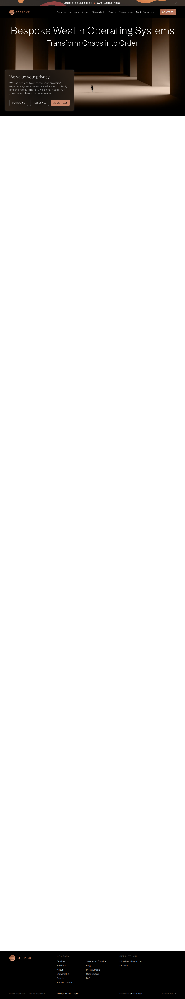
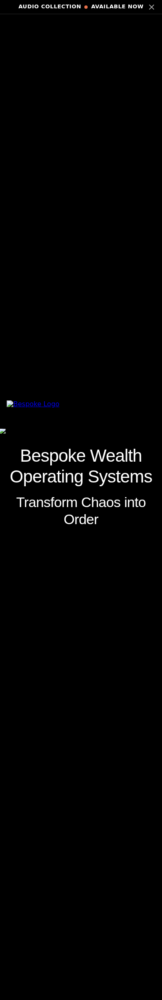

# UI Design System & Master Generation Blueprint: bespokegroup-io

> **Bespoke Group · Private Wealth & Estate Planning Advisory** (https://bespokegroup.io/) — Bespoke Group provides expert wealth management, estate planning, and advisory services for HNWIs and families. Tailored strategies for a...



---

## 1. Executive Visual Persona & Design Archetype

- **Brand Essence & Persona**: **Bespoke Group · Private Wealth & Estate Planning Advisory** (`https://bespokegroup.io/`). Bespoke Group provides expert wealth management, estate planning, and advisory services for HNWIs and families. Tailored strategies for a...
- **Visual Archetype**: **Light-Substrate Editorial & Modular Grid System (`#fff` canvas, `#474747` ink, `#9c9c9c` accent)**.
- **Anti-AI-Slop Differentiators**:
  - **Source-Grounded Chromatic Polarity**: Anchors the viewport in `#fff` (`var(--color-white)` in `:root`) paired with `#474747` primary typography and `#9c9c9c` accents.
  - **Extracted Typographic Hierarchy**: Pairs `Booton` for display copy (`Bespoke Wealth Operating Systems`) with `Segoe UI` and `SFMono-Regular`.
  - **Calibrated Spatial Grid & Motion**: Combines `1680px` container bounds (`gap: 16px`, padding `20px`) with `cubic-bezier(0.215,0.61,0.355,1)` easing.

---

## 2. Spatial Architecture & Modular Grid Mathematics



### Viewport Allocation & Container Geometry
- **Captured Viewport Dimensions**: Desktop `1440×7760px` (`assets/desktop.png`, full-page scroll capture), Mobile `390×2400px` (`assets/mobile.png`, capped at 2400px multi-section capture).
- **Master Container Bounds**: `1680px` extracted from `bespokegroup-io` stylesheet.
- **Canvas Lateral Padding & Spacing**: `20px` lateral canvas padding with `16px` grid gap.
- **Border Radius Scale**: `50%`, `100%`, `8px`, `4px`.

### Responsive Breakpoint Architecture
- **Desktop Layout**: Multi-column CSS Grid / Flexbox layout at `1440px` (`max-width: 1680px`, `gap: 16px`).
- **Mobile Layout**: Single-column vertical stack at `390px` viewport width with `20px` horizontal padding.
- **Extracted CSS Media Queries**: `@media screen and (min-width:1024px)`, `@media screen and (min-width:768px)`, `@media screen and (min-width:1280px)`, `@media (hover:hover)and (pointer:fine)and (min-width:1024px)`.

---

## 3. Color System, Materiality & Atmospheric Lighting

### Semantic Palette & Source Grounding
| Semantic Role | Ground-Truth Value | Extracted CSS Source / Selector |
|---|---|---|
| **Primary Canvas Substrate** | `#fff` | `var(--color-white)` in `:root` |
| **Primary Typography Ink** | `#f4f5f2` | `var(--color-off-white)` in `:root` |
| **Elevated Surface / Card Substrate** | `#cdcdcd` | `var(--color-grey-300)` in `:root` |
| **Interactive Accent / Highlight** | `#9c9c9c` | `var(--color-grey-400)` in `:root` |
| **Secondary / Muted Copy** | `#636363` | `var(--color-grey-600)` in `:root` |
| **Structural Hairline Border** | `#474747` | `var(--color-grey-700)` in `:root` |
| **Variable Token (`--color-grey-900`)** | `#2a2a2a` | `var(--color-grey-900)` in `:root` |
| **Variable Token (`--color-grey-1000`)** | `#0d0d0d` | `var(--color-grey-1000)` in `:root` |
| **Variable Token (`--color-black`)** | `#000` | `var(--color-black)` in `:root` |
| **Variable Token (`--color-off-black`)** | `#333` | `var(--color-off-black)` in `:root` |
| **Variable Token (`--color-linen`)** | `#f7e9e0` | `var(--color-linen)` in `:root` |
| **Variable Token (`--color-champagne`)** | `#dac9be` | `var(--color-champagne)` in `:root` |
| **Variable Token (`--color-beige`)** | `#ebcfbc` | `var(--color-beige)` in `:root` |

### Sanitized Root CSS Variables (`ui-ux.md` Ground Truth)
| Variable Name | Extracted Value | Semantic Role |
|---|---|---|
| `--cubic-easing` | `cubic-bezier(0.215,0.61,0.355,1)` | Motion / Easing Token |
| `--color-white` | `#fff` | Canvas / Surface Token |
| `--color-off-white` | `#f4f5f2` | Canvas / Surface Token |
| `--color-grey-300` | `#cdcdcd` | Brand / Palette Token |
| `--color-grey-400` | `#9c9c9c` | Brand / Palette Token |
| `--color-grey-500` | `grey` | Brand / Palette Token |
| `--color-grey-600` | `#636363` | Brand / Palette Token |
| `--color-grey-700` | `#474747` | Brand / Palette Token |
| `--color-grey-800` | `#474747` | Brand / Palette Token |
| `--color-grey-900` | `#2a2a2a` | Brand / Palette Token |
| `--color-grey-1000` | `#0d0d0d` | Brand / Palette Token |
| `--color-black` | `#000` | Canvas / Surface Token |
| `--color-off-black` | `#333` | Canvas / Surface Token |
| `--color-linen` | `#f7e9e0` | Brand / Palette Token |
| `--color-champagne` | `#dac9be` | Brand / Palette Token |
| `--color-beige` | `#ebcfbc` | Brand / Palette Token |

---

## 4. Typographic Scale & Editorial Hierarchy

### Font Family Stacks
- **Display Typography**: `Booton`.
- **Primary Body Stack**: `Segoe UI`.
- **Technical / Metadata Stack**: `SFMono-Regular`.

### Typographic Scale & Rules (Extracted from Stylesheet & Variables)
- **Hero Display (`H1`)**: rule `h1` (`font-size: 42px`, `line-height: 50px`).
- **Section Heading (`H2`)**: rule `h2` (`letter-spacing: -.02em`, `font-weight: 300`).
- **Body Copy**: rule `p` (`letter-spacing: 0!important`).
- **Metadata & Navigation Labels**: not explicitly declared on tag in static CSS (stylesheet font-size ladder: `1em`, `80%`, `75%`, `100%`, `64px`).

---

## 5. Choreographed Motion & Interaction Physics

### Primary Easing Curves
- **Extracted Timing Functions**: `cubic-bezier(0.215,0.61,0.355,1)`, `cubic-bezier(.215,.61,.355,1)`, `cubic-bezier(.19,1,.22,1)`.

### Per-Element Transition & Choreography Rules
- **Selector `.intersection-active--default`**: `transition: opacity .75s cubic-bezier(0.215,0.61,0.355,1),transform .75s cubi...` extracted from `bespokegroup-io` stylesheet.
- **Selector `ntrast-override-dark span:not(.no...`**: `transition: color .1s ease` extracted from `bespokegroup-io` stylesheet.
- **Selector `trast-override-light span:not(.no...`**: `transition: color .1s ease` extracted from `bespokegroup-io` stylesheet.
- **Extracted Easing Curve (`cubic-bezier(0.215,0.61,0.355,1)`)**: Governs interactive state transitions across `<header.header>` and `<section.acf_text-animation>`.
- **State & Hover Choreography**: Opacity and transform transitions on `<section.acf_hero-scene>` and `<section.acf_text-animation>` interactive targets.

---

## 6. Component Wireframe & Structural DOM Map

### Visual Layout Schematic (Grounded in `dom.html` — `1440px` Desktop & `390px` Mobile Reflow)
```
┌────────────────────────────────────────────────────────────────────────┐
│ DESKTOP VIEWPORT (1440px) — Bespoke Group · Private Wealth & Estate Pl │
│ ====================================================================== │
│ [ <header.header>          | S e r v i c e s · A d v i s o r y · A  ]  │
│ ---------------------------------------------------------------------- │
│ | HERO STAGE: <section.acf_hero-scene>                             |   │
│ | H1: Bespoke Wealth Operating Systems                             |   │
│ | Substrate: #fff       | Ink: #474747    | Accent: #9c9c9c        |   │
│ ---------------------------------------------------------------------- │
│ | SHOWCASE GRID (<section.acf_text-animatio) max-w: 1680px         |   │
│ | +------------------------------+  +------------------------------+ | │
│ | | Transform Chaos into Order   |  | We help the world’s most suc | | │
│ | +------------------------------+  +------------------------------+ | │
│ ---------------------------------------------------------------------- │
│ | MOBILE VIEWPORT REFLOW (390px) — Single-Column Stack (gap: 16px  ) | │
│ | [<header.header>] -> [<section.acf_hero-] -> [<section.acf_text-] |  │
│ ---------------------------------------------------------------------- │
│ [ FOOTER (<footer.footer>       ) | https://bespokegroup.io/           │
└────────────────────────────────────────────────────────────────────────┘
```

### Granular DOM Region Breakdown
1. **Brand Header & Navigation Bar (<header.header> — `bespokegroup-io`)**:
   - Landmark `<header class="header header--dark">` hosting `Bespoke Group · Private Wealth & Est` navigation (`S e r v i c e s · A d v i s o r y · A b o u t · P e o p l e · R e s o u r c e s`), DOM attributes (`data-cfasync="false"`, `data-pagespeed-no-defer`, `data-cfasync="false"`, `data-cfasync="false"`), and stylesheet rule `before { box-sizing:border-box }`.
2. **Hero Stage & Focal Lead (<section.acf_hero-scene> — `Bespoke Wealth Operating Systems`)**:
   - Landmark `<section class="acf_hero-scene">` presenting display lead `Bespoke Wealth Operating Systems` and copy excerpt *"We value your privacy"* over `#fff` canvas and `#474747` ink.
3. **Primary Showcase & Content Grid (<section.acf_text-animation> — `Transform Chaos into Order`)**:
   - Landmark `<section class="acf_text-animation">` rendering section `Transform Chaos into Order` with copy *"We use cookies to enhance your browsing experience, serve persona"*, asset references (`gtm.js`, `www.googletagmanager.com`, `hero.home_.webp`, `logomark.png`), and grid rule `strong { font-weight:bolder }`.
4. **Interactive Detail & Feature Matrix (<article.acf_text-animation__content> — `We help the world’s most successfu`)**:
   - Landmark `<article class="acf_text-animation__content grid">` framing `We help the world’s most successful entrepreneurs...` and `Tailored and Integrated Wealth Systems` (*"Customise Consent Preferences"*) with `#cdcdcd` surface cards, `#9c9c9c` accents, and `samp { font-family:ui-monospace,SFMono-Regular,Consolas,Liberation Mono,Menlo,m... }`.
5. **Colophon & Global Directory Footer (<footer.footer> — `https://bespokegroup.io/`)**:
   - Landmark `<footer class="footer footer--no-newsletter">` anchoring `Bespoke Group · Private Wealth &` footer links (`S e r v i c e s · A d v i s o r y · A b o u t · P e o p l e · R e s o u r c e s`), copy *"We use cookies to help you navigate efficiently and perform "*, and `#474747` structural dividers.

---

## 7. Master Zero-Shot AI Generation Prompt

```markdown
# Master Zero-Shot Frontend Generation Prompt: bespokegroup-io (Bespoke Group · Private Wealth & Estate Planning Advisory)

You are a principal frontend architect and design systems engineer. Build a complete, production-ready web application replicating the exact design system, DOM landmarks, typographic hierarchy, color tokens, and motion physics of `bespokegroup-io` (**Bespoke Group · Private Wealth & Estate Planning Advisory** — `https://bespokegroup.io/`).

### 1. Visual Archetype & Anti-AI-Slop Mandates
- **Archetype**: Light-Substrate Editorial & Modular Grid System (`#fff` canvas, `#474747` ink, `#9c9c9c` accent).
- **Identity & Domain Context**: Bespoke Group provides expert wealth management, estate planning, and advisory services for HNWIs and families. Tailored strategies for a...
- **Primary Substrate**: `#fff` (`var(--color-white)` in `:root`), **Primary Ink**: `#474747`, **Accent / Highlight**: `#9c9c9c`.
- **Site-Specific Differentiators**:
  - **Source-Grounded Chromatic Polarity**: Anchors the viewport in `#fff` (`var(--color-white)` in `:root`) paired with `#474747` primary typography and `#9c9c9c` accents.
  - **Extracted Typographic Hierarchy**: Pairs `Booton` for display copy (`Bespoke Wealth Operating Systems`) with `Segoe UI` and `SFMono-Regular`.
  - **Calibrated Spatial Grid & Motion**: Combines `1680px` container bounds (`gap: 16px`, padding `20px`) with `cubic-bezier(0.215,0.61,0.355,1)` easing.

### 2. Ground-Truth CSS Variables (`:root` Token Contract)
Declare and consume these exact custom properties extracted from `bespokegroup-io` in your global stylesheet:

:root {
  /* Bespoke Group · Private Wealth & Estate Planning Advisory (bespokegroup-io) — Ground-Truth Extracted CSS Variables */
  --cubic-easing: cubic-bezier(0.215,0.61,0.355,1); /* Motion / Easing Token (bespokegroup-io) */
  --color-white: #fff; /* Canvas / Surface Token (bespokegroup-io) */
  --color-off-white: #f4f5f2; /* Canvas / Surface Token (bespokegroup-io) */
  --color-grey-300: #cdcdcd; /* Brand / Palette Token (bespokegroup-io) */
  --color-grey-400: #9c9c9c; /* Brand / Palette Token (bespokegroup-io) */
  --color-grey-500: grey; /* Brand / Palette Token (bespokegroup-io) */
  --color-grey-600: #636363; /* Brand / Palette Token (bespokegroup-io) */
  --color-grey-700: #474747; /* Brand / Palette Token (bespokegroup-io) */
  --color-grey-800: #474747; /* Brand / Palette Token (bespokegroup-io) */
  --color-grey-900: #2a2a2a; /* Brand / Palette Token (bespokegroup-io) */
  --color-grey-1000: #0d0d0d; /* Brand / Palette Token (bespokegroup-io) */
  --color-black: #000; /* Canvas / Surface Token (bespokegroup-io) */
  --color-off-black: #333; /* Canvas / Surface Token (bespokegroup-io) */
  --color-linen: #f7e9e0; /* Brand / Palette Token (bespokegroup-io) */
  --color-champagne: #dac9be; /* Brand / Palette Token (bespokegroup-io) */
  --color-beige: #ebcfbc; /* Brand / Palette Token (bespokegroup-io) */
}

### 3. Semantic Color & Materiality Contract
Map every surface, ink, and border strictly to these source-grounded tokens:
- **Primary Canvas Substrate**: `#fff` — grounded in `var(--color-white)` in `:root`
- **Primary Typography Ink**: `#f4f5f2` — grounded in `var(--color-off-white)` in `:root`
- **Elevated Surface / Card Substrate**: `#cdcdcd` — grounded in `var(--color-grey-300)` in `:root`
- **Interactive Accent / Highlight**: `#9c9c9c` — grounded in `var(--color-grey-400)` in `:root`
- **Secondary / Muted Copy**: `#636363` — grounded in `var(--color-grey-600)` in `:root`
- **Structural Hairline Border**: `#474747` — grounded in `var(--color-grey-700)` in `:root`
- **Variable Token (`--color-grey-900`)**: `#2a2a2a` — grounded in `var(--color-grey-900)` in `:root`
- **Variable Token (`--color-grey-1000`)**: `#0d0d0d` — grounded in `var(--color-grey-1000)` in `:root`
- **Variable Token (`--color-black`)**: `#000` — grounded in `var(--color-black)` in `:root`
- **Variable Token (`--color-off-black`)**: `#333` — grounded in `var(--color-off-black)` in `:root`
- **Variable Token (`--color-linen`)**: `#f7e9e0` — grounded in `var(--color-linen)` in `:root`
- **Variable Token (`--color-champagne`)**: `#dac9be` — grounded in `var(--color-champagne)` in `:root`
- **Variable Token (`--color-beige`)**: `#ebcfbc` — grounded in `var(--color-beige)` in `:root`

### 4. Spatial Grid, Container Bounds & Responsive Breakpoints
- **Desktop Viewport Reference**: `1440×7760px` (full-page scroll capture, `1440px` standard desktop width).
- **Mobile Viewport Reference**: `390×2400px` (capped at 2400px multi-section capture, `390px` standard mobile width).
- **Container Max-Width**: `1680px` extracted from `bespokegroup-io` stylesheet
- **Padding & Gutters**: `20px` lateral canvas padding with `16px` grid gap
- **Desktop Grid**: Multi-column CSS Grid / Flexbox layout at `1440px` (`max-width: 1680px`, `gap: 16px`)
- **Mobile Adaptation**: Single-column vertical stack at `390px` viewport width with `20px` horizontal padding
- **Media Queries**: `@media screen and (min-width:1024px)`, `@media screen and (min-width:768px)`, `@media screen and (min-width:1280px)`, `@media (hover:hover)and (pointer:fine)and (min-width:1024px)`
- **Corner Radii**: `50%`, `100%`, `8px`, `4px`

### 5. Typography & Editorial Scale Contract
- **Display Font Stack**: `Booton`
- **Body Font Stack**: `Segoe UI`
- **Monospace / Technical Font Stack**: `SFMono-Regular`
- **H1 Display Rule**: rule `h1` (`font-size: 42px`, `line-height: 50px`)
- **H2 Section Rule**: rule `h2` (`letter-spacing: -.02em`, `font-weight: 300`)
- **Body Copy Rule**: rule `p` (`letter-spacing: 0!important`)
- **Metadata & Index Rule**: not explicitly declared on tag in static CSS (stylesheet font-size ladder: `1em`, `80%`, `75%`, `100%`, `64px`)

### 6. Component Hierarchy, Verbatim Copy & Real DOM Landmarks
Scaffold `bespokegroup-io` (`Bespoke Group · Private Wealth & Estate Planning Advisory`) with these exact structural regions, extracted copy, and CSS rules from `dom.html`:
1. **Brand Header & Navigation Bar (<header.header> — `bespokegroup-io`)**:
   - DOM & Selectors: Landmark `<header class="header header--dark">` hosting `Bespoke Group · Private Wealth & Est` navigation (`S e r v i c e s · A d v i s o r y · A b o u t · P e o p l e · R e s o u r c e s`), DOM attributes (`data-cfasync="false"`, `data-pagespeed-no-defer`, `data-cfasync="false"`, `data-cfasync="false"`), and stylesheet rule `before { box-sizing:border-box }`.
   - Responsive Contract: Header `Brand Header & Navigation Bar (<header.header> — `bespokegroup-io`)` (`bespokegroup-io`) adapts across `@media screen and (min-width:1024px)`, `@media screen and (min-width:768px)`, `@media screen and (min-width:1280px)`, `@media (hover:hover)and (pointer:fine)and (min-width:1024px)` with `cubic-bezier(0.215,0.61,0.355,1)`, `cubic-bezier(.215,.61,.355,1)`, `cubic-bezier(.19,1,.22,1)` transitions and links `S e r v i c e s · A d v i s o r y · A b o u t · P e o p l e · R e s o u r c e s`.
2. **Hero Stage & Focal Lead (<section.acf_hero-scene> — `Bespoke Wealth Operating Systems`)**:
   - DOM & Selectors: Landmark `<section class="acf_hero-scene">` presenting display lead `Bespoke Wealth Operating Systems` and copy excerpt *"We value your privacy"* over `#fff` canvas and `#474747` ink.
   - Responsive Contract: Hero stage (`1440×7760px` desktop / `390×2400px` mobile) sets `#fff` background with `#474747` headline `Bespoke Wealth Operating Systems`.
3. **Primary Showcase & Content Grid (<section.acf_text-animation> — `Transform Chaos into Order`)**:
   - DOM & Selectors: Landmark `<section class="acf_text-animation">` rendering section `Transform Chaos into Order` with copy *"We use cookies to enhance your browsing experience, serve persona"*, asset references (`gtm.js`, `www.googletagmanager.com`, `hero.home_.webp`, `logomark.png`), and grid rule `strong { font-weight:bolder }`.
   - Responsive Contract: Showcase grid `Primary Showcase & Content Grid (<section.acf_text-animation> — `Transform Chaos into Order`)` applies Multi-column CSS Grid / Flexbox layout at `1440px` (`max-width: 1680px`, `gap: 16px`) on desktop and Single-column vertical stack at `390px` viewport width with `20px` horizontal padding on mobile.
4. **Interactive Detail & Feature Matrix (<article.acf_text-animation__content> — `We help the world’s most successfu`)**:
   - DOM & Selectors: Landmark `<article class="acf_text-animation__content grid">` framing `We help the world’s most successful entrepreneurs...` and `Tailored and Integrated Wealth Systems` (*"Customise Consent Preferences"*) with `#cdcdcd` surface cards, `#9c9c9c` accents, and `samp { font-family:ui-monospace,SFMono-Regular,Consolas,Liberation Mono,Menlo,m... }`.
   - Responsive Contract: Detail module `Interactive Detail & Feature Matrix (<article.acf_text-animation__content> — `We help the world’s most successfu`)` uses `50%`, `100%`, `8px`, `4px` radii, `#9c9c9c` highlights, and assets (gtm.js, www.googletagmanager.com, hero.home_.webp).
5. **Colophon & Global Directory Footer (<footer.footer> — `https://bespokegroup.io/`)**:
   - DOM & Selectors: Landmark `<footer class="footer footer--no-newsletter">` anchoring `Bespoke Group · Private Wealth &` footer links (`S e r v i c e s · A d v i s o r y · A b o u t · P e o p l e · R e s o u r c e s`), copy *"We use cookies to help you navigate efficiently and perform "*, and `#474747` structural dividers.
   - Responsive Contract: Footer `Colophon & Global Directory Footer (<footer.footer> — `https://bespokegroup.io/`)` aligns to `1680px` extracted from `bespokegroup-io` stylesheet with `20px` lateral canvas padding with `16px` grid gap and attributes (data-cfasync="false", data-pagespeed-no-defer, data-cfasync="false").

#### Verbatim DOM Copy Excerpts (`dom.html`)
- Copy Excerpt 1: *"We value your privacy"*
- Copy Excerpt 2: *"We use cookies to enhance your browsing experience, serve personalised ads or cont..."*
- Copy Excerpt 3: *"Customise Consent Preferences"*
- Copy Excerpt 4: *"We use cookies to help you navigate efficiently and perform certain functions. You..."*

### 7. Motion, Extracted Stylesheet Rules & Interaction Choreography
- **Primary Easing Functions**: `cubic-bezier(0.215,0.61,0.355,1)`, `cubic-bezier(.215,.61,.355,1)`, `cubic-bezier(.19,1,.22,1)`
- **Extracted Stylesheet Rules (`bespokegroup-io`)**:
- `before { box-sizing:border-box }`
- `strong { font-weight:bolder }`
- `samp { font-family:ui-monospace,SFMono-Regular,Consolas,Liberation Mono,Menlo,m... }`
- `small { font-size:80% }`
- `sup { font-size:75%;line-height:0;position:relative;vertical-align:baseline }`
- **Per-Selector Transition Rules**:
- **Selector `.intersection-active--default`**: `transition: opacity .75s cubic-bezier(0.215,0.61,0.355,1),transform .75s cubi...` extracted from `bespokegroup-io` stylesheet.
- **Selector `ntrast-override-dark span:not(.no...`**: `transition: color .1s ease` extracted from `bespokegroup-io` stylesheet.
- **Selector `trast-override-light span:not(.no...`**: `transition: color .1s ease` extracted from `bespokegroup-io` stylesheet.
- **Extracted Easing Curve (`cubic-bezier(0.215,0.61,0.355,1)`)**: Governs interactive state transitions across `<header.header>` and `<section.acf_text-animation>`.
- **State & Hover Choreography**: Opacity and transform transitions on `<section.acf_hero-scene>` and `<section.acf_text-animation>` interactive targets.

### 8. Technical Deliverables
- Implement in Next.js (App Router) with TypeScript and Tailwind CSS consuming the `:root` custom properties defined above for `bespokegroup-io`.
- Reproduce both the `1440px` desktop architecture and `390px` mobile breakpoint transitions, preserving semantic HTML5 landmarks (`<header>`, `<nav>`, `<main>`, `<section>`, `<footer>`) and `prefers-reduced-motion` accessibility guards.
```
