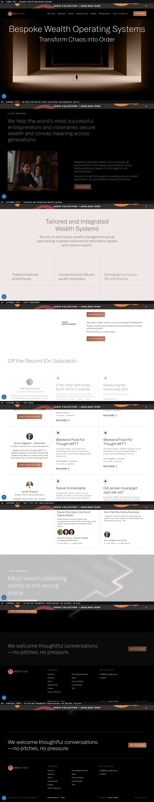
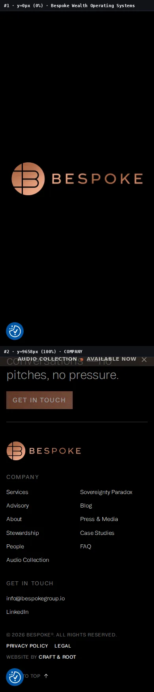

# UI Design System & Master Generation Blueprint: bespokegroup-io

> **Bespoke Group · Private Wealth & Estate Planning Advisory** (https://bespokegroup.io/) — Bespoke Group provides expert wealth management, estate planning, and advisory services for HNWIs and families. Tailored strategies for a...





---

## 1. Executive Visual Persona & Design Archetype

- **Brand Essence & Persona**: **Bespoke Group · Private Wealth & Estate Planning Advisory** (`https://bespokegroup.io/`). Bespoke Group provides expert wealth management, estate planning, and advisory services for HNWIs and families. Tailored strategies for a...
- **Capture Provenance**: Live browser capture (`tier1_fast`, HTTP `200`, captured `2026-11-24`).
- **Visual Archetype**: **Light-Substrate Editorial & Modular Grid System (`#ffffff` canvas, `#000000` ink, `#ffa500` accent)**.
- **Anti-AI-Slop Differentiators**:
  - **Live-Computed Chromatic Polarity**: Anchors the viewport in `#ffffff` (live computed `browser-default` `background-color` (`computed_styles.json`)) paired with `#000000` primary typography and `#ffa500` accents.
  - **Grounded Typographic Hierarchy**: Pairs `Booton` for display copy (`Bespoke Wealth Operating Systems`) with `Segoe UI` and `SFMono-Regular`.
  - **Calibrated Spatial Grid & Motion**: Combines `1073px` container bounds (`gap: 16px`, padding `20px`) with `cubic-bezier(0.215,0.61,0.355,1)` easing.

---

## 2. Spatial Architecture & Modular Grid Mathematics

### Viewport Allocation & Container Geometry
- **Captured Journey Filmstrips**: Desktop `1280×6624px` (`assets/desktop-journey.webp`, `8` keyframes up to `y=6837px` / doc `7737px`), Mobile `390×1744px` (`assets/mobile-journey.webp`, `2` keyframes).
- **Master Container Bounds**: `1073px` (non-`@media` desktop container stylesheet rule).
- **Canvas Lateral Padding & Spacing**: `20px` lateral canvas padding with `16px` grid gap.
- **Border Radius Scale**: `50%`, `100%`, `8px`, `4px`.

### Responsive Breakpoint Architecture
- **Desktop Layout**: Multi-column CSS Grid / Flexbox layout at `1440px` (`max-width: 1073px`, `gap: 16px`).
- **Mobile Layout**: Single-column vertical stack at `390px` viewport width with `20px` horizontal padding.
- **Extracted CSS Media Queries**: `@media only screen and (max-width:991px)`, `@media only screen and (max-width:767px)`, `@media screen and (min-width:1024px)`, `@media screen and (min-width:768px)`.

---

## 3. Color System, Materiality & Atmospheric Lighting

### Semantic Palette & Source Grounding
| Semantic Role | Ground-Truth Value | Extracted Live / CSS Source |
|---|---|---|
| **Primary Canvas Substrate** | `#ffffff` | live computed `browser-default` `background-color` (`computed_styles.json`) |
| **Primary Typography Ink** | `#000000` | live computed `main` `color` (`computed_styles.json`) |
| **Elevated Surface / Card Substrate** | `#fef7f3` | `var(--color-seashell)` in `:root` |
| **Interactive Accent / Highlight** | `#ffa500` | `.socialButton:hover { background: orange }` (`#ffa500`) |
| **Secondary / Muted Copy** | `#0000ee` | live computed `a` `color` (`computed_styles.json`) |
| **Structural Hairline Border** | `#808080` | `.border-grey-300 { border-color: #808080 }` |
| **Variable Token (`--color-off-white`)** | `#f4f5f2` | `var(--color-off-white)` in `:root` |
| **Variable Token (`--color-grey-300`)** | `#cdcdcd` | `var(--color-grey-300)` in `:root` |
| **Variable Token (`--color-grey-400`)** | `#9c9c9c` | `var(--color-grey-400)` in `:root` |
| **Variable Token (`--color-grey-600`)** | `#636363` | `var(--color-grey-600)` in `:root` |
| **Variable Token (`--color-grey-700`)** | `#474747` | `var(--color-grey-700)` in `:root` |
| **Variable Token (`--color-grey-900`)** | `#2a2a2a` | `var(--color-grey-900)` in `:root` |
| **Variable Token (`--color-grey-1000`)** | `#0d0d0d` | `var(--color-grey-1000)` in `:root` |
| **Variable Token (`--color-off-black`)** | `#333333` | `var(--color-off-black)` in `:root` |
| **Variable Token (`--color-linen`)** | `#f7e9e0` | `var(--color-linen)` in `:root` |
| **Variable Token (`--color-champagne`)** | `#dac9be` | `var(--color-champagne)` in `:root` |
| **Variable Token (`--color-beige`)** | `#ebcfbc` | `var(--color-beige)` in `:root` |

### Sanitized Root CSS Variables (`ui-ux.md` Ground Truth)
| Variable Name | Extracted Value | Semantic Role |
|---|---|---|
| `--cubic-easing` | `cubic-bezier(0.215,0.61,0.355,1)` | Motion / Easing Token |
| `--color-white` | `#fff` | Canvas / Surface Token |
| `--color-off-white` | `#f4f5f2` | Canvas / Surface Token |
| `--color-grey-300` | `#cdcdcd` | Brand / Palette Token |
| `--color-grey-400` | `#9c9c9c` | Brand / Palette Token |
| `--color-grey-500` | `grey` | Brand / Palette Token |
| `--color-grey-600` | `#636363` | Brand / Palette Token |
| `--color-grey-700` | `#474747` | Brand / Palette Token |
| `--color-grey-800` | `#474747` | Brand / Palette Token |
| `--color-grey-900` | `#2a2a2a` | Brand / Palette Token |
| `--color-grey-1000` | `#0d0d0d` | Brand / Palette Token |
| `--color-black` | `#000` | Canvas / Surface Token |
| `--color-off-black` | `#333` | Canvas / Surface Token |
| `--color-linen` | `#f7e9e0` | Brand / Palette Token |
| `--color-champagne` | `#dac9be` | Brand / Palette Token |
| `--color-beige` | `#ebcfbc` | Brand / Palette Token |

---

## 4. Typographic Scale & Editorial Hierarchy

### Font Family Stacks
- **Display Typography**: `Booton`.
- **Primary Body Stack**: `Segoe UI`.
- **Technical / Metadata Stack**: `SFMono-Regular`.

### Typographic Scale & Rules (Live Computed & Stylesheet Grounded)
- **Hero Display (`H1`)**: live computed `h1` (`font-size: 78px`, `line-height: 94px`, `font-weight: 300`, `letter-spacing: -1.56px`); rule `h1` (`font-size: 42px`, `line-height: 50px`).
- **Section Heading (`H2`)**: live computed `h2` (`font-size: 56px`, `line-height: 67px`, `font-weight: 300`, `letter-spacing: -1.12px`); rule `h2` (`letter-spacing: -.02em`, `font-weight: 300`).
- **Body Copy**: live computed `body` (`font-size: 16px`, `line-height: 18.4px`, `font-weight: 400`); rule `p` (`letter-spacing: 0`).
- **Metadata & Navigation Labels**: live computed `nav/a` (`font-size: 16px`, `line-height: 18.4px`, `font-weight: 400`).

---

## 5. Choreographed Motion & Interaction Physics

### Primary Easing Curves
- **Extracted Timing Functions**: `cubic-bezier(0.215,0.61,0.355,1)`, `cubic-bezier(.215,.61,.355,1)`, `cubic-bezier(.19,1,.22,1)`.

### Per-Element Transition & Choreography Rules
- **Selector `.intersection-active--default`**: `transition: opacity .75s cubic-bezier(0.215,0.61,0.355,1),transform .75s cubi...` extracted from `bespokegroup-io` stylesheet.
- **Selector `ntrast-override-dark span:not(.no...`**: `transition: color .1s ease` extracted from `bespokegroup-io` stylesheet.
- **Selector `trast-override-light span:not(.no...`**: `transition: color .1s ease` extracted from `bespokegroup-io` stylesheet.
- **Extracted Easing Curve (`cubic-bezier(0.215,0.61,0.355,1)`)**: Governs interactive state transitions across `<header.header>` and `<section.acf_text-animation>`.
- **State & Hover Choreography**: Opacity and transform transitions on `<section.acf_hero-scene>` and `<section.acf_text-animation>` interactive targets.
### Measured Runtime Scroll & Interaction Telemetry (`behavioral_journey_v2`)
- **Scroll Driver Mode**: `native` (max document height `7737px`, deepest scrollY reached `6837px` across `8` desktop keyframes).
- **Detected Scroll / Motion Libraries**: Native browser scroll / standard CSS transitions.
- **Hover Physics (`primary_cta` · `CONTACT`)**: Computed transition `0s` / `ease` (no static color/transform shift captured at rest).
- **Route Transition Architecture**: First internal navigation (`/services/`) measured as `MPA` in `1443ms`.

---

## 6. Component Wireframe & Structural DOM Map

### Visual Layout Schematic — Desktop (`1440px`, Grounded in `dom.html` & Landmark Bounding Boxes)
```
┌────────────────────────────────────────────────────────────────────────┐
│ DESKTOP VIEWPORT (1440px) — Bespoke Group · Private Wealth & Estate Pl │
│ ====================================================================== │
│ [ <header.header> (1440x93px)         | S e r v i c e s · A d v i s  ] │
│ ---------------------------------------------------------------------- │
│ | HERO STAGE: <section.acf_hero-scene> (w=1440px)                    | │
│ | H1: Bespoke Wealth Operating Systems                               | │
│ | Substrate: #ffffff | Ink: #000000 | Accent: #ffa500                | │
│ ---------------------------------------------------------------------- │
│ | SHOWCASE GRID (<section.acf_text-animatio) max-w: 1073px           | │
│ | +------------------------------+  +------------------------------+ | │
│ | | Transform Chaos into Order   |  | We help the world’s most suc | | │
│ | +------------------------------+  +------------------------------+ | │
│ ---------------------------------------------------------------------- │
│ | DETAIL MODULE (<article.acf_text-animatio) — Tailored and Integrat | │
│ ---------------------------------------------------------------------- │
│ [ FOOTER (<footer.footer>     ) | https://bespokegroup.io/             │
└────────────────────────────────────────────────────────────────────────┘
```

### Visual Layout Schematic — Mobile Reflow (`390px`)
```
┌────────────────────────────────────────────────────────────────────────┐
│ MOBILE VIEWPORT REFLOW (390px) — Single-Column Stack (gap: 16px)       │
│ ====================================================================== │
│ [ HEADER BAR (<header.header>         ) | Compact Menu (390px)         │
│ ---------------------------------------------------------------------- │
│ | HERO STAGE (<section.acf_hero-scene>) — 390px Vertical Lead        | │
│ | H1: Bespoke Wealth Operating Systems                               | │
│ ---------------------------------------------------------------------- │
│ | SHOWCASE STACK (<section.acf_text-anim) — 1-Col Stack              | │
│ | [ Item 1: Transform Chaos into Order                             ] | │
│ | [ Item 2: We help the world’s most successful entrepreneurs...   ] | │
│ ---------------------------------------------------------------------- │
│ | DETAIL STACK (<article.acf_text-animat) — 1-Col (Tailored and Integ) │
│ ---------------------------------------------------------------------- │
│ [ FOOTER (<footer.footer>     ) | Stacked 390px Colophon               │
└────────────────────────────────────────────────────────────────────────┘
```

### Granular DOM Region Breakdown
1. **Brand Header & Navigation Bar (<header.header> — `bespokegroup-io`)**:
   - Landmark `<header class="header header--dark">` (`1440x93px`) hosting `Bespoke Group · Private Wealth & Est` navigation (`S e r v i c e s · A d v i s o r y · A b o u t · P e o p l e · R e s o u r c e s`), DOM attributes (`data-cfasync="false"`, `data-pagespeed-no-defer`, `data-cfasync="false"`, `data-cfasync="false"`), and stylesheet rule `.cfm-episodes-grid:before { content:"";display:table;clear:both }`.
2. **Hero Stage & Focal Lead (<section.acf_hero-scene> — `Bespoke Wealth Operating Systems`)**:
   - Landmark `<section class="acf_hero-scene">` presenting display lead `Bespoke Wealth Operating Systems` and copy excerpt *"Transformational philanthropy"* over `#ffffff` canvas and `#000000` ink.
3. **Primary Showcase & Content Grid (<section.acf_text-animation> — `Transform Chaos into Order`)**:
   - Landmark `<section class="acf_text-animation">` rendering section `Transform Chaos into Order` with copy *"Comprehensive Bitcoin wealth strategies"*, asset references (`gtm.js`, `www.googletagmanager.com`, `hero.home_.webp`, `logomark.png`), and grid rule `episodes-grid .cfm-episode-wrap:b... { content:"";display:table;clear:both }`.
4. **Interactive Detail & Feature Matrix (<article.acf_text-animation__content> — `We help the world’s most successfu`)**:
   - Landmark `<article class="acf_text-animation__content grid">` framing `We help the world’s most successful entrepreneurs...` and `Tailored and Integrated Wealth Systems` (*"Strengthen privacy in life and finance"*) with `#fef7f3` surface cards, `#ffa500` accents, and `d.cfm-episodes-cols-2 .cfm-episod... { width:50%;-webkit-box-flex:0;-ms-flex:0 1 50%;flex:0 1 50% }`.
5. **Colophon & Global Directory Footer (<footer.footer> — `https://bespokegroup.io/`)**:
   - Landmark `<footer class="footer footer--no-newsletter">` anchoring `Bespoke Group · Private Wealth &` footer links (`S e r v i c e s · A d v i s o r y · A b o u t · P e o p l e · R e s o u r c e s`), copy *"Minimize and manage tax exposure"*, and `#808080` structural dividers.
### Full Vertical Scroll Sequence (Desktop `1440×900` Keyframes)
- **Step 01** (`y=0px`, `0%`): Active landmark `Bespoke Wealth Operating Systems` · sticky/fixed elements: `5`
- **Step 02** (`y=850px`, `12%`): Active landmark `We help the world’s most successful entrepreneurs...` · sticky/fixed elements: `5`
- **Step 03** (`y=1700px`, `25%`): Active landmark `Tailored and Integrated Wealth Systems` · sticky/fixed elements: `5`
- **Step 04** (`y=3400px`, `50%`): Active landmark `ASSET MANAGEMENT` · sticky/fixed elements: `5`
- **Step 05** (`y=4250px`, `62%`): Active landmark `Your Queue` · sticky/fixed elements: `5`
- **Step 06** (`y=5950px`, `87%`): Active landmark `Don’t Sell the Family Business` · sticky/fixed elements: `5`
- **Step 07** (`y=6800px`, `99%`): Active landmark `We welcome thoughtful conversations —no pitches,...` · sticky/fixed elements: `5`
- **Step 08** (`y=6837px`, `100%`): Active landmark `We welcome thoughtful conversations —no pitches,...` · sticky/fixed elements: `5`

### Multi-Page Internal Route Map
- **Listing Route (`/services/`)**: `https://bespokegroup.io/services/` — H1: `Wealth Operating Systems for Generational Wealth...`, scrollHeight `7037px`, transition `MPA` (`1443ms`)
- **Detail Route (`/resource/a-better-way-to-prepare-the-rising-gen/`)**: `https://bespokegroup.io/resource/a-better-way-to-prepare-the-rising-gen/` — H1: `A Better Way to Prepare the Rising-Gen`, scrollHeight `5583px`, transition `direct` (`1384ms`)
- **About Route (`/about/`)**: `https://bespokegroup.io/about/` — H1: `About Bespoke Group · Wealth Advisory Experts · B...`, scrollHeight `10343px`, transition `direct` (`1241ms`)

---

## 7. Master Zero-Shot AI Generation Prompt

```markdown
# Master Zero-Shot Frontend Generation Prompt: bespokegroup-io (Bespoke Group · Private Wealth & Estate Planning Advisory)

You are a principal frontend architect and design systems engineer. Build a complete, production-ready web application replicating the exact design system, DOM landmarks, typographic hierarchy, color tokens, and motion physics of `bespokegroup-io` (**Bespoke Group · Private Wealth & Estate Planning Advisory** — `https://bespokegroup.io/`).

### 1. Visual Archetype & Anti-AI-Slop Mandates
- **Archetype**: Light-Substrate Editorial & Modular Grid System (`#ffffff` canvas, `#000000` ink, `#ffa500` accent).
- **Identity & Domain Context**: Bespoke Group provides expert wealth management, estate planning, and advisory services for HNWIs and families. Tailored strategies for a...
- **Primary Substrate**: `#ffffff` (live computed `browser-default` `background-color` (`computed_styles.json`)), **Primary Ink**: `#000000`, **Accent / Highlight**: `#ffa500`.
- **Site-Specific Differentiators**:
  - **Live-Computed Chromatic Polarity**: Anchors the viewport in `#ffffff` (live computed `browser-default` `background-color` (`computed_styles.json`)) paired with `#000000` primary typography and `#ffa500` accents.
  - **Grounded Typographic Hierarchy**: Pairs `Booton` for display copy (`Bespoke Wealth Operating Systems`) with `Segoe UI` and `SFMono-Regular`.
  - **Calibrated Spatial Grid & Motion**: Combines `1073px` container bounds (`gap: 16px`, padding `20px`) with `cubic-bezier(0.215,0.61,0.355,1)` easing.

### 2. Ground-Truth CSS Variables (`:root` Token Contract)
Declare and consume these exact custom properties extracted from `bespokegroup-io` in your global stylesheet:

:root {
  /* Bespoke Group · Private Wealth & Estate Planning Advisory (bespokegroup-io) — Live-Grounded CSS Variables */
  --cubic-easing: cubic-bezier(0.215,0.61,0.355,1); /* Motion / Easing Token (bespokegroup-io) */
  --color-white: #fff; /* Canvas / Surface Token (bespokegroup-io) */
  --color-off-white: #f4f5f2; /* Canvas / Surface Token (bespokegroup-io) */
  --color-grey-300: #cdcdcd; /* Brand / Palette Token (bespokegroup-io) */
  --color-grey-400: #9c9c9c; /* Brand / Palette Token (bespokegroup-io) */
  --color-grey-500: grey; /* Brand / Palette Token (bespokegroup-io) */
  --color-grey-600: #636363; /* Brand / Palette Token (bespokegroup-io) */
  --color-grey-700: #474747; /* Brand / Palette Token (bespokegroup-io) */
  --color-grey-800: #474747; /* Brand / Palette Token (bespokegroup-io) */
  --color-grey-900: #2a2a2a; /* Brand / Palette Token (bespokegroup-io) */
  --color-grey-1000: #0d0d0d; /* Brand / Palette Token (bespokegroup-io) */
  --color-black: #000; /* Canvas / Surface Token (bespokegroup-io) */
  --color-off-black: #333; /* Canvas / Surface Token (bespokegroup-io) */
  --color-linen: #f7e9e0; /* Brand / Palette Token (bespokegroup-io) */
  --color-champagne: #dac9be; /* Brand / Palette Token (bespokegroup-io) */
  --color-beige: #ebcfbc; /* Brand / Palette Token (bespokegroup-io) */
}

### 3. Semantic Color & Materiality Contract
Map every surface, ink, and border strictly to these source-grounded tokens:
- **Primary Canvas Substrate**: `#ffffff` — grounded in live computed `browser-default` `background-color` (`computed_styles.json`)
- **Primary Typography Ink**: `#000000` — grounded in live computed `main` `color` (`computed_styles.json`)
- **Elevated Surface / Card Substrate**: `#fef7f3` — grounded in `var(--color-seashell)` in `:root`
- **Interactive Accent / Highlight**: `#ffa500` — grounded in `.socialButton:hover { background: orange }` (`#ffa500`)
- **Secondary / Muted Copy**: `#0000ee` — grounded in live computed `a` `color` (`computed_styles.json`)
- **Structural Hairline Border**: `#808080` — grounded in `.border-grey-300 { border-color: #808080 }`
- **Variable Token (`--color-off-white`)**: `#f4f5f2` — grounded in `var(--color-off-white)` in `:root`
- **Variable Token (`--color-grey-300`)**: `#cdcdcd` — grounded in `var(--color-grey-300)` in `:root`
- **Variable Token (`--color-grey-400`)**: `#9c9c9c` — grounded in `var(--color-grey-400)` in `:root`
- **Variable Token (`--color-grey-600`)**: `#636363` — grounded in `var(--color-grey-600)` in `:root`
- **Variable Token (`--color-grey-700`)**: `#474747` — grounded in `var(--color-grey-700)` in `:root`
- **Variable Token (`--color-grey-900`)**: `#2a2a2a` — grounded in `var(--color-grey-900)` in `:root`
- **Variable Token (`--color-grey-1000`)**: `#0d0d0d` — grounded in `var(--color-grey-1000)` in `:root`
- **Variable Token (`--color-off-black`)**: `#333333` — grounded in `var(--color-off-black)` in `:root`
- **Variable Token (`--color-linen`)**: `#f7e9e0` — grounded in `var(--color-linen)` in `:root`
- **Variable Token (`--color-champagne`)**: `#dac9be` — grounded in `var(--color-champagne)` in `:root`
- **Variable Token (`--color-beige`)**: `#ebcfbc` — grounded in `var(--color-beige)` in `:root`

### 4. Spatial Grid, Container Bounds & Responsive Breakpoints
- **Desktop Viewport Reference**: `1280×6624px` (multi-frame vertical journey filmstrip (6624px), `1440px` standard desktop width).
- **Mobile Viewport Reference**: `390×1744px` (full-page live capture (1744px), `390px` standard mobile width).
- **Container Max-Width**: `1073px` (non-`@media` desktop container stylesheet rule)
- **Padding & Gutters**: `20px` lateral canvas padding with `16px` grid gap
- **Desktop Grid**: Multi-column CSS Grid / Flexbox layout at `1440px` (`max-width: 1073px`, `gap: 16px`)
- **Mobile Adaptation**: Single-column vertical stack at `390px` viewport width with `20px` horizontal padding
- **Media Queries**: `@media only screen and (max-width:991px)`, `@media only screen and (max-width:767px)`, `@media screen and (min-width:1024px)`, `@media screen and (min-width:768px)`
- **Corner Radii**: `50%`, `100%`, `8px`, `4px`

### 5. Typography & Editorial Scale Contract
- **Display Font Stack**: `Booton`
- **Body Font Stack**: `Segoe UI`
- **Monospace / Technical Font Stack**: `SFMono-Regular`
- **H1 Display Rule**: live computed `h1` (`font-size: 78px`, `line-height: 94px`, `font-weight: 300`, `letter-spacing: -1.56px`); rule `h1` (`font-size: 42px`, `line-height: 50px`)
- **H2 Section Rule**: live computed `h2` (`font-size: 56px`, `line-height: 67px`, `font-weight: 300`, `letter-spacing: -1.12px`); rule `h2` (`letter-spacing: -.02em`, `font-weight: 300`)
- **Body Copy Rule**: live computed `body` (`font-size: 16px`, `line-height: 18.4px`, `font-weight: 400`); rule `p` (`letter-spacing: 0`)
- **Metadata & Index Rule**: live computed `nav/a` (`font-size: 16px`, `line-height: 18.4px`, `font-weight: 400`)

### 6. Component Hierarchy, Verbatim Copy & Real DOM Landmarks
Scaffold `bespokegroup-io` (`Bespoke Group · Private Wealth & Estate Planning Advisory`) with these exact structural regions, extracted copy, and CSS rules from `dom.html`:
1. **Brand Header & Navigation Bar (<header.header> — `bespokegroup-io`)**:
   - DOM & Selectors: Landmark `<header class="header header--dark">` (`1440x93px`) hosting `Bespoke Group · Private Wealth & Est` navigation (`S e r v i c e s · A d v i s o r y · A b o u t · P e o p l e · R e s o u r c e s`), DOM attributes (`data-cfasync="false"`, `data-pagespeed-no-defer`, `data-cfasync="false"`, `data-cfasync="false"`), and stylesheet rule `.cfm-episodes-grid:before { content:"";display:table;clear:both }`.
   - Responsive Contract: Header `Brand Header & Navigation Bar (<header.header> — `bespokegroup-io`)` (`bespokegroup-io`) adapts across `@media only screen and (max-width:991px)`, `@media only screen and (max-width:767px)`, `@media screen and (min-width:1024px)`, `@media screen and (min-width:768px)` with `cubic-bezier(0.215,0.61,0.355,1)`, `cubic-bezier(.215,.61,.355,1)`, `cubic-bezier(.19,1,.22,1)` transitions and links `S e r v i c e s · A d v i s o r y · A b o u t · P e o p l e · R e s o u r c e s`.
2. **Hero Stage & Focal Lead (<section.acf_hero-scene> — `Bespoke Wealth Operating Systems`)**:
   - DOM & Selectors: Landmark `<section class="acf_hero-scene">` presenting display lead `Bespoke Wealth Operating Systems` and copy excerpt *"Transformational philanthropy"* over `#ffffff` canvas and `#000000` ink.
   - Responsive Contract: Hero stage (`1280×6624px` desktop / `390×1744px` mobile) sets `#ffffff` background with `#000000` headline `Bespoke Wealth Operating Systems`.
3. **Primary Showcase & Content Grid (<section.acf_text-animation> — `Transform Chaos into Order`)**:
   - DOM & Selectors: Landmark `<section class="acf_text-animation">` rendering section `Transform Chaos into Order` with copy *"Comprehensive Bitcoin wealth strategies"*, asset references (`gtm.js`, `www.googletagmanager.com`, `hero.home_.webp`, `logomark.png`), and grid rule `episodes-grid .cfm-episode-wrap:b... { content:"";display:table;clear:both }`.
   - Responsive Contract: Showcase grid `Primary Showcase & Content Grid (<section.acf_text-animation> — `Transform Chaos into Order`)` applies Multi-column CSS Grid / Flexbox layout at `1440px` (`max-width: 1073px`, `gap: 16px`) on desktop and Single-column vertical stack at `390px` viewport width with `20px` horizontal padding on mobile.
4. **Interactive Detail & Feature Matrix (<article.acf_text-animation__content> — `We help the world’s most successfu`)**:
   - DOM & Selectors: Landmark `<article class="acf_text-animation__content grid">` framing `We help the world’s most successful entrepreneurs...` and `Tailored and Integrated Wealth Systems` (*"Strengthen privacy in life and finance"*) with `#fef7f3` surface cards, `#ffa500` accents, and `d.cfm-episodes-cols-2 .cfm-episod... { width:50%;-webkit-box-flex:0;-ms-flex:0 1 50%;flex:0 1 50% }`.
   - Responsive Contract: Detail module `Interactive Detail & Feature Matrix (<article.acf_text-animation__content> — `We help the world’s most successfu`)` uses `50%`, `100%`, `8px`, `4px` radii, `#ffa500` highlights, and assets (gtm.js, www.googletagmanager.com, hero.home_.webp).
5. **Colophon & Global Directory Footer (<footer.footer> — `https://bespokegroup.io/`)**:
   - DOM & Selectors: Landmark `<footer class="footer footer--no-newsletter">` anchoring `Bespoke Group · Private Wealth &` footer links (`S e r v i c e s · A d v i s o r y · A b o u t · P e o p l e · R e s o u r c e s`), copy *"Minimize and manage tax exposure"*, and `#808080` structural dividers.
   - Responsive Contract: Footer `Colophon & Global Directory Footer (<footer.footer> — `https://bespokegroup.io/`)` aligns to `1073px` (non-`@media` desktop container stylesheet rule) with `20px` lateral canvas padding with `16px` grid gap and attributes (data-cfasync="false", data-pagespeed-no-defer, data-cfasync="false").

#### Verbatim DOM Copy Excerpts (`dom.html`)
- Copy Excerpt 1: *"Transformational philanthropy"*
- Copy Excerpt 2: *"Comprehensive Bitcoin wealth strategies"*
- Copy Excerpt 3: *"Strengthen privacy in life and finance"*
- Copy Excerpt 4: *"Minimize and manage tax exposure"*

### 7. Motion, Extracted Stylesheet Rules & Interaction Choreography
- **Primary Easing Functions**: `cubic-bezier(0.215,0.61,0.355,1)`, `cubic-bezier(.215,.61,.355,1)`, `cubic-bezier(.19,1,.22,1)`
- **Extracted Stylesheet Rules (`bespokegroup-io`)**:
- `.cfm-episodes-grid:before { content:"";display:table;clear:both }`
- `episodes-grid .cfm-episode-wrap:b... { content:"";display:table;clear:both }`
- `d.cfm-episodes-cols-2 .cfm-episod... { width:50%;-webkit-box-flex:0;-ms-flex:0 1 50%;flex:0 1 50% }`
- `d.cfm-episodes-cols-3 .cfm-episod... { width:33.33%;-webkit-box-flex:0;-ms-flex:0 1 33.33%;flex:0 1 33.33% }`
- `d.cfm-episodes-cols-4 .cfm-episod... { width:25%;-webkit-box-flex:0;-ms-flex:0 1 25%;flex:0 1 25% }`
- **Per-Selector Transition Rules**:
- **Selector `.intersection-active--default`**: `transition: opacity .75s cubic-bezier(0.215,0.61,0.355,1),transform .75s cubi...` extracted from `bespokegroup-io` stylesheet.
- **Selector `ntrast-override-dark span:not(.no...`**: `transition: color .1s ease` extracted from `bespokegroup-io` stylesheet.
- **Selector `trast-override-light span:not(.no...`**: `transition: color .1s ease` extracted from `bespokegroup-io` stylesheet.
- **Extracted Easing Curve (`cubic-bezier(0.215,0.61,0.355,1)`)**: Governs interactive state transitions across `<header.header>` and `<section.acf_text-animation>`.
- **State & Hover Choreography**: Opacity and transform transitions on `<section.acf_hero-scene>` and `<section.acf_text-animation>` interactive targets.
### 7b. Full-Page Scroll Choreography, Interactive States & Multi-Page Routes
- **Scroll Mechanics**: Implement `native` vertical progression up to `7737px` across 8 distinct viewport chapters.
- **Vertical Chapter Sequence**: Bespoke Wealth Operating Sy... (0%) -> We help the world’s most su... (12%) -> Tailored and Integrated Wea... (25%) -> ASSET MANAGEMENT (50%) -> Your Queue (62%) -> Don’t Sell the Family Business (87%) -> We welcome thoughtful conve... (99%) -> We welcome thoughtful conve... (100%).
- **Multi-Page Routes**: Scaffold internal routes `/services/` (listing, MPA), `/resource/a-better-way-to-prepare-the-rising-gen/` (detail, direct), `/about/` (about, direct) sharing the global header/footer shell and design tokens.

### 8. Technical Deliverables
- Implement in Next.js (App Router) with TypeScript and Tailwind CSS consuming the `:root` custom properties defined above for `bespokegroup-io`.
- Reproduce both the `1440px` desktop architecture and `390px` mobile breakpoint transitions, preserving semantic HTML5 landmarks (`<header>`, `<nav>`, `<main>`, `<section>`, `<footer>`) and `prefers-reduced-motion` accessibility guards.
```
---

## 8. Full-Page Scroll Journey, Interactive States & Subpage Inventory

### Desktop Scroll Keyframes (`1440×900` WebP)
| Step | Scroll Y | Progress | Active Landmark / Section | Sticky/Fixed | Visual Asset |
| :---: | :---: | :---: | :--- | :---: | :--- |
| `#01` | `0px` | `0%` | Bespoke Wealth Operating Systems | `5` | [desktop-step-01.webp](assets/desktop-step-01.webp) |
| `#02` | `850px` | `12%` | We help the world’s most successful entrepren... | `5` | [desktop-step-02.webp](assets/desktop-step-02.webp) |
| `#03` | `1700px` | `25%` | Tailored and Integrated Wealth Systems | `5` | [desktop-step-03.webp](assets/desktop-step-03.webp) |
| `#04` | `3400px` | `50%` | ASSET MANAGEMENT | `5` | [desktop-step-04.webp](assets/desktop-step-04.webp) |
| `#05` | `4250px` | `62%` | Your Queue | `5` | [desktop-step-05.webp](assets/desktop-step-05.webp) |
| `#06` | `5950px` | `87%` | Don’t Sell the Family Business | `5` | [desktop-step-06.webp](assets/desktop-step-06.webp) |
| `#07` | `6800px` | `99%` | We welcome thoughtful conversations —no pitch... | `5` | [desktop-step-07.webp](assets/desktop-step-07.webp) |
| `#08` | `6837px` | `100%` | We welcome thoughtful conversations —no pitch... | `5` | [desktop-step-08.webp](assets/desktop-step-08.webp) |

### Mobile Condensed Keyframes (`390×844` WebP)
| Step | Scroll Y | Progress | Active Landmark | Visual Asset |
| :---: | :---: | :---: | :--- | :--- |
| `#01` | `0px` | `0%` | Bespoke Wealth Operating Systems | [mobile-step-01.webp](assets/mobile-step-01.webp) |
| `#02` | `9658px` | `100%` | COMPANY | [mobile-step-02.webp](assets/mobile-step-02.webp) |

### Internal Subpage Filmstrips (`1080px` Wide WebP)
| # | Template | Route URL | H1 / Title | Scroll Height | Transition | Filmstrip Asset |
| :-: | :---: | :--- | :--- | :---: | :---: | :--- |
| `1` | `listing` | `https://bespokegroup.io/services/` | Wealth Operating Systems for Generati... | `7037px` | `MPA` (`1443ms`) | [subpage-01-services.webp](assets/subpage-01-services.webp) |
| `2` | `detail` | `https://bespokegroup.io/resource/a-better-way-to-prepare-the-rising-gen/` | A Better Way to Prepare the Rising-Gen | `5583px` | `direct` (`1384ms`) | [subpage-02-resource-a-better-way-to-prepare-the.webp](assets/subpage-02-resource-a-better-way-to-prepare-the.webp) |
| `3` | `about` | `https://bespokegroup.io/about/` | About Bespoke Group · Wealth Advisory... | `10343px` | `direct` (`1241ms`) | [subpage-03-about.webp](assets/subpage-03-about.webp) |

