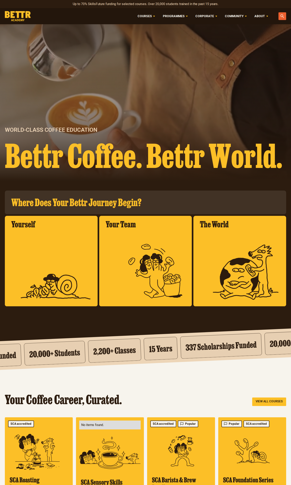

# UI Design System & Master Generation Blueprint: bettr-academy

> **Bettr Academy · World-Class Barista & Coffee Training** (https://bettr.academy/) — Bettr Academy offers SCA-certified and WSQ-accredited coffee courses in Singapore — real, hands-on training with up to 70% SkillsFuture f...



---

## 1. Executive Visual Persona & Design Archetype

- **Brand Essence & Persona**: **Bettr Academy · World-Class Barista & Coffee Training** (`https://bettr.academy/`). Bettr Academy offers SCA-certified and WSQ-accredited coffee courses in Singapore — real, hands-on training with up to 70% SkillsFuture f...
- **Capture Provenance**: Live browser capture (`tier1_fast`, HTTP `200`, captured `2026-11-23`).
- **Visual Archetype**: **Light-Substrate Editorial & Modular Grid System (`#f7f4ed` canvas, `#2c1c0f` ink, `#0082f3` accent)**.
- **Anti-AI-Slop Differentiators**:
  - **Live-Computed Chromatic Polarity**: Anchors the viewport in `#f7f4ed` (live computed `body` `background-color` (`computed_styles.json`)) paired with `#2c1c0f` primary typography and `#0082f3` accents.
  - **Grounded Typographic Hierarchy**: Pairs `Jobclarendon` for display copy (`Bettr Coffee. Bettr World.`) with `Roboto` and not declared in live computed styles (uses primary stack / `ui-monospace`).
  - **Calibrated Spatial Grid & Motion**: Combines `96rem` container bounds (`gap: 16px`, padding `9px`) with `cubic-bezier(.34,1.56,.64,1)` easing and Lenis Smooth Scroll (`data-lenis`), GSAP Timeline & ScrollTrigger.

---

## 2. Spatial Architecture & Modular Grid Mathematics


### Viewport Allocation & Container Geometry
- **Captured Viewport Dimensions**: Desktop `1440×2400px` (`assets/desktop.png`, clamped at 2400px live multi-section capture), Mobile `390×2400px` (`assets/mobile.png`, clamped at 2400px live multi-section capture).
- **Master Container Bounds**: `96rem` (non-`@media` desktop container stylesheet rule).
- **Canvas Lateral Padding & Spacing**: `9px` lateral canvas padding with `16px` grid gap.
- **Border Radius Scale**: `100%`, `3px`, `50%`, `2px`.

### Responsive Breakpoint Architecture
- **Desktop Layout**: Multi-column CSS Grid / Flexbox layout at `1440px` (`max-width: 96rem`, `gap: 16px`).
- **Mobile Layout**: Single-column vertical stack at `390px` viewport width with `9px` horizontal padding.
- **Extracted CSS Media Queries**: `@media screen and (max-width: 991px)`, `@media screen and (max-width: 767px)`, `@media screen and (max-width: 479px)`, `@media (min-width: 768px)`.

---

## 3. Color System, Materiality & Atmospheric Lighting

### Semantic Palette & Source Grounding
| Semantic Role | Ground-Truth Value | Extracted Live / CSS Source |
|---|---|---|
| **Primary Canvas Substrate** | `#f7f4ed` | live computed `body` `background-color` (`computed_styles.json`) |
| **Primary Typography Ink** | `#2c1c0f` | live computed `main` `color` (`computed_styles.json`) |
| **Elevated Surface / Card Substrate** | `#fcbf27` | live computed `footer` `background-color` (`computed_styles.json`) |
| **Interactive Accent / Highlight** | `#0082f3` | `.w-dropdown-link.w--current { color: #0082f3 }` |
| **Secondary / Muted Copy** | `#fcbf27` | live computed `h1` `color` (`computed_styles.json`) |
| **Structural Hairline Border** | `#e2e2e2` | `blockquote { border-left: #e2e2e2 }` |
| **Variable Token (`--_primitives---colors--white`)** | `#ffffff` | `var(--_primitives---colors--white)` in `:root` |
| **Variable Token (`--_primitives---opacity--neutral-darkest-5`)** | `#0c0c0c` | `var(--_primitives---opacity--neutral-darkest-5)` in `:root` |
| **Variable Token (`--_primitives---opacity--white-20`)** | `#fff3` | `var(--_primitives---opacity--white-20)` in `:root` |
| **Variable Token (`--_primitives---colors--earth`)** | `#ed612f` | `var(--_primitives---colors--earth)` in `:root` |
| **Variable Token (`--_primitives---colors--latte`)** | `#edd5b7` | `var(--_primitives---colors--latte)` in `:root` |

### Sanitized Root CSS Variables (`ui-ux.md` Ground Truth)
| Variable Name | Extracted Value | Semantic Role |
|---|---|---|
| `--color-scheme-1--background` | `var(--_primitives---colors--cream)` | Canvas / Surface Token |
| `--_typography---font-styles--body` | `Roboto, sans-serif` | Typography / Scale Token |
| `--color-scheme-1--text` | `var(--_primitives---colors--coffee)` | Typography Ink Token |
| `--_typography---font-styles--heading` | `Jobclarendon, Arial, sans-serif` | Typography Ink Token |
| `--_primitives---colors--white` | `#fff` | Canvas / Surface Token |
| `--_primitives---opacity--transparent` | `transparent` | Design System Custom Token |
| `--_primitives---opacity--neutral-darkest-5` | `#0c0c0c0d` | Canvas / Surface Token |
| `--_primitives---opacity--neutral-darkest-15` | `#0c0c0c26` | Canvas / Surface Token |
| `--_primitives---colors--neutral-darkest` | `#0c0c0c` | Canvas / Surface Token |
| `--_primitives---opacity--white-10` | `#ffffff1a` | Canvas / Surface Token |
| `--_primitives---opacity--white-20` | `#fff3` | Canvas / Surface Token |
| `--_primitives---colors--sunshine` | `#fcbf27` | Brand / Palette Token |
| `--_primitives---colors--coffee` | `#2c1c0f` | Brand / Palette Token |
| `--_primitives---colors--cream` | `#f7f4ed` | Brand / Palette Token |
| `--_primitives---colors--earth` | `#ed612f` | Brand / Palette Token |
| `--_primitives---colors--latte` | `#edd5b7` | Brand / Palette Token |

---

## 4. Typographic Scale & Editorial Hierarchy

### Font Family Stacks
- **Display Typography**: `Jobclarendon`.
- **Primary Body Stack**: `Roboto`.
- **Technical / Metadata Stack**: not declared in live computed styles (uses primary stack / `ui-monospace`).

### Typographic Scale & Rules (Live Computed & Stylesheet Grounded)
- **Hero Display (`H1`)**: live computed `h1` (`font-size: 154.977px`, `line-height: 185.972px`, `font-weight: 600`); rule `h1` (`font-size: 2em`).
- **Section Heading (`H2`)**: live computed `h2` (`font-size: 48px`, `line-height: 52.8px`, `font-weight: 600`); rule `h2` (`font-size: 32px`, `line-height: 36px`).
- **Body Copy**: live computed `body` (`font-size: 16px`, `line-height: 24px`, `font-weight: 400`); CSS variables `--_typography---font-styles--body: Roboto, sans-serif`; rule `body` (`font-size: 14px`, `line-height: 20px`).
- **Metadata & Navigation Labels**: live computed `nav/a` (`font-size: 16px`, `line-height: 24px`, `font-weight: 400`); CSS variables `--_ui-styles---radius--small: .25rem`; rule `small` (`font-size: 80%`).

---

## 5. Choreographed Motion & Interaction Physics

### Primary Easing Curves
- **Extracted Timing Functions**: `cubic-bezier(.34,1.56,.64,1)`, `cubic-bezier(0.625,0.05,0,1)`.

### Per-Element Transition & Choreography Rules
- **Selector `.w-webflow-badge > img`**: `transition: unset` extracted from `bettr-academy` stylesheet.
- **Selector `.w-slider-dot`**: `transition: background-color .1s, color .1s` extracted from `bettr-academy` stylesheet.
- **Selector `.w-lightbox-control`**: `transition: all .3s` extracted from `bettr-academy` stylesheet.
- **Extracted Easing Curve (`cubic-bezier(.34,1.56,.64,1)`)**: Governs interactive state transitions across `<header.section_header>` and `<section.section_journey>`.
- **Runtime Interaction Engine**: Integrates Lenis Smooth Scroll (`data-lenis`), GSAP Timeline & ScrollTrigger, Three.js / WebGL Canvas Pipeline, Swiper Touch Carousel Engine, Barba.js Page Transition Router with `prefers-reduced-motion: reduce` fallback guards.

---

## 6. Component Wireframe & Structural DOM Map

### Visual Layout Schematic — Desktop (`1440px`, Grounded in `dom.html` & Landmark Bounding Boxes)
```
┌────────────────────────────────────────────────────────────────────────┐
│ DESKTOP VIEWPORT (1440px) — Bettr Academy · World-Class Barista & Coff │
│ ====================================================================== │
│ [ <header.section_header (1440x855px) | Coffee Automation · Barista  ] │
│ ---------------------------------------------------------------------- │
│ | HERO STAGE: <section.notice-banner_component> (w=1440px)           | │
│ | H1: Bettr Coffee. Bettr World.                                     | │
│ | Substrate: #f7f4ed | Ink: #2c1c0f | Accent: #0082f3                | │
│ ---------------------------------------------------------------------- │
│ | SHOWCASE GRID (<section.section_journey>) max-w: 96rem             | │
│ | +------------------------------+  +------------------------------+ | │
│ | | B e t t r C o f f e e . B e  |  | Where Does Your Bettr Journe | | │
│ | +------------------------------+  +------------------------------+ | │
│ ---------------------------------------------------------------------- │
│ | DETAIL MODULE (<section.section_rotating-) — Your Coffee Career, C | │
│ ---------------------------------------------------------------------- │
│ [ FOOTER (<footer.footer_compo) | https://bettr.academy/               │
└────────────────────────────────────────────────────────────────────────┘
```

### Visual Layout Schematic — Mobile Reflow (`390px`)
```
┌────────────────────────────────────────────────────────────────────────┐
│ MOBILE VIEWPORT REFLOW (390px) — Single-Column Stack (gap: 16px)       │
│ ====================================================================== │
│ [ HEADER BAR (<header.section_header> ) | Compact Menu (390px)         │
│ ---------------------------------------------------------------------- │
│ | HERO STAGE (<section.notice-banner_c) — 390px Vertical Lead        | │
│ | H1: Bettr Coffee. Bettr World.                                     | │
│ ---------------------------------------------------------------------- │
│ | SHOWCASE STACK (<section.section_journ) — 1-Col Stack              | │
│ | [ Item 1: B e t t r C o f f e e . B e t t r W o r l d .          ] | │
│ | [ Item 2: Where Does Your Bettr Journey Begin?                   ] | │
│ ---------------------------------------------------------------------- │
│ | DETAIL STACK (<section.section_rotatin) — 1-Col (Your Coffee Career) │
│ ---------------------------------------------------------------------- │
│ [ FOOTER (<footer.footer_compo) | Stacked 390px Colophon               │
└────────────────────────────────────────────────────────────────────────┘
```

### Granular DOM Region Breakdown
1. **Brand Header & Navigation Bar (<header.section_header> — `bettr-academy`)**:
   - Landmark `<header class="section_header">` (`1440x855px`) hosting `Bettr Academy · World-Class Barista ` navigation (`Coffee Automation · Barista · Brewing · Sensory · Roasting`), DOM attributes (`data-wf-domain="bettr.academy"`, `data-wf-page="69f15930f71b5763616e2c5d"`, `data-wf-site="69f15930f71b5763616e2c5c"`, `data-barba="wrapper"`), and stylesheet rule `html { -webkit-text-size-adjust: 100%; -ms-text-size-adjust: 100%; font-family:... }`.
2. **Hero Stage & Focal Lead (<section.notice-banner_component> — `Bettr Coffee. Bettr World.`)**:
   - Landmark `<section class="notice-banner_component">` presenting display lead `Bettr Coffee. Bettr World.` and copy excerpt *"WORLD-CLASS COFFEE EDUCATION"* over `#f7f4ed` canvas and `#2c1c0f` ink.
3. **Primary Showcase & Content Grid (<section.section_journey> — `B e t t r C o f f e e . B e t t r `)**:
   - Landmark `<section class="section_journey color-scheme-4">` rendering section `B e t t r C o f f e e . B e t t r W o r l d .` with copy *"WORLD-CLASS COfFEE EDUCATION"*, asset references (`cdn.prod.website-files.com`, `bettr-academy.webflow.shared.25d4...`, `bettr-academy.webflow.69f15930f71...`, `fonts.googleapis.com`), and grid rule `body { margin: 0; }`.
4. **Interactive Detail & Feature Matrix (<section.section_rotating-words-banner> — `Where Does Your Bettr Journey Begi`)**:
   - Landmark `<section class="section_rotating-words-banner color-scheme-2">` framing `Where Does Your Bettr Journey Begin?` and `Your Coffee Career, Curated.` (*"Stop just making coffee, start building a career. Gain the SCA cr"*) with `#fcbf27` surface cards, `#0082f3` accents, and `summary { display: block; }`.
5. **Colophon & Global Directory Footer (<footer.footer_component> — `https://bettr.academy/`)**:
   - Landmark `<footer class="footer_component color-scheme-3">` anchoring `Bettr Academy · World-Class Bari` footer links (`Coffee Automation · Barista · Brewing · Sensory · Roasting`), copy *"Build team skills and foster professional development. Coffe"*, and `#e2e2e2` structural dividers.

---

## 7. Master Zero-Shot AI Generation Prompt

```markdown
# Master Zero-Shot Frontend Generation Prompt: bettr-academy (Bettr Academy · World-Class Barista & Coffee Training)

You are a principal frontend architect and design systems engineer. Build a complete, production-ready web application replicating the exact design system, DOM landmarks, typographic hierarchy, color tokens, and motion physics of `bettr-academy` (**Bettr Academy · World-Class Barista & Coffee Training** — `https://bettr.academy/`).

### 1. Visual Archetype & Anti-AI-Slop Mandates
- **Archetype**: Light-Substrate Editorial & Modular Grid System (`#f7f4ed` canvas, `#2c1c0f` ink, `#0082f3` accent).
- **Identity & Domain Context**: Bettr Academy offers SCA-certified and WSQ-accredited coffee courses in Singapore — real, hands-on training with up to 70% SkillsFuture f...
- **Primary Substrate**: `#f7f4ed` (live computed `body` `background-color` (`computed_styles.json`)), **Primary Ink**: `#2c1c0f`, **Accent / Highlight**: `#0082f3`.
- **Site-Specific Differentiators**:
  - **Live-Computed Chromatic Polarity**: Anchors the viewport in `#f7f4ed` (live computed `body` `background-color` (`computed_styles.json`)) paired with `#2c1c0f` primary typography and `#0082f3` accents.
  - **Grounded Typographic Hierarchy**: Pairs `Jobclarendon` for display copy (`Bettr Coffee. Bettr World.`) with `Roboto` and not declared in live computed styles (uses primary stack / `ui-monospace`).
  - **Calibrated Spatial Grid & Motion**: Combines `96rem` container bounds (`gap: 16px`, padding `9px`) with `cubic-bezier(.34,1.56,.64,1)` easing and Lenis Smooth Scroll (`data-lenis`), GSAP Timeline & ScrollTrigger.

### 2. Ground-Truth CSS Variables (`:root` Token Contract)
Declare and consume these exact custom properties extracted from `bettr-academy` in your global stylesheet:

:root {
  /* Bettr Academy · World-Class Barista & Coffee Training (bettr-academy) — Live-Grounded CSS Variables */
  --color-scheme-1--background: var(--_primitives---colors--cream); /* Canvas / Surface Token (bettr-academy) */
  --_typography---font-styles--body: Roboto, sans-serif; /* Typography / Scale Token (bettr-academy) */
  --color-scheme-1--text: var(--_primitives---colors--coffee); /* Typography Ink Token (bettr-academy) */
  --_typography---font-styles--heading: Jobclarendon, Arial, sans-serif; /* Typography Ink Token (bettr-academy) */
  --_primitives---colors--white: #fff; /* Canvas / Surface Token (bettr-academy) */
  --_primitives---opacity--transparent: transparent; /* Design System Custom Token (bettr-academy) */
  --_primitives---opacity--neutral-darkest-5: #0c0c0c0d; /* Canvas / Surface Token (bettr-academy) */
  --_primitives---opacity--neutral-darkest-15: #0c0c0c26; /* Canvas / Surface Token (bettr-academy) */
  --_primitives---colors--neutral-darkest: #0c0c0c; /* Canvas / Surface Token (bettr-academy) */
  --_primitives---opacity--white-10: #ffffff1a; /* Canvas / Surface Token (bettr-academy) */
  --_primitives---opacity--white-20: #fff3; /* Canvas / Surface Token (bettr-academy) */
  --_primitives---colors--sunshine: #fcbf27; /* Brand / Palette Token (bettr-academy) */
  --_primitives---colors--coffee: #2c1c0f; /* Brand / Palette Token (bettr-academy) */
  --_primitives---colors--cream: #f7f4ed; /* Brand / Palette Token (bettr-academy) */
  --_primitives---colors--earth: #ed612f; /* Brand / Palette Token (bettr-academy) */
  --_primitives---colors--latte: #edd5b7; /* Brand / Palette Token (bettr-academy) */
}

### 3. Semantic Color & Materiality Contract
Map every surface, ink, and border strictly to these source-grounded tokens:
- **Primary Canvas Substrate**: `#f7f4ed` — grounded in live computed `body` `background-color` (`computed_styles.json`)
- **Primary Typography Ink**: `#2c1c0f` — grounded in live computed `main` `color` (`computed_styles.json`)
- **Elevated Surface / Card Substrate**: `#fcbf27` — grounded in live computed `footer` `background-color` (`computed_styles.json`)
- **Interactive Accent / Highlight**: `#0082f3` — grounded in `.w-dropdown-link.w--current { color: #0082f3 }`
- **Secondary / Muted Copy**: `#fcbf27` — grounded in live computed `h1` `color` (`computed_styles.json`)
- **Structural Hairline Border**: `#e2e2e2` — grounded in `blockquote { border-left: #e2e2e2 }`
- **Variable Token (`--_primitives---colors--white`)**: `#ffffff` — grounded in `var(--_primitives---colors--white)` in `:root`
- **Variable Token (`--_primitives---opacity--neutral-darkest-5`)**: `#0c0c0c` — grounded in `var(--_primitives---opacity--neutral-darkest-5)` in `:root`
- **Variable Token (`--_primitives---opacity--white-20`)**: `#fff3` — grounded in `var(--_primitives---opacity--white-20)` in `:root`
- **Variable Token (`--_primitives---colors--earth`)**: `#ed612f` — grounded in `var(--_primitives---colors--earth)` in `:root`
- **Variable Token (`--_primitives---colors--latte`)**: `#edd5b7` — grounded in `var(--_primitives---colors--latte)` in `:root`

### 4. Spatial Grid, Container Bounds & Responsive Breakpoints
- **Desktop Viewport Reference**: `1440×2400px` (clamped at 2400px live multi-section capture, `1440px` standard desktop width).
- **Mobile Viewport Reference**: `390×2400px` (clamped at 2400px live multi-section capture, `390px` standard mobile width).
- **Container Max-Width**: `96rem` (non-`@media` desktop container stylesheet rule)
- **Padding & Gutters**: `9px` lateral canvas padding with `16px` grid gap
- **Desktop Grid**: Multi-column CSS Grid / Flexbox layout at `1440px` (`max-width: 96rem`, `gap: 16px`)
- **Mobile Adaptation**: Single-column vertical stack at `390px` viewport width with `9px` horizontal padding
- **Media Queries**: `@media screen and (max-width: 991px)`, `@media screen and (max-width: 767px)`, `@media screen and (max-width: 479px)`, `@media (min-width: 768px)`
- **Corner Radii**: `100%`, `3px`, `50%`, `2px`

### 5. Typography & Editorial Scale Contract
- **Display Font Stack**: `Jobclarendon`
- **Body Font Stack**: `Roboto`
- **Monospace / Technical Font Stack**: not declared in live computed styles (uses primary stack / `ui-monospace`)
- **H1 Display Rule**: live computed `h1` (`font-size: 154.977px`, `line-height: 185.972px`, `font-weight: 600`); rule `h1` (`font-size: 2em`)
- **H2 Section Rule**: live computed `h2` (`font-size: 48px`, `line-height: 52.8px`, `font-weight: 600`); rule `h2` (`font-size: 32px`, `line-height: 36px`)
- **Body Copy Rule**: live computed `body` (`font-size: 16px`, `line-height: 24px`, `font-weight: 400`); CSS variables `--_typography---font-styles--body: Roboto, sans-serif`; rule `body` (`font-size: 14px`, `line-height: 20px`)
- **Metadata & Index Rule**: live computed `nav/a` (`font-size: 16px`, `line-height: 24px`, `font-weight: 400`); CSS variables `--_ui-styles---radius--small: .25rem`; rule `small` (`font-size: 80%`)

### 6. Component Hierarchy, Verbatim Copy & Real DOM Landmarks
Scaffold `bettr-academy` (`Bettr Academy · World-Class Barista & Coffee Training`) with these exact structural regions, extracted copy, and CSS rules from `dom.html`:
1. **Brand Header & Navigation Bar (<header.section_header> — `bettr-academy`)**:
   - DOM & Selectors: Landmark `<header class="section_header">` (`1440x855px`) hosting `Bettr Academy · World-Class Barista ` navigation (`Coffee Automation · Barista · Brewing · Sensory · Roasting`), DOM attributes (`data-wf-domain="bettr.academy"`, `data-wf-page="69f15930f71b5763616e2c5d"`, `data-wf-site="69f15930f71b5763616e2c5c"`, `data-barba="wrapper"`), and stylesheet rule `html { -webkit-text-size-adjust: 100%; -ms-text-size-adjust: 100%; font-family:... }`.
   - Responsive Contract: Header `Brand Header & Navigation Bar (<header.section_header> — `bettr-academy`)` (`bettr-academy`) adapts across `@media screen and (max-width: 991px)`, `@media screen and (max-width: 767px)`, `@media screen and (max-width: 479px)`, `@media (min-width: 768px)` with `cubic-bezier(.34,1.56,.64,1)`, `cubic-bezier(0.625,0.05,0,1)` transitions and links `Coffee Automation · Barista · Brewing · Sensory · Roasting`.
2. **Hero Stage & Focal Lead (<section.notice-banner_component> — `Bettr Coffee. Bettr World.`)**:
   - DOM & Selectors: Landmark `<section class="notice-banner_component">` presenting display lead `Bettr Coffee. Bettr World.` and copy excerpt *"WORLD-CLASS COFFEE EDUCATION"* over `#f7f4ed` canvas and `#2c1c0f` ink.
   - Responsive Contract: Hero stage (`1440×2400px` desktop / `390×2400px` mobile) sets `#f7f4ed` background with `#2c1c0f` headline `Bettr Coffee. Bettr World.`.
3. **Primary Showcase & Content Grid (<section.section_journey> — `B e t t r C o f f e e . B e t t r `)**:
   - DOM & Selectors: Landmark `<section class="section_journey color-scheme-4">` rendering section `B e t t r C o f f e e . B e t t r W o r l d .` with copy *"WORLD-CLASS COfFEE EDUCATION"*, asset references (`cdn.prod.website-files.com`, `bettr-academy.webflow.shared.25d4...`, `bettr-academy.webflow.69f15930f71...`, `fonts.googleapis.com`), and grid rule `body { margin: 0; }`.
   - Responsive Contract: Showcase grid `Primary Showcase & Content Grid (<section.section_journey> — `B e t t r C o f f e e . B e t t r `)` applies Multi-column CSS Grid / Flexbox layout at `1440px` (`max-width: 96rem`, `gap: 16px`) on desktop and Single-column vertical stack at `390px` viewport width with `9px` horizontal padding on mobile.
4. **Interactive Detail & Feature Matrix (<section.section_rotating-words-banner> — `Where Does Your Bettr Journey Begi`)**:
   - DOM & Selectors: Landmark `<section class="section_rotating-words-banner color-scheme-2">` framing `Where Does Your Bettr Journey Begin?` and `Your Coffee Career, Curated.` (*"Stop just making coffee, start building a career. Gain the SCA cr"*) with `#fcbf27` surface cards, `#0082f3` accents, and `summary { display: block; }`.
   - Responsive Contract: Detail module `Interactive Detail & Feature Matrix (<section.section_rotating-words-banner> — `Where Does Your Bettr Journey Begi`)` uses `100%`, `3px`, `50%`, `2px` radii, `#0082f3` highlights, and assets (cdn.prod.website-files.com, bettr-academy.webflow.shared.25d4..., bettr-academy.webflow.69f15930f71...).
5. **Colophon & Global Directory Footer (<footer.footer_component> — `https://bettr.academy/`)**:
   - DOM & Selectors: Landmark `<footer class="footer_component color-scheme-3">` anchoring `Bettr Academy · World-Class Bari` footer links (`Coffee Automation · Barista · Brewing · Sensory · Roasting`), copy *"Build team skills and foster professional development. Coffe"*, and `#e2e2e2` structural dividers.
   - Responsive Contract: Footer `Colophon & Global Directory Footer (<footer.footer_component> — `https://bettr.academy/`)` aligns to `96rem` (non-`@media` desktop container stylesheet rule) with `9px` lateral canvas padding with `16px` grid gap and attributes (data-wf-domain="bettr.academy", data-wf-page="69f15930f71b5763616e2c5d", data-wf-site="69f15930f71b5763616e2c5c").

#### Verbatim DOM Copy Excerpts (`dom.html`)
- Copy Excerpt 1: *"WORLD-CLASS COFFEE EDUCATION"*
- Copy Excerpt 2: *"WORLD-CLASS COfFEE EDUCATION"*
- Copy Excerpt 3: *"Stop just making coffee, start building a career. Gain the SCA credentials recogni..."*
- Copy Excerpt 4: *"Build team skills and foster professional development. Coffee Appreciation, Life S..."*

### 7. Motion, Extracted Stylesheet Rules & Interaction Choreography
- **Primary Easing Functions**: `cubic-bezier(.34,1.56,.64,1)`, `cubic-bezier(0.625,0.05,0,1)`
- **Extracted Stylesheet Rules (`bettr-academy`)**:
- `html { -webkit-text-size-adjust: 100%; -ms-text-size-adjust: 100%; font-family:... }`
- `body { margin: 0; }`
- `summary { display: block; }`
- `video { vertical-align: baseline; display: inline-block; }`
- `template { display: none; }`
- **Per-Selector Transition Rules**:
- **Selector `.w-webflow-badge > img`**: `transition: unset` extracted from `bettr-academy` stylesheet.
- **Selector `.w-slider-dot`**: `transition: background-color .1s, color .1s` extracted from `bettr-academy` stylesheet.
- **Selector `.w-lightbox-control`**: `transition: all .3s` extracted from `bettr-academy` stylesheet.
- **Extracted Easing Curve (`cubic-bezier(.34,1.56,.64,1)`)**: Governs interactive state transitions across `<header.section_header>` and `<section.section_journey>`.
- **Runtime Interaction Engine**: Integrates Lenis Smooth Scroll (`data-lenis`), GSAP Timeline & ScrollTrigger, Three.js / WebGL Canvas Pipeline, Swiper Touch Carousel Engine, Barba.js Page Transition Router with `prefers-reduced-motion: reduce` fallback guards.

### 8. Technical Deliverables
- Implement in Next.js (App Router) with TypeScript and Tailwind CSS consuming the `:root` custom properties defined above for `bettr-academy`.
- Reproduce both the `1440px` desktop architecture and `390px` mobile breakpoint transitions, preserving semantic HTML5 landmarks (`<header>`, `<nav>`, `<main>`, `<section>`, `<footer>`) and `prefers-reduced-motion` accessibility guards.
```
