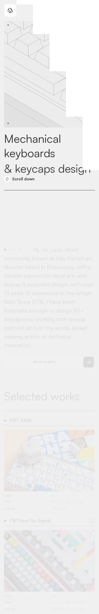

# UI Design System & Master Generation Blueprint: biipmk-com

> **biipmk** (https://biipmk.com/) — French art director and keycap designer with 10+ years experience. Specializing in mechanical keyboard design, custom keycap sets, and vi...


---

## 1. Executive Visual Persona & Design Archetype

- **Brand Essence & Persona**: **biipmk** (`https://biipmk.com/`). French art director and keycap designer with 10+ years experience. Specializing in mechanical keyboard design, custom keycap sets, and vi...
- **Capture Provenance**: Live browser capture (`tier1_fast`, HTTP `200`, captured `2026-11-23`).
- **Visual Archetype**: **Light-Substrate Editorial & Modular Grid System (`#f0f0f1` canvas, `#000000` ink, `#0000ee` accent)**.
- **Anti-AI-Slop Differentiators**:
  - **Live-Computed Chromatic Polarity**: Anchors the viewport in `#f0f0f1` (live computed `body` `background-color` (`computed_styles.json`)) paired with `#000000` primary typography and `#0000ee` accents.
  - **Grounded Typographic Hierarchy**: Pairs `Satoshi` for display copy (`Mechanical keyboards & keycaps desig`) with `Satoshi Placeholder` and `IBM Plex Mono`.
  - **Calibrated Spatial Grid & Motion**: Combines `1044px` container bounds (`gap: 16px`, padding `16px`) with `cubic-bezier(0.4,1.2,0.6,1)` easing and Lenis Smooth Scroll (`data-lenis`), Framer Motion Layout Physics.

---

## 2. Spatial Architecture & Modular Grid Mathematics



### Viewport Allocation & Container Geometry
- **Captured Viewport Dimensions**: Desktop `1440×2400px` (`assets/desktop.png`, clamped at 2400px live multi-section capture), Mobile `390×2400px` (`assets/mobile.png`, clamped at 2400px live multi-section capture).
- **Master Container Bounds**: `1044px` (measured widest bounded `<section>` landmark width on `1440px` desktop).
- **Canvas Lateral Padding & Spacing**: `16px` lateral canvas padding with `16px` grid gap.
- **Border Radius Scale**: `10px`, `12px`, `8px`, `15px`.

### Responsive Breakpoint Architecture
- **Desktop Layout**: Multi-column CSS Grid / Flexbox layout at `1440px` (`max-width: 1044px`, `gap: 16px`).
- **Mobile Layout**: Single-column vertical stack at `390px` viewport width with `16px` horizontal padding.
- **Extracted CSS Media Queries**: `@media (min-width: 2200px)`, `@media (min-width: 1280px) and (max-width: 2199.98px)`, `@media (min-width: 810px) and (max-width: 1279.98px)`, `@media (max-width: 809.98px)`.

---

## 3. Color System, Materiality & Atmospheric Lighting

### Semantic Palette & Source Grounding
| Semantic Role | Ground-Truth Value | Extracted Live / CSS Source |
|---|---|---|
| **Primary Canvas Substrate** | `#f0f0f1` | live computed `body` `background-color` (`computed_styles.json`) |
| **Primary Typography Ink** | `#000000` | live computed `main` `color` (`computed_styles.json`) |
| **Elevated Surface / Card Substrate** | `#ffffff` | live computed `a` `background-color` (`computed_styles.json`) |
| **Interactive Accent / Highlight** | `#0000ee` | live computed `a` `color` (`computed_styles.json`) |
| **Secondary / Muted Copy** | `#2e2e2f` | live computed `h1` `color` (`computed_styles.json`) |
| **Structural Hairline Border** | `#2e2e2f` | `var(--border-color)` in `:root` |
| **Variable Token (`--token-1ef64e56-8935-4468-b341-7e1dc51bb63d`)** | `#fff9` | `var(--token-1ef64e56-8935-4468-b341-7e1dc51bb63d)` in `:root` |
| **Variable Token (`--token-f56b1214-00aa-4536-9ffd-154101bb6be0`)** | `#d2d2d2` | `var(--token-f56b1214-00aa-4536-9ffd-154101bb6be0)` in `:root` |
| **Variable Token (`--token-63ff77c2-576f-40e9-b4c2-5caf21c4f1e9`)** | `#bcbcbd` | `var(--token-63ff77c2-576f-40e9-b4c2-5caf21c4f1e9)` in `:root` |
| **Variable Token (`--token-d752c2e3-4387-4d99-8931-9ec888af3ba1`)** | `#9d9d9f` | `var(--token-d752c2e3-4387-4d99-8931-9ec888af3ba1)` in `:root` |
| **Variable Token (`--token-bc378e3e-7ff2-44fd-a6d1-b4984d382cfe`)** | `#8a8a8c` | `var(--token-bc378e3e-7ff2-44fd-a6d1-b4984d382cfe)` in `:root` |
| **Variable Token (`--token-8a478efd-d44a-4177-9d88-c7291b9d6b8f`)** | `#6d6d6f` | `var(--token-8a478efd-d44a-4177-9d88-c7291b9d6b8f)` in `:root` |
| **Variable Token (`--token-cd0db9f3-e04f-469f-bf1c-a192982ebe5f`)** | `#636365` | `var(--token-cd0db9f3-e04f-469f-bf1c-a192982ebe5f)` in `:root` |
| **Variable Token (`--token-a4711fc1-f7ea-49d6-acf3-e384c36b6979`)** | `#4d4d4f` | `var(--token-a4711fc1-f7ea-49d6-acf3-e384c36b6979)` in `:root` |
| **Variable Token (`--token-ead8cd39-f167-4cb4-a750-94b1094ca9b4`)** | `#3c3c3d` | `var(--token-ead8cd39-f167-4cb4-a750-94b1094ca9b4)` in `:root` |
| **Variable Token (`--token-8dfa6ef2-fdbc-4c8e-8f62-36db9261f81d`)** | `#252526` | `var(--token-8dfa6ef2-fdbc-4c8e-8f62-36db9261f81d)` in `:root` |

### Sanitized Root CSS Variables (`ui-ux.md` Ground Truth)
| Variable Name | Extracted Value | Semantic Role |
|---|---|---|
| `--token-a58b3a81-59cc-45f7-ae05-091785ff903e` | `#fff` | Color / Atmospheric Token |
| `--token-9a61cb06-3a3a-4375-8be8-66b9dda45d4e` | `#2e2e2f` | Color / Atmospheric Token |
| `--token-1ef64e56-8935-4468-b341-7e1dc51bb63d` | `#fff9` | Color / Atmospheric Token |
| `--token-b3a4db72-7cd5-441a-86c3-f810b7cadc92` | `#f0f0f1` | Color / Atmospheric Token |
| `--token-f56b1214-00aa-4536-9ffd-154101bb6be0` | `#d2d2d2` | Color / Atmospheric Token |
| `--token-63ff77c2-576f-40e9-b4c2-5caf21c4f1e9` | `#bcbcbd` | Color / Atmospheric Token |
| `--token-d752c2e3-4387-4d99-8931-9ec888af3ba1` | `#9d9d9f` | Color / Atmospheric Token |
| `--token-bc378e3e-7ff2-44fd-a6d1-b4984d382cfe` | `#8a8a8c` | Color / Atmospheric Token |
| `--token-8a478efd-d44a-4177-9d88-c7291b9d6b8f` | `#6d6d6f` | Color / Atmospheric Token |
| `--token-cd0db9f3-e04f-469f-bf1c-a192982ebe5f` | `#636365` | Color / Atmospheric Token |
| `--token-a4711fc1-f7ea-49d6-acf3-e384c36b6979` | `#4d4d4f` | Color / Atmospheric Token |
| `--token-ead8cd39-f167-4cb4-a750-94b1094ca9b4` | `#3c3c3d` | Color / Atmospheric Token |
| `--token-8dfa6ef2-fdbc-4c8e-8f62-36db9261f81d` | `#252526` | Color / Atmospheric Token |
| `--token-2ef8ddb3-0f66-468d-abb6-13d65e017e32` | `#d2d2d280` | Color / Atmospheric Token |
| `--token-d5e104ff-e396-4ea1-8a79-0d0dbbc87b4d` | `#fff` | Color / Atmospheric Token |
| `--text-decoration-skip-ink` | `var(--framer-text-decoration-skip-ink)` | Typography Ink Token |

---

## 4. Typographic Scale & Editorial Hierarchy

### Font Family Stacks
- **Display Typography**: `Satoshi`.
- **Primary Body Stack**: `Satoshi Placeholder`.
- **Technical / Metadata Stack**: `IBM Plex Mono`.

### Typographic Scale & Rules (Live Computed & Stylesheet Grounded)
- **Hero Display (`H1`)**: live computed `h1` (`font-size: 64px`, `line-height: 89.6px`, `font-weight: 400`); rule `h1` (`font-size: calc(var(--framer-root-font-s...`, `line-height: 140%`, `letter-spacing: 0em`, `font-weight: 400`).
- **Section Heading (`H2`)**: live computed `h2` (`font-size: 64px`, `line-height: 89.6px`, `font-weight: 400`).
- **Body Copy**: live computed `body` (`font-size: 12px`, `line-height: normal`, `font-weight: 400`); rule `p` (`font-size: calc(var(--framer-root-font-s...`, `line-height: 120%`, `letter-spacing: 0em`, `font-weight: 700`).
- **Metadata & Navigation Labels**: live computed `nav/a` (`font-size: 12px`, `line-height: normal`, `font-weight: 400`); CSS variables `--letter-spacing: var(--framer-letter-spacing)`.

---

## 5. Choreographed Motion & Interaction Physics

### Primary Easing Curves
- **Extracted Timing Functions**: `cubic-bezier(0.4,1.2,0.6,1)`.

### Per-Element Transition & Choreography Rules
- **Selector `#__framer-editorbar-label`**: `transition: opacity 0.4s ease-out` extracted from `biipmk-com` stylesheet.
- **Selector `style]`**: `transition: background 0.2s` extracted from `biipmk-com` stylesheet.
- **Selector `style]`**: `transition: left 0.2s cubic-bezier(0.4,1.2,0.6,1)` extracted from `biipmk-com` stylesheet.
- **Extracted Easing Curve (`cubic-bezier(0.4,1.2,0.6,1)`)**: Governs interactive state transitions across `<nav.framer-yfoBI>` and `<article.framer-sbufwg:nth(2)>`.
- **Runtime Interaction Engine**: Integrates Lenis Smooth Scroll (`data-lenis`), Framer Motion Layout Physics with `prefers-reduced-motion: reduce` fallback guards.

---

## 6. Component Wireframe & Structural DOM Map

### Visual Layout Schematic — Desktop (`1440px`, Grounded in `dom.html` & Landmark Bounding Boxes)
```
┌────────────────────────────────────────────────────────────────────────┐
│ DESKTOP VIEWPORT (1440px) — biipmk                                     │
│ ====================================================================== │
│ [ <nav.framer-yfoBI> (1440x50px)      | Home · Works · About · Conta ] │
│ ---------------------------------------------------------------------- │
│ | HERO STAGE: <article.framer-sbufwg> (w=1440px)                     | │
│ | H1: Mechanical keyboards & keycaps design                          | │
│ | Substrate: #f0f0f1 | Ink: #000000 | Accent: #0000ee                | │
│ ---------------------------------------------------------------------- │
│ | SHOWCASE GRID (<article.framer-sbufwg:nth) max-w: 1044px           | │
│ | +------------------------------+  +------------------------------+ | │
│ | | M e c h a n i c a l k e y b  |  | S e l e c t e d w o r k s    | | │
│ | +------------------------------+  +------------------------------+ | │
│ ---------------------------------------------------------------------- │
│ | DETAIL MODULE (<article.framer-sbufwg:nth) — PBTfans No Signal     | │
│ ---------------------------------------------------------------------- │
│ [ FOOTER (<footer.framer-geIks) | https://biipmk.com/                  │
└────────────────────────────────────────────────────────────────────────┘
```

### Visual Layout Schematic — Mobile Reflow (`390px`)
```
┌────────────────────────────────────────────────────────────────────────┐
│ MOBILE VIEWPORT REFLOW (390px) — Single-Column Stack (gap: 16px)       │
│ ====================================================================== │
│ [ HEADER BAR (<nav.framer-yfoBI>      ) | Compact Menu (390px)         │
│ ---------------------------------------------------------------------- │
│ | HERO STAGE (<article.framer-sbufwg>) — 390px Vertical Lead         | │
│ | H1: Mechanical keyboards & keycaps design                          | │
│ ---------------------------------------------------------------------- │
│ | SHOWCASE STACK (<article.framer-sbufwg) — 1-Col Stack              | │
│ | [ Item 1: M e c h a n i c a l k e y b o a r d s & k e y c a...   ] | │
│ | [ Item 2: S e l e c t e d w o r k s                              ] | │
│ ---------------------------------------------------------------------- │
│ | DETAIL STACK (<article.framer-sbufwg:n) — 1-Col (PBTfans No Signal)  │
│ ---------------------------------------------------------------------- │
│ [ FOOTER (<footer.framer-geIks) | Stacked 390px Colophon               │
└────────────────────────────────────────────────────────────────────────┘
```

### Granular DOM Region Breakdown
1. **Brand Header & Navigation Bar (<nav.framer-yfoBI> — `biipmk-com`)**:
   - Landmark `<nav class="framer-yfoBI framer-1rw6cnj">` (`1440x50px`) hosting `biipmk` navigation (`Home · Works · About · Contact`), DOM attributes (`data-redirect-timezone="1"`, `data-framer-generated-canonical`, `data-framer-font-css`, `data-framer-breakpoint-css`), and stylesheet rule `.hidden-1qegrwl { display:none!important }`.
2. **Hero Stage & Focal Lead (<article.framer-sbufwg> — `Mechanical keyboards & keycaps des`)**:
   - Landmark `<article class="framer-sbufwg">` presenting display lead `Mechanical keyboards & keycaps design` and copy excerpt *"M e c h a n i c a l"* over `#f0f0f1` canvas and `#000000` ink.
3. **Primary Showcase & Content Grid (<article.framer-sbufwg:nth(2)> — `M e c h a n i c a l k e y b o a r `)**:
   - Landmark `<article class="framer-sbufwg">` rendering section `M e c h a n i c a l k e y b o a r d s & k e y c a...` with copy *"Strasbourg, France."*, asset references (`pmry2NqhXUH8l6AL2sqCWz37mfA.png`, `KonkIH5joVcpFDiWUIosk62WxE8.png`, `02sP8aoNizSrkiNxivI6fvFyU.png`, `framerusercontent.com`), and grid rule `.hidden-72rtr7 { display:none!important }`.
4. **Interactive Detail & Feature Matrix (<article.framer-sbufwg:nth(3)> — `S e l e c t e d w o r k s`)**:
   - Landmark `<article class="framer-sbufwg">` framing `S e l e c t e d w o r k s` and `PBTfans No Signal` (*"M e c h a n i c a l k e y b o a r d s & k e y c a..."*) with `#ffffff` surface cards, `#0000ee` accents, and `.hidden-6reknn { display:none!important }`.
5. **Colophon & Global Directory Footer (<footer.framer-geIks> — `https://biipmk.com/`)**:
   - Landmark `<footer class="framer-geIks framer-VygiK">` anchoring `biipmk` footer links (`Home · Works · About · Contact`), copy *"S e l e c t e d w o r k s"*, and `#2e2e2f` structural dividers.

---

## 7. Master Zero-Shot AI Generation Prompt

```markdown
# Master Zero-Shot Frontend Generation Prompt: biipmk-com (biipmk)

You are a principal frontend architect and design systems engineer. Build a complete, production-ready web application replicating the exact design system, DOM landmarks, typographic hierarchy, color tokens, and motion physics of `biipmk-com` (**biipmk** — `https://biipmk.com/`).

### 1. Visual Archetype & Anti-AI-Slop Mandates
- **Archetype**: Light-Substrate Editorial & Modular Grid System (`#f0f0f1` canvas, `#000000` ink, `#0000ee` accent).
- **Identity & Domain Context**: French art director and keycap designer with 10+ years experience. Specializing in mechanical keyboard design, custom keycap sets, and vi...
- **Primary Substrate**: `#f0f0f1` (live computed `body` `background-color` (`computed_styles.json`)), **Primary Ink**: `#000000`, **Accent / Highlight**: `#0000ee`.
- **Site-Specific Differentiators**:
  - **Live-Computed Chromatic Polarity**: Anchors the viewport in `#f0f0f1` (live computed `body` `background-color` (`computed_styles.json`)) paired with `#000000` primary typography and `#0000ee` accents.
  - **Grounded Typographic Hierarchy**: Pairs `Satoshi` for display copy (`Mechanical keyboards & keycaps desig`) with `Satoshi Placeholder` and `IBM Plex Mono`.
  - **Calibrated Spatial Grid & Motion**: Combines `1044px` container bounds (`gap: 16px`, padding `16px`) with `cubic-bezier(0.4,1.2,0.6,1)` easing and Lenis Smooth Scroll (`data-lenis`), Framer Motion Layout Physics.

### 2. Ground-Truth CSS Variables (`:root` Token Contract)
Declare and consume these exact custom properties extracted from `biipmk-com` in your global stylesheet:

:root {
  /* biipmk (biipmk-com) — Live-Grounded CSS Variables */
  --token-a58b3a81-59cc-45f7-ae05-091785ff903e: #fff; /* Color / Atmospheric Token (biipmk-com) */
  --token-9a61cb06-3a3a-4375-8be8-66b9dda45d4e: #2e2e2f; /* Color / Atmospheric Token (biipmk-com) */
  --token-1ef64e56-8935-4468-b341-7e1dc51bb63d: #fff9; /* Color / Atmospheric Token (biipmk-com) */
  --token-b3a4db72-7cd5-441a-86c3-f810b7cadc92: #f0f0f1; /* Color / Atmospheric Token (biipmk-com) */
  --token-f56b1214-00aa-4536-9ffd-154101bb6be0: #d2d2d2; /* Color / Atmospheric Token (biipmk-com) */
  --token-63ff77c2-576f-40e9-b4c2-5caf21c4f1e9: #bcbcbd; /* Color / Atmospheric Token (biipmk-com) */
  --token-d752c2e3-4387-4d99-8931-9ec888af3ba1: #9d9d9f; /* Color / Atmospheric Token (biipmk-com) */
  --token-bc378e3e-7ff2-44fd-a6d1-b4984d382cfe: #8a8a8c; /* Color / Atmospheric Token (biipmk-com) */
  --token-8a478efd-d44a-4177-9d88-c7291b9d6b8f: #6d6d6f; /* Color / Atmospheric Token (biipmk-com) */
  --token-cd0db9f3-e04f-469f-bf1c-a192982ebe5f: #636365; /* Color / Atmospheric Token (biipmk-com) */
  --token-a4711fc1-f7ea-49d6-acf3-e384c36b6979: #4d4d4f; /* Color / Atmospheric Token (biipmk-com) */
  --token-ead8cd39-f167-4cb4-a750-94b1094ca9b4: #3c3c3d; /* Color / Atmospheric Token (biipmk-com) */
  --token-8dfa6ef2-fdbc-4c8e-8f62-36db9261f81d: #252526; /* Color / Atmospheric Token (biipmk-com) */
  --token-2ef8ddb3-0f66-468d-abb6-13d65e017e32: #d2d2d280; /* Color / Atmospheric Token (biipmk-com) */
  --token-d5e104ff-e396-4ea1-8a79-0d0dbbc87b4d: #fff; /* Color / Atmospheric Token (biipmk-com) */
  --text-decoration-skip-ink: var(--framer-text-decoration-skip-ink); /* Typography Ink Token (biipmk-com) */
}

### 3. Semantic Color & Materiality Contract
Map every surface, ink, and border strictly to these source-grounded tokens:
- **Primary Canvas Substrate**: `#f0f0f1` — grounded in live computed `body` `background-color` (`computed_styles.json`)
- **Primary Typography Ink**: `#000000` — grounded in live computed `main` `color` (`computed_styles.json`)
- **Elevated Surface / Card Substrate**: `#ffffff` — grounded in live computed `a` `background-color` (`computed_styles.json`)
- **Interactive Accent / Highlight**: `#0000ee` — grounded in live computed `a` `color` (`computed_styles.json`)
- **Secondary / Muted Copy**: `#2e2e2f` — grounded in live computed `h1` `color` (`computed_styles.json`)
- **Structural Hairline Border**: `#2e2e2f` — grounded in `var(--border-color)` in `:root`
- **Variable Token (`--token-1ef64e56-8935-4468-b341-7e1dc51bb63d`)**: `#fff9` — grounded in `var(--token-1ef64e56-8935-4468-b341-7e1dc51bb63d)` in `:root`
- **Variable Token (`--token-f56b1214-00aa-4536-9ffd-154101bb6be0`)**: `#d2d2d2` — grounded in `var(--token-f56b1214-00aa-4536-9ffd-154101bb6be0)` in `:root`
- **Variable Token (`--token-63ff77c2-576f-40e9-b4c2-5caf21c4f1e9`)**: `#bcbcbd` — grounded in `var(--token-63ff77c2-576f-40e9-b4c2-5caf21c4f1e9)` in `:root`
- **Variable Token (`--token-d752c2e3-4387-4d99-8931-9ec888af3ba1`)**: `#9d9d9f` — grounded in `var(--token-d752c2e3-4387-4d99-8931-9ec888af3ba1)` in `:root`
- **Variable Token (`--token-bc378e3e-7ff2-44fd-a6d1-b4984d382cfe`)**: `#8a8a8c` — grounded in `var(--token-bc378e3e-7ff2-44fd-a6d1-b4984d382cfe)` in `:root`
- **Variable Token (`--token-8a478efd-d44a-4177-9d88-c7291b9d6b8f`)**: `#6d6d6f` — grounded in `var(--token-8a478efd-d44a-4177-9d88-c7291b9d6b8f)` in `:root`
- **Variable Token (`--token-cd0db9f3-e04f-469f-bf1c-a192982ebe5f`)**: `#636365` — grounded in `var(--token-cd0db9f3-e04f-469f-bf1c-a192982ebe5f)` in `:root`
- **Variable Token (`--token-a4711fc1-f7ea-49d6-acf3-e384c36b6979`)**: `#4d4d4f` — grounded in `var(--token-a4711fc1-f7ea-49d6-acf3-e384c36b6979)` in `:root`
- **Variable Token (`--token-ead8cd39-f167-4cb4-a750-94b1094ca9b4`)**: `#3c3c3d` — grounded in `var(--token-ead8cd39-f167-4cb4-a750-94b1094ca9b4)` in `:root`
- **Variable Token (`--token-8dfa6ef2-fdbc-4c8e-8f62-36db9261f81d`)**: `#252526` — grounded in `var(--token-8dfa6ef2-fdbc-4c8e-8f62-36db9261f81d)` in `:root`

### 4. Spatial Grid, Container Bounds & Responsive Breakpoints
- **Desktop Viewport Reference**: `1440×2400px` (clamped at 2400px live multi-section capture, `1440px` standard desktop width).
- **Mobile Viewport Reference**: `390×2400px` (clamped at 2400px live multi-section capture, `390px` standard mobile width).
- **Container Max-Width**: `1044px` (measured widest bounded `<section>` landmark width on `1440px` desktop)
- **Padding & Gutters**: `16px` lateral canvas padding with `16px` grid gap
- **Desktop Grid**: Multi-column CSS Grid / Flexbox layout at `1440px` (`max-width: 1044px`, `gap: 16px`)
- **Mobile Adaptation**: Single-column vertical stack at `390px` viewport width with `16px` horizontal padding
- **Media Queries**: `@media (min-width: 2200px)`, `@media (min-width: 1280px) and (max-width: 2199.98px)`, `@media (min-width: 810px) and (max-width: 1279.98px)`, `@media (max-width: 809.98px)`
- **Corner Radii**: `10px`, `12px`, `8px`, `15px`

### 5. Typography & Editorial Scale Contract
- **Display Font Stack**: `Satoshi`
- **Body Font Stack**: `Satoshi Placeholder`
- **Monospace / Technical Font Stack**: `IBM Plex Mono`
- **H1 Display Rule**: live computed `h1` (`font-size: 64px`, `line-height: 89.6px`, `font-weight: 400`); rule `h1` (`font-size: calc(var(--framer-root-font-s...`, `line-height: 140%`, `letter-spacing: 0em`, `font-weight: 400`)
- **H2 Section Rule**: live computed `h2` (`font-size: 64px`, `line-height: 89.6px`, `font-weight: 400`)
- **Body Copy Rule**: live computed `body` (`font-size: 12px`, `line-height: normal`, `font-weight: 400`); rule `p` (`font-size: calc(var(--framer-root-font-s...`, `line-height: 120%`, `letter-spacing: 0em`, `font-weight: 700`)
- **Metadata & Index Rule**: live computed `nav/a` (`font-size: 12px`, `line-height: normal`, `font-weight: 400`); CSS variables `--letter-spacing: var(--framer-letter-spacing)`

### 6. Component Hierarchy, Verbatim Copy & Real DOM Landmarks
Scaffold `biipmk-com` (`biipmk`) with these exact structural regions, extracted copy, and CSS rules from `dom.html`:
1. **Brand Header & Navigation Bar (<nav.framer-yfoBI> — `biipmk-com`)**:
   - DOM & Selectors: Landmark `<nav class="framer-yfoBI framer-1rw6cnj">` (`1440x50px`) hosting `biipmk` navigation (`Home · Works · About · Contact`), DOM attributes (`data-redirect-timezone="1"`, `data-framer-generated-canonical`, `data-framer-font-css`, `data-framer-breakpoint-css`), and stylesheet rule `.hidden-1qegrwl { display:none!important }`.
   - Responsive Contract: Header `Brand Header & Navigation Bar (<nav.framer-yfoBI> — `biipmk-com`)` (`biipmk-com`) adapts across `@media (min-width: 2200px)`, `@media (min-width: 1280px) and (max-width: 2199.98px)`, `@media (min-width: 810px) and (max-width: 1279.98px)`, `@media (max-width: 809.98px)` with `cubic-bezier(0.4,1.2,0.6,1)` transitions and links `Home · Works · About · Contact`.
2. **Hero Stage & Focal Lead (<article.framer-sbufwg> — `Mechanical keyboards & keycaps des`)**:
   - DOM & Selectors: Landmark `<article class="framer-sbufwg">` presenting display lead `Mechanical keyboards & keycaps design` and copy excerpt *"M e c h a n i c a l"* over `#f0f0f1` canvas and `#000000` ink.
   - Responsive Contract: Hero stage (`1440×2400px` desktop / `390×2400px` mobile) sets `#f0f0f1` background with `#000000` headline `Mechanical keyboards & keycaps design`.
3. **Primary Showcase & Content Grid (<article.framer-sbufwg:nth(2)> — `M e c h a n i c a l k e y b o a r `)**:
   - DOM & Selectors: Landmark `<article class="framer-sbufwg">` rendering section `M e c h a n i c a l k e y b o a r d s & k e y c a...` with copy *"Strasbourg, France."*, asset references (`pmry2NqhXUH8l6AL2sqCWz37mfA.png`, `KonkIH5joVcpFDiWUIosk62WxE8.png`, `02sP8aoNizSrkiNxivI6fvFyU.png`, `framerusercontent.com`), and grid rule `.hidden-72rtr7 { display:none!important }`.
   - Responsive Contract: Showcase grid `Primary Showcase & Content Grid (<article.framer-sbufwg:nth(2)> — `M e c h a n i c a l k e y b o a r `)` applies Multi-column CSS Grid / Flexbox layout at `1440px` (`max-width: 1044px`, `gap: 16px`) on desktop and Single-column vertical stack at `390px` viewport width with `16px` horizontal padding on mobile.
4. **Interactive Detail & Feature Matrix (<article.framer-sbufwg:nth(3)> — `S e l e c t e d w o r k s`)**:
   - DOM & Selectors: Landmark `<article class="framer-sbufwg">` framing `S e l e c t e d w o r k s` and `PBTfans No Signal` (*"M e c h a n i c a l k e y b o a r d s & k e y c a..."*) with `#ffffff` surface cards, `#0000ee` accents, and `.hidden-6reknn { display:none!important }`.
   - Responsive Contract: Detail module `Interactive Detail & Feature Matrix (<article.framer-sbufwg:nth(3)> — `S e l e c t e d w o r k s`)` uses `10px`, `12px`, `8px`, `15px` radii, `#0000ee` highlights, and assets (pmry2NqhXUH8l6AL2sqCWz37mfA.png, KonkIH5joVcpFDiWUIosk62WxE8.png, 02sP8aoNizSrkiNxivI6fvFyU.png).
5. **Colophon & Global Directory Footer (<footer.framer-geIks> — `https://biipmk.com/`)**:
   - DOM & Selectors: Landmark `<footer class="framer-geIks framer-VygiK">` anchoring `biipmk` footer links (`Home · Works · About · Contact`), copy *"S e l e c t e d w o r k s"*, and `#2e2e2f` structural dividers.
   - Responsive Contract: Footer `Colophon & Global Directory Footer (<footer.framer-geIks> — `https://biipmk.com/`)` aligns to `1044px` (measured widest bounded `<section>` landmark width on `1440px` desktop) with `16px` lateral canvas padding with `16px` grid gap and attributes (data-redirect-timezone="1", data-framer-generated-canonical, data-framer-font-css).

#### Verbatim DOM Copy Excerpts (`dom.html`)
- Copy Excerpt 1: *"M e c h a n i c a l"*
- Copy Excerpt 2: *"Strasbourg, France."*

### 7. Motion, Extracted Stylesheet Rules & Interaction Choreography
- **Primary Easing Functions**: `cubic-bezier(0.4,1.2,0.6,1)`
- **Extracted Stylesheet Rules (`biipmk-com`)**:
- `.hidden-1qegrwl { display:none!important }`
- `.hidden-72rtr7 { display:none!important }`
- `.hidden-6reknn { display:none!important }`
- `.hidden-5s13wu { display:none!important }`
- `.hidden-ufovn0 { display:none!important }`
- **Per-Selector Transition Rules**:
- **Selector `#__framer-editorbar-label`**: `transition: opacity 0.4s ease-out` extracted from `biipmk-com` stylesheet.
- **Selector `style]`**: `transition: background 0.2s` extracted from `biipmk-com` stylesheet.
- **Selector `style]`**: `transition: left 0.2s cubic-bezier(0.4,1.2,0.6,1)` extracted from `biipmk-com` stylesheet.
- **Extracted Easing Curve (`cubic-bezier(0.4,1.2,0.6,1)`)**: Governs interactive state transitions across `<nav.framer-yfoBI>` and `<article.framer-sbufwg:nth(2)>`.
- **Runtime Interaction Engine**: Integrates Lenis Smooth Scroll (`data-lenis`), Framer Motion Layout Physics with `prefers-reduced-motion: reduce` fallback guards.

### 8. Technical Deliverables
- Implement in Next.js (App Router) with TypeScript and Tailwind CSS consuming the `:root` custom properties defined above for `biipmk-com`.
- Reproduce both the `1440px` desktop architecture and `390px` mobile breakpoint transitions, preserving semantic HTML5 landmarks (`<header>`, `<nav>`, `<main>`, `<section>`, `<footer>`) and `prefers-reduced-motion` accessibility guards.
```
