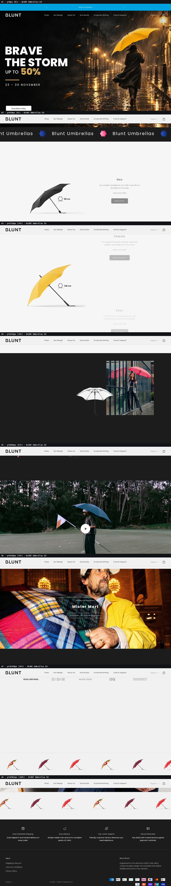
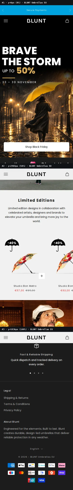

# UI Design System & Master Generation Blueprint: bluntumbrellas-com

> **BLUNT Umbrellas · Built to Resist Every Weather** (https://bluntumbrellas.com) — Discover Blunt Umbrellas: premium stormproof umbrellas designed to withstand extreme weather. Innovative design, superior durability, and...





---

## 1. Executive Visual Persona & Design Archetype

- **Brand Essence & Persona**: **BLUNT Umbrellas · Built to Resist Every Weather** (`https://bluntumbrellas.com`). Discover Blunt Umbrellas: premium stormproof umbrellas designed to withstand extreme weather. Innovative design, superior durability, and...
- **Final Redirected URL**: [https://bluntumbrellas.eu/](https://bluntumbrellas.eu/)
- **Capture Provenance**: Live browser capture (`tier1_fast`, HTTP `200`, captured `2026-11-24`).
- **Visual Archetype**: **Light-Substrate Editorial & Modular Grid System (`#f1f1f1` canvas, `#1c1c1c` ink, `#ffc700` accent)**.
- **Anti-AI-Slop Differentiators**:
  - **Live-Computed Chromatic Polarity**: Anchors the viewport in `#f1f1f1` (live computed `body` `background-color` (`computed_styles.json`)) paired with `#1c1c1c` primary typography and `#ffc700` accents.
  - **Grounded Typographic Hierarchy**: Uses `Poppins` across display (`BLUNT Umbrellas EU`) and body copy.
  - **Calibrated Spatial Grid & Motion**: Combines `1600px` container bounds (`gap: 10px 40px`, padding `16px`) with `cubic-bezier(.4,0,.2,1)` easing and GSAP Timeline & ScrollTrigger, Swiper Touch Carousel Engine.

---

## 2. Spatial Architecture & Modular Grid Mathematics

### Viewport Allocation & Container Geometry
- **Captured Journey Filmstrips**: Desktop `1280×6624px` (`assets/desktop-journey.webp`, `8` keyframes up to `y=10802px` / doc `11748px`), Mobile `390×2616px` (`assets/mobile-journey.webp`, `3` keyframes).
- **Master Container Bounds**: `1600px` (non-`@media` desktop container stylesheet rule).
- **Canvas Lateral Padding & Spacing**: `16px` lateral canvas padding with `10px 40px` grid gap.
- **Border Radius Scale**: `0px`, `5px`, `34px`, `50%`.

### Responsive Breakpoint Architecture
- **Desktop Layout**: Multi-column CSS Grid / Flexbox layout at `1440px` (`max-width: 1600px`, `gap: 10px 40px`).
- **Mobile Layout**: Single-column vertical stack at `390px` viewport width with `16px` horizontal padding.
- **Extracted CSS Media Queries**: `@media (max-width:991.98px)`, `@media (max-width:767.98px)`, `@media (max-width:767.98px)and (max-width:767.98px)`, `@media (min-width:900px)`.

---

## 3. Color System, Materiality & Atmospheric Lighting

### Semantic Palette & Source Grounding
| Semantic Role | Ground-Truth Value | Extracted Live / CSS Source |
|---|---|---|
| **Primary Canvas Substrate** | `#f1f1f1` | live computed `body` `background-color` (`computed_styles.json`) |
| **Primary Typography Ink** | `#1c1c1c` | live computed `main` `color` (`computed_styles.json`) |
| **Elevated Surface / Card Substrate** | `#ffffff` | `var(--bundle-component-background)` in `:root` |
| **Interactive Accent / Highlight** | `#ffc700` | `oduct-review .question-form .ra... { color: #ffc700 }` |
| **Secondary / Muted Copy** | `#7b7b7b` | `var(--jdgm-snippet-lighter-text-color)` in `:root` |
| **Structural Hairline Border** | `#cccccc` | `var(--bundle-option-border-color)` in `:root` |

### Sanitized Root CSS Variables (`ui-ux.md` Ground Truth)
| Variable Name | Extracted Value | Semantic Role |
|---|---|---|
| `--container-max-width` | `100%` | Layout / Spatial Grid Token |
| `--container-xxs-max-width` | `27.5rem` | Layout / Spatial Grid Token |
| `--container-xs-max-width` | `42.5rem` | Layout / Spatial Grid Token |
| `--container-sm-max-width` | `61.25rem` | Layout / Spatial Grid Token |
| `--container-md-max-width` | `71.875rem` | Layout / Spatial Grid Token |
| `--container-lg-max-width` | `78.75rem` | Layout / Spatial Grid Token |
| `--container-xl-max-width` | `85rem` | Layout / Spatial Grid Token |
| `--container-gutter` | `1.25rem` | Layout / Spatial Grid Token |
| `--section-vertical-spacing` | `2.5rem` | Layout / Spatial Grid Token |
| `--section-vertical-spacing-tight` | `2.5rem` | Layout / Spatial Grid Token |
| `--section-stack-gap` | `2.25rem` | Layout / Spatial Grid Token |
| `--section-stack-gap-tight` | `2.25rem` | Layout / Spatial Grid Token |
| `--form-gap` | `1.25rem` | Layout / Spatial Grid Token |
| `--fieldset-gap` | `1rem` | Layout / Spatial Grid Token |
| `--form-control-gap` | `0.625rem` | Layout / Spatial Grid Token |
| `--checkbox-control-gap` | `0.75rem` | Layout / Spatial Grid Token |

---

## 4. Typographic Scale & Editorial Hierarchy

### Font Family Stacks
- **Display Typography**: `Poppins`.
- **Primary Body Stack**: `Poppins`.
- **Technical / Metadata Stack**: not declared in live computed styles (uses primary stack / `ui-monospace`).

### Typographic Scale & Rules (Live Computed & Stylesheet Grounded)
- **Hero Display (`H1`)**: live computed `h1` (`font-size: 28px`, `line-height: 46.2px`, `font-weight: 700`); CSS variables `--loyalty-shimmer-display: none`, `--x-shell-disclosure-display: block`, `--x-shell-order-summary-display: none`; rule `,.h1` (`font-size: 140px`, `line-height: .99em`, `font-weight: 600`).
- **Section Heading (`H2`)**: live computed `h2` (`font-size: 28px`, `line-height: 39.2px`, `font-weight: 400`, `letter-spacing: 2.8px`); CSS variables `--loyalty-banner-subtitle-size: 14px`; rule `,.h2` (`font-size: 95px`, `line-height: .95em`, `font-weight: 600`).
- **Body Copy**: live computed `body` (`font-size: 14px`, `line-height: 23.1px`, `font-weight: 400`); CSS variables `--text-base: 0.875rem`, `--paragraph-font-size: 16px`, `--paragraph-font-weight: 400`; rule `p` (`font-size: 13px`, `line-height: 17px`).
- **Metadata & Navigation Labels**: live computed `nav/a` (`font-size: 14px`, `line-height: 23.1px`, `font-weight: 400`); CSS variables `--heading-letter-spacing: 0.1em`, `--text-letter-spacing: 0.0em`, `--button-letter-spacing: 0.18em`.

---

## 5. Choreographed Motion & Interaction Physics

### Primary Easing Curves
- **Extracted Timing Functions**: `cubic-bezier(.4,0,.2,1)`, `cubic-bezier(.785,.135,.15,.86)`, `cubic-bezier(.4,0,.22,1)`.

### Per-Element Transition & Choreography Rules
- **Selector `.button`**: `transition: all .3s ease` extracted from `bluntumbrellas-com` stylesheet.
- **Selector `.underline-link`**: `transition: all .3s ease` extracted from `bluntumbrellas-com` stylesheet.
- **Selector `.underline-link:after`**: `transition: all .3s ease` extracted from `bluntumbrellas-com` stylesheet.
- **Extracted Easing Curve (`cubic-bezier(.4,0,.2,1)`)**: Governs interactive state transitions across `<header.jdgm-settings-script>` and `<section.shopify-section--scrolling-content>`.
- **Runtime Interaction Engine**: Integrates GSAP Timeline & ScrollTrigger, Swiper Touch Carousel Engine with `prefers-reduced-motion: reduce` fallback guards.
### Measured Runtime Scroll & Interaction Telemetry (`behavioral_journey_v2`)
- **Scroll Driver Mode**: `native` (max document height `11748px`, deepest scrollY reached `10802px` across `8` desktop keyframes).
- **Detected Scroll / Motion Libraries**: Native browser scroll / standard CSS transitions.
- **Hover Physics (`primary_cta` · `BLUNT Umbrellas EU`)**: `color`: `rgb(255, 255, 255)` -> `rgb(28, 28, 28)`; `borderColor`: `rgba(0, 0, 0, 0)` -> `rgb(209, 209, 209)` (`transition-duration: 0s`, `timing: ease`).
- **Interactive Control Probe (`accordion` · `Change language`)**: Triggered visual diff `5.875` (attr `false -> true`, captured in `assets/state-interactive.webp`).
- **Route Transition Architecture**: First internal navigation (`/pages/all-collections`) measured as `direct` in `1481ms`.

---

## 6. Component Wireframe & Structural DOM Map

### Visual Layout Schematic — Desktop (`1440px`, Grounded in `dom.html` & Landmark Bounding Boxes)
```
┌────────────────────────────────────────────────────────────────────────┐
│ DESKTOP VIEWPORT (1440px) — BLUNT Umbrellas · Built to Resist Every We │
│ ====================================================================== │
│ [ <header.jdgm-settings- (1440x75px)  | Regular Models · Limited Edi ] │
│ ---------------------------------------------------------------------- │
│ | HERO STAGE: <section.shopify-section> (w=1440px)                   | │
│ | H1: BLUNT Umbrellas EU                                             | │
│ | Substrate: #f1f1f1 | Ink: #1c1c1c | Accent: #ffc700                | │
│ ---------------------------------------------------------------------- │
│ | SHOWCASE GRID (<section.shopify-section--) max-w: 1600px           | │
│ | +------------------------------+  +------------------------------+ | │
│ | | What others say about Blunt  |  | Your trusted sidekick. Compa | | │
│ | +------------------------------+  +------------------------------+ | │
│ ---------------------------------------------------------------------- │
│ | DETAIL MODULE (<section.shopify-section:n) — The original full len | │
│ ---------------------------------------------------------------------- │
│ [ FOOTER (<footer.analytics>  ) | https://bluntumbrellas.com           │
└────────────────────────────────────────────────────────────────────────┘
```

### Visual Layout Schematic — Mobile Reflow (`390px`)
```
┌────────────────────────────────────────────────────────────────────────┐
│ MOBILE VIEWPORT REFLOW (390px) — Single-Column Stack (gap: 10px 40p)   │
│ ====================================================================== │
│ [ HEADER BAR (<header.jdgm-settings-sc) | Compact Menu (390px)         │
│ ---------------------------------------------------------------------- │
│ | HERO STAGE (<section.shopify-section) — 390px Vertical Lead        | │
│ | H1: BLUNT Umbrellas EU                                             | │
│ ---------------------------------------------------------------------- │
│ | SHOWCASE STACK (<section.shopify-secti) — 1-Col Stack              | │
│ | [ Item 1: What others say about Blunt                            ] | │
│ | [ Item 2: Your trusted sidekick. Compact, collapsible and        ] | │
│ ---------------------------------------------------------------------- │
│ | DETAIL STACK (<section.shopify-section) — 1-Col (The original full ) │
│ ---------------------------------------------------------------------- │
│ [ FOOTER (<footer.analytics>  ) | Stacked 390px Colophon               │
└────────────────────────────────────────────────────────────────────────┘
```

### Granular DOM Region Breakdown
1. **Brand Header & Navigation Bar (<header.jdgm-settings-script> — `bluntumbrellas-com`)**:
   - Landmark `<header class="jdgm-settings-script">` (`1440x75px`) hosting `BLUNT Umbrellas · Built to Resist Ev` navigation (`Regular Models · Limited Editions · UV Umbrellas · All Umbrellas · Our Design`), DOM attributes (`data-source-attribution="shopify.exit_intersti..."`, `data-source-attribution="shopify.loadfeatures"`, `data-source-attribution="shopify.dynamic_check..."`, `data-source-attribution="shopify.dynamic_check..."`), and stylesheet rule `html { line-height:1.15;-webkit-text-size-adjust:100% }`.
2. **Hero Stage & Focal Lead (<section.shopify-section> — `BLUNT Umbrellas EU`)**:
   - Landmark `<section class="shopify-section shopify-section--neo-hero">` presenting display lead `BLUNT Umbrellas EU` and copy excerpt *"Our smallest and lightest yet. Folds to just 26 cm and slips into"* over `#f1f1f1` canvas and `#1c1c1c` ink.
3. **Primary Showcase & Content Grid (<section.shopify-section--scrolling-content> — `What others say about Blunt`)**:
   - Landmark `<section class="shopify-section shopify-section--scrolling-content">` rendering section `What others say about Blunt` with copy *"Your trusted sidekick. Compact, collapsible and convenient for li"*, asset references (`blunt_favicon.png`, `fonts.shopifycdn.com`, `poppins_n4.0ba78fa5af9b0e1a374041...`, `es-modules-shim.2.4.0.js`), and grid rule `main { display:block }`.
4. **Interactive Detail & Feature Matrix (<section.shopify-section:nth(2)> — `Your trusted sidekick. Compact, co`)**:
   - Landmark `<section class="shopify-section">` framing `Your trusted sidekick. Compact, collapsible and ` and `The original full length umbrella, inspired by t` (*"The original full length umbrella, inspired by tradition and desi"*) with `#ffffff` surface cards, `#ffc700` accents, and `pre { font-family:monospace,monospace;font-size:1em }`.
5. **Colophon & Global Directory Footer (<footer.analytics> — `https://bluntumbrellas.com`)**:
   - Landmark `<footer class="analytics">` anchoring `BLUNT Umbrellas · Built to Resis` footer links (`Regular Models · Limited Editions · UV Umbrellas · All Umbrellas · Our Design`), copy *"In the business of keeping you dry with relentless performan"*, and `#cccccc` structural dividers.
### Full Vertical Scroll Sequence (Desktop `1440×900` Keyframes)
- **Step 01** (`y=0px`, `0%`): Active landmark `BLUNT Umbrellas EU` · sticky/fixed elements: `1`
- **Step 02** (`y=850px`, `8%`): Active landmark `BLUNT Umbrellas EU` · sticky/fixed elements: `1`
- **Step 03** (`y=2550px`, `24%`): Active landmark `BLUNT Umbrellas EU` · sticky/fixed elements: `1`
- **Step 04** (`y=4250px`, `39%`): Active landmark `BLUNT Umbrellas EU` · sticky/fixed elements: `1`
- **Step 05** (`y=6800px`, `63%`): Active landmark `BLUNT Umbrellas EU` · sticky/fixed elements: `1`
- **Step 06** (`y=8500px`, `79%`): Active landmark `BLUNT Umbrellas EU` · sticky/fixed elements: `1`
- **Step 07** (`y=10200px`, `94%`): Active landmark `BLUNT Umbrellas EU` · sticky/fixed elements: `1`
- **Step 08** (`y=10802px`, `100%`): Active landmark `BLUNT Umbrellas EU` · sticky/fixed elements: `1`

### Multi-Page Internal Route Map
- **Detail Route (`/pages/all-collections`)**: `https://bluntumbrellas.eu/pages/all-collections` — H1: `All Collections`, scrollHeight `7130px`, transition `direct` (`1481ms`)
- **Detail Route (`/collections/limited-editions`)**: `https://bluntumbrellas.eu/collections/limited-editions` — H1: `Limited Editions`, scrollHeight `7706px`, transition `direct` (`2366ms`)
- **Detail Route (`/collections/uv-umbrellas`)**: `https://bluntumbrellas.eu/collections/uv-umbrellas` — H1: `UV Umbrellas`, scrollHeight `4349px`, transition `direct` (`1246ms`)

---

## 7. Master Zero-Shot AI Generation Prompt

```markdown
# Master Zero-Shot Frontend Generation Prompt: bluntumbrellas-com (BLUNT Umbrellas · Built to Resist Every Weather)

You are a principal frontend architect and design systems engineer. Build a complete, production-ready web application replicating the exact design system, DOM landmarks, typographic hierarchy, color tokens, and motion physics of `bluntumbrellas-com` (**BLUNT Umbrellas · Built to Resist Every Weather** — `https://bluntumbrellas.com`).

### 1. Visual Archetype & Anti-AI-Slop Mandates
- **Archetype**: Light-Substrate Editorial & Modular Grid System (`#f1f1f1` canvas, `#1c1c1c` ink, `#ffc700` accent).
- **Identity & Domain Context**: Discover Blunt Umbrellas: premium stormproof umbrellas designed to withstand extreme weather. Innovative design, superior durability, and...
- **Primary Substrate**: `#f1f1f1` (live computed `body` `background-color` (`computed_styles.json`)), **Primary Ink**: `#1c1c1c`, **Accent / Highlight**: `#ffc700`.
- **Site-Specific Differentiators**:
  - **Live-Computed Chromatic Polarity**: Anchors the viewport in `#f1f1f1` (live computed `body` `background-color` (`computed_styles.json`)) paired with `#1c1c1c` primary typography and `#ffc700` accents.
  - **Grounded Typographic Hierarchy**: Uses `Poppins` across display (`BLUNT Umbrellas EU`) and body copy.
  - **Calibrated Spatial Grid & Motion**: Combines `1600px` container bounds (`gap: 10px 40px`, padding `16px`) with `cubic-bezier(.4,0,.2,1)` easing and GSAP Timeline & ScrollTrigger, Swiper Touch Carousel Engine.

### 2. Ground-Truth CSS Variables (`:root` Token Contract)
Declare and consume these exact custom properties extracted from `bluntumbrellas-com` in your global stylesheet:

:root {
  /* BLUNT Umbrellas · Built to Resist Every Weather (bluntumbrellas-com) — Live-Grounded CSS Variables */
  --container-max-width: 100%; /* Layout / Spatial Grid Token (bluntumbrellas-com) */
  --container-xxs-max-width: 27.5rem; /* Layout / Spatial Grid Token (bluntumbrellas-com) */
  --container-xs-max-width: 42.5rem; /* Layout / Spatial Grid Token (bluntumbrellas-com) */
  --container-sm-max-width: 61.25rem; /* Layout / Spatial Grid Token (bluntumbrellas-com) */
  --container-md-max-width: 71.875rem; /* Layout / Spatial Grid Token (bluntumbrellas-com) */
  --container-lg-max-width: 78.75rem; /* Layout / Spatial Grid Token (bluntumbrellas-com) */
  --container-xl-max-width: 85rem; /* Layout / Spatial Grid Token (bluntumbrellas-com) */
  --container-gutter: 1.25rem; /* Layout / Spatial Grid Token (bluntumbrellas-com) */
  --section-vertical-spacing: 2.5rem; /* Layout / Spatial Grid Token (bluntumbrellas-com) */
  --section-vertical-spacing-tight: 2.5rem; /* Layout / Spatial Grid Token (bluntumbrellas-com) */
  --section-stack-gap: 2.25rem; /* Layout / Spatial Grid Token (bluntumbrellas-com) */
  --section-stack-gap-tight: 2.25rem; /* Layout / Spatial Grid Token (bluntumbrellas-com) */
  --form-gap: 1.25rem; /* Layout / Spatial Grid Token (bluntumbrellas-com) */
  --fieldset-gap: 1rem; /* Layout / Spatial Grid Token (bluntumbrellas-com) */
  --form-control-gap: 0.625rem; /* Layout / Spatial Grid Token (bluntumbrellas-com) */
  --checkbox-control-gap: 0.75rem; /* Layout / Spatial Grid Token (bluntumbrellas-com) */
}

### 3. Semantic Color & Materiality Contract
Map every surface, ink, and border strictly to these source-grounded tokens:
- **Primary Canvas Substrate**: `#f1f1f1` — grounded in live computed `body` `background-color` (`computed_styles.json`)
- **Primary Typography Ink**: `#1c1c1c` — grounded in live computed `main` `color` (`computed_styles.json`)
- **Elevated Surface / Card Substrate**: `#ffffff` — grounded in `var(--bundle-component-background)` in `:root`
- **Interactive Accent / Highlight**: `#ffc700` — grounded in `oduct-review .question-form .ra... { color: #ffc700 }`
- **Secondary / Muted Copy**: `#7b7b7b` — grounded in `var(--jdgm-snippet-lighter-text-color)` in `:root`
- **Structural Hairline Border**: `#cccccc` — grounded in `var(--bundle-option-border-color)` in `:root`

### 4. Spatial Grid, Container Bounds & Responsive Breakpoints
- **Desktop Viewport Reference**: `1280×6624px` (multi-frame vertical journey filmstrip (6624px), `1440px` standard desktop width).
- **Mobile Viewport Reference**: `390×2616px` (multi-frame vertical journey filmstrip (2616px), `390px` standard mobile width).
- **Container Max-Width**: `1600px` (non-`@media` desktop container stylesheet rule)
- **Padding & Gutters**: `16px` lateral canvas padding with `10px 40px` grid gap
- **Desktop Grid**: Multi-column CSS Grid / Flexbox layout at `1440px` (`max-width: 1600px`, `gap: 10px 40px`)
- **Mobile Adaptation**: Single-column vertical stack at `390px` viewport width with `16px` horizontal padding
- **Media Queries**: `@media (max-width:991.98px)`, `@media (max-width:767.98px)`, `@media (max-width:767.98px)and (max-width:767.98px)`, `@media (min-width:900px)`
- **Corner Radii**: `0px`, `5px`, `34px`, `50%`

### 5. Typography & Editorial Scale Contract
- **Display Font Stack**: `Poppins`
- **Body Font Stack**: `Poppins`
- **Monospace / Technical Font Stack**: not declared in live computed styles (uses primary stack / `ui-monospace`)
- **H1 Display Rule**: live computed `h1` (`font-size: 28px`, `line-height: 46.2px`, `font-weight: 700`); CSS variables `--loyalty-shimmer-display: none`, `--x-shell-disclosure-display: block`, `--x-shell-order-summary-display: none`; rule `,.h1` (`font-size: 140px`, `line-height: .99em`, `font-weight: 600`)
- **H2 Section Rule**: live computed `h2` (`font-size: 28px`, `line-height: 39.2px`, `font-weight: 400`, `letter-spacing: 2.8px`); CSS variables `--loyalty-banner-subtitle-size: 14px`; rule `,.h2` (`font-size: 95px`, `line-height: .95em`, `font-weight: 600`)
- **Body Copy Rule**: live computed `body` (`font-size: 14px`, `line-height: 23.1px`, `font-weight: 400`); CSS variables `--text-base: 0.875rem`, `--paragraph-font-size: 16px`, `--paragraph-font-weight: 400`; rule `p` (`font-size: 13px`, `line-height: 17px`)
- **Metadata & Index Rule**: live computed `nav/a` (`font-size: 14px`, `line-height: 23.1px`, `font-weight: 400`); CSS variables `--heading-letter-spacing: 0.1em`, `--text-letter-spacing: 0.0em`, `--button-letter-spacing: 0.18em`

### 6. Component Hierarchy, Verbatim Copy & Real DOM Landmarks
Scaffold `bluntumbrellas-com` (`BLUNT Umbrellas · Built to Resist Every Weather`) with these exact structural regions, extracted copy, and CSS rules from `dom.html`:
1. **Brand Header & Navigation Bar (<header.jdgm-settings-script> — `bluntumbrellas-com`)**:
   - DOM & Selectors: Landmark `<header class="jdgm-settings-script">` (`1440x75px`) hosting `BLUNT Umbrellas · Built to Resist Ev` navigation (`Regular Models · Limited Editions · UV Umbrellas · All Umbrellas · Our Design`), DOM attributes (`data-source-attribution="shopify.exit_intersti..."`, `data-source-attribution="shopify.loadfeatures"`, `data-source-attribution="shopify.dynamic_check..."`, `data-source-attribution="shopify.dynamic_check..."`), and stylesheet rule `html { line-height:1.15;-webkit-text-size-adjust:100% }`.
   - Responsive Contract: Header `Brand Header & Navigation Bar (<header.jdgm-settings-script> — `bluntumbrellas-com`)` (`bluntumbrellas-com`) adapts across `@media (max-width:991.98px)`, `@media (max-width:767.98px)`, `@media (max-width:767.98px)and (max-width:767.98px)`, `@media (min-width:900px)` with `cubic-bezier(.4,0,.2,1)`, `cubic-bezier(.785,.135,.15,.86)`, `cubic-bezier(.4,0,.22,1)` transitions and links `Regular Models · Limited Editions · UV Umbrellas · All Umbrellas · Our Design`.
2. **Hero Stage & Focal Lead (<section.shopify-section> — `BLUNT Umbrellas EU`)**:
   - DOM & Selectors: Landmark `<section class="shopify-section shopify-section--neo-hero">` presenting display lead `BLUNT Umbrellas EU` and copy excerpt *"Our smallest and lightest yet. Folds to just 26 cm and slips into"* over `#f1f1f1` canvas and `#1c1c1c` ink.
   - Responsive Contract: Hero stage (`1280×6624px` desktop / `390×2616px` mobile) sets `#f1f1f1` background with `#1c1c1c` headline `BLUNT Umbrellas EU`.
3. **Primary Showcase & Content Grid (<section.shopify-section--scrolling-content> — `What others say about Blunt`)**:
   - DOM & Selectors: Landmark `<section class="shopify-section shopify-section--scrolling-content">` rendering section `What others say about Blunt` with copy *"Your trusted sidekick. Compact, collapsible and convenient for li"*, asset references (`blunt_favicon.png`, `fonts.shopifycdn.com`, `poppins_n4.0ba78fa5af9b0e1a374041...`, `es-modules-shim.2.4.0.js`), and grid rule `main { display:block }`.
   - Responsive Contract: Showcase grid `Primary Showcase & Content Grid (<section.shopify-section--scrolling-content> — `What others say about Blunt`)` applies Multi-column CSS Grid / Flexbox layout at `1440px` (`max-width: 1600px`, `gap: 10px 40px`) on desktop and Single-column vertical stack at `390px` viewport width with `16px` horizontal padding on mobile.
4. **Interactive Detail & Feature Matrix (<section.shopify-section:nth(2)> — `Your trusted sidekick. Compact, co`)**:
   - DOM & Selectors: Landmark `<section class="shopify-section">` framing `Your trusted sidekick. Compact, collapsible and ` and `The original full length umbrella, inspired by t` (*"The original full length umbrella, inspired by tradition and desi"*) with `#ffffff` surface cards, `#ffc700` accents, and `pre { font-family:monospace,monospace;font-size:1em }`.
   - Responsive Contract: Detail module `Interactive Detail & Feature Matrix (<section.shopify-section:nth(2)> — `Your trusted sidekick. Compact, co`)` uses `0px`, `5px`, `34px`, `50%` radii, `#ffc700` highlights, and assets (blunt_favicon.png, fonts.shopifycdn.com, poppins_n4.0ba78fa5af9b0e1a374041...).
5. **Colophon & Global Directory Footer (<footer.analytics> — `https://bluntumbrellas.com`)**:
   - DOM & Selectors: Landmark `<footer class="analytics">` anchoring `BLUNT Umbrellas · Built to Resis` footer links (`Regular Models · Limited Editions · UV Umbrellas · All Umbrellas · Our Design`), copy *"In the business of keeping you dry with relentless performan"*, and `#cccccc` structural dividers.
   - Responsive Contract: Footer `Colophon & Global Directory Footer (<footer.analytics> — `https://bluntumbrellas.com`)` aligns to `1600px` (non-`@media` desktop container stylesheet rule) with `16px` lateral canvas padding with `10px 40px` grid gap and attributes (data-source-attribution="shopify.exit_intersti...", data-source-attribution="shopify.loadfeatures", data-source-attribution="shopify.dynamic_check...").

#### Verbatim DOM Copy Excerpts (`dom.html`)
- Copy Excerpt 1: *"Our smallest and lightest yet. Folds to just 26 cm and slips into any bag."*
- Copy Excerpt 2: *"Your trusted sidekick. Compact, collapsible and convenient for life on the go."*
- Copy Excerpt 3: *"The original full length umbrella, inspired by tradition and designed for the future."*
- Copy Excerpt 4: *"In the business of keeping you dry with relentless performance and reliability."*

### 7. Motion, Extracted Stylesheet Rules & Interaction Choreography
- **Primary Easing Functions**: `cubic-bezier(.4,0,.2,1)`, `cubic-bezier(.785,.135,.15,.86)`, `cubic-bezier(.4,0,.22,1)`
- **Extracted Stylesheet Rules (`bluntumbrellas-com`)**:
- `html { line-height:1.15;-webkit-text-size-adjust:100% }`
- `main { display:block }`
- `pre { font-family:monospace,monospace;font-size:1em }`
- `strong { font-weight:bolder }`
- `samp { font-family:monospace,monospace;font-size:1em }`
- **Per-Selector Transition Rules**:
- **Selector `.button`**: `transition: all .3s ease` extracted from `bluntumbrellas-com` stylesheet.
- **Selector `.underline-link`**: `transition: all .3s ease` extracted from `bluntumbrellas-com` stylesheet.
- **Selector `.underline-link:after`**: `transition: all .3s ease` extracted from `bluntumbrellas-com` stylesheet.
- **Extracted Easing Curve (`cubic-bezier(.4,0,.2,1)`)**: Governs interactive state transitions across `<header.jdgm-settings-script>` and `<section.shopify-section--scrolling-content>`.
- **Runtime Interaction Engine**: Integrates GSAP Timeline & ScrollTrigger, Swiper Touch Carousel Engine with `prefers-reduced-motion: reduce` fallback guards.
### 7b. Full-Page Scroll Choreography, Interactive States & Multi-Page Routes
- **Scroll Mechanics**: Implement `native` vertical progression up to `11748px` across 8 distinct viewport chapters.
- **Vertical Chapter Sequence**: BLUNT Umbrellas EU (0%) -> BLUNT Umbrellas EU (8%) -> BLUNT Umbrellas EU (24%) -> BLUNT Umbrellas EU (39%) -> BLUNT Umbrellas EU (63%) -> BLUNT Umbrellas EU (79%) -> BLUNT Umbrellas EU (94%) -> BLUNT Umbrellas EU (100%).
- **Hover Micro-Interaction (`primary_cta`)**: Animate `color, borderColor` with `0s ease`.
- **Multi-Page Routes**: Scaffold internal routes `/pages/all-collections` (detail, direct), `/collections/limited-editions` (detail, direct), `/collections/uv-umbrellas` (detail, direct) sharing the global header/footer shell and design tokens.

### 8. Technical Deliverables
- Implement in Next.js (App Router) with TypeScript and Tailwind CSS consuming the `:root` custom properties defined above for `bluntumbrellas-com`.
- Reproduce both the `1440px` desktop architecture and `390px` mobile breakpoint transitions, preserving semantic HTML5 landmarks (`<header>`, `<nav>`, `<main>`, `<section>`, `<footer>`) and `prefers-reduced-motion` accessibility guards.
```
---

## 8. Full-Page Scroll Journey, Interactive States & Subpage Inventory

### Desktop Scroll Keyframes (`1440×900` WebP)
| Step | Scroll Y | Progress | Active Landmark / Section | Sticky/Fixed | Visual Asset |
| :---: | :---: | :---: | :--- | :---: | :--- |
| `#01` | `0px` | `0%` | BLUNT Umbrellas EU | `1` | [desktop-step-01.webp](assets/desktop-step-01.webp) |
| `#02` | `850px` | `8%` | BLUNT Umbrellas EU | `1` | [desktop-step-02.webp](assets/desktop-step-02.webp) |
| `#03` | `2550px` | `24%` | BLUNT Umbrellas EU | `1` | [desktop-step-03.webp](assets/desktop-step-03.webp) |
| `#04` | `4250px` | `39%` | BLUNT Umbrellas EU | `1` | [desktop-step-04.webp](assets/desktop-step-04.webp) |
| `#05` | `6800px` | `63%` | BLUNT Umbrellas EU | `1` | [desktop-step-05.webp](assets/desktop-step-05.webp) |
| `#06` | `8500px` | `79%` | BLUNT Umbrellas EU | `1` | [desktop-step-06.webp](assets/desktop-step-06.webp) |
| `#07` | `10200px` | `94%` | BLUNT Umbrellas EU | `1` | [desktop-step-07.webp](assets/desktop-step-07.webp) |
| `#08` | `10802px` | `100%` | BLUNT Umbrellas EU | `1` | [desktop-step-08.webp](assets/desktop-step-08.webp) |

### Mobile Condensed Keyframes (`390×844` WebP)
| Step | Scroll Y | Progress | Active Landmark | Visual Asset |
| :---: | :---: | :---: | :--- | :--- |
| `#01` | `0px` | `0%` | BLUNT Umbrellas EU | [mobile-step-01.webp](assets/mobile-step-01.webp) |
| `#02` | `2903px` | `50%` | BLUNT Umbrellas EU | [mobile-step-02.webp](assets/mobile-step-02.webp) |
| `#03` | `5836px` | `100%` | BLUNT Umbrellas EU | [mobile-step-03.webp](assets/mobile-step-03.webp) |

### Interactive UI State Captures (`1440×900` WebP)
| State Type | Trigger / Observation | Visual Asset |
| :--- | :--- | :--- |
| `interactive_control` | Control `accordion` (`Change language`, diff `5.875`) | [state-interactive.webp](assets/state-interactive.webp) |

### Internal Subpage Filmstrips (`1080px` Wide WebP)
| # | Template | Route URL | H1 / Title | Scroll Height | Transition | Filmstrip Asset |
| :-: | :---: | :--- | :--- | :---: | :---: | :--- |
| `1` | `detail` | `https://bluntumbrellas.eu/pages/all-collections` | All Collections | `7130px` | `direct` (`1481ms`) | [subpage-01-pages-all-collections.webp](assets/subpage-01-pages-all-collections.webp) |
| `2` | `detail` | `https://bluntumbrellas.eu/collections/limited-editions` | Limited Editions | `7706px` | `direct` (`2366ms`) | [subpage-02-collections-limited-editions.webp](assets/subpage-02-collections-limited-editions.webp) |
| `3` | `detail` | `https://bluntumbrellas.eu/collections/uv-umbrellas` | UV Umbrellas | `4349px` | `direct` (`1246ms`) | [subpage-03-collections-uv-umbrellas.webp](assets/subpage-03-collections-uv-umbrellas.webp) |

