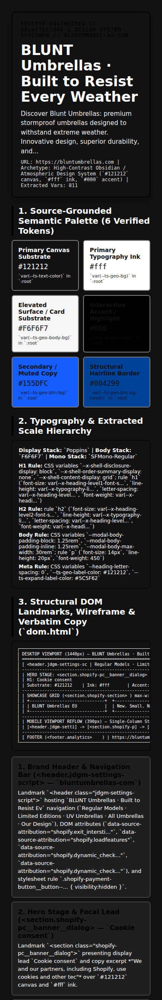

# UI Design System & Master Generation Blueprint: bluntumbrellas-com

> **BLUNT Umbrellas · Built to Resist Every Weather** (https://bluntumbrellas.com) — Discover Blunt Umbrellas: premium stormproof umbrellas designed to withstand extreme weather. Innovative design, superior durability, and...


---

## 1. Executive Visual Persona & Design Archetype

- **Brand Essence & Persona**: **BLUNT Umbrellas · Built to Resist Every Weather** (`https://bluntumbrellas.com`). Discover Blunt Umbrellas: premium stormproof umbrellas designed to withstand extreme weather. Innovative design, superior durability, and...
- **Visual Archetype**: **High-Contrast Obsidian / Atmospheric Design System (`#121212` canvas, `#fff` ink, `#000` accent)**.
- **Anti-AI-Slop Differentiators**:
  - **Source-Grounded Chromatic Polarity**: Anchors the viewport in `#121212` (`var(--ts-text-color)` in `:root`) paired with `#fff` primary typography and `#000` accents.
  - **Extracted Typographic Hierarchy**: Pairs `Poppins` for display copy (`Cookie consent`) with `F6F6F7` and `SFMono-Regular`.
  - **Calibrated Spatial Grid & Motion**: Combines `999px` container bounds (`gap: .625rem`, padding `.65rem`) with `cubic-bezier(.785,.135,.15,.86)` easing.

---

## 2. Spatial Architecture & Modular Grid Mathematics



### Viewport Allocation & Container Geometry
- **Captured Viewport Dimensions**: Desktop `1440×11684px` (`assets/desktop.png`, full-page scroll capture), Mobile `390×2400px` (`assets/mobile.png`, capped at 2400px multi-section capture).
- **Master Container Bounds**: `999px` extracted from `bluntumbrellas-com` stylesheet.
- **Canvas Lateral Padding & Spacing**: `.65rem` lateral canvas padding with `.625rem` grid gap.
- **Border Radius Scale**: `4px`, `var(--button-border-radius)`, `var(--rounded-full)`, `var(--input-border-radius)`.

### Responsive Breakpoint Architecture
- **Desktop Layout**: Multi-column CSS Grid / Flexbox layout at `1440px` (`max-width: 999px`, `gap: .625rem`).
- **Mobile Layout**: Single-column vertical stack at `390px` viewport width with `.65rem` horizontal padding.
- **Extracted CSS Media Queries**: `@media screen and (forced-colors:active)`, `@media screen and (width<=750px)`, `@media screen and (min-width:1000px)`, `@media screen and (min-width:700px)`.

---

## 3. Color System, Materiality & Atmospheric Lighting

### Semantic Palette & Source Grounding
| Semantic Role | Ground-Truth Value | Extracted CSS Source / Selector |
|---|---|---|
| **Primary Canvas Substrate** | `#121212` | `var(--ts-text-color)` in `:root` |
| **Primary Typography Ink** | `#fff` | `var(--ts-geo-bg)` in `:root` |
| **Elevated Surface / Card Substrate** | `#F6F6F7` | `var(--ts-geo-body-bg)` in `:root` |
| **Interactive Accent / Highlight** | `#000` | `var(--ts-geo-icon)` in `:root` |
| **Secondary / Muted Copy** | `#155DFC` | `var(--ts-geo-btn-bg)` in `:root` |
| **Structural Hairline Border** | `#004299` | `var(--ts-geo-btn-bg-hover)` in `:root` |

### Sanitized Root CSS Variables (`ui-ux.md` Ground Truth)
| Variable Name | Extracted Value | Semantic Role |
|---|---|---|
| `--border-color` | `var(--text-color) / .6` | Brand / Palette Token |
| `--blog-post-list-items-per-row` | `1` | Design System Custom Token |
| `--blog-post-list-column-gap` | `1.875rem` | Layout / Spatial Grid Token |
| `--blog-post-list-row-gap` | `var(--section-stack-gap)` | Layout / Spatial Grid Token |
| `--blog-post-list-card-width` | `40vw` | Layout / Spatial Grid Token |
| `--hover-gradient` | `linear-gradient(transparent, transparent)` | Design System Custom Token |
| `--initial-background-position` | `var(--transform-origin-end)` | Canvas / Surface Token |
| `--hover-background-position` | `var(--transform-origin-start)` | Canvas / Surface Token |
| `--initial-gradient` | `linear-gradient(transparent, transparent)` | Design System Custom Token |
| `--circle-button-size` | `2.75rem` | Layout / Spatial Grid Token |
| `--content-over-media-gap` | `1.25rem` | Layout / Spatial Grid Token |
| `--content-over-media-calculated-row-gap` | `var(--content-over-media-row-gap, var(--content-over-media-gap))` | Layout / Spatial Grid Token |
| `--content-over-media-calculated-column-gap` | `var(--content-over-media-column-gap, var(--content-over-media-gap))` | Layout / Spatial Grid Token |
| `--content-over-media-height` | `clamp(15rem, 65vw, 25rem)` | Layout / Spatial Grid Token |
| `--dot-size` | `.375rem` | Layout / Spatial Grid Token |
| `--floating-controls-inset-inline` | `1.5rem` | Dimension / Scale Token |

---

## 4. Typographic Scale & Editorial Hierarchy

### Font Family Stacks
- **Display Typography**: `Poppins`.
- **Primary Body Stack**: `F6F6F7`.
- **Technical / Metadata Stack**: `SFMono-Regular`.

### Typographic Scale & Rules (Extracted from Stylesheet & Variables)
- **Hero Display (`H1`)**: CSS variables `--x-shell-disclosure-display: block`, `--x-shell-order-summary-display: none`, `--x-shell-content-display: grid`; rule `h1` (`font-size: var(--x-heading-level1-font-s...`, `line-height: var(--x-typography-li...`, `letter-spacing: var(--x-heading-level...`, `font-weight: var(--x-headi...`).
- **Section Heading (`H2`)**: rule `h2` (`font-size: var(--x-heading-level2-font-s...`, `line-height: var(--x-typography-li...`, `letter-spacing: var(--x-heading-level...`, `font-weight: var(--x-headi...`).
- **Body Copy**: CSS variables `--modal-body-padding-block: 1.25rem`, `--modal-body-padding-inline: 1.25rem`, `--modal-body-max-width: 30rem`; rule `p` (`font-size: 14px`, `line-height: 20px`, `font-weight: 450`).
- **Metadata & Navigation Labels**: CSS variables `--heading-letter-spacing: 0`, `--ts-geo-label-color: #121212`, `--ts-expand-label-color: #5C5F62`.

---

## 5. Choreographed Motion & Interaction Physics

### Primary Easing Curves
- **Extracted Timing Functions**: `cubic-bezier(.785,.135,.15,.86)`, `cubic-bezier(.4,0,.22,1)`, `cubic-bezier(.45,0,.55,1)`.

### Per-Element Transition & Choreography Rules
- **Selector `.shopify-payment-button__button`**: `transition: background .2s ease-in-out` extracted from `bluntumbrellas-com` stylesheet.
- **Selector `.accordion :is(svg)`**: `transition: transform .2s` extracted from `bluntumbrellas-com` stylesheet.
- **Selector `.shopify-payment-button__button--...`**: `transition: background-size .45s cubic-bezier(.785,.135,.15,.86),backgroun...` extracted from `bluntumbrellas-com` stylesheet.
- **Extracted Easing Curve (`cubic-bezier(.785,.135,.15,.86)`)**: Governs interactive state transitions across `<header.jdgm-settings-script>` and `<section.shopify-section>`.
- **State & Hover Choreography**: Opacity and transform transitions on `<section.shopify-pc__banner__dialog>` and `<section.shopify-section>` interactive targets.

---

## 6. Component Wireframe & Structural DOM Map

### Visual Layout Schematic (Grounded in `dom.html` — `1440px` Desktop & `390px` Mobile Reflow)
```
┌────────────────────────────────────────────────────────────────────────┐
│ DESKTOP VIEWPORT (1440px) — BLUNT Umbrellas · Built to Resist Every We │
│ ====================================================================== │
│ [ <header.jdgm-settings-sc | Regular Models · Limited Editions · UV ]  │
│ ---------------------------------------------------------------------- │
│ | HERO STAGE: <section.shopify-pc__banner__dialog>                 |   │
│ | H1: Cookie consent                                               |   │
│ | Substrate: #121212    | Ink: #fff       | Accent: #000           |   │
│ ---------------------------------------------------------------------- │
│ | SHOWCASE GRID (<section.shopify-section> ) max-w: 999px          |   │
│ | +------------------------------+  +------------------------------+ | │
│ | | BLUNT Umbrellas EU           |  | New. Small. Neo.             | | │
│ | +------------------------------+  +------------------------------+ | │
│ ---------------------------------------------------------------------- │
│ | MOBILE VIEWPORT REFLOW (390px) — Single-Column Stack (gap: .625re) | │
│ | [<header.jdgm-setti] -> [<section.shopify-p] -> [<section.shopify-s] │
│ ---------------------------------------------------------------------- │
│ [ FOOTER (<footer.analytics>    ) | https://bluntumbrellas.com         │
└────────────────────────────────────────────────────────────────────────┘
```

### Granular DOM Region Breakdown
1. **Brand Header & Navigation Bar (<header.jdgm-settings-script> — `bluntumbrellas-com`)**:
   - Landmark `<header class="jdgm-settings-script">` hosting `BLUNT Umbrellas · Built to Resist Ev` navigation (`Regular Models · Limited Editions · UV Umbrellas · All Umbrellas · Our Design`), DOM attributes (`data-source-attribution="shopify.exit_intersti..."`, `data-source-attribution="shopify.loadfeatures"`, `data-source-attribution="shopify.dynamic_check..."`, `data-source-attribution="shopify.dynamic_check..."`), and stylesheet rule `.shopify-payment-button__button--... { visibility:hidden }`.
2. **Hero Stage & Focal Lead (<section.shopify-pc__banner__dialog> — `Cookie consent`)**:
   - Landmark `<section class="shopify-pc__banner__dialog">` presenting display lead `Cookie consent` and copy excerpt *"We and our partners, including Shopify, use cookies and other tec"* over `#121212` canvas and `#fff` ink.
3. **Primary Showcase & Content Grid (<section.shopify-section> — `BLUNT Umbrellas EU`)**:
   - Landmark `<section class="shopify-section shopify-section-group-overlay-group">` rendering section `BLUNT Umbrellas EU` with copy *"Manage preferences"*, asset references (`blunt_favicon.png`, `fonts.shopifycdn.com`, `poppins_n4.0ba78fa5af9b0e1a374041...`, `es-modules-shim.2.4.0.js`), and grid rule `opify-payment-button__button--unb... { background-color:1990c6;padding:1em 2em }`.
4. **Interactive Detail & Feature Matrix (<section.shopify-section> — `New. Small. Neo.`)**:
   - Landmark `<section class="shopify-section shopify-section--neo-hero">` framing `New. Small. Neo.` and `What others say about Blunt` (*"Free UPS shipping to Germany & neighbouring countries"*) with `#F6F6F7` surface cards, `#000` accents, and `ptions.shopify-payment-button__sk... { width:50%;margin-left:25%;margin-right:25%;border-radius:4px!important;h... }`.
5. **Colophon & Global Directory Footer (<footer.analytics> — `https://bluntumbrellas.com`)**:
   - Landmark `<footer class="analytics">` anchoring `BLUNT Umbrellas · Built to Resis` footer links (`Regular Models · Limited Editions · UV Umbrellas · All Umbrellas · Our Design`), copy *"BLUNT Umbrellas EU"*, and `#004299` structural dividers.

---

## 7. Master Zero-Shot AI Generation Prompt

```markdown
# Master Zero-Shot Frontend Generation Prompt: bluntumbrellas-com (BLUNT Umbrellas · Built to Resist Every Weather)

You are a principal frontend architect and design systems engineer. Build a complete, production-ready web application replicating the exact design system, DOM landmarks, typographic hierarchy, color tokens, and motion physics of `bluntumbrellas-com` (**BLUNT Umbrellas · Built to Resist Every Weather** — `https://bluntumbrellas.com`).

### 1. Visual Archetype & Anti-AI-Slop Mandates
- **Archetype**: High-Contrast Obsidian / Atmospheric Design System (`#121212` canvas, `#fff` ink, `#000` accent).
- **Identity & Domain Context**: Discover Blunt Umbrellas: premium stormproof umbrellas designed to withstand extreme weather. Innovative design, superior durability, and...
- **Primary Substrate**: `#121212` (`var(--ts-text-color)` in `:root`), **Primary Ink**: `#fff`, **Accent / Highlight**: `#000`.
- **Site-Specific Differentiators**:
  - **Source-Grounded Chromatic Polarity**: Anchors the viewport in `#121212` (`var(--ts-text-color)` in `:root`) paired with `#fff` primary typography and `#000` accents.
  - **Extracted Typographic Hierarchy**: Pairs `Poppins` for display copy (`Cookie consent`) with `F6F6F7` and `SFMono-Regular`.
  - **Calibrated Spatial Grid & Motion**: Combines `999px` container bounds (`gap: .625rem`, padding `.65rem`) with `cubic-bezier(.785,.135,.15,.86)` easing.

### 2. Ground-Truth CSS Variables (`:root` Token Contract)
Declare and consume these exact custom properties extracted from `bluntumbrellas-com` in your global stylesheet:

:root {
  /* BLUNT Umbrellas · Built to Resist Every Weather (bluntumbrellas-com) — Ground-Truth Extracted CSS Variables */
  --border-color: var(--text-color) / .6; /* Brand / Palette Token (bluntumbrellas-com) */
  --blog-post-list-items-per-row: 1; /* Design System Custom Token (bluntumbrellas-com) */
  --blog-post-list-column-gap: 1.875rem; /* Layout / Spatial Grid Token (bluntumbrellas-com) */
  --blog-post-list-row-gap: var(--section-stack-gap); /* Layout / Spatial Grid Token (bluntumbrellas-com) */
  --blog-post-list-card-width: 40vw; /* Layout / Spatial Grid Token (bluntumbrellas-com) */
  --hover-gradient: linear-gradient(transparent, transparent); /* Design System Custom Token (bluntumbrellas-com) */
  --initial-background-position: var(--transform-origin-end); /* Canvas / Surface Token (bluntumbrellas-com) */
  --hover-background-position: var(--transform-origin-start); /* Canvas / Surface Token (bluntumbrellas-com) */
  --initial-gradient: linear-gradient(transparent, transparent); /* Design System Custom Token (bluntumbrellas-com) */
  --circle-button-size: 2.75rem; /* Layout / Spatial Grid Token (bluntumbrellas-com) */
  --content-over-media-gap: 1.25rem; /* Layout / Spatial Grid Token (bluntumbrellas-com) */
  --content-over-media-calculated-row-gap: var(--content-over-media-row-gap, var(--content-over-media-gap)); /* Layout / Spatial Grid Token (bluntumbrellas-com) */
  --content-over-media-calculated-column-gap: var(--content-over-media-column-gap, var(--content-over-media-gap)); /* Layout / Spatial Grid Token (bluntumbrellas-com) */
  --content-over-media-height: clamp(15rem, 65vw, 25rem); /* Layout / Spatial Grid Token (bluntumbrellas-com) */
  --dot-size: .375rem; /* Layout / Spatial Grid Token (bluntumbrellas-com) */
  --floating-controls-inset-inline: 1.5rem; /* Dimension / Scale Token (bluntumbrellas-com) */
}

### 3. Semantic Color & Materiality Contract
Map every surface, ink, and border strictly to these source-grounded tokens:
- **Primary Canvas Substrate**: `#121212` — grounded in `var(--ts-text-color)` in `:root`
- **Primary Typography Ink**: `#fff` — grounded in `var(--ts-geo-bg)` in `:root`
- **Elevated Surface / Card Substrate**: `#F6F6F7` — grounded in `var(--ts-geo-body-bg)` in `:root`
- **Interactive Accent / Highlight**: `#000` — grounded in `var(--ts-geo-icon)` in `:root`
- **Secondary / Muted Copy**: `#155DFC` — grounded in `var(--ts-geo-btn-bg)` in `:root`
- **Structural Hairline Border**: `#004299` — grounded in `var(--ts-geo-btn-bg-hover)` in `:root`

### 4. Spatial Grid, Container Bounds & Responsive Breakpoints
- **Desktop Viewport Reference**: `1440×11684px` (full-page scroll capture, `1440px` standard desktop width).
- **Mobile Viewport Reference**: `390×2400px` (capped at 2400px multi-section capture, `390px` standard mobile width).
- **Container Max-Width**: `999px` extracted from `bluntumbrellas-com` stylesheet
- **Padding & Gutters**: `.65rem` lateral canvas padding with `.625rem` grid gap
- **Desktop Grid**: Multi-column CSS Grid / Flexbox layout at `1440px` (`max-width: 999px`, `gap: .625rem`)
- **Mobile Adaptation**: Single-column vertical stack at `390px` viewport width with `.65rem` horizontal padding
- **Media Queries**: `@media screen and (forced-colors:active)`, `@media screen and (width<=750px)`, `@media screen and (min-width:1000px)`, `@media screen and (min-width:700px)`
- **Corner Radii**: `4px`, `var(--button-border-radius)`, `var(--rounded-full)`, `var(--input-border-radius)`

### 5. Typography & Editorial Scale Contract
- **Display Font Stack**: `Poppins`
- **Body Font Stack**: `F6F6F7`
- **Monospace / Technical Font Stack**: `SFMono-Regular`
- **H1 Display Rule**: CSS variables `--x-shell-disclosure-display: block`, `--x-shell-order-summary-display: none`, `--x-shell-content-display: grid`; rule `h1` (`font-size: var(--x-heading-level1-font-s...`, `line-height: var(--x-typography-li...`, `letter-spacing: var(--x-heading-level...`, `font-weight: var(--x-headi...`)
- **H2 Section Rule**: rule `h2` (`font-size: var(--x-heading-level2-font-s...`, `line-height: var(--x-typography-li...`, `letter-spacing: var(--x-heading-level...`, `font-weight: var(--x-headi...`)
- **Body Copy Rule**: CSS variables `--modal-body-padding-block: 1.25rem`, `--modal-body-padding-inline: 1.25rem`, `--modal-body-max-width: 30rem`; rule `p` (`font-size: 14px`, `line-height: 20px`, `font-weight: 450`)
- **Metadata & Index Rule**: CSS variables `--heading-letter-spacing: 0`, `--ts-geo-label-color: #121212`, `--ts-expand-label-color: #121212`

### 6. Component Hierarchy, Verbatim Copy & Real DOM Landmarks
Scaffold `bluntumbrellas-com` (`BLUNT Umbrellas · Built to Resist Every Weather`) with these exact structural regions, extracted copy, and CSS rules from `dom.html`:
1. **Brand Header & Navigation Bar (<header.jdgm-settings-script> — `bluntumbrellas-com`)**:
   - DOM & Selectors: Landmark `<header class="jdgm-settings-script">` hosting `BLUNT Umbrellas · Built to Resist Ev` navigation (`Regular Models · Limited Editions · UV Umbrellas · All Umbrellas · Our Design`), DOM attributes (`data-source-attribution="shopify.exit_intersti..."`, `data-source-attribution="shopify.loadfeatures"`, `data-source-attribution="shopify.dynamic_check..."`, `data-source-attribution="shopify.dynamic_check..."`), and stylesheet rule `.shopify-payment-button__button--... { visibility:hidden }`.
   - Responsive Contract: Header `Brand Header & Navigation Bar (<header.jdgm-settings-script> — `bluntumbrellas-com`)` (`bluntumbrellas-com`) adapts across `@media screen and (forced-colors:active)`, `@media screen and (width<=750px)`, `@media screen and (min-width:1000px)`, `@media screen and (min-width:700px)` with `cubic-bezier(.785,.135,.15,.86)`, `cubic-bezier(.4,0,.22,1)`, `cubic-bezier(.45,0,.55,1)` transitions and links `Regular Models · Limited Editions · UV Umbrellas · All Umbrellas · Our Design`.
2. **Hero Stage & Focal Lead (<section.shopify-pc__banner__dialog> — `Cookie consent`)**:
   - DOM & Selectors: Landmark `<section class="shopify-pc__banner__dialog">` presenting display lead `Cookie consent` and copy excerpt *"We and our partners, including Shopify, use cookies and other tec"* over `#121212` canvas and `#fff` ink.
   - Responsive Contract: Hero stage (`1440×11684px` desktop / `390×2400px` mobile) sets `#121212` background with `#fff` headline `Cookie consent`.
3. **Primary Showcase & Content Grid (<section.shopify-section> — `BLUNT Umbrellas EU`)**:
   - DOM & Selectors: Landmark `<section class="shopify-section shopify-section-group-overlay-group">` rendering section `BLUNT Umbrellas EU` with copy *"Manage preferences"*, asset references (`blunt_favicon.png`, `fonts.shopifycdn.com`, `poppins_n4.0ba78fa5af9b0e1a374041...`, `es-modules-shim.2.4.0.js`), and grid rule `opify-payment-button__button--unb... { background-color:1990c6;padding:1em 2em }`.
   - Responsive Contract: Showcase grid `Primary Showcase & Content Grid (<section.shopify-section> — `BLUNT Umbrellas EU`)` applies Multi-column CSS Grid / Flexbox layout at `1440px` (`max-width: 999px`, `gap: .625rem`) on desktop and Single-column vertical stack at `390px` viewport width with `.65rem` horizontal padding on mobile.
4. **Interactive Detail & Feature Matrix (<section.shopify-section> — `New. Small. Neo.`)**:
   - DOM & Selectors: Landmark `<section class="shopify-section shopify-section--neo-hero">` framing `New. Small. Neo.` and `What others say about Blunt` (*"Free UPS shipping to Germany & neighbouring countries"*) with `#F6F6F7` surface cards, `#000` accents, and `ptions.shopify-payment-button__sk... { width:50%;margin-left:25%;margin-right:25%;border-radius:4px!important;h... }`.
   - Responsive Contract: Detail module `Interactive Detail & Feature Matrix (<section.shopify-section> — `New. Small. Neo.`)` uses `4px`, `var(--button-border-radius)`, `var(--rounded-full)`, `var(--input-border-radius)` radii, `#000` highlights, and assets (blunt_favicon.png, fonts.shopifycdn.com, poppins_n4.0ba78fa5af9b0e1a374041...).
5. **Colophon & Global Directory Footer (<footer.analytics> — `https://bluntumbrellas.com`)**:
   - DOM & Selectors: Landmark `<footer class="analytics">` anchoring `BLUNT Umbrellas · Built to Resis` footer links (`Regular Models · Limited Editions · UV Umbrellas · All Umbrellas · Our Design`), copy *"BLUNT Umbrellas EU"*, and `#004299` structural dividers.
   - Responsive Contract: Footer `Colophon & Global Directory Footer (<footer.analytics> — `https://bluntumbrellas.com`)` aligns to `999px` extracted from `bluntumbrellas-com` stylesheet with `.65rem` lateral canvas padding with `.625rem` grid gap and attributes (data-source-attribution="shopify.exit_intersti...", data-source-attribution="shopify.loadfeatures", data-source-attribution="shopify.dynamic_check...").

#### Verbatim DOM Copy Excerpts (`dom.html`)
- Copy Excerpt 1: *"We and our partners, including Shopify, use cookies and other technologies to pers..."*
- Copy Excerpt 2: *"Manage preferences"*
- Copy Excerpt 3: *"Free UPS shipping to Germany & neighbouring countries"*
- Copy Excerpt 4: *"BLUNT Umbrellas EU"*

### 7. Motion, Extracted Stylesheet Rules & Interaction Choreography
- **Primary Easing Functions**: `cubic-bezier(.785,.135,.15,.86)`, `cubic-bezier(.4,0,.22,1)`, `cubic-bezier(.45,0,.55,1)`
- **Extracted Stylesheet Rules (`bluntumbrellas-com`)**:
- `.shopify-payment-button__button--... { visibility:hidden }`
- `opify-payment-button__button--unb... { background-color:1990c6;padding:1em 2em }`
- `ptions.shopify-payment-button__sk... { width:50%;margin-left:25%;margin-right:25%;border-radius:4px!important;h... }`
- `shopify-payment-button__button--b... { z-index:1;flex-direction:column;display:flex;position:relative }`
- `on__button--branded .shopify-clea... { flex-direction:column!important;flex:1!important;display:flex!important }`
- **Per-Selector Transition Rules**:
- **Selector `.shopify-payment-button__button`**: `transition: background .2s ease-in-out` extracted from `bluntumbrellas-com` stylesheet.
- **Selector `.accordion :is(svg)`**: `transition: transform .2s` extracted from `bluntumbrellas-com` stylesheet.
- **Selector `.shopify-payment-button__button--...`**: `transition: background-size .45s cubic-bezier(.785,.135,.15,.86),backgroun...` extracted from `bluntumbrellas-com` stylesheet.
- **Extracted Easing Curve (`cubic-bezier(.785,.135,.15,.86)`)**: Governs interactive state transitions across `<header.jdgm-settings-script>` and `<section.shopify-section>`.
- **State & Hover Choreography**: Opacity and transform transitions on `<section.shopify-pc__banner__dialog>` and `<section.shopify-section>` interactive targets.

### 8. Technical Deliverables
- Implement in Next.js (App Router) with TypeScript and Tailwind CSS consuming the `:root` custom properties defined above for `bluntumbrellas-com`.
- Reproduce both the `1440px` desktop architecture and `390px` mobile breakpoint transitions, preserving semantic HTML5 landmarks (`<header>`, `<nav>`, `<main>`, `<section>`, `<footer>`) and `prefers-reduced-motion` accessibility guards.
```
