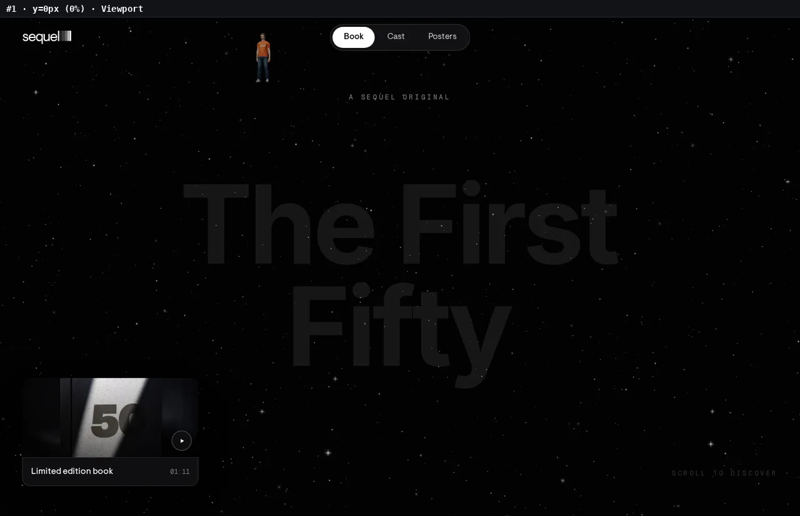
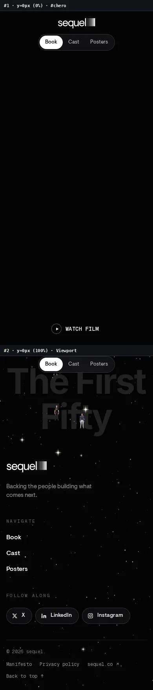

# UI Design System & Master Generation Blueprint: book-sequel-co

> **The First Fifty** (https://book.sequel.co/) — The film can't play in this viewer. Open on desktop





---

## 1. Executive Visual Persona & Design Archetype

- **Brand Essence & Persona**: **The First Fifty** (`https://book.sequel.co/`). The film can't play in this viewer. Open on desktop
- **Capture Provenance**: Live browser capture (`tier1_fast`, HTTP `200`, captured `2026-11-24`).
- **Visual Archetype**: **Dark-Substrate WebGL / Canvas Interactive Experience (`#000000` / `#e6e6e6`)**.
- **Anti-AI-Slop Differentiators**:
  - **Live-Computed Chromatic Polarity**: Anchors the viewport in `#000000` (live computed `canvas-modal-luma` `background-color` (`computed_styles.json`)) paired with `#ffffff` primary typography and `#e6e6e6` accents.
  - **Grounded Typographic Hierarchy**: Pairs `Geist Mono` for display copy (`The First Fifty`) with `Bradford` and `Geist Mono`.
  - **Calibrated Spatial Grid & Motion**: Combines `1440px` container bounds (`gap: 8px`, padding `var(--gutter)`) with `cubic-bezier(.2,.8,.2,1)` easing and GSAP Timeline & ScrollTrigger, Three.js / WebGL Canvas Pipeline.

---

## 2. Spatial Architecture & Modular Grid Mathematics

### Viewport Allocation & Container Geometry
- **Captured Journey Filmstrips**: Desktop `1280×828px` (`assets/desktop-journey.webp`, `1` keyframes up to `y=0px` / doc `900px`), Mobile `390×1744px` (`assets/mobile-journey.webp`, `2` keyframes).
- **Master Container Bounds**: `1440px` (full-bleed `100%` viewport stage).
- **Canvas Lateral Padding & Spacing**: `var(--gutter)` lateral canvas padding with `8px` grid gap.
- **Border Radius Scale**: `6px`, `50%`, `999px`, `4px`.

### Responsive Breakpoint Architecture
- **Desktop Layout**: Multi-column CSS Grid / Flexbox layout at `1440px` (`max-width: 1440px`, `gap: 8px`).
- **Mobile Layout**: Single-column vertical stack at `390px` viewport width with `var(--gutter)` horizontal padding.
- **Extracted CSS Media Queries**: `@media (max-width: 900px)`, `@media (prefers-reduced-motion: reduce)`, `@media (max-width: 560px)`, `@media (max-width: 360px)`.

---

## 3. Color System, Materiality & Atmospheric Lighting

### Semantic Palette & Source Grounding
| Semantic Role | Ground-Truth Value | Extracted Live / CSS Source |
|---|---|---|
| **Primary Canvas Substrate** | `#000000` | live computed `canvas-modal-luma` `background-color` (`computed_styles.json`) |
| **Primary Typography Ink** | `#ffffff` | `var(--ink)` in `:root` |
| **Elevated Surface / Card Substrate** | `#0d0d0d` | `var(--paper)` in `:root` |
| **Interactive Accent / Highlight** | `#e6e6e6` | `.pill .pill-cta:hover { background: #e6e6e6 }` |
| **Secondary / Muted Copy** | `#777777` | `.exh-label .el-no { color: #777777 }` |
| **Structural Hairline Border** | `#333333` | `.bk-rail li { border-left: #333333 }` |
| **Variable Token (`--dark-grey`)** | `#181818` | `var(--dark-grey)` in `:root` |
| **Variable Token (`--mid-grey`)** | `#282828` | `var(--mid-grey)` in `:root` |

### Sanitized Root CSS Variables (`ui-ux.md` Ground Truth)
| Variable Name | Extracted Value | Semantic Role |
|---|---|---|
| `--black` | `#0d0d0d` | Canvas / Surface Token |
| `--dark-grey` | `#181818` | Canvas / Surface Token |
| `--mid-grey` | `#282828` | Color / Atmospheric Token |
| `--white` | `#ffffff` | Canvas / Surface Token |
| `--white-60` | `rgba(255,255,255,.6)` | Canvas / Surface Token |
| `--paper` | `#0d0d0d` | Canvas / Surface Token |
| `--ink` | `#ffffff` | Typography Ink Token |
| `--ink-60` | `rgba(255,255,255,.6)` | Typography Ink Token |
| `--ink-08` | `rgba(255,255,255,.08)` | Typography Ink Token |
| `--sans` | `"VisueltPro", system-ui, sans-serif` | Typography / Scale Token |
| `--mono` | `"Geist Mono", ui-monospace, monospace` | Typography / Scale Token |
| `--display` | `"HD Colton", "VisueltPro", system-ui, sans-serif` | Dimension / Scale Token |
| `--type-display` | `clamp(4rem, 9vw, 7rem)` | Typography / Scale Token |
| `--type-lede` | `1.25rem` | Typography / Scale Token |
| `--type-body` | `1rem` | Typography / Scale Token |
| `--type-label` | `.875rem` | Typography / Scale Token |

---

## 4. Typographic Scale & Editorial Hierarchy

### Font Family Stacks
- **Display Typography**: `Geist Mono`.
- **Primary Body Stack**: `Bradford`.
- **Technical / Metadata Stack**: `Geist Mono`.

### Typographic Scale & Rules (Live Computed & Stylesheet Grounded)
- **Hero Display (`H1`)**: CSS variables `--display: "HD Colton", "VisueltPro", system-ui, sans-serif`, `--type-display: clamp(4rem, 9vw, 7rem)`; rule `h1` (`font-size: clamp(1.75rem, 2.6vw, 2.5rem)`, `line-height: 1.02`, `letter-spacing: -.02em`, `font-weight: 500`).
- **Section Heading (`H2`)**: rule `h2` (`font-size: clamp(2rem, 4.4vw, 3.5rem)`, `line-height: 1`, `letter-spacing: .01em`, `font-weight: 900`).
- **Body Copy**: CSS variables `--type-body: 1rem`; rule `body` (`font-size: var(--type-body)`, `line-height: 1.5`).
- **Metadata & Navigation Labels**: CSS variables `--mono: "Geist Mono", ui-monospace, monospace`, `--type-label: .875rem`, `--type-meta: .8125rem`; rule `small` (`font-size: .5625rem`, `letter-spacing: .14em`).

---

## 5. Choreographed Motion & Interaction Physics

### Primary Easing Curves
- **Extracted Timing Functions**: `cubic-bezier(.2,.8,.2,1)`, `cubic-bezier(.45,0,.2,1)`, `cubic-bezier(.16,1,.3,1)`.

### Per-Element Transition & Choreography Rules
- **Selector `.hero-foot`**: `transition: opacity 1.4s ease .2s` extracted from `book-sequel-co` stylesheet.
- **Selector `.film-thumb img`**: `transition: transform .5s cubic-bezier(.2,.8,.2,1)` extracted from `book-sequel-co` stylesheet.
- **Selector `.film-thumb .play`**: `transition: transform .2s ease-out` extracted from `book-sequel-co` stylesheet.
- **Extracted Easing Curve (`cubic-bezier(.2,.8,.2,1)`)**: Governs interactive state transitions across `<header.hero-top>` and `<section.hero>`.
- **Runtime Interaction Engine**: Integrates GSAP Timeline & ScrollTrigger, Three.js / WebGL Canvas Pipeline with `prefers-reduced-motion: reduce` fallback guards.
### Measured Runtime Scroll & Interaction Telemetry (`behavioral_journey_v2`)
- **Scroll Driver Mode**: `wheel` (max document height `900px`, deepest scrollY reached `0px` across `1` desktop keyframes).
- **Detected Scroll / Motion Libraries**: `WebGL/Canvas`.

---

## 6. Component Wireframe & Structural DOM Map

### Visual Layout Schematic — Desktop (`1440px`, Grounded in `dom.html` & Landmark Bounding Boxes)
```
┌────────────────────────────────────────────────────────────────────────┐
│ DESKTOP VIEWPORT (1440px) — The First Fifty                            │
│ ====================================================================== │
│ [ <header.hero-top> (1440px)          | Book · Cast · Posters        ] │
│ ---------------------------------------------------------------------- │
│ | HERO STAGE: <section.chero> (w=1440px)                             | │
│ | H1: The First Fifty                                                | │
│ | Substrate: #000000 | Ink: #ffffff | Accent: #e6e6e6                | │
│ ---------------------------------------------------------------------- │
│ | SHOWCASE GRID (<section.hero>) max-w: 1440px                       | │
│ | +------------------------------+  +------------------------------+ | │
│ | | The film can't play in this  |  | Limited edition book 01:11   | | │
│ | +------------------------------+  +------------------------------+ | │
│ ---------------------------------------------------------------------- │
│ | DETAIL MODULE (<section.page-home>) — VOLUME I · LIMITED ED        | │
│ ---------------------------------------------------------------------- │
│ [ FOOTER (<footer.sf>         ) | https://book.sequel.co/              │
└────────────────────────────────────────────────────────────────────────┘
```

### Visual Layout Schematic — Mobile Reflow (`390px`)
```
┌────────────────────────────────────────────────────────────────────────┐
│ MOBILE VIEWPORT REFLOW (390px) — Single-Column Stack (gap: 8px)        │
│ ====================================================================== │
│ [ HEADER BAR (<header.hero-top>       ) | Compact Menu (390px)         │
│ ---------------------------------------------------------------------- │
│ | HERO STAGE (<section.chero>) — 390px Vertical Lead                 | │
│ | H1: The First Fifty                                                | │
│ ---------------------------------------------------------------------- │
│ | SHOWCASE STACK (<section.hero>) — 1-Col Stack                      | │
│ | [ Item 1: The film can't play in this viewer. Open on desk       ] | │
│ | [ Item 2: Limited edition book 01:11                             ] | │
│ ---------------------------------------------------------------------- │
│ | DETAIL STACK (<section.page-home>) — 1-Col (VOLUME I · LIMITED)    | │
│ ---------------------------------------------------------------------- │
│ [ FOOTER (<footer.sf>         ) | Stacked 390px Colophon               │
└────────────────────────────────────────────────────────────────────────┘
```

### Granular DOM Region Breakdown
1. **Brand Header & Navigation Bar (<header.hero-top> — `book-sequel-co`)**:
   - Landmark `<header class="hero-top">` (`1440px`) hosting `The First Fifty` navigation (`Book · Cast · Posters`), DOM attributes (`data-page="home"`, `data-page="home"`, `data-page="home"`, `data-page="cast"`), and stylesheet rule `html { scroll-padding-top:env(safe-area-inset-top,0px) }`.
2. **Hero Stage & Focal Lead (<section.chero> — `The First Fifty`)**:
   - Landmark `<section class="chero">` presenting display lead `The First Fifty` and copy excerpt *"The film can't play in this viewer. Open on desktop"* over `#000000` canvas and `#ffffff` ink.
3. **Primary Showcase & Content Grid (<section.hero> — `The film can't play in this viewer`)**:
   - Landmark `<section class="hero">` rendering section `The film can't play in this viewer. Open on desk` with copy *"Limited edition book 01:11"*, asset references (`favicon.png`, `script.js`, `fonts.googleapis.com`, `fonts.gstatic.com`), and grid rule `body { margin:0;padding:0;font:14px -apple-system,BlinkMacSystemFont,sans-serif... }`.
4. **Interactive Detail & Feature Matrix (<section.page-home> — `Limited edition book 01:11`)**:
   - Landmark `<section class="page-home">` framing `Limited edition book 01:11` and `VOLUME I · LIMITED EDITION` (*"VOLUME I · LIMITED EDITION"*) with `#0d0d0d` surface cards, `#e6e6e6` accents, and `img { max-width:100% }`.
5. **Colophon & Global Directory Footer (<footer.sf> — `https://book.sequel.co/`)**:
   - Landmark `<footer class="sf js">` anchoring `The First Fifty` footer links (`Book · Cast · Posters`), copy *"Be first to hear when The First Fifty, the posters and the f"*, and `#333333` structural dividers.
### Full Vertical Scroll Sequence (Desktop `1440×900` Keyframes)
- **Step 01** (`y=0px`, `0%`): Active landmark `Viewport` · sticky/fixed elements: `0`

---

## 7. Master Zero-Shot AI Generation Prompt

```markdown
# Master Zero-Shot Frontend Generation Prompt: book-sequel-co (The First Fifty)

You are a principal frontend architect and design systems engineer. Build a complete, production-ready web application replicating the exact design system, DOM landmarks, typographic hierarchy, color tokens, and motion physics of `book-sequel-co` (**The First Fifty** — `https://book.sequel.co/`).

### 1. Visual Archetype & Anti-AI-Slop Mandates
- **Archetype**: Dark-Substrate WebGL / Canvas Interactive Experience (`#000000` / `#e6e6e6`).
- **Identity & Domain Context**: The film can't play in this viewer. Open on desktop
- **Primary Substrate**: `#000000` (live computed `canvas-modal-luma` `background-color` (`computed_styles.json`)), **Primary Ink**: `#ffffff`, **Accent / Highlight**: `#e6e6e6`.
- **Site-Specific Differentiators**:
  - **Live-Computed Chromatic Polarity**: Anchors the viewport in `#000000` (live computed `canvas-modal-luma` `background-color` (`computed_styles.json`)) paired with `#ffffff` primary typography and `#e6e6e6` accents.
  - **Grounded Typographic Hierarchy**: Pairs `Geist Mono` for display copy (`The First Fifty`) with `Bradford` and `Geist Mono`.
  - **Calibrated Spatial Grid & Motion**: Combines `1440px` container bounds (`gap: 8px`, padding `var(--gutter)`) with `cubic-bezier(.2,.8,.2,1)` easing and GSAP Timeline & ScrollTrigger, Three.js / WebGL Canvas Pipeline.

### 2. Ground-Truth CSS Variables (`:root` Token Contract)
Declare and consume these exact custom properties extracted from `book-sequel-co` in your global stylesheet:

:root {
  /* The First Fifty (book-sequel-co) — Live-Grounded CSS Variables */
  --black: #0d0d0d; /* Canvas / Surface Token (book-sequel-co) */
  --dark-grey: #181818; /* Canvas / Surface Token (book-sequel-co) */
  --mid-grey: #282828; /* Color / Atmospheric Token (book-sequel-co) */
  --white: #ffffff; /* Canvas / Surface Token (book-sequel-co) */
  --white-60: rgba(255,255,255,.6); /* Canvas / Surface Token (book-sequel-co) */
  --paper: #0d0d0d; /* Canvas / Surface Token (book-sequel-co) */
  --ink: #ffffff; /* Typography Ink Token (book-sequel-co) */
  --ink-60: rgba(255,255,255,.6); /* Typography Ink Token (book-sequel-co) */
  --ink-08: rgba(255,255,255,.08); /* Typography Ink Token (book-sequel-co) */
  --sans: "VisueltPro", system-ui, sans-serif; /* Typography / Scale Token (book-sequel-co) */
  --mono: "Geist Mono", ui-monospace, monospace; /* Typography / Scale Token (book-sequel-co) */
  --display: "HD Colton", "VisueltPro", system-ui, sans-serif; /* Dimension / Scale Token (book-sequel-co) */
  --type-display: clamp(4rem, 9vw, 7rem); /* Typography / Scale Token (book-sequel-co) */
  --type-lede: 1.25rem; /* Typography / Scale Token (book-sequel-co) */
  --type-body: 1rem; /* Typography / Scale Token (book-sequel-co) */
  --type-label: .875rem; /* Typography / Scale Token (book-sequel-co) */
}

### 3. Semantic Color & Materiality Contract
Map every surface, ink, and border strictly to these source-grounded tokens:
- **Primary Canvas Substrate**: `#000000` — grounded in live computed `canvas-modal-luma` `background-color` (`computed_styles.json`)
- **Primary Typography Ink**: `#ffffff` — grounded in `var(--ink)` in `:root`
- **Elevated Surface / Card Substrate**: `#0d0d0d` — grounded in `var(--paper)` in `:root`
- **Interactive Accent / Highlight**: `#e6e6e6` — grounded in `.pill .pill-cta:hover { background: #e6e6e6 }`
- **Secondary / Muted Copy**: `#777777` — grounded in `.exh-label .el-no { color: #777777 }`
- **Structural Hairline Border**: `#333333` — grounded in `.bk-rail li { border-left: #333333 }`
- **Variable Token (`--dark-grey`)**: `#181818` — grounded in `var(--dark-grey)` in `:root`
- **Variable Token (`--mid-grey`)**: `#282828` — grounded in `var(--mid-grey)` in `:root`

### 4. Spatial Grid, Container Bounds & Responsive Breakpoints
- **Desktop Viewport Reference**: `1280×828px` (single-viewport 100vh live capture (900px), `1440px` standard desktop width).
- **Mobile Viewport Reference**: `390×1744px` (full-page live capture (1744px), `390px` standard mobile width).
- **Container Max-Width**: `1440px` (full-bleed `100%` viewport stage)
- **Padding & Gutters**: `var(--gutter)` lateral canvas padding with `8px` grid gap
- **Desktop Grid**: Multi-column CSS Grid / Flexbox layout at `1440px` (`max-width: 1440px`, `gap: 8px`)
- **Mobile Adaptation**: Single-column vertical stack at `390px` viewport width with `var(--gutter)` horizontal padding
- **Media Queries**: `@media (max-width: 900px)`, `@media (prefers-reduced-motion: reduce)`, `@media (max-width: 560px)`, `@media (max-width: 360px)`
- **Corner Radii**: `6px`, `50%`, `999px`, `4px`

### 5. Typography & Editorial Scale Contract
- **Display Font Stack**: `Geist Mono`
- **Body Font Stack**: `Bradford`
- **Monospace / Technical Font Stack**: `Geist Mono`
- **H1 Display Rule**: CSS variables `--display: "HD Colton", "VisueltPro", system-ui, sans-serif`, `--type-display: clamp(4rem, 9vw, 7rem)`; rule `h1` (`font-size: clamp(1.75rem, 2.6vw, 2.5rem)`, `line-height: 1.02`, `letter-spacing: -.02em`, `font-weight: 500`)
- **H2 Section Rule**: rule `h2` (`font-size: clamp(2rem, 4.4vw, 3.5rem)`, `line-height: 1`, `letter-spacing: .01em`, `font-weight: 900`)
- **Body Copy Rule**: CSS variables `--type-body: 1rem`; rule `body` (`font-size: var(--type-body)`, `line-height: 1.5`)
- **Metadata & Index Rule**: CSS variables `--mono: "Geist Mono", ui-monospace, monospace`, `--type-label: .875rem`, `--type-meta: .8125rem`; rule `small` (`font-size: .5625rem`, `letter-spacing: .14em`)

### 6. Component Hierarchy, Verbatim Copy & Real DOM Landmarks
Scaffold `book-sequel-co` (`The First Fifty`) with these exact structural regions, extracted copy, and CSS rules from `dom.html`:
1. **Brand Header & Navigation Bar (<header.hero-top> — `book-sequel-co`)**:
   - DOM & Selectors: Landmark `<header class="hero-top">` (`1440px`) hosting `The First Fifty` navigation (`Book · Cast · Posters`), DOM attributes (`data-page="home"`, `data-page="home"`, `data-page="home"`, `data-page="cast"`), and stylesheet rule `html { scroll-padding-top:env(safe-area-inset-top,0px) }`.
   - Responsive Contract: Header `Brand Header & Navigation Bar (<header.hero-top> — `book-sequel-co`)` (`book-sequel-co`) adapts across `@media (max-width: 900px)`, `@media (prefers-reduced-motion: reduce)`, `@media (max-width: 560px)`, `@media (max-width: 360px)` with `cubic-bezier(.2,.8,.2,1)`, `cubic-bezier(.45,0,.2,1)`, `cubic-bezier(.16,1,.3,1)` transitions and links `Book · Cast · Posters`.
2. **Hero Stage & Focal Lead (<section.chero> — `The First Fifty`)**:
   - DOM & Selectors: Landmark `<section class="chero">` presenting display lead `The First Fifty` and copy excerpt *"The film can't play in this viewer. Open on desktop"* over `#000000` canvas and `#ffffff` ink.
   - Responsive Contract: Hero stage (`1280×828px` desktop / `390×1744px` mobile) sets `#000000` background with `#ffffff` headline `The First Fifty`.
3. **Primary Showcase & Content Grid (<section.hero> — `The film can't play in this viewer`)**:
   - DOM & Selectors: Landmark `<section class="hero">` rendering section `The film can't play in this viewer. Open on desk` with copy *"Limited edition book 01:11"*, asset references (`favicon.png`, `script.js`, `fonts.googleapis.com`, `fonts.gstatic.com`), and grid rule `body { margin:0;padding:0;font:14px -apple-system,BlinkMacSystemFont,sans-serif... }`.
   - Responsive Contract: Showcase grid `Primary Showcase & Content Grid (<section.hero> — `The film can't play in this viewer`)` applies Multi-column CSS Grid / Flexbox layout at `1440px` (`max-width: 1440px`, `gap: 8px`) on desktop and Single-column vertical stack at `390px` viewport width with `var(--gutter)` horizontal padding on mobile.
4. **Interactive Detail & Feature Matrix (<section.page-home> — `Limited edition book 01:11`)**:
   - DOM & Selectors: Landmark `<section class="page-home">` framing `Limited edition book 01:11` and `VOLUME I · LIMITED EDITION` (*"VOLUME I · LIMITED EDITION"*) with `#0d0d0d` surface cards, `#e6e6e6` accents, and `img { max-width:100% }`.
   - Responsive Contract: Detail module `Interactive Detail & Feature Matrix (<section.page-home> — `Limited edition book 01:11`)` uses `6px`, `50%`, `999px`, `4px` radii, `#e6e6e6` highlights, and assets (favicon.png, script.js, fonts.googleapis.com).
5. **Colophon & Global Directory Footer (<footer.sf> — `https://book.sequel.co/`)**:
   - DOM & Selectors: Landmark `<footer class="sf js">` anchoring `The First Fifty` footer links (`Book · Cast · Posters`), copy *"Be first to hear when The First Fifty, the posters and the f"*, and `#333333` structural dividers.
   - Responsive Contract: Footer `Colophon & Global Directory Footer (<footer.sf> — `https://book.sequel.co/`)` aligns to `1440px` (full-bleed `100%` viewport stage) with `var(--gutter)` lateral canvas padding with `8px` grid gap and attributes (data-page="home", data-page="home", data-page="home").

#### Verbatim DOM Copy Excerpts (`dom.html`)
- Copy Excerpt 1: *"The film can't play in this viewer. Open on desktop"*
- Copy Excerpt 2: *"Limited edition book 01:11"*
- Copy Excerpt 3: *"VOLUME I · LIMITED EDITION"*
- Copy Excerpt 4: *"Be first to hear when The First Fifty, the posters and the founder figures go on s..."*

### 7. Motion, Extracted Stylesheet Rules & Interaction Choreography
- **Primary Easing Functions**: `cubic-bezier(.2,.8,.2,1)`, `cubic-bezier(.45,0,.2,1)`, `cubic-bezier(.16,1,.3,1)`
- **Extracted Stylesheet Rules (`book-sequel-co`)**:
- `html { scroll-padding-top:env(safe-area-inset-top,0px) }`
- `body { margin:0;padding:0;font:14px -apple-system,BlinkMacSystemFont,sans-serif... }`
- `img { max-width:100% }`
- `.sr-only { position: absolute; width: 1px; height: 1px; overflow: hidden; clip: rec... }`
- `.stage { position: absolute; inset: 0; z-index: 0; cursor: grab; }`
- **Per-Selector Transition Rules**:
- **Selector `.hero-foot`**: `transition: opacity 1.4s ease .2s` extracted from `book-sequel-co` stylesheet.
- **Selector `.film-thumb img`**: `transition: transform .5s cubic-bezier(.2,.8,.2,1)` extracted from `book-sequel-co` stylesheet.
- **Selector `.film-thumb .play`**: `transition: transform .2s ease-out` extracted from `book-sequel-co` stylesheet.
- **Extracted Easing Curve (`cubic-bezier(.2,.8,.2,1)`)**: Governs interactive state transitions across `<header.hero-top>` and `<section.hero>`.
- **Runtime Interaction Engine**: Integrates GSAP Timeline & ScrollTrigger, Three.js / WebGL Canvas Pipeline with `prefers-reduced-motion: reduce` fallback guards.
### 7b. Full-Page Scroll Choreography, Interactive States & Multi-Page Routes
- **Scroll Mechanics**: Implement `wheel` vertical progression up to `900px` across 1 distinct viewport chapters using WebGL/Canvas.
- **Vertical Chapter Sequence**: Viewport (0%).

### 8. Technical Deliverables
- Implement in Next.js (App Router) with TypeScript and Tailwind CSS consuming the `:root` custom properties defined above for `book-sequel-co`.
- Reproduce both the `1440px` desktop architecture and `390px` mobile breakpoint transitions, preserving semantic HTML5 landmarks (`<header>`, `<nav>`, `<main>`, `<section>`, `<footer>`) and `prefers-reduced-motion` accessibility guards.
```
---

## 8. Full-Page Scroll Journey, Interactive States & Subpage Inventory

### Desktop Scroll Keyframes (`1440×900` WebP)
| Step | Scroll Y | Progress | Active Landmark / Section | Sticky/Fixed | Visual Asset |
| :---: | :---: | :---: | :--- | :---: | :--- |
| `#01` | `0px` | `0%` | Viewport | `0` | [desktop-step-01.webp](assets/desktop-step-01.webp) |

### Mobile Condensed Keyframes (`390×844` WebP)
| Step | Scroll Y | Progress | Active Landmark | Visual Asset |
| :---: | :---: | :---: | :--- | :--- |
| `#01` | `0px` | `0%` | #chero | [mobile-step-01.webp](assets/mobile-step-01.webp) |
| `#02` | `0px` | `100%` | Viewport | [mobile-step-02.webp](assets/mobile-step-02.webp) |

