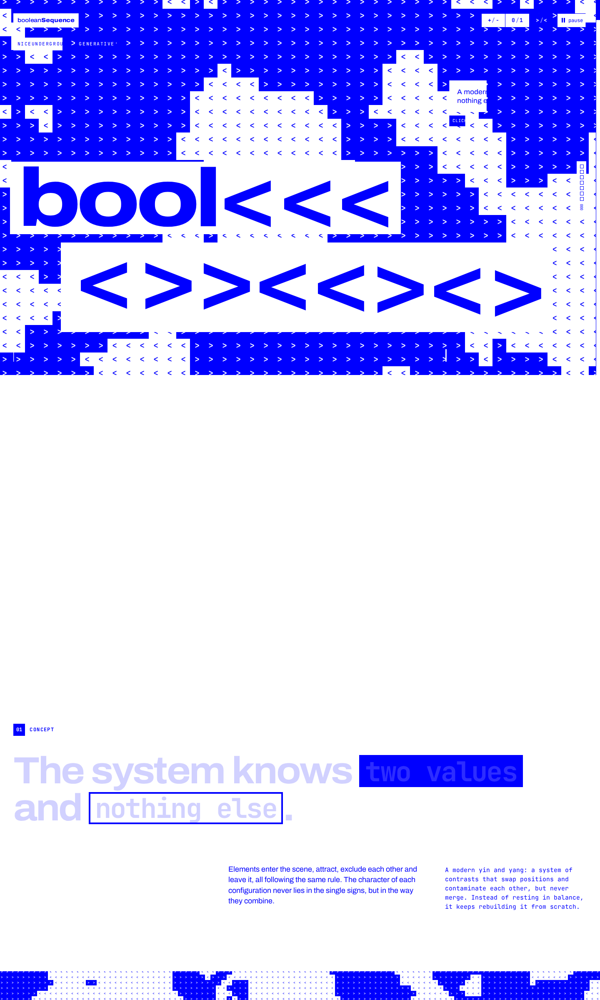
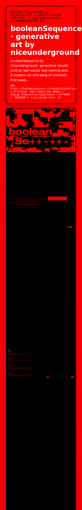

# UI Design System & Master Generation Blueprint: booleansequence-niceunderground-xyz

> **booleanSequence · generative art by niceunderground** (https://booleansequence.niceunderground.xyz/) — booleanSequence by niceunderground: generative visuals built on two values and nothing else. A modern yin and yang of contrasts that swap...



---

## 1. Executive Visual Persona & Design Archetype

- **Brand Essence & Persona**: **booleanSequence · generative art by niceunderground** (`https://booleansequence.niceunderground.xyz/`). booleanSequence by niceunderground: generative visuals built on two values and nothing else. A modern yin and yang of contrasts that swap...
- **Visual Archetype**: **Dark-Substrate WebGL / Canvas Interactive Experience (`#ff0000` / `#000000`)**.
- **Anti-AI-Slop Differentiators**:
  - **Source-Grounded Chromatic Polarity**: Anchors the viewport in `#ff0000` (`var(--err)` in `:root`) paired with `#ffffff` primary typography and `#000000` accents.
  - **Extracted Typographic Hierarchy**: Pairs `Archivo` for display copy (`boolean Sequence`) with `JetBrains Mono` and `JetBrains Mono`.
  - **Calibrated Spatial Grid & Motion**: Combines `900px` container bounds (`gap: 12px`, padding `1.4rem`) with `cubic-bezier(.7,0,.2,1)` easing and Lenis Smooth Scroll (`data-lenis`), GSAP Timeline & ScrollTrigger.

---

## 2. Spatial Architecture & Modular Grid Mathematics



### Viewport Allocation & Container Geometry
- **Captured Viewport Dimensions**: Desktop `1440×21109px` (`assets/desktop.png`, full-page scroll capture), Mobile `390×2400px` (`assets/mobile.png`, capped at 2400px multi-section capture).
- **Master Container Bounds**: `900px` extracted from `booleansequence-niceunderground-xyz` stylesheet.
- **Canvas Lateral Padding & Spacing**: `1.4rem` lateral canvas padding with `12px` grid gap.
- **Border Radius Scale**: `0px` (sharp unrounded corners).

### Responsive Breakpoint Architecture
- **Desktop Layout**: Multi-column CSS Grid / Flexbox layout at `1440px` (`max-width: 900px`, `gap: 12px`).
- **Mobile Layout**: Single-column vertical stack at `390px` viewport width with `1.4rem` horizontal padding.
- **Extracted CSS Media Queries**: `@media (max-width: 900px)`, `@media (min-width: 901px) and (max-height: 820px)`, `@media (max-width: 900px),(prefers-reduced-motion: reduce)`, `@media (min-width: 901px)`.

---

## 3. Color System, Materiality & Atmospheric Lighting

### Semantic Palette & Source Grounding
| Semantic Role | Ground-Truth Value | Extracted CSS Source / Selector |
|---|---|---|
| **Primary Canvas Substrate** | `#ff0000` | `var(--err)` in `:root` |
| **Primary Typography Ink** | `#0000ff` | `var(--pt)` in `:root` |
| **Elevated Surface / Card Substrate** | `#ffffff` | `var(--pf)` in `:root` |
| **Interactive Accent / Highlight** | `#000000` | `<meta name="theme-color" content="#000000">` in `dom.html` |

### Sanitized Root CSS Variables (`ui-ux.md` Ground Truth)
| Variable Name | Extracted Value | Semantic Role |
|---|---|---|
| `--err` | `#ff0000` | Color / Atmospheric Token |
| `--fd` | `"Archivo", "Helvetica Neue", Arial, sans-serif` | Dimension / Scale Token |
| `--fm` | `"JetBrains Mono", ui-monospace, "SFMono-Regular", Menlo, monospace` | Design System Custom Token |
| `--pad` | `clamp(16px, 2.2vw, 40px)` | Layout / Spatial Grid Token |
| `--hud` | `clamp(30px, 2.4vw, 38px)` | Dimension / Scale Token |
| `--ease` | `cubic-bezier(.7, 0, .2, 1)` | Motion / Easing Token |
| `--wp` | `.1em` | Dimension / Scale Token |
| `--rule-h2` | `clamp(2rem, 4.6vw, 5.6rem)` | Typography / Scale Token |
| `--pt` | `#0000ff` | Color / Atmospheric Token |
| `--pf` | `#ffffff` | Color / Atmospheric Token |
| `--booleansequence--bg` | `#ff0000` | Canvas Substrate (from `var(--err)` in `:root`) |
| `--booleansequence--ink` | `#ffffff` | Primary Typography Ink (stylesheet-derived) |
| `--booleansequence--surface` | `#ffffff` | Surface Substrate (stylesheet-derived) |
| `--booleansequence--accent` | `#000000` | Interactive Accent (stylesheet-derived) |
| `--booleansequence--muted` | `#ffffff` | Secondary Ink (stylesheet-derived) |
| `--booleansequence--border` | `#ffffff` | Structural Border (stylesheet-derived) |

---

## 4. Typographic Scale & Editorial Hierarchy

### Font Family Stacks
- **Display Typography**: `Archivo`.
- **Primary Body Stack**: `JetBrains Mono`.
- **Technical / Metadata Stack**: `JetBrains Mono`.

### Typographic Scale & Rules (Extracted from Stylesheet & Variables)
- **Hero Display (`H1`)**: not explicitly declared on tag in static CSS (stylesheet font-size ladder: `16px`, `13px`, `clamp(5rem,21vw,22rem)`, `12px`, `14px`).
- **Section Heading (`H2`)**: CSS variables `--rule-h2: clamp(2rem, 4.6vw, 5.6rem)`; rule `.h2` (`font-size: clamp(2.1rem,5vw,6rem)`).
- **Body Copy**: rule `p` (`font-size: clamp(15px,1.05vw,17px)`, `line-height: 1.4`).
- **Metadata & Navigation Labels**: not explicitly declared on tag in static CSS (stylesheet font-size ladder: `16px`, `13px`, `clamp(5rem,21vw,22rem)`, `12px`, `14px`).

---

## 5. Choreographed Motion & Interaction Physics

### Primary Easing Curves
- **Extracted Timing Functions**: `cubic-bezier(.7,0,.2,1)`.

### Per-Element Transition & Choreography Rules
- **Selector `.tag span`**: `transition: transform .45s var(--ease)` extracted from `booleansequence-niceunderground-xyz` stylesheet.
- **Selector `.bits i`**: `transition: background .2s` extracted from `booleansequence-niceunderground-xyz` stylesheet.
- **Selector `.step__n`**: `transition: background .3s,color .3s` extracted from `booleansequence-niceunderground-xyz` stylesheet.
- **Extracted Easing Curve (`cubic-bezier(.7,0,.2,1)`)**: Governs interactive state transitions across `<header.hud>` and `<section.statement>`.
- **Runtime Interaction Engine**: Integrates Lenis Smooth Scroll (`data-lenis`), GSAP Timeline & ScrollTrigger, Three.js / WebGL Canvas Pipeline with `prefers-reduced-motion: reduce` fallback guards.

---

## 6. Component Wireframe & Structural DOM Map

### Visual Layout Schematic (Grounded in `dom.html` — `1440px` Desktop & `390px` Mobile Reflow)
```
┌────────────────────────────────────────────────────────────────────────┐
│ DESKTOP VIEWPORT (1440px) — booleanSequence · generative art by niceun │
│ ====================================================================== │
│ [ <header.hud>             | Overview · Index · Archive · About · C ]  │
│ ---------------------------------------------------------------------- │
│ | HERO STAGE: <section.hero>                                       |   │
│ | H1: boolean Sequence                                             |   │
│ | Substrate: #ff0000    | Ink: #ffffff    | Accent: #000000        |   │
│ ---------------------------------------------------------------------- │
│ | SHOWCASE GRID (<section.statement>       ) max-w: 900px          |   │
│ | +------------------------------+  +------------------------------+ | │
│ | | 01 Concept                   |  | Seen from above, it looks li | | │
│ | +------------------------------+  +------------------------------+ | │
│ ---------------------------------------------------------------------- │
│ | MOBILE VIEWPORT REFLOW (390px) — Single-Column Stack (gap: 12px  ) | │
│ | [<header.hud>] -> [<section.hero>] -> [<section.statement] |         │
│ ---------------------------------------------------------------------- │
│ [ FOOTER (<footer.foot>         ) | https://booleansequence.niceunderg │
└────────────────────────────────────────────────────────────────────────┘
```

### Granular DOM Region Breakdown
1. **Brand Header & Navigation Bar (<header.hud> — `booleansequence-niceunderground-xyz`)**:
   - Landmark `<header class="hud">` hosting `booleanSequence · generative art by ` navigation (`Overview · Index · Archive · About · Contact`), DOM attributes (`data-live`, `data-magnetic`, `data-set="plus"`, `data-set="bin"`), and stylesheet rule `after { box-sizing:border-box }`.
2. **Hero Stage & Focal Lead (<section.hero> — `boolean Sequence`)**:
   - Landmark `<section class="hero">` presenting display lead `boolean Sequence` and copy excerpt *"two values, nothing else"* over `#ff0000` canvas and `#ffffff` ink.
3. **Primary Showcase & Content Grid (<section.statement> — `01 Concept`)**:
   - Landmark `<section class="statement">` rendering section `01 Concept` with copy *"niceunderground generative visuals"*, asset references (`llms.txt`, `favicon.svg`, `favicon-32.png`, `favicon-48.png`), and grid rule `html { -webkit-text-size-adjust:100% }`.
4. **Interactive Detail & Feature Matrix (<section.above> — `Seen from above, it looks like a s`)**:
   - Landmark `<section class="above">` framing `Seen from above, it looks like a society.` and `One rule, four verbs.` (*"generative visuals"*) with `#ffffff` surface cards, `#000000` accents, and `html.lenis body { height:auto }`.
5. **Colophon & Global Directory Footer (<footer.foot> — `https://booleansequence.niceunderground.xyz/`)**:
   - Landmark `<footer class="foot">` anchoring `booleanSequence · generative art` footer links (`Overview · Index · Archive · About · Contact`), copy *"A modern yin and yang. Two values, nothing else."*, and `#ffffff` structural dividers.

---

## 7. Master Zero-Shot AI Generation Prompt

```markdown
# Master Zero-Shot Frontend Generation Prompt: booleansequence-niceunderground-xyz (booleanSequence · generative art by niceunderground)

You are a principal frontend architect and design systems engineer. Build a complete, production-ready web application replicating the exact design system, DOM landmarks, typographic hierarchy, color tokens, and motion physics of `booleansequence-niceunderground-xyz` (**booleanSequence · generative art by niceunderground** — `https://booleansequence.niceunderground.xyz/`).

### 1. Visual Archetype & Anti-AI-Slop Mandates
- **Archetype**: Dark-Substrate WebGL / Canvas Interactive Experience (`#ff0000` / `#000000`).
- **Identity & Domain Context**: booleanSequence by niceunderground: generative visuals built on two values and nothing else. A modern yin and yang of contrasts that swap...
- **Primary Substrate**: `#ff0000` (`var(--err)` in `:root`), **Primary Ink**: `#ffffff`, **Accent / Highlight**: `#000000`.
- **Site-Specific Differentiators**:
  - **Source-Grounded Chromatic Polarity**: Anchors the viewport in `#ff0000` (`var(--err)` in `:root`) paired with `#ffffff` primary typography and `#000000` accents.
  - **Extracted Typographic Hierarchy**: Pairs `Archivo` for display copy (`boolean Sequence`) with `JetBrains Mono` and `JetBrains Mono`.
  - **Calibrated Spatial Grid & Motion**: Combines `900px` container bounds (`gap: 12px`, padding `1.4rem`) with `cubic-bezier(.7,0,.2,1)` easing and Lenis Smooth Scroll (`data-lenis`), GSAP Timeline & ScrollTrigger.

### 2. Ground-Truth CSS Variables (`:root` Token Contract)
Declare and consume these exact custom properties extracted from `booleansequence-niceunderground-xyz` in your global stylesheet:

:root {
  /* booleanSequence · generative art by niceunderground (booleansequence-niceunderground-xyz) — Ground-Truth Extracted CSS Variables */
  --err: #ff0000; /* Color / Atmospheric Token (booleansequence-niceunderground-xyz) */
  --fd: "Archivo", "Helvetica Neue", Arial, sans-serif; /* Dimension / Scale Token (booleansequence-niceunderground-xyz) */
  --fm: "JetBrains Mono", ui-monospace, "SFMono-Regular", Menlo, monospace; /* Design System Custom Token (booleansequence-niceunderground-xyz) */
  --pad: clamp(16px, 2.2vw, 40px); /* Layout / Spatial Grid Token (booleansequence-niceunderground-xyz) */
  --hud: clamp(30px, 2.4vw, 38px); /* Dimension / Scale Token (booleansequence-niceunderground-xyz) */
  --ease: cubic-bezier(.7, 0, .2, 1); /* Motion / Easing Token (booleansequence-niceunderground-xyz) */
  --wp: .1em; /* Dimension / Scale Token (booleansequence-niceunderground-xyz) */
  --rule-h2: clamp(2rem, 4.6vw, 5.6rem); /* Typography / Scale Token (booleansequence-niceunderground-xyz) */
  --pt: #0000ff; /* Color / Atmospheric Token (booleansequence-niceunderground-xyz) */
  --pf: #ffffff; /* Color / Atmospheric Token (booleansequence-niceunderground-xyz) */
  --booleansequence--bg: #ff0000; /* Canvas Substrate (from `var(--err)` in `:root`) (booleansequence-niceunderground-xyz) */
  --booleansequence--ink: #ffffff; /* Primary Typography Ink (stylesheet-derived) (booleansequence-niceunderground-xyz) */
  --booleansequence--surface: #ffffff; /* Surface Substrate (stylesheet-derived) (booleansequence-niceunderground-xyz) */
  --booleansequence--accent: #000000; /* Interactive Accent (stylesheet-derived) (booleansequence-niceunderground-xyz) */
  --booleansequence--muted: #ffffff; /* Secondary Ink (stylesheet-derived) (booleansequence-niceunderground-xyz) */
  --booleansequence--border: #ffffff; /* Structural Border (stylesheet-derived) (booleansequence-niceunderground-xyz) */
}

### 3. Semantic Color & Materiality Contract
Map every surface, ink, and border strictly to these source-grounded tokens:
- **Primary Canvas Substrate**: `#ff0000` — grounded in `var(--err)` in `:root`
- **Primary Typography Ink**: `#0000ff` — grounded in `var(--pt)` in `:root`
- **Elevated Surface / Card Substrate**: `#ffffff` — grounded in `var(--pf)` in `:root`
- **Interactive Accent / Highlight**: `#000000` — grounded in `<meta name="theme-color" content="#000000">` in `dom.html`

### 4. Spatial Grid, Container Bounds & Responsive Breakpoints
- **Desktop Viewport Reference**: `1440×21109px` (full-page scroll capture, `1440px` standard desktop width).
- **Mobile Viewport Reference**: `390×2400px` (capped at 2400px multi-section capture, `390px` standard mobile width).
- **Container Max-Width**: `900px` extracted from `booleansequence-niceunderground-xyz` stylesheet
- **Padding & Gutters**: `1.4rem` lateral canvas padding with `12px` grid gap
- **Desktop Grid**: Multi-column CSS Grid / Flexbox layout at `1440px` (`max-width: 900px`, `gap: 12px`)
- **Mobile Adaptation**: Single-column vertical stack at `390px` viewport width with `1.4rem` horizontal padding
- **Media Queries**: `@media (max-width: 900px)`, `@media (min-width: 901px) and (max-height: 820px)`, `@media (max-width: 900px),(prefers-reduced-motion: reduce)`, `@media (min-width: 901px)`
- **Corner Radii**: `0px` (sharp unrounded corners)

### 5. Typography & Editorial Scale Contract
- **Display Font Stack**: `Archivo`
- **Body Font Stack**: `JetBrains Mono`
- **Monospace / Technical Font Stack**: `JetBrains Mono`
- **H1 Display Rule**: not explicitly declared on tag in static CSS (stylesheet font-size ladder: `16px`, `13px`, `clamp(5rem,21vw,22rem)`, `12px`, `14px`)
- **H2 Section Rule**: CSS variables `--rule-h2: clamp(2rem, 4.6vw, 5.6rem)`; rule `.h2` (`font-size: clamp(2.1rem,5vw,6rem)`)
- **Body Copy Rule**: rule `p` (`font-size: clamp(15px,1.05vw,17px)`, `line-height: 1.4`)
- **Metadata & Index Rule**: not explicitly declared on tag in static CSS (stylesheet font-size ladder: `16px`, `13px`, `clamp(5rem,21vw,22rem)`, `12px`, `14px`)

### 6. Component Hierarchy, Verbatim Copy & Real DOM Landmarks
Scaffold `booleansequence-niceunderground-xyz` (`booleanSequence · generative art by niceunderground`) with these exact structural regions, extracted copy, and CSS rules from `dom.html`:
1. **Brand Header & Navigation Bar (<header.hud> — `booleansequence-niceunderground-xyz`)**:
   - DOM & Selectors: Landmark `<header class="hud">` hosting `booleanSequence · generative art by ` navigation (`Overview · Index · Archive · About · Contact`), DOM attributes (`data-live`, `data-magnetic`, `data-set="plus"`, `data-set="bin"`), and stylesheet rule `after { box-sizing:border-box }`.
   - Responsive Contract: Header `Brand Header & Navigation Bar (<header.hud> — `booleansequence-niceunderground-xyz`)` (`booleansequence-niceunderground-xyz`) adapts across `@media (max-width: 900px)`, `@media (min-width: 901px) and (max-height: 820px)`, `@media (max-width: 900px),(prefers-reduced-motion: reduce)`, `@media (min-width: 901px)` with `cubic-bezier(.7,0,.2,1)` transitions and links `Overview · Index · Archive · About · Contact`.
2. **Hero Stage & Focal Lead (<section.hero> — `boolean Sequence`)**:
   - DOM & Selectors: Landmark `<section class="hero">` presenting display lead `boolean Sequence` and copy excerpt *"two values, nothing else"* over `#ff0000` canvas and `#ffffff` ink.
   - Responsive Contract: Hero stage (`1440×21109px` desktop / `390×2400px` mobile) sets `#ff0000` background with `#ffffff` headline `boolean Sequence`.
3. **Primary Showcase & Content Grid (<section.statement> — `01 Concept`)**:
   - DOM & Selectors: Landmark `<section class="statement">` rendering section `01 Concept` with copy *"niceunderground generative visuals"*, asset references (`llms.txt`, `favicon.svg`, `favicon-32.png`, `favicon-48.png`), and grid rule `html { -webkit-text-size-adjust:100% }`.
   - Responsive Contract: Showcase grid `Primary Showcase & Content Grid (<section.statement> — `01 Concept`)` applies Multi-column CSS Grid / Flexbox layout at `1440px` (`max-width: 900px`, `gap: 12px`) on desktop and Single-column vertical stack at `390px` viewport width with `1.4rem` horizontal padding on mobile.
4. **Interactive Detail & Feature Matrix (<section.above> — `Seen from above, it looks like a s`)**:
   - DOM & Selectors: Landmark `<section class="above">` framing `Seen from above, it looks like a society.` and `One rule, four verbs.` (*"generative visuals"*) with `#ffffff` surface cards, `#000000` accents, and `html.lenis body { height:auto }`.
   - Responsive Contract: Detail module `Interactive Detail & Feature Matrix (<section.above> — `Seen from above, it looks like a s`)` uses `0px` (sharp unrounded corners) radii, `#000000` highlights, and assets (llms.txt, favicon.svg, favicon-32.png).
5. **Colophon & Global Directory Footer (<footer.foot> — `https://booleansequence.niceunderground.xyz/`)**:
   - DOM & Selectors: Landmark `<footer class="foot">` anchoring `booleanSequence · generative art` footer links (`Overview · Index · Archive · About · Contact`), copy *"A modern yin and yang. Two values, nothing else."*, and `#ffffff` structural dividers.
   - Responsive Contract: Footer `Colophon & Global Directory Footer (<footer.foot> — `https://booleansequence.niceunderground.xyz/`)` aligns to `900px` extracted from `booleansequence-niceunderground-xyz` stylesheet with `1.4rem` lateral canvas padding with `12px` grid gap and attributes (data-live, data-magnetic, data-set="plus").

#### Verbatim DOM Copy Excerpts (`dom.html`)
- Copy Excerpt 1: *"two values, nothing else"*
- Copy Excerpt 2: *"niceunderground generative visuals"*
- Copy Excerpt 3: *"generative visuals"*
- Copy Excerpt 4: *"A modern yin and yang. Two values, nothing else."*

### 7. Motion, Extracted Stylesheet Rules & Interaction Choreography
- **Primary Easing Functions**: `cubic-bezier(.7,0,.2,1)`
- **Extracted Stylesheet Rules (`booleansequence-niceunderground-xyz`)**:
- `after { box-sizing:border-box }`
- `html { -webkit-text-size-adjust:100% }`
- `html.lenis body { height:auto }`
- `.lenis.lenis-smooth { scroll-behavior:auto!important }`
- `.lenis.lenis-stopped { overflow:hidden }`
- **Per-Selector Transition Rules**:
- **Selector `.tag span`**: `transition: transform .45s var(--ease)` extracted from `booleansequence-niceunderground-xyz` stylesheet.
- **Selector `.bits i`**: `transition: background .2s` extracted from `booleansequence-niceunderground-xyz` stylesheet.
- **Selector `.step__n`**: `transition: background .3s,color .3s` extracted from `booleansequence-niceunderground-xyz` stylesheet.
- **Extracted Easing Curve (`cubic-bezier(.7,0,.2,1)`)**: Governs interactive state transitions across `<header.hud>` and `<section.statement>`.
- **Runtime Interaction Engine**: Integrates Lenis Smooth Scroll (`data-lenis`), GSAP Timeline & ScrollTrigger, Three.js / WebGL Canvas Pipeline with `prefers-reduced-motion: reduce` fallback guards.

### 8. Technical Deliverables
- Implement in Next.js (App Router) with TypeScript and Tailwind CSS consuming the `:root` custom properties defined above for `booleansequence-niceunderground-xyz`.
- Reproduce both the `1440px` desktop architecture and `390px` mobile breakpoint transitions, preserving semantic HTML5 landmarks (`<header>`, `<nav>`, `<main>`, `<section>`, `<footer>`) and `prefers-reduced-motion` accessibility guards.
```
