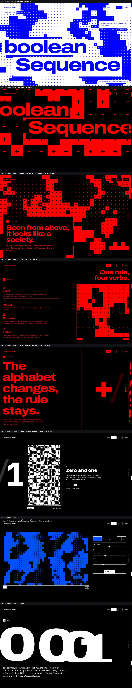
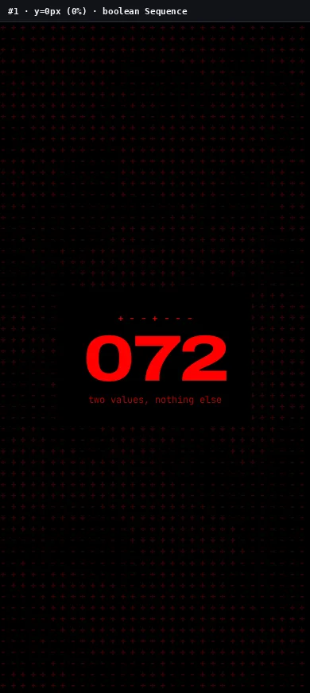

# UI Design System & Master Generation Blueprint: booleansequence-niceunderground-xyz

> **booleanSequence · generative art by niceunderground** (https://booleansequence.niceunderground.xyz/) — booleanSequence by niceunderground: generative visuals built on two values and nothing else. A modern yin and yang of contrasts that swap...





---

## 1. Executive Visual Persona & Design Archetype

- **Brand Essence & Persona**: **booleanSequence · generative art by niceunderground** (`https://booleansequence.niceunderground.xyz/`). booleanSequence by niceunderground: generative visuals built on two values and nothing else. A modern yin and yang of contrasts that swap...
- **Capture Provenance**: Live browser capture (`tier1_fast`, HTTP `200`, captured `2026-11-24`).
- **Visual Archetype**: **Light-Gallery WebGL / Canvas Interactive Experience (`#ffffff` / `#ff0000`)**.
- **Anti-AI-Slop Differentiators**:
  - **Live-Computed Chromatic Polarity**: Anchors the viewport in `#ffffff` (live computed `body` `background-color` (`computed_styles.json`)) paired with `#0000ff` primary typography and `#ff0000` accents.
  - **Grounded Typographic Hierarchy**: Uses `Archivo` across display (`boolean Sequence`) and body copy, paired with `JetBrains Mono` for monospace/code.
  - **Calibrated Spatial Grid & Motion**: Combines `1440px` container bounds (`gap: 12px`, padding `1.4rem`) with `cubic-bezier(.7,0,.2,1)` easing and Lenis Smooth Scroll (`data-lenis`), GSAP Timeline & ScrollTrigger.

---

## 2. Spatial Architecture & Modular Grid Mathematics

### Viewport Allocation & Container Geometry
- **Captured Journey Filmstrips**: Desktop `1280×6624px` (`assets/desktop-journey.webp`, `8` keyframes up to `y=14400px` / doc `21109px`), Mobile `390×872px` (`assets/mobile-journey.webp`, `1` keyframes).
- **Master Container Bounds**: `1440px` (full-bleed `100%` desktop stage measured on `1440px` viewport).
- **Canvas Lateral Padding & Spacing**: `1.4rem` lateral canvas padding with `12px` grid gap.
- **Border Radius Scale**: `0px` (sharp unrounded corners).

### Responsive Breakpoint Architecture
- **Desktop Layout**: Multi-column CSS Grid / Flexbox layout at `1440px` (`max-width: 1440px`, `gap: 12px`).
- **Mobile Layout**: Single-column vertical stack at `390px` viewport width with `1.4rem` horizontal padding.
- **Extracted CSS Media Queries**: `@media (max-width: 900px)`, `@media (min-width: 901px) and (max-height: 820px)`, `@media (max-width: 900px),(prefers-reduced-motion: reduce)`, `@media (min-width: 901px)`.

---

## 3. Color System, Materiality & Atmospheric Lighting

### Semantic Palette & Source Grounding
| Semantic Role | Ground-Truth Value | Extracted Live / CSS Source |
|---|---|---|
| **Primary Canvas Substrate** | `#ffffff` | live computed `body` `background-color` (`computed_styles.json`) |
| **Primary Typography Ink** | `#0000ff` | live computed `h1` `color` (`computed_styles.json`) |
| **Elevated Surface / Card Substrate** | `#0000ff` | live computed `a` `background-color` (`computed_styles.json`) |
| **Interactive Accent / Highlight** | `#ff0000` | `var(--err)` in `:root` |
| **Secondary / Muted Copy** | `#0000ff` | secondary opacity step of live computed `h1` `color` (`computed_styles.json`) |
| **Structural Hairline Border** | `#0000ff` | hairline divider derived from secondary opacity step of live computed `h1` `color` (`computed_styles.json`) |

### Sanitized Root CSS Variables (`ui-ux.md` Ground Truth)
| Variable Name | Extracted Value | Semantic Role |
|---|---|---|
| `--err` | `#ff0000` | Color / Atmospheric Token |
| `--fd` | `"Archivo", "Helvetica Neue", Arial, sans-serif` | Dimension / Scale Token |
| `--fm` | `"JetBrains Mono", ui-monospace, "SFMono-Regular", Menlo, monospace` | Design System Custom Token |
| `--pad` | `clamp(16px, 2.2vw, 40px)` | Layout / Spatial Grid Token |
| `--hud` | `clamp(30px, 2.4vw, 38px)` | Dimension / Scale Token |
| `--ease` | `cubic-bezier(.7, 0, .2, 1)` | Motion / Easing Token |
| `--wp` | `.1em` | Dimension / Scale Token |
| `--rule-h2` | `clamp(2rem, 4.6vw, 5.6rem)` | Typography / Scale Token |
| `--pt` | `#0000ff` | Color / Atmospheric Token |
| `--pf` | `#ffffff` | Color / Atmospheric Token |
| `--booleansequence--bg` | `#ffffff` | Canvas Substrate (from live computed `body` `background-color` (`computed_styles.json`)) |
| `--booleansequence--ink` | `#0000ff` | Primary Typography Ink (computed-derived) |
| `--booleansequence--surface` | `#0000ff` | Surface Substrate (computed-derived) |
| `--booleansequence--accent` | `#ff0000` | Interactive Accent (computed-derived) |
| `--booleansequence--muted` | `#0000ff` | Secondary Ink (computed-derived) |
| `--booleansequence--border` | `#0000ff` | Structural Border (computed-derived) |

---

## 4. Typographic Scale & Editorial Hierarchy

### Font Family Stacks
- **Display Typography**: `Archivo`.
- **Primary Body Stack**: `Archivo`.
- **Technical / Metadata Stack**: `JetBrains Mono`.

### Typographic Scale & Rules (Live Computed & Stylesheet Grounded)
- **Hero Display (`H1`)**: live computed `h1` (`font-size: 196.663px`, `line-height: 157.33px`, `font-weight: 800`, `letter-spacing: -10.8165px`).
- **Section Heading (`H2`)**: live computed `h2` (`font-size: 518.4px`, `line-height: 383.616px`, `font-weight: 900`, `letter-spacing: -7.776px`); CSS variables `--rule-h2: clamp(2rem, 4.6vw, 5.6rem)`; rule `.h2` (`font-size: clamp(2.1rem,5vw,6rem)`).
- **Body Copy**: live computed `body` (`font-size: 16px`, `line-height: 22.4px`, `font-weight: 400`); rule `p` (`font-size: clamp(15px,1.05vw,17px)`, `line-height: 1.4`).
- **Metadata & Navigation Labels**: live computed `nav/a` (`font-size: 16px`, `line-height: 22.4px`, `font-weight: 400`).

---

## 5. Choreographed Motion & Interaction Physics

### Primary Easing Curves
- **Extracted Timing Functions**: `cubic-bezier(.7,0,.2,1)`.

### Per-Element Transition & Choreography Rules
- **Selector `.tag span`**: `transition: transform .45s var(--ease)` extracted from `booleansequence-niceunderground-xyz` stylesheet.
- **Selector `.bits i`**: `transition: background .2s` extracted from `booleansequence-niceunderground-xyz` stylesheet.
- **Selector `.step__n`**: `transition: background .3s,color .3s` extracted from `booleansequence-niceunderground-xyz` stylesheet.
- **Extracted Easing Curve (`cubic-bezier(.7,0,.2,1)`)**: Governs interactive state transitions across `<header.hud>` and `<section.statement>`.
- **Runtime Interaction Engine**: Integrates Lenis Smooth Scroll (`data-lenis`), GSAP Timeline & ScrollTrigger, Three.js / WebGL Canvas Pipeline with `prefers-reduced-motion: reduce` fallback guards.
### Measured Runtime Scroll & Interaction Telemetry (`behavioral_journey_v2`)
- **Scroll Driver Mode**: `native` (max document height `21109px`, deepest scrollY reached `14400px` across `8` desktop keyframes).
- **Detected Scroll / Motion Libraries**: `Lenis`, `GSAP/ScrollTrigger`, `WebGL/Canvas`.
- **Hover Physics (`primary_cta` · `scroll`)**: `color`: `rgb(255, 248, 248)` -> `rgb(255, 70, 70)`; `borderColor`: `rgb(255, 248, 248)` -> `rgb(255, 70, 70)` (`transition-duration: 0s`, `timing: ease`).

---

## 6. Component Wireframe & Structural DOM Map

### Visual Layout Schematic — Desktop (`1440px`, Grounded in `dom.html` & Landmark Bounding Boxes)
```
┌────────────────────────────────────────────────────────────────────────┐
│ DESKTOP VIEWPORT (1440px) — booleanSequence · generative art by niceun │
│ ====================================================================== │
│ [ <header.hud> (1377x35px)            | Overview · Index · Archive · ] │
│ ---------------------------------------------------------------------- │
│ | HERO STAGE: <section.hero> (w=1440px)                              | │
│ | H1: boolean Sequence                                               | │
│ | Substrate: #ffffff | Ink: #0000ff | Accent: #ff0000                | │
│ ---------------------------------------------------------------------- │
│ | SHOWCASE GRID (<section.statement>) max-w: 1440px                  | │
│ | +------------------------------+  +------------------------------+ | │
│ | | b o o l e a n S e q u e n c  |  | Seen from above, it looks li | | │
│ | +------------------------------+  +------------------------------+ | │
│ ---------------------------------------------------------------------- │
│ | DETAIL MODULE (<section.above>) — One rule, four verbs.            | │
│ ---------------------------------------------------------------------- │
│ [ FOOTER (<footer.foot>       ) | https://booleansequence.niceundergr  │
└────────────────────────────────────────────────────────────────────────┘
```

### Visual Layout Schematic — Mobile Reflow (`390px`)
```
┌────────────────────────────────────────────────────────────────────────┐
│ MOBILE VIEWPORT REFLOW (390px) — Single-Column Stack (gap: 12px)       │
│ ====================================================================== │
│ [ HEADER BAR (<header.hud>            ) | Compact Menu (390px)         │
│ ---------------------------------------------------------------------- │
│ | HERO STAGE (<section.hero>) — 390px Vertical Lead                  | │
│ | H1: boolean Sequence                                               | │
│ ---------------------------------------------------------------------- │
│ | SHOWCASE STACK (<section.statement>) — 1-Col Stack                 | │
│ | [ Item 1: b o o l e a n S e q u e n c e                          ] | │
│ | [ Item 2: Seen from above, it looks like a society.              ] | │
│ ---------------------------------------------------------------------- │
│ | DETAIL STACK (<section.above>) — 1-Col (One rule, four ver)        | │
│ ---------------------------------------------------------------------- │
│ [ FOOTER (<footer.foot>       ) | Stacked 390px Colophon               │
└────────────────────────────────────────────────────────────────────────┘
```

### Granular DOM Region Breakdown
1. **Brand Header & Navigation Bar (<header.hud> — `booleansequence-niceunderground-xyz`)**:
   - Landmark `<header class="hud">` (`1377x35px`) hosting `booleanSequence · generative art by ` navigation (`Overview · Index · Archive · About · Contact`), DOM attributes (`data-live`, `data-magnetic`, `data-set="plus"`, `data-set="bin"`), and stylesheet rule `after { box-sizing:border-box }`.
2. **Hero Stage & Focal Lead (<section.hero> — `boolean Sequence`)**:
   - Landmark `<section class="hero">` presenting display lead `boolean Sequence` and copy excerpt *"niceunderground generative visuals"* over `#ffffff` canvas and `#0000ff` ink.
3. **Primary Showcase & Content Grid (<section.statement> — `b o o l e a n S e q u e n c e`)**:
   - Landmark `<section class="statement">` rendering section `b o o l e a n S e q u e n c e` with copy *"generative visuals"*, asset references (`llms.txt`, `favicon.svg`, `favicon-32.png`, `favicon-48.png`), and grid rule `html { -webkit-text-size-adjust:100% }`.
4. **Interactive Detail & Feature Matrix (<section.above> — `Seen from above, it looks like a s`)**:
   - Landmark `<section class="above">` framing `Seen from above, it looks like a society.` and `One rule, four verbs.` (*"A modern yin and yang. Two values, nothing else."*) with `#0000ff` surface cards, `#ff0000` accents, and `html.lenis body { height:auto }`.
5. **Colophon & Global Directory Footer (<footer.foot> — `https://booleansequence.niceunderground.xyz/`)**:
   - Landmark `<footer class="foot">` anchoring `booleanSequence · generative art` footer links (`Overview · Index · Archive · About · Contact`), copy *"click the field to send a wave through it tap the field to s"*, and `#0000ff` structural dividers.
### Full Vertical Scroll Sequence (Desktop `1440×900` Keyframes)
- **Step 01** (`y=0px`, `0%`): Active landmark `boolean Sequence` · sticky/fixed elements: `3`
- **Step 02** (`y=850px`, `4%`): Active landmark `boolean Sequence` · sticky/fixed elements: `2`
- **Step 03** (`y=3400px`, `17%`): Active landmark `Seen from above, it looks like a society.` · sticky/fixed elements: `3`
- **Step 04** (`y=5950px`, `29%`): Active landmark `One rule, four verbs.` · sticky/fixed elements: `3`
- **Step 05** (`y=8500px`, `42%`): Active landmark `The alphabet changes, the rule stays.` · sticky/fixed elements: `3`
- **Step 06** (`y=11050px`, `55%`): Active landmark `The alphabet changes, the rule stays.` · sticky/fixed elements: `3`
- **Step 07** (`y=13600px`, `67%`): Active landmark `#trip` · sticky/fixed elements: `2`
- **Step 08** (`y=14400px`, `71%`): Active landmark `0001` · sticky/fixed elements: `2`

---

## 7. Master Zero-Shot AI Generation Prompt

```markdown
# Master Zero-Shot Frontend Generation Prompt: booleansequence-niceunderground-xyz (booleanSequence · generative art by niceunderground)

You are a principal frontend architect and design systems engineer. Build a complete, production-ready web application replicating the exact design system, DOM landmarks, typographic hierarchy, color tokens, and motion physics of `booleansequence-niceunderground-xyz` (**booleanSequence · generative art by niceunderground** — `https://booleansequence.niceunderground.xyz/`).

### 1. Visual Archetype & Anti-AI-Slop Mandates
- **Archetype**: Light-Gallery WebGL / Canvas Interactive Experience (`#ffffff` / `#ff0000`).
- **Identity & Domain Context**: booleanSequence by niceunderground: generative visuals built on two values and nothing else. A modern yin and yang of contrasts that swap...
- **Primary Substrate**: `#ffffff` (live computed `body` `background-color` (`computed_styles.json`)), **Primary Ink**: `#0000ff`, **Accent / Highlight**: `#ff0000`.
- **Site-Specific Differentiators**:
  - **Live-Computed Chromatic Polarity**: Anchors the viewport in `#ffffff` (live computed `body` `background-color` (`computed_styles.json`)) paired with `#0000ff` primary typography and `#ff0000` accents.
  - **Grounded Typographic Hierarchy**: Uses `Archivo` across display (`boolean Sequence`) and body copy, paired with `JetBrains Mono` for monospace/code.
  - **Calibrated Spatial Grid & Motion**: Combines `1440px` container bounds (`gap: 12px`, padding `1.4rem`) with `cubic-bezier(.7,0,.2,1)` easing and Lenis Smooth Scroll (`data-lenis`), GSAP Timeline & ScrollTrigger.

### 2. Ground-Truth CSS Variables (`:root` Token Contract)
Declare and consume these exact custom properties extracted from `booleansequence-niceunderground-xyz` in your global stylesheet:

:root {
  /* booleanSequence · generative art by niceunderground (booleansequence-niceunderground-xyz) — Live-Grounded CSS Variables */
  --err: #ff0000; /* Color / Atmospheric Token (booleansequence-niceunderground-xyz) */
  --fd: "Archivo", "Helvetica Neue", Arial, sans-serif; /* Dimension / Scale Token (booleansequence-niceunderground-xyz) */
  --fm: "JetBrains Mono", ui-monospace, "SFMono-Regular", Menlo, monospace; /* Design System Custom Token (booleansequence-niceunderground-xyz) */
  --pad: clamp(16px, 2.2vw, 40px); /* Layout / Spatial Grid Token (booleansequence-niceunderground-xyz) */
  --hud: clamp(30px, 2.4vw, 38px); /* Dimension / Scale Token (booleansequence-niceunderground-xyz) */
  --ease: cubic-bezier(.7, 0, .2, 1); /* Motion / Easing Token (booleansequence-niceunderground-xyz) */
  --wp: .1em; /* Dimension / Scale Token (booleansequence-niceunderground-xyz) */
  --rule-h2: clamp(2rem, 4.6vw, 5.6rem); /* Typography / Scale Token (booleansequence-niceunderground-xyz) */
  --pt: #0000ff; /* Color / Atmospheric Token (booleansequence-niceunderground-xyz) */
  --pf: #ffffff; /* Color / Atmospheric Token (booleansequence-niceunderground-xyz) */
  --booleansequence--bg: #ffffff; /* Canvas Substrate (from live computed `body` `background-color` (`computed_styles.json`)) (booleansequence-niceunderground-xyz) */
  --booleansequence--ink: #0000ff; /* Primary Typography Ink (computed-derived) (booleansequence-niceunderground-xyz) */
  --booleansequence--surface: #0000ff; /* Surface Substrate (computed-derived) (booleansequence-niceunderground-xyz) */
  --booleansequence--accent: #ff0000; /* Interactive Accent (computed-derived) (booleansequence-niceunderground-xyz) */
  --booleansequence--muted: #0000ff; /* Secondary Ink (computed-derived) (booleansequence-niceunderground-xyz) */
  --booleansequence--border: #0000ff; /* Structural Border (computed-derived) (booleansequence-niceunderground-xyz) */
}

### 3. Semantic Color & Materiality Contract
Map every surface, ink, and border strictly to these source-grounded tokens:
- **Primary Canvas Substrate**: `#ffffff` — grounded in live computed `body` `background-color` (`computed_styles.json`)
- **Primary Typography Ink**: `#0000ff` — grounded in live computed `h1` `color` (`computed_styles.json`)
- **Elevated Surface / Card Substrate**: `#0000ff` — grounded in live computed `a` `background-color` (`computed_styles.json`)
- **Interactive Accent / Highlight**: `#ff0000` — grounded in `var(--err)` in `:root`
- **Secondary / Muted Copy**: `#0000ff` — grounded in secondary opacity step of live computed `h1` `color` (`computed_styles.json`)
- **Structural Hairline Border**: `#0000ff` — grounded in hairline divider derived from secondary opacity step of live computed `h1` `color` (`computed_styles.json`)

### 4. Spatial Grid, Container Bounds & Responsive Breakpoints
- **Desktop Viewport Reference**: `1280×6624px` (multi-frame vertical journey filmstrip (6624px), `1440px` standard desktop width).
- **Mobile Viewport Reference**: `390×872px` (full-page live capture (872px), `390px` standard mobile width).
- **Container Max-Width**: `1440px` (full-bleed `100%` desktop stage measured on `1440px` viewport)
- **Padding & Gutters**: `1.4rem` lateral canvas padding with `12px` grid gap
- **Desktop Grid**: Multi-column CSS Grid / Flexbox layout at `1440px` (`max-width: 1440px`, `gap: 12px`)
- **Mobile Adaptation**: Single-column vertical stack at `390px` viewport width with `1.4rem` horizontal padding
- **Media Queries**: `@media (max-width: 900px)`, `@media (min-width: 901px) and (max-height: 820px)`, `@media (max-width: 900px),(prefers-reduced-motion: reduce)`, `@media (min-width: 901px)`
- **Corner Radii**: `0px` (sharp unrounded corners)

### 5. Typography & Editorial Scale Contract
- **Display Font Stack**: `Archivo`
- **Body Font Stack**: `Archivo`
- **Monospace / Technical Font Stack**: `JetBrains Mono`
- **H1 Display Rule**: live computed `h1` (`font-size: 196.663px`, `line-height: 157.33px`, `font-weight: 800`, `letter-spacing: -10.8165px`)
- **H2 Section Rule**: live computed `h2` (`font-size: 518.4px`, `line-height: 383.616px`, `font-weight: 900`, `letter-spacing: -7.776px`); CSS variables `--rule-h2: clamp(2rem, 4.6vw, 5.6rem)`; rule `.h2` (`font-size: clamp(2.1rem,5vw,6rem)`)
- **Body Copy Rule**: live computed `body` (`font-size: 16px`, `line-height: 22.4px`, `font-weight: 400`); rule `p` (`font-size: clamp(15px,1.05vw,17px)`, `line-height: 1.4`)
- **Metadata & Index Rule**: live computed `nav/a` (`font-size: 16px`, `line-height: 22.4px`, `font-weight: 400`)

### 6. Component Hierarchy, Verbatim Copy & Real DOM Landmarks
Scaffold `booleansequence-niceunderground-xyz` (`booleanSequence · generative art by niceunderground`) with these exact structural regions, extracted copy, and CSS rules from `dom.html`:
1. **Brand Header & Navigation Bar (<header.hud> — `booleansequence-niceunderground-xyz`)**:
   - DOM & Selectors: Landmark `<header class="hud">` (`1377x35px`) hosting `booleanSequence · generative art by ` navigation (`Overview · Index · Archive · About · Contact`), DOM attributes (`data-live`, `data-magnetic`, `data-set="plus"`, `data-set="bin"`), and stylesheet rule `after { box-sizing:border-box }`.
   - Responsive Contract: Header `Brand Header & Navigation Bar (<header.hud> — `booleansequence-niceunderground-xyz`)` (`booleansequence-niceunderground-xyz`) adapts across `@media (max-width: 900px)`, `@media (min-width: 901px) and (max-height: 820px)`, `@media (max-width: 900px),(prefers-reduced-motion: reduce)`, `@media (min-width: 901px)` with `cubic-bezier(.7,0,.2,1)` transitions and links `Overview · Index · Archive · About · Contact`.
2. **Hero Stage & Focal Lead (<section.hero> — `boolean Sequence`)**:
   - DOM & Selectors: Landmark `<section class="hero">` presenting display lead `boolean Sequence` and copy excerpt *"niceunderground generative visuals"* over `#ffffff` canvas and `#0000ff` ink.
   - Responsive Contract: Hero stage (`1280×6624px` desktop / `390×872px` mobile) sets `#ffffff` background with `#0000ff` headline `boolean Sequence`.
3. **Primary Showcase & Content Grid (<section.statement> — `b o o l e a n S e q u e n c e`)**:
   - DOM & Selectors: Landmark `<section class="statement">` rendering section `b o o l e a n S e q u e n c e` with copy *"generative visuals"*, asset references (`llms.txt`, `favicon.svg`, `favicon-32.png`, `favicon-48.png`), and grid rule `html { -webkit-text-size-adjust:100% }`.
   - Responsive Contract: Showcase grid `Primary Showcase & Content Grid (<section.statement> — `b o o l e a n S e q u e n c e`)` applies Multi-column CSS Grid / Flexbox layout at `1440px` (`max-width: 1440px`, `gap: 12px`) on desktop and Single-column vertical stack at `390px` viewport width with `1.4rem` horizontal padding on mobile.
4. **Interactive Detail & Feature Matrix (<section.above> — `Seen from above, it looks like a s`)**:
   - DOM & Selectors: Landmark `<section class="above">` framing `Seen from above, it looks like a society.` and `One rule, four verbs.` (*"A modern yin and yang. Two values, nothing else."*) with `#0000ff` surface cards, `#ff0000` accents, and `html.lenis body { height:auto }`.
   - Responsive Contract: Detail module `Interactive Detail & Feature Matrix (<section.above> — `Seen from above, it looks like a s`)` uses `0px` (sharp unrounded corners) radii, `#ff0000` highlights, and assets (llms.txt, favicon.svg, favicon-32.png).
5. **Colophon & Global Directory Footer (<footer.foot> — `https://booleansequence.niceunderground.xyz/`)**:
   - DOM & Selectors: Landmark `<footer class="foot">` anchoring `booleanSequence · generative art` footer links (`Overview · Index · Archive · About · Contact`), copy *"click the field to send a wave through it tap the field to s"*, and `#0000ff` structural dividers.
   - Responsive Contract: Footer `Colophon & Global Directory Footer (<footer.foot> — `https://booleansequence.niceunderground.xyz/`)` aligns to `1440px` (full-bleed `100%` desktop stage measured on `1440px` viewport) with `1.4rem` lateral canvas padding with `12px` grid gap and attributes (data-live, data-magnetic, data-set="plus").

#### Verbatim DOM Copy Excerpts (`dom.html`)
- Copy Excerpt 1: *"niceunderground generative visuals"*
- Copy Excerpt 2: *"generative visuals"*
- Copy Excerpt 3: *"A modern yin and yang. Two values, nothing else."*
- Copy Excerpt 4: *"click the field to send a wave through it tap the field to send a wave through it"*

### 7. Motion, Extracted Stylesheet Rules & Interaction Choreography
- **Primary Easing Functions**: `cubic-bezier(.7,0,.2,1)`
- **Extracted Stylesheet Rules (`booleansequence-niceunderground-xyz`)**:
- `after { box-sizing:border-box }`
- `html { -webkit-text-size-adjust:100% }`
- `html.lenis body { height:auto }`
- `.lenis.lenis-smooth { scroll-behavior:auto!important }`
- `.lenis.lenis-stopped { overflow:hidden }`
- **Per-Selector Transition Rules**:
- **Selector `.tag span`**: `transition: transform .45s var(--ease)` extracted from `booleansequence-niceunderground-xyz` stylesheet.
- **Selector `.bits i`**: `transition: background .2s` extracted from `booleansequence-niceunderground-xyz` stylesheet.
- **Selector `.step__n`**: `transition: background .3s,color .3s` extracted from `booleansequence-niceunderground-xyz` stylesheet.
- **Extracted Easing Curve (`cubic-bezier(.7,0,.2,1)`)**: Governs interactive state transitions across `<header.hud>` and `<section.statement>`.
- **Runtime Interaction Engine**: Integrates Lenis Smooth Scroll (`data-lenis`), GSAP Timeline & ScrollTrigger, Three.js / WebGL Canvas Pipeline with `prefers-reduced-motion: reduce` fallback guards.
### 7b. Full-Page Scroll Choreography, Interactive States & Multi-Page Routes
- **Scroll Mechanics**: Implement `native` vertical progression up to `21109px` across 8 distinct viewport chapters using Lenis, GSAP/ScrollTrigger, WebGL/Canvas.
- **Vertical Chapter Sequence**: boolean Sequence (0%) -> boolean Sequence (4%) -> Seen from above, it looks l... (17%) -> One rule, four verbs. (29%) -> The alphabet changes, the r... (42%) -> The alphabet changes, the r... (55%) -> #trip (67%) -> 0001 (71%).
- **Hover Micro-Interaction (`primary_cta`)**: Animate `color, borderColor` with `0s ease`.

### 8. Technical Deliverables
- Implement in Next.js (App Router) with TypeScript and Tailwind CSS consuming the `:root` custom properties defined above for `booleansequence-niceunderground-xyz`.
- Reproduce both the `1440px` desktop architecture and `390px` mobile breakpoint transitions, preserving semantic HTML5 landmarks (`<header>`, `<nav>`, `<main>`, `<section>`, `<footer>`) and `prefers-reduced-motion` accessibility guards.
```
---

## 8. Full-Page Scroll Journey, Interactive States & Subpage Inventory

### Desktop Scroll Keyframes (`1440×900` WebP)
| Step | Scroll Y | Progress | Active Landmark / Section | Sticky/Fixed | Visual Asset |
| :---: | :---: | :---: | :--- | :---: | :--- |
| `#01` | `0px` | `0%` | boolean Sequence | `3` | [desktop-step-01.webp](assets/desktop-step-01.webp) |
| `#02` | `850px` | `4%` | boolean Sequence | `2` | [desktop-step-02.webp](assets/desktop-step-02.webp) |
| `#03` | `3400px` | `17%` | Seen from above, it looks like a society. | `3` | [desktop-step-03.webp](assets/desktop-step-03.webp) |
| `#04` | `5950px` | `29%` | One rule, four verbs. | `3` | [desktop-step-04.webp](assets/desktop-step-04.webp) |
| `#05` | `8500px` | `42%` | The alphabet changes, the rule stays. | `3` | [desktop-step-05.webp](assets/desktop-step-05.webp) |
| `#06` | `11050px` | `55%` | The alphabet changes, the rule stays. | `3` | [desktop-step-06.webp](assets/desktop-step-06.webp) |
| `#07` | `13600px` | `67%` | #trip | `2` | [desktop-step-07.webp](assets/desktop-step-07.webp) |
| `#08` | `14400px` | `71%` | 0001 | `2` | [desktop-step-08.webp](assets/desktop-step-08.webp) |

### Mobile Condensed Keyframes (`390×844` WebP)
| Step | Scroll Y | Progress | Active Landmark | Visual Asset |
| :---: | :---: | :---: | :--- | :--- |
| `#01` | `0px` | `0%` | boolean Sequence | [mobile-step-01.webp](assets/mobile-step-01.webp) |

