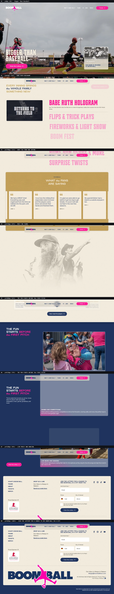
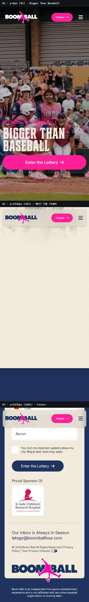

# UI Design System & Master Generation Blueprint: boomballtour-com

> **Boom Ball Baseball · The Ultimate Family Sports Experience** (https://boomballtour.com/) — Discover Boom Ball — the interactive, family-friendly baseball show packed with energy, music, and nonstop fun for all ages.





---

## 1. Executive Visual Persona & Design Archetype

- **Brand Essence & Persona**: **Boom Ball Baseball · The Ultimate Family Sports Experience** (`https://boomballtour.com/`). Discover Boom Ball — the interactive, family-friendly baseball show packed with energy, music, and nonstop fun for all ages.
- **Final Redirected URL**: [https://boomball.com/](https://boomball.com/)
- **Capture Provenance**: Live browser capture (`tier1_fast`, HTTP `200`, captured `2026-11-24`).
- **Visual Archetype**: **Light-Substrate Editorial & Modular Grid System (`#f4eddf` canvas, `#1f335e` ink, `#0000ff` accent)**.
- **Anti-AI-Slop Differentiators**:
  - **Live-Computed Chromatic Polarity**: Anchors the viewport in `#f4eddf` (live computed `body` `background-color` (`computed_styles.json`)) paired with `#1f335e` primary typography and `#0000ff` accents.
  - **Grounded Typographic Hierarchy**: Pairs `Groundout` for display copy (`Bigger Than Baseball`) with `Inter-400`.
  - **Calibrated Spatial Grid & Motion**: Combines `1320px` container bounds (`gap: 16px`, padding `40px`) with `cubic-bezier(0.22,1,0.36,1)` easing and GSAP Timeline & ScrollTrigger, Three.js / WebGL Canvas Pipeline.

---

## 2. Spatial Architecture & Modular Grid Mathematics

### Viewport Allocation & Container Geometry
- **Captured Journey Filmstrips**: Desktop `1280×6624px` (`assets/desktop-journey.webp`, `8` keyframes up to `y=5409px` / doc `6339px`), Mobile `390×2616px` (`assets/mobile-journey.webp`, `3` keyframes).
- **Master Container Bounds**: `1320px` (non-`@media` desktop container stylesheet rule).
- **Canvas Lateral Padding & Spacing**: `40px` lateral canvas padding with `16px` grid gap.
- **Border Radius Scale**: `4px`, `8px`, `var(--bbc-radius)`, `50%`.

### Responsive Breakpoint Architecture
- **Desktop Layout**: Multi-column CSS Grid / Flexbox layout at `1440px` (`max-width: 1320px`, `gap: 16px`).
- **Mobile Layout**: Single-column vertical stack at `390px` viewport width with `40px` horizontal padding.
- **Extracted CSS Media Queries**: `@media screen and (min-width:673px)`, `@media screen and (min-width:1040px)`, `@media screen and (min-width:1110px)`, `@media screen and (min-width:1218px)`.

---

## 3. Color System, Materiality & Atmospheric Lighting

### Semantic Palette & Source Grounding
| Semantic Role | Ground-Truth Value | Extracted Live / CSS Source |
|---|---|---|
| **Primary Canvas Substrate** | `#f4eddf` | live computed `body` `background-color` (`computed_styles.json`) |
| **Primary Typography Ink** | `#1f335e` | live computed `a` `color` (`computed_styles.json`) |
| **Elevated Surface / Card Substrate** | `#f3ebdc` | `var(--bb-color-paper)` in `:root` |
| **Interactive Accent / Highlight** | `#0000ff` | `.bb-consent-btn--primary:hover { background-color: blue }` (`#0000ff`) |
| **Secondary / Muted Copy** | `#5ba238` | `var(--fkcart-saving-text-price-color)` in `:root` |
| **Structural Hairline Border** | `#b8b3a8` | `var(--bb-color-divider)` in `:root` |
| **Variable Token (`--bb-color-pink`)** | `#ff1e96` | `var(--bb-color-pink)` in `:root` |
| **Variable Token (`--bb-color-gold`)** | `#c2a155` | `var(--bb-color-gold)` in `:root` |
| **Variable Token (`--bb-color-ink`)** | `#43433d` | `var(--bb-color-ink)` in `:root` |
| **Variable Token (`--bb-color-white`)** | `#ffffff` | `var(--bb-color-white)` in `:root` |
| **Variable Token (`--bb-color-slate`)** | `#79859f` | `var(--bb-color-slate)` in `:root` |
| **Variable Token (`--bb-color-inactive`)** | `#f894c5` | `var(--bb-color-inactive)` in `:root` |

### Sanitized Root CSS Variables (`ui-ux.md` Ground Truth)
| Variable Name | Extracted Value | Semantic Role |
|---|---|---|
| `--bb-color-pink` | `#ff1e96` | Typography Ink Token |
| `--bb-color-blue` | `#1f335e` | Brand / Palette Token |
| `--bb-color-gold` | `#c2a155` | Brand / Palette Token |
| `--bb-color-ink` | `#43433d` | Typography Ink Token |
| `--bb-color-paper` | `#f3ebdc` | Canvas / Surface Token |
| `--bb-color-white` | `#ffffff` | Canvas / Surface Token |
| `--bb-color-slate` | `#79859f` | Brand / Palette Token |
| `--bb-color-frame` | `rgb(255 255 255 / 35%)` | Brand / Palette Token |
| `--bb-color-divider` | `#B8B3A8` | Brand / Palette Token |
| `--bb-color-inactive` | `#f894c5` | Brand / Palette Token |
| `--bb-font-body` | `"Inter-400", Arial, Helvetica, sans-serif` | Typography / Scale Token |
| `--bb-font-body-medium` | `"Inter-500", Arial, Helvetica, sans-serif` | Typography / Scale Token |
| `--bb-font-heading` | `"Hamburg-700", Arial, Helvetica, sans-serif` | Typography Ink Token |
| `--bb-font-display` | `"Groundout", Georgia, serif` | Typography / Scale Token |
| `--bb-font-script` | `"Brooklyn-700", Georgia, serif` | Typography / Scale Token |
| `--bb-font-mono` | `"Roboto-600", "Courier New", monospace` | Typography / Scale Token |

---

## 4. Typographic Scale & Editorial Hierarchy

### Font Family Stacks
- **Display Typography**: `Groundout`.
- **Primary Body Stack**: `Inter-400`.
- **Technical / Metadata Stack**: not declared in live computed styles (uses primary stack / `ui-monospace`).

### Typographic Scale & Rules (Live Computed & Stylesheet Grounded)
- **Hero Display (`H1`)**: live computed `h1` (`font-size: 96px`, `line-height: 76.8px`, `font-weight: 500`); CSS variables `--bb-font-display: "Groundout", Georgia, serif`, `--bbc-font-display: var(--bb-font-display, Georgia, serif)`; rule `,h1` (`font-size: calc(1.375rem + 1.5vw)`).
- **Section Heading (`H2`)**: live computed `h2` (`font-size: 239.04px`, `line-height: 191.232px`, `font-weight: 400`, `letter-spacing: -3px`); rule `,h2` (`font-size: calc(1.325rem + .9vw)`).
- **Body Copy**: live computed `body` (`font-size: 18px`, `line-height: 23.4px`, `font-weight: 400`); CSS variables `--bb-font-body: "Inter-400", Arial, Helvetica, sans-serif`, `--bb-font-body-medium: "Inter-500", Arial, Helvetica, sans-serif`, `--bs-body-bg-rgb: 255,255,255`; rule `p` (`font-size: 16px`).
- **Metadata & Navigation Labels**: live computed `nav/a` (`font-size: 18px`, `line-height: 23.4px`, `font-weight: 400`); CSS variables `--bb-font-mono: "Roboto-600", "Courier New", monospace`, `--bbc-font-label: var(--bb-font-heading, Arial, Helvetica, sans-serif)`, `--wpforms-field-size-sublabel-spacing: 5px`; rule `,small` (`font-size: .875em`).

---

## 5. Choreographed Motion & Interaction Physics

### Primary Easing Curves
- **Extracted Timing Functions**: `cubic-bezier(0.22,1,0.36,1)`, `cubic-bezier(.215,.61,.355,1)`, `cubic-bezier(.22,1,.36,1)`.

### Per-Element Transition & Choreography Rules
- **Selector `.bb-consent-banner`**: `transition: opacity var(--bbc-duration) var(--bbc-ease), transform var(--b...` extracted from `boomballtour-com` stylesheet.
- **Selector `.bb-consent-banner__expand`**: `transition: background-color 0.25s ease, border-color 0.25s ease` extracted from `boomballtour-com` stylesheet.
- **Selector `.bb-consent-banner__expand svg`**: `transition: transform var(--bbc-duration) var(--bbc-ease)` extracted from `boomballtour-com` stylesheet.
- **Extracted Easing Curve (`cubic-bezier(0.22,1,0.36,1)`)**: Governs interactive state transitions across `<nav.footer-nav>` and `<section.bb-feature>`.
- **Runtime Interaction Engine**: Integrates GSAP Timeline & ScrollTrigger, Three.js / WebGL Canvas Pipeline, Barba.js Page Transition Router with `prefers-reduced-motion: reduce` fallback guards.
### Measured Runtime Scroll & Interaction Telemetry (`behavioral_journey_v2`)
- **Scroll Driver Mode**: `native` (max document height `6339px`, deepest scrollY reached `5409px` across `8` desktop keyframes).
- **Detected Scroll / Motion Libraries**: `GSAP/ScrollTrigger`.
- **Route Transition Architecture**: First internal navigation (`/shop/`) measured as `direct` in `1985ms`.

---

## 6. Component Wireframe & Structural DOM Map

### Visual Layout Schematic — Desktop (`1440px`, Grounded in `dom.html` & Landmark Bounding Boxes)
```
┌────────────────────────────────────────────────────────────────────────┐
│ DESKTOP VIEWPORT (1440px) — Boom Ball Baseball · The Ultimate Family S │
│ ====================================================================== │
│ [ <nav.footer-nav> (273x144px)        | What’s Boom Ball · Teams · A ] │
│ ---------------------------------------------------------------------- │
│ | HERO STAGE: <section.hero-banner> (w=1440px)                       | │
│ | H1: Bigger Than Baseball                                           | │
│ | Substrate: #f4eddf | Ink: #1f335e | Accent: #0000ff                | │
│ ---------------------------------------------------------------------- │
│ | SHOWCASE GRID (<section.bb-feature>) max-w: 1320px                 | │
│ | +------------------------------+  +------------------------------+ | │
│ | | See The Great Bambino take t |  | EVERY INNING BRINGS          | | │
│ | +------------------------------+  +------------------------------+ | │
│ ---------------------------------------------------------------------- │
│ | DETAIL MODULE (<article.bb-feature__item>) — Boom Ball is baseball | │
│ ---------------------------------------------------------------------- │
│ [ FOOTER (<footer.site-footer>) | https://boomballtour.com/            │
└────────────────────────────────────────────────────────────────────────┘
```

### Visual Layout Schematic — Mobile Reflow (`390px`)
```
┌────────────────────────────────────────────────────────────────────────┐
│ MOBILE VIEWPORT REFLOW (390px) — Single-Column Stack (gap: 16px)       │
│ ====================================================================== │
│ [ HEADER BAR (<nav.footer-nav>        ) | Compact Menu (390px)         │
│ ---------------------------------------------------------------------- │
│ | HERO STAGE (<section.hero-banner>) — 390px Vertical Lead           | │
│ | H1: Bigger Than Baseball                                           | │
│ ---------------------------------------------------------------------- │
│ | SHOWCASE STACK (<section.bb-feature>) — 1-Col Stack                | │
│ | [ Item 1: See The Great Bambino take the field and re-crea       ] | │
│ | [ Item 2: EVERY INNING BRINGS                                    ] | │
│ ---------------------------------------------------------------------- │
│ | DETAIL STACK (<article.bb-feature__ite) — 1-Col (Boom Ball is baseb) │
│ ---------------------------------------------------------------------- │
│ [ FOOTER (<footer.site-footer>) | Stacked 390px Colophon               │
└────────────────────────────────────────────────────────────────────────┘
```

### Granular DOM Region Breakdown
1. **Brand Header & Navigation Bar (<nav.footer-nav> — `boomballtour-com`)**:
   - Landmark `<nav class="footer-nav">` (`273x144px`) hosting `Boom Ball Baseball · The Ultimate Fa` navigation (`What’s Boom Ball · Teams · About · Tickets · Merch`), DOM attributes (`data-id="D8BJ15BC77UDFA3HME2G"`, `data-wp-strategy="defer"`, `data-wp-strategy="defer"`, `data-wp-strategy="defer"`), and stylesheet rule `merce-page .woocommerce-message .... { float:right }`.
2. **Hero Stage & Focal Lead (<section.hero-banner> — `Bigger Than Baseball`)**:
   - Landmark `<section class="hero-banner">` presenting display lead `Bigger Than Baseball` and copy excerpt *"See The Great Bambino take the field and re-create his legendary "* over `#f4eddf` canvas and `#1f335e` ink.
3. **Primary Showcase & Content Grid (<section.bb-feature> — `See The Great Bambino take the fie`)**:
   - Landmark `<section class="bb-feature is-enhanced">` rendering section `See The Great Bambino take the field and re-crea` with copy *"EVERY INNING BRINGS"*, asset references (`favicon-96x96.png`, `favicon.svg`, `favicon.ico`, `apple-touch-icon.png`), and grid rule `.woocommerce-page .col2-set { width:100% }`.
4. **Interactive Detail & Feature Matrix (<article.bb-feature__item> — `EVERY INNING BRINGS`)**:
   - Landmark `<article class="bb-feature__item reveal-slide">` framing `EVERY INNING BRINGS` and `Boom Ball is baseball reimagined for families—a ` (*"Boom Ball is baseball reimagined for families—a fast-paced, high-"*) with `#f3ebdc` surface cards, `#0000ff` accents, and `.woocommerce-page .col2-set::before { content:" ";display:table }`.
5. **Colophon & Global Directory Footer (<footer.site-footer> — `https://boomballtour.com/`)**:
   - Landmark `<footer class="site-footer">` anchoring `Boom Ball Baseball · The Ultimat` footer links (`What’s Boom Ball · Teams · About · Tickets · Merch`), copy *"Babe Ruth Hologram"*, and `#b8b3a8` structural dividers.
### Full Vertical Scroll Sequence (Desktop `1440×900` Keyframes)
- **Step 01** (`y=0px`, `0%`): Active landmark `Bigger Than Baseball` · sticky/fixed elements: `1`
- **Step 02** (`y=850px`, `16%`): Active landmark `BABE RUTH HOLOGRAM` · sticky/fixed elements: `1`
- **Step 03** (`y=1700px`, `31%`): Active landmark `WHAT the FANS ARE SAYING` · sticky/fixed elements: `1`
- **Step 04** (`y=2550px`, `47%`): Active landmark `MEET THE TEAMS` · sticky/fixed elements: `1`
- **Step 05** (`y=3400px`, `63%`): Active landmark `THE FUN STARTS BEFORE the FIRST PITCH` · sticky/fixed elements: `2`
- **Step 06** (`y=4250px`, `79%`): Active landmark `THE FUN STARTS BEFORE the FIRST PITCH` · sticky/fixed elements: `2`
- **Step 07** (`y=5100px`, `94%`): Active landmark `LIVE MUSIC AND DANCING` · sticky/fixed elements: `2`
- **Step 08** (`y=5409px`, `100%`): Active landmark `JOIN THE LOTTERY FOR A CHANCE TO SEE BOOM BALL IN...` · sticky/fixed elements: `2`

### Multi-Page Internal Route Map
- **Listing Route (`/shop/`)**: `https://boomball.com/shop/` — H1: `GEAR UP FOR the SHOW`, scrollHeight `4604px`, transition `direct` (`1985ms`)
- **Other Route (`/what-is-boom-ball/`)**: `https://boomball.com/what-is-boom-ball/` — H1: `A NEW CHAPTER in SPORTS ENTERTAINMENT`, scrollHeight `7003px`, transition `direct` (`1015ms`)
- **Other Route (`/teams/`)**: `https://boomball.com/teams/` — H1: `TWO TEAMS BUILT FOR the SPOTLIGHT`, scrollHeight `4603px`, transition `direct` (`657ms`)

---

## 7. Master Zero-Shot AI Generation Prompt

```markdown
# Master Zero-Shot Frontend Generation Prompt: boomballtour-com (Boom Ball Baseball · The Ultimate Family Sports Experience)

You are a principal frontend architect and design systems engineer. Build a complete, production-ready web application replicating the exact design system, DOM landmarks, typographic hierarchy, color tokens, and motion physics of `boomballtour-com` (**Boom Ball Baseball · The Ultimate Family Sports Experience** — `https://boomballtour.com/`).

### 1. Visual Archetype & Anti-AI-Slop Mandates
- **Archetype**: Light-Substrate Editorial & Modular Grid System (`#f4eddf` canvas, `#1f335e` ink, `#0000ff` accent).
- **Identity & Domain Context**: Discover Boom Ball — the interactive, family-friendly baseball show packed with energy, music, and nonstop fun for all ages.
- **Primary Substrate**: `#f4eddf` (live computed `body` `background-color` (`computed_styles.json`)), **Primary Ink**: `#1f335e`, **Accent / Highlight**: `#0000ff`.
- **Site-Specific Differentiators**:
  - **Live-Computed Chromatic Polarity**: Anchors the viewport in `#f4eddf` (live computed `body` `background-color` (`computed_styles.json`)) paired with `#1f335e` primary typography and `#0000ff` accents.
  - **Grounded Typographic Hierarchy**: Pairs `Groundout` for display copy (`Bigger Than Baseball`) with `Inter-400`.
  - **Calibrated Spatial Grid & Motion**: Combines `1320px` container bounds (`gap: 16px`, padding `40px`) with `cubic-bezier(0.22,1,0.36,1)` easing and GSAP Timeline & ScrollTrigger, Three.js / WebGL Canvas Pipeline.

### 2. Ground-Truth CSS Variables (`:root` Token Contract)
Declare and consume these exact custom properties extracted from `boomballtour-com` in your global stylesheet:

:root {
  /* Boom Ball Baseball · The Ultimate Family Sports Experience (boomballtour-com) — Live-Grounded CSS Variables */
  --bb-color-pink: #ff1e96; /* Typography Ink Token (boomballtour-com) */
  --bb-color-blue: #1f335e; /* Brand / Palette Token (boomballtour-com) */
  --bb-color-gold: #c2a155; /* Brand / Palette Token (boomballtour-com) */
  --bb-color-ink: #43433d; /* Typography Ink Token (boomballtour-com) */
  --bb-color-paper: #f3ebdc; /* Canvas / Surface Token (boomballtour-com) */
  --bb-color-white: #ffffff; /* Canvas / Surface Token (boomballtour-com) */
  --bb-color-slate: #79859f; /* Brand / Palette Token (boomballtour-com) */
  --bb-color-frame: rgb(255 255 255 / 35%); /* Brand / Palette Token (boomballtour-com) */
  --bb-color-divider: #B8B3A8; /* Brand / Palette Token (boomballtour-com) */
  --bb-color-inactive: #f894c5; /* Brand / Palette Token (boomballtour-com) */
  --bb-font-body: "Inter-400", Arial, Helvetica, sans-serif; /* Typography / Scale Token (boomballtour-com) */
  --bb-font-body-medium: "Inter-500", Arial, Helvetica, sans-serif; /* Typography / Scale Token (boomballtour-com) */
  --bb-font-heading: "Hamburg-700", Arial, Helvetica, sans-serif; /* Typography Ink Token (boomballtour-com) */
  --bb-font-display: "Groundout", Georgia, serif; /* Typography / Scale Token (boomballtour-com) */
  --bb-font-script: "Brooklyn-700", Georgia, serif; /* Typography / Scale Token (boomballtour-com) */
  --bb-font-mono: "Roboto-600", "Courier New", monospace; /* Typography / Scale Token (boomballtour-com) */
}

### 3. Semantic Color & Materiality Contract
Map every surface, ink, and border strictly to these source-grounded tokens:
- **Primary Canvas Substrate**: `#f4eddf` — grounded in live computed `body` `background-color` (`computed_styles.json`)
- **Primary Typography Ink**: `#1f335e` — grounded in live computed `a` `color` (`computed_styles.json`)
- **Elevated Surface / Card Substrate**: `#f3ebdc` — grounded in `var(--bb-color-paper)` in `:root`
- **Interactive Accent / Highlight**: `#0000ff` — grounded in `.bb-consent-btn--primary:hover { background-color: blue }` (`#0000ff`)
- **Secondary / Muted Copy**: `#5ba238` — grounded in `var(--fkcart-saving-text-price-color)` in `:root`
- **Structural Hairline Border**: `#b8b3a8` — grounded in `var(--bb-color-divider)` in `:root`
- **Variable Token (`--bb-color-pink`)**: `#ff1e96` — grounded in `var(--bb-color-pink)` in `:root`
- **Variable Token (`--bb-color-gold`)**: `#c2a155` — grounded in `var(--bb-color-gold)` in `:root`
- **Variable Token (`--bb-color-ink`)**: `#43433d` — grounded in `var(--bb-color-ink)` in `:root`
- **Variable Token (`--bb-color-white`)**: `#ffffff` — grounded in `var(--bb-color-white)` in `:root`
- **Variable Token (`--bb-color-slate`)**: `#79859f` — grounded in `var(--bb-color-slate)` in `:root`
- **Variable Token (`--bb-color-inactive`)**: `#f894c5` — grounded in `var(--bb-color-inactive)` in `:root`

### 4. Spatial Grid, Container Bounds & Responsive Breakpoints
- **Desktop Viewport Reference**: `1280×6624px` (multi-frame vertical journey filmstrip (6624px), `1440px` standard desktop width).
- **Mobile Viewport Reference**: `390×2616px` (multi-frame vertical journey filmstrip (2616px), `390px` standard mobile width).
- **Container Max-Width**: `1320px` (non-`@media` desktop container stylesheet rule)
- **Padding & Gutters**: `40px` lateral canvas padding with `16px` grid gap
- **Desktop Grid**: Multi-column CSS Grid / Flexbox layout at `1440px` (`max-width: 1320px`, `gap: 16px`)
- **Mobile Adaptation**: Single-column vertical stack at `390px` viewport width with `40px` horizontal padding
- **Media Queries**: `@media screen and (min-width:673px)`, `@media screen and (min-width:1040px)`, `@media screen and (min-width:1110px)`, `@media screen and (min-width:1218px)`
- **Corner Radii**: `4px`, `8px`, `var(--bbc-radius)`, `50%`

### 5. Typography & Editorial Scale Contract
- **Display Font Stack**: `Groundout`
- **Body Font Stack**: `Inter-400`
- **Monospace / Technical Font Stack**: not declared in live computed styles (uses primary stack / `ui-monospace`)
- **H1 Display Rule**: live computed `h1` (`font-size: 96px`, `line-height: 76.8px`, `font-weight: 500`); CSS variables `--bb-font-display: "Groundout", Georgia, serif`, `--bbc-font-display: var(--bb-font-display, Georgia, serif)`; rule `,h1` (`font-size: calc(1.375rem + 1.5vw)`)
- **H2 Section Rule**: live computed `h2` (`font-size: 239.04px`, `line-height: 191.232px`, `font-weight: 400`, `letter-spacing: -3px`); rule `,h2` (`font-size: calc(1.325rem + .9vw)`)
- **Body Copy Rule**: live computed `body` (`font-size: 18px`, `line-height: 23.4px`, `font-weight: 400`); CSS variables `--bb-font-body: "Inter-400", Arial, Helvetica, sans-serif`, `--bb-font-body-medium: "Inter-500", Arial, Helvetica, sans-serif`, `--bs-body-bg-rgb: 255,255,255`; rule `p` (`font-size: 16px`)
- **Metadata & Index Rule**: live computed `nav/a` (`font-size: 18px`, `line-height: 23.4px`, `font-weight: 400`); CSS variables `--bb-font-mono: "Roboto-600", "Courier New", monospace`, `--bbc-font-label: var(--bb-font-heading, Arial, Helvetica, sans-serif)`, `--wpforms-field-size-sublabel-spacing: 5px`; rule `,small` (`font-size: .875em`)

### 6. Component Hierarchy, Verbatim Copy & Real DOM Landmarks
Scaffold `boomballtour-com` (`Boom Ball Baseball · The Ultimate Family Sports Experience`) with these exact structural regions, extracted copy, and CSS rules from `dom.html`:
1. **Brand Header & Navigation Bar (<nav.footer-nav> — `boomballtour-com`)**:
   - DOM & Selectors: Landmark `<nav class="footer-nav">` (`273x144px`) hosting `Boom Ball Baseball · The Ultimate Fa` navigation (`What’s Boom Ball · Teams · About · Tickets · Merch`), DOM attributes (`data-id="D8BJ15BC77UDFA3HME2G"`, `data-wp-strategy="defer"`, `data-wp-strategy="defer"`, `data-wp-strategy="defer"`), and stylesheet rule `merce-page .woocommerce-message .... { float:right }`.
   - Responsive Contract: Header `Brand Header & Navigation Bar (<nav.footer-nav> — `boomballtour-com`)` (`boomballtour-com`) adapts across `@media screen and (min-width:673px)`, `@media screen and (min-width:1040px)`, `@media screen and (min-width:1110px)`, `@media screen and (min-width:1218px)` with `cubic-bezier(0.22,1,0.36,1)`, `cubic-bezier(.215,.61,.355,1)`, `cubic-bezier(.22,1,.36,1)` transitions and links `What’s Boom Ball · Teams · About · Tickets · Merch`.
2. **Hero Stage & Focal Lead (<section.hero-banner> — `Bigger Than Baseball`)**:
   - DOM & Selectors: Landmark `<section class="hero-banner">` presenting display lead `Bigger Than Baseball` and copy excerpt *"See The Great Bambino take the field and re-create his legendary "* over `#f4eddf` canvas and `#1f335e` ink.
   - Responsive Contract: Hero stage (`1280×6624px` desktop / `390×2616px` mobile) sets `#f4eddf` background with `#1f335e` headline `Bigger Than Baseball`.
3. **Primary Showcase & Content Grid (<section.bb-feature> — `See The Great Bambino take the fie`)**:
   - DOM & Selectors: Landmark `<section class="bb-feature is-enhanced">` rendering section `See The Great Bambino take the field and re-crea` with copy *"EVERY INNING BRINGS"*, asset references (`favicon-96x96.png`, `favicon.svg`, `favicon.ico`, `apple-touch-icon.png`), and grid rule `.woocommerce-page .col2-set { width:100% }`.
   - Responsive Contract: Showcase grid `Primary Showcase & Content Grid (<section.bb-feature> — `See The Great Bambino take the fie`)` applies Multi-column CSS Grid / Flexbox layout at `1440px` (`max-width: 1320px`, `gap: 16px`) on desktop and Single-column vertical stack at `390px` viewport width with `40px` horizontal padding on mobile.
4. **Interactive Detail & Feature Matrix (<article.bb-feature__item> — `EVERY INNING BRINGS`)**:
   - DOM & Selectors: Landmark `<article class="bb-feature__item reveal-slide">` framing `EVERY INNING BRINGS` and `Boom Ball is baseball reimagined for families—a ` (*"Boom Ball is baseball reimagined for families—a fast-paced, high-"*) with `#f3ebdc` surface cards, `#0000ff` accents, and `.woocommerce-page .col2-set::before { content:" ";display:table }`.
   - Responsive Contract: Detail module `Interactive Detail & Feature Matrix (<article.bb-feature__item> — `EVERY INNING BRINGS`)` uses `4px`, `8px`, `var(--bbc-radius)`, `50%` radii, `#0000ff` highlights, and assets (favicon-96x96.png, favicon.svg, favicon.ico).
5. **Colophon & Global Directory Footer (<footer.site-footer> — `https://boomballtour.com/`)**:
   - DOM & Selectors: Landmark `<footer class="site-footer">` anchoring `Boom Ball Baseball · The Ultimat` footer links (`What’s Boom Ball · Teams · About · Tickets · Merch`), copy *"Babe Ruth Hologram"*, and `#b8b3a8` structural dividers.
   - Responsive Contract: Footer `Colophon & Global Directory Footer (<footer.site-footer> — `https://boomballtour.com/`)` aligns to `1320px` (non-`@media` desktop container stylesheet rule) with `40px` lateral canvas padding with `16px` grid gap and attributes (data-id="D8BJ15BC77UDFA3HME2G", data-wp-strategy="defer", data-wp-strategy="defer").

#### Verbatim DOM Copy Excerpts (`dom.html`)
- Copy Excerpt 1: *"See The Great Bambino take the field and re-create his legendary Called Shot momen..."*
- Copy Excerpt 2: *"EVERY INNING BRINGS"*
- Copy Excerpt 3: *"Boom Ball is baseball reimagined for families—a fast-paced, high-energy show packe..."*
- Copy Excerpt 4: *"Babe Ruth Hologram"*

### 7. Motion, Extracted Stylesheet Rules & Interaction Choreography
- **Primary Easing Functions**: `cubic-bezier(0.22,1,0.36,1)`, `cubic-bezier(.215,.61,.355,1)`, `cubic-bezier(.22,1,.36,1)`
- **Extracted Stylesheet Rules (`boomballtour-com`)**:
- `merce-page .woocommerce-message .... { float:right }`
- `.woocommerce-page .col2-set { width:100% }`
- `.woocommerce-page .col2-set::before { content:" ";display:table }`
- `.woocommerce-page .col2-set::after { clear:both }`
- `.woocommerce-page .col2-set .col-1 { float:left;width:48% }`
- **Per-Selector Transition Rules**:
- **Selector `.bb-consent-banner`**: `transition: opacity var(--bbc-duration) var(--bbc-ease), transform var(--b...` extracted from `boomballtour-com` stylesheet.
- **Selector `.bb-consent-banner__expand`**: `transition: background-color 0.25s ease, border-color 0.25s ease` extracted from `boomballtour-com` stylesheet.
- **Selector `.bb-consent-banner__expand svg`**: `transition: transform var(--bbc-duration) var(--bbc-ease)` extracted from `boomballtour-com` stylesheet.
- **Extracted Easing Curve (`cubic-bezier(0.22,1,0.36,1)`)**: Governs interactive state transitions across `<nav.footer-nav>` and `<section.bb-feature>`.
- **Runtime Interaction Engine**: Integrates GSAP Timeline & ScrollTrigger, Three.js / WebGL Canvas Pipeline, Barba.js Page Transition Router with `prefers-reduced-motion: reduce` fallback guards.
### 7b. Full-Page Scroll Choreography, Interactive States & Multi-Page Routes
- **Scroll Mechanics**: Implement `native` vertical progression up to `6339px` across 8 distinct viewport chapters using GSAP/ScrollTrigger.
- **Vertical Chapter Sequence**: Bigger Than Baseball (0%) -> BABE RUTH HOLOGRAM (16%) -> WHAT the FANS ARE SAYING (31%) -> MEET THE TEAMS (47%) -> THE FUN STARTS BEFORE the F... (63%) -> THE FUN STARTS BEFORE the F... (79%) -> LIVE MUSIC AND DANCING (94%) -> JOIN THE LOTTERY FOR A CHAN... (100%).
- **Multi-Page Routes**: Scaffold internal routes `/shop/` (listing, direct), `/what-is-boom-ball/` (other, direct), `/teams/` (other, direct) sharing the global header/footer shell and design tokens.

### 8. Technical Deliverables
- Implement in Next.js (App Router) with TypeScript and Tailwind CSS consuming the `:root` custom properties defined above for `boomballtour-com`.
- Reproduce both the `1440px` desktop architecture and `390px` mobile breakpoint transitions, preserving semantic HTML5 landmarks (`<header>`, `<nav>`, `<main>`, `<section>`, `<footer>`) and `prefers-reduced-motion` accessibility guards.
```
---

## 8. Full-Page Scroll Journey, Interactive States & Subpage Inventory

### Desktop Scroll Keyframes (`1440×900` WebP)
| Step | Scroll Y | Progress | Active Landmark / Section | Sticky/Fixed | Visual Asset |
| :---: | :---: | :---: | :--- | :---: | :--- |
| `#01` | `0px` | `0%` | Bigger Than Baseball | `1` | [desktop-step-01.webp](assets/desktop-step-01.webp) |
| `#02` | `850px` | `16%` | BABE RUTH HOLOGRAM | `1` | [desktop-step-02.webp](assets/desktop-step-02.webp) |
| `#03` | `1700px` | `31%` | WHAT the FANS ARE SAYING | `1` | [desktop-step-03.webp](assets/desktop-step-03.webp) |
| `#04` | `2550px` | `47%` | MEET THE TEAMS | `1` | [desktop-step-04.webp](assets/desktop-step-04.webp) |
| `#05` | `3400px` | `63%` | THE FUN STARTS BEFORE the FIRST PITCH | `2` | [desktop-step-05.webp](assets/desktop-step-05.webp) |
| `#06` | `4250px` | `79%` | THE FUN STARTS BEFORE the FIRST PITCH | `2` | [desktop-step-06.webp](assets/desktop-step-06.webp) |
| `#07` | `5100px` | `94%` | LIVE MUSIC AND DANCING | `2` | [desktop-step-07.webp](assets/desktop-step-07.webp) |
| `#08` | `5409px` | `100%` | JOIN THE LOTTERY FOR A CHANCE TO SEE BOOM BAL... | `2` | [desktop-step-08.webp](assets/desktop-step-08.webp) |

### Mobile Condensed Keyframes (`390×844` WebP)
| Step | Scroll Y | Progress | Active Landmark | Visual Asset |
| :---: | :---: | :---: | :--- | :--- |
| `#01` | `0px` | `0%` | Bigger Than Baseball | [mobile-step-01.webp](assets/mobile-step-01.webp) |
| `#02` | `2938px` | `50%` | MEET THE TEAMS | [mobile-step-02.webp](assets/mobile-step-02.webp) |
| `#03` | `5876px` | `100%` | Footer | [mobile-step-03.webp](assets/mobile-step-03.webp) |

### Internal Subpage Filmstrips (`1080px` Wide WebP)
| # | Template | Route URL | H1 / Title | Scroll Height | Transition | Filmstrip Asset |
| :-: | :---: | :--- | :--- | :---: | :---: | :--- |
| `1` | `listing` | `https://boomball.com/shop/` | GEAR UP FOR the SHOW | `4604px` | `direct` (`1985ms`) | [subpage-01-shop.webp](assets/subpage-01-shop.webp) |
| `2` | `other` | `https://boomball.com/what-is-boom-ball/` | A NEW CHAPTER in SPORTS ENTERTAINMENT | `7003px` | `direct` (`1015ms`) | [subpage-02-what-is-boom-ball.webp](assets/subpage-02-what-is-boom-ball.webp) |
| `3` | `other` | `https://boomball.com/teams/` | TWO TEAMS BUILT FOR the SPOTLIGHT | `4603px` | `direct` (`657ms`) | [subpage-03-teams.webp](assets/subpage-03-teams.webp) |

