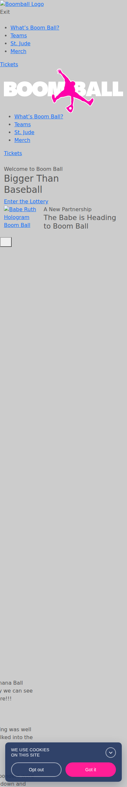

# UI Design System & Master Generation Blueprint: boomballtour-com

> **Boom Ball Baseball · The Ultimate Family Sports Experience** (https://boomballtour.com/) — Discover Boom Ball — the interactive, family-friendly baseball show packed with energy, music, and nonstop fun for all ages.


---

## 1. Executive Visual Persona & Design Archetype

- **Brand Essence & Persona**: **Boom Ball Baseball · The Ultimate Family Sports Experience** (`https://boomballtour.com/`). Discover Boom Ball — the interactive, family-friendly baseball show packed with energy, music, and nonstop fun for all ages.
- **Visual Archetype**: **Light-Substrate Editorial & Modular Grid System (`#ccc` canvas, `#6610f2` ink, `#6610f2` accent)**.
- **Anti-AI-Slop Differentiators**:
  - **Source-Grounded Chromatic Polarity**: Anchors the viewport in `#ccc` (`var(--iti-border-color)` in `:root`) paired with `#6610f2` primary typography and `#6610f2` accents.
  - **Extracted Typographic Hierarchy**: Pairs `Brooklyn-700` for display copy (`Bigger Than Baseball`) with `Hamburg-700` and not declared in static CSS (uses primary stack / `ui-monospace`).
  - **Calibrated Spatial Grid & Motion**: Combines `767px` container bounds (`gap: 10px`, padding `14px`) with `cubic-bezier(0.22,1,0.36,1)` easing and GSAP Timeline & ScrollTrigger, Three.js / WebGL Canvas Pipeline.

---

## 2. Spatial Architecture & Modular Grid Mathematics



### Viewport Allocation & Container Geometry
- **Captured Viewport Dimensions**: Desktop `1440×2400px` (`assets/desktop.png`, capped at 2400px multi-section capture), Mobile `390×2400px` (`assets/mobile.png`, capped at 2400px multi-section capture).
- **Master Container Bounds**: `767px` extracted from `boomballtour-com` stylesheet.
- **Canvas Lateral Padding & Spacing**: `14px` lateral canvas padding with `10px` grid gap.
- **Border Radius Scale**: `999px`, `var(--bbc-radius)`, `50%`, `100px`.

### Responsive Breakpoint Architecture
- **Desktop Layout**: Multi-column CSS Grid / Flexbox layout at `1440px` (`max-width: 767px`, `gap: 10px`).
- **Mobile Layout**: Single-column vertical stack at `390px` viewport width with `14px` horizontal padding.
- **Extracted CSS Media Queries**: `@media (max-width: 767px)`, `@media (prefers-reduced-motion: reduce)`, `@media (min-width: 576px) and (max-width: 991.98px)`, `@media (min-width: 992px)`.

---

## 3. Color System, Materiality & Atmospheric Lighting

### Semantic Palette & Source Grounding
| Semantic Role | Ground-Truth Value | Extracted CSS Source / Selector |
|---|---|---|
| **Primary Canvas Substrate** | `#ccc` | `var(--iti-border-color)` in `:root` |
| **Primary Typography Ink** | `#555` | `var(--iti-icon-color)` in `:root` |
| **Elevated Surface / Card Substrate** | `#0d6efd` | `var(--bs-blue)` in `:root` |
| **Interactive Accent / Highlight** | `#6610f2` | `var(--bs-indigo)` in `:root` |
| **Secondary / Muted Copy** | `#6f42c1` | `var(--bs-purple)` in `:root` |
| **Structural Hairline Border** | `#d63384` | `var(--bs-pink)` in `:root` |
| **Variable Token (`--bbc-blue`)** | `#1f335e` | `var(--bbc-blue)` in `:root` |
| **Variable Token (`--bbc-pink`)** | `#ff1e96` | `var(--bbc-pink)` in `:root` |
| **Variable Token (`--bbc-gold`)** | `#c2a155` | `var(--bbc-gold)` in `:root` |
| **Variable Token (`--bbc-paper`)** | `#f3ebdc` | `var(--bbc-paper)` in `:root` |
| **Variable Token (`--bbc-ink`)** | `#43433d` | `var(--bbc-ink)` in `:root` |
| **Variable Token (`--bbc-white`)** | `#fff` | `var(--bbc-white)` in `:root` |

### Sanitized Root CSS Variables (`ui-ux.md` Ground Truth)
| Variable Name | Extracted Value | Semantic Role |
|---|---|---|
| `--fa-family-brands` | `"Font Awesome 7 Brands"` | Brand / Palette Token |
| `--fa-font-brands` | `normal 400 1em/1 var(--fa-family-brands)` | Brand / Palette Token |
| `--fa-family` | `var(--fa-family-brands)` | Typography / Scale Token |
| `--fa-style` | `400` | Design System Custom Token |
| `--bbc-blue` | `var(--bb-color-blue, #1f335e)` | Color / Atmospheric Token |
| `--bbc-pink` | `var(--bb-color-pink, #ff1e96)` | Typography Ink Token |
| `--bbc-gold` | `var(--bb-color-gold, #c2a155)` | Color / Atmospheric Token |
| `--bbc-paper` | `var(--bb-color-paper, #f3ebdc)` | Canvas / Surface Token |
| `--bbc-ink` | `var(--bb-color-ink, #43433d)` | Typography Ink Token |
| `--bbc-white` | `var(--bb-color-white, #fff)` | Canvas / Surface Token |
| `--bbc-radius` | `var(--bb-radius-media, 10px)` | Elevation / Border Token |
| `--bbc-ease` | `var(--bb-motion-ease, cubic-bezier(0.22, 1, 0.36, 1))` | Motion / Easing Token |
| `--bbc-duration` | `var(--bb-motion-duration, 0.42s)` | Motion / Easing Token |
| `--bbc-font-body` | `var(--bb-font-body, Arial, Helvetica, sans-serif)` | Typography / Scale Token |
| `--bbc-font-strong` | `"Inter-600", var(--bbc-font-body)` | Typography / Scale Token |
| `--bbc-font-label` | `var(--bb-font-heading, Arial, Helvetica, sans-serif)` | Typography / Scale Token |

---

## 4. Typographic Scale & Editorial Hierarchy

### Font Family Stacks
- **Display Typography**: `Brooklyn-700`.
- **Primary Body Stack**: `Hamburg-700`.
- **Technical / Metadata Stack**: not declared in static CSS (uses primary stack / `ui-monospace`).

### Typographic Scale & Rules (Extracted from Stylesheet & Variables)
- **Hero Display (`H1`)**: CSS variables `--bbc-font-display: var(--bb-font-display, Georgia, serif)`, `--bb-font-display: "Groundout", Georgia, serif`; rule `,h1` (`font-size: calc(1.375rem + 1.5vw)`).
- **Section Heading (`H2`)**: rule `,h2` (`font-size: calc(1.325rem + .9vw)`).
- **Body Copy**: CSS variables `--bbc-font-body: var(--bb-font-body, Arial, Helvetica, sans-serif)`, `--bs-body-color-rgb: 33,37,41`, `--bs-body-bg-rgb: 255,255,255`; rule `p` (`font-size: 16px!important`).
- **Metadata & Navigation Labels**: CSS variables `--bbc-font-label: var(--bb-font-heading, Arial, Helvetica, sans-serif)`, `--bb-font-mono: "Roboto-600", "Courier New", monospace`, `--wpforms-label-color: rgba( 0, 0, 0, 0.85 )`; rule `,small` (`font-size: .875em`).

---

## 5. Choreographed Motion & Interaction Physics

### Primary Easing Curves
- **Extracted Timing Functions**: `cubic-bezier(0.22,1,0.36,1)`, `cubic-bezier(0.6,0,0.2,1)`, `cubic-bezier(.28,.84,.42,1)`.

### Per-Element Transition & Choreography Rules
- **Selector `.bb-consent-banner`**: `transition: opacity var(--bbc-duration) var(--bbc-ease), transform var(--b...` extracted from `boomballtour-com` stylesheet.
- **Selector `.bb-consent-banner__expand`**: `transition: background-color 0.25s ease, border-color 0.25s ease` extracted from `boomballtour-com` stylesheet.
- **Selector `.bb-consent-banner__expand svg`**: `transition: transform var(--bbc-duration) var(--bbc-ease)` extracted from `boomballtour-com` stylesheet.
- **Extracted Easing Curve (`cubic-bezier(0.22,1,0.36,1)`)**: Governs interactive state transitions across `<nav.footer-nav>` and `<section.bb-feature>`.
- **Runtime Interaction Engine**: Integrates GSAP Timeline & ScrollTrigger, Three.js / WebGL Canvas Pipeline, Barba.js Page Transition Router with `prefers-reduced-motion: reduce` fallback guards.

---

## 6. Component Wireframe & Structural DOM Map

### Visual Layout Schematic (Grounded in `dom.html` — `1440px` Desktop & `390px` Mobile Reflow)
```
┌────────────────────────────────────────────────────────────────────────┐
│ DESKTOP VIEWPORT (1440px) — Boom Ball Baseball · The Ultimate Family S │
│ ====================================================================== │
│ [ <nav.footer-nav>         | What’s Boom Ball · Teams · About · Tic ]  │
│ ---------------------------------------------------------------------- │
│ | HERO STAGE: <section.hero-banner>                                |   │
│ | H1: Bigger Than Baseball                                         |   │
│ | Substrate: #ccc       | Ink: #6610f2    | Accent: #6610f2        |   │
│ ---------------------------------------------------------------------- │
│ | SHOWCASE GRID (<section.bb-feature>      ) max-w: 767px          |   │
│ | +------------------------------+  +------------------------------+ | │
│ | | EVERY INNING BRINGS the WHOL |  | Babe Ruth Hologram           | | │
│ | +------------------------------+  +------------------------------+ | │
│ ---------------------------------------------------------------------- │
│ | MOBILE VIEWPORT REFLOW (390px) — Single-Column Stack (gap: 10px  ) | │
│ | [<nav.footer-nav>] -> [<section.hero-bann] -> [<section.bb-featur] | │
│ ---------------------------------------------------------------------- │
│ [ FOOTER (<footer.site-footer>  ) | https://boomballtour.com/          │
└────────────────────────────────────────────────────────────────────────┘
```

### Granular DOM Region Breakdown
1. **Brand Header & Navigation Bar (<nav.footer-nav> — `boomballtour-com`)**:
   - Landmark `<nav class="footer-nav">` hosting `Boom Ball Baseball · The Ultimate Fa` navigation (`What’s Boom Ball · Teams · About · Tickets · Merch`), DOM attributes (`data-id="D8BJ15BC77UDFA3HME2G"`, `data-wp-strategy="defer"`, `data-wp-strategy="defer"`, `data-wp-strategy="defer"`), and stylesheet rule `root { --fa-family-brands:"Font Awesome 7 Brands";--fa-font-brands:normal 400 1... }`.
2. **Hero Stage & Focal Lead (<section.hero-banner> — `Bigger Than Baseball`)**:
   - Landmark `<section class="hero-banner">` presenting display lead `Bigger Than Baseball` and copy excerpt *"EVERY INNING BRINGS"* over `#ccc` canvas and `#6610f2` ink.
3. **Primary Showcase & Content Grid (<section.bb-feature> — `EVERY INNING BRINGS the WHOLE FAMI`)**:
   - Landmark `<section class="bb-feature is-enhanced">` rendering section `EVERY INNING BRINGS the WHOLE FAMILY SOMETHING NEW` with copy *"Boom Ball is baseball reimagined for families—a fast-paced, high-"*, asset references (`favicon-96x96.png`, `favicon.svg`, `favicon.ico`, `apple-touch-icon.png`), and grid rule `.fab { --fa-family:var(--fa-family-brands);--fa-style:400 }`.
4. **Interactive Detail & Feature Matrix (<article.bb-feature__item> — `Babe Ruth Hologram`)**:
   - Landmark `<article class="bb-feature__item reveal-slide">` framing `Babe Ruth Hologram` and `Flips & Trick Plays` (*"Babe Ruth Hologram"*) with `#0d6efd` surface cards, `#6610f2` accents, and `.fa-firefox-browser { --fa:"\e007" }`.
5. **Colophon & Global Directory Footer (<footer.site-footer> — `https://boomballtour.com/`)**:
   - Landmark `<footer class="site-footer">` anchoring `Boom Ball Baseball · The Ultimat` footer links (`What’s Boom Ball · Teams · About · Tickets · Merch`), copy *"See The Great Bambino take the field and re-create his legen"*, and `#d63384` structural dividers.

---

## 7. Master Zero-Shot AI Generation Prompt

```markdown
# Master Zero-Shot Frontend Generation Prompt: boomballtour-com (Boom Ball Baseball · The Ultimate Family Sports Experience)

You are a principal frontend architect and design systems engineer. Build a complete, production-ready web application replicating the exact design system, DOM landmarks, typographic hierarchy, color tokens, and motion physics of `boomballtour-com` (**Boom Ball Baseball · The Ultimate Family Sports Experience** — `https://boomballtour.com/`).

### 1. Visual Archetype & Anti-AI-Slop Mandates
- **Archetype**: Light-Substrate Editorial & Modular Grid System (`#ccc` canvas, `#6610f2` ink, `#6610f2` accent).
- **Identity & Domain Context**: Discover Boom Ball — the interactive, family-friendly baseball show packed with energy, music, and nonstop fun for all ages.
- **Primary Substrate**: `#ccc` (`var(--iti-border-color)` in `:root`), **Primary Ink**: `#6610f2`, **Accent / Highlight**: `#6610f2`.
- **Site-Specific Differentiators**:
  - **Source-Grounded Chromatic Polarity**: Anchors the viewport in `#ccc` (`var(--iti-border-color)` in `:root`) paired with `#6610f2` primary typography and `#6610f2` accents.
  - **Extracted Typographic Hierarchy**: Pairs `Brooklyn-700` for display copy (`Bigger Than Baseball`) with `Hamburg-700` and not declared in static CSS (uses primary stack / `ui-monospace`).
  - **Calibrated Spatial Grid & Motion**: Combines `767px` container bounds (`gap: 10px`, padding `14px`) with `cubic-bezier(0.22,1,0.36,1)` easing and GSAP Timeline & ScrollTrigger, Three.js / WebGL Canvas Pipeline.

### 2. Ground-Truth CSS Variables (`:root` Token Contract)
Declare and consume these exact custom properties extracted from `boomballtour-com` in your global stylesheet:

:root {
  /* Boom Ball Baseball · The Ultimate Family Sports Experience (boomballtour-com) — Ground-Truth Extracted CSS Variables */
  --fa-family-brands: "Font Awesome 7 Brands"; /* Brand / Palette Token (boomballtour-com) */
  --fa-font-brands: normal 400 1em/1 var(--fa-family-brands); /* Brand / Palette Token (boomballtour-com) */
  --fa-family: var(--fa-family-brands); /* Typography / Scale Token (boomballtour-com) */
  --fa-style: 400; /* Design System Custom Token (boomballtour-com) */
  --bbc-blue: var(--bb-color-blue, #1f335e); /* Color / Atmospheric Token (boomballtour-com) */
  --bbc-pink: var(--bb-color-pink, #ff1e96); /* Typography Ink Token (boomballtour-com) */
  --bbc-gold: var(--bb-color-gold, #c2a155); /* Color / Atmospheric Token (boomballtour-com) */
  --bbc-paper: var(--bb-color-paper, #f3ebdc); /* Canvas / Surface Token (boomballtour-com) */
  --bbc-ink: var(--bb-color-ink, #43433d); /* Typography Ink Token (boomballtour-com) */
  --bbc-white: var(--bb-color-white, #fff); /* Canvas / Surface Token (boomballtour-com) */
  --bbc-radius: var(--bb-radius-media, 10px); /* Elevation / Border Token (boomballtour-com) */
  --bbc-ease: var(--bb-motion-ease, cubic-bezier(0.22, 1, 0.36, 1)); /* Motion / Easing Token (boomballtour-com) */
  --bbc-duration: var(--bb-motion-duration, 0.42s); /* Motion / Easing Token (boomballtour-com) */
  --bbc-font-body: var(--bb-font-body, Arial, Helvetica, sans-serif); /* Typography / Scale Token (boomballtour-com) */
  --bbc-font-strong: "Inter-600", var(--bbc-font-body); /* Typography / Scale Token (boomballtour-com) */
  --bbc-font-label: var(--bb-font-heading, Arial, Helvetica, sans-serif); /* Typography / Scale Token (boomballtour-com) */
}

### 3. Semantic Color & Materiality Contract
Map every surface, ink, and border strictly to these source-grounded tokens:
- **Primary Canvas Substrate**: `#ccc` — grounded in `var(--iti-border-color)` in `:root`
- **Primary Typography Ink**: `#555` — grounded in `var(--iti-icon-color)` in `:root`
- **Elevated Surface / Card Substrate**: `#0d6efd` — grounded in `var(--bs-blue)` in `:root`
- **Interactive Accent / Highlight**: `#6610f2` — grounded in `var(--bs-indigo)` in `:root`
- **Secondary / Muted Copy**: `#6f42c1` — grounded in `var(--bs-purple)` in `:root`
- **Structural Hairline Border**: `#d63384` — grounded in `var(--bs-pink)` in `:root`
- **Variable Token (`--bbc-blue`)**: `#1f335e` — grounded in `var(--bbc-blue)` in `:root`
- **Variable Token (`--bbc-pink`)**: `#ff1e96` — grounded in `var(--bbc-pink)` in `:root`
- **Variable Token (`--bbc-gold`)**: `#c2a155` — grounded in `var(--bbc-gold)` in `:root`
- **Variable Token (`--bbc-paper`)**: `#f3ebdc` — grounded in `var(--bbc-paper)` in `:root`
- **Variable Token (`--bbc-ink`)**: `#43433d` — grounded in `var(--bbc-ink)` in `:root`
- **Variable Token (`--bbc-white`)**: `#fff` — grounded in `var(--bbc-white)` in `:root`

### 4. Spatial Grid, Container Bounds & Responsive Breakpoints
- **Desktop Viewport Reference**: `1440×2400px` (capped at 2400px multi-section capture, `1440px` standard desktop width).
- **Mobile Viewport Reference**: `390×2400px` (capped at 2400px multi-section capture, `390px` standard mobile width).
- **Container Max-Width**: `767px` extracted from `boomballtour-com` stylesheet
- **Padding & Gutters**: `14px` lateral canvas padding with `10px` grid gap
- **Desktop Grid**: Multi-column CSS Grid / Flexbox layout at `1440px` (`max-width: 767px`, `gap: 10px`)
- **Mobile Adaptation**: Single-column vertical stack at `390px` viewport width with `14px` horizontal padding
- **Media Queries**: `@media (max-width: 767px)`, `@media (prefers-reduced-motion: reduce)`, `@media (min-width: 576px) and (max-width: 991.98px)`, `@media (min-width: 992px)`
- **Corner Radii**: `999px`, `var(--bbc-radius)`, `50%`, `100px`

### 5. Typography & Editorial Scale Contract
- **Display Font Stack**: `Brooklyn-700`
- **Body Font Stack**: `Hamburg-700`
- **Monospace / Technical Font Stack**: not declared in static CSS (uses primary stack / `ui-monospace`)
- **H1 Display Rule**: CSS variables `--bbc-font-display: var(--bb-font-display, Georgia, serif)`, `--bb-font-display: "Groundout", Georgia, serif`; rule `,h1` (`font-size: calc(1.375rem + 1.5vw)`)
- **H2 Section Rule**: rule `,h2` (`font-size: calc(1.325rem + .9vw)`)
- **Body Copy Rule**: CSS variables `--bbc-font-body: var(--bb-font-body, Arial, Helvetica, sans-serif)`, `--bs-body-color-rgb: 33,37,41`, `--bs-body-bg-rgb: 255,255,255`; rule `p` (`font-size: 16px!important`)
- **Metadata & Index Rule**: CSS variables `--bbc-font-label: var(--bb-font-heading, Arial, Helvetica, sans-serif)`, `--bb-font-mono: "Roboto-600", "Courier New", monospace`, `--wpforms-label-color: rgba( 0, 0, 0, 0.85 )`; rule `,small` (`font-size: .875em`)

### 6. Component Hierarchy, Verbatim Copy & Real DOM Landmarks
Scaffold `boomballtour-com` (`Boom Ball Baseball · The Ultimate Family Sports Experience`) with these exact structural regions, extracted copy, and CSS rules from `dom.html`:
1. **Brand Header & Navigation Bar (<nav.footer-nav> — `boomballtour-com`)**:
   - DOM & Selectors: Landmark `<nav class="footer-nav">` hosting `Boom Ball Baseball · The Ultimate Fa` navigation (`What’s Boom Ball · Teams · About · Tickets · Merch`), DOM attributes (`data-id="D8BJ15BC77UDFA3HME2G"`, `data-wp-strategy="defer"`, `data-wp-strategy="defer"`, `data-wp-strategy="defer"`), and stylesheet rule `root { --fa-family-brands:"Font Awesome 7 Brands";--fa-font-brands:normal 400 1... }`.
   - Responsive Contract: Header `Brand Header & Navigation Bar (<nav.footer-nav> — `boomballtour-com`)` (`boomballtour-com`) adapts across `@media (max-width: 767px)`, `@media (prefers-reduced-motion: reduce)`, `@media (min-width: 576px) and (max-width: 991.98px)`, `@media (min-width: 992px)` with `cubic-bezier(0.22,1,0.36,1)`, `cubic-bezier(0.6,0,0.2,1)`, `cubic-bezier(.28,.84,.42,1)` transitions and links `What’s Boom Ball · Teams · About · Tickets · Merch`.
2. **Hero Stage & Focal Lead (<section.hero-banner> — `Bigger Than Baseball`)**:
   - DOM & Selectors: Landmark `<section class="hero-banner">` presenting display lead `Bigger Than Baseball` and copy excerpt *"EVERY INNING BRINGS"* over `#ccc` canvas and `#6610f2` ink.
   - Responsive Contract: Hero stage (`1440×2400px` desktop / `390×2400px` mobile) sets `#ccc` background with `#6610f2` headline `Bigger Than Baseball`.
3. **Primary Showcase & Content Grid (<section.bb-feature> — `EVERY INNING BRINGS the WHOLE FAMI`)**:
   - DOM & Selectors: Landmark `<section class="bb-feature is-enhanced">` rendering section `EVERY INNING BRINGS the WHOLE FAMILY SOMETHING NEW` with copy *"Boom Ball is baseball reimagined for families—a fast-paced, high-"*, asset references (`favicon-96x96.png`, `favicon.svg`, `favicon.ico`, `apple-touch-icon.png`), and grid rule `.fab { --fa-family:var(--fa-family-brands);--fa-style:400 }`.
   - Responsive Contract: Showcase grid `Primary Showcase & Content Grid (<section.bb-feature> — `EVERY INNING BRINGS the WHOLE FAMI`)` applies Multi-column CSS Grid / Flexbox layout at `1440px` (`max-width: 767px`, `gap: 10px`) on desktop and Single-column vertical stack at `390px` viewport width with `14px` horizontal padding on mobile.
4. **Interactive Detail & Feature Matrix (<article.bb-feature__item> — `Babe Ruth Hologram`)**:
   - DOM & Selectors: Landmark `<article class="bb-feature__item reveal-slide">` framing `Babe Ruth Hologram` and `Flips & Trick Plays` (*"Babe Ruth Hologram"*) with `#0d6efd` surface cards, `#6610f2` accents, and `.fa-firefox-browser { --fa:"\e007" }`.
   - Responsive Contract: Detail module `Interactive Detail & Feature Matrix (<article.bb-feature__item> — `Babe Ruth Hologram`)` uses `999px`, `var(--bbc-radius)`, `50%`, `100px` radii, `#6610f2` highlights, and assets (favicon-96x96.png, favicon.svg, favicon.ico).
5. **Colophon & Global Directory Footer (<footer.site-footer> — `https://boomballtour.com/`)**:
   - DOM & Selectors: Landmark `<footer class="site-footer">` anchoring `Boom Ball Baseball · The Ultimat` footer links (`What’s Boom Ball · Teams · About · Tickets · Merch`), copy *"See The Great Bambino take the field and re-create his legen"*, and `#d63384` structural dividers.
   - Responsive Contract: Footer `Colophon & Global Directory Footer (<footer.site-footer> — `https://boomballtour.com/`)` aligns to `767px` extracted from `boomballtour-com` stylesheet with `14px` lateral canvas padding with `10px` grid gap and attributes (data-id="D8BJ15BC77UDFA3HME2G", data-wp-strategy="defer", data-wp-strategy="defer").

#### Verbatim DOM Copy Excerpts (`dom.html`)
- Copy Excerpt 1: *"EVERY INNING BRINGS"*
- Copy Excerpt 2: *"Boom Ball is baseball reimagined for families—a fast-paced, high-energy show packe..."*
- Copy Excerpt 3: *"Babe Ruth Hologram"*
- Copy Excerpt 4: *"See The Great Bambino take the field and re-create his legendary Called Shot momen..."*

### 7. Motion, Extracted Stylesheet Rules & Interaction Choreography
- **Primary Easing Functions**: `cubic-bezier(0.22,1,0.36,1)`, `cubic-bezier(0.6,0,0.2,1)`, `cubic-bezier(.28,.84,.42,1)`
- **Extracted Stylesheet Rules (`boomballtour-com`)**:
- `root { --fa-family-brands:"Font Awesome 7 Brands";--fa-font-brands:normal 400 1... }`
- `.fab { --fa-family:var(--fa-family-brands);--fa-style:400 }`
- `.fa-firefox-browser { --fa:"\e007" }`
- `.fa-ideal { --fa:"\e013" }`
- `.fa-microblog { --fa:"\e01a" }`
- **Per-Selector Transition Rules**:
- **Selector `.bb-consent-banner`**: `transition: opacity var(--bbc-duration) var(--bbc-ease), transform var(--b...` extracted from `boomballtour-com` stylesheet.
- **Selector `.bb-consent-banner__expand`**: `transition: background-color 0.25s ease, border-color 0.25s ease` extracted from `boomballtour-com` stylesheet.
- **Selector `.bb-consent-banner__expand svg`**: `transition: transform var(--bbc-duration) var(--bbc-ease)` extracted from `boomballtour-com` stylesheet.
- **Extracted Easing Curve (`cubic-bezier(0.22,1,0.36,1)`)**: Governs interactive state transitions across `<nav.footer-nav>` and `<section.bb-feature>`.
- **Runtime Interaction Engine**: Integrates GSAP Timeline & ScrollTrigger, Three.js / WebGL Canvas Pipeline, Barba.js Page Transition Router with `prefers-reduced-motion: reduce` fallback guards.

### 8. Technical Deliverables
- Implement in Next.js (App Router) with TypeScript and Tailwind CSS consuming the `:root` custom properties defined above for `boomballtour-com`.
- Reproduce both the `1440px` desktop architecture and `390px` mobile breakpoint transitions, preserving semantic HTML5 landmarks (`<header>`, `<nav>`, `<main>`, `<section>`, `<footer>`) and `prefers-reduced-motion` accessibility guards.
```
