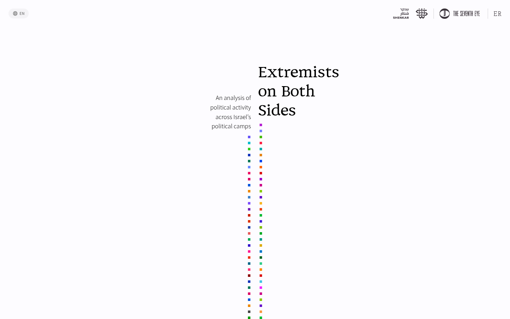
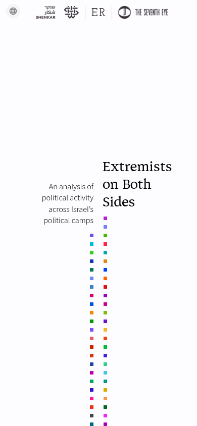

# UI Design System & Master Generation Blueprint: both-sides-the7eye-org-il_en

> **Extremists on Both Sides** (https://both-sides.the7eye.org.il/en/) — We collected thousands of political actions carried out in public space over the past four years. Decide for yourself — who are the extre...



---

## 1. Executive Visual Persona & Design Archetype

- **Brand Essence & Persona**: **Extremists on Both Sides** (`https://both-sides.the7eye.org.il/en/`). We collected thousands of political actions carried out in public space over the past four years. Decide for yourself — who are the extre...
- **Capture Provenance**: Live browser capture (`tier2_webgl`, HTTP `200`, captured `2026-11-23`).
- **Visual Archetype**: **Light-Gallery WebGL / Canvas Interactive Experience (`#fdfcff` / `#25d366`)**.
- **Anti-AI-Slop Differentiators**:
  - **Live-Computed Chromatic Polarity**: Anchors the viewport in `#fdfcff` (live computed `body` `background-color` (`computed_styles.json`)) paired with `#000000` primary typography and `#25d366` accents.
  - **Grounded Typographic Hierarchy**: Pairs `Discordia` for display copy (`Extremists on Both Sides`) with `Assistant` and not declared in live computed styles (uses primary stack / `ui-monospace`).
  - **Calibrated Spatial Grid & Motion**: Combines `1440px` container bounds (`gap: 8px`, padding `2px`) with `cubic-bezier(0.22,1,0.36,1)` easing and Three.js / WebGL Canvas Pipeline.

---

## 2. Spatial Architecture & Modular Grid Mathematics



### Viewport Allocation & Container Geometry
- **Captured Viewport Dimensions**: Desktop `1440×900px` (`assets/desktop.png`, single-viewport 100vh live capture (900px)), Mobile `390×844px` (`assets/mobile.png`, single-viewport 100vh live capture (844px)).
- **Master Container Bounds**: `1440px` (full-bleed `100%` desktop stage measured on `1440px` viewport).
- **Canvas Lateral Padding & Spacing**: `2px` lateral canvas padding with `8px` grid gap.
- **Border Radius Scale**: `16px`, `4px`, `6px`, `8px`.

### Responsive Breakpoint Architecture
- **Desktop Layout**: Multi-column CSS Grid / Flexbox layout at `1440px` (`max-width: 1440px`, `gap: 8px`).
- **Mobile Layout**: Single-column vertical stack at `390px` viewport width with `2px` horizontal padding.
- **Extracted CSS Media Queries**: `@media (max-width: 600px)`, `@media (max-width: 600px) and (hover: hover) and (pointer: fine)`, `@media (min-width: 601px)`, `@media (min-width: 640px)`.

---

## 3. Color System, Materiality & Atmospheric Lighting

### Semantic Palette & Source Grounding
| Semantic Role | Ground-Truth Value | Extracted Live / CSS Source |
|---|---|---|
| **Primary Canvas Substrate** | `#fdfcff` | live computed `body` `background-color` (`computed_styles.json`) |
| **Primary Typography Ink** | `#000000` | live computed `h1` `color` (`computed_styles.json`) |
| **Elevated Surface / Card Substrate** | `#ffffff` | `age9-layout-v2 #page9ZoneAbove... { background: #ffffff }` |
| **Interactive Accent / Highlight** | `#25d366` | `var(--brand)` in `:root` |
| **Secondary / Muted Copy** | `#767676` | `var(--muted-ui)` in `:root` |
| **Structural Hairline Border** | `#e1e1e1` | `var(--line-light)` in `:root` |
| **Variable Token (`--ink`)** | `#111111` | `var(--ink)` in `:root` |

### Sanitized Root CSS Variables (`ui-ux.md` Ground Truth)
| Variable Name | Extracted Value | Semantic Role |
|---|---|---|
| `--bg` | `#FDFCFF` | Canvas / Surface Token |
| `--card-w` | `min(456px, 100vw - 48px)` | Dimension / Scale Token |
| `--card-top` | `4.4vh` | Dimension / Scale Token |
| `--ink` | `#111` | Typography Ink Token |
| `--ink-soft` | `rgba(0, 0, 0, 0.81)` | Typography Ink Token |
| `--ink-note` | `rgba(0, 0, 0, 0.85)` | Typography Ink Token |
| `--muted-ui` | `#767676` | Color / Atmospheric Token |
| `--line-light` | `#E1E1E1` | Canvas / Surface Token |
| `--font-body` | `'Assistant', sans-serif` | Typography / Scale Token |
| `--font-title` | `'Discordia', serif` | Typography / Scale Token |
| `--font-ar` | `'IBM Plex Sans Arabic', 'Assistant', sans-serif` | Typography / Scale Token |
| `--ui-fade-ms` | `180ms` | Motion / Timing Token |
| `--tray-ms` | `.85s` | Motion / Timing Token |
| `--tray-ease` | `cubic-bezier(0.22, 1, 0.36, 1)` | Motion / Easing Token |
| `--fade-ms` | `.35s` | Motion / Timing Token |
| `--p9-pop-ms` | `280ms` | Motion / Timing Token |

---

## 4. Typographic Scale & Editorial Hierarchy

### Font Family Stacks
- **Display Typography**: `Discordia`.
- **Primary Body Stack**: `Assistant`.
- **Technical / Metadata Stack**: not declared in live computed styles (uses primary stack / `ui-monospace`).

### Typographic Scale & Rules (Live Computed & Stylesheet Grounded)
- **Hero Display (`H1`)**: live computed `h1` (`font-size: 40px`, `line-height: 54px`, `font-weight: 400`); CSS variables `--se-cap-display: block`.
- **Section Heading (`H2`)**: live computed `h2` (`font-size: 24px`, `line-height: normal`, `font-weight: 700`); rule `.section-title` (`font-size: 36px`, `line-height: 1.2`).
- **Body Copy**: live computed `body` (`font-size: 16px`, `line-height: normal`, `font-weight: 400`); CSS variables `--font-body: 'Assistant', sans-serif`.
- **Metadata & Navigation Labels**: live computed `nav/a` (`font-size: 16px`, `line-height: normal`, `font-weight: 400`).

---

## 5. Choreographed Motion & Interaction Physics

### Primary Easing Curves
- **Extracted Timing Functions**: `cubic-bezier(0.22,1,0.36,1)`, `cubic-bezier(0.37,0,0.63,1)`.

### Per-Element Transition & Choreography Rules
- **Selector `.page9-title-row .page9-header-su...`**: `transition: opacity var(--fade-ms) ease-out` extracted from `both-sides-the7eye-org-il_en` stylesheet.
- **Selector `-title-row .text-card .text-card-...`**: `transition: opacity var(--fade-ms) ease-out` extracted from `both-sides-the7eye-org-il_en` stylesheet.
- **Selector `page9-title-row .text-card .text-...`**: `transition: background var(--fade-ms) ease-out` extracted from `both-sides-the7eye-org-il_en` stylesheet.
- **Extracted Easing Curve (`cubic-bezier(0.22,1,0.36,1)`)**: Governs interactive state transitions across `<nav.lang-wrap>` and `<section.text-section:nth(2)>`.
- **Runtime Interaction Engine**: Integrates Three.js / WebGL Canvas Pipeline with `prefers-reduced-motion: reduce` fallback guards.

---

## 6. Component Wireframe & Structural DOM Map

### Visual Layout Schematic — Desktop (`1440px`, Grounded in `dom.html` & Landmark Bounding Boxes)
```
┌────────────────────────────────────────────────────────────────────────┐
│ DESKTOP VIEWPORT (1440px) — Extremists on Both Sides                   │
│ ====================================================================== │
│ [ <nav.lang-wrap> (57x28px)           | עברית · English · العربية    ] │
│ ---------------------------------------------------------------------- │
│ | HERO STAGE: <section.text-section> (w=1440px)                      | │
│ | H1: Extremists on Both Sides                                       | │
│ | Substrate: #fdfcff | Ink: #000000 | Accent: #25d366                | │
│ ---------------------------------------------------------------------- │
│ | SHOWCASE GRID (<section.text-section:nth() max-w: 1440px           | │
│ | +------------------------------+  +------------------------------+ | │
│ | | In recent years, Israeli cit |  | Both camps include groups th | | │
│ | +------------------------------+  +------------------------------+ | │
│ ---------------------------------------------------------------------- │
│ | DETAIL MODULE (<section.text-section:nth() — Because of their on-t | │
│ ---------------------------------------------------------------------- │
│ [ FOOTER (<footer.page0-dots-o) | https://both-sides.the7eye.org.il/e  │
└────────────────────────────────────────────────────────────────────────┘
```

### Visual Layout Schematic — Mobile Reflow (`390px`)
```
┌────────────────────────────────────────────────────────────────────────┐
│ MOBILE VIEWPORT REFLOW (390px) — Single-Column Stack (gap: 8px)        │
│ ====================================================================== │
│ [ HEADER BAR (<nav.lang-wrap>         ) | Compact Menu (390px)         │
│ ---------------------------------------------------------------------- │
│ | HERO STAGE (<section.text-section>) — 390px Vertical Lead          | │
│ | H1: Extremists on Both Sides                                       | │
│ ---------------------------------------------------------------------- │
│ | SHOWCASE STACK (<section.text-section:) — 1-Col Stack              | │
│ | [ Item 1: In recent years, Israeli citizens have become div...   ] | │
│ | [ Item 2: Both camps include groups that bring their politi...   ] | │
│ ---------------------------------------------------------------------- │
│ | DETAIL STACK (<section.text-section:nt) — 1-Col (Because of their o) │
│ ---------------------------------------------------------------------- │
│ [ FOOTER (<footer.page0-dots-o) | Stacked 390px Colophon               │
└────────────────────────────────────────────────────────────────────────┘
```

### Granular DOM Region Breakdown
1. **Brand Header & Navigation Bar (<nav.lang-wrap> — `both-sides-the7eye-org-il_en`)**:
   - Landmark `<nav class="lang-wrap">` (`57x28px`) hosting `Extremists on Both Sides` navigation (`עברית · English · العربية`), DOM attributes (`data-page="0"`, `data-page="1"`, `data-page="2"`, `data-page="3"`), and stylesheet rule `html { touch-action: pan-x pan-y; }`.
2. **Hero Stage & Focal Lead (<section.text-section> — `Extremists on Both Sides`)**:
   - Landmark `<section class="text-section">` presenting display lead `Extremists on Both Sides` and copy excerpt *"The project shows 14,877 documented political actions that took p"* over `#fdfcff` canvas and `#000000` ink.
3. **Primary Showcase & Content Grid (<section.text-section:nth(2)> — `In recent years, Israeli citizens `)**:
   - Landmark `<section class="text-section">` rendering section `In recent years, Israeli citizens have become div...` with copy *"An analysis of political activity across Israel’s political camps"*, asset references (`favicon.svg`, `favicon-32.png`, `favicon-192.png`, `apple-touch-icon.png`), and grid rule `body { background: var(--bg); }`.
4. **Interactive Detail & Feature Matrix (<section.text-section:nth(3)> — `Both camps include groups that bri`)**:
   - Landmark `<section class="text-section">` framing `Both camps include groups that bring their politi...` and `Because of their on-the-ground activity, these gr...` (*"Hover over a square to view the event description and scale."*) with `#ffffff` surface cards, `#25d366` accents, and `after { -webkit-user-select: none !important; user-select: none !important; -web... }`.
5. **Colophon & Global Directory Footer (<footer.page0-dots-overlay> — `https://both-sides.the7eye.org.il/en/`)**:
   - Landmark `<footer class="page0-dots-overlay">` anchoring `Extremists on Both Sides` footer links (`עברית · English · العربية`), copy *"Press and hold a square to view the event description and sc"*, and `#e1e1e1` structural dividers.

---

## 7. Master Zero-Shot AI Generation Prompt

```markdown
# Master Zero-Shot Frontend Generation Prompt: both-sides-the7eye-org-il_en (Extremists on Both Sides)

You are a principal frontend architect and design systems engineer. Build a complete, production-ready web application replicating the exact design system, DOM landmarks, typographic hierarchy, color tokens, and motion physics of `both-sides-the7eye-org-il_en` (**Extremists on Both Sides** — `https://both-sides.the7eye.org.il/en/`).

### 1. Visual Archetype & Anti-AI-Slop Mandates
- **Archetype**: Light-Gallery WebGL / Canvas Interactive Experience (`#fdfcff` / `#25d366`).
- **Identity & Domain Context**: We collected thousands of political actions carried out in public space over the past four years. Decide for yourself — who are the extre...
- **Primary Substrate**: `#fdfcff` (live computed `body` `background-color` (`computed_styles.json`)), **Primary Ink**: `#000000`, **Accent / Highlight**: `#25d366`.
- **Site-Specific Differentiators**:
  - **Live-Computed Chromatic Polarity**: Anchors the viewport in `#fdfcff` (live computed `body` `background-color` (`computed_styles.json`)) paired with `#000000` primary typography and `#25d366` accents.
  - **Grounded Typographic Hierarchy**: Pairs `Discordia` for display copy (`Extremists on Both Sides`) with `Assistant` and not declared in live computed styles (uses primary stack / `ui-monospace`).
  - **Calibrated Spatial Grid & Motion**: Combines `1440px` container bounds (`gap: 8px`, padding `2px`) with `cubic-bezier(0.22,1,0.36,1)` easing and Three.js / WebGL Canvas Pipeline.

### 2. Ground-Truth CSS Variables (`:root` Token Contract)
Declare and consume these exact custom properties extracted from `both-sides-the7eye-org-il_en` in your global stylesheet:

:root {
  /* Extremists on Both Sides (both-sides-the7eye-org-il_en) — Live-Grounded CSS Variables */
  --bg: #FDFCFF; /* Canvas / Surface Token (both-sides-the7eye-org-il_en) */
  --card-w: min(456px, 100vw - 48px); /* Dimension / Scale Token (both-sides-the7eye-org-il_en) */
  --card-top: 4.4vh; /* Dimension / Scale Token (both-sides-the7eye-org-il_en) */
  --ink: #111; /* Typography Ink Token (both-sides-the7eye-org-il_en) */
  --ink-soft: rgba(0, 0, 0, 0.81); /* Typography Ink Token (both-sides-the7eye-org-il_en) */
  --ink-note: rgba(0, 0, 0, 0.85); /* Typography Ink Token (both-sides-the7eye-org-il_en) */
  --muted-ui: #767676; /* Color / Atmospheric Token (both-sides-the7eye-org-il_en) */
  --line-light: #E1E1E1; /* Canvas / Surface Token (both-sides-the7eye-org-il_en) */
  --font-body: 'Assistant', sans-serif; /* Typography / Scale Token (both-sides-the7eye-org-il_en) */
  --font-title: 'Discordia', serif; /* Typography / Scale Token (both-sides-the7eye-org-il_en) */
  --font-ar: 'IBM Plex Sans Arabic', 'Assistant', sans-serif; /* Typography / Scale Token (both-sides-the7eye-org-il_en) */
  --ui-fade-ms: 180ms; /* Motion / Timing Token (both-sides-the7eye-org-il_en) */
  --tray-ms: .85s; /* Motion / Timing Token (both-sides-the7eye-org-il_en) */
  --tray-ease: cubic-bezier(0.22, 1, 0.36, 1); /* Motion / Easing Token (both-sides-the7eye-org-il_en) */
  --fade-ms: .35s; /* Motion / Timing Token (both-sides-the7eye-org-il_en) */
  --p9-pop-ms: 280ms; /* Motion / Timing Token (both-sides-the7eye-org-il_en) */
}

### 3. Semantic Color & Materiality Contract
Map every surface, ink, and border strictly to these source-grounded tokens:
- **Primary Canvas Substrate**: `#fdfcff` — grounded in live computed `body` `background-color` (`computed_styles.json`)
- **Primary Typography Ink**: `#000000` — grounded in live computed `h1` `color` (`computed_styles.json`)
- **Elevated Surface / Card Substrate**: `#ffffff` — grounded in `age9-layout-v2 #page9ZoneAbove... { background: #ffffff }`
- **Interactive Accent / Highlight**: `#25d366` — grounded in `var(--brand)` in `:root`
- **Secondary / Muted Copy**: `#767676` — grounded in `var(--muted-ui)` in `:root`
- **Structural Hairline Border**: `#e1e1e1` — grounded in `var(--line-light)` in `:root`
- **Variable Token (`--ink`)**: `#111111` — grounded in `var(--ink)` in `:root`

### 4. Spatial Grid, Container Bounds & Responsive Breakpoints
- **Desktop Viewport Reference**: `1440×900px` (single-viewport 100vh live capture (900px), `1440px` standard desktop width).
- **Mobile Viewport Reference**: `390×844px` (single-viewport 100vh live capture (844px), `390px` standard mobile width).
- **Container Max-Width**: `1440px` (full-bleed `100%` desktop stage measured on `1440px` viewport)
- **Padding & Gutters**: `2px` lateral canvas padding with `8px` grid gap
- **Desktop Grid**: Multi-column CSS Grid / Flexbox layout at `1440px` (`max-width: 1440px`, `gap: 8px`)
- **Mobile Adaptation**: Single-column vertical stack at `390px` viewport width with `2px` horizontal padding
- **Media Queries**: `@media (max-width: 600px)`, `@media (max-width: 600px) and (hover: hover) and (pointer: fine)`, `@media (min-width: 601px)`, `@media (min-width: 640px)`
- **Corner Radii**: `16px`, `4px`, `6px`, `8px`

### 5. Typography & Editorial Scale Contract
- **Display Font Stack**: `Discordia`
- **Body Font Stack**: `Assistant`
- **Monospace / Technical Font Stack**: not declared in live computed styles (uses primary stack / `ui-monospace`)
- **H1 Display Rule**: live computed `h1` (`font-size: 40px`, `line-height: 54px`, `font-weight: 400`); CSS variables `--se-cap-display: block`
- **H2 Section Rule**: live computed `h2` (`font-size: 24px`, `line-height: normal`, `font-weight: 700`); rule `.section-title` (`font-size: 36px`, `line-height: 1.2`)
- **Body Copy Rule**: live computed `body` (`font-size: 16px`, `line-height: normal`, `font-weight: 400`); CSS variables `--font-body: 'Assistant', sans-serif`
- **Metadata & Index Rule**: live computed `nav/a` (`font-size: 16px`, `line-height: normal`, `font-weight: 400`)

### 6. Component Hierarchy, Verbatim Copy & Real DOM Landmarks
Scaffold `both-sides-the7eye-org-il_en` (`Extremists on Both Sides`) with these exact structural regions, extracted copy, and CSS rules from `dom.html`:
1. **Brand Header & Navigation Bar (<nav.lang-wrap> — `both-sides-the7eye-org-il_en`)**:
   - DOM & Selectors: Landmark `<nav class="lang-wrap">` (`57x28px`) hosting `Extremists on Both Sides` navigation (`עברית · English · العربية`), DOM attributes (`data-page="0"`, `data-page="1"`, `data-page="2"`, `data-page="3"`), and stylesheet rule `html { touch-action: pan-x pan-y; }`.
   - Responsive Contract: Header `Brand Header & Navigation Bar (<nav.lang-wrap> — `both-sides-the7eye-org-il_en`)` (`both-sides-the7eye-org-il_en`) adapts across `@media (max-width: 600px)`, `@media (max-width: 600px) and (hover: hover) and (pointer: fine)`, `@media (min-width: 601px)`, `@media (min-width: 640px)` with `cubic-bezier(0.22,1,0.36,1)`, `cubic-bezier(0.37,0,0.63,1)` transitions and links `עברית · English · العربية`.
2. **Hero Stage & Focal Lead (<section.text-section> — `Extremists on Both Sides`)**:
   - DOM & Selectors: Landmark `<section class="text-section">` presenting display lead `Extremists on Both Sides` and copy excerpt *"The project shows 14,877 documented political actions that took p"* over `#fdfcff` canvas and `#000000` ink.
   - Responsive Contract: Hero stage (`1440×900px` desktop / `390×844px` mobile) sets `#fdfcff` background with `#000000` headline `Extremists on Both Sides`.
3. **Primary Showcase & Content Grid (<section.text-section:nth(2)> — `In recent years, Israeli citizens `)**:
   - DOM & Selectors: Landmark `<section class="text-section">` rendering section `In recent years, Israeli citizens have become div...` with copy *"An analysis of political activity across Israel’s political camps"*, asset references (`favicon.svg`, `favicon-32.png`, `favicon-192.png`, `apple-touch-icon.png`), and grid rule `body { background: var(--bg); }`.
   - Responsive Contract: Showcase grid `Primary Showcase & Content Grid (<section.text-section:nth(2)> — `In recent years, Israeli citizens `)` applies Multi-column CSS Grid / Flexbox layout at `1440px` (`max-width: 1440px`, `gap: 8px`) on desktop and Single-column vertical stack at `390px` viewport width with `2px` horizontal padding on mobile.
4. **Interactive Detail & Feature Matrix (<section.text-section:nth(3)> — `Both camps include groups that bri`)**:
   - DOM & Selectors: Landmark `<section class="text-section">` framing `Both camps include groups that bring their politi...` and `Because of their on-the-ground activity, these gr...` (*"Hover over a square to view the event description and scale."*) with `#ffffff` surface cards, `#25d366` accents, and `after { -webkit-user-select: none !important; user-select: none !important; -web... }`.
   - Responsive Contract: Detail module `Interactive Detail & Feature Matrix (<section.text-section:nth(3)> — `Both camps include groups that bri`)` uses `16px`, `4px`, `6px`, `8px` radii, `#25d366` highlights, and assets (favicon.svg, favicon-32.png, favicon-192.png).
5. **Colophon & Global Directory Footer (<footer.page0-dots-overlay> — `https://both-sides.the7eye.org.il/en/`)**:
   - DOM & Selectors: Landmark `<footer class="page0-dots-overlay">` anchoring `Extremists on Both Sides` footer links (`עברית · English · العربية`), copy *"Press and hold a square to view the event description and sc"*, and `#e1e1e1` structural dividers.
   - Responsive Contract: Footer `Colophon & Global Directory Footer (<footer.page0-dots-overlay> — `https://both-sides.the7eye.org.il/en/`)` aligns to `1440px` (full-bleed `100%` desktop stage measured on `1440px` viewport) with `2px` lateral canvas padding with `8px` grid gap and attributes (data-page="0", data-page="1", data-page="2").

#### Verbatim DOM Copy Excerpts (`dom.html`)
- Copy Excerpt 1: *"The project shows 14,877 documented political actions that took place in public sp..."*
- Copy Excerpt 2: *"An analysis of political activity across Israel’s political camps"*
- Copy Excerpt 3: *"Hover over a square to view the event description and scale."*
- Copy Excerpt 4: *"Press and hold a square to view the event description and scale."*

### 7. Motion, Extracted Stylesheet Rules & Interaction Choreography
- **Primary Easing Functions**: `cubic-bezier(0.22,1,0.36,1)`, `cubic-bezier(0.37,0,0.63,1)`
- **Extracted Stylesheet Rules (`both-sides-the7eye-org-il_en`)**:
- `html { touch-action: pan-x pan-y; }`
- `body { background: var(--bg); }`
- `after { -webkit-user-select: none !important; user-select: none !important; -web... }`
- `.fold-number-badge.is-visible { display: block; }`
- `.fold-number-badge.is-dot { display: none; }`
- **Per-Selector Transition Rules**:
- **Selector `.page9-title-row .page9-header-su...`**: `transition: opacity var(--fade-ms) ease-out` extracted from `both-sides-the7eye-org-il_en` stylesheet.
- **Selector `-title-row .text-card .text-card-...`**: `transition: opacity var(--fade-ms) ease-out` extracted from `both-sides-the7eye-org-il_en` stylesheet.
- **Selector `page9-title-row .text-card .text-...`**: `transition: background var(--fade-ms) ease-out` extracted from `both-sides-the7eye-org-il_en` stylesheet.
- **Extracted Easing Curve (`cubic-bezier(0.22,1,0.36,1)`)**: Governs interactive state transitions across `<nav.lang-wrap>` and `<section.text-section:nth(2)>`.
- **Runtime Interaction Engine**: Integrates Three.js / WebGL Canvas Pipeline with `prefers-reduced-motion: reduce` fallback guards.

### 8. Technical Deliverables
- Implement in Next.js (App Router) with TypeScript and Tailwind CSS consuming the `:root` custom properties defined above for `both-sides-the7eye-org-il_en`.
- Reproduce both the `1440px` desktop architecture and `390px` mobile breakpoint transitions, preserving semantic HTML5 landmarks (`<header>`, `<nav>`, `<main>`, `<section>`, `<footer>`) and `prefers-reduced-motion` accessibility guards.
```
