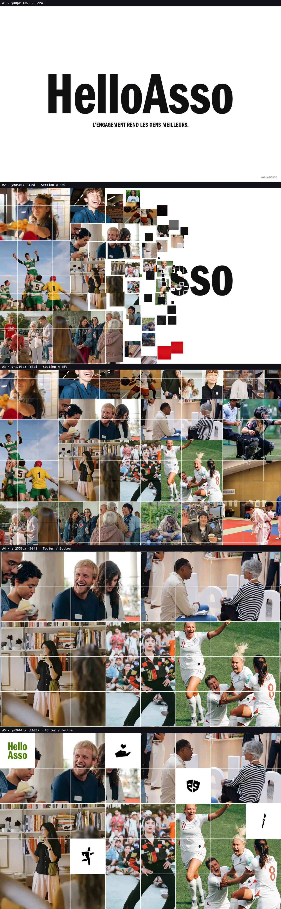
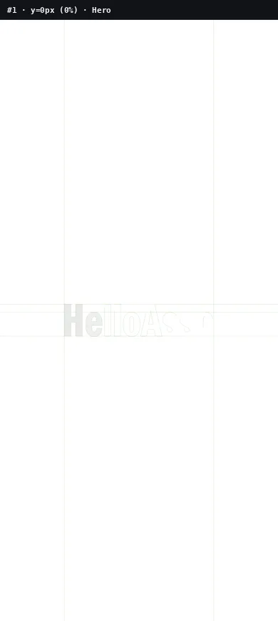

# UI Design System & Master Generation Blueprint: brand-helloasso-com

> **Accueil – Brandbook HelloAsso** (https://brand.helloasso.com/) — Logotype, typographie, couleurs, direction photographique et identité verbale de HelloAsso.





---

## 1. Executive Visual Persona & Design Archetype

- **Brand Essence & Persona**: **Accueil – Brandbook HelloAsso** (`https://brand.helloasso.com/`). Logotype, typographie, couleurs, direction photographique et identité verbale de HelloAsso.
- **Capture Provenance**: Live browser capture (`tier1_fast`, HTTP `200`, captured `2026-11-24`).
- **Visual Archetype**: **Light-Gallery WebGL / Canvas Interactive Experience (`#ffffff` / `#d7e103`)**.
- **Anti-AI-Slop Differentiators**:
  - **Live-Computed Chromatic Polarity**: Anchors the viewport in `#ffffff` (live computed `body` `background-color` (`computed_styles.json`)) paired with `#101010` primary typography and `#d7e103` accents.
  - **Grounded Typographic Hierarchy**: Pairs `ITC Franklin Gothic LT` for display copy (`Accueil – Brandbook HelloAsso`) with `ABC Diatype Rounded`.
  - **Calibrated Spatial Grid & Motion**: Combines `1392px` container bounds (`gap: 8px`, padding `10px`) with `cubic-bezier(.19,1,.22,1)` easing and Lenis Smooth Scroll (`data-lenis`), HTML5 `<canvas>` Interactive Viewport Surface.

---

## 2. Spatial Architecture & Modular Grid Mathematics

### Viewport Allocation & Container Geometry
- **Captured Journey Filmstrips**: Desktop `1280×4140px` (`assets/desktop-journey.webp`, `5` keyframes up to `y=2604px` / doc `3504px`), Mobile `390×872px` (`assets/mobile-journey.webp`, `1` keyframes).
- **Master Container Bounds**: `1392px` (measured widest bounded `<section>` landmark width on `1440px` desktop).
- **Canvas Lateral Padding & Spacing**: `10px` lateral canvas padding with `8px` grid gap.
- **Border Radius Scale**: `21.8%`.

### Responsive Breakpoint Architecture
- **Desktop Layout**: Multi-column CSS Grid / Flexbox layout at `1440px` (`max-width: 1392px`, `gap: 8px`).
- **Mobile Layout**: Single-column vertical stack at `390px` viewport width with `10px` horizontal padding.
- **Extracted CSS Media Queries**: `@media (prefers-reduced-motion)`, `@media (width<=767px)`, `@media (prefers-reduced-motion:reduce)`.

---

## 3. Color System, Materiality & Atmospheric Lighting

### Semantic Palette & Source Grounding
| Semantic Role | Ground-Truth Value | Extracted Live / CSS Source |
|---|---|---|
| **Primary Canvas Substrate** | `#ffffff` | live computed `body` `background-color` (`computed_styles.json`) |
| **Primary Typography Ink** | `#101010` | live computed `main` `color` (`computed_styles.json`) |
| **Elevated Surface / Card Substrate** | `#ededed` | `var(--tools-surface-hover)` in `:root` |
| **Interactive Accent / Highlight** | `#d7e103` | `var(--color-sport-jaune-fluo)` in `:root` |
| **Secondary / Muted Copy** | `#878787` | `var(--color-placeholder)` in `:root` |
| **Structural Hairline Border** | `#e7e7e7` | `var(--tools-line)` in `:root` |
| **Variable Token (`--color-gris-fonce`)** | `#434649` | `var(--color-gris-fonce)` in `:root` |
| **Variable Token (`--color-gris`)** | `#888c8f` | `var(--color-gris)` in `:root` |
| **Variable Token (`--color-gris-clair`)** | `#cdced0` | `var(--color-gris-clair)` in `:root` |
| **Variable Token (`--color-gris-tres-clair`)** | `#f5f5f5` | `var(--color-gris-tres-clair)` in `:root` |
| **Variable Token (`--color-vert`)** | `#4a8100` | `var(--color-vert)` in `:root` |
| **Variable Token (`--color-vanille`)** | `#fdffc6` | `var(--color-vanille)` in `:root` |
| **Variable Token (`--color-rose`)** | `#fba2ec` | `var(--color-rose)` in `:root` |
| **Variable Token (`--color-sahara`)** | `#b38806` | `var(--color-sahara)` in `:root` |
| **Variable Token (`--color-lila`)** | `#f1edff` | `var(--color-lila)` in `:root` |
| **Variable Token (`--color-cuir`)** | `#644a02` | `var(--color-cuir)` in `:root` |
| **Variable Token (`--color-prune`)** | `#572a37` | `var(--color-prune)` in `:root` |
| **Variable Token (`--color-sport-logo-fond-clair`)** | `#c6cf0e` | `var(--color-sport-logo-fond-clair)` in `:root` |
| **Variable Token (`--color-sport-anthracite`)** | `#504e44` | `var(--color-sport-anthracite)` in `:root` |

### Sanitized Root CSS Variables (`ui-ux.md` Ground Truth)
| Variable Name | Extracted Value | Semantic Role |
|---|---|---|
| `--color-noir` | `#101010` | Brand / Palette Token |
| `--color-gris-fonce` | `#434649` | Brand / Palette Token |
| `--color-gris` | `#888c8f` | Brand / Palette Token |
| `--color-gris-clair` | `#cdced0` | Brand / Palette Token |
| `--color-gris-tres-clair` | `#f5f5f5` | Brand / Palette Token |
| `--color-blanc` | `#fff` | Brand / Palette Token |
| `--color-vert` | `#4a8100` | Brand / Palette Token |
| `--color-vanille` | `#fdffc6` | Brand / Palette Token |
| `--color-rose` | `#fba2ec` | Brand / Palette Token |
| `--color-sahara` | `#b38806` | Brand / Palette Token |
| `--color-lila` | `#f1edff` | Brand / Palette Token |
| `--color-cuir` | `#644a02` | Brand / Palette Token |
| `--color-prune` | `#572a37` | Brand / Palette Token |
| `--color-sport-jaune-fluo` | `#d7e103` | Brand / Palette Token |
| `--color-sport-logo-fond-clair` | `#c6cf0e` | Brand / Palette Token |
| `--color-sport-anthracite` | `#504e44` | Brand / Palette Token |

---

## 4. Typographic Scale & Editorial Hierarchy

### Font Family Stacks
- **Display Typography**: `ITC Franklin Gothic LT`.
- **Primary Body Stack**: `ABC Diatype Rounded`.
- **Technical / Metadata Stack**: not declared in live computed styles (uses primary stack / `ui-monospace`).

### Typographic Scale & Rules (Live Computed & Stylesheet Grounded)
- **Hero Display (`H1`)**: CSS variables `--font-display: "ITC Franklin Gothic LT", "Arial Narrow", sans-serif`, `--fs-h1: 64px`, `--lh-h1: 58px`.
- **Section Heading (`H2`)**: live computed `h2` (`font-size: 132px`, `line-height: 118.8px`, `font-weight: 700`, `letter-spacing: -1.32px`); CSS variables `--fs-h2: 48px`, `--lh-h2: 43px`.
- **Body Copy**: live computed `body` (`font-size: 14px`, `line-height: 18px`, `font-weight: 400`); CSS variables `--fs-body: 14px`, `--lh-body: 18px`, `--fs-body-s: 14px`.
- **Metadata & Navigation Labels**: live computed `nav/a` (`font-size: 11px`, `line-height: 14.3px`, `font-weight: 400`); CSS variables `--fs-caption: 12px`, `--lh-caption: 17px`, `--caption-gap: var(--space-12)`.

---

## 5. Choreographed Motion & Interaction Physics

### Primary Easing Curves
- **Extracted Timing Functions**: `cubic-bezier(.19,1,.22,1)`, `cubic-bezier(.25,1,.5,1)`, `cubic-bezier(.16,1,.3,1)`.

### Per-Element Transition & Choreography Rules
- **Selector `.hlabel`**: `transition: opacity .3s,transform .4s cubic-bezier(.19,1,.22,1)` extracted from `brand-helloasso-com` stylesheet.
- **Selector `.harrow__i`**: `transition: transform 1s cubic-bezier(.19,1,.22,1)` extracted from `brand-helloasso-com` stylesheet.
- **Selector `.bcta img`**: `transition: transform .4s cubic-bezier(.19,1,.22,1)` extracted from `brand-helloasso-com` stylesheet.
- **Extracted Easing Curve (`cubic-bezier(.19,1,.22,1)`)**: Governs interactive state transitions across `<header.is-ready>` and `<section.chapter:nth(2)>`.
- **Runtime Interaction Engine**: Integrates Lenis Smooth Scroll (`data-lenis`), HTML5 `<canvas>` Interactive Viewport Surface with `prefers-reduced-motion: reduce` fallback guards.
### Measured Runtime Scroll & Interaction Telemetry (`behavioral_journey_v2`)
- **Scroll Driver Mode**: `native` (max document height `3504px`, deepest scrollY reached `2604px` across `5` desktop keyframes).
- **Detected Scroll / Motion Libraries**: `GSAP/ScrollTrigger`, `WebGL/Canvas`.

---

## 6. Component Wireframe & Structural DOM Map

### Visual Layout Schematic — Desktop (`1440px`, Grounded in `dom.html` & Landmark Bounding Boxes)
```
┌────────────────────────────────────────────────────────────────────────┐
│ DESKTOP VIEWPORT (1440px) — Accueil – Brandbook HelloAsso              │
│ ====================================================================== │
│ [ <header.is-ready> (1440px)          | BRUNO                        ] │
│ ---------------------------------------------------------------------- │
│ | HERO STAGE: <section.chapter> (w=1440px)                           | │
│ | H1: Accueil – Brandbook HelloAsso                                  | │
│ | Substrate: #ffffff | Ink: #101010 | Accent: #d7e103                | │
│ ---------------------------------------------------------------------- │
│ | SHOWCASE GRID (<section.chapter:nth(2)>) max-w: 1392px             | │
│ | +------------------------------+  +------------------------------+ | │
│ | | Featured Work & Interactive  |  | Technical Architecture & Nar | | │
│ | +------------------------------+  +------------------------------+ | │
│ ---------------------------------------------------------------------- │
│ | DETAIL MODULE (<section.chapter:nth(3)>) — Global Directory & Co   | │
│ ---------------------------------------------------------------------- │
│ [ FOOTER (<footer.cell-border>) | https://brand.helloasso.com/         │
└────────────────────────────────────────────────────────────────────────┘
```

### Visual Layout Schematic — Mobile Reflow (`390px`)
```
┌────────────────────────────────────────────────────────────────────────┐
│ MOBILE VIEWPORT REFLOW (390px) — Single-Column Stack (gap: 8px)        │
│ ====================================================================== │
│ [ HEADER BAR (<header.is-ready>       ) | Compact Menu (390px)         │
│ ---------------------------------------------------------------------- │
│ | HERO STAGE (<section.chapter>) — 390px Vertical Lead               | │
│ | H1: Accueil – Brandbook HelloAsso                                  | │
│ ---------------------------------------------------------------------- │
│ | SHOWCASE STACK (<section.chapter:nth(2) — 1-Col Stack              | │
│ | [ Item 1: Featured Work & Interactive Showcase                   ] | │
│ | [ Item 2: Technical Architecture & Narrative                     ] | │
│ ---------------------------------------------------------------------- │
│ | DETAIL STACK (<section.chapter:nth(3)>) — 1-Col (Global Directory &) │
│ ---------------------------------------------------------------------- │
│ [ FOOTER (<footer.cell-border>) | Stacked 390px Colophon               │
└────────────────────────────────────────────────────────────────────────┘
```

### Granular DOM Region Breakdown
1. **Brand Header & Navigation Bar (<header.is-ready> — `brand-helloasso-com`)**:
   - Landmark `<header class="is-ready">` (`1440px`) hosting `Accueil – Brandbook HelloAsso` navigation (`BRUNO`), DOM attributes (`data-astro-transition-scope="astro-nfpogox7-1"`, `data-layout="fullscreen"`, `data-astro-exec`, `data-svg-origin="24 512"`), and stylesheet rule `body { background:var(--blanc);color:var(--noir);font-family:var(--ff-ui) }`.
2. **Hero Stage & Focal Lead (<section.chapter> — `Accueil – Brandbook HelloAsso`)**:
   - Landmark `<section class="chapter">` presenting display lead `Accueil – Brandbook HelloAsso` and copy excerpt *"L’ENGAGEMENT REND LES GENS MEILLEURS."* over `#ffffff` canvas and `#101010` ink.
3. **Primary Showcase & Content Grid (<section.chapter:nth(2)> — `Featured Work & Interactive Showca`)**:
   - Landmark `<section class="chapter">` rendering section `Featured Work & Interactive Showcase` with copy *"L’engagement rend les gens meilleurs."*, asset references (`favicon.svg`, `favicon-32.png`, `apple-touch-icon.png`, `ITCFranklinGothicLT-DemiCompresse...`), and grid rule `.cursor { will-change:transform;display:none }`.
4. **Interactive Detail & Feature Matrix (<section.chapter:nth(3)> — `Technical Architecture & Narrative`)**:
   - Landmark `<section class="chapter">` framing `Technical Architecture & Narrative` and `Global Directory & Contact` (*"Featured Work & Interactive Showcase"*) with `#ededed` surface cards, `#d7e103` accents, and `.scroller { height:620vh;position:relative }`.
5. **Colophon & Global Directory Footer (<footer.cell-border> — `https://brand.helloasso.com/`)**:
   - Landmark `<footer class="cell-border">` anchoring `Accueil – Brandbook HelloAsso` footer links (`BRUNO`), copy *"Technical Architecture & Narrative"*, and `#e7e7e7` structural dividers.
### Full Vertical Scroll Sequence (Desktop `1440×900` Keyframes)
- **Step 01** (`y=0px`, `0%`): Active landmark `Hero` · sticky/fixed elements: `1`
- **Step 02** (`y=850px`, `33%`): Active landmark `Section @ 33%` · sticky/fixed elements: `1`
- **Step 03** (`y=1700px`, `65%`): Active landmark `Section @ 65%` · sticky/fixed elements: `1`
- **Step 04** (`y=2550px`, `98%`): Active landmark `Footer / Bottom` · sticky/fixed elements: `1`
- **Step 05** (`y=2604px`, `100%`): Active landmark `Footer / Bottom` · sticky/fixed elements: `1`

---

## 7. Master Zero-Shot AI Generation Prompt

```markdown
# Master Zero-Shot Frontend Generation Prompt: brand-helloasso-com (Accueil – Brandbook HelloAsso)

You are a principal frontend architect and design systems engineer. Build a complete, production-ready web application replicating the exact design system, DOM landmarks, typographic hierarchy, color tokens, and motion physics of `brand-helloasso-com` (**Accueil – Brandbook HelloAsso** — `https://brand.helloasso.com/`).

### 1. Visual Archetype & Anti-AI-Slop Mandates
- **Archetype**: Light-Gallery WebGL / Canvas Interactive Experience (`#ffffff` / `#d7e103`).
- **Identity & Domain Context**: Logotype, typographie, couleurs, direction photographique et identité verbale de HelloAsso.
- **Primary Substrate**: `#ffffff` (live computed `body` `background-color` (`computed_styles.json`)), **Primary Ink**: `#101010`, **Accent / Highlight**: `#d7e103`.
- **Site-Specific Differentiators**:
  - **Live-Computed Chromatic Polarity**: Anchors the viewport in `#ffffff` (live computed `body` `background-color` (`computed_styles.json`)) paired with `#101010` primary typography and `#d7e103` accents.
  - **Grounded Typographic Hierarchy**: Pairs `ITC Franklin Gothic LT` for display copy (`Accueil – Brandbook HelloAsso`) with `ABC Diatype Rounded`.
  - **Calibrated Spatial Grid & Motion**: Combines `1392px` container bounds (`gap: 8px`, padding `10px`) with `cubic-bezier(.19,1,.22,1)` easing and Lenis Smooth Scroll (`data-lenis`), HTML5 `<canvas>` Interactive Viewport Surface.

### 2. Ground-Truth CSS Variables (`:root` Token Contract)
Declare and consume these exact custom properties extracted from `brand-helloasso-com` in your global stylesheet:

:root {
  /* Accueil – Brandbook HelloAsso (brand-helloasso-com) — Live-Grounded CSS Variables */
  --color-noir: #101010; /* Brand / Palette Token (brand-helloasso-com) */
  --color-gris-fonce: #434649; /* Brand / Palette Token (brand-helloasso-com) */
  --color-gris: #888c8f; /* Brand / Palette Token (brand-helloasso-com) */
  --color-gris-clair: #cdced0; /* Brand / Palette Token (brand-helloasso-com) */
  --color-gris-tres-clair: #f5f5f5; /* Brand / Palette Token (brand-helloasso-com) */
  --color-blanc: #fff; /* Brand / Palette Token (brand-helloasso-com) */
  --color-vert: #4a8100; /* Brand / Palette Token (brand-helloasso-com) */
  --color-vanille: #fdffc6; /* Brand / Palette Token (brand-helloasso-com) */
  --color-rose: #fba2ec; /* Brand / Palette Token (brand-helloasso-com) */
  --color-sahara: #b38806; /* Brand / Palette Token (brand-helloasso-com) */
  --color-lila: #f1edff; /* Brand / Palette Token (brand-helloasso-com) */
  --color-cuir: #644a02; /* Brand / Palette Token (brand-helloasso-com) */
  --color-prune: #572a37; /* Brand / Palette Token (brand-helloasso-com) */
  --color-sport-jaune-fluo: #d7e103; /* Brand / Palette Token (brand-helloasso-com) */
  --color-sport-logo-fond-clair: #c6cf0e; /* Brand / Palette Token (brand-helloasso-com) */
  --color-sport-anthracite: #504e44; /* Brand / Palette Token (brand-helloasso-com) */
}

### 3. Semantic Color & Materiality Contract
Map every surface, ink, and border strictly to these source-grounded tokens:
- **Primary Canvas Substrate**: `#ffffff` — grounded in live computed `body` `background-color` (`computed_styles.json`)
- **Primary Typography Ink**: `#101010` — grounded in live computed `main` `color` (`computed_styles.json`)
- **Elevated Surface / Card Substrate**: `#ededed` — grounded in `var(--tools-surface-hover)` in `:root`
- **Interactive Accent / Highlight**: `#d7e103` — grounded in `var(--color-sport-jaune-fluo)` in `:root`
- **Secondary / Muted Copy**: `#878787` — grounded in `var(--color-placeholder)` in `:root`
- **Structural Hairline Border**: `#e7e7e7` — grounded in `var(--tools-line)` in `:root`
- **Variable Token (`--color-gris-fonce`)**: `#434649` — grounded in `var(--color-gris-fonce)` in `:root`
- **Variable Token (`--color-gris`)**: `#888c8f` — grounded in `var(--color-gris)` in `:root`
- **Variable Token (`--color-gris-clair`)**: `#cdced0` — grounded in `var(--color-gris-clair)` in `:root`
- **Variable Token (`--color-gris-tres-clair`)**: `#f5f5f5` — grounded in `var(--color-gris-tres-clair)` in `:root`
- **Variable Token (`--color-vert`)**: `#4a8100` — grounded in `var(--color-vert)` in `:root`
- **Variable Token (`--color-vanille`)**: `#fdffc6` — grounded in `var(--color-vanille)` in `:root`
- **Variable Token (`--color-rose`)**: `#fba2ec` — grounded in `var(--color-rose)` in `:root`
- **Variable Token (`--color-sahara`)**: `#b38806` — grounded in `var(--color-sahara)` in `:root`
- **Variable Token (`--color-lila`)**: `#f1edff` — grounded in `var(--color-lila)` in `:root`
- **Variable Token (`--color-cuir`)**: `#644a02` — grounded in `var(--color-cuir)` in `:root`
- **Variable Token (`--color-prune`)**: `#572a37` — grounded in `var(--color-prune)` in `:root`
- **Variable Token (`--color-sport-logo-fond-clair`)**: `#c6cf0e` — grounded in `var(--color-sport-logo-fond-clair)` in `:root`
- **Variable Token (`--color-sport-anthracite`)**: `#504e44` — grounded in `var(--color-sport-anthracite)` in `:root`

### 4. Spatial Grid, Container Bounds & Responsive Breakpoints
- **Desktop Viewport Reference**: `1280×4140px` (multi-frame vertical journey filmstrip (4140px), `1440px` standard desktop width).
- **Mobile Viewport Reference**: `390×872px` (full-page live capture (872px), `390px` standard mobile width).
- **Container Max-Width**: `1392px` (measured widest bounded `<section>` landmark width on `1440px` desktop)
- **Padding & Gutters**: `10px` lateral canvas padding with `8px` grid gap
- **Desktop Grid**: Multi-column CSS Grid / Flexbox layout at `1440px` (`max-width: 1392px`, `gap: 8px`)
- **Mobile Adaptation**: Single-column vertical stack at `390px` viewport width with `10px` horizontal padding
- **Media Queries**: `@media (prefers-reduced-motion)`, `@media (width<=767px)`, `@media (prefers-reduced-motion:reduce)`
- **Corner Radii**: `21.8%`

### 5. Typography & Editorial Scale Contract
- **Display Font Stack**: `ITC Franklin Gothic LT`
- **Body Font Stack**: `ABC Diatype Rounded`
- **Monospace / Technical Font Stack**: not declared in live computed styles (uses primary stack / `ui-monospace`)
- **H1 Display Rule**: CSS variables `--font-display: "ITC Franklin Gothic LT", "Arial Narrow", sans-serif`, `--fs-h1: 64px`, `--lh-h1: 58px`
- **H2 Section Rule**: live computed `h2` (`font-size: 132px`, `line-height: 118.8px`, `font-weight: 700`, `letter-spacing: -1.32px`); CSS variables `--fs-h2: 48px`, `--lh-h2: 43px`
- **Body Copy Rule**: live computed `body` (`font-size: 14px`, `line-height: 18px`, `font-weight: 400`); CSS variables `--fs-body: 14px`, `--lh-body: 18px`, `--fs-body-s: 14px`
- **Metadata & Index Rule**: live computed `nav/a` (`font-size: 11px`, `line-height: 14.3px`, `font-weight: 400`); CSS variables `--fs-caption: 12px`, `--lh-caption: 17px`, `--caption-gap: var(--space-12)`

### 6. Component Hierarchy, Verbatim Copy & Real DOM Landmarks
Scaffold `brand-helloasso-com` (`Accueil – Brandbook HelloAsso`) with these exact structural regions, extracted copy, and CSS rules from `dom.html`:
1. **Brand Header & Navigation Bar (<header.is-ready> — `brand-helloasso-com`)**:
   - DOM & Selectors: Landmark `<header class="is-ready">` (`1440px`) hosting `Accueil – Brandbook HelloAsso` navigation (`BRUNO`), DOM attributes (`data-astro-transition-scope="astro-nfpogox7-1"`, `data-layout="fullscreen"`, `data-astro-exec`, `data-svg-origin="24 512"`), and stylesheet rule `body { background:var(--blanc);color:var(--noir);font-family:var(--ff-ui) }`.
   - Responsive Contract: Header `Brand Header & Navigation Bar (<header.is-ready> — `brand-helloasso-com`)` (`brand-helloasso-com`) adapts across `@media (prefers-reduced-motion)`, `@media (width<=767px)`, `@media (prefers-reduced-motion:reduce)` with `cubic-bezier(.19,1,.22,1)`, `cubic-bezier(.25,1,.5,1)`, `cubic-bezier(.16,1,.3,1)` transitions and links `BRUNO`.
2. **Hero Stage & Focal Lead (<section.chapter> — `Accueil – Brandbook HelloAsso`)**:
   - DOM & Selectors: Landmark `<section class="chapter">` presenting display lead `Accueil – Brandbook HelloAsso` and copy excerpt *"L’ENGAGEMENT REND LES GENS MEILLEURS."* over `#ffffff` canvas and `#101010` ink.
   - Responsive Contract: Hero stage (`1280×4140px` desktop / `390×872px` mobile) sets `#ffffff` background with `#101010` headline `Accueil – Brandbook HelloAsso`.
3. **Primary Showcase & Content Grid (<section.chapter:nth(2)> — `Featured Work & Interactive Showca`)**:
   - DOM & Selectors: Landmark `<section class="chapter">` rendering section `Featured Work & Interactive Showcase` with copy *"L’engagement rend les gens meilleurs."*, asset references (`favicon.svg`, `favicon-32.png`, `apple-touch-icon.png`, `ITCFranklinGothicLT-DemiCompresse...`), and grid rule `.cursor { will-change:transform;display:none }`.
   - Responsive Contract: Showcase grid `Primary Showcase & Content Grid (<section.chapter:nth(2)> — `Featured Work & Interactive Showca`)` applies Multi-column CSS Grid / Flexbox layout at `1440px` (`max-width: 1392px`, `gap: 8px`) on desktop and Single-column vertical stack at `390px` viewport width with `10px` horizontal padding on mobile.
4. **Interactive Detail & Feature Matrix (<section.chapter:nth(3)> — `Technical Architecture & Narrative`)**:
   - DOM & Selectors: Landmark `<section class="chapter">` framing `Technical Architecture & Narrative` and `Global Directory & Contact` (*"Featured Work & Interactive Showcase"*) with `#ededed` surface cards, `#d7e103` accents, and `.scroller { height:620vh;position:relative }`.
   - Responsive Contract: Detail module `Interactive Detail & Feature Matrix (<section.chapter:nth(3)> — `Technical Architecture & Narrative`)` uses `21.8%` radii, `#d7e103` highlights, and assets (favicon.svg, favicon-32.png, apple-touch-icon.png).
5. **Colophon & Global Directory Footer (<footer.cell-border> — `https://brand.helloasso.com/`)**:
   - DOM & Selectors: Landmark `<footer class="cell-border">` anchoring `Accueil – Brandbook HelloAsso` footer links (`BRUNO`), copy *"Technical Architecture & Narrative"*, and `#e7e7e7` structural dividers.
   - Responsive Contract: Footer `Colophon & Global Directory Footer (<footer.cell-border> — `https://brand.helloasso.com/`)` aligns to `1392px` (measured widest bounded `<section>` landmark width on `1440px` desktop) with `10px` lateral canvas padding with `8px` grid gap and attributes (data-astro-transition-scope="astro-nfpogox7-1", data-layout="fullscreen", data-astro-exec).

#### Verbatim DOM Copy Excerpts (`dom.html`)
- Copy Excerpt 1: *"L’ENGAGEMENT REND LES GENS MEILLEURS."*
- Copy Excerpt 2: *"L’engagement rend les gens meilleurs."*

### 7. Motion, Extracted Stylesheet Rules & Interaction Choreography
- **Primary Easing Functions**: `cubic-bezier(.19,1,.22,1)`, `cubic-bezier(.25,1,.5,1)`, `cubic-bezier(.16,1,.3,1)`
- **Extracted Stylesheet Rules (`brand-helloasso-com`)**:
- `body { background:var(--blanc);color:var(--noir);font-family:var(--ff-ui) }`
- `.cursor { will-change:transform;display:none }`
- `.scroller { height:620vh;position:relative }`
- `.viewport { height:100vh;position:fixed;inset:0;overflow:hidden }`
- `.shape { will-change:transform;backface-visibility:hidden;position:absolute;top:0... }`
- **Per-Selector Transition Rules**:
- **Selector `.hlabel`**: `transition: opacity .3s,transform .4s cubic-bezier(.19,1,.22,1)` extracted from `brand-helloasso-com` stylesheet.
- **Selector `.harrow__i`**: `transition: transform 1s cubic-bezier(.19,1,.22,1)` extracted from `brand-helloasso-com` stylesheet.
- **Selector `.bcta img`**: `transition: transform .4s cubic-bezier(.19,1,.22,1)` extracted from `brand-helloasso-com` stylesheet.
- **Extracted Easing Curve (`cubic-bezier(.19,1,.22,1)`)**: Governs interactive state transitions across `<header.is-ready>` and `<section.chapter:nth(2)>`.
- **Runtime Interaction Engine**: Integrates Lenis Smooth Scroll (`data-lenis`), HTML5 `<canvas>` Interactive Viewport Surface with `prefers-reduced-motion: reduce` fallback guards.
### 7b. Full-Page Scroll Choreography, Interactive States & Multi-Page Routes
- **Scroll Mechanics**: Implement `native` vertical progression up to `3504px` across 5 distinct viewport chapters using GSAP/ScrollTrigger, WebGL/Canvas.
- **Vertical Chapter Sequence**: Hero (0%) -> Section @ 33% (33%) -> Section @ 65% (65%) -> Footer / Bottom (98%) -> Footer / Bottom (100%).

### 8. Technical Deliverables
- Implement in Next.js (App Router) with TypeScript and Tailwind CSS consuming the `:root` custom properties defined above for `brand-helloasso-com`.
- Reproduce both the `1440px` desktop architecture and `390px` mobile breakpoint transitions, preserving semantic HTML5 landmarks (`<header>`, `<nav>`, `<main>`, `<section>`, `<footer>`) and `prefers-reduced-motion` accessibility guards.
```
---

## 8. Full-Page Scroll Journey, Interactive States & Subpage Inventory

### Desktop Scroll Keyframes (`1440×900` WebP)
| Step | Scroll Y | Progress | Active Landmark / Section | Sticky/Fixed | Visual Asset |
| :---: | :---: | :---: | :--- | :---: | :--- |
| `#01` | `0px` | `0%` | Hero | `1` | [desktop-step-01.webp](assets/desktop-step-01.webp) |
| `#02` | `850px` | `33%` | Section @ 33% | `1` | [desktop-step-02.webp](assets/desktop-step-02.webp) |
| `#03` | `1700px` | `65%` | Section @ 65% | `1` | [desktop-step-03.webp](assets/desktop-step-03.webp) |
| `#04` | `2550px` | `98%` | Footer / Bottom | `1` | [desktop-step-04.webp](assets/desktop-step-04.webp) |
| `#05` | `2604px` | `100%` | Footer / Bottom | `1` | [desktop-step-05.webp](assets/desktop-step-05.webp) |

### Mobile Condensed Keyframes (`390×844` WebP)
| Step | Scroll Y | Progress | Active Landmark | Visual Asset |
| :---: | :---: | :---: | :--- | :--- |
| `#01` | `0px` | `0%` | Hero | [mobile-step-01.webp](assets/mobile-step-01.webp) |

