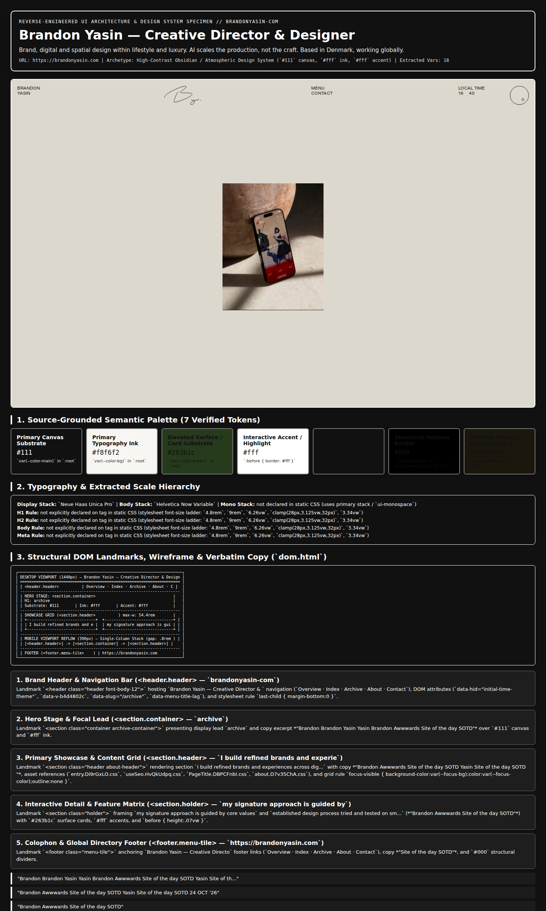
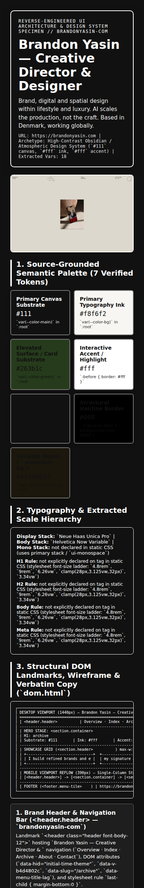

# UI Design System & Master Generation Blueprint: brandonyasin-com

> **Brandon Yasin — Creative Director & Designer** (https://brandonyasin.com) — Brand, digital and spatial design within lifestyle and luxury. AI scales the production, not the craft. Based in Denmark, working globally.



---

## 1. Executive Visual Persona & Design Archetype

- **Brand Essence & Persona**: **Brandon Yasin — Creative Director & Designer** (`https://brandonyasin.com`). Brand, digital and spatial design within lifestyle and luxury. AI scales the production, not the craft. Based in Denmark, working globally.
- **Visual Archetype**: **High-Contrast Obsidian / Atmospheric Design System (`#111` canvas, `#fff` ink, `#fff` accent)**.
- **Anti-AI-Slop Differentiators**:
  - **Source-Grounded Chromatic Polarity**: Anchors the viewport in `#111` (`var(--color-main)` in `:root`) paired with `#fff` primary typography and `#fff` accents.
  - **Extracted Typographic Hierarchy**: Pairs `Neue Haas Unica Pro` for display copy (`archive`) with `Helvetica Now Variable` and not declared in static CSS (uses primary stack / `ui-monospace`).
  - **Calibrated Spatial Grid & Motion**: Combines `54.4rem` container bounds (`gap: .8rem`, padding `6.4rem`) with `cubic-bezier(.645,.045,.355,1)` easing and Lenis Smooth Scroll (`data-lenis`), GSAP Timeline & ScrollTrigger.

---

## 2. Spatial Architecture & Modular Grid Mathematics



### Viewport Allocation & Container Geometry
- **Captured Viewport Dimensions**: Desktop `1440×2400px` (`assets/desktop.png`, capped at 2400px multi-section capture), Mobile `390×2400px` (`assets/mobile.png`, capped at 2400px multi-section capture).
- **Master Container Bounds**: `54.4rem` extracted from `brandonyasin-com` stylesheet.
- **Canvas Lateral Padding & Spacing**: `6.4rem` lateral canvas padding with `.8rem` grid gap.
- **Border Radius Scale**: `50%`.

### Responsive Breakpoint Architecture
- **Desktop Layout**: Multi-column CSS Grid / Flexbox layout at `1440px` (`max-width: 54.4rem`, `gap: .8rem`).
- **Mobile Layout**: Single-column vertical stack at `390px` viewport width with `6.4rem` horizontal padding.
- **Extracted CSS Media Queries**: `@media only screen and (width>=768px)`, `@media only screen and (width>=1025px)`, `@media only screen and (width>=1438px)`, `@media screen and (width<=360px)`.

---

## 3. Color System, Materiality & Atmospheric Lighting

### Semantic Palette & Source Grounding
| Semantic Role | Ground-Truth Value | Extracted CSS Source / Selector |
|---|---|---|
| **Primary Canvas Substrate** | `#111` | `var(--color-main)` in `:root` |
| **Primary Typography Ink** | `#f8f6f2` | `var(--color-bg)` in `:root` |
| **Elevated Surface / Card Substrate** | `#263b1c` | `var(--color-green)` in `:root` |
| **Interactive Accent / Highlight** | `#fff` | `:before { border: #fff }` |
| **Secondary / Muted Copy** | `#0000` | `html { color: #0000 }` |
| **Structural Hairline Border** | `#000` | `.img-wrap:after { background-color: #000 }` |
| **Variable Token (`--selection-bg`)** | `#44300033` | `var(--selection-bg)` in `:root` |

### Sanitized Root CSS Variables (`ui-ux.md` Ground Truth)
| Variable Name | Extracted Value | Semantic Role |
|---|---|---|
| `--color-main` | `#111` | Brand / Palette Token |
| `--color-bg` | `#f8f6f2` | Canvas / Surface Token |
| `--selection-color` | `#111` | Brand / Palette Token |
| `--selection-bg` | `#44300033` | Canvas / Surface Token |
| `--focus-bg` | `var(--color-main)` | Canvas / Surface Token |
| `--focus-color` | `var(--color-bg)` | Brand / Palette Token |
| `--lvh` | `1vh` | Layout / Spatial Grid Token |
| `--svh` | `1vh` | Layout / Spatial Grid Token |
| `--img-over-opacity` | `0` | Design System Custom Token |
| `--bg-brightness` | `1` | Canvas / Surface Token |
| `--size` | `1168` | Layout / Spatial Grid Token |
| `--cut` | `100%` | Dimension / Scale Token |
| `--color-green` | `#263b1c` | Brand / Palette Token |
| `--line-x` | `0px` | Dimension / Scale Token |
| `--line-w` | `0` | Design System Custom Token |
| `--before-w` | `.9` | Design System Custom Token |

---

## 4. Typographic Scale & Editorial Hierarchy

### Font Family Stacks
- **Display Typography**: `Neue Haas Unica Pro`.
- **Primary Body Stack**: `Helvetica Now Variable`.
- **Technical / Metadata Stack**: not declared in static CSS (uses primary stack / `ui-monospace`).

### Typographic Scale & Rules (Extracted from Stylesheet & Variables)
- **Hero Display (`H1`)**: not explicitly declared on tag in static CSS (stylesheet font-size ladder: `4.8rem`, `9rem`, `6.26vw`, `clamp(28px,3.125vw,32px)`, `3.34vw`).
- **Section Heading (`H2`)**: not explicitly declared on tag in static CSS (stylesheet font-size ladder: `4.8rem`, `9rem`, `6.26vw`, `clamp(28px,3.125vw,32px)`, `3.34vw`).
- **Body Copy**: not explicitly declared on tag in static CSS (stylesheet font-size ladder: `4.8rem`, `9rem`, `6.26vw`, `clamp(28px,3.125vw,32px)`, `3.34vw`).
- **Metadata & Navigation Labels**: not explicitly declared on tag in static CSS (stylesheet font-size ladder: `4.8rem`, `9rem`, `6.26vw`, `clamp(28px,3.125vw,32px)`, `3.34vw`).

---

## 5. Choreographed Motion & Interaction Physics

### Primary Easing Curves
- **Extracted Timing Functions**: `cubic-bezier(.645,.045,.355,1)`, `cubic-bezier(.87,0,.13,1)`, `cubic-bezier(.33333,1,.66667,1)`.

### Per-Element Transition & Choreography Rules
- **Selector `.header--color-anim[data-v-dc320ba0]`**: `transition: color .5s ease-out` extracted from `brandonyasin-com` stylesheet.
- **Selector `.button[data-v-dc320ba0]:before`**: `transition: transform .35s cubic-bezier(.645,.045,.355,1)` extracted from `brandonyasin-com` stylesheet.
- **Selector `.button[data-v-dc320ba0]:after`**: `transition: transform .35s cubic-bezier(.645,.045,.355,1) .2s` extracted from `brandonyasin-com` stylesheet.
- **Extracted Easing Curve (`cubic-bezier(.645,.045,.355,1)`)**: Governs interactive state transitions across `<header.header>` and `<section.header>`.
- **Runtime Interaction Engine**: Integrates Lenis Smooth Scroll (`data-lenis`), GSAP Timeline & ScrollTrigger, Three.js / WebGL Canvas Pipeline with `prefers-reduced-motion: reduce` fallback guards.

---

## 6. Component Wireframe & Structural DOM Map

### Visual Layout Schematic (Grounded in `dom.html` — `1440px` Desktop & `390px` Mobile Reflow)
```
┌────────────────────────────────────────────────────────────────────────┐
│ DESKTOP VIEWPORT (1440px) — Brandon Yasin — Creative Director & Design │
│ ====================================================================== │
│ [ <header.header>          | Overview · Index · Archive · About · C ]  │
│ ---------------------------------------------------------------------- │
│ | HERO STAGE: <section.container>                                  |   │
│ | H1: archive                                                      |   │
│ | Substrate: #111       | Ink: #fff       | Accent: #fff           |   │
│ ---------------------------------------------------------------------- │
│ | SHOWCASE GRID (<section.header>          ) max-w: 54.4rem        |   │
│ | +------------------------------+  +------------------------------+ | │
│ | | I build refined brands and e |  | my signature approach is gui | | │
│ | +------------------------------+  +------------------------------+ | │
│ ---------------------------------------------------------------------- │
│ | MOBILE VIEWPORT REFLOW (390px) — Single-Column Stack (gap: .8rem ) | │
│ | [<header.header>] -> [<section.container] -> [<section.header>] |    │
│ ---------------------------------------------------------------------- │
│ [ FOOTER (<footer.menu-tile>    ) | https://brandonyasin.com           │
└────────────────────────────────────────────────────────────────────────┘
```

### Granular DOM Region Breakdown
1. **Brand Header & Navigation Bar (<header.header> — `brandonyasin-com`)**:
   - Landmark `<header class="header font-body-12">` hosting `Brandon Yasin — Creative Director & ` navigation (`Overview · Index · Archive · About · Contact`), DOM attributes (`data-hid="initial-time-theme"`, `data-v-b4d4802c`, `data-slug="/archive"`, `data-menu-title-lag`), and stylesheet rule `last-child { margin-bottom:0 }`.
2. **Hero Stage & Focal Lead (<section.container> — `archive`)**:
   - Landmark `<section class="container archive-container">` presenting display lead `archive` and copy excerpt *"Brandon Brandon Yasin Yasin Brandon Awwwards Site of the day SOTD"* over `#111` canvas and `#fff` ink.
3. **Primary Showcase & Content Grid (<section.header> — `I build refined brands and experie`)**:
   - Landmark `<section class="header about-header">` rendering section `I build refined brands and experiences across dig...` with copy *"Brandon Awwwards Site of the day SOTD Yasin Site of the day SOTD "*, asset references (`entry.Di9rGxLO.css`, `useSeo.HvQkUdpq.css`, `PageTitle.DBPCFnbI.css`, `about.D7v35ChA.css`), and grid rule `focus-visible { background-color:var(--focus-bg);color:var(--focus-color);outline:none }`.
4. **Interactive Detail & Feature Matrix (<section.holder> — `my signature approach is guided by`)**:
   - Landmark `<section class="holder">` framing `my signature approach is guided by core values` and `established design process tried and tested on sm...` (*"Brandon Awwwards Site of the day SOTD"*) with `#263b1c` surface cards, `#fff` accents, and `before { height:.07vw }`.
5. **Colophon & Global Directory Footer (<footer.menu-tile> — `https://brandonyasin.com`)**:
   - Landmark `<footer class="menu-tile">` anchoring `Brandon Yasin — Creative Directo` footer links (`Overview · Index · Archive · About · Contact`), copy *"Site of the day SOTD"*, and `#000` structural dividers.

---

## 7. Master Zero-Shot AI Generation Prompt

```markdown
# Master Zero-Shot Frontend Generation Prompt: brandonyasin-com (Brandon Yasin — Creative Director & Designer)

You are a principal frontend architect and design systems engineer. Build a complete, production-ready web application replicating the exact design system, DOM landmarks, typographic hierarchy, color tokens, and motion physics of `brandonyasin-com` (**Brandon Yasin — Creative Director & Designer** — `https://brandonyasin.com`).

### 1. Visual Archetype & Anti-AI-Slop Mandates
- **Archetype**: High-Contrast Obsidian / Atmospheric Design System (`#111` canvas, `#fff` ink, `#fff` accent).
- **Identity & Domain Context**: Brand, digital and spatial design within lifestyle and luxury. AI scales the production, not the craft. Based in Denmark, working globally.
- **Primary Substrate**: `#111` (`var(--color-main)` in `:root`), **Primary Ink**: `#fff`, **Accent / Highlight**: `#fff`.
- **Site-Specific Differentiators**:
  - **Source-Grounded Chromatic Polarity**: Anchors the viewport in `#111` (`var(--color-main)` in `:root`) paired with `#fff` primary typography and `#fff` accents.
  - **Extracted Typographic Hierarchy**: Pairs `Neue Haas Unica Pro` for display copy (`archive`) with `Helvetica Now Variable` and not declared in static CSS (uses primary stack / `ui-monospace`).
  - **Calibrated Spatial Grid & Motion**: Combines `54.4rem` container bounds (`gap: .8rem`, padding `6.4rem`) with `cubic-bezier(.645,.045,.355,1)` easing and Lenis Smooth Scroll (`data-lenis`), GSAP Timeline & ScrollTrigger.

### 2. Ground-Truth CSS Variables (`:root` Token Contract)
Declare and consume these exact custom properties extracted from `brandonyasin-com` in your global stylesheet:

:root {
  /* Brandon Yasin — Creative Director & Designer (brandonyasin-com) — Ground-Truth Extracted CSS Variables */
  --color-main: #111; /* Brand / Palette Token (brandonyasin-com) */
  --color-bg: #f8f6f2; /* Canvas / Surface Token (brandonyasin-com) */
  --selection-color: #111; /* Brand / Palette Token (brandonyasin-com) */
  --selection-bg: #44300033; /* Canvas / Surface Token (brandonyasin-com) */
  --focus-bg: var(--color-main); /* Canvas / Surface Token (brandonyasin-com) */
  --focus-color: var(--color-bg); /* Brand / Palette Token (brandonyasin-com) */
  --lvh: 1vh; /* Layout / Spatial Grid Token (brandonyasin-com) */
  --svh: 1vh; /* Layout / Spatial Grid Token (brandonyasin-com) */
  --img-over-opacity: 0; /* Design System Custom Token (brandonyasin-com) */
  --bg-brightness: 1; /* Canvas / Surface Token (brandonyasin-com) */
  --size: 1168; /* Layout / Spatial Grid Token (brandonyasin-com) */
  --cut: 100%; /* Dimension / Scale Token (brandonyasin-com) */
  --color-green: #263b1c; /* Brand / Palette Token (brandonyasin-com) */
  --line-x: 0px; /* Dimension / Scale Token (brandonyasin-com) */
  --line-w: 0; /* Design System Custom Token (brandonyasin-com) */
  --before-w: .9; /* Design System Custom Token (brandonyasin-com) */
}

### 3. Semantic Color & Materiality Contract
Map every surface, ink, and border strictly to these source-grounded tokens:
- **Primary Canvas Substrate**: `#111` — grounded in `var(--color-main)` in `:root`
- **Primary Typography Ink**: `#f8f6f2` — grounded in `var(--color-bg)` in `:root`
- **Elevated Surface / Card Substrate**: `#263b1c` — grounded in `var(--color-green)` in `:root`
- **Interactive Accent / Highlight**: `#fff` — grounded in `:before { border: #fff }`
- **Secondary / Muted Copy**: `#0000` — grounded in `html { color: #0000 }`
- **Structural Hairline Border**: `#000` — grounded in `.img-wrap:after { background-color: #000 }`
- **Variable Token (`--selection-bg`)**: `#44300033` — grounded in `var(--selection-bg)` in `:root`

### 4. Spatial Grid, Container Bounds & Responsive Breakpoints
- **Desktop Viewport Reference**: `1440×2400px` (capped at 2400px multi-section capture, `1440px` standard desktop width).
- **Mobile Viewport Reference**: `390×2400px` (capped at 2400px multi-section capture, `390px` standard mobile width).
- **Container Max-Width**: `54.4rem` extracted from `brandonyasin-com` stylesheet
- **Padding & Gutters**: `6.4rem` lateral canvas padding with `.8rem` grid gap
- **Desktop Grid**: Multi-column CSS Grid / Flexbox layout at `1440px` (`max-width: 54.4rem`, `gap: .8rem`)
- **Mobile Adaptation**: Single-column vertical stack at `390px` viewport width with `6.4rem` horizontal padding
- **Media Queries**: `@media only screen and (width>=768px)`, `@media only screen and (width>=1025px)`, `@media only screen and (width>=1438px)`, `@media screen and (width<=360px)`
- **Corner Radii**: `50%`

### 5. Typography & Editorial Scale Contract
- **Display Font Stack**: `Neue Haas Unica Pro`
- **Body Font Stack**: `Helvetica Now Variable`
- **Monospace / Technical Font Stack**: not declared in static CSS (uses primary stack / `ui-monospace`)
- **H1 Display Rule**: not explicitly declared on tag in static CSS (stylesheet font-size ladder: `4.8rem`, `9rem`, `6.26vw`, `clamp(28px,3.125vw,32px)`, `3.34vw`)
- **H2 Section Rule**: not explicitly declared on tag in static CSS (stylesheet font-size ladder: `4.8rem`, `9rem`, `6.26vw`, `clamp(28px,3.125vw,32px)`, `3.34vw`)
- **Body Copy Rule**: not explicitly declared on tag in static CSS (stylesheet font-size ladder: `4.8rem`, `9rem`, `6.26vw`, `clamp(28px,3.125vw,32px)`, `3.34vw`)
- **Metadata & Index Rule**: not explicitly declared on tag in static CSS (stylesheet font-size ladder: `4.8rem`, `9rem`, `6.26vw`, `clamp(28px,3.125vw,32px)`, `3.34vw`)

### 6. Component Hierarchy, Verbatim Copy & Real DOM Landmarks
Scaffold `brandonyasin-com` (`Brandon Yasin — Creative Director & Designer`) with these exact structural regions, extracted copy, and CSS rules from `dom.html`:
1. **Brand Header & Navigation Bar (<header.header> — `brandonyasin-com`)**:
   - DOM & Selectors: Landmark `<header class="header font-body-12">` hosting `Brandon Yasin — Creative Director & ` navigation (`Overview · Index · Archive · About · Contact`), DOM attributes (`data-hid="initial-time-theme"`, `data-v-b4d4802c`, `data-slug="/archive"`, `data-menu-title-lag`), and stylesheet rule `last-child { margin-bottom:0 }`.
   - Responsive Contract: Header `Brand Header & Navigation Bar (<header.header> — `brandonyasin-com`)` (`brandonyasin-com`) adapts across `@media only screen and (width>=768px)`, `@media only screen and (width>=1025px)`, `@media only screen and (width>=1438px)`, `@media screen and (width<=360px)` with `cubic-bezier(.645,.045,.355,1)`, `cubic-bezier(.87,0,.13,1)`, `cubic-bezier(.33333,1,.66667,1)` transitions and links `Overview · Index · Archive · About · Contact`.
2. **Hero Stage & Focal Lead (<section.container> — `archive`)**:
   - DOM & Selectors: Landmark `<section class="container archive-container">` presenting display lead `archive` and copy excerpt *"Brandon Brandon Yasin Yasin Brandon Awwwards Site of the day SOTD"* over `#111` canvas and `#fff` ink.
   - Responsive Contract: Hero stage (`1440×2400px` desktop / `390×2400px` mobile) sets `#111` background with `#fff` headline `archive`.
3. **Primary Showcase & Content Grid (<section.header> — `I build refined brands and experie`)**:
   - DOM & Selectors: Landmark `<section class="header about-header">` rendering section `I build refined brands and experiences across dig...` with copy *"Brandon Awwwards Site of the day SOTD Yasin Site of the day SOTD "*, asset references (`entry.Di9rGxLO.css`, `useSeo.HvQkUdpq.css`, `PageTitle.DBPCFnbI.css`, `about.D7v35ChA.css`), and grid rule `focus-visible { background-color:var(--focus-bg);color:var(--focus-color);outline:none }`.
   - Responsive Contract: Showcase grid `Primary Showcase & Content Grid (<section.header> — `I build refined brands and experie`)` applies Multi-column CSS Grid / Flexbox layout at `1440px` (`max-width: 54.4rem`, `gap: .8rem`) on desktop and Single-column vertical stack at `390px` viewport width with `6.4rem` horizontal padding on mobile.
4. **Interactive Detail & Feature Matrix (<section.holder> — `my signature approach is guided by`)**:
   - DOM & Selectors: Landmark `<section class="holder">` framing `my signature approach is guided by core values` and `established design process tried and tested on sm...` (*"Brandon Awwwards Site of the day SOTD"*) with `#263b1c` surface cards, `#fff` accents, and `before { height:.07vw }`.
   - Responsive Contract: Detail module `Interactive Detail & Feature Matrix (<section.holder> — `my signature approach is guided by`)` uses `50%` radii, `#fff` highlights, and assets (entry.Di9rGxLO.css, useSeo.HvQkUdpq.css, PageTitle.DBPCFnbI.css).
5. **Colophon & Global Directory Footer (<footer.menu-tile> — `https://brandonyasin.com`)**:
   - DOM & Selectors: Landmark `<footer class="menu-tile">` anchoring `Brandon Yasin — Creative Directo` footer links (`Overview · Index · Archive · About · Contact`), copy *"Site of the day SOTD"*, and `#000` structural dividers.
   - Responsive Contract: Footer `Colophon & Global Directory Footer (<footer.menu-tile> — `https://brandonyasin.com`)` aligns to `54.4rem` extracted from `brandonyasin-com` stylesheet with `6.4rem` lateral canvas padding with `.8rem` grid gap and attributes (data-hid="initial-time-theme", data-v-b4d4802c, data-slug="/archive").

#### Verbatim DOM Copy Excerpts (`dom.html`)
- Copy Excerpt 1: *"Brandon Brandon Yasin Yasin Brandon Awwwards Site of the day SOTD Yasin Site of th..."*
- Copy Excerpt 2: *"Brandon Awwwards Site of the day SOTD Yasin Site of the day SOTD 24 OCT '26"*
- Copy Excerpt 3: *"Brandon Awwwards Site of the day SOTD"*
- Copy Excerpt 4: *"Site of the day SOTD"*

### 7. Motion, Extracted Stylesheet Rules & Interaction Choreography
- **Primary Easing Functions**: `cubic-bezier(.645,.045,.355,1)`, `cubic-bezier(.87,0,.13,1)`, `cubic-bezier(.33333,1,.66667,1)`
- **Extracted Stylesheet Rules (`brandonyasin-com`)**:
- `last-child { margin-bottom:0 }`
- `focus-visible { background-color:var(--focus-bg);color:var(--focus-color);outline:none }`
- `before { height:.07vw }`
- `after { height:.07vw }`
- `hover:before { transform:scaleX(0) }`
- **Per-Selector Transition Rules**:
- **Selector `.header--color-anim[data-v-dc320ba0]`**: `transition: color .5s ease-out` extracted from `brandonyasin-com` stylesheet.
- **Selector `.button[data-v-dc320ba0]:before`**: `transition: transform .35s cubic-bezier(.645,.045,.355,1)` extracted from `brandonyasin-com` stylesheet.
- **Selector `.button[data-v-dc320ba0]:after`**: `transition: transform .35s cubic-bezier(.645,.045,.355,1) .2s` extracted from `brandonyasin-com` stylesheet.
- **Extracted Easing Curve (`cubic-bezier(.645,.045,.355,1)`)**: Governs interactive state transitions across `<header.header>` and `<section.header>`.
- **Runtime Interaction Engine**: Integrates Lenis Smooth Scroll (`data-lenis`), GSAP Timeline & ScrollTrigger, Three.js / WebGL Canvas Pipeline with `prefers-reduced-motion: reduce` fallback guards.

### 8. Technical Deliverables
- Implement in Next.js (App Router) with TypeScript and Tailwind CSS consuming the `:root` custom properties defined above for `brandonyasin-com`.
- Reproduce both the `1440px` desktop architecture and `390px` mobile breakpoint transitions, preserving semantic HTML5 landmarks (`<header>`, `<nav>`, `<main>`, `<section>`, `<footer>`) and `prefers-reduced-motion` accessibility guards.
```
