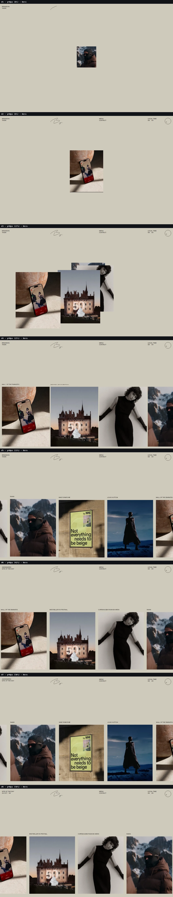
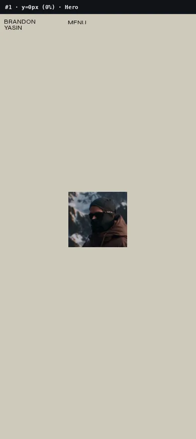

# UI Design System & Master Generation Blueprint: brandonyasin-com

> **Brandon Yasin — Creative Director & Designer** (https://brandonyasin.com) — Brand, digital and spatial design within lifestyle and luxury. AI scales the production, not the craft. Based in Denmark, working globally.





---

## 1. Executive Visual Persona & Design Archetype

- **Brand Essence & Persona**: **Brandon Yasin — Creative Director & Designer** (`https://brandonyasin.com`). Brand, digital and spatial design within lifestyle and luxury. AI scales the production, not the craft. Based in Denmark, working globally.
- **Capture Provenance**: Live browser capture (`tier1_fast`, HTTP `200`, captured `2026-11-24`).
- **Visual Archetype**: **Light-Substrate Editorial & Modular Grid System (`#cec9bb` canvas, `#111111` ink, `#ffeb48` accent)**.
- **Anti-AI-Slop Differentiators**:
  - **Live-Computed Chromatic Polarity**: Anchors the viewport in `#cec9bb` (live computed `body` `background-color` (`computed_styles.json`)) paired with `#111111` primary typography and `#ffeb48` accents.
  - **Grounded Typographic Hierarchy**: Uses `Neue Haas Unica Pro` across display (`archive`) and body copy.
  - **Calibrated Spatial Grid & Motion**: Combines `114.05vw` container bounds (`gap: 3rem`, padding `16px`) with `cubic-bezier(.645,.045,.355,1)` easing and Lenis Smooth Scroll (`data-lenis`), GSAP Timeline & ScrollTrigger.

---

## 2. Spatial Architecture & Modular Grid Mathematics

### Viewport Allocation & Container Geometry
- **Captured Journey Filmstrips**: Desktop `1280×6624px` (`assets/desktop-journey.webp`, `8` keyframes up to `y=0px` / doc `900px`), Mobile `390×872px` (`assets/mobile-journey.webp`, `1` keyframes).
- **Master Container Bounds**: `114.05vw` (non-`@media` desktop container stylesheet rule).
- **Canvas Lateral Padding & Spacing**: `16px` lateral canvas padding with `3rem` grid gap.
- **Border Radius Scale**: `50%`.

### Responsive Breakpoint Architecture
- **Desktop Layout**: Multi-column CSS Grid / Flexbox layout at `1440px` (`max-width: 114.05vw`, `gap: 3rem`).
- **Mobile Layout**: Single-column vertical stack at `390px` viewport width with `16px` horizontal padding.
- **Extracted CSS Media Queries**: `@media only screen and (width>=768px)`, `@media only screen and (width>=1025px)`, `@media only screen and (width>=1438px)`, `@media (width>=768px)`.

---

## 3. Color System, Materiality & Atmospheric Lighting

### Semantic Palette & Source Grounding
| Semantic Role | Ground-Truth Value | Extracted Live / CSS Source |
|---|---|---|
| **Primary Canvas Substrate** | `#cec9bb` | live computed `body` `background-color` (`computed_styles.json`) |
| **Primary Typography Ink** | `#111111` | live computed `h1` `color` (`computed_styles.json`) |
| **Elevated Surface / Card Substrate** | `#f8f6f2` | `var(--color-bg)` in `:root` |
| **Interactive Accent / Highlight** | `#ffeb48` | `::-moz-placeholder { color: #ffeb48 }` |
| **Secondary / Muted Copy** | `#8c1919` | `label span { color: #8c1919 }` |
| **Structural Hairline Border** | `#ffffff` | `:before { border: #ffffff }` |
| **Variable Token (`--selection-bg`)** | `#443000` | `var(--selection-bg)` in `:root` |
| **Variable Token (`--color-green`)** | `#263b1c` | `var(--color-green)` in `:root` |

### Sanitized Root CSS Variables (`ui-ux.md` Ground Truth)
| Variable Name | Extracted Value | Semantic Role |
|---|---|---|
| `--color-main` | `#111` | Brand / Palette Token |
| `--color-bg` | `#f8f6f2` | Canvas / Surface Token |
| `--selection-color` | `#111` | Brand / Palette Token |
| `--selection-bg` | `#44300033` | Canvas / Surface Token |
| `--focus-bg` | `var(--color-main)` | Canvas / Surface Token |
| `--focus-color` | `var(--color-bg)` | Brand / Palette Token |
| `--lvh` | `1vh` | Layout / Spatial Grid Token |
| `--svh` | `1vh` | Layout / Spatial Grid Token |
| `--img-over-opacity` | `0` | Design System Custom Token |
| `--bg-brightness` | `1` | Canvas / Surface Token |
| `--size` | `1168` | Layout / Spatial Grid Token |
| `--cut` | `100%` | Dimension / Scale Token |
| `--color-green` | `#263b1c` | Brand / Palette Token |
| `--line-x` | `0px` | Dimension / Scale Token |
| `--line-w` | `0` | Design System Custom Token |
| `--before-w` | `.9` | Design System Custom Token |

---

## 4. Typographic Scale & Editorial Hierarchy

### Font Family Stacks
- **Display Typography**: `Neue Haas Unica Pro`.
- **Primary Body Stack**: `Neue Haas Unica Pro`.
- **Technical / Metadata Stack**: not declared in live computed styles (uses primary stack / `ui-monospace`).

### Typographic Scale & Rules (Live Computed & Stylesheet Grounded)
- **Hero Display (`H1`)**: live computed `h1` (`font-size: 90.144px`, `line-height: 111.779px`, `font-weight: 400`, `letter-spacing: -3.60576px`).
- **Section Heading (`H2`)**: live computed `h2` (`font-size: 40.032px`, `line-height: 48.0384px`, `font-weight: 400`, `letter-spacing: -1.60128px`).
- **Body Copy**: live computed `body` (`font-size: 15.984px`, `line-height: 20.7792px`, `font-weight: 400`).
- **Metadata & Navigation Labels**: live computed `nav/a` (`font-size: 12px`, `line-height: 12px`, `font-weight: 400`).

---

## 5. Choreographed Motion & Interaction Physics

### Primary Easing Curves
- **Extracted Timing Functions**: `cubic-bezier(.645,.045,.355,1)`, `cubic-bezier(.87,0,.13,1)`, `cubic-bezier(.33333,1,.66667,1)`.

### Per-Element Transition & Choreography Rules
- **Selector `label`**: `transition: color .2s ease-out` extracted from `brandonyasin-com` stylesheet.
- **Selector `textarea[data-v-564d7e72]:-webkit...`**: `transition: background-color 10000000s step-end` extracted from `brandonyasin-com` stylesheet.
- **Selector `al-wrap textarea[data-v-564d7e72]...`**: `transition: background-color 10000000s step-end` extracted from `brandonyasin-com` stylesheet.
- **Extracted Easing Curve (`cubic-bezier(.645,.045,.355,1)`)**: Governs interactive state transitions across `<header.header>` and `<section.header>`.
- **Runtime Interaction Engine**: Integrates Lenis Smooth Scroll (`data-lenis`), GSAP Timeline & ScrollTrigger, Three.js / WebGL Canvas Pipeline with `prefers-reduced-motion: reduce` fallback guards.
### Measured Runtime Scroll & Interaction Telemetry (`behavioral_journey_v2`)
- **Scroll Driver Mode**: `wheel` (max document height `900px`, deepest scrollY reached `0px` across `8` desktop keyframes).
- **Detected Scroll / Motion Libraries**: `Lenis`.
- **Nav / Drawer Probe (`MENU MENU`)**: Triggered visual change (pixel diff `58.807`, captured in `assets/state-nav.webp`); revealed links: BRANDON BRANDON YASIN..., MALL OF THE EMIRATES..., BESTSELLER 50 FESTIVA..., COPENHAGEN FASHION WE..., RAINS RAINS, NINE FURNITURE NINE F....
- **Hover Physics (`primary_cta` · `BRANDON BRANDON YASIN YASIN`)**: Computed transition `0s` / `ease` (no static color/transform shift captured at rest).
- **Route Transition Architecture**: First internal navigation (`/cases/mall-of-the-emirates`) measured as `direct` in `775ms`.

---

## 6. Component Wireframe & Structural DOM Map

### Visual Layout Schematic — Desktop (`1440px`, Grounded in `dom.html` & Landmark Bounding Boxes)
```
┌────────────────────────────────────────────────────────────────────────┐
│ DESKTOP VIEWPORT (1440px) — Brandon Yasin — Creative Director & Design │
│ ====================================================================== │
│ [ <header.header> (1440x84px)         | Overview · Index · Archive · ] │
│ ---------------------------------------------------------------------- │
│ | HERO STAGE: <section.archive-container> (w=1440px)                 | │
│ | H1: archive                                                        | │
│ | Substrate: #cec9bb | Ink: #111111 | Accent: #ffeb48                | │
│ ---------------------------------------------------------------------- │
│ | SHOWCASE GRID (<section.header>) max-w: 114.05vw                   | │
│ | +------------------------------+  +------------------------------+ | │
│ | | Every project begins with ob |  | Brandon Awwwards Site of the | | │
│ | +------------------------------+  +------------------------------+ | │
│ ---------------------------------------------------------------------- │
│ | DETAIL MODULE (<section.holder>) — Brandon Awwwards Site           | │
│ ---------------------------------------------------------------------- │
│ [ FOOTER (<footer.menu-tile>  ) | https://brandonyasin.com             │
└────────────────────────────────────────────────────────────────────────┘
```

### Visual Layout Schematic — Mobile Reflow (`390px`)
```
┌────────────────────────────────────────────────────────────────────────┐
│ MOBILE VIEWPORT REFLOW (390px) — Single-Column Stack (gap: 3rem)       │
│ ====================================================================== │
│ [ HEADER BAR (<header.header>         ) | Compact Menu (390px)         │
│ ---------------------------------------------------------------------- │
│ | HERO STAGE (<section.archive-contain) — 390px Vertical Lead        | │
│ | H1: archive                                                        | │
│ ---------------------------------------------------------------------- │
│ | SHOWCASE STACK (<section.header>) — 1-Col Stack                    | │
│ | [ Item 1: Every project begins with observation. Understan       ] | │
│ | [ Item 2: Brandon Awwwards Site of the day SOTD Yasin Site       ] | │
│ ---------------------------------------------------------------------- │
│ | DETAIL STACK (<section.holder>) — 1-Col (Brandon Awwwards S)       | │
│ ---------------------------------------------------------------------- │
│ [ FOOTER (<footer.menu-tile>  ) | Stacked 390px Colophon               │
└────────────────────────────────────────────────────────────────────────┘
```

### Granular DOM Region Breakdown
1. **Brand Header & Navigation Bar (<header.header> — `brandonyasin-com`)**:
   - Landmark `<header class="header font-body-12">` (`1440x84px`) hosting `Brandon Yasin — Creative Director & ` navigation (`Overview · Index · Archive · About · Contact`), DOM attributes (`data-hid="initial-time-theme"`, `data-v-b4d4802c`, `data-slug="/archive"`, `data-menu-title-lag`), and stylesheet rule `.font-headline-1 { letter-spacing:-.04em;font:400 5.4rem/1.24 Neue Haas Unica Pro,Helvetica... }`.
2. **Hero Stage & Focal Lead (<section.archive-container> — `archive`)**:
   - Landmark `<section class="archive-container container">` presenting display lead `archive` and copy excerpt *"Every project begins with observation. Understanding the context,"* over `#cec9bb` canvas and `#111111` ink.
3. **Primary Showcase & Content Grid (<section.header> — `Every project begins with observat`)**:
   - Landmark `<section class="header about-header">` rendering section `Every project begins with observation. Understan` with copy *"Brandon Awwwards Site of the day SOTD Yasin Site of the day SOTD "*, asset references (`entry.CxmSBJR3.css`, `BUkWhEWa.js`, `DK3Fl9T5.js`, `IQKDJ7dv.js`), and grid rule `.font-headline-2 { letter-spacing:0;font:251 2.8rem/1.2 Neue Haas Unica Pro,Helvetica Neue,... }`.
4. **Interactive Detail & Feature Matrix (<section.holder> — `Brandon Awwwards Site of the day S`)**:
   - Landmark `<section class="holder">` framing `Brandon Awwwards Site of the day SOTD Yasin Site` and `Brandon Awwwards Site of the day SOTD` (*"Brandon Awwwards Site of the day SOTD"*) with `#f8f6f2` surface cards, `#ffeb48` accents, and `.font-headline-2-large { letter-spacing:0;font:251 5.5rem/1.24 Neue Haas Unica Pro,Helvetica Neue... }`.
5. **Colophon & Global Directory Footer (<footer.menu-tile> — `https://brandonyasin.com`)**:
   - Landmark `<footer class="menu-tile">` anchoring `Brandon Yasin — Creative Directo` footer links (`Overview · Index · Archive · About · Contact`), copy *"Site of the day SOTD"*, and `#ffffff` structural dividers.
### Full Vertical Scroll Sequence (Desktop `1440×900` Keyframes)
- **Step 01** (`y=0px`, `0%`): Active landmark `Hero` · sticky/fixed elements: `0`
- **Step 02** (`y=0px`, `8%`): Active landmark `Hero` · sticky/fixed elements: `0`
- **Step 03** (`y=0px`, `17%`): Active landmark `Hero` · sticky/fixed elements: `0`
- **Step 04** (`y=0px`, `25%`): Active landmark `Hero` · sticky/fixed elements: `0`
- **Step 05** (`y=0px`, `33%`): Active landmark `Hero` · sticky/fixed elements: `0`
- **Step 06** (`y=0px`, `42%`): Active landmark `Hero` · sticky/fixed elements: `0`
- **Step 07** (`y=0px`, `50%`): Active landmark `Hero` · sticky/fixed elements: `0`
- **Step 08** (`y=0px`, `58%`): Active landmark `Hero` · sticky/fixed elements: `0`

### Multi-Page Internal Route Map
- **Detail Route (`/cases/mall-of-the-emirates`)**: `https://brandonyasin.com/cases/mall-of-the-emirates` — H1: `archive`, scrollHeight `8159px`, transition `direct` (`775ms`)
- **Detail Route (`/cases/bestseller`)**: `https://brandonyasin.com/cases/bestseller` — H1: `archive`, scrollHeight `10864px`, transition `direct` (`1373ms`)
- **Detail Route (`/cases/copenhagen-fashion-week`)**: `https://brandonyasin.com/cases/copenhagen-fashion-week` — H1: `archive`, scrollHeight `10851px`, transition `direct` (`1736ms`)

---

## 7. Master Zero-Shot AI Generation Prompt

```markdown
# Master Zero-Shot Frontend Generation Prompt: brandonyasin-com (Brandon Yasin — Creative Director & Designer)

You are a principal frontend architect and design systems engineer. Build a complete, production-ready web application replicating the exact design system, DOM landmarks, typographic hierarchy, color tokens, and motion physics of `brandonyasin-com` (**Brandon Yasin — Creative Director & Designer** — `https://brandonyasin.com`).

### 1. Visual Archetype & Anti-AI-Slop Mandates
- **Archetype**: Light-Substrate Editorial & Modular Grid System (`#cec9bb` canvas, `#111111` ink, `#ffeb48` accent).
- **Identity & Domain Context**: Brand, digital and spatial design within lifestyle and luxury. AI scales the production, not the craft. Based in Denmark, working globally.
- **Primary Substrate**: `#cec9bb` (live computed `body` `background-color` (`computed_styles.json`)), **Primary Ink**: `#111111`, **Accent / Highlight**: `#ffeb48`.
- **Site-Specific Differentiators**:
  - **Live-Computed Chromatic Polarity**: Anchors the viewport in `#cec9bb` (live computed `body` `background-color` (`computed_styles.json`)) paired with `#111111` primary typography and `#ffeb48` accents.
  - **Grounded Typographic Hierarchy**: Uses `Neue Haas Unica Pro` across display (`archive`) and body copy.
  - **Calibrated Spatial Grid & Motion**: Combines `114.05vw` container bounds (`gap: 3rem`, padding `16px`) with `cubic-bezier(.645,.045,.355,1)` easing and Lenis Smooth Scroll (`data-lenis`), GSAP Timeline & ScrollTrigger.

### 2. Ground-Truth CSS Variables (`:root` Token Contract)
Declare and consume these exact custom properties extracted from `brandonyasin-com` in your global stylesheet:

:root {
  /* Brandon Yasin — Creative Director & Designer (brandonyasin-com) — Live-Grounded CSS Variables */
  --color-main: #111; /* Brand / Palette Token (brandonyasin-com) */
  --color-bg: #f8f6f2; /* Canvas / Surface Token (brandonyasin-com) */
  --selection-color: #111; /* Brand / Palette Token (brandonyasin-com) */
  --selection-bg: #44300033; /* Canvas / Surface Token (brandonyasin-com) */
  --focus-bg: var(--color-main); /* Canvas / Surface Token (brandonyasin-com) */
  --focus-color: var(--color-bg); /* Brand / Palette Token (brandonyasin-com) */
  --lvh: 1vh; /* Layout / Spatial Grid Token (brandonyasin-com) */
  --svh: 1vh; /* Layout / Spatial Grid Token (brandonyasin-com) */
  --img-over-opacity: 0; /* Design System Custom Token (brandonyasin-com) */
  --bg-brightness: 1; /* Canvas / Surface Token (brandonyasin-com) */
  --size: 1168; /* Layout / Spatial Grid Token (brandonyasin-com) */
  --cut: 100%; /* Dimension / Scale Token (brandonyasin-com) */
  --color-green: #263b1c; /* Brand / Palette Token (brandonyasin-com) */
  --line-x: 0px; /* Dimension / Scale Token (brandonyasin-com) */
  --line-w: 0; /* Design System Custom Token (brandonyasin-com) */
  --before-w: .9; /* Design System Custom Token (brandonyasin-com) */
}

### 3. Semantic Color & Materiality Contract
Map every surface, ink, and border strictly to these source-grounded tokens:
- **Primary Canvas Substrate**: `#cec9bb` — grounded in live computed `body` `background-color` (`computed_styles.json`)
- **Primary Typography Ink**: `#111111` — grounded in live computed `h1` `color` (`computed_styles.json`)
- **Elevated Surface / Card Substrate**: `#f8f6f2` — grounded in `var(--color-bg)` in `:root`
- **Interactive Accent / Highlight**: `#ffeb48` — grounded in `::-moz-placeholder { color: #ffeb48 }`
- **Secondary / Muted Copy**: `#8c1919` — grounded in `label span { color: #8c1919 }`
- **Structural Hairline Border**: `#ffffff` — grounded in `:before { border: #ffffff }`
- **Variable Token (`--selection-bg`)**: `#443000` — grounded in `var(--selection-bg)` in `:root`
- **Variable Token (`--color-green`)**: `#263b1c` — grounded in `var(--color-green)` in `:root`

### 4. Spatial Grid, Container Bounds & Responsive Breakpoints
- **Desktop Viewport Reference**: `1280×6624px` (multi-frame vertical journey filmstrip (6624px), `1440px` standard desktop width).
- **Mobile Viewport Reference**: `390×872px` (full-page live capture (872px), `390px` standard mobile width).
- **Container Max-Width**: `114.05vw` (non-`@media` desktop container stylesheet rule)
- **Padding & Gutters**: `16px` lateral canvas padding with `3rem` grid gap
- **Desktop Grid**: Multi-column CSS Grid / Flexbox layout at `1440px` (`max-width: 114.05vw`, `gap: 3rem`)
- **Mobile Adaptation**: Single-column vertical stack at `390px` viewport width with `16px` horizontal padding
- **Media Queries**: `@media only screen and (width>=768px)`, `@media only screen and (width>=1025px)`, `@media only screen and (width>=1438px)`, `@media (width>=768px)`
- **Corner Radii**: `50%`

### 5. Typography & Editorial Scale Contract
- **Display Font Stack**: `Neue Haas Unica Pro`
- **Body Font Stack**: `Neue Haas Unica Pro`
- **Monospace / Technical Font Stack**: not declared in live computed styles (uses primary stack / `ui-monospace`)
- **H1 Display Rule**: live computed `h1` (`font-size: 90.144px`, `line-height: 111.779px`, `font-weight: 400`, `letter-spacing: -3.60576px`)
- **H2 Section Rule**: live computed `h2` (`font-size: 40.032px`, `line-height: 48.0384px`, `font-weight: 400`, `letter-spacing: -1.60128px`)
- **Body Copy Rule**: live computed `body` (`font-size: 15.984px`, `line-height: 20.7792px`, `font-weight: 400`)
- **Metadata & Index Rule**: live computed `nav/a` (`font-size: 12px`, `line-height: 12px`, `font-weight: 400`)

### 6. Component Hierarchy, Verbatim Copy & Real DOM Landmarks
Scaffold `brandonyasin-com` (`Brandon Yasin — Creative Director & Designer`) with these exact structural regions, extracted copy, and CSS rules from `dom.html`:
1. **Brand Header & Navigation Bar (<header.header> — `brandonyasin-com`)**:
   - DOM & Selectors: Landmark `<header class="header font-body-12">` (`1440x84px`) hosting `Brandon Yasin — Creative Director & ` navigation (`Overview · Index · Archive · About · Contact`), DOM attributes (`data-hid="initial-time-theme"`, `data-v-b4d4802c`, `data-slug="/archive"`, `data-menu-title-lag`), and stylesheet rule `.font-headline-1 { letter-spacing:-.04em;font:400 5.4rem/1.24 Neue Haas Unica Pro,Helvetica... }`.
   - Responsive Contract: Header `Brand Header & Navigation Bar (<header.header> — `brandonyasin-com`)` (`brandonyasin-com`) adapts across `@media only screen and (width>=768px)`, `@media only screen and (width>=1025px)`, `@media only screen and (width>=1438px)`, `@media (width>=768px)` with `cubic-bezier(.645,.045,.355,1)`, `cubic-bezier(.87,0,.13,1)`, `cubic-bezier(.33333,1,.66667,1)` transitions and links `Overview · Index · Archive · About · Contact`.
2. **Hero Stage & Focal Lead (<section.archive-container> — `archive`)**:
   - DOM & Selectors: Landmark `<section class="archive-container container">` presenting display lead `archive` and copy excerpt *"Every project begins with observation. Understanding the context,"* over `#cec9bb` canvas and `#111111` ink.
   - Responsive Contract: Hero stage (`1280×6624px` desktop / `390×872px` mobile) sets `#cec9bb` background with `#111111` headline `archive`.
3. **Primary Showcase & Content Grid (<section.header> — `Every project begins with observat`)**:
   - DOM & Selectors: Landmark `<section class="header about-header">` rendering section `Every project begins with observation. Understan` with copy *"Brandon Awwwards Site of the day SOTD Yasin Site of the day SOTD "*, asset references (`entry.CxmSBJR3.css`, `BUkWhEWa.js`, `DK3Fl9T5.js`, `IQKDJ7dv.js`), and grid rule `.font-headline-2 { letter-spacing:0;font:251 2.8rem/1.2 Neue Haas Unica Pro,Helvetica Neue,... }`.
   - Responsive Contract: Showcase grid `Primary Showcase & Content Grid (<section.header> — `Every project begins with observat`)` applies Multi-column CSS Grid / Flexbox layout at `1440px` (`max-width: 114.05vw`, `gap: 3rem`) on desktop and Single-column vertical stack at `390px` viewport width with `16px` horizontal padding on mobile.
4. **Interactive Detail & Feature Matrix (<section.holder> — `Brandon Awwwards Site of the day S`)**:
   - DOM & Selectors: Landmark `<section class="holder">` framing `Brandon Awwwards Site of the day SOTD Yasin Site` and `Brandon Awwwards Site of the day SOTD` (*"Brandon Awwwards Site of the day SOTD"*) with `#f8f6f2` surface cards, `#ffeb48` accents, and `.font-headline-2-large { letter-spacing:0;font:251 5.5rem/1.24 Neue Haas Unica Pro,Helvetica Neue... }`.
   - Responsive Contract: Detail module `Interactive Detail & Feature Matrix (<section.holder> — `Brandon Awwwards Site of the day S`)` uses `50%` radii, `#ffeb48` highlights, and assets (entry.CxmSBJR3.css, BUkWhEWa.js, DK3Fl9T5.js).
5. **Colophon & Global Directory Footer (<footer.menu-tile> — `https://brandonyasin.com`)**:
   - DOM & Selectors: Landmark `<footer class="menu-tile">` anchoring `Brandon Yasin — Creative Directo` footer links (`Overview · Index · Archive · About · Contact`), copy *"Site of the day SOTD"*, and `#ffffff` structural dividers.
   - Responsive Contract: Footer `Colophon & Global Directory Footer (<footer.menu-tile> — `https://brandonyasin.com`)` aligns to `114.05vw` (non-`@media` desktop container stylesheet rule) with `16px` lateral canvas padding with `3rem` grid gap and attributes (data-hid="initial-time-theme", data-v-b4d4802c, data-slug="/archive").

#### Verbatim DOM Copy Excerpts (`dom.html`)
- Copy Excerpt 1: *"Every project begins with observation. Understanding the context, people and brand..."*
- Copy Excerpt 2: *"Brandon Awwwards Site of the day SOTD Yasin Site of the day SOTD 24 OCT '26"*
- Copy Excerpt 3: *"Brandon Awwwards Site of the day SOTD"*
- Copy Excerpt 4: *"Site of the day SOTD"*

### 7. Motion, Extracted Stylesheet Rules & Interaction Choreography
- **Primary Easing Functions**: `cubic-bezier(.645,.045,.355,1)`, `cubic-bezier(.87,0,.13,1)`, `cubic-bezier(.33333,1,.66667,1)`
- **Extracted Stylesheet Rules (`brandonyasin-com`)**:
- `.font-headline-1 { letter-spacing:-.04em;font:400 5.4rem/1.24 Neue Haas Unica Pro,Helvetica... }`
- `.font-headline-2 { letter-spacing:0;font:251 2.8rem/1.2 Neue Haas Unica Pro,Helvetica Neue,... }`
- `.font-headline-2-large { letter-spacing:0;font:251 5.5rem/1.24 Neue Haas Unica Pro,Helvetica Neue... }`
- `.font-headline-3 { letter-spacing:0;font:251 2.8rem/1.1 Neue Haas Unica Pro,Helvetica Neue,... }`
- `.font-headline-4 { letter-spacing:0;font:251 2.8rem/1.1 Neue Haas Unica Pro,Helvetica Neue,... }`
- **Per-Selector Transition Rules**:
- **Selector `label`**: `transition: color .2s ease-out` extracted from `brandonyasin-com` stylesheet.
- **Selector `textarea[data-v-564d7e72]:-webkit...`**: `transition: background-color 10000000s step-end` extracted from `brandonyasin-com` stylesheet.
- **Selector `al-wrap textarea[data-v-564d7e72]...`**: `transition: background-color 10000000s step-end` extracted from `brandonyasin-com` stylesheet.
- **Extracted Easing Curve (`cubic-bezier(.645,.045,.355,1)`)**: Governs interactive state transitions across `<header.header>` and `<section.header>`.
- **Runtime Interaction Engine**: Integrates Lenis Smooth Scroll (`data-lenis`), GSAP Timeline & ScrollTrigger, Three.js / WebGL Canvas Pipeline with `prefers-reduced-motion: reduce` fallback guards.
### 7b. Full-Page Scroll Choreography, Interactive States & Multi-Page Routes
- **Scroll Mechanics**: Implement `wheel` vertical progression up to `900px` across 8 distinct viewport chapters using Lenis.
- **Vertical Chapter Sequence**: Hero (0%) -> Hero (8%) -> Hero (17%) -> Hero (25%) -> Hero (33%) -> Hero (42%) -> Hero (50%) -> Hero (58%).
- **Navigation Drawer / Menu State**: Replicate interactive menu toggle (`MENU MENU`) with Escape-to-close keyboard handling.
- **Multi-Page Routes**: Scaffold internal routes `/cases/mall-of-the-emirates` (detail, direct), `/cases/bestseller` (detail, direct), `/cases/copenhagen-fashion-week` (detail, direct) sharing the global header/footer shell and design tokens.

### 8. Technical Deliverables
- Implement in Next.js (App Router) with TypeScript and Tailwind CSS consuming the `:root` custom properties defined above for `brandonyasin-com`.
- Reproduce both the `1440px` desktop architecture and `390px` mobile breakpoint transitions, preserving semantic HTML5 landmarks (`<header>`, `<nav>`, `<main>`, `<section>`, `<footer>`) and `prefers-reduced-motion` accessibility guards.
```
---

## 8. Full-Page Scroll Journey, Interactive States & Subpage Inventory

### Desktop Scroll Keyframes (`1440×900` WebP)
| Step | Scroll Y | Progress | Active Landmark / Section | Sticky/Fixed | Visual Asset |
| :---: | :---: | :---: | :--- | :---: | :--- |
| `#01` | `0px` | `0%` | Hero | `0` | [desktop-step-01.webp](assets/desktop-step-01.webp) |
| `#02` | `0px` | `8%` | Hero | `0` | [desktop-step-02.webp](assets/desktop-step-02.webp) |
| `#03` | `0px` | `17%` | Hero | `0` | [desktop-step-03.webp](assets/desktop-step-03.webp) |
| `#04` | `0px` | `25%` | Hero | `0` | [desktop-step-04.webp](assets/desktop-step-04.webp) |
| `#05` | `0px` | `33%` | Hero | `0` | [desktop-step-05.webp](assets/desktop-step-05.webp) |
| `#06` | `0px` | `42%` | Hero | `0` | [desktop-step-06.webp](assets/desktop-step-06.webp) |
| `#07` | `0px` | `50%` | Hero | `0` | [desktop-step-07.webp](assets/desktop-step-07.webp) |
| `#08` | `0px` | `58%` | Hero | `0` | [desktop-step-08.webp](assets/desktop-step-08.webp) |

### Mobile Condensed Keyframes (`390×844` WebP)
| Step | Scroll Y | Progress | Active Landmark | Visual Asset |
| :---: | :---: | :---: | :--- | :--- |
| `#01` | `0px` | `0%` | Hero | [mobile-step-01.webp](assets/mobile-step-01.webp) |

### Interactive UI State Captures (`1440×900` WebP)
| State Type | Trigger / Observation | Visual Asset |
| :--- | :--- | :--- |
| `nav_menu` | Nav/Menu opened (`MENU MENU`, diff `58.807`) | [state-nav.webp](assets/state-nav.webp) |

### Internal Subpage Filmstrips (`1080px` Wide WebP)
| # | Template | Route URL | H1 / Title | Scroll Height | Transition | Filmstrip Asset |
| :-: | :---: | :--- | :--- | :---: | :---: | :--- |
| `1` | `detail` | `https://brandonyasin.com/cases/mall-of-the-emirates` | archive | `8159px` | `direct` (`775ms`) | [subpage-01-cases-mall-of-the-emirates.webp](assets/subpage-01-cases-mall-of-the-emirates.webp) |
| `2` | `detail` | `https://brandonyasin.com/cases/bestseller` | archive | `10864px` | `direct` (`1373ms`) | [subpage-02-cases-bestseller.webp](assets/subpage-02-cases-bestseller.webp) |
| `3` | `detail` | `https://brandonyasin.com/cases/copenhagen-fashion-week` | archive | `10851px` | `direct` (`1736ms`) | [subpage-03-cases-copenhagen-fashion-week.webp](assets/subpage-03-cases-copenhagen-fashion-week.webp) |

