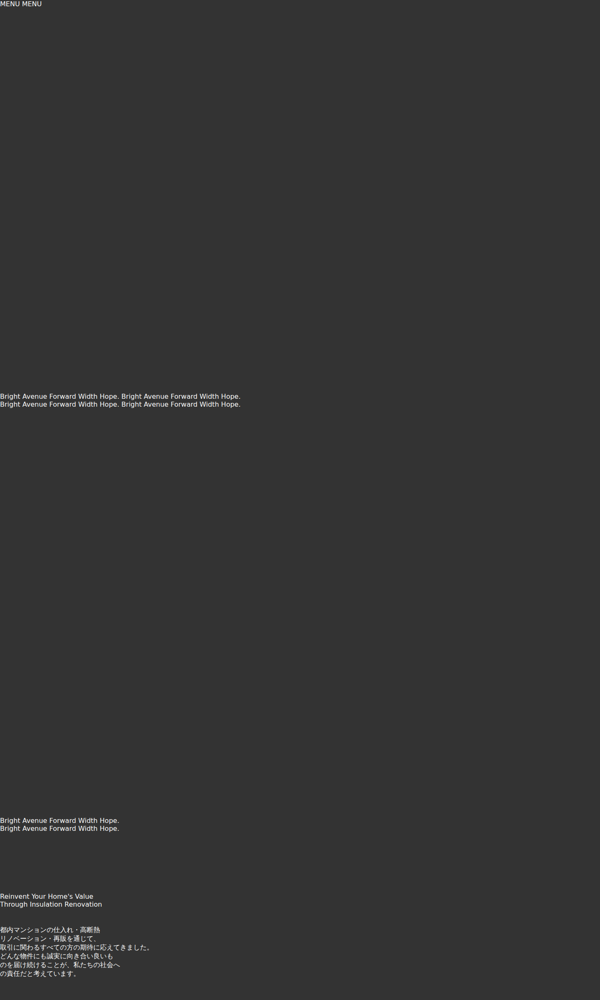
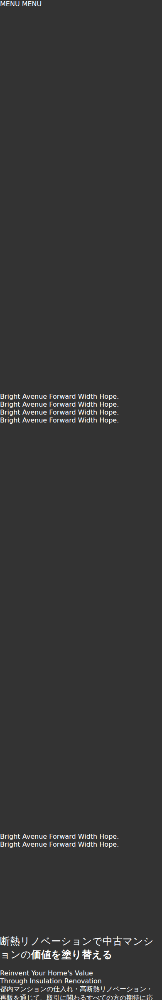

# UI Design System & Master Generation Blueprint: bright-avenue-jp

> **株式会社ブライトアベニュー · 不動産買取再販事業・リノベーション事業** (https://bright-avenue.jp/) — 株式会社ブライトアベニューは、関東エリアを中心に不動産買取再販サービスを展開しています。



---

## 1. Executive Visual Persona & Design Archetype

- **Brand Essence & Persona**: **株式会社ブライトアベニュー · 不動産買取再販事業・リノベーション事業** (`https://bright-avenue.jp/`). 株式会社ブライトアベニューは、関東エリアを中心に不動産買取再販サービスを展開しています。
- **Visual Archetype**: **Dark-Substrate WebGL / Canvas Interactive Experience (`#333333` / `#D9D4D4`)**.
- **Anti-AI-Slop Differentiators**:
  - **Source-Grounded Chromatic Polarity**: Anchors the viewport in `#333333` (`var(--color-text)` in `:root`) paired with `#fff` primary typography and `#D9D4D4` accents.
  - **Extracted Typographic Hierarchy**: Pairs `Noto Sans JP` for display copy (`断熱リノベーションで 中古マンションの価値を塗り替える`) with `mfw-tbgostd-demibold` and not declared in static CSS (uses primary stack / `ui-monospace`).
  - **Calibrated Spatial Grid & Motion**: Combines `1023px` container bounds (`gap: 4rem`, padding `4rem`) with `cubic-bezier(.55,.05,.22,.99)` easing and Lenis Smooth Scroll (`data-lenis`), Three.js / WebGL Canvas Pipeline.

---

## 2. Spatial Architecture & Modular Grid Mathematics



### Viewport Allocation & Container Geometry
- **Captured Viewport Dimensions**: Desktop `1440×2400px` (`assets/desktop.png`, capped at 2400px multi-section capture), Mobile `390×2400px` (`assets/mobile.png`, capped at 2400px multi-section capture).
- **Master Container Bounds**: `1023px` extracted from `bright-avenue-jp` stylesheet.
- **Canvas Lateral Padding & Spacing**: `4rem` lateral canvas padding with `4rem` grid gap.
- **Border Radius Scale**: `50%`, `5px`, `3px`, `18px`.

### Responsive Breakpoint Architecture
- **Desktop Layout**: Multi-column CSS Grid / Flexbox layout at `1440px` (`max-width: 1023px`, `gap: 4rem`).
- **Mobile Layout**: Single-column vertical stack at `390px` viewport width with `4rem` horizontal padding.
- **Extracted CSS Media Queries**: `@media (max-width: 1023px)`, `@media only screen and (min-width: 1600px)`, `@media only screen and (max-width: 1023px)`, `@media (min-width: 1024px)`.

---

## 3. Color System, Materiality & Atmospheric Lighting

### Semantic Palette & Source Grounding
| Semantic Role | Ground-Truth Value | Extracted CSS Source / Selector |
|---|---|---|
| **Primary Canvas Substrate** | `#333333` | `var(--color-text)` in `:root` |
| **Primary Typography Ink** | `#f6f6f6` | `var(--color-background)` in `:root` |
| **Elevated Surface / Card Substrate** | `#fff` | `var(--color-white)` in `:root` |
| **Interactive Accent / Highlight** | `#D9D4D4` | `var(--color-beige-1)` in `:root` |
| **Secondary / Muted Copy** | `#e3d3d3` | `var(--color-beige-2)` in `:root` |
| **Structural Hairline Border** | `#afa3a3` | `var(--color-beige-3)` in `:root` |
| **Variable Token (`--color-blue-1`)** | `#609aae` | `var(--color-blue-1)` in `:root` |
| **Variable Token (`--color-gray-1`)** | `#ededed` | `var(--color-gray-1)` in `:root` |

### Sanitized Root CSS Variables (`ui-ux.md` Ground Truth)
| Variable Name | Extracted Value | Semantic Role |
|---|---|---|
| `--scrollbar-width` | `15px` | Layout / Spatial Grid Token |
| `--bottom-offset` | `1px` | Dimension / Scale Token |
| `--line-width` | `1px` | Layout / Spatial Grid Token |
| `--window-width` | `calc(100vw - var(--scrollbar-width))` | Layout / Spatial Grid Token |
| `--grid-outer` | `4rem` | Layout / Spatial Grid Token |
| `--grid-outer-sp` | `1.5rem` | Layout / Spatial Grid Token |
| `--grid-gap` | `4rem` | Layout / Spatial Grid Token |
| `--five-column-grid--liquid` | `calc((100% - var(--grid-gap) * 4) / 5)` | Layout / Spatial Grid Token |
| `--color-text` | `#333333` | Typography Ink Token |
| `--color-background` | `#f6f6f6` | Canvas / Surface Token |
| `--color-white` | `#fff` | Canvas / Surface Token |
| `--color-beige-1` | `#D9D4D4` | Brand / Palette Token |
| `--color-beige-2` | `#e3d3d3` | Brand / Palette Token |
| `--color-beige-3` | `#afa3a3` | Brand / Palette Token |
| `--color-blue-1` | `#609aae` | Brand / Palette Token |
| `--color-gray-1` | `#ededed` | Brand / Palette Token |

---

## 4. Typographic Scale & Editorial Hierarchy

### Font Family Stacks
- **Display Typography**: `Noto Sans JP`.
- **Primary Body Stack**: `mfw-tbgostd-demibold`.
- **Technical / Metadata Stack**: not declared in static CSS (uses primary stack / `ui-monospace`).

### Typographic Scale & Rules (Extracted from Stylesheet & Variables)
- **Hero Display (`H1`)**: not explicitly declared on tag in static CSS (stylesheet font-size ladder: `10px`, `1.4rem`, `12.5px`, `2.6666666667vw`, `1.2rem`).
- **Section Heading (`H2`)**: rule `h2` (`font-size: 3rem`, `line-height: 1.4`).
- **Body Copy**: rule `p` (`font-size: 1.4rem`, `line-height: 1.75`).
- **Metadata & Navigation Labels**: not explicitly declared on tag in static CSS (stylesheet font-size ladder: `10px`, `1.4rem`, `12.5px`, `2.6666666667vw`, `1.2rem`).

---

## 5. Choreographed Motion & Interaction Physics

### Primary Easing Curves
- **Extracted Timing Functions**: `cubic-bezier(.55,.05,.22,.99)`, `cubic-bezier(.22,1,.36,1)`, `cubic-bezier(.16,1,.3,1)`.

### Per-Element Transition & Choreography Rules
- **Selector `.l-header`**: `transition: opacity .3s cubic-bezier(.55,.05,.22,.99)` extracted from `bright-avenue-jp` stylesheet.
- **Selector `.l-header.is-hidden .l-header__me...`**: `transition: opacity .5s cubic-bezier(.55,.05,.22,.99),visibility 0s .5s` extracted from `bright-avenue-jp` stylesheet.
- **Selector `.l-header__logo`**: `transition: opacity .3s cubic-bezier(.55,.05,.22,.99)` extracted from `bright-avenue-jp` stylesheet.
- **Extracted Easing Curve (`cubic-bezier(.55,.05,.22,.99)`)**: Governs interactive state transitions across `<header.l-header>` and `<section.p-top-message>`.
- **Runtime Interaction Engine**: Integrates Lenis Smooth Scroll (`data-lenis`), Three.js / WebGL Canvas Pipeline with `prefers-reduced-motion: reduce` fallback guards.

---

## 6. Component Wireframe & Structural DOM Map

### Visual Layout Schematic (Grounded in `dom.html` — `1440px` Desktop & `390px` Mobile Reflow)
```
┌────────────────────────────────────────────────────────────────────────┐
│ DESKTOP VIEWPORT (1440px) — 株式会社ブライトアベニュー · 不動産買取再販事業・リノベーション事業        │
│ ====================================================================== │
│ [ <header.l-header>        | 会 会 社 社 情 情 報 報 · 販 販 売 売 実 実 績 績 · 事  ]  │
│ ---------------------------------------------------------------------- │
│ | HERO STAGE: <section.p-top-fv>                                   |   │
│ | H1: 断熱リノベーションで 中古マンションの価値を塗り替える                                  |   │
│ | Substrate: #333333    | Ink: #fff       | Accent: #D9D4D4        |   │
│ ---------------------------------------------------------------------- │
│ | SHOWCASE GRID (<section.p-top-message>   ) max-w: 1023px         |   │
│ | +------------------------------+  +------------------------------+ | │
│ | | 断熱リノベーションで 中古マンションの 価値を塗り替える |  | メッセージ メッセージ                  | | │
│ | +------------------------------+  +------------------------------+ | │
│ ---------------------------------------------------------------------- │
│ | MOBILE VIEWPORT REFLOW (390px) — Single-Column Stack (gap: 4rem  ) | │
│ | [<header.l-header>] -> [<section.p-top-fv>] -> [<section.p-top-mes]  │
│ ---------------------------------------------------------------------- │
│ [ FOOTER (<footer.l-footer>     ) | https://bright-avenue.jp/          │
└────────────────────────────────────────────────────────────────────────┘
```

### Granular DOM Region Breakdown
1. **Brand Header & Navigation Bar (<header.l-header> — `bright-avenue-jp`)**:
   - Landmark `<header class="l-header is-nav-white">` hosting `株式会社ブライトアベニュー · 不動産買取再販事業・リノベーション事業` navigation (`会 会 社 社 情 情 報 報 · 販 販 売 売 実 実 績 績 · 事 事 業 業 内 内 容 容 · お お 知 知 ら ら せ せ · 採 採 用 用 情 情 報 報`), DOM attributes (`data-nav="company"`, `data-header-hover-rotate-bound="true"`, `data-nav="feature"`, `data-header-hover-rotate-bound="true"`), and stylesheet rule `body { margin:0;padding:0;border:none }`.
2. **Hero Stage & Focal Lead (<section.p-top-fv> — `断熱リノベーションで 中古マンションの価値を塗り替える`)**:
   - Landmark `<section class="p-top-fv">` presenting display lead `断熱リノベーションで 中古マンションの価値を塗り替える` and copy excerpt *"私 私 た た ち ち の の 特 特 徴 徴"* over `#333333` canvas and `#fff` ink.
3. **Primary Showcase & Content Grid (<section.p-top-message> — `断熱リノベーションで 中古マンションの 価値を塗り替える`)**:
   - Landmark `<section class="p-top-message">` rendering section `断熱リノベーションで 中古マンションの 価値を塗り替える` with copy *"協 協 業 業 の の ご ご 相 相 談 談"*, asset references (`favicon.png`, `top_fv-poster-sp.avif`, `top_fv-poster-blur-frame.webp`, `fonts.googleapis.com`), and grid rule `section { margin:0;padding:0;border:0;list-style-type:none }`.
4. **Interactive Detail & Feature Matrix (<section.p-top-service> — `メッセージ メッセージ`)**:
   - Landmark `<section class="p-top-service">` framing `メッセージ メッセージ` and `事業内容 事業内容` (*"お お 問 問 い い 合 合 わ わ せ せ"*) with `#fff` surface cards, `#D9D4D4` accents, and `table { border:none;border-collapse:collapse;border-spacing:0 }`.
5. **Colophon & Global Directory Footer (<footer.l-footer> — `https://bright-avenue.jp/`)**:
   - Landmark `<footer class="l-footer">` anchoring `株式会社ブライトアベニュー · 不動産買取再販事業・リノベーショ` footer links (`会 会 社 社 情 情 報 報 · 販 販 売 売 実 実 績 績 · 事 事 業 業 内 内 容 容 · お お 知 知 ら ら せ せ · 採 採 用 用 情 情 報 報`), copy *"東京都渋谷区渋谷2丁目9－11 インテリックス青山通ビル 6F"*, and `#afa3a3` structural dividers.

---

## 7. Master Zero-Shot AI Generation Prompt

```markdown
# Master Zero-Shot Frontend Generation Prompt: bright-avenue-jp (株式会社ブライトアベニュー · 不動産買取再販事業・リノベーション事業)

You are a principal frontend architect and design systems engineer. Build a complete, production-ready web application replicating the exact design system, DOM landmarks, typographic hierarchy, color tokens, and motion physics of `bright-avenue-jp` (**株式会社ブライトアベニュー · 不動産買取再販事業・リノベーション事業** — `https://bright-avenue.jp/`).

### 1. Visual Archetype & Anti-AI-Slop Mandates
- **Archetype**: Dark-Substrate WebGL / Canvas Interactive Experience (`#333333` / `#D9D4D4`).
- **Identity & Domain Context**: 株式会社ブライトアベニューは、関東エリアを中心に不動産買取再販サービスを展開しています。
- **Primary Substrate**: `#333333` (`var(--color-text)` in `:root`), **Primary Ink**: `#fff`, **Accent / Highlight**: `#D9D4D4`.
- **Site-Specific Differentiators**:
  - **Source-Grounded Chromatic Polarity**: Anchors the viewport in `#333333` (`var(--color-text)` in `:root`) paired with `#fff` primary typography and `#D9D4D4` accents.
  - **Extracted Typographic Hierarchy**: Pairs `Noto Sans JP` for display copy (`断熱リノベーションで 中古マンションの価値を塗り替える`) with `mfw-tbgostd-demibold` and not declared in static CSS (uses primary stack / `ui-monospace`).
  - **Calibrated Spatial Grid & Motion**: Combines `1023px` container bounds (`gap: 4rem`, padding `4rem`) with `cubic-bezier(.55,.05,.22,.99)` easing and Lenis Smooth Scroll (`data-lenis`), Three.js / WebGL Canvas Pipeline.

### 2. Ground-Truth CSS Variables (`:root` Token Contract)
Declare and consume these exact custom properties extracted from `bright-avenue-jp` in your global stylesheet:

:root {
  /* 株式会社ブライトアベニュー · 不動産買取再販事業・リノベーション事業 (bright-avenue-jp) — Ground-Truth Extracted CSS Variables */
  --scrollbar-width: 15px; /* Layout / Spatial Grid Token (bright-avenue-jp) */
  --bottom-offset: 1px; /* Dimension / Scale Token (bright-avenue-jp) */
  --line-width: 1px; /* Layout / Spatial Grid Token (bright-avenue-jp) */
  --window-width: calc(100vw - var(--scrollbar-width)); /* Layout / Spatial Grid Token (bright-avenue-jp) */
  --grid-outer: 4rem; /* Layout / Spatial Grid Token (bright-avenue-jp) */
  --grid-outer-sp: 1.5rem; /* Layout / Spatial Grid Token (bright-avenue-jp) */
  --grid-gap: 4rem; /* Layout / Spatial Grid Token (bright-avenue-jp) */
  --five-column-grid--liquid: calc((100% - var(--grid-gap) * 4) / 5); /* Layout / Spatial Grid Token (bright-avenue-jp) */
  --color-text: #333333; /* Typography Ink Token (bright-avenue-jp) */
  --color-background: #f6f6f6; /* Canvas / Surface Token (bright-avenue-jp) */
  --color-white: #fff; /* Canvas / Surface Token (bright-avenue-jp) */
  --color-beige-1: #D9D4D4; /* Brand / Palette Token (bright-avenue-jp) */
  --color-beige-2: #e3d3d3; /* Brand / Palette Token (bright-avenue-jp) */
  --color-beige-3: #afa3a3; /* Brand / Palette Token (bright-avenue-jp) */
  --color-blue-1: #609aae; /* Brand / Palette Token (bright-avenue-jp) */
  --color-gray-1: #ededed; /* Brand / Palette Token (bright-avenue-jp) */
}

### 3. Semantic Color & Materiality Contract
Map every surface, ink, and border strictly to these source-grounded tokens:
- **Primary Canvas Substrate**: `#333333` — grounded in `var(--color-text)` in `:root`
- **Primary Typography Ink**: `#f6f6f6` — grounded in `var(--color-background)` in `:root`
- **Elevated Surface / Card Substrate**: `#fff` — grounded in `var(--color-white)` in `:root`
- **Interactive Accent / Highlight**: `#D9D4D4` — grounded in `var(--color-beige-1)` in `:root`
- **Secondary / Muted Copy**: `#e3d3d3` — grounded in `var(--color-beige-2)` in `:root`
- **Structural Hairline Border**: `#afa3a3` — grounded in `var(--color-beige-3)` in `:root`
- **Variable Token (`--color-blue-1`)**: `#609aae` — grounded in `var(--color-blue-1)` in `:root`
- **Variable Token (`--color-gray-1`)**: `#ededed` — grounded in `var(--color-gray-1)` in `:root`

### 4. Spatial Grid, Container Bounds & Responsive Breakpoints
- **Desktop Viewport Reference**: `1440×2400px` (capped at 2400px multi-section capture, `1440px` standard desktop width).
- **Mobile Viewport Reference**: `390×2400px` (capped at 2400px multi-section capture, `390px` standard mobile width).
- **Container Max-Width**: `1023px` extracted from `bright-avenue-jp` stylesheet
- **Padding & Gutters**: `4rem` lateral canvas padding with `4rem` grid gap
- **Desktop Grid**: Multi-column CSS Grid / Flexbox layout at `1440px` (`max-width: 1023px`, `gap: 4rem`)
- **Mobile Adaptation**: Single-column vertical stack at `390px` viewport width with `4rem` horizontal padding
- **Media Queries**: `@media (max-width: 1023px)`, `@media only screen and (min-width: 1600px)`, `@media only screen and (max-width: 1023px)`, `@media (min-width: 1024px)`
- **Corner Radii**: `50%`, `5px`, `3px`, `18px`

### 5. Typography & Editorial Scale Contract
- **Display Font Stack**: `Noto Sans JP`
- **Body Font Stack**: `mfw-tbgostd-demibold`
- **Monospace / Technical Font Stack**: not declared in static CSS (uses primary stack / `ui-monospace`)
- **H1 Display Rule**: not explicitly declared on tag in static CSS (stylesheet font-size ladder: `10px`, `1.4rem`, `12.5px`, `2.6666666667vw`, `1.2rem`)
- **H2 Section Rule**: rule `h2` (`font-size: 3rem`, `line-height: 1.4`)
- **Body Copy Rule**: rule `p` (`font-size: 1.4rem`, `line-height: 1.75`)
- **Metadata & Index Rule**: not explicitly declared on tag in static CSS (stylesheet font-size ladder: `10px`, `1.4rem`, `12.5px`, `2.6666666667vw`, `1.2rem`)

### 6. Component Hierarchy, Verbatim Copy & Real DOM Landmarks
Scaffold `bright-avenue-jp` (`株式会社ブライトアベニュー · 不動産買取再販事業・リノベーション事業`) with these exact structural regions, extracted copy, and CSS rules from `dom.html`:
1. **Brand Header & Navigation Bar (<header.l-header> — `bright-avenue-jp`)**:
   - DOM & Selectors: Landmark `<header class="l-header is-nav-white">` hosting `株式会社ブライトアベニュー · 不動産買取再販事業・リノベーション事業` navigation (`会 会 社 社 情 情 報 報 · 販 販 売 売 実 実 績 績 · 事 事 業 業 内 内 容 容 · お お 知 知 ら ら せ せ · 採 採 用 用 情 情 報 報`), DOM attributes (`data-nav="company"`, `data-header-hover-rotate-bound="true"`, `data-nav="feature"`, `data-header-hover-rotate-bound="true"`), and stylesheet rule `body { margin:0;padding:0;border:none }`.
   - Responsive Contract: Header `Brand Header & Navigation Bar (<header.l-header> — `bright-avenue-jp`)` (`bright-avenue-jp`) adapts across `@media (max-width: 1023px)`, `@media only screen and (min-width: 1600px)`, `@media only screen and (max-width: 1023px)`, `@media (min-width: 1024px)` with `cubic-bezier(.55,.05,.22,.99)`, `cubic-bezier(.22,1,.36,1)`, `cubic-bezier(.16,1,.3,1)` transitions and links `会 会 社 社 情 情 報 報 · 販 販 売 売 実 実 績 績 · 事 事 業 業 内 内 容 容 · お お 知 知 ら ら せ せ · 採 採 用 用 情 情 報 報`.
2. **Hero Stage & Focal Lead (<section.p-top-fv> — `断熱リノベーションで 中古マンションの価値を塗り替える`)**:
   - DOM & Selectors: Landmark `<section class="p-top-fv">` presenting display lead `断熱リノベーションで 中古マンションの価値を塗り替える` and copy excerpt *"私 私 た た ち ち の の 特 特 徴 徴"* over `#333333` canvas and `#fff` ink.
   - Responsive Contract: Hero stage (`1440×2400px` desktop / `390×2400px` mobile) sets `#333333` background with `#fff` headline `断熱リノベーションで 中古マンションの価値を塗り替える`.
3. **Primary Showcase & Content Grid (<section.p-top-message> — `断熱リノベーションで 中古マンションの 価値を塗り替える`)**:
   - DOM & Selectors: Landmark `<section class="p-top-message">` rendering section `断熱リノベーションで 中古マンションの 価値を塗り替える` with copy *"協 協 業 業 の の ご ご 相 相 談 談"*, asset references (`favicon.png`, `top_fv-poster-sp.avif`, `top_fv-poster-blur-frame.webp`, `fonts.googleapis.com`), and grid rule `section { margin:0;padding:0;border:0;list-style-type:none }`.
   - Responsive Contract: Showcase grid `Primary Showcase & Content Grid (<section.p-top-message> — `断熱リノベーションで 中古マンションの 価値を塗り替える`)` applies Multi-column CSS Grid / Flexbox layout at `1440px` (`max-width: 1023px`, `gap: 4rem`) on desktop and Single-column vertical stack at `390px` viewport width with `4rem` horizontal padding on mobile.
4. **Interactive Detail & Feature Matrix (<section.p-top-service> — `メッセージ メッセージ`)**:
   - DOM & Selectors: Landmark `<section class="p-top-service">` framing `メッセージ メッセージ` and `事業内容 事業内容` (*"お お 問 問 い い 合 合 わ わ せ せ"*) with `#fff` surface cards, `#D9D4D4` accents, and `table { border:none;border-collapse:collapse;border-spacing:0 }`.
   - Responsive Contract: Detail module `Interactive Detail & Feature Matrix (<section.p-top-service> — `メッセージ メッセージ`)` uses `50%`, `5px`, `3px`, `18px` radii, `#D9D4D4` highlights, and assets (favicon.png, top_fv-poster-sp.avif, top_fv-poster-blur-frame.webp).
5. **Colophon & Global Directory Footer (<footer.l-footer> — `https://bright-avenue.jp/`)**:
   - DOM & Selectors: Landmark `<footer class="l-footer">` anchoring `株式会社ブライトアベニュー · 不動産買取再販事業・リノベーショ` footer links (`会 会 社 社 情 情 報 報 · 販 販 売 売 実 実 績 績 · 事 事 業 業 内 内 容 容 · お お 知 知 ら ら せ せ · 採 採 用 用 情 情 報 報`), copy *"東京都渋谷区渋谷2丁目9－11 インテリックス青山通ビル 6F"*, and `#afa3a3` structural dividers.
   - Responsive Contract: Footer `Colophon & Global Directory Footer (<footer.l-footer> — `https://bright-avenue.jp/`)` aligns to `1023px` extracted from `bright-avenue-jp` stylesheet with `4rem` lateral canvas padding with `4rem` grid gap and attributes (data-nav="company", data-header-hover-rotate-bound="true", data-nav="feature").

#### Verbatim DOM Copy Excerpts (`dom.html`)
- Copy Excerpt 1: *"私 私 た た ち ち の の 特 特 徴 徴"*
- Copy Excerpt 2: *"協 協 業 業 の の ご ご 相 相 談 談"*
- Copy Excerpt 3: *"お お 問 問 い い 合 合 わ わ せ せ"*
- Copy Excerpt 4: *"東京都渋谷区渋谷2丁目9－11 インテリックス青山通ビル 6F"*

### 7. Motion, Extracted Stylesheet Rules & Interaction Choreography
- **Primary Easing Functions**: `cubic-bezier(.55,.05,.22,.99)`, `cubic-bezier(.22,1,.36,1)`, `cubic-bezier(.16,1,.3,1)`
- **Extracted Stylesheet Rules (`bright-avenue-jp`)**:
- `body { margin:0;padding:0;border:none }`
- `section { margin:0;padding:0;border:0;list-style-type:none }`
- `table { border:none;border-collapse:collapse;border-spacing:0 }`
- `img { vertical-align:top;display:inline-block }`
- `picture { display:block;overflow:clip }`
- **Per-Selector Transition Rules**:
- **Selector `.l-header`**: `transition: opacity .3s cubic-bezier(.55,.05,.22,.99)` extracted from `bright-avenue-jp` stylesheet.
- **Selector `.l-header.is-hidden .l-header__me...`**: `transition: opacity .5s cubic-bezier(.55,.05,.22,.99),visibility 0s .5s` extracted from `bright-avenue-jp` stylesheet.
- **Selector `.l-header__logo`**: `transition: opacity .3s cubic-bezier(.55,.05,.22,.99)` extracted from `bright-avenue-jp` stylesheet.
- **Extracted Easing Curve (`cubic-bezier(.55,.05,.22,.99)`)**: Governs interactive state transitions across `<header.l-header>` and `<section.p-top-message>`.
- **Runtime Interaction Engine**: Integrates Lenis Smooth Scroll (`data-lenis`), Three.js / WebGL Canvas Pipeline with `prefers-reduced-motion: reduce` fallback guards.

### 8. Technical Deliverables
- Implement in Next.js (App Router) with TypeScript and Tailwind CSS consuming the `:root` custom properties defined above for `bright-avenue-jp`.
- Reproduce both the `1440px` desktop architecture and `390px` mobile breakpoint transitions, preserving semantic HTML5 landmarks (`<header>`, `<nav>`, `<main>`, `<section>`, `<footer>`) and `prefers-reduced-motion` accessibility guards.
```
