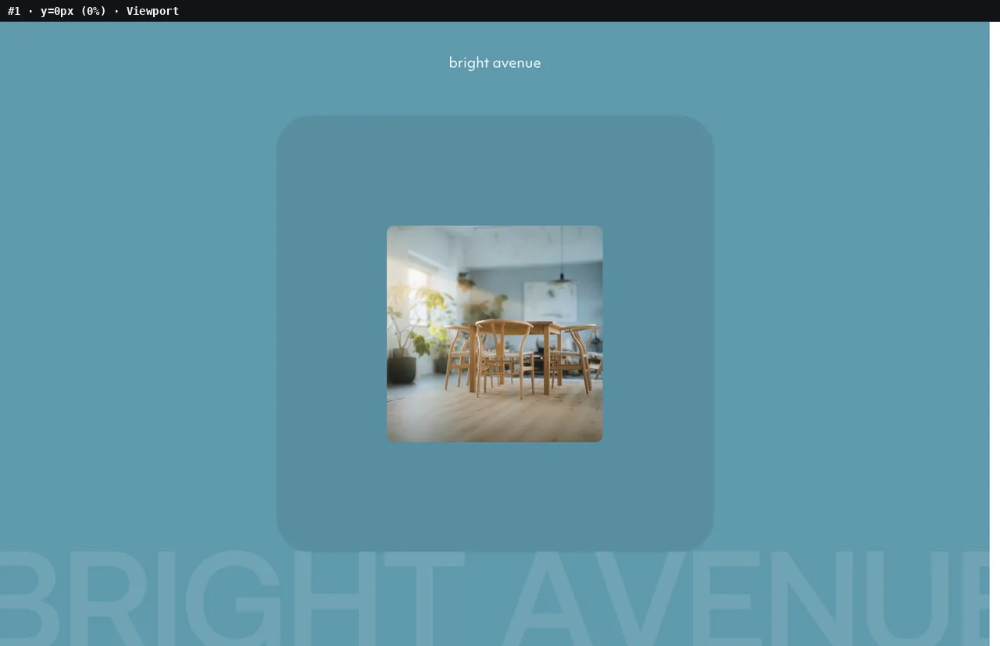
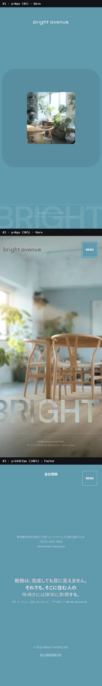

# UI Design System & Master Generation Blueprint: bright-avenue-jp

> **株式会社ブライトアベニュー · 不動産買取再販事業・リノベーション事業** (https://bright-avenue.jp/) — 株式会社ブライトアベニューは、関東エリアを中心に不動産買取再販サービスを展開しています。





---

## 1. Executive Visual Persona & Design Archetype

- **Brand Essence & Persona**: **株式会社ブライトアベニュー · 不動産買取再販事業・リノベーション事業** (`https://bright-avenue.jp/`). 株式会社ブライトアベニューは、関東エリアを中心に不動産買取再販サービスを展開しています。
- **Capture Provenance**: Live browser capture (`tier2_webgl`, HTTP `200`, captured `2026-11-24`).
- **Visual Archetype**: **Light-Gallery WebGL / Canvas Interactive Experience (`#609aae` / `#0000ff`)**.
- **Anti-AI-Slop Differentiators**:
  - **Live-Computed Chromatic Polarity**: Anchors the viewport in `#609aae` (live computed `section` `background-color` (`computed_styles.json`)) paired with `#ffffff` primary typography and `#0000ff` accents.
  - **Grounded Typographic Hierarchy**: Uses `YakuHanJP` across display (`断熱リノベーションで 中古マンションの価値を塗り替える`) and body copy.
  - **Calibrated Spatial Grid & Motion**: Combines `80rem` container bounds (`gap: 4rem`, padding `4rem`) with `cubic-bezier(.55,.05,.22,.99)` easing and Lenis Smooth Scroll (`data-lenis`), Three.js / WebGL Canvas Pipeline.

---

## 2. Spatial Architecture & Modular Grid Mathematics

### Viewport Allocation & Container Geometry
- **Captured Journey Filmstrips**: Desktop `1280×828px` (`assets/desktop-journey.webp`, `1` keyframes up to `y=0px` / doc `900px`), Mobile `390×2616px` (`assets/mobile-journey.webp`, `3` keyframes).
- **Master Container Bounds**: `80rem` (non-`@media` desktop container stylesheet rule).
- **Canvas Lateral Padding & Spacing**: `4rem` lateral canvas padding with `4rem` grid gap.
- **Border Radius Scale**: `5px`, `50%`, `3px`, `18px`.

### Responsive Breakpoint Architecture
- **Desktop Layout**: 2-column persistent left sidebar (`306px`, <aside.p-top-case__filter>) + `1425px` main content stage at `1440px` (`max-width: 80rem`, `gap: 4rem`).
- **Mobile Layout**: Single-column vertical stack at `390px` viewport width with collapsed `<aside.p-top-case__filter>` drawer navigation and `4rem` horizontal padding.
- **Extracted CSS Media Queries**: `@media (max-width: 1023px)`, `@media only screen and (min-width: 1600px)`, `@media only screen and (max-width: 1023px)`, `@media (min-width: 1024px)`.

---

## 3. Color System, Materiality & Atmospheric Lighting

### Semantic Palette & Source Grounding
| Semantic Role | Ground-Truth Value | Extracted Live / CSS Source |
|---|---|---|
| **Primary Canvas Substrate** | `#609aae` | live computed `section` `background-color` (`computed_styles.json`) |
| **Primary Typography Ink** | `#ffffff` | live computed `h2` `color` (`computed_styles.json`) |
| **Elevated Surface / Card Substrate** | `#dddddd` | `var(--wp-editor-canvas-background)` in `:root` |
| **Interactive Accent / Highlight** | `#0000ff` | `.c-btn._bgBlue { background: blue }` (`#0000ff`) |
| **Secondary / Muted Copy** | `#afa3a3` | live computed `p` `color` (`computed_styles.json`) |
| **Structural Hairline Border** | `#4e4d4d` | `var(--top-line-reveal-color)` in `:root` |
| **Variable Token (`--color-text`)** | `#333333` | `var(--color-text)` in `:root` |
| **Variable Token (`--color-background`)** | `#f6f6f6` | `var(--color-background)` in `:root` |
| **Variable Token (`--color-beige-1`)** | `#d9d4d4` | `var(--color-beige-1)` in `:root` |
| **Variable Token (`--color-beige-2`)** | `#e3d3d3` | `var(--color-beige-2)` in `:root` |
| **Variable Token (`--color-gray-1`)** | `#ededed` | `var(--color-gray-1)` in `:root` |

### Sanitized Root CSS Variables (`ui-ux.md` Ground Truth)
| Variable Name | Extracted Value | Semantic Role |
|---|---|---|
| `--scrollbar-width` | `15px` | Layout / Spatial Grid Token |
| `--bottom-offset` | `1px` | Dimension / Scale Token |
| `--line-width` | `1px` | Layout / Spatial Grid Token |
| `--window-width` | `calc(100vw - var(--scrollbar-width))` | Layout / Spatial Grid Token |
| `--grid-outer` | `4rem` | Layout / Spatial Grid Token |
| `--grid-outer-sp` | `1.5rem` | Layout / Spatial Grid Token |
| `--grid-gap` | `4rem` | Layout / Spatial Grid Token |
| `--five-column-grid--liquid` | `calc((100% - var(--grid-gap) * 4) / 5)` | Layout / Spatial Grid Token |
| `--color-text` | `#333333` | Typography Ink Token |
| `--color-background` | `#f6f6f6` | Canvas / Surface Token |
| `--color-white` | `#fff` | Canvas / Surface Token |
| `--color-beige-1` | `#D9D4D4` | Brand / Palette Token |
| `--color-beige-2` | `#e3d3d3` | Brand / Palette Token |
| `--color-beige-3` | `#afa3a3` | Brand / Palette Token |
| `--color-blue-1` | `#609aae` | Brand / Palette Token |
| `--color-gray-1` | `#ededed` | Brand / Palette Token |

---

## 4. Typographic Scale & Editorial Hierarchy

### Font Family Stacks
- **Display Typography**: `YakuHanJP`.
- **Primary Body Stack**: `YakuHanJP`.
- **Technical / Metadata Stack**: not declared in live computed styles (uses primary stack / `ui-monospace`).

### Typographic Scale & Rules (Live Computed & Stylesheet Grounded)
- **Hero Display (`H1`)**: observed font-size ladder: `24px`, `18px`, `14px`, `210px`, `10px`.
- **Section Heading (`H2`)**: live computed `h2` (`font-size: 24px`, `line-height: 32.4px`, `font-weight: 400`); rule `h2` (`font-size: 3rem`, `line-height: 1.4`).
- **Body Copy**: live computed `body` (`font-size: 14px`, `line-height: 14px`, `font-weight: 400`); rule `p` (`font-size: 1.4rem`, `line-height: 1.75`).
- **Metadata & Navigation Labels**: live computed `nav/a` (`font-size: 14px`, `line-height: 14px`, `font-weight: 400`).

---

## 5. Choreographed Motion & Interaction Physics

### Primary Easing Curves
- **Extracted Timing Functions**: `cubic-bezier(.55,.05,.22,.99)`, `cubic-bezier(.22,1,.36,1)`, `cubic-bezier(.16,1,.3,1)`.

### Per-Element Transition & Choreography Rules
- **Selector `.l-header`**: `transition: opacity .3s cubic-bezier(.55,.05,.22,.99)` extracted from `bright-avenue-jp` stylesheet.
- **Selector `.l-header.is-hidden .l-header__me...`**: `transition: opacity .5s cubic-bezier(.55,.05,.22,.99),visibility 0s .5s` extracted from `bright-avenue-jp` stylesheet.
- **Selector `.l-header__logo`**: `transition: opacity .3s cubic-bezier(.55,.05,.22,.99)` extracted from `bright-avenue-jp` stylesheet.
- **Extracted Easing Curve (`cubic-bezier(.55,.05,.22,.99)`)**: Governs interactive state transitions across `<header.l-header>` and `<section.p-top-message>`.
- **Runtime Interaction Engine**: Integrates Lenis Smooth Scroll (`data-lenis`), Three.js / WebGL Canvas Pipeline with `prefers-reduced-motion: reduce` fallback guards.
### Measured Runtime Scroll & Interaction Telemetry (`behavioral_journey_v2`)
- **Scroll Driver Mode**: `wheel` (max document height `900px`, deepest scrollY reached `0px` across `1` desktop keyframes).
- **Detected Scroll / Motion Libraries**: Native browser scroll / standard CSS transitions.
- **Hover Physics (`primary_cta` · `会 会 社 社 情 情 報 報`)**: Computed transition `0s` / `ease` (no static color/transform shift captured at rest).
- **Route Transition Architecture**: First internal navigation (`/news/`) measured as `MPA` in `5136ms`.

---

## 6. Component Wireframe & Structural DOM Map

### Visual Layout Schematic — Desktop (`1440px`, Grounded in `dom.html` & Landmark Bounding Boxes)
```
┌────────────────────────────────────────────────────────────────────────┐
│ DESKTOP VIEWPORT (1440px) — Sidebar (306px) + Main (1425px)            │
│ ====================================================================== │
│ +--[ SIDEBAR (306px) ]--+--[ MAIN CONTENT STAGE (1425px) ]-----------+ │
│ | <aside.p-top-case__fi | [ <header.l-header> | 会 会 社 社 情 情 報 報 ·  ] | │
│ | - 会 会 社 社 情 情 報 報     | ------------------------------------------ | │
│ | - 販 販 売 売 実 実 績 績     | HERO STAGE: <section.p-top-fv>             | │
│ | - 事 事 業 業 内 内 容 容     | H1: 断熱リノベーションで 中古マンションの価値を塗り替える            | │
│ | - お お 知 知 ら ら せ せ     | Bg:#609aae Ink:#ffffff Acc:#0000ff         | │
│ | x=40 h=846px rail     | ------------------------------------------ | │
│ |                       | SHOWCASE: <section.p-top-messa max:80rem   | │
│ |                       | [断熱リノベーションで 中古マンション] [2. リノベーション事業      ]  | │
│ |                       | DETAIL: <section.p-top-service>            | │
│ +-----------------------+--------------------------------------------+ │
│ [ FOOTER (<footer.l-footer>   ) | https://bright-avenue.jp/            │
└────────────────────────────────────────────────────────────────────────┘
```

### Visual Layout Schematic — Mobile Reflow (`390px`)
```
┌────────────────────────────────────────────────────────────────────────┐
│ MOBILE VIEWPORT REFLOW (390px) — Collapsed Sidebar + 1-Col Stack       │
│ ====================================================================== │
│ [ DRAWER (<aside.p-top-case__fil) | <header.l-header>                  │
│ ---------------------------------------------------------------------- │
│ | HERO STAGE (<section.p-top-fv>) — 390px Full-Width                 | │
│ | H1: 断熱リノベーションで 中古マンションの価値を塗り替える                                    | │
│ ---------------------------------------------------------------------- │
│ | SHOWCASE STACK (<section.p-top-message) — 1-Col (gap: 4rem)        | │
│ | [ Card 1: 断熱リノベーションで 中古マンションの 価値を塗り替える                           ] | │
│ | [ Card 2: 2. リノベーション事業                                           ] | │
│ ---------------------------------------------------------------------- │
│ | DETAIL STACK (<section.p-top-service>) — 1-Col (私たちの特徴 私たちの特徴)     | │
│ ---------------------------------------------------------------------- │
│ [ FOOTER (<footer.l-footer>     ) | Stacked 390px Colophon             │
└────────────────────────────────────────────────────────────────────────┘
```

### Granular DOM Region Breakdown
1. **Persistent Left Sidebar Navigation (<aside.p-top-case__filter> — `306×846px` at `x=40`)**:
   - Fixed/sticky left rail `<aside class="p-top-case__filter u-scrollBar-hidden">` (`306px` wide) paired with top bar `<header class="l-header is-nav-white">` hosting `株式会社ブライトアベニュー · 不動産買取再販事業・リノベー` navigation (`会 会 社 社 情 情 報 報 · 販 販 売 売 実 実 績 績 · 事 事 業 業 内 内 容 容 · お お 知 知 ら ら せ せ · 採 採 用 用 情 情 報 報`), DOM attributes (`data-nav="company"`, `data-header-hover-rotate-bound="true"`, `data-nav="feature"`, `data-header-hover-rotate-bound="true"`), and rule `body { margin:0;padding:0;border:none }`.
2. **Hero Stage & Focal Lead (<section.p-top-fv> — `断熱リノベーションで 中古マンションの価値を塗り替える`)**:
   - Landmark `<section class="p-top-fv">` inside `1425px` main stage presenting display lead `断熱リノベーションで 中古マンションの価値を塗り替える` and copy excerpt *"B R I G H T A V E N U E F O R W A R D W I D T H H O P E ."* over `#609aae` canvas and `#ffffff` ink.
3. **Primary Showcase & Content Grid (<section.p-top-message> — `断熱リノベーションで 中古マンションの 価値を塗り替える`)**:
   - Landmark `<section class="p-top-message">` rendering section `断熱リノベーションで 中古マンションの 価値を塗り替える` with copy *"B r i g h t A v e n u e F o r w a r d W i d t h H o p e ."*, asset references (`favicon.png`, `top_fv-poster-sp.avif`, `top_fv-poster-blur-frame.webp`, `fonts.googleapis.com`), and grid rule `section { margin:0;padding:0;border:0;list-style-type:none }`.
4. **Interactive Detail & Feature Matrix (<section.p-top-service> — `2. リノベーション事業`)**:
   - Landmark `<section class="p-top-service">` framing `2. リノベーション事業` and `私たちの特徴 私たちの特徴` (*"都内マンションの仕入れ・高断熱リノベーション・再販を通じて、 取引に関わるすべての方の期待に応えてきました。 どんな物件にも誠実に"*) with `#dddddd` surface cards, `#0000ff` accents, and `table { border:none;border-collapse:collapse;border-spacing:0 }`.
5. **Colophon & Global Directory Footer (<footer.l-footer> — `https://bright-avenue.jp/`)**:
   - Landmark `<footer class="l-footer">` anchoring `株式会社ブライトアベニュー · 不動産買取再販事業・リノベーショ` footer links (`会 会 社 社 情 情 報 報 · 販 販 売 売 実 実 績 績 · 事 事 業 業 内 内 容 容 · お お 知 知 ら ら せ せ · 採 採 用 用 情 情 報 報`), copy *"都内マンションの仕入れ・高断熱リノベーション・再販を通じて、"*, and `#4e4d4d` structural dividers.
### Full Vertical Scroll Sequence (Desktop `1440×900` Keyframes)
- **Step 01** (`y=0px`, `0%`): Active landmark `Viewport` · sticky/fixed elements: `0`

### Multi-Page Internal Route Map
- **Listing Route (`/news/`)**: `https://bright-avenue.jp/news/` — H1: `お知らせ 最新情報・お知らせ`, scrollHeight `5064px`, transition `MPA` (`5136ms`)

---

## 7. Master Zero-Shot AI Generation Prompt

```markdown
# Master Zero-Shot Frontend Generation Prompt: bright-avenue-jp (株式会社ブライトアベニュー · 不動産買取再販事業・リノベーション事業)

You are a principal frontend architect and design systems engineer. Build a complete, production-ready web application replicating the exact design system, DOM landmarks, typographic hierarchy, color tokens, and motion physics of `bright-avenue-jp` (**株式会社ブライトアベニュー · 不動産買取再販事業・リノベーション事業** — `https://bright-avenue.jp/`).

### 1. Visual Archetype & Anti-AI-Slop Mandates
- **Archetype**: Light-Gallery WebGL / Canvas Interactive Experience (`#609aae` / `#0000ff`).
- **Identity & Domain Context**: 株式会社ブライトアベニューは、関東エリアを中心に不動産買取再販サービスを展開しています。
- **Primary Substrate**: `#609aae` (live computed `section` `background-color` (`computed_styles.json`)), **Primary Ink**: `#ffffff`, **Accent / Highlight**: `#0000ff`.
- **Site-Specific Differentiators**:
  - **Live-Computed Chromatic Polarity**: Anchors the viewport in `#609aae` (live computed `section` `background-color` (`computed_styles.json`)) paired with `#ffffff` primary typography and `#0000ff` accents.
  - **Grounded Typographic Hierarchy**: Uses `YakuHanJP` across display (`断熱リノベーションで 中古マンションの価値を塗り替える`) and body copy.
  - **Calibrated Spatial Grid & Motion**: Combines `80rem` container bounds (`gap: 4rem`, padding `4rem`) with `cubic-bezier(.55,.05,.22,.99)` easing and Lenis Smooth Scroll (`data-lenis`), Three.js / WebGL Canvas Pipeline.

### 2. Ground-Truth CSS Variables (`:root` Token Contract)
Declare and consume these exact custom properties extracted from `bright-avenue-jp` in your global stylesheet:

:root {
  /* 株式会社ブライトアベニュー · 不動産買取再販事業・リノベーション事業 (bright-avenue-jp) — Live-Grounded CSS Variables */
  --scrollbar-width: 15px; /* Layout / Spatial Grid Token (bright-avenue-jp) */
  --bottom-offset: 1px; /* Dimension / Scale Token (bright-avenue-jp) */
  --line-width: 1px; /* Layout / Spatial Grid Token (bright-avenue-jp) */
  --window-width: calc(100vw - var(--scrollbar-width)); /* Layout / Spatial Grid Token (bright-avenue-jp) */
  --grid-outer: 4rem; /* Layout / Spatial Grid Token (bright-avenue-jp) */
  --grid-outer-sp: 1.5rem; /* Layout / Spatial Grid Token (bright-avenue-jp) */
  --grid-gap: 4rem; /* Layout / Spatial Grid Token (bright-avenue-jp) */
  --five-column-grid--liquid: calc((100% - var(--grid-gap) * 4) / 5); /* Layout / Spatial Grid Token (bright-avenue-jp) */
  --color-text: #333333; /* Typography Ink Token (bright-avenue-jp) */
  --color-background: #f6f6f6; /* Canvas / Surface Token (bright-avenue-jp) */
  --color-white: #fff; /* Canvas / Surface Token (bright-avenue-jp) */
  --color-beige-1: #D9D4D4; /* Brand / Palette Token (bright-avenue-jp) */
  --color-beige-2: #e3d3d3; /* Brand / Palette Token (bright-avenue-jp) */
  --color-beige-3: #afa3a3; /* Brand / Palette Token (bright-avenue-jp) */
  --color-blue-1: #609aae; /* Brand / Palette Token (bright-avenue-jp) */
  --color-gray-1: #ededed; /* Brand / Palette Token (bright-avenue-jp) */
}

### 3. Semantic Color & Materiality Contract
Map every surface, ink, and border strictly to these source-grounded tokens:
- **Primary Canvas Substrate**: `#609aae` — grounded in live computed `section` `background-color` (`computed_styles.json`)
- **Primary Typography Ink**: `#ffffff` — grounded in live computed `h2` `color` (`computed_styles.json`)
- **Elevated Surface / Card Substrate**: `#dddddd` — grounded in `var(--wp-editor-canvas-background)` in `:root`
- **Interactive Accent / Highlight**: `#0000ff` — grounded in `.c-btn._bgBlue { background: blue }` (`#0000ff`)
- **Secondary / Muted Copy**: `#afa3a3` — grounded in live computed `p` `color` (`computed_styles.json`)
- **Structural Hairline Border**: `#4e4d4d` — grounded in `var(--top-line-reveal-color)` in `:root`
- **Variable Token (`--color-text`)**: `#333333` — grounded in `var(--color-text)` in `:root`
- **Variable Token (`--color-background`)**: `#f6f6f6` — grounded in `var(--color-background)` in `:root`
- **Variable Token (`--color-beige-1`)**: `#d9d4d4` — grounded in `var(--color-beige-1)` in `:root`
- **Variable Token (`--color-beige-2`)**: `#e3d3d3` — grounded in `var(--color-beige-2)` in `:root`
- **Variable Token (`--color-gray-1`)**: `#ededed` — grounded in `var(--color-gray-1)` in `:root`

### 4. Spatial Grid, Container Bounds & Responsive Breakpoints
- **Desktop Viewport Reference**: `1280×828px` (single-viewport 100vh live capture (900px), `1440px` standard desktop width).
- **Mobile Viewport Reference**: `390×2616px` (multi-frame vertical journey filmstrip (2616px), `390px` standard mobile width).
- **Container Max-Width**: `80rem` (non-`@media` desktop container stylesheet rule)
- **Padding & Gutters**: `4rem` lateral canvas padding with `4rem` grid gap
- **Desktop Grid**: 2-column persistent left sidebar (`306px`, <aside.p-top-case__filter>) + `1425px` main content stage at `1440px` (`max-width: 80rem`, `gap: 4rem`)
- **Mobile Adaptation**: Single-column vertical stack at `390px` viewport width with collapsed `<aside.p-top-case__filter>` drawer navigation and `4rem` horizontal padding
- **Media Queries**: `@media (max-width: 1023px)`, `@media only screen and (min-width: 1600px)`, `@media only screen and (max-width: 1023px)`, `@media (min-width: 1024px)`
- **Corner Radii**: `5px`, `50%`, `3px`, `18px`

### 5. Typography & Editorial Scale Contract
- **Display Font Stack**: `YakuHanJP`
- **Body Font Stack**: `YakuHanJP`
- **Monospace / Technical Font Stack**: not declared in live computed styles (uses primary stack / `ui-monospace`)
- **H1 Display Rule**: observed font-size ladder: `24px`, `18px`, `14px`, `210px`, `10px`
- **H2 Section Rule**: live computed `h2` (`font-size: 24px`, `line-height: 32.4px`, `font-weight: 400`); rule `h2` (`font-size: 3rem`, `line-height: 1.4`)
- **Body Copy Rule**: live computed `body` (`font-size: 14px`, `line-height: 14px`, `font-weight: 400`); rule `p` (`font-size: 1.4rem`, `line-height: 1.75`)
- **Metadata & Index Rule**: live computed `nav/a` (`font-size: 14px`, `line-height: 14px`, `font-weight: 400`)

### 6. Component Hierarchy, Verbatim Copy & Real DOM Landmarks
Scaffold `bright-avenue-jp` (`株式会社ブライトアベニュー · 不動産買取再販事業・リノベーション事業`) with these exact structural regions, extracted copy, and CSS rules from `dom.html`:
1. **Persistent Left Sidebar Navigation (<aside.p-top-case__filter> — `306×846px` at `x=40`)**:
   - DOM & Selectors: Fixed/sticky left rail `<aside class="p-top-case__filter u-scrollBar-hidden">` (`306px` wide) paired with top bar `<header class="l-header is-nav-white">` hosting `株式会社ブライトアベニュー · 不動産買取再販事業・リノベー` navigation (`会 会 社 社 情 情 報 報 · 販 販 売 売 実 実 績 績 · 事 事 業 業 内 内 容 容 · お お 知 知 ら ら せ せ · 採 採 用 用 情 情 報 報`), DOM attributes (`data-nav="company"`, `data-header-hover-rotate-bound="true"`, `data-nav="feature"`, `data-header-hover-rotate-bound="true"`), and rule `body { margin:0;padding:0;border:none }`.
   - Responsive Contract: Header `Persistent Left Sidebar Navigation (<aside.p-top-case__filter> — `306×846px` at `x=40`)` (`bright-avenue-jp`) adapts across `@media (max-width: 1023px)`, `@media only screen and (min-width: 1600px)`, `@media only screen and (max-width: 1023px)`, `@media (min-width: 1024px)` with `cubic-bezier(.55,.05,.22,.99)`, `cubic-bezier(.22,1,.36,1)`, `cubic-bezier(.16,1,.3,1)` transitions and links `会 会 社 社 情 情 報 報 · 販 販 売 売 実 実 績 績 · 事 事 業 業 内 内 容 容 · お お 知 知 ら ら せ せ · 採 採 用 用 情 情 報 報`.
2. **Hero Stage & Focal Lead (<section.p-top-fv> — `断熱リノベーションで 中古マンションの価値を塗り替える`)**:
   - DOM & Selectors: Landmark `<section class="p-top-fv">` inside `1425px` main stage presenting display lead `断熱リノベーションで 中古マンションの価値を塗り替える` and copy excerpt *"B R I G H T A V E N U E F O R W A R D W I D T H H O P E ."* over `#609aae` canvas and `#ffffff` ink.
   - Responsive Contract: Hero stage (`1280×828px` desktop / `390×2616px` mobile) sets `#609aae` background with `#ffffff` headline `断熱リノベーションで 中古マンションの価値を塗り替える`.
3. **Primary Showcase & Content Grid (<section.p-top-message> — `断熱リノベーションで 中古マンションの 価値を塗り替える`)**:
   - DOM & Selectors: Landmark `<section class="p-top-message">` rendering section `断熱リノベーションで 中古マンションの 価値を塗り替える` with copy *"B r i g h t A v e n u e F o r w a r d W i d t h H o p e ."*, asset references (`favicon.png`, `top_fv-poster-sp.avif`, `top_fv-poster-blur-frame.webp`, `fonts.googleapis.com`), and grid rule `section { margin:0;padding:0;border:0;list-style-type:none }`.
   - Responsive Contract: Showcase grid `Primary Showcase & Content Grid (<section.p-top-message> — `断熱リノベーションで 中古マンションの 価値を塗り替える`)` applies 2-column persistent left sidebar (`306px`, <aside.p-top-case__filter>) + `1425px` main content stage at `1440px` (`max-width: 80rem`, `gap: 4rem`) on desktop and Single-column vertical stack at `390px` viewport width with collapsed `<aside.p-top-case__filter>` drawer navigation and `4rem` horizontal padding on mobile.
4. **Interactive Detail & Feature Matrix (<section.p-top-service> — `2. リノベーション事業`)**:
   - DOM & Selectors: Landmark `<section class="p-top-service">` framing `2. リノベーション事業` and `私たちの特徴 私たちの特徴` (*"都内マンションの仕入れ・高断熱リノベーション・再販を通じて、 取引に関わるすべての方の期待に応えてきました。 どんな物件にも誠実に"*) with `#dddddd` surface cards, `#0000ff` accents, and `table { border:none;border-collapse:collapse;border-spacing:0 }`.
   - Responsive Contract: Detail module `Interactive Detail & Feature Matrix (<section.p-top-service> — `2. リノベーション事業`)` uses `5px`, `50%`, `3px`, `18px` radii, `#0000ff` highlights, and assets (favicon.png, top_fv-poster-sp.avif, top_fv-poster-blur-frame.webp).
5. **Colophon & Global Directory Footer (<footer.l-footer> — `https://bright-avenue.jp/`)**:
   - DOM & Selectors: Landmark `<footer class="l-footer">` anchoring `株式会社ブライトアベニュー · 不動産買取再販事業・リノベーショ` footer links (`会 会 社 社 情 情 報 報 · 販 販 売 売 実 実 績 績 · 事 事 業 業 内 内 容 容 · お お 知 知 ら ら せ せ · 採 採 用 用 情 情 報 報`), copy *"都内マンションの仕入れ・高断熱リノベーション・再販を通じて、"*, and `#4e4d4d` structural dividers.
   - Responsive Contract: Footer `Colophon & Global Directory Footer (<footer.l-footer> — `https://bright-avenue.jp/`)` aligns to `80rem` (non-`@media` desktop container stylesheet rule) with `4rem` lateral canvas padding with `4rem` grid gap and attributes (data-nav="company", data-header-hover-rotate-bound="true", data-nav="feature").

#### Verbatim DOM Copy Excerpts (`dom.html`)
- Copy Excerpt 1: *"B R I G H T A V E N U E F O R W A R D W I D T H H O P E ."*
- Copy Excerpt 2: *"B r i g h t A v e n u e F o r w a r d W i d t h H o p e ."*
- Copy Excerpt 3: *"都内マンションの仕入れ・高断熱リノベーション・再販を通じて、 取引に関わるすべての方の期待に応えてきました。 どんな物件にも誠実に向き合い、良いものを届け続けること..."*
- Copy Excerpt 4: *"都内マンションの仕入れ・高断熱リノベーション・再販を通じて、"*

### 7. Motion, Extracted Stylesheet Rules & Interaction Choreography
- **Primary Easing Functions**: `cubic-bezier(.55,.05,.22,.99)`, `cubic-bezier(.22,1,.36,1)`, `cubic-bezier(.16,1,.3,1)`
- **Extracted Stylesheet Rules (`bright-avenue-jp`)**:
- `body { margin:0;padding:0;border:none }`
- `section { margin:0;padding:0;border:0;list-style-type:none }`
- `table { border:none;border-collapse:collapse;border-spacing:0 }`
- `img { vertical-align:top;display:inline-block }`
- `picture { display:block;overflow:clip }`
- **Per-Selector Transition Rules**:
- **Selector `.l-header`**: `transition: opacity .3s cubic-bezier(.55,.05,.22,.99)` extracted from `bright-avenue-jp` stylesheet.
- **Selector `.l-header.is-hidden .l-header__me...`**: `transition: opacity .5s cubic-bezier(.55,.05,.22,.99),visibility 0s .5s` extracted from `bright-avenue-jp` stylesheet.
- **Selector `.l-header__logo`**: `transition: opacity .3s cubic-bezier(.55,.05,.22,.99)` extracted from `bright-avenue-jp` stylesheet.
- **Extracted Easing Curve (`cubic-bezier(.55,.05,.22,.99)`)**: Governs interactive state transitions across `<header.l-header>` and `<section.p-top-message>`.
- **Runtime Interaction Engine**: Integrates Lenis Smooth Scroll (`data-lenis`), Three.js / WebGL Canvas Pipeline with `prefers-reduced-motion: reduce` fallback guards.
### 7b. Full-Page Scroll Choreography, Interactive States & Multi-Page Routes
- **Scroll Mechanics**: Implement `wheel` vertical progression up to `900px` across 1 distinct viewport chapters.
- **Vertical Chapter Sequence**: Viewport (0%).
- **Multi-Page Routes**: Scaffold internal routes `/news/` (listing, MPA) sharing the global header/footer shell and design tokens.

### 8. Technical Deliverables
- Implement in Next.js (App Router) with TypeScript and Tailwind CSS consuming the `:root` custom properties defined above for `bright-avenue-jp`.
- Reproduce both the `1440px` desktop architecture and `390px` mobile breakpoint transitions, preserving semantic HTML5 landmarks (`<header>`, `<nav>`, `<main>`, `<section>`, `<footer>`) and `prefers-reduced-motion` accessibility guards.
```
---

## 8. Full-Page Scroll Journey, Interactive States & Subpage Inventory

### Desktop Scroll Keyframes (`1440×900` WebP)
| Step | Scroll Y | Progress | Active Landmark / Section | Sticky/Fixed | Visual Asset |
| :---: | :---: | :---: | :--- | :---: | :--- |
| `#01` | `0px` | `0%` | Viewport | `0` | [desktop-step-01.webp](assets/desktop-step-01.webp) |

### Mobile Condensed Keyframes (`390×844` WebP)
| Step | Scroll Y | Progress | Active Landmark | Visual Asset |
| :---: | :---: | :---: | :--- | :--- |
| `#01` | `0px` | `0%` | Hero | [mobile-step-01.webp](assets/mobile-step-01.webp) |
| `#02` | `0px` | `50%` | Hero | [mobile-step-02.webp](assets/mobile-step-02.webp) |
| `#03` | `10427px` | `100%` | Footer | [mobile-step-03.webp](assets/mobile-step-03.webp) |

### Internal Subpage Filmstrips (`1080px` Wide WebP)
| # | Template | Route URL | H1 / Title | Scroll Height | Transition | Filmstrip Asset |
| :-: | :---: | :--- | :--- | :---: | :---: | :--- |
| `1` | `listing` | `https://bright-avenue.jp/news/` | お知らせ 最新情報・お知らせ | `5064px` | `MPA` (`5136ms`) | [subpage-01-news.webp](assets/subpage-01-news.webp) |

