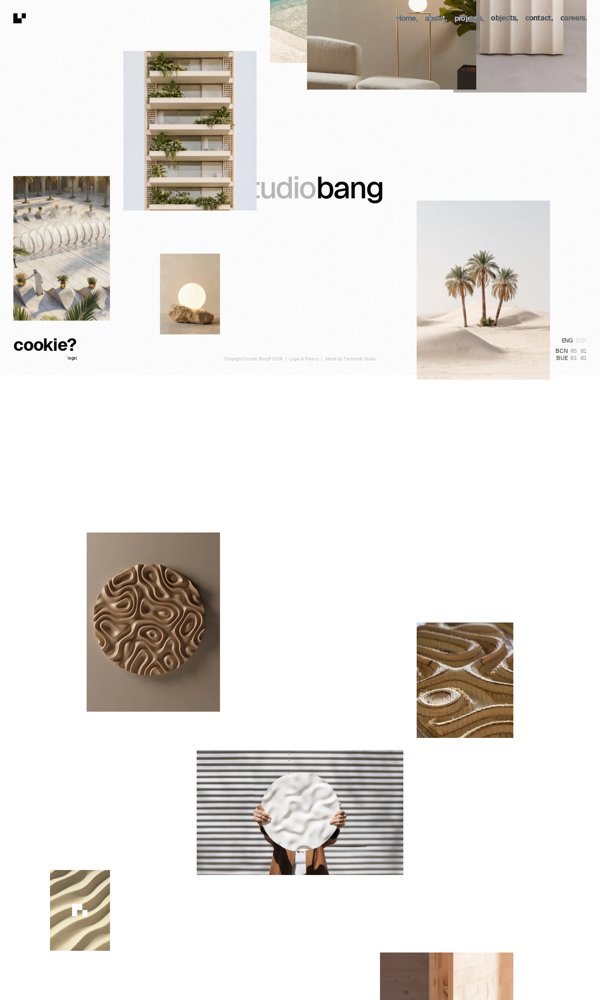

# UI Design System & Master Generation Blueprint: bybang-co

> **Estudio Bang · Architecture, Interiors, Objects & Digital Media** (https://bybang.co/) — Estudio Bang is a Barcelona-based architecture studio working across architecture, interiors, objects and digital media. We create spaces...



---

## 1. Executive Visual Persona & Design Archetype

- **Brand Essence & Persona**: **Estudio Bang · Architecture, Interiors, Objects & Digital Media** (`https://bybang.co/`). Estudio Bang is a Barcelona-based architecture studio working across architecture, interiors, objects and digital media. We create spaces...
- **Visual Archetype**: **Light-Substrate Editorial & Modular Grid System (`#f5f5f2` canvas, `#141414` ink, `#141414` accent)**.
- **Anti-AI-Slop Differentiators**:
  - **Source-Grounded Chromatic Polarity**: Anchors the viewport in `#f5f5f2` (`var(--bg)` in `:root`) paired with `#141414` primary typography and `#141414` accents.
  - **Extracted Typographic Hierarchy**: Pairs `Geist` for display copy (`Estudio Bang · Architecture, Interio`) with `Geist Mono` and `Geist Mono`.
  - **Calibrated Spatial Grid & Motion**: Combines `700px` container bounds (`gap: 24px`, padding `10px`) with `cubic-bezier(.2,.8,.2,1)` easing and Lenis Smooth Scroll (`data-lenis`).

---

## 2. Spatial Architecture & Modular Grid Mathematics


### Viewport Allocation & Container Geometry
- **Captured Viewport Dimensions**: Desktop `1440×56160px` (`assets/desktop.png`, full-page scroll capture), Mobile `390×2400px` (`assets/mobile.png`, capped at 2400px multi-section capture).
- **Master Container Bounds**: `700px` extracted from `bybang-co` stylesheet.
- **Canvas Lateral Padding & Spacing**: `10px` lateral canvas padding with `24px` grid gap.
- **Border Radius Scale**: `999px`, `8px`, `6px`, `50%`.

### Responsive Breakpoint Architecture
- **Desktop Layout**: Multi-column CSS Grid / Flexbox layout at `1440px` (`max-width: 700px`, `gap: 24px`).
- **Mobile Layout**: Single-column vertical stack at `390px` viewport width with `10px` horizontal padding.
- **Extracted CSS Media Queries**: `@media (max-width:700px)`, `@media (max-width:980px)`, `@media (max-width:1100px)`, `@media (max-width:760px)`.

---

## 3. Color System, Materiality & Atmospheric Lighting

### Semantic Palette & Source Grounding
| Semantic Role | Ground-Truth Value | Extracted CSS Source / Selector |
|---|---|---|
| **Primary Canvas Substrate** | `#f5f5f2` | `var(--bg)` in `:root` |
| **Primary Typography Ink** | `#e1e1e1` | `var(--panel)` in `:root` |
| **Elevated Surface / Card Substrate** | `#d7d7d0` | `var(--panel-dark)` in `:root` |
| **Interactive Accent / Highlight** | `#141414` | `var(--text)` in `:root` |
| **Secondary / Muted Copy** | `#946ec4` | `var(--accent)` in `:root` |
| **Structural Hairline Border** | `#ffffff` | `var(--site-bg)` in `:root` |

### Sanitized Root CSS Variables (`ui-ux.md` Ground Truth)
| Variable Name | Extracted Value | Semantic Role |
|---|---|---|
| `--bg` | `#f5f5f2` | Canvas / Surface Token |
| `--panel` | `#e1e1e1` | Color / Atmospheric Token |
| `--panel-dark` | `#d7d7d0` | Canvas / Surface Token |
| `--text` | `#141414` | Typography Ink Token |
| `--muted` | `rgba(20, 20, 20, .3)` | Color / Atmospheric Token |
| `--border` | `rgba(20, 20, 20, .08)` | Elevation / Border Token |
| `--accent` | `#946ec4` | Brand / Palette Token |
| `--shadow` | `0 24px 80px rgba(11, 12, 11, .12)` | Elevation / Border Token |
| `--mono` | `"Geist Mono", ui-monospace, monospace` | Typography / Scale Token |
| `--sans` | `"Geist", "Helvetica Neue", Arial, sans-serif` | Typography / Scale Token |
| `--stable-viewport-height` | `100vh` | Layout / Spatial Grid Token |
| `--not-found-row-height` | `clamp(50px, 5.28vw, 76px)` | Layout / Spatial Grid Token |
| `--not-found-type-size` | `clamp(48px, 5.14vw, 74px)` | Typography / Scale Token |
| `--site-bg` | `#ffffff` | Canvas / Surface Token |
| `--site-ink` | `#141414` | Typography Ink Token |
| `--site-muted` | `rgba(20, 20, 20, .3)` | Color / Atmospheric Token |

---

## 4. Typographic Scale & Editorial Hierarchy

### Font Family Stacks
- **Display Typography**: `Geist`.
- **Primary Body Stack**: `Geist Mono`.
- **Technical / Metadata Stack**: `Geist Mono`.

### Typographic Scale & Rules (Extracted from Stylesheet & Variables)
- **Hero Display (`H1`)**: rule `h1` (`font-size: 32px`, `line-height: .95`, `letter-spacing: -.02em`).
- **Section Heading (`H2`)**: rule `h2` (`font-size: 32px`).
- **Body Copy**: rule `p` (`font-size: 16px`, `line-height: 1.4`, `letter-spacing: -.02em`).
- **Metadata & Navigation Labels**: CSS variables `--mono: "Geist Mono", ui-monospace, monospace`; rule `small` (`font-size: 11px`, `line-height: 1`).

---

## 5. Choreographed Motion & Interaction Physics

### Primary Easing Curves
- **Extracted Timing Functions**: `cubic-bezier(.2,.8,.2,1)`, `cubic-bezier(.68,-.48,.28,1.48)`, `cubic-bezier(.16,1,.3,1)`.

### Per-Element Transition & Choreography Rules
- **Selector `.lenis.lenis-autoToggle`**: `transition: 1ms` extracted from `bybang-co` stylesheet.
- **Selector `.home-stage`**: `transition: transform .42s cubic-bezier(.2,.8,.2,1),opacity .22s ease` extracted from `bybang-co` stylesheet.
- **Selector `.site-language__option`**: `transition: opacity .24s ease` extracted from `bybang-co` stylesheet.
- **Extracted Easing Curve (`cubic-bezier(.2,.8,.2,1)`)**: Governs interactive state transitions across `<header.site-chrome>` and `<main.site-home>`.
- **Runtime Interaction Engine**: Integrates Lenis Smooth Scroll (`data-lenis`) with `prefers-reduced-motion: reduce` fallback guards.

---

## 6. Component Wireframe & Structural DOM Map

### Visual Layout Schematic (Grounded in `dom.html` — `1440px` Desktop & `390px` Mobile Reflow)
```
┌────────────────────────────────────────────────────────────────────────┐
│ DESKTOP VIEWPORT (1440px) — Estudio Bang · Architecture, Interiors, Ob │
│ ====================================================================== │
│ [ <header.site-chrome>     | Overview · Index · Archive · About · C ]  │
│ ---------------------------------------------------------------------- │
│ | HERO STAGE: <main.site-home>                                     |   │
│ | H1: Estudio Bang · Architecture, Interiors, Objects              |   │
│ | Substrate: #f5f5f2    | Ink: #141414    | Accent: #141414        |   │
│ ---------------------------------------------------------------------- │
│ | SHOWCASE GRID (<main.site-home>          ) max-w: 700px          |   │
│ | +------------------------------+  +------------------------------+ | │
│ | | Featured Work & Interactive  |  | Technical Architecture & Nar | | │
│ | +------------------------------+  +------------------------------+ | │
│ ---------------------------------------------------------------------- │
│ | MOBILE VIEWPORT REFLOW (390px) — Single-Column Stack (gap: 24px  ) | │
│ | [<header.site-chrom] -> [<main.site-home>] -> [<main.site-home>] |   │
│ ---------------------------------------------------------------------- │
│ [ FOOTER (<footer.custom-cursor_) | https://bybang.co/                 │
└────────────────────────────────────────────────────────────────────────┘
```

### Granular DOM Region Breakdown
1. **Brand Header & Navigation Bar (<header.site-chrome> — `bybang-co`)**:
   - Landmark `<header class="site-chrome">` hosting `Estudio Bang · Architecture, Interio` navigation (`Overview · Index · Archive · About · Contact`), DOM attributes (`data-cursor-target="logo"`, `data-cursor-target="logo"`, `data-entry-signal="0"`, `data-filter="all"`), and stylesheet rule `html.lenis body { height:auto }`.
2. **Hero Stage & Focal Lead (<main.site-home> — `Estudio Bang · Architecture, Inter`)**:
   - Landmark `<main class="site-home">` presenting display lead `Estudio Bang · Architecture, Interiors, Objects ` and copy excerpt *"BCN 16 : 01 BUE 12 : 01"* over `#f5f5f2` canvas and `#141414` ink.
3. **Primary Showcase & Content Grid (<main.site-home> — `Featured Work & Interactive Showca`)**:
   - Landmark `<main class="site-home">` rendering section `Featured Work & Interactive Showcase` with copy *"Copyright Estudio Bang® 2026 · Legal & Privacy · Made by Tremendo"*, asset references (`intro-01.webp`, `intro-02.webp`, `intro-03.webp`, `intro-04.webp`), and grid rule `.lenis-stopped { overflow:clip }`.
4. **Interactive Detail & Feature Matrix (<main.site-home> — `Technical Architecture & Narrative`)**:
   - Landmark `<main class="site-home">` framing `Technical Architecture & Narrative` and `Global Directory & Contact` (*"Copyright Estudio Bang® 2026"*) with `#d7d7d0` surface cards, `#141414` accents, and `.lenis.lenis-smooth iframe { pointer-events:none }`.
5. **Colophon & Global Directory Footer (<footer.custom-cursor__shape> — `https://bybang.co/`)**:
   - Landmark `<footer class="custom-cursor__shape">` anchoring `Estudio Bang · Architecture, Int` footer links (`Overview · Index · Archive · About · Contact`), copy *"Technical Architecture & Narrative"*, and `#ffffff` structural dividers.

---

## 7. Master Zero-Shot AI Generation Prompt

```markdown
# Master Zero-Shot Frontend Generation Prompt: bybang-co (Estudio Bang · Architecture, Interiors, Objects & Digital Media)

You are a principal frontend architect and design systems engineer. Build a complete, production-ready web application replicating the exact design system, DOM landmarks, typographic hierarchy, color tokens, and motion physics of `bybang-co` (**Estudio Bang · Architecture, Interiors, Objects & Digital Media** — `https://bybang.co/`).

### 1. Visual Archetype & Anti-AI-Slop Mandates
- **Archetype**: Light-Substrate Editorial & Modular Grid System (`#f5f5f2` canvas, `#141414` ink, `#141414` accent).
- **Identity & Domain Context**: Estudio Bang is a Barcelona-based architecture studio working across architecture, interiors, objects and digital media. We create spaces...
- **Primary Substrate**: `#f5f5f2` (`var(--bg)` in `:root`), **Primary Ink**: `#141414`, **Accent / Highlight**: `#141414`.
- **Site-Specific Differentiators**:
  - **Source-Grounded Chromatic Polarity**: Anchors the viewport in `#f5f5f2` (`var(--bg)` in `:root`) paired with `#141414` primary typography and `#141414` accents.
  - **Extracted Typographic Hierarchy**: Pairs `Geist` for display copy (`Estudio Bang · Architecture, Interio`) with `Geist Mono` and `Geist Mono`.
  - **Calibrated Spatial Grid & Motion**: Combines `700px` container bounds (`gap: 24px`, padding `10px`) with `cubic-bezier(.2,.8,.2,1)` easing and Lenis Smooth Scroll (`data-lenis`).

### 2. Ground-Truth CSS Variables (`:root` Token Contract)
Declare and consume these exact custom properties extracted from `bybang-co` in your global stylesheet:

:root {
  /* Estudio Bang · Architecture, Interiors, Objects & Digital Media (bybang-co) — Ground-Truth Extracted CSS Variables */
  --bg: #f5f5f2; /* Canvas / Surface Token (bybang-co) */
  --panel: #e1e1e1; /* Color / Atmospheric Token (bybang-co) */
  --panel-dark: #d7d7d0; /* Canvas / Surface Token (bybang-co) */
  --text: #141414; /* Typography Ink Token (bybang-co) */
  --muted: rgba(20, 20, 20, .3); /* Color / Atmospheric Token (bybang-co) */
  --border: rgba(20, 20, 20, .08); /* Elevation / Border Token (bybang-co) */
  --accent: #946ec4; /* Brand / Palette Token (bybang-co) */
  --shadow: 0 24px 80px rgba(11, 12, 11, .12); /* Elevation / Border Token (bybang-co) */
  --mono: "Geist Mono", ui-monospace, monospace; /* Typography / Scale Token (bybang-co) */
  --sans: "Geist", "Helvetica Neue", Arial, sans-serif; /* Typography / Scale Token (bybang-co) */
  --stable-viewport-height: 100vh; /* Layout / Spatial Grid Token (bybang-co) */
  --not-found-row-height: clamp(50px, 5.28vw, 76px); /* Layout / Spatial Grid Token (bybang-co) */
  --not-found-type-size: clamp(48px, 5.14vw, 74px); /* Typography / Scale Token (bybang-co) */
  --site-bg: #ffffff; /* Canvas / Surface Token (bybang-co) */
  --site-ink: #141414; /* Typography Ink Token (bybang-co) */
  --site-muted: rgba(20, 20, 20, .3); /* Color / Atmospheric Token (bybang-co) */
}

### 3. Semantic Color & Materiality Contract
Map every surface, ink, and border strictly to these source-grounded tokens:
- **Primary Canvas Substrate**: `#f5f5f2` — grounded in `var(--bg)` in `:root`
- **Primary Typography Ink**: `#e1e1e1` — grounded in `var(--panel)` in `:root`
- **Elevated Surface / Card Substrate**: `#d7d7d0` — grounded in `var(--panel-dark)` in `:root`
- **Interactive Accent / Highlight**: `#141414` — grounded in `var(--text)` in `:root`
- **Secondary / Muted Copy**: `#946ec4` — grounded in `var(--accent)` in `:root`
- **Structural Hairline Border**: `#ffffff` — grounded in `var(--site-bg)` in `:root`

### 4. Spatial Grid, Container Bounds & Responsive Breakpoints
- **Desktop Viewport Reference**: `1440×56160px` (full-page scroll capture, `1440px` standard desktop width).
- **Mobile Viewport Reference**: `390×2400px` (capped at 2400px multi-section capture, `390px` standard mobile width).
- **Container Max-Width**: `700px` extracted from `bybang-co` stylesheet
- **Padding & Gutters**: `10px` lateral canvas padding with `24px` grid gap
- **Desktop Grid**: Multi-column CSS Grid / Flexbox layout at `1440px` (`max-width: 700px`, `gap: 24px`)
- **Mobile Adaptation**: Single-column vertical stack at `390px` viewport width with `10px` horizontal padding
- **Media Queries**: `@media (max-width:700px)`, `@media (max-width:980px)`, `@media (max-width:1100px)`, `@media (max-width:760px)`
- **Corner Radii**: `999px`, `8px`, `6px`, `50%`

### 5. Typography & Editorial Scale Contract
- **Display Font Stack**: `Geist`
- **Body Font Stack**: `Geist Mono`
- **Monospace / Technical Font Stack**: `Geist Mono`
- **H1 Display Rule**: rule `h1` (`font-size: 32px`, `line-height: .95`, `letter-spacing: -.02em`)
- **H2 Section Rule**: rule `h2` (`font-size: 32px`)
- **Body Copy Rule**: rule `p` (`font-size: 16px`, `line-height: 1.4`, `letter-spacing: -.02em`)
- **Metadata & Index Rule**: CSS variables `--mono: "Geist Mono", ui-monospace, monospace`; rule `small` (`font-size: 11px`, `line-height: 1`)

### 6. Component Hierarchy, Verbatim Copy & Real DOM Landmarks
Scaffold `bybang-co` (`Estudio Bang · Architecture, Interiors, Objects & Digital Media`) with these exact structural regions, extracted copy, and CSS rules from `dom.html`:
1. **Brand Header & Navigation Bar (<header.site-chrome> — `bybang-co`)**:
   - DOM & Selectors: Landmark `<header class="site-chrome">` hosting `Estudio Bang · Architecture, Interio` navigation (`Overview · Index · Archive · About · Contact`), DOM attributes (`data-cursor-target="logo"`, `data-cursor-target="logo"`, `data-entry-signal="0"`, `data-filter="all"`), and stylesheet rule `html.lenis body { height:auto }`.
   - Responsive Contract: Header `Brand Header & Navigation Bar (<header.site-chrome> — `bybang-co`)` (`bybang-co`) adapts across `@media (max-width:700px)`, `@media (max-width:980px)`, `@media (max-width:1100px)`, `@media (max-width:760px)` with `cubic-bezier(.2,.8,.2,1)`, `cubic-bezier(.68,-.48,.28,1.48)`, `cubic-bezier(.16,1,.3,1)` transitions and links `Overview · Index · Archive · About · Contact`.
2. **Hero Stage & Focal Lead (<main.site-home> — `Estudio Bang · Architecture, Inter`)**:
   - DOM & Selectors: Landmark `<main class="site-home">` presenting display lead `Estudio Bang · Architecture, Interiors, Objects ` and copy excerpt *"BCN 16 : 01 BUE 12 : 01"* over `#f5f5f2` canvas and `#141414` ink.
   - Responsive Contract: Hero stage (`1440×56160px` desktop / `390×2400px` mobile) sets `#f5f5f2` background with `#141414` headline `Estudio Bang · Architecture, Interiors, Objects `.
3. **Primary Showcase & Content Grid (<main.site-home> — `Featured Work & Interactive Showca`)**:
   - DOM & Selectors: Landmark `<main class="site-home">` rendering section `Featured Work & Interactive Showcase` with copy *"Copyright Estudio Bang® 2026 · Legal & Privacy · Made by Tremendo"*, asset references (`intro-01.webp`, `intro-02.webp`, `intro-03.webp`, `intro-04.webp`), and grid rule `.lenis-stopped { overflow:clip }`.
   - Responsive Contract: Showcase grid `Primary Showcase & Content Grid (<main.site-home> — `Featured Work & Interactive Showca`)` applies Multi-column CSS Grid / Flexbox layout at `1440px` (`max-width: 700px`, `gap: 24px`) on desktop and Single-column vertical stack at `390px` viewport width with `10px` horizontal padding on mobile.
4. **Interactive Detail & Feature Matrix (<main.site-home> — `Technical Architecture & Narrative`)**:
   - DOM & Selectors: Landmark `<main class="site-home">` framing `Technical Architecture & Narrative` and `Global Directory & Contact` (*"Copyright Estudio Bang® 2026"*) with `#d7d7d0` surface cards, `#141414` accents, and `.lenis.lenis-smooth iframe { pointer-events:none }`.
   - Responsive Contract: Detail module `Interactive Detail & Feature Matrix (<main.site-home> — `Technical Architecture & Narrative`)` uses `999px`, `8px`, `6px`, `50%` radii, `#141414` highlights, and assets (intro-01.webp, intro-02.webp, intro-03.webp).
5. **Colophon & Global Directory Footer (<footer.custom-cursor__shape> — `https://bybang.co/`)**:
   - DOM & Selectors: Landmark `<footer class="custom-cursor__shape">` anchoring `Estudio Bang · Architecture, Int` footer links (`Overview · Index · Archive · About · Contact`), copy *"Technical Architecture & Narrative"*, and `#ffffff` structural dividers.
   - Responsive Contract: Footer `Colophon & Global Directory Footer (<footer.custom-cursor__shape> — `https://bybang.co/`)` aligns to `700px` extracted from `bybang-co` stylesheet with `10px` lateral canvas padding with `24px` grid gap and attributes (data-cursor-target="logo", data-cursor-target="logo", data-entry-signal="0").

#### Verbatim DOM Copy Excerpts (`dom.html`)
- Copy Excerpt 1: *"BCN 16 : 01 BUE 12 : 01"*
- Copy Excerpt 2: *"Copyright Estudio Bang® 2026 · Legal & Privacy · Made by Tremendo Studio"*
- Copy Excerpt 3: *"Copyright Estudio Bang® 2026"*

### 7. Motion, Extracted Stylesheet Rules & Interaction Choreography
- **Primary Easing Functions**: `cubic-bezier(.2,.8,.2,1)`, `cubic-bezier(.68,-.48,.28,1.48)`, `cubic-bezier(.16,1,.3,1)`
- **Extracted Stylesheet Rules (`bybang-co`)**:
- `html.lenis body { height:auto }`
- `.lenis-stopped { overflow:clip }`
- `.lenis.lenis-smooth iframe { pointer-events:none }`
- `.lenis.lenis-autoToggle { transition-property:overflow;transition-duration:1ms;transition-behavior... }`
- `selection { background:000;color:fff }`
- **Per-Selector Transition Rules**:
- **Selector `.lenis.lenis-autoToggle`**: `transition: 1ms` extracted from `bybang-co` stylesheet.
- **Selector `.home-stage`**: `transition: transform .42s cubic-bezier(.2,.8,.2,1),opacity .22s ease` extracted from `bybang-co` stylesheet.
- **Selector `.site-language__option`**: `transition: opacity .24s ease` extracted from `bybang-co` stylesheet.
- **Extracted Easing Curve (`cubic-bezier(.2,.8,.2,1)`)**: Governs interactive state transitions across `<header.site-chrome>` and `<main.site-home>`.
- **Runtime Interaction Engine**: Integrates Lenis Smooth Scroll (`data-lenis`) with `prefers-reduced-motion: reduce` fallback guards.

### 8. Technical Deliverables
- Implement in Next.js (App Router) with TypeScript and Tailwind CSS consuming the `:root` custom properties defined above for `bybang-co`.
- Reproduce both the `1440px` desktop architecture and `390px` mobile breakpoint transitions, preserving semantic HTML5 landmarks (`<header>`, `<nav>`, `<main>`, `<section>`, `<footer>`) and `prefers-reduced-motion` accessibility guards.
```
