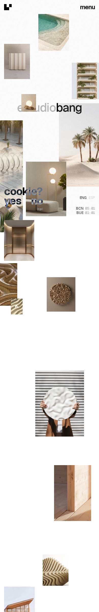

# UI Design System & Master Generation Blueprint: bybang-co

> **Estudio Bang · Architecture, Interiors, Objects & Digital Media** (https://bybang.co/) — Estudio Bang is a Barcelona-based architecture studio working across architecture, interiors, objects and digital media. We create spaces...


---

## 1. Executive Visual Persona & Design Archetype

- **Brand Essence & Persona**: **Estudio Bang · Architecture, Interiors, Objects & Digital Media** (`https://bybang.co/`). Estudio Bang is a Barcelona-based architecture studio working across architecture, interiors, objects and digital media. We create spaces...
- **Capture Provenance**: Live browser capture (`tier1_fast`, HTTP `200`, captured `2026-11-23`).
- **Visual Archetype**: **Light-Substrate Editorial & Modular Grid System (`#ffffff` canvas, `#141414` ink, `#c7161d` accent)**.
- **Anti-AI-Slop Differentiators**:
  - **Live-Computed Chromatic Polarity**: Anchors the viewport in `#ffffff` (live computed `body` `background-color` (`computed_styles.json`)) paired with `#141414` primary typography and `#c7161d` accents.
  - **Grounded Typographic Hierarchy**: Pairs `Geist` for display copy (`estudiobang`) with `Geist` and `Geist Mono`.
  - **Calibrated Spatial Grid & Motion**: Combines `1440px` container bounds (`gap: 18px`, padding `10px`) with `cubic-bezier(.2,.8,.2,1)` easing and Lenis Smooth Scroll (`data-lenis`).

---

## 2. Spatial Architecture & Modular Grid Mathematics



### Viewport Allocation & Container Geometry
- **Captured Viewport Dimensions**: Desktop `1440×2400px` (`assets/desktop.png`, clamped at 2400px live multi-section capture), Mobile `390×2400px` (`assets/mobile.png`, clamped at 2400px live multi-section capture).
- **Master Container Bounds**: `1440px` (full-bleed `100%` desktop stage measured on `1440px` viewport).
- **Canvas Lateral Padding & Spacing**: `10px` lateral canvas padding with `18px` grid gap.
- **Border Radius Scale**: `999px`, `8px`, `6px`, `50%`.

### Responsive Breakpoint Architecture
- **Desktop Layout**: Multi-column CSS Grid / Flexbox layout at `1440px` (`max-width: 1440px`, `gap: 18px`).
- **Mobile Layout**: Single-column vertical stack at `390px` viewport width with `10px` horizontal padding.
- **Extracted CSS Media Queries**: `@media (max-width:700px)`, `@media (max-width:980px)`, `@media (max-width:1100px)`, `@media (max-width:760px)`.

---

## 3. Color System, Materiality & Atmospheric Lighting

### Semantic Palette & Source Grounding
| Semantic Role | Ground-Truth Value | Extracted Live / CSS Source |
|---|---|---|
| **Primary Canvas Substrate** | `#ffffff` | live computed `body` `background-color` (`computed_styles.json`) |
| **Primary Typography Ink** | `#141414` | live computed `h1` `color` (`computed_styles.json`) |
| **Elevated Surface / Card Substrate** | `#f5f5f2` | `var(--bg)` in `:root` |
| **Interactive Accent / Highlight** | `#c7161d` | `.case-contact-button--error { background: #c7161d }` |
| **Secondary / Muted Copy** | `#2e2e2e` | live computed `p` `color` (`computed_styles.json`) |
| **Structural Hairline Border** | `#ececec` | `var(--border)` in `:root` (`rgba(20, 20, 20, .08)`) |
| **Variable Token (`--panel`)** | `#e1e1e1` | `var(--panel)` in `:root` |
| **Variable Token (`--panel-dark`)** | `#d7d7d0` | `var(--panel-dark)` in `:root` |
| **Variable Token (`--accent`)** | `#946ec4` | `var(--accent)` in `:root` |

### Sanitized Root CSS Variables (`ui-ux.md` Ground Truth)
| Variable Name | Extracted Value | Semantic Role |
|---|---|---|
| `--bg` | `#f5f5f2` | Canvas / Surface Token |
| `--panel` | `#e1e1e1` | Color / Atmospheric Token |
| `--panel-dark` | `#d7d7d0` | Canvas / Surface Token |
| `--text` | `#141414` | Typography Ink Token |
| `--muted` | `rgba(20, 20, 20, .3)` | Color / Atmospheric Token |
| `--border` | `rgba(20, 20, 20, .08)` | Elevation / Border Token |
| `--accent` | `#946ec4` | Brand / Palette Token |
| `--shadow` | `0 24px 80px rgba(11, 12, 11, .12)` | Elevation / Border Token |
| `--mono` | `"Geist Mono", ui-monospace, monospace` | Typography / Scale Token |
| `--sans` | `"Geist", "Helvetica Neue", Arial, sans-serif` | Typography / Scale Token |
| `--stable-viewport-height` | `100vh` | Layout / Spatial Grid Token |
| `--site-bg` | `#ffffff` | Canvas / Surface Token |
| `--site-ink` | `#141414` | Typography Ink Token |
| `--site-muted` | `rgba(20, 20, 20, .3)` | Color / Atmospheric Token |
| `--site-faint` | `rgba(20, 20, 20, .2)` | Color / Atmospheric Token |
| `--site-grid-edge` | `32px` | Layout / Spatial Grid Token |

---

## 4. Typographic Scale & Editorial Hierarchy

### Font Family Stacks
- **Display Typography**: `Geist`.
- **Primary Body Stack**: `Geist`.
- **Technical / Metadata Stack**: `Geist Mono`.

### Typographic Scale & Rules (Live Computed & Stylesheet Grounded)
- **Hero Display (`H1`)**: live computed `h1` (`font-size: 74px`, `line-height: 76px`, `font-weight: 500`, `letter-spacing: -2.96px`); rule `h1` (`font-size: 32px`, `line-height: .95`, `letter-spacing: -.02em`).
- **Section Heading (`H2`)**: rule `h2` (`font-size: 32px`).
- **Body Copy**: live computed `body` (`font-size: 16px`, `line-height: normal`, `font-weight: 400`); rule `p` (`font-size: 16px`, `line-height: 1.4`, `letter-spacing: -.02em`).
- **Metadata & Navigation Labels**: live computed `nav/a` (`font-size: 16px`, `line-height: normal`, `font-weight: 400`); CSS variables `--mono: "Geist Mono", ui-monospace, monospace`; rule `small` (`font-size: 11px`, `line-height: 1`).

---

## 5. Choreographed Motion & Interaction Physics

### Primary Easing Curves
- **Extracted Timing Functions**: `cubic-bezier(.2,.8,.2,1)`, `cubic-bezier(.68,-.48,.28,1.48)`, `cubic-bezier(.16,1,.3,1)`.

### Per-Element Transition & Choreography Rules
- **Selector `.lenis.lenis-autoToggle`**: `transition: 1ms` extracted from `bybang-co` stylesheet.
- **Selector `.home-stage`**: `transition: transform .42s cubic-bezier(.2,.8,.2,1),opacity .22s ease` extracted from `bybang-co` stylesheet.
- **Selector `.site-language__option`**: `transition: opacity .24s ease` extracted from `bybang-co` stylesheet.
- **Extracted Easing Curve (`cubic-bezier(.2,.8,.2,1)`)**: Governs interactive state transitions across `<header.site-chrome>` and `<main.site-home--ready>`.
- **Runtime Interaction Engine**: Integrates Lenis Smooth Scroll (`data-lenis`) with `prefers-reduced-motion: reduce` fallback guards.

---

## 6. Component Wireframe & Structural DOM Map

### Visual Layout Schematic — Desktop (`1440px`, Grounded in `dom.html` & Landmark Bounding Boxes)
```
┌────────────────────────────────────────────────────────────────────────┐
│ DESKTOP VIEWPORT (1440px) — Estudio Bang · Architecture, Interiors, Ob │
│ ====================================================================== │
│ [ <header.site-chrome> (1376x24px)    | Overview · Index · Archive · ] │
│ ---------------------------------------------------------------------- │
│ | HERO STAGE: <main.site-home> (w=1440px)                            | │
│ | H1: estudiobang                                                    | │
│ | Substrate: #ffffff | Ink: #141414 | Accent: #c7161d                | │
│ ---------------------------------------------------------------------- │
│ | SHOWCASE GRID (<main.site-home--ready>) max-w: 1440px              | │
│ | +------------------------------+  +------------------------------+ | │
│ | | BCN 05 : 01 BUE 01 : 01      |  | Copyright Estudio Bang® 2026 | | │
│ | +------------------------------+  +------------------------------+ | │
│ ---------------------------------------------------------------------- │
│ | DETAIL MODULE (<main.site-home:nth(2)>) — Copyright Estudio Ban    | │
│ ---------------------------------------------------------------------- │
│ [ FOOTER (<footer.custom-curso) | https://bybang.co/                   │
└────────────────────────────────────────────────────────────────────────┘
```

### Visual Layout Schematic — Mobile Reflow (`390px`)
```
┌────────────────────────────────────────────────────────────────────────┐
│ MOBILE VIEWPORT REFLOW (390px) — Single-Column Stack (gap: 18px)       │
│ ====================================================================== │
│ [ HEADER BAR (<header.site-chrome>    ) | Compact Menu (390px)         │
│ ---------------------------------------------------------------------- │
│ | HERO STAGE (<main.site-home>) — 390px Vertical Lead                | │
│ | H1: estudiobang                                                    | │
│ ---------------------------------------------------------------------- │
│ | SHOWCASE STACK (<main.site-home--ready) — 1-Col Stack              | │
│ | [ Item 1: BCN 05 : 01 BUE 01 : 01                                ] | │
│ | [ Item 2: Copyright Estudio Bang® 2026 · Legal & Privacy ·       ] | │
│ ---------------------------------------------------------------------- │
│ | DETAIL STACK (<main.site-home:nth(2)>) — 1-Col (Copyright Estudio )  │
│ ---------------------------------------------------------------------- │
│ [ FOOTER (<footer.custom-curso) | Stacked 390px Colophon               │
└────────────────────────────────────────────────────────────────────────┘
```

### Granular DOM Region Breakdown
1. **Brand Header & Navigation Bar (<header.site-chrome> — `bybang-co`)**:
   - Landmark `<header class="site-chrome">` (`1376x24px`) hosting `Estudio Bang · Architecture, Interio` navigation (`Overview · Index · Archive · About · Contact`), DOM attributes (`data-cursor-target="logo"`, `data-cursor-target="logo"`, `data-entry-signal="0"`, `data-filter="all"`), and stylesheet rule `html.lenis body { height:auto }`.
2. **Hero Stage & Focal Lead (<main.site-home> — `estudiobang`)**:
   - Landmark `<main class="site-home site-home--ready">` presenting display lead `estudiobang` and copy excerpt *"BCN 05 : 01 BUE 01 : 01"* over `#ffffff` canvas and `#141414` ink.
3. **Primary Showcase & Content Grid (<main.site-home--ready> — `BCN 05 : 01 BUE 01 : 01`)**:
   - Landmark `<main class="site-home site-home--ready">` rendering section `BCN 05 : 01 BUE 01 : 01` with copy *"Copyright Estudio Bang® 2026 · Legal & Privacy · Made by Tremendo"*, asset references (`intro-01.webp`, `intro-02.webp`, `intro-03.webp`, `intro-04.webp`), and grid rule `.lenis-stopped { overflow:clip }`.
4. **Interactive Detail & Feature Matrix (<main.site-home:nth(2)> — `Copyright Estudio Bang® 2026 · Leg`)**:
   - Landmark `<main class="site-home site-home--ready">` framing `Copyright Estudio Bang® 2026 · Legal & Privacy ·` and `Copyright Estudio Bang® 2026` (*"Copyright Estudio Bang® 2026"*) with `#f5f5f2` surface cards, `#c7161d` accents, and `.lenis.lenis-smooth iframe { pointer-events:none }`.
5. **Colophon & Global Directory Footer (<footer.custom-cursor__split> — `https://bybang.co/`)**:
   - Landmark `<footer class="custom-cursor__split">` anchoring `Estudio Bang · Architecture, Int` footer links (`Overview · Index · Archive · About · Contact`), copy *"Copyright Estudio Bang® 2026 · Legal & Privacy ·"*, and `#ececec` structural dividers.

---

## 7. Master Zero-Shot AI Generation Prompt

```markdown
# Master Zero-Shot Frontend Generation Prompt: bybang-co (Estudio Bang · Architecture, Interiors, Objects & Digital Media)

You are a principal frontend architect and design systems engineer. Build a complete, production-ready web application replicating the exact design system, DOM landmarks, typographic hierarchy, color tokens, and motion physics of `bybang-co` (**Estudio Bang · Architecture, Interiors, Objects & Digital Media** — `https://bybang.co/`).

### 1. Visual Archetype & Anti-AI-Slop Mandates
- **Archetype**: Light-Substrate Editorial & Modular Grid System (`#ffffff` canvas, `#141414` ink, `#c7161d` accent).
- **Identity & Domain Context**: Estudio Bang is a Barcelona-based architecture studio working across architecture, interiors, objects and digital media. We create spaces...
- **Primary Substrate**: `#ffffff` (live computed `body` `background-color` (`computed_styles.json`)), **Primary Ink**: `#141414`, **Accent / Highlight**: `#c7161d`.
- **Site-Specific Differentiators**:
  - **Live-Computed Chromatic Polarity**: Anchors the viewport in `#ffffff` (live computed `body` `background-color` (`computed_styles.json`)) paired with `#141414` primary typography and `#c7161d` accents.
  - **Grounded Typographic Hierarchy**: Pairs `Geist` for display copy (`estudiobang`) with `Geist` and `Geist Mono`.
  - **Calibrated Spatial Grid & Motion**: Combines `1440px` container bounds (`gap: 18px`, padding `10px`) with `cubic-bezier(.2,.8,.2,1)` easing and Lenis Smooth Scroll (`data-lenis`).

### 2. Ground-Truth CSS Variables (`:root` Token Contract)
Declare and consume these exact custom properties extracted from `bybang-co` in your global stylesheet:

:root {
  /* Estudio Bang · Architecture, Interiors, Objects & Digital Media (bybang-co) — Live-Grounded CSS Variables */
  --bg: #f5f5f2; /* Canvas / Surface Token (bybang-co) */
  --panel: #e1e1e1; /* Color / Atmospheric Token (bybang-co) */
  --panel-dark: #d7d7d0; /* Canvas / Surface Token (bybang-co) */
  --text: #141414; /* Typography Ink Token (bybang-co) */
  --muted: rgba(20, 20, 20, .3); /* Color / Atmospheric Token (bybang-co) */
  --border: rgba(20, 20, 20, .08); /* Elevation / Border Token (bybang-co) */
  --accent: #946ec4; /* Brand / Palette Token (bybang-co) */
  --shadow: 0 24px 80px rgba(11, 12, 11, .12); /* Elevation / Border Token (bybang-co) */
  --mono: "Geist Mono", ui-monospace, monospace; /* Typography / Scale Token (bybang-co) */
  --sans: "Geist", "Helvetica Neue", Arial, sans-serif; /* Typography / Scale Token (bybang-co) */
  --stable-viewport-height: 100vh; /* Layout / Spatial Grid Token (bybang-co) */
  --site-bg: #ffffff; /* Canvas / Surface Token (bybang-co) */
  --site-ink: #141414; /* Typography Ink Token (bybang-co) */
  --site-muted: rgba(20, 20, 20, .3); /* Color / Atmospheric Token (bybang-co) */
  --site-faint: rgba(20, 20, 20, .2); /* Color / Atmospheric Token (bybang-co) */
  --site-grid-edge: 32px; /* Layout / Spatial Grid Token (bybang-co) */
}

### 3. Semantic Color & Materiality Contract
Map every surface, ink, and border strictly to these source-grounded tokens:
- **Primary Canvas Substrate**: `#ffffff` — grounded in live computed `body` `background-color` (`computed_styles.json`)
- **Primary Typography Ink**: `#141414` — grounded in live computed `h1` `color` (`computed_styles.json`)
- **Elevated Surface / Card Substrate**: `#f5f5f2` — grounded in `var(--bg)` in `:root`
- **Interactive Accent / Highlight**: `#c7161d` — grounded in `.case-contact-button--error { background: #c7161d }`
- **Secondary / Muted Copy**: `#2e2e2e` — grounded in live computed `p` `color` (`computed_styles.json`)
- **Structural Hairline Border**: `#ececec` — grounded in `var(--border)` in `:root` (`rgba(20, 20, 20, .08)`)
- **Variable Token (`--panel`)**: `#e1e1e1` — grounded in `var(--panel)` in `:root`
- **Variable Token (`--panel-dark`)**: `#d7d7d0` — grounded in `var(--panel-dark)` in `:root`
- **Variable Token (`--accent`)**: `#946ec4` — grounded in `var(--accent)` in `:root`

### 4. Spatial Grid, Container Bounds & Responsive Breakpoints
- **Desktop Viewport Reference**: `1440×2400px` (clamped at 2400px live multi-section capture, `1440px` standard desktop width).
- **Mobile Viewport Reference**: `390×2400px` (clamped at 2400px live multi-section capture, `390px` standard mobile width).
- **Container Max-Width**: `1440px` (full-bleed `100%` desktop stage measured on `1440px` viewport)
- **Padding & Gutters**: `10px` lateral canvas padding with `18px` grid gap
- **Desktop Grid**: Multi-column CSS Grid / Flexbox layout at `1440px` (`max-width: 1440px`, `gap: 18px`)
- **Mobile Adaptation**: Single-column vertical stack at `390px` viewport width with `10px` horizontal padding
- **Media Queries**: `@media (max-width:700px)`, `@media (max-width:980px)`, `@media (max-width:1100px)`, `@media (max-width:760px)`
- **Corner Radii**: `999px`, `8px`, `6px`, `50%`

### 5. Typography & Editorial Scale Contract
- **Display Font Stack**: `Geist`
- **Body Font Stack**: `Geist`
- **Monospace / Technical Font Stack**: `Geist Mono`
- **H1 Display Rule**: live computed `h1` (`font-size: 74px`, `line-height: 76px`, `font-weight: 500`, `letter-spacing: -2.96px`); rule `h1` (`font-size: 32px`, `line-height: .95`, `letter-spacing: -.02em`)
- **H2 Section Rule**: rule `h2` (`font-size: 32px`)
- **Body Copy Rule**: live computed `body` (`font-size: 16px`, `line-height: normal`, `font-weight: 400`); rule `p` (`font-size: 16px`, `line-height: 1.4`, `letter-spacing: -.02em`)
- **Metadata & Index Rule**: live computed `nav/a` (`font-size: 16px`, `line-height: normal`, `font-weight: 400`); CSS variables `--mono: "Geist Mono", ui-monospace, monospace`; rule `small` (`font-size: 11px`, `line-height: 1`)

### 6. Component Hierarchy, Verbatim Copy & Real DOM Landmarks
Scaffold `bybang-co` (`Estudio Bang · Architecture, Interiors, Objects & Digital Media`) with these exact structural regions, extracted copy, and CSS rules from `dom.html`:
1. **Brand Header & Navigation Bar (<header.site-chrome> — `bybang-co`)**:
   - DOM & Selectors: Landmark `<header class="site-chrome">` (`1376x24px`) hosting `Estudio Bang · Architecture, Interio` navigation (`Overview · Index · Archive · About · Contact`), DOM attributes (`data-cursor-target="logo"`, `data-cursor-target="logo"`, `data-entry-signal="0"`, `data-filter="all"`), and stylesheet rule `html.lenis body { height:auto }`.
   - Responsive Contract: Header `Brand Header & Navigation Bar (<header.site-chrome> — `bybang-co`)` (`bybang-co`) adapts across `@media (max-width:700px)`, `@media (max-width:980px)`, `@media (max-width:1100px)`, `@media (max-width:760px)` with `cubic-bezier(.2,.8,.2,1)`, `cubic-bezier(.68,-.48,.28,1.48)`, `cubic-bezier(.16,1,.3,1)` transitions and links `Overview · Index · Archive · About · Contact`.
2. **Hero Stage & Focal Lead (<main.site-home> — `estudiobang`)**:
   - DOM & Selectors: Landmark `<main class="site-home site-home--ready">` presenting display lead `estudiobang` and copy excerpt *"BCN 05 : 01 BUE 01 : 01"* over `#ffffff` canvas and `#141414` ink.
   - Responsive Contract: Hero stage (`1440×2400px` desktop / `390×2400px` mobile) sets `#ffffff` background with `#141414` headline `estudiobang`.
3. **Primary Showcase & Content Grid (<main.site-home--ready> — `BCN 05 : 01 BUE 01 : 01`)**:
   - DOM & Selectors: Landmark `<main class="site-home site-home--ready">` rendering section `BCN 05 : 01 BUE 01 : 01` with copy *"Copyright Estudio Bang® 2026 · Legal & Privacy · Made by Tremendo"*, asset references (`intro-01.webp`, `intro-02.webp`, `intro-03.webp`, `intro-04.webp`), and grid rule `.lenis-stopped { overflow:clip }`.
   - Responsive Contract: Showcase grid `Primary Showcase & Content Grid (<main.site-home--ready> — `BCN 05 : 01 BUE 01 : 01`)` applies Multi-column CSS Grid / Flexbox layout at `1440px` (`max-width: 1440px`, `gap: 18px`) on desktop and Single-column vertical stack at `390px` viewport width with `10px` horizontal padding on mobile.
4. **Interactive Detail & Feature Matrix (<main.site-home:nth(2)> — `Copyright Estudio Bang® 2026 · Leg`)**:
   - DOM & Selectors: Landmark `<main class="site-home site-home--ready">` framing `Copyright Estudio Bang® 2026 · Legal & Privacy ·` and `Copyright Estudio Bang® 2026` (*"Copyright Estudio Bang® 2026"*) with `#f5f5f2` surface cards, `#c7161d` accents, and `.lenis.lenis-smooth iframe { pointer-events:none }`.
   - Responsive Contract: Detail module `Interactive Detail & Feature Matrix (<main.site-home:nth(2)> — `Copyright Estudio Bang® 2026 · Leg`)` uses `999px`, `8px`, `6px`, `50%` radii, `#c7161d` highlights, and assets (intro-01.webp, intro-02.webp, intro-03.webp).
5. **Colophon & Global Directory Footer (<footer.custom-cursor__split> — `https://bybang.co/`)**:
   - DOM & Selectors: Landmark `<footer class="custom-cursor__split">` anchoring `Estudio Bang · Architecture, Int` footer links (`Overview · Index · Archive · About · Contact`), copy *"Copyright Estudio Bang® 2026 · Legal & Privacy ·"*, and `#ececec` structural dividers.
   - Responsive Contract: Footer `Colophon & Global Directory Footer (<footer.custom-cursor__split> — `https://bybang.co/`)` aligns to `1440px` (full-bleed `100%` desktop stage measured on `1440px` viewport) with `10px` lateral canvas padding with `18px` grid gap and attributes (data-cursor-target="logo", data-cursor-target="logo", data-entry-signal="0").

#### Verbatim DOM Copy Excerpts (`dom.html`)
- Copy Excerpt 1: *"BCN 05 : 01 BUE 01 : 01"*
- Copy Excerpt 2: *"Copyright Estudio Bang® 2026 · Legal & Privacy · Made by Tremendo Studio"*
- Copy Excerpt 3: *"Copyright Estudio Bang® 2026"*

### 7. Motion, Extracted Stylesheet Rules & Interaction Choreography
- **Primary Easing Functions**: `cubic-bezier(.2,.8,.2,1)`, `cubic-bezier(.68,-.48,.28,1.48)`, `cubic-bezier(.16,1,.3,1)`
- **Extracted Stylesheet Rules (`bybang-co`)**:
- `html.lenis body { height:auto }`
- `.lenis-stopped { overflow:clip }`
- `.lenis.lenis-smooth iframe { pointer-events:none }`
- `.lenis.lenis-autoToggle { transition-property:overflow;transition-duration:1ms;transition-behavior... }`
- `selection { background:000;color:fff }`
- **Per-Selector Transition Rules**:
- **Selector `.lenis.lenis-autoToggle`**: `transition: 1ms` extracted from `bybang-co` stylesheet.
- **Selector `.home-stage`**: `transition: transform .42s cubic-bezier(.2,.8,.2,1),opacity .22s ease` extracted from `bybang-co` stylesheet.
- **Selector `.site-language__option`**: `transition: opacity .24s ease` extracted from `bybang-co` stylesheet.
- **Extracted Easing Curve (`cubic-bezier(.2,.8,.2,1)`)**: Governs interactive state transitions across `<header.site-chrome>` and `<main.site-home--ready>`.
- **Runtime Interaction Engine**: Integrates Lenis Smooth Scroll (`data-lenis`) with `prefers-reduced-motion: reduce` fallback guards.

### 8. Technical Deliverables
- Implement in Next.js (App Router) with TypeScript and Tailwind CSS consuming the `:root` custom properties defined above for `bybang-co`.
- Reproduce both the `1440px` desktop architecture and `390px` mobile breakpoint transitions, preserving semantic HTML5 landmarks (`<header>`, `<nav>`, `<main>`, `<section>`, `<footer>`) and `prefers-reduced-motion` accessibility guards.
```
