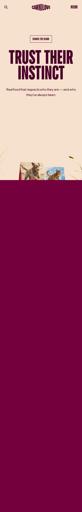

# UI Design System & Master Generation Blueprint: carnilove-ashfall-studio

> **Carnilove · Home** (https://carnilove.ashfall.studio/) — Rotate your device to portrait mode.


---

## 1. Executive Visual Persona & Design Archetype

- **Brand Essence & Persona**: **Carnilove · Home** (`https://carnilove.ashfall.studio/`). Rotate your device to portrait mode.
- **Capture Provenance**: Live browser capture (`tier1_fast`, HTTP `200`, captured `2026-11-23`).
- **Visual Archetype**: **Dark-Substrate WebGL / Canvas Interactive Experience (`#74003d` / `#4a002a`)**.
- **Anti-AI-Slop Differentiators**:
  - **Live-Computed Chromatic Polarity**: Anchors the viewport in `#74003d` (live computed `body` `background-color` (`computed_styles.json`)) paired with `#fff3e4` primary typography and `#4a002a` accents.
  - **Grounded Typographic Hierarchy**: Pairs `Matter` for display copy (`P U R E P R E S E N C E I N M O T I `) with `Matter` and `SFMono-Regular`.
  - **Calibrated Spatial Grid & Motion**: Combines `1404px` container bounds (`gap: 18px normal`, padding `18px`) with `cubic-bezier(.23,1,.32,1)` easing and Lenis Smooth Scroll (`data-lenis`), GSAP Timeline & ScrollTrigger.

---

## 2. Spatial Architecture & Modular Grid Mathematics



### Viewport Allocation & Container Geometry
- **Captured Viewport Dimensions**: Desktop `1440×900px` (`assets/desktop.png`, single-viewport 100vh live capture (900px)), Mobile `390×2400px` (`assets/mobile.png`, clamped at 2400px live multi-section capture).
- **Master Container Bounds**: `1404px` (measured widest bounded `<section>` landmark width on `1440px` desktop).
- **Canvas Lateral Padding & Spacing**: `18px` lateral canvas padding with `18px normal` grid gap.
- **Border Radius Scale**: `10rem`.

### Responsive Breakpoint Architecture
- **Desktop Layout**: Multi-column CSS Grid / Flexbox layout at `1440px` (`max-width: 1404px`, `gap: 18px normal`).
- **Mobile Layout**: Single-column vertical stack at `390px` viewport width with `18px` horizontal padding.
- **Extracted CSS Media Queries**: `@media (min-width:40rem)`, `@media (min-width:48rem)`, `@media (min-width:64rem)`, `@media (min-width:64.5rem)`.

---

## 3. Color System, Materiality & Atmospheric Lighting

### Semantic Palette & Source Grounding
| Semantic Role | Ground-Truth Value | Extracted Live / CSS Source |
|---|---|---|
| **Primary Canvas Substrate** | `#74003d` | live computed `body` `background-color` (`computed_styles.json`) |
| **Primary Typography Ink** | `#fff3e4` | live computed `p` `color` (`computed_styles.json`) |
| **Elevated Surface / Card Substrate** | `#000000` | `.bg-black { background-color: black }` (`#000000`) |
| **Interactive Accent / Highlight** | `#4a002a` | live computed `a` `color` (`computed_styles.json`) |
| **Secondary / Muted Copy** | `#f6e1ce` | live computed `main` `color` (`computed_styles.json`) |
| **Structural Hairline Border** | `#800080` | `.border-purple-dark { border-color: #800080 }` |

### Sanitized Root CSS Variables (`ui-ux.md` Ground Truth)
| Variable Name | Extracted Value | Semantic Role |
|---|---|---|
| `--size` | `375` | Layout / Spatial Grid Token |
| `--margin` | `2rem` | Layout / Spatial Grid Token |
| `--gutter` | `1rem` | Layout / Spatial Grid Token |
| `--header-height` | `6.5rem` | Layout / Spatial Grid Token |
| `--vw` | `100vw` | Layout / Spatial Grid Token |
| `--vh` | `calc(var(--vh-initial,1vh)*100)` | Layout / Spatial Grid Token |
| `--vh-dynamic` | `calc(var(--vh-initial-dynamic,1vh)*100)` | Layout / Spatial Grid Token |
| `--column` | `calc((var(--vw) - var(--margin)*2)/12)` | Layout / Spatial Grid Token |
| `--global-header-text` | `var(--color-purple-dark)` | Typography Ink Token |
| `--global-header-bg` | `var(--color-beige-light)` | Canvas / Surface Token |
| `--font-body` | `var(--font-multilingual)` | Typography / Scale Token |
| `--font-spark` | `var(--font-multilingual-bold)` | Typography / Scale Token |
| `--font-heading` | `var(--font-multilingual-bold)` | Typography Ink Token |
| `--color-black` | `#000` | Canvas / Surface Token |
| `--spacing` | `.1rem` | Layout / Spatial Grid Token |
| `--breakpoint-xl` | `64.5rem` | Dimension / Scale Token |

---

## 4. Typographic Scale & Editorial Hierarchy

### Font Family Stacks
- **Display Typography**: `Matter`.
- **Primary Body Stack**: `Matter`.
- **Technical / Metadata Stack**: `SFMono-Regular`.

### Typographic Scale & Rules (Live Computed & Stylesheet Grounded)
- **Hero Display (`H1`)**: CSS variables `--text-h1: 16rem`, `--text-h1--line-height: 80%`, `--text-h1-mobile: 6.4rem`.
- **Section Heading (`H2`)**: live computed `h3 (primary section heading)` (`font-size: 97.2px`, `line-height: 78.732px`, `font-weight: 400`, `letter-spacing: -0.972px`); CSS variables `--text-h2: 10.8rem`, `--text-h2--line-height: 81%`, `--text-h2-mobile: 5rem`; rule `h2` (`font-size: var(--text-h4-mobile)`, `line-height: var(--tw-leading,var(...`, `letter-spacing: calc(var(--tracking-t...`).
- **Body Copy**: live computed `body` (`font-size: 15px`, `line-height: 24px`, `font-weight: 400`, `letter-spacing: -0.15px`); CSS variables `--font-body: var(--font-multilingual)`, `--text-body-l: 1.7rem`, `--text-body-l--line-height: 190%`; rule `p` (`font-size: var(--text-body-s)`, `line-height: var(--tw-leading,var(...`, `letter-spacing: calc(var(--tracking-t...`).
- **Metadata & Navigation Labels**: live computed `nav/a` (`font-size: 15px`, `line-height: 24px`, `font-weight: 400`, `letter-spacing: -0.15px`); CSS variables `--default-mono-font-family: var(--font-mono)`, `--text-label: 1.4rem`, `--text-label--line-height: 100%`.

---

## 5. Choreographed Motion & Interaction Physics

### Primary Easing Curves
- **Extracted Timing Functions**: `cubic-bezier(.23,1,.32,1)`, `cubic-bezier(.4,0,.2,1)`, `cubic-bezier(.25,.46,.45,.9)`.

### Per-Element Transition & Choreography Rules
- **Selector `layer theme`**: `transition: .15s` extracted from `carnilove-ashfall-studio` stylesheet.
- **Selector `.transition`**: `transition: var(--tw-ease,var(--default-transition-timing-function))` extracted from `carnilove-ashfall-studio` stylesheet.
- **Selector `background-color\]`**: `transition: var(--tw-ease,var(--default-transition-timing-function))` extracted from `carnilove-ashfall-studio` stylesheet.
- **Extracted Easing Curve (`cubic-bezier(.23,1,.32,1)`)**: Governs interactive state transitions across `<header.header>` and `<section.flex>`.
- **Runtime Interaction Engine**: Integrates Lenis Smooth Scroll (`data-lenis`), GSAP Timeline & ScrollTrigger, Three.js / WebGL Canvas Pipeline with `prefers-reduced-motion: reduce` fallback guards.

---

## 6. Component Wireframe & Structural DOM Map

### Visual Layout Schematic — Desktop (`1440px`, Grounded in `dom.html` & Landmark Bounding Boxes)
```
┌────────────────────────────────────────────────────────────────────────┐
│ DESKTOP VIEWPORT (1440px) — Carnilove · Home                           │
│ ====================================================================== │
│ [ <header.header> (1440x72px)         | Mission · Ambassadors · Blog ] │
│ ---------------------------------------------------------------------- │
│ | HERO STAGE: <section.dropdown-el> (w=1440px)                       | │
│ | H1: P U R E P R E S E N C E I N M O T I O N PURE PRES...           | │
│ | Substrate: #74003d | Ink: #fff3e4 | Accent: #4a002a                | │
│ ---------------------------------------------------------------------- │
│ | SHOWCASE GRID (<section.flex>) max-w: 1404px                       | │
│ | +------------------------------+  +------------------------------+ | │
│ | | S H A R P E N E D B Y N A T  |  | f r e e t o b e f i e r c e  | | │
│ | +------------------------------+  +------------------------------+ | │
│ ---------------------------------------------------------------------- │
│ | DETAIL MODULE (<section.flex-col>) — TRUST THEIRINSTINCT           | │
│ ---------------------------------------------------------------------- │
│ [ FOOTER (<footer.footer>     ) | https://carnilove.ashfall.studio/    │
└────────────────────────────────────────────────────────────────────────┘
```

### Visual Layout Schematic — Mobile Reflow (`390px`)
```
┌────────────────────────────────────────────────────────────────────────┐
│ MOBILE VIEWPORT REFLOW (390px) — Single-Column Stack (gap: 18px nor)   │
│ ====================================================================== │
│ [ HEADER BAR (<header.header>         ) | Compact Menu (390px)         │
│ ---------------------------------------------------------------------- │
│ | HERO STAGE (<section.dropdown-el>) — 390px Vertical Lead           | │
│ | H1: P U R E P R E S E N C E I N M O T I O N PURE PRES...           | │
│ ---------------------------------------------------------------------- │
│ | SHOWCASE STACK (<section.flex>) — 1-Col Stack                      | │
│ | [ Item 1: S H A R P E N E D B Y N A T U R A L E N E R G Y S...   ] | │
│ | [ Item 2: f r e e t o b e f i e r c e l y a l i v e free to...   ] | │
│ ---------------------------------------------------------------------- │
│ | DETAIL STACK (<section.flex-col>) — 1-Col (TRUST THEIRINSTINC)     | │
│ ---------------------------------------------------------------------- │
│ [ FOOTER (<footer.footer>     ) | Stacked 390px Colophon               │
└────────────────────────────────────────────────────────────────────────┘
```

### Granular DOM Region Breakdown
1. **Brand Header & Navigation Bar (<header.header> — `carnilove-ashfall-studio`)**:
   - Landmark `<header class="header top-0">` (`1440x72px`) hosting `Carnilove · Home` navigation (`Mission · Ambassadors · Blog · Contact · Dry Food`), DOM attributes (`data-astro-cid-sckkx6r4`, `data-src="https://images.ctfass..."`, `data-srcset="https://images.ctfass..."`, `data-sizes="100vw"`), and stylesheet rule `backdrop { box-sizing:border-box;border:0 solid;margin:0;padding:0 }`.
2. **Hero Stage & Focal Lead (<section.dropdown-el> — `P U R E P R E S E N C E I N M O T `)**:
   - Landmark `<section class="dropdown-el flex">` presenting display lead `P U R E P R E S E N C E I N M O T I O N PURE PRES...` and copy excerpt *"Rotate your device to portrait mode."* over `#74003d` canvas and `#fff3e4` ink.
3. **Primary Showcase & Content Grid (<section.flex> — `S H A R P E N E D B Y N A T U R A `)**:
   - Landmark `<section class="dropdown-el flex">` rendering section `S H A R P E N E D B Y N A T U R A L E N E R G Y S...` with copy *"T R U S T T H E I R"*, asset references (`apple-touch-icon-57x57.png`, `apple-touch-icon-60x60.png`, `apple-touch-icon-72x72.png`, `apple-touch-icon-76x76.png`), and grid rule `file-selector-button { box-sizing:border-box;border:0 solid;margin:0;padding:0 }`.
4. **Interactive Detail & Feature Matrix (<section.flex-col> — `f r e e t o b e f i e r c e l y a `)**:
   - Landmark `<section class="dropdown-el flex">` framing `f r e e t o b e f i e r c e l y a l i v e free to...` and `TRUST THEIRINSTINCT` (*"TRUST THEIRINSTINCT"*) with `#000000` surface cards, `#4a002a` accents, and `strong { font-weight:bolder }`.
5. **Colophon & Global Directory Footer (<footer.footer> — `https://carnilove.ashfall.studio/`)**:
   - Landmark `<footer class="footer gap-y-20">` anchoring `Carnilove · Home` footer links (`Mission · Ambassadors · Blog · Contact · Dry Food`), copy *"Real food that respects who they are — and who they’ve alway"*, and `#800080` structural dividers.

---

## 7. Master Zero-Shot AI Generation Prompt

```markdown
# Master Zero-Shot Frontend Generation Prompt: carnilove-ashfall-studio (Carnilove · Home)

You are a principal frontend architect and design systems engineer. Build a complete, production-ready web application replicating the exact design system, DOM landmarks, typographic hierarchy, color tokens, and motion physics of `carnilove-ashfall-studio` (**Carnilove · Home** — `https://carnilove.ashfall.studio/`).

### 1. Visual Archetype & Anti-AI-Slop Mandates
- **Archetype**: Dark-Substrate WebGL / Canvas Interactive Experience (`#74003d` / `#4a002a`).
- **Identity & Domain Context**: Rotate your device to portrait mode.
- **Primary Substrate**: `#74003d` (live computed `body` `background-color` (`computed_styles.json`)), **Primary Ink**: `#fff3e4`, **Accent / Highlight**: `#4a002a`.
- **Site-Specific Differentiators**:
  - **Live-Computed Chromatic Polarity**: Anchors the viewport in `#74003d` (live computed `body` `background-color` (`computed_styles.json`)) paired with `#fff3e4` primary typography and `#4a002a` accents.
  - **Grounded Typographic Hierarchy**: Pairs `Matter` for display copy (`P U R E P R E S E N C E I N M O T I `) with `Matter` and `SFMono-Regular`.
  - **Calibrated Spatial Grid & Motion**: Combines `1404px` container bounds (`gap: 18px normal`, padding `18px`) with `cubic-bezier(.23,1,.32,1)` easing and Lenis Smooth Scroll (`data-lenis`), GSAP Timeline & ScrollTrigger.

### 2. Ground-Truth CSS Variables (`:root` Token Contract)
Declare and consume these exact custom properties extracted from `carnilove-ashfall-studio` in your global stylesheet:

:root {
  /* Carnilove · Home (carnilove-ashfall-studio) — Live-Grounded CSS Variables */
  --size: 375; /* Layout / Spatial Grid Token (carnilove-ashfall-studio) */
  --margin: 2rem; /* Layout / Spatial Grid Token (carnilove-ashfall-studio) */
  --gutter: 1rem; /* Layout / Spatial Grid Token (carnilove-ashfall-studio) */
  --header-height: 6.5rem; /* Layout / Spatial Grid Token (carnilove-ashfall-studio) */
  --vw: 100vw; /* Layout / Spatial Grid Token (carnilove-ashfall-studio) */
  --vh: calc(var(--vh-initial,1vh)*100); /* Layout / Spatial Grid Token (carnilove-ashfall-studio) */
  --vh-dynamic: calc(var(--vh-initial-dynamic,1vh)*100); /* Layout / Spatial Grid Token (carnilove-ashfall-studio) */
  --column: calc((var(--vw) - var(--margin)*2)/12); /* Layout / Spatial Grid Token (carnilove-ashfall-studio) */
  --global-header-text: var(--color-purple-dark); /* Typography Ink Token (carnilove-ashfall-studio) */
  --global-header-bg: var(--color-beige-light); /* Canvas / Surface Token (carnilove-ashfall-studio) */
  --font-body: var(--font-multilingual); /* Typography / Scale Token (carnilove-ashfall-studio) */
  --font-spark: var(--font-multilingual-bold); /* Typography / Scale Token (carnilove-ashfall-studio) */
  --font-heading: var(--font-multilingual-bold); /* Typography Ink Token (carnilove-ashfall-studio) */
  --color-black: #000; /* Canvas / Surface Token (carnilove-ashfall-studio) */
  --spacing: .1rem; /* Layout / Spatial Grid Token (carnilove-ashfall-studio) */
  --breakpoint-xl: 64.5rem; /* Dimension / Scale Token (carnilove-ashfall-studio) */
}

### 3. Semantic Color & Materiality Contract
Map every surface, ink, and border strictly to these source-grounded tokens:
- **Primary Canvas Substrate**: `#74003d` — grounded in live computed `body` `background-color` (`computed_styles.json`)
- **Primary Typography Ink**: `#fff3e4` — grounded in live computed `p` `color` (`computed_styles.json`)
- **Elevated Surface / Card Substrate**: `#000000` — grounded in `.bg-black { background-color: black }` (`#000000`)
- **Interactive Accent / Highlight**: `#4a002a` — grounded in live computed `a` `color` (`computed_styles.json`)
- **Secondary / Muted Copy**: `#f6e1ce` — grounded in live computed `main` `color` (`computed_styles.json`)
- **Structural Hairline Border**: `#800080` — grounded in `.border-purple-dark { border-color: #800080 }`

### 4. Spatial Grid, Container Bounds & Responsive Breakpoints
- **Desktop Viewport Reference**: `1440×900px` (single-viewport 100vh live capture (900px), `1440px` standard desktop width).
- **Mobile Viewport Reference**: `390×2400px` (clamped at 2400px live multi-section capture, `390px` standard mobile width).
- **Container Max-Width**: `1404px` (measured widest bounded `<section>` landmark width on `1440px` desktop)
- **Padding & Gutters**: `18px` lateral canvas padding with `18px normal` grid gap
- **Desktop Grid**: Multi-column CSS Grid / Flexbox layout at `1440px` (`max-width: 1404px`, `gap: 18px normal`)
- **Mobile Adaptation**: Single-column vertical stack at `390px` viewport width with `18px` horizontal padding
- **Media Queries**: `@media (min-width:40rem)`, `@media (min-width:48rem)`, `@media (min-width:64rem)`, `@media (min-width:64.5rem)`
- **Corner Radii**: `10rem`

### 5. Typography & Editorial Scale Contract
- **Display Font Stack**: `Matter`
- **Body Font Stack**: `Matter`
- **Monospace / Technical Font Stack**: `SFMono-Regular`
- **H1 Display Rule**: CSS variables `--text-h1: 16rem`, `--text-h1--line-height: 80%`, `--text-h1-mobile: 6.4rem`
- **H2 Section Rule**: live computed `h3 (primary section heading)` (`font-size: 97.2px`, `line-height: 78.732px`, `font-weight: 400`, `letter-spacing: -0.972px`); CSS variables `--text-h2: 10.8rem`, `--text-h2--line-height: 81%`, `--text-h2-mobile: 5rem`; rule `h2` (`font-size: var(--text-h4-mobile)`, `line-height: var(--tw-leading,var(...`, `letter-spacing: calc(var(--tracking-t...`)
- **Body Copy Rule**: live computed `body` (`font-size: 15px`, `line-height: 24px`, `font-weight: 400`, `letter-spacing: -0.15px`); CSS variables `--font-body: var(--font-multilingual)`, `--text-body-l: 1.7rem`, `--text-body-l--line-height: 190%`; rule `p` (`font-size: var(--text-body-s)`, `line-height: var(--tw-leading,var(...`, `letter-spacing: calc(var(--tracking-t...`)
- **Metadata & Index Rule**: live computed `nav/a` (`font-size: 15px`, `line-height: 24px`, `font-weight: 400`, `letter-spacing: -0.15px`); CSS variables `--default-mono-font-family: var(--font-mono)`, `--text-label: 1.4rem`, `--text-label--line-height: 100%`

### 6. Component Hierarchy, Verbatim Copy & Real DOM Landmarks
Scaffold `carnilove-ashfall-studio` (`Carnilove · Home`) with these exact structural regions, extracted copy, and CSS rules from `dom.html`:
1. **Brand Header & Navigation Bar (<header.header> — `carnilove-ashfall-studio`)**:
   - DOM & Selectors: Landmark `<header class="header top-0">` (`1440x72px`) hosting `Carnilove · Home` navigation (`Mission · Ambassadors · Blog · Contact · Dry Food`), DOM attributes (`data-astro-cid-sckkx6r4`, `data-src="https://images.ctfass..."`, `data-srcset="https://images.ctfass..."`, `data-sizes="100vw"`), and stylesheet rule `backdrop { box-sizing:border-box;border:0 solid;margin:0;padding:0 }`.
   - Responsive Contract: Header `Brand Header & Navigation Bar (<header.header> — `carnilove-ashfall-studio`)` (`carnilove-ashfall-studio`) adapts across `@media (min-width:40rem)`, `@media (min-width:48rem)`, `@media (min-width:64rem)`, `@media (min-width:64.5rem)` with `cubic-bezier(.23,1,.32,1)`, `cubic-bezier(.4,0,.2,1)`, `cubic-bezier(.25,.46,.45,.9)` transitions and links `Mission · Ambassadors · Blog · Contact · Dry Food`.
2. **Hero Stage & Focal Lead (<section.dropdown-el> — `P U R E P R E S E N C E I N M O T `)**:
   - DOM & Selectors: Landmark `<section class="dropdown-el flex">` presenting display lead `P U R E P R E S E N C E I N M O T I O N PURE PRES...` and copy excerpt *"Rotate your device to portrait mode."* over `#74003d` canvas and `#fff3e4` ink.
   - Responsive Contract: Hero stage (`1440×900px` desktop / `390×2400px` mobile) sets `#74003d` background with `#fff3e4` headline `P U R E P R E S E N C E I N M O T I O N PURE PRES...`.
3. **Primary Showcase & Content Grid (<section.flex> — `S H A R P E N E D B Y N A T U R A `)**:
   - DOM & Selectors: Landmark `<section class="dropdown-el flex">` rendering section `S H A R P E N E D B Y N A T U R A L E N E R G Y S...` with copy *"T R U S T T H E I R"*, asset references (`apple-touch-icon-57x57.png`, `apple-touch-icon-60x60.png`, `apple-touch-icon-72x72.png`, `apple-touch-icon-76x76.png`), and grid rule `file-selector-button { box-sizing:border-box;border:0 solid;margin:0;padding:0 }`.
   - Responsive Contract: Showcase grid `Primary Showcase & Content Grid (<section.flex> — `S H A R P E N E D B Y N A T U R A `)` applies Multi-column CSS Grid / Flexbox layout at `1440px` (`max-width: 1404px`, `gap: 18px normal`) on desktop and Single-column vertical stack at `390px` viewport width with `18px` horizontal padding on mobile.
4. **Interactive Detail & Feature Matrix (<section.flex-col> — `f r e e t o b e f i e r c e l y a `)**:
   - DOM & Selectors: Landmark `<section class="dropdown-el flex">` framing `f r e e t o b e f i e r c e l y a l i v e free to...` and `TRUST THEIRINSTINCT` (*"TRUST THEIRINSTINCT"*) with `#000000` surface cards, `#4a002a` accents, and `strong { font-weight:bolder }`.
   - Responsive Contract: Detail module `Interactive Detail & Feature Matrix (<section.flex-col> — `f r e e t o b e f i e r c e l y a `)` uses `10rem` radii, `#4a002a` highlights, and assets (apple-touch-icon-57x57.png, apple-touch-icon-60x60.png, apple-touch-icon-72x72.png).
5. **Colophon & Global Directory Footer (<footer.footer> — `https://carnilove.ashfall.studio/`)**:
   - DOM & Selectors: Landmark `<footer class="footer gap-y-20">` anchoring `Carnilove · Home` footer links (`Mission · Ambassadors · Blog · Contact · Dry Food`), copy *"Real food that respects who they are — and who they’ve alway"*, and `#800080` structural dividers.
   - Responsive Contract: Footer `Colophon & Global Directory Footer (<footer.footer> — `https://carnilove.ashfall.studio/`)` aligns to `1404px` (measured widest bounded `<section>` landmark width on `1440px` desktop) with `18px` lateral canvas padding with `18px normal` grid gap and attributes (data-astro-cid-sckkx6r4, data-src="https://images.ctfass...", data-srcset="https://images.ctfass...").

#### Verbatim DOM Copy Excerpts (`dom.html`)
- Copy Excerpt 1: *"Rotate your device to portrait mode."*
- Copy Excerpt 2: *"T R U S T T H E I R"*
- Copy Excerpt 3: *"TRUST THEIRINSTINCT"*
- Copy Excerpt 4: *"Real food that respects who they are — and who they’ve always been."*

### 7. Motion, Extracted Stylesheet Rules & Interaction Choreography
- **Primary Easing Functions**: `cubic-bezier(.23,1,.32,1)`, `cubic-bezier(.4,0,.2,1)`, `cubic-bezier(.25,.46,.45,.9)`
- **Extracted Stylesheet Rules (`carnilove-ashfall-studio`)**:
- `backdrop { box-sizing:border-box;border:0 solid;margin:0;padding:0 }`
- `file-selector-button { box-sizing:border-box;border:0 solid;margin:0;padding:0 }`
- `strong { font-weight:bolder }`
- `small { font-size:80% }`
- `sup { vertical-align:baseline;font-size:75%;line-height:0;position:relative }`
- **Per-Selector Transition Rules**:
- **Selector `layer theme`**: `transition: .15s` extracted from `carnilove-ashfall-studio` stylesheet.
- **Selector `.transition`**: `transition: var(--tw-ease,var(--default-transition-timing-function))` extracted from `carnilove-ashfall-studio` stylesheet.
- **Selector `background-color\]`**: `transition: var(--tw-ease,var(--default-transition-timing-function))` extracted from `carnilove-ashfall-studio` stylesheet.
- **Extracted Easing Curve (`cubic-bezier(.23,1,.32,1)`)**: Governs interactive state transitions across `<header.header>` and `<section.flex>`.
- **Runtime Interaction Engine**: Integrates Lenis Smooth Scroll (`data-lenis`), GSAP Timeline & ScrollTrigger, Three.js / WebGL Canvas Pipeline with `prefers-reduced-motion: reduce` fallback guards.

### 8. Technical Deliverables
- Implement in Next.js (App Router) with TypeScript and Tailwind CSS consuming the `:root` custom properties defined above for `carnilove-ashfall-studio`.
- Reproduce both the `1440px` desktop architecture and `390px` mobile breakpoint transitions, preserving semantic HTML5 landmarks (`<header>`, `<nav>`, `<main>`, `<section>`, `<footer>`) and `prefers-reduced-motion` accessibility guards.
```
