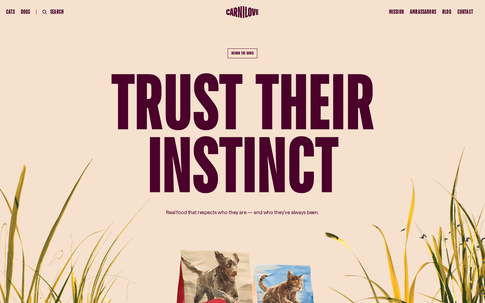

# UI Design System & Master Generation Blueprint: carnilove-ashfall-studio

> **Carnilove · Home** (https://carnilove.ashfall.studio/) — Rotate your device to portrait mode.



---

## 1. Executive Visual Persona & Design Archetype

- **Brand Essence & Persona**: **Carnilove · Home** (`https://carnilove.ashfall.studio/`). Rotate your device to portrait mode.
- **Visual Archetype**: **Dark-Substrate WebGL / Canvas Interactive Experience (`#000` / `#f6e1ce`)**.
- **Anti-AI-Slop Differentiators**:
  - **Source-Grounded Chromatic Polarity**: Anchors the viewport in `#000` (`var(--color-black)` in `:root`) paired with `#fff3e4` primary typography and `#f6e1ce` accents.
  - **Extracted Typographic Hierarchy**: Pairs `SparkCL` for display copy (`P U R E P R E S E N C E I N M O T I `) with `TTBluescreens` and `SFMono-Regular`.
  - **Calibrated Spatial Grid & Motion**: Combines `40rem` container bounds (`gap: var(--spacing-gutter)`, padding `var(--spacing-margin)`) with `cubic-bezier(.23,1,.32,1)` easing and Lenis Smooth Scroll (`data-lenis`), GSAP Timeline & ScrollTrigger.

---

## 2. Spatial Architecture & Modular Grid Mathematics


### Viewport Allocation & Container Geometry
- **Captured Viewport Dimensions**: Desktop `1440×8547px` (`assets/desktop.png`, full-page scroll capture), Mobile `390×2400px` (`assets/mobile.png`, capped at 2400px multi-section capture).
- **Master Container Bounds**: `40rem` extracted from `carnilove-ashfall-studio` stylesheet.
- **Canvas Lateral Padding & Spacing**: `var(--spacing-margin)` lateral canvas padding with `var(--spacing-gutter)` grid gap.
- **Border Radius Scale**: `10rem`.

### Responsive Breakpoint Architecture
- **Desktop Layout**: Multi-column CSS Grid / Flexbox layout at `1440px` (`max-width: 40rem`, `gap: var(--spacing-gutter)`).
- **Mobile Layout**: Single-column vertical stack at `390px` viewport width with `var(--spacing-margin)` horizontal padding.
- **Extracted CSS Media Queries**: `@media (min-width:40rem)`, `@media (min-width:48rem)`, `@media (min-width:64rem)`, `@media (min-width:64.5rem)`.

---

## 3. Color System, Materiality & Atmospheric Lighting

### Semantic Palette & Source Grounding
| Semantic Role | Ground-Truth Value | Extracted CSS Source / Selector |
|---|---|---|
| **Primary Canvas Substrate** | `#000` | `var(--color-black)` in `:root` |
| **Primary Typography Ink** | `#4a002a` | `var(--color-purple-dark)` in `:root` |
| **Elevated Surface / Card Substrate** | `#74003d` | `var(--color-purple-light)` in `:root` |
| **Interactive Accent / Highlight** | `#f6e1ce` | `var(--color-beige-dark)` in `:root` |
| **Secondary / Muted Copy** | `#fff3e4` | `var(--color-beige-light)` in `:root` |
| **Structural Hairline Border** | `#f00037` | `var(--color-red-light)` in `:root` |

### Sanitized Root CSS Variables (`ui-ux.md` Ground Truth)
| Variable Name | Extracted Value | Semantic Role |
|---|---|---|
| `--color-black` | `#000` | Canvas / Surface Token |
| `--spacing` | `.1rem` | Layout / Spatial Grid Token |
| `--breakpoint-xl` | `64.5rem` | Dimension / Scale Token |
| `--text-xl` | `26rem` | Typography Ink Token |
| `--text-xl--line-height` | `80%` | Typography Ink Token |
| `--tracking-tight` | `.01em` | Typography / Scale Token |
| `--ease-out` | `cubic-bezier(.23,1,.32,1)` | Motion / Easing Token |
| `--default-transition-duration` | `.15s` | Motion / Easing Token |
| `--default-transition-timing-function` | `cubic-bezier(.4,0,.2,1)` | Motion / Easing Token |
| `--default-font-family` | `var(--font-sans)` | Typography / Scale Token |
| `--default-mono-font-family` | `var(--font-mono)` | Typography / Scale Token |
| `--font-body` | `"Matter",sans-serif` | Typography / Scale Token |
| `--font-heading` | `"TTBluescreens",sans-serif` | Typography Ink Token |
| `--font-spark` | `"SparkCL",sans-serif` | Typography / Scale Token |
| `--font-multilingual` | `"NotoSans",sans-serif` | Typography / Scale Token |
| `--font-multilingual-bold` | `"NotoSansCondensed",sans-serif` | Typography / Scale Token |

---

## 4. Typographic Scale & Editorial Hierarchy

### Font Family Stacks
- **Display Typography**: `SparkCL`.
- **Primary Body Stack**: `TTBluescreens`.
- **Technical / Metadata Stack**: `SFMono-Regular`.

### Typographic Scale & Rules (Extracted from Stylesheet & Variables)
- **Hero Display (`H1`)**: CSS variables `--text-h1: 16rem`, `--text-h1--line-height: 80%`, `--text-h1-mobile: 6.4rem`.
- **Section Heading (`H2`)**: CSS variables `--text-h2: 10.8rem`, `--text-h2--line-height: 81%`, `--text-h2-mobile: 5rem`; rule `h2` (`font-size: var(--text-h4-mobile)`, `line-height: var(--tw-leading,var(...`, `letter-spacing: calc(var(--tracking-t...`).
- **Body Copy**: CSS variables `--font-body: "Matter",sans-serif`, `--text-body-l: 1.7rem`, `--text-body-l--line-height: 190%`; rule `p` (`font-size: var(--text-body-s)`, `line-height: var(--tw-leading,var(...`, `letter-spacing: calc(var(--tracking-t...`).
- **Metadata & Navigation Labels**: CSS variables `--default-mono-font-family: var(--font-mono)`, `--text-label: 1.4rem`, `--text-label--line-height: 100%`.

---

## 5. Choreographed Motion & Interaction Physics

### Primary Easing Curves
- **Extracted Timing Functions**: `cubic-bezier(.23,1,.32,1)`, `cubic-bezier(.4,0,.2,1)`, `cubic-bezier(.25,.46,.45,.9)`.

### Per-Element Transition & Choreography Rules
- **Selector `layer theme`**: `transition: .15s` extracted from `carnilove-ashfall-studio` stylesheet.
- **Selector `.transition`**: `transition: var(--tw-ease,var(--default-transition-timing-function))` extracted from `carnilove-ashfall-studio` stylesheet.
- **Selector `background-color\]`**: `transition: var(--tw-ease,var(--default-transition-timing-function))` extracted from `carnilove-ashfall-studio` stylesheet.
- **Extracted Easing Curve (`cubic-bezier(.23,1,.32,1)`)**: Governs interactive state transitions across `<header.header>` and `<section.dropdown-el>`.
- **Runtime Interaction Engine**: Integrates Lenis Smooth Scroll (`data-lenis`), GSAP Timeline & ScrollTrigger, Three.js / WebGL Canvas Pipeline with `prefers-reduced-motion: reduce` fallback guards.

---

## 6. Component Wireframe & Structural DOM Map

### Visual Layout Schematic (Grounded in `dom.html` — `1440px` Desktop & `390px` Mobile Reflow)
```
┌────────────────────────────────────────────────────────────────────────┐
│ DESKTOP VIEWPORT (1440px) — Carnilove · Home                           │
│ ====================================================================== │
│ [ <header.header>          | Mission · Ambassadors · Blog · Contact ]  │
│ ---------------------------------------------------------------------- │
│ | HERO STAGE: <section.dropdown-el>                                |   │
│ | H1: P U R E P R E S E N C E I N M O T I O N PURE PRES...         |   │
│ | Substrate: #000       | Ink: #fff3e4    | Accent: #f6e1ce        |   │
│ ---------------------------------------------------------------------- │
│ | SHOWCASE GRID (<section.dropdown-el>     ) max-w: 40rem          |   │
│ | +------------------------------+  +------------------------------+ | │
│ | | S H A R P E N E D B Y N A T  |  | f r e e t o b e f i e r c e  | | │
│ | +------------------------------+  +------------------------------+ | │
│ ---------------------------------------------------------------------- │
│ | MOBILE VIEWPORT REFLOW (390px) — Single-Column Stack (gap: var(--) | │
│ | [<header.header>] -> [<section.dropdown-] -> [<section.dropdown-] |  │
│ ---------------------------------------------------------------------- │
│ [ FOOTER (<footer.footer>       ) | https://carnilove.ashfall.studio/  │
└────────────────────────────────────────────────────────────────────────┘
```

### Granular DOM Region Breakdown
1. **Brand Header & Navigation Bar (<header.header> — `carnilove-ashfall-studio`)**:
   - Landmark `<header class="header fixed">` hosting `Carnilove · Home` navigation (`Mission · Ambassadors · Blog · Contact · Dry Food`), DOM attributes (`data-astro-cid-sckkx6r4`, `data-src="https://images.ctfass..."`, `data-srcset="https://images.ctfass..."`, `data-sizes="100vw"`), and stylesheet rule `backdrop { box-sizing:border-box;border:0 solid;margin:0;padding:0 }`.
2. **Hero Stage & Focal Lead (<section.dropdown-el> — `P U R E P R E S E N C E I N M O T `)**:
   - Landmark `<section class="dropdown-el flex">` presenting display lead `P U R E P R E S E N C E I N M O T I O N PURE PRES...` and copy excerpt *"Bosnia and Herzegovina de"* over `#000` canvas and `#fff3e4` ink.
3. **Primary Showcase & Content Grid (<section.dropdown-el> — `S H A R P E N E D B Y N A T U R A `)**:
   - Landmark `<section class="dropdown-el flex">` rendering section `S H A R P E N E D B Y N A T U R A L E N E R G Y S...` with copy *"T R U S T T H E I R"*, asset references (`apple-touch-icon-57x57.png`, `apple-touch-icon-60x60.png`, `apple-touch-icon-72x72.png`, `apple-touch-icon-76x76.png`), and grid rule `file-selector-button { box-sizing:border-box;border:0 solid;margin:0;padding:0 }`.
4. **Interactive Detail & Feature Matrix (<section.dropdown-el> — `f r e e t o b e f i e r c e l y a `)**:
   - Landmark `<section class="dropdown-el flex">` framing `f r e e t o b e f i e r c e l y a l i v e free to...` and `TRUST THEIRINSTINCT` (*"TRUST THEIRINSTINCT"*) with `#74003d` surface cards, `#f6e1ce` accents, and `strong { font-weight:bolder }`.
5. **Colophon & Global Directory Footer (<footer.footer> — `https://carnilove.ashfall.studio/`)**:
   - Landmark `<footer class="footer flex">` anchoring `Carnilove · Home` footer links (`Mission · Ambassadors · Blog · Contact · Dry Food`), copy *"Real food that respects who they are — and who they’ve alway"*, and `#f00037` structural dividers.

---

## 7. Master Zero-Shot AI Generation Prompt

```markdown
# Master Zero-Shot Frontend Generation Prompt: carnilove-ashfall-studio (Carnilove · Home)

You are a principal frontend architect and design systems engineer. Build a complete, production-ready web application replicating the exact design system, DOM landmarks, typographic hierarchy, color tokens, and motion physics of `carnilove-ashfall-studio` (**Carnilove · Home** — `https://carnilove.ashfall.studio/`).

### 1. Visual Archetype & Anti-AI-Slop Mandates
- **Archetype**: Dark-Substrate WebGL / Canvas Interactive Experience (`#000` / `#f6e1ce`).
- **Identity & Domain Context**: Rotate your device to portrait mode.
- **Primary Substrate**: `#000` (`var(--color-black)` in `:root`), **Primary Ink**: `#fff3e4`, **Accent / Highlight**: `#f6e1ce`.
- **Site-Specific Differentiators**:
  - **Source-Grounded Chromatic Polarity**: Anchors the viewport in `#000` (`var(--color-black)` in `:root`) paired with `#fff3e4` primary typography and `#f6e1ce` accents.
  - **Extracted Typographic Hierarchy**: Pairs `SparkCL` for display copy (`P U R E P R E S E N C E I N M O T I `) with `TTBluescreens` and `SFMono-Regular`.
  - **Calibrated Spatial Grid & Motion**: Combines `40rem` container bounds (`gap: var(--spacing-gutter)`, padding `var(--spacing-margin)`) with `cubic-bezier(.23,1,.32,1)` easing and Lenis Smooth Scroll (`data-lenis`), GSAP Timeline & ScrollTrigger.

### 2. Ground-Truth CSS Variables (`:root` Token Contract)
Declare and consume these exact custom properties extracted from `carnilove-ashfall-studio` in your global stylesheet:

:root {
  /* Carnilove · Home (carnilove-ashfall-studio) — Ground-Truth Extracted CSS Variables */
  --color-black: #000; /* Canvas / Surface Token (carnilove-ashfall-studio) */
  --spacing: .1rem; /* Layout / Spatial Grid Token (carnilove-ashfall-studio) */
  --breakpoint-xl: 64.5rem; /* Dimension / Scale Token (carnilove-ashfall-studio) */
  --text-xl: 26rem; /* Typography Ink Token (carnilove-ashfall-studio) */
  --text-xl--line-height: 80%; /* Typography Ink Token (carnilove-ashfall-studio) */
  --tracking-tight: .01em; /* Typography / Scale Token (carnilove-ashfall-studio) */
  --ease-out: cubic-bezier(.23,1,.32,1); /* Motion / Easing Token (carnilove-ashfall-studio) */
  --default-transition-duration: .15s; /* Motion / Easing Token (carnilove-ashfall-studio) */
  --default-transition-timing-function: cubic-bezier(.4,0,.2,1); /* Motion / Easing Token (carnilove-ashfall-studio) */
  --default-font-family: var(--font-sans); /* Typography / Scale Token (carnilove-ashfall-studio) */
  --default-mono-font-family: var(--font-mono); /* Typography / Scale Token (carnilove-ashfall-studio) */
  --font-body: "Matter",sans-serif; /* Typography / Scale Token (carnilove-ashfall-studio) */
  --font-heading: "TTBluescreens",sans-serif; /* Typography Ink Token (carnilove-ashfall-studio) */
  --font-spark: "SparkCL",sans-serif; /* Typography / Scale Token (carnilove-ashfall-studio) */
  --font-multilingual: "NotoSans",sans-serif; /* Typography / Scale Token (carnilove-ashfall-studio) */
  --font-multilingual-bold: "NotoSansCondensed",sans-serif; /* Typography / Scale Token (carnilove-ashfall-studio) */
}

### 3. Semantic Color & Materiality Contract
Map every surface, ink, and border strictly to these source-grounded tokens:
- **Primary Canvas Substrate**: `#000` — grounded in `var(--color-black)` in `:root`
- **Primary Typography Ink**: `#4a002a` — grounded in `var(--color-purple-dark)` in `:root`
- **Elevated Surface / Card Substrate**: `#74003d` — grounded in `var(--color-purple-light)` in `:root`
- **Interactive Accent / Highlight**: `#f6e1ce` — grounded in `var(--color-beige-dark)` in `:root`
- **Secondary / Muted Copy**: `#fff3e4` — grounded in `var(--color-beige-light)` in `:root`
- **Structural Hairline Border**: `#f00037` — grounded in `var(--color-red-light)` in `:root`

### 4. Spatial Grid, Container Bounds & Responsive Breakpoints
- **Desktop Viewport Reference**: `1440×8547px` (full-page scroll capture, `1440px` standard desktop width).
- **Mobile Viewport Reference**: `390×2400px` (capped at 2400px multi-section capture, `390px` standard mobile width).
- **Container Max-Width**: `40rem` extracted from `carnilove-ashfall-studio` stylesheet
- **Padding & Gutters**: `var(--spacing-margin)` lateral canvas padding with `var(--spacing-gutter)` grid gap
- **Desktop Grid**: Multi-column CSS Grid / Flexbox layout at `1440px` (`max-width: 40rem`, `gap: var(--spacing-gutter)`)
- **Mobile Adaptation**: Single-column vertical stack at `390px` viewport width with `var(--spacing-margin)` horizontal padding
- **Media Queries**: `@media (min-width:40rem)`, `@media (min-width:48rem)`, `@media (min-width:64rem)`, `@media (min-width:64.5rem)`
- **Corner Radii**: `10rem`

### 5. Typography & Editorial Scale Contract
- **Display Font Stack**: `SparkCL`
- **Body Font Stack**: `TTBluescreens`
- **Monospace / Technical Font Stack**: `SFMono-Regular`
- **H1 Display Rule**: CSS variables `--text-h1: 16rem`, `--text-h1--line-height: 80%`, `--text-h1-mobile: 6.4rem`
- **H2 Section Rule**: CSS variables `--text-h2: 10.8rem`, `--text-h2--line-height: 81%`, `--text-h2-mobile: 5rem`; rule `h2` (`font-size: var(--text-h4-mobile)`, `line-height: var(--tw-leading,var(...`, `letter-spacing: calc(var(--tracking-t...`)
- **Body Copy Rule**: CSS variables `--font-body: "Matter",sans-serif`, `--text-body-l: 1.7rem`, `--text-body-l--line-height: 190%`; rule `p` (`font-size: var(--text-body-s)`, `line-height: var(--tw-leading,var(...`, `letter-spacing: calc(var(--tracking-t...`)
- **Metadata & Index Rule**: CSS variables `--default-mono-font-family: var(--font-mono)`, `--text-label: 1.4rem`, `--text-label--line-height: 100%`

### 6. Component Hierarchy, Verbatim Copy & Real DOM Landmarks
Scaffold `carnilove-ashfall-studio` (`Carnilove · Home`) with these exact structural regions, extracted copy, and CSS rules from `dom.html`:
1. **Brand Header & Navigation Bar (<header.header> — `carnilove-ashfall-studio`)**:
   - DOM & Selectors: Landmark `<header class="header fixed">` hosting `Carnilove · Home` navigation (`Mission · Ambassadors · Blog · Contact · Dry Food`), DOM attributes (`data-astro-cid-sckkx6r4`, `data-src="https://images.ctfass..."`, `data-srcset="https://images.ctfass..."`, `data-sizes="100vw"`), and stylesheet rule `backdrop { box-sizing:border-box;border:0 solid;margin:0;padding:0 }`.
   - Responsive Contract: Header `Brand Header & Navigation Bar (<header.header> — `carnilove-ashfall-studio`)` (`carnilove-ashfall-studio`) adapts across `@media (min-width:40rem)`, `@media (min-width:48rem)`, `@media (min-width:64rem)`, `@media (min-width:64.5rem)` with `cubic-bezier(.23,1,.32,1)`, `cubic-bezier(.4,0,.2,1)`, `cubic-bezier(.25,.46,.45,.9)` transitions and links `Mission · Ambassadors · Blog · Contact · Dry Food`.
2. **Hero Stage & Focal Lead (<section.dropdown-el> — `P U R E P R E S E N C E I N M O T `)**:
   - DOM & Selectors: Landmark `<section class="dropdown-el flex">` presenting display lead `P U R E P R E S E N C E I N M O T I O N PURE PRES...` and copy excerpt *"Bosnia and Herzegovina de"* over `#000` canvas and `#fff3e4` ink.
   - Responsive Contract: Hero stage (`1440×8547px` desktop / `390×2400px` mobile) sets `#000` background with `#fff3e4` headline `P U R E P R E S E N C E I N M O T I O N PURE PRES...`.
3. **Primary Showcase & Content Grid (<section.dropdown-el> — `S H A R P E N E D B Y N A T U R A `)**:
   - DOM & Selectors: Landmark `<section class="dropdown-el flex">` rendering section `S H A R P E N E D B Y N A T U R A L E N E R G Y S...` with copy *"T R U S T T H E I R"*, asset references (`apple-touch-icon-57x57.png`, `apple-touch-icon-60x60.png`, `apple-touch-icon-72x72.png`, `apple-touch-icon-76x76.png`), and grid rule `file-selector-button { box-sizing:border-box;border:0 solid;margin:0;padding:0 }`.
   - Responsive Contract: Showcase grid `Primary Showcase & Content Grid (<section.dropdown-el> — `S H A R P E N E D B Y N A T U R A `)` applies Multi-column CSS Grid / Flexbox layout at `1440px` (`max-width: 40rem`, `gap: var(--spacing-gutter)`) on desktop and Single-column vertical stack at `390px` viewport width with `var(--spacing-margin)` horizontal padding on mobile.
4. **Interactive Detail & Feature Matrix (<section.dropdown-el> — `f r e e t o b e f i e r c e l y a `)**:
   - DOM & Selectors: Landmark `<section class="dropdown-el flex">` framing `f r e e t o b e f i e r c e l y a l i v e free to...` and `TRUST THEIRINSTINCT` (*"TRUST THEIRINSTINCT"*) with `#74003d` surface cards, `#f6e1ce` accents, and `strong { font-weight:bolder }`.
   - Responsive Contract: Detail module `Interactive Detail & Feature Matrix (<section.dropdown-el> — `f r e e t o b e f i e r c e l y a `)` uses `10rem` radii, `#f6e1ce` highlights, and assets (apple-touch-icon-57x57.png, apple-touch-icon-60x60.png, apple-touch-icon-72x72.png).
5. **Colophon & Global Directory Footer (<footer.footer> — `https://carnilove.ashfall.studio/`)**:
   - DOM & Selectors: Landmark `<footer class="footer flex">` anchoring `Carnilove · Home` footer links (`Mission · Ambassadors · Blog · Contact · Dry Food`), copy *"Real food that respects who they are — and who they’ve alway"*, and `#f00037` structural dividers.
   - Responsive Contract: Footer `Colophon & Global Directory Footer (<footer.footer> — `https://carnilove.ashfall.studio/`)` aligns to `40rem` extracted from `carnilove-ashfall-studio` stylesheet with `var(--spacing-margin)` lateral canvas padding with `var(--spacing-gutter)` grid gap and attributes (data-astro-cid-sckkx6r4, data-src="https://images.ctfass...", data-srcset="https://images.ctfass...").

#### Verbatim DOM Copy Excerpts (`dom.html`)
- Copy Excerpt 1: *"Bosnia and Herzegovina de"*
- Copy Excerpt 2: *"T R U S T T H E I R"*
- Copy Excerpt 3: *"TRUST THEIRINSTINCT"*
- Copy Excerpt 4: *"Real food that respects who they are — and who they’ve always been."*

### 7. Motion, Extracted Stylesheet Rules & Interaction Choreography
- **Primary Easing Functions**: `cubic-bezier(.23,1,.32,1)`, `cubic-bezier(.4,0,.2,1)`, `cubic-bezier(.25,.46,.45,.9)`
- **Extracted Stylesheet Rules (`carnilove-ashfall-studio`)**:
- `backdrop { box-sizing:border-box;border:0 solid;margin:0;padding:0 }`
- `file-selector-button { box-sizing:border-box;border:0 solid;margin:0;padding:0 }`
- `strong { font-weight:bolder }`
- `small { font-size:80% }`
- `sup { vertical-align:baseline;font-size:75%;line-height:0;position:relative }`
- **Per-Selector Transition Rules**:
- **Selector `layer theme`**: `transition: .15s` extracted from `carnilove-ashfall-studio` stylesheet.
- **Selector `.transition`**: `transition: var(--tw-ease,var(--default-transition-timing-function))` extracted from `carnilove-ashfall-studio` stylesheet.
- **Selector `background-color\]`**: `transition: var(--tw-ease,var(--default-transition-timing-function))` extracted from `carnilove-ashfall-studio` stylesheet.
- **Extracted Easing Curve (`cubic-bezier(.23,1,.32,1)`)**: Governs interactive state transitions across `<header.header>` and `<section.dropdown-el>`.
- **Runtime Interaction Engine**: Integrates Lenis Smooth Scroll (`data-lenis`), GSAP Timeline & ScrollTrigger, Three.js / WebGL Canvas Pipeline with `prefers-reduced-motion: reduce` fallback guards.

### 8. Technical Deliverables
- Implement in Next.js (App Router) with TypeScript and Tailwind CSS consuming the `:root` custom properties defined above for `carnilove-ashfall-studio`.
- Reproduce both the `1440px` desktop architecture and `390px` mobile breakpoint transitions, preserving semantic HTML5 landmarks (`<header>`, `<nav>`, `<main>`, `<section>`, `<footer>`) and `prefers-reduced-motion` accessibility guards.
```
