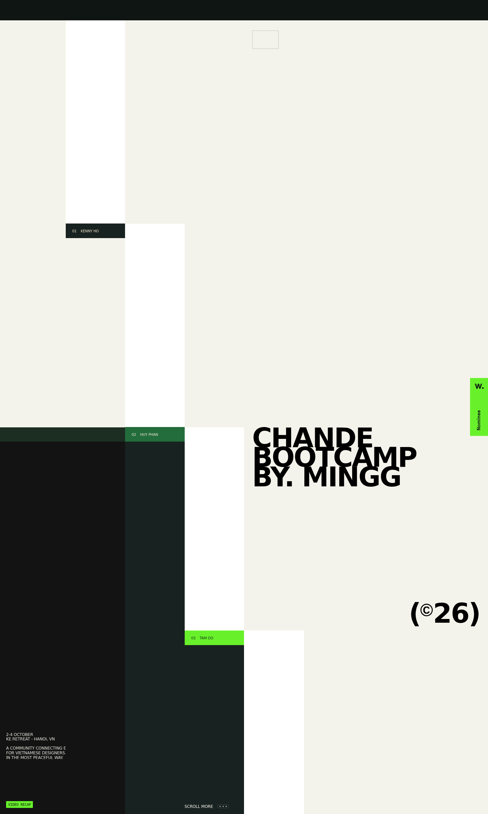

# UI Design System & Master Generation Blueprint: chandebootcamp-com

> **Chande Bootcamp 2026 by Mingg Patreon - Design Community in Vietnam** (http://chandebootcamp.com/) — Chande Bootcamp by Mingg is a retreat that connects Vietnamese designers: three days to listen, share and show the love at Ke Retreat, Ha...



---

## 1. Executive Visual Persona & Design Archetype

- **Brand Essence & Persona**: **Chande Bootcamp 2026 by Mingg Patreon - Design Community in Vietnam** (`http://chandebootcamp.com/`). Chande Bootcamp by Mingg is a retreat that connects Vietnamese designers: three days to listen, share and show the love at Ke Retreat, Ha...
- **Visual Archetype**: **Dark-Substrate WebGL / Canvas Interactive Experience (`#0f1513` / `#236c3c`)**.
- **Anti-AI-Slop Differentiators**:
  - **Source-Grounded Chromatic Polarity**: Anchors the viewport in `#0f1513` (`var(--ink)` in `:root`) paired with `#F7F3ED` primary typography and `#236c3c` accents.
  - **Extracted Typographic Hierarchy**: Pairs `Phudu` for display copy (`Chande Bootcamp By. Mingg`) with `Geist Mono` and `Geist Mono`.
  - **Calibrated Spatial Grid & Motion**: Combines `899px` container bounds (`gap: 10px`, padding `1.75rem`) with `cubic-bezier(.65,0,.35,1)` easing and Lenis Smooth Scroll (`data-lenis`), GSAP Timeline & ScrollTrigger.

---

## 2. Spatial Architecture & Modular Grid Mathematics


### Viewport Allocation & Container Geometry
- **Captured Viewport Dimensions**: Desktop `1440×2400px` (`assets/desktop.png`, capped at 2400px multi-section capture), Mobile `390×2400px` (`assets/mobile.png`, capped at 2400px multi-section capture).
- **Master Container Bounds**: `899px` extracted from `chandebootcamp-com` stylesheet.
- **Canvas Lateral Padding & Spacing**: `1.75rem` lateral canvas padding with `10px` grid gap.
- **Border Radius Scale**: `999px`, `10px`, `4px`, `99px`.

### Responsive Breakpoint Architecture
- **Desktop Layout**: Multi-column CSS Grid / Flexbox layout at `1440px` (`max-width: 899px`, `gap: 10px`).
- **Mobile Layout**: Single-column vertical stack at `390px` viewport width with `1.75rem` horizontal padding.
- **Extracted CSS Media Queries**: `@media (max-width:899px)`, `@media (max-width:1023px)`, `@media (max-width:44em), (max-height:680px)`, `@media (max-width:44em)`.

---

## 3. Color System, Materiality & Atmospheric Lighting

### Semantic Palette & Source Grounding
| Semantic Role | Ground-Truth Value | Extracted CSS Source / Selector |
|---|---|---|
| **Primary Canvas Substrate** | `#0f1513` | `var(--ink)` in `:root` |
| **Primary Typography Ink** | `#f4f3eb` | `var(--cream)` in `:root` |
| **Elevated Surface / Card Substrate** | `#F7F3ED` | `var(--g3-floor)` in `:root` |
| **Interactive Accent / Highlight** | `#236c3c` | `var(--g3-green)` in `:root` |
| **Secondary / Muted Copy** | `#68f12b` | `var(--g3-lime)` in `:root` |
| **Structural Hairline Border** | `#c4372b` | `var(--g3-danger)` in `:root` |

### Sanitized Root CSS Variables (`ui-ux.md` Ground Truth)
| Variable Name | Extracted Value | Semantic Role |
|---|---|---|
| `--ink` | `#0f1513` | Typography Ink Token |
| `--line` | `rgba(15,21,19,.18)` | Color / Atmospheric Token |
| `--tb` | `1` | Design System Custom Token |
| `--fu` | `min(var(--u), calc((100svh - var(--bar)) / 1000))` | Dimension / Scale Token |
| `--cream` | `#f4f3eb` | Color / Atmospheric Token |
| `--mono` | `max(11px, calc(14 * var(--fu)))` | Typography / Scale Token |
| `--lab` | `max(12px, calc(16 * var(--fu)))` | Dimension / Scale Token |
| `--g3-floor` | `#F7F3ED` | Color / Atmospheric Token |
| `--g3-ink` | `#0f1513` | Typography Ink Token |
| `--g3-green` | `#236c3c` | Color / Atmospheric Token |
| `--g3-lime` | `#68f12b` | Color / Atmospheric Token |
| `--g3-cream` | `#f4f3eb` | Color / Atmospheric Token |
| `--g3-danger` | `#c4372b` | Color / Atmospheric Token |
| `--g3-hair` | `rgba(15, 21, 19, .18)` | Color / Atmospheric Token |
| `--g3-mute` | `rgba(15, 21, 19, .55)` | Color / Atmospheric Token |
| `--g3-mono` | `'Geist Mono', ui-monospace, 'SFMono-Regular', Consolas, monospace` | Typography / Scale Token |

---

## 4. Typographic Scale & Editorial Hierarchy

### Font Family Stacks
- **Display Typography**: `Phudu`.
- **Primary Body Stack**: `Geist Mono`.
- **Technical / Metadata Stack**: `Geist Mono`.

### Typographic Scale & Rules (Extracted from Stylesheet & Variables)
- **Hero Display (`H1`)**: CSS variables `--g3-display: 'Phudu', ui-sans-serif, system-ui, sans-serif`.
- **Section Heading (`H2`)**: rule `h2` (`font-size: max(2.2rem, calc(80 * var(--u)))`, `line-height: .8`, `letter-spacing: -.04em`, `font-weight: 700`).
- **Body Copy**: rule `p` (`font-size: var(--lab)`, `line-height: .98`, `letter-spacing: -.02em`, `font-weight: 500`).
- **Metadata & Navigation Labels**: CSS variables `--mono: max(11px, calc(14 * var(--fu)))`, `--g3-mono: 'Geist Mono', ui-monospace, 'SFMono-Regular', Consolas, monospace`; rule `.mono` (`line-height: .96`, `letter-spacing: -.02em`, `font-weight: 500`).

---

## 5. Choreographed Motion & Interaction Physics

### Primary Easing Curves
- **Extracted Timing Functions**: `cubic-bezier(.65,0,.35,1)`, `cubic-bezier(.65,0,.25,1)`, `cubic-bezier(.16,1,.3,1)`.

### Per-Element Transition & Choreography Rules
- **Selector `.fm textarea`**: `transition: border-color .2s` extracted from `chandebootcamp-com` stylesheet.
- **Selector `.fm__opt span`**: `transition: background-color .2s, border-color .2s, color .2s` extracted from `chandebootcamp-com` stylesheet.
- **Selector `.fm.pt .pt__send i svg.pt__arrow`**: `transition: translate .35s cubic-bezier(.65,0,.35,1)` extracted from `chandebootcamp-com` stylesheet.
- **Extracted Easing Curve (`cubic-bezier(.65,0,.35,1)`)**: Governs interactive state transitions across `<nav.abs>` and `<section.hs>`.
- **Runtime Interaction Engine**: Integrates Lenis Smooth Scroll (`data-lenis`), GSAP Timeline & ScrollTrigger, Three.js / WebGL Canvas Pipeline, Barba.js Page Transition Router with `prefers-reduced-motion: reduce` fallback guards.

---

## 6. Component Wireframe & Structural DOM Map

### Visual Layout Schematic (Grounded in `dom.html` — `1440px` Desktop & `390px` Mobile Reflow)
```
┌────────────────────────────────────────────────────────────────────────┐
│ DESKTOP VIEWPORT (1440px) — Chande Bootcamp 2026 by Mingg Patreon - De │
│ ====================================================================== │
│ [ <nav.abs>                | Explore Gallery · About us             ]  │
│ ---------------------------------------------------------------------- │
│ | HERO STAGE: <section.hero>                                       |   │
│ | H1: Chande Bootcamp By. Mingg                                    |   │
│ | Substrate: #0f1513    | Ink: #F7F3ED    | Accent: #236c3c        |   │
│ ---------------------------------------------------------------------- │
│ | SHOWCASE GRID (<section.hs>              ) max-w: 899px          |   │
│ | +------------------------------+  +------------------------------+ | │
│ | | An event for all designers t |  | 06 years                     | | │
│ | +------------------------------+  +------------------------------+ | │
│ ---------------------------------------------------------------------- │
│ | MOBILE VIEWPORT REFLOW (390px) — Single-Column Stack (gap: 10px  ) | │
│ | [<nav.abs>] -> [<section.hero>] -> [<section.hs>] |                  │
│ ---------------------------------------------------------------------- │
│ [ FOOTER (<footer.hs>           ) | http://chandebootcamp.com/         │
└────────────────────────────────────────────────────────────────────────┘
```

### Granular DOM Region Breakdown
1. **Brand Header & Navigation Bar (<nav.abs> — `chandebootcamp-com`)**:
   - Landmark `<nav class="abs pills">` hosting `Chande Bootcamp 2026 by Mingg Patreo` navigation (`Explore Gallery · About us`), DOM attributes (`data-chande-loading`, `data-chande-transition`, `data-barba="wrapper"`, `data-transition-wrap`), and stylesheet rule `.fm__aside { grid-column:1 / span 5; align-self:start; position:sticky; top:calc(var(... }`.
2. **Hero Stage & Focal Lead (<section.hero> — `Chande Bootcamp By. Mingg`)**:
   - Landmark `<section class="hero">` presenting display lead `Chande Bootcamp By. Mingg` and copy excerpt *"Special event organized by Mingg Patreon - Design community"* over `#0f1513` canvas and `#F7F3ED` ink.
3. **Primary Showcase & Content Grid (<section.hs> — `An event for all designers to conn`)**:
   - Landmark `<section class="hs hs-intro">` rendering section `An event for all designers to connect. Listen & s...` with copy *"2-4 October Ke Retreat - Hanoi, VN"*, asset references (`favicon.ico`, `favicon.svg`, `favicon-32.png`, `apple-touch-icon.png`), and grid rule `.fm__title em { font-style:normal; color:236c3c }`.
4. **Interactive Detail & Feature Matrix (<section.hs> — `06 years`)**:
   - Landmark `<section class="hs hs-story">` framing `06 years` and `Chande.` (*"A community connecting event for Vietnamese designers. In the mos"*) with `#F7F3ED` surface cards, `#236c3c` accents, and `.fm__lead { margin-top:1em }`.
5. **Colophon & Global Directory Footer (<footer.hs> — `http://chandebootcamp.com/`)**:
   - Landmark `<footer class="hs hs-foot">` anchoring `Chande Bootcamp 2026 by Mingg Pa` footer links (`Explore Gallery · About us`), copy *"[ UIUX design community ]"*, and `#c4372b` structural dividers.

---

## 7. Master Zero-Shot AI Generation Prompt

```markdown
# Master Zero-Shot Frontend Generation Prompt: chandebootcamp-com (Chande Bootcamp 2026 by Mingg Patreon - Design Community in Vietnam)

You are a principal frontend architect and design systems engineer. Build a complete, production-ready web application replicating the exact design system, DOM landmarks, typographic hierarchy, color tokens, and motion physics of `chandebootcamp-com` (**Chande Bootcamp 2026 by Mingg Patreon - Design Community in Vietnam** — `http://chandebootcamp.com/`).

### 1. Visual Archetype & Anti-AI-Slop Mandates
- **Archetype**: Dark-Substrate WebGL / Canvas Interactive Experience (`#0f1513` / `#236c3c`).
- **Identity & Domain Context**: Chande Bootcamp by Mingg is a retreat that connects Vietnamese designers: three days to listen, share and show the love at Ke Retreat, Ha...
- **Primary Substrate**: `#0f1513` (`var(--ink)` in `:root`), **Primary Ink**: `#F7F3ED`, **Accent / Highlight**: `#236c3c`.
- **Site-Specific Differentiators**:
  - **Source-Grounded Chromatic Polarity**: Anchors the viewport in `#0f1513` (`var(--ink)` in `:root`) paired with `#F7F3ED` primary typography and `#236c3c` accents.
  - **Extracted Typographic Hierarchy**: Pairs `Phudu` for display copy (`Chande Bootcamp By. Mingg`) with `Geist Mono` and `Geist Mono`.
  - **Calibrated Spatial Grid & Motion**: Combines `899px` container bounds (`gap: 10px`, padding `1.75rem`) with `cubic-bezier(.65,0,.35,1)` easing and Lenis Smooth Scroll (`data-lenis`), GSAP Timeline & ScrollTrigger.

### 2. Ground-Truth CSS Variables (`:root` Token Contract)
Declare and consume these exact custom properties extracted from `chandebootcamp-com` in your global stylesheet:

:root {
  /* Chande Bootcamp 2026 by Mingg Patreon - Design Community in Vietnam (chandebootcamp-com) — Ground-Truth Extracted CSS Variables */
  --ink: #0f1513; /* Typography Ink Token (chandebootcamp-com) */
  --line: rgba(15,21,19,.18); /* Color / Atmospheric Token (chandebootcamp-com) */
  --tb: 1; /* Design System Custom Token (chandebootcamp-com) */
  --fu: min(var(--u), calc((100svh - var(--bar)) / 1000)); /* Dimension / Scale Token (chandebootcamp-com) */
  --cream: #f4f3eb; /* Color / Atmospheric Token (chandebootcamp-com) */
  --mono: max(11px, calc(14 * var(--fu))); /* Typography / Scale Token (chandebootcamp-com) */
  --lab: max(12px, calc(16 * var(--fu))); /* Dimension / Scale Token (chandebootcamp-com) */
  --g3-floor: #F7F3ED; /* Color / Atmospheric Token (chandebootcamp-com) */
  --g3-ink: #0f1513; /* Typography Ink Token (chandebootcamp-com) */
  --g3-green: #236c3c; /* Color / Atmospheric Token (chandebootcamp-com) */
  --g3-lime: #68f12b; /* Color / Atmospheric Token (chandebootcamp-com) */
  --g3-cream: #f4f3eb; /* Color / Atmospheric Token (chandebootcamp-com) */
  --g3-danger: #c4372b; /* Color / Atmospheric Token (chandebootcamp-com) */
  --g3-hair: rgba(15, 21, 19, .18); /* Color / Atmospheric Token (chandebootcamp-com) */
  --g3-mute: rgba(15, 21, 19, .55); /* Color / Atmospheric Token (chandebootcamp-com) */
  --g3-mono: 'Geist Mono', ui-monospace, 'SFMono-Regular', Consolas, monospace; /* Typography / Scale Token (chandebootcamp-com) */
}

### 3. Semantic Color & Materiality Contract
Map every surface, ink, and border strictly to these source-grounded tokens:
- **Primary Canvas Substrate**: `#0f1513` — grounded in `var(--ink)` in `:root`
- **Primary Typography Ink**: `#f4f3eb` — grounded in `var(--cream)` in `:root`
- **Elevated Surface / Card Substrate**: `#F7F3ED` — grounded in `var(--g3-floor)` in `:root`
- **Interactive Accent / Highlight**: `#236c3c` — grounded in `var(--g3-green)` in `:root`
- **Secondary / Muted Copy**: `#68f12b` — grounded in `var(--g3-lime)` in `:root`
- **Structural Hairline Border**: `#c4372b` — grounded in `var(--g3-danger)` in `:root`

### 4. Spatial Grid, Container Bounds & Responsive Breakpoints
- **Desktop Viewport Reference**: `1440×2400px` (capped at 2400px multi-section capture, `1440px` standard desktop width).
- **Mobile Viewport Reference**: `390×2400px` (capped at 2400px multi-section capture, `390px` standard mobile width).
- **Container Max-Width**: `899px` extracted from `chandebootcamp-com` stylesheet
- **Padding & Gutters**: `1.75rem` lateral canvas padding with `10px` grid gap
- **Desktop Grid**: Multi-column CSS Grid / Flexbox layout at `1440px` (`max-width: 899px`, `gap: 10px`)
- **Mobile Adaptation**: Single-column vertical stack at `390px` viewport width with `1.75rem` horizontal padding
- **Media Queries**: `@media (max-width:899px)`, `@media (max-width:1023px)`, `@media (max-width:44em), (max-height:680px)`, `@media (max-width:44em)`
- **Corner Radii**: `999px`, `10px`, `4px`, `99px`

### 5. Typography & Editorial Scale Contract
- **Display Font Stack**: `Phudu`
- **Body Font Stack**: `Geist Mono`
- **Monospace / Technical Font Stack**: `Geist Mono`
- **H1 Display Rule**: CSS variables `--g3-display: 'Phudu', ui-sans-serif, system-ui, sans-serif`
- **H2 Section Rule**: rule `h2` (`font-size: max(2.2rem, calc(80 * var(--u)))`, `line-height: .8`, `letter-spacing: -.04em`, `font-weight: 700`)
- **Body Copy Rule**: rule `p` (`font-size: var(--lab)`, `line-height: .98`, `letter-spacing: -.02em`, `font-weight: 500`)
- **Metadata & Index Rule**: CSS variables `--mono: max(11px, calc(14 * var(--fu)))`, `--g3-mono: 'Geist Mono', ui-monospace, 'SFMono-Regular', Consolas, monospace`; rule `.mono` (`line-height: .96`, `letter-spacing: -.02em`, `font-weight: 500`)

### 6. Component Hierarchy, Verbatim Copy & Real DOM Landmarks
Scaffold `chandebootcamp-com` (`Chande Bootcamp 2026 by Mingg Patreon - Design Community in Vietnam`) with these exact structural regions, extracted copy, and CSS rules from `dom.html`:
1. **Brand Header & Navigation Bar (<nav.abs> — `chandebootcamp-com`)**:
   - DOM & Selectors: Landmark `<nav class="abs pills">` hosting `Chande Bootcamp 2026 by Mingg Patreo` navigation (`Explore Gallery · About us`), DOM attributes (`data-chande-loading`, `data-chande-transition`, `data-barba="wrapper"`, `data-transition-wrap`), and stylesheet rule `.fm__aside { grid-column:1 / span 5; align-self:start; position:sticky; top:calc(var(... }`.
   - Responsive Contract: Header `Brand Header & Navigation Bar (<nav.abs> — `chandebootcamp-com`)` (`chandebootcamp-com`) adapts across `@media (max-width:899px)`, `@media (max-width:1023px)`, `@media (max-width:44em), (max-height:680px)`, `@media (max-width:44em)` with `cubic-bezier(.65,0,.35,1)`, `cubic-bezier(.65,0,.25,1)`, `cubic-bezier(.16,1,.3,1)` transitions and links `Explore Gallery · About us`.
2. **Hero Stage & Focal Lead (<section.hero> — `Chande Bootcamp By. Mingg`)**:
   - DOM & Selectors: Landmark `<section class="hero">` presenting display lead `Chande Bootcamp By. Mingg` and copy excerpt *"Special event organized by Mingg Patreon - Design community"* over `#0f1513` canvas and `#F7F3ED` ink.
   - Responsive Contract: Hero stage (`1440×2400px` desktop / `390×2400px` mobile) sets `#0f1513` background with `#F7F3ED` headline `Chande Bootcamp By. Mingg`.
3. **Primary Showcase & Content Grid (<section.hs> — `An event for all designers to conn`)**:
   - DOM & Selectors: Landmark `<section class="hs hs-intro">` rendering section `An event for all designers to connect. Listen & s...` with copy *"2-4 October Ke Retreat - Hanoi, VN"*, asset references (`favicon.ico`, `favicon.svg`, `favicon-32.png`, `apple-touch-icon.png`), and grid rule `.fm__title em { font-style:normal; color:236c3c }`.
   - Responsive Contract: Showcase grid `Primary Showcase & Content Grid (<section.hs> — `An event for all designers to conn`)` applies Multi-column CSS Grid / Flexbox layout at `1440px` (`max-width: 899px`, `gap: 10px`) on desktop and Single-column vertical stack at `390px` viewport width with `1.75rem` horizontal padding on mobile.
4. **Interactive Detail & Feature Matrix (<section.hs> — `06 years`)**:
   - DOM & Selectors: Landmark `<section class="hs hs-story">` framing `06 years` and `Chande.` (*"A community connecting event for Vietnamese designers. In the mos"*) with `#F7F3ED` surface cards, `#236c3c` accents, and `.fm__lead { margin-top:1em }`.
   - Responsive Contract: Detail module `Interactive Detail & Feature Matrix (<section.hs> — `06 years`)` uses `999px`, `10px`, `4px`, `99px` radii, `#236c3c` highlights, and assets (favicon.ico, favicon.svg, favicon-32.png).
5. **Colophon & Global Directory Footer (<footer.hs> — `http://chandebootcamp.com/`)**:
   - DOM & Selectors: Landmark `<footer class="hs hs-foot">` anchoring `Chande Bootcamp 2026 by Mingg Pa` footer links (`Explore Gallery · About us`), copy *"[ UIUX design community ]"*, and `#c4372b` structural dividers.
   - Responsive Contract: Footer `Colophon & Global Directory Footer (<footer.hs> — `http://chandebootcamp.com/`)` aligns to `899px` extracted from `chandebootcamp-com` stylesheet with `1.75rem` lateral canvas padding with `10px` grid gap and attributes (data-chande-loading, data-chande-transition, data-barba="wrapper").

#### Verbatim DOM Copy Excerpts (`dom.html`)
- Copy Excerpt 1: *"Special event organized by Mingg Patreon - Design community"*
- Copy Excerpt 2: *"2-4 October Ke Retreat - Hanoi, VN"*
- Copy Excerpt 3: *"A community connecting event for Vietnamese designers. In the most peaceful way."*
- Copy Excerpt 4: *"[ UIUX design community ]"*

### 7. Motion, Extracted Stylesheet Rules & Interaction Choreography
- **Primary Easing Functions**: `cubic-bezier(.65,0,.35,1)`, `cubic-bezier(.65,0,.25,1)`, `cubic-bezier(.16,1,.3,1)`
- **Extracted Stylesheet Rules (`chandebootcamp-com`)**:
- `.fm__aside { grid-column:1 / span 5; align-self:start; position:sticky; top:calc(var(... }`
- `.fm__title em { font-style:normal; color:236c3c }`
- `.fm__lead { margin-top:1em }`
- `.fm__form { grid-column:7 / span 6; display:flex; flex-direction:column; border-top:... }`
- `.fm__group { margin:0; padding:calc(40 * var(--u)) 0; border:0; border-bottom:1px sol... }`
- **Per-Selector Transition Rules**:
- **Selector `.fm textarea`**: `transition: border-color .2s` extracted from `chandebootcamp-com` stylesheet.
- **Selector `.fm__opt span`**: `transition: background-color .2s, border-color .2s, color .2s` extracted from `chandebootcamp-com` stylesheet.
- **Selector `.fm.pt .pt__send i svg.pt__arrow`**: `transition: translate .35s cubic-bezier(.65,0,.35,1)` extracted from `chandebootcamp-com` stylesheet.
- **Extracted Easing Curve (`cubic-bezier(.65,0,.35,1)`)**: Governs interactive state transitions across `<nav.abs>` and `<section.hs>`.
- **Runtime Interaction Engine**: Integrates Lenis Smooth Scroll (`data-lenis`), GSAP Timeline & ScrollTrigger, Three.js / WebGL Canvas Pipeline, Barba.js Page Transition Router with `prefers-reduced-motion: reduce` fallback guards.

### 8. Technical Deliverables
- Implement in Next.js (App Router) with TypeScript and Tailwind CSS consuming the `:root` custom properties defined above for `chandebootcamp-com`.
- Reproduce both the `1440px` desktop architecture and `390px` mobile breakpoint transitions, preserving semantic HTML5 landmarks (`<header>`, `<nav>`, `<main>`, `<section>`, `<footer>`) and `prefers-reduced-motion` accessibility guards.
```
