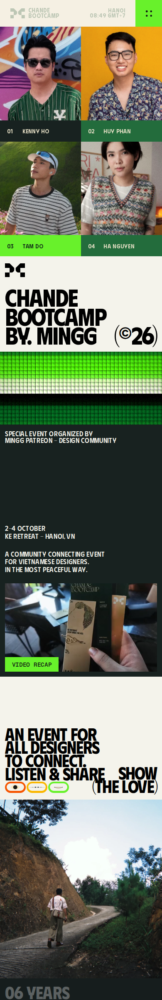

# UI Design System & Master Generation Blueprint: chandebootcamp-com

> **Chande Bootcamp 2026 by Mingg Patreon - Design Community in Vietnam** (http://chandebootcamp.com/) — Chande Bootcamp by Mingg is a retreat that connects Vietnamese designers: three days to listen, share and show the love at Ke Retreat, Ha...


---

## 1. Executive Visual Persona & Design Archetype

- **Brand Essence & Persona**: **Chande Bootcamp 2026 by Mingg Patreon - Design Community in Vietnam** (`http://chandebootcamp.com/`). Chande Bootcamp by Mingg is a retreat that connects Vietnamese designers: three days to listen, share and show the love at Ke Retreat, Ha...
- **Final Redirected URL**: [https://www.chandebootcamp.com/](https://www.chandebootcamp.com/)
- **Capture Provenance**: Live browser capture (`tier1_fast`, HTTP `200`, captured `2026-11-23`).
- **Visual Archetype**: **Light-Gallery WebGL / Canvas Interactive Experience (`#f4f3eb` / `#236c3c`)**.
- **Anti-AI-Slop Differentiators**:
  - **Live-Computed Chromatic Polarity**: Anchors the viewport in `#f4f3eb` (live computed `body` `background-color` (`computed_styles.json`)) paired with `#000000` primary typography and `#236c3c` accents.
  - **Grounded Typographic Hierarchy**: Pairs `Phudu` for display copy (`CHANDE BOOTCAMP BY. MINGG`) with `Phudu` and `Geist Mono`.
  - **Calibrated Spatial Grid & Motion**: Combines `1440px` container bounds (`gap: 2px`, padding `.5rem`) with `cubic-bezier(.76,0,.24,1)` easing and Lenis Smooth Scroll (`data-lenis`), GSAP Timeline & ScrollTrigger.

---

## 2. Spatial Architecture & Modular Grid Mathematics



### Viewport Allocation & Container Geometry
- **Captured Viewport Dimensions**: Desktop `1440×2400px` (`assets/desktop.png`, clamped at 2400px live multi-section capture), Mobile `390×2400px` (`assets/mobile.png`, clamped at 2400px live multi-section capture).
- **Master Container Bounds**: `1440px` (full-bleed `100%` desktop stage measured on `1440px` viewport).
- **Canvas Lateral Padding & Spacing**: `.5rem` lateral canvas padding with `2px` grid gap.
- **Border Radius Scale**: `999px`, `10px`, `4px`, `99px`.

### Responsive Breakpoint Architecture
- **Desktop Layout**: Multi-column CSS Grid / Flexbox layout at `1440px` (`max-width: 1440px`, `gap: 2px`).
- **Mobile Layout**: Single-column vertical stack at `390px` viewport width with `.5rem` horizontal padding.
- **Extracted CSS Media Queries**: `@media (min-width:900px)`, `@media (max-width:1920px)`, `@media (max-width:1728px)`, `@media (prefers-reduced-motion:reduce)`.

---

## 3. Color System, Materiality & Atmospheric Lighting

### Semantic Palette & Source Grounding
| Semantic Role | Ground-Truth Value | Extracted Live / CSS Source |
|---|---|---|
| **Primary Canvas Substrate** | `#f4f3eb` | live computed `body` `background-color` (`computed_styles.json`) |
| **Primary Typography Ink** | `#000000` | live computed `h1` `color` (`computed_styles.json`) |
| **Elevated Surface / Card Substrate** | `#f5f0e3` | live computed `button` `background-color` (`computed_styles.json`) |
| **Interactive Accent / Highlight** | `#236c3c` | `.hs-foot__cta1 { background: #236c3c }` |
| **Secondary / Muted Copy** | `#838b89` | live computed `footer` `color` (`computed_styles.json`) |
| **Structural Hairline Border** | `#cbcbc4` | `var(--line)` in `:root` (`rgba(15,21,19,.18)`) |
| **Variable Token (`--panel`)** | `#1b2625` | `var(--panel)` in `:root` |
| **Variable Token (`--green`)** | `#245535` | `var(--green)` in `:root` |
| **Variable Token (`--lime`)** | `#68f12b` | `var(--lime)` in `:root` |
| **Variable Token (`--ink`)** | `#0f1513` | `var(--ink)` in `:root` |
| **Variable Token (`--cap-ink`)** | `#e9e2c8` | `var(--cap-ink)` in `:root` |
| **Variable Token (`--cap-block`)** | `#102a19` | `var(--cap-block)` in `:root` |

### Sanitized Root CSS Variables (`ui-ux.md` Ground Truth)
| Variable Name | Extracted Value | Semantic Role |
|---|---|---|
| `--cream` | `#f4f3eb` | Color / Atmospheric Token |
| `--panel` | `#1b2625` | Color / Atmospheric Token |
| `--green` | `#245535` | Color / Atmospheric Token |
| `--lime` | `#68f12b` | Color / Atmospheric Token |
| `--ink` | `#0f1513` | Typography Ink Token |
| `--bar` | `5rem` | Dimension / Scale Token |
| `--fold` | `calc(100svh - var(--bar))` | Dimension / Scale Token |
| `--img` | `25` | Design System Custom Token |
| `--cap` | `56` | Design System Custom Token |
| `--hi` | `calc(var(--img) * 1svh)` | Dimension / Scale Token |
| `--y3` | `calc(2 * var(--hi))` | Design System Custom Token |
| `--y4` | `calc(3 * var(--hi))` | Design System Custom Token |
| `--cap-bg` | `#236c3c` | Canvas / Surface Token |
| `--cap-ink` | `#e9e2c8` | Typography Ink Token |
| `--cap-block` | `#102a19` | Color / Atmospheric Token |
| `--tb` | `1` | Design System Custom Token |

---

## 4. Typographic Scale & Editorial Hierarchy

### Font Family Stacks
- **Display Typography**: `Phudu`.
- **Primary Body Stack**: `Phudu`.
- **Technical / Metadata Stack**: `Geist Mono`.

### Typographic Scale & Rules (Live Computed & Stylesheet Grounded)
- **Hero Display (`H1`)**: live computed `h1` (`font-size: 80.0244px`, `line-height: 57.6176px`, `font-weight: 700`, `letter-spacing: -3.20098px`); CSS variables `--g3-display: 'Phudu', ui-sans-serif, system-ui, sans-serif`.
- **Section Heading (`H2`)**: live computed `h2` (`font-size: 79.5px`, `line-height: 62.01px`, `font-weight: 700`, `letter-spacing: -3.18px`); rule `h2` (`font-size: max(2.2rem, calc(80 * var(--u)))`, `line-height: .8`, `letter-spacing: -.04em`, `font-weight: 700`).
- **Body Copy**: live computed `body` (`font-size: 12px`, `line-height: normal`, `font-weight: 600`); rule `body` (`font-weight: 600`).
- **Metadata & Navigation Labels**: live computed `nav/a` (`font-size: 12px`, `line-height: 11.52px`, `font-weight: 500`, `letter-spacing: -0.24px`); CSS variables `--mono: max(11px, calc(14 * var(--fu)))`, `--g3-mono: 'Geist Mono', ui-monospace, 'SFMono-Regular', Consolas, monospace`; rule `.mono` (`line-height: .96`, `letter-spacing: -.02em`, `font-weight: 500`).

---

## 5. Choreographed Motion & Interaction Physics

### Primary Easing Curves
- **Extracted Timing Functions**: `cubic-bezier(.76,0,.24,1)`, `cubic-bezier(.65,0,.35,1)`, `cubic-bezier(.2,.7,.2,1)`.

### Per-Element Transition & Choreography Rules
- **Selector `.hero`**: `transition: background-color .6s ease` extracted from `chandebootcamp-com` stylesheet.
- **Selector `.hero__intro-text`**: `transition: color .6s ease` extracted from `chandebootcamp-com` stylesheet.
- **Selector `.chip::after`**: `transition: background-color .6s ease` extracted from `chandebootcamp-com` stylesheet.
- **Extracted Easing Curve (`cubic-bezier(.76,0,.24,1)`)**: Governs interactive state transitions across `<nav.abs>` and `<section.hs>`.
- **Runtime Interaction Engine**: Integrates Lenis Smooth Scroll (`data-lenis`), GSAP Timeline & ScrollTrigger, Three.js / WebGL Canvas Pipeline, Barba.js Page Transition Router with `prefers-reduced-motion: reduce` fallback guards.

---

## 6. Component Wireframe & Structural DOM Map

### Visual Layout Schematic — Desktop (`1440px`, Grounded in `dom.html` & Landmark Bounding Boxes)
```
┌────────────────────────────────────────────────────────────────────────┐
│ DESKTOP VIEWPORT (1440px) — Chande Bootcamp 2026 by Mingg Patreon - De │
│ ====================================================================== │
│ [ <nav.abs> (320x56px)                | Explore Gallery · About us   ] │
│ ---------------------------------------------------------------------- │
│ | HERO STAGE: <section.hero> (w=1440px)                              | │
│ | H1: CHANDE BOOTCAMP BY. MINGG                                      | │
│ | Substrate: #f4f3eb | Ink: #000000 | Accent: #236c3c                | │
│ ---------------------------------------------------------------------- │
│ | SHOWCASE GRID (<section.hs>) max-w: 1440px                         | │
│ | +------------------------------+  +------------------------------+ | │
│ | | Chande Bootcamp By. Mingg    |  | An event for all designers t | | │
│ | +------------------------------+  +------------------------------+ | │
│ ---------------------------------------------------------------------- │
│ | DETAIL MODULE (<section.hs-story>) — (12) Events at bootca         | │
│ ---------------------------------------------------------------------- │
│ [ FOOTER (<footer.hs>         ) | http://chandebootcamp.com/           │
└────────────────────────────────────────────────────────────────────────┘
```

### Visual Layout Schematic — Mobile Reflow (`390px`)
```
┌────────────────────────────────────────────────────────────────────────┐
│ MOBILE VIEWPORT REFLOW (390px) — Single-Column Stack (gap: 2px)        │
│ ====================================================================== │
│ [ HEADER BAR (<nav.abs>               ) | Compact Menu (390px)         │
│ ---------------------------------------------------------------------- │
│ | HERO STAGE (<section.hero>) — 390px Vertical Lead                  | │
│ | H1: CHANDE BOOTCAMP BY. MINGG                                      | │
│ ---------------------------------------------------------------------- │
│ | SHOWCASE STACK (<section.hs>) — 1-Col Stack                        | │
│ | [ Item 1: Chande Bootcamp By. Mingg                              ] | │
│ | [ Item 2: An event for all designers to connect. Listen & s...   ] | │
│ ---------------------------------------------------------------------- │
│ | DETAIL STACK (<section.hs-story>) — 1-Col ((12) Events at boo)     | │
│ ---------------------------------------------------------------------- │
│ [ FOOTER (<footer.hs>         ) | Stacked 390px Colophon               │
└────────────────────────────────────────────────────────────────────────┘
```

### Granular DOM Region Breakdown
1. **Brand Header & Navigation Bar (<nav.abs> — `chandebootcamp-com`)**:
   - Landmark `<nav class="abs pills">` (`320x56px`) hosting `Chande Bootcamp 2026 by Mingg Patreo` navigation (`Explore Gallery · About us`), DOM attributes (`data-chande-loading`, `data-chande-transition`, `data-barba="wrapper"`, `data-transition-wrap`), and stylesheet rule `body { overflow-x:clip; overscroll-behavior-x:none; -webkit-text-size-adjust:10... }`.
2. **Hero Stage & Focal Lead (<section.hero> — `CHANDE BOOTCAMP BY. MINGG`)**:
   - Landmark `<section class="hero">` presenting display lead `CHANDE BOOTCAMP BY. MINGG` and copy excerpt *"Special event organized by Mingg Patreon - Design community"* over `#f4f3eb` canvas and `#000000` ink.
3. **Primary Showcase & Content Grid (<section.hs> — `Chande Bootcamp By. Mingg`)**:
   - Landmark `<section class="hs hs-intro">` rendering section `Chande Bootcamp By. Mingg` with copy *"2-4 October Ke Retreat - Hanoi, VN"*, asset references (`favicon.ico`, `favicon.svg`, `favicon-32.png`, `apple-touch-icon.png`), and grid rule `.hero { transition:background-color .6s ease }`.
4. **Interactive Detail & Feature Matrix (<section.hs-story> — `An event for all designers to conn`)**:
   - Landmark `<section class="hs hs-story">` framing `An event for all designers to connect. Listen & s...` and `(12) Events at bootcamp` (*"A community connecting event for Vietnamese designers. In the mos"*) with `#f5f0e3` surface cards, `#236c3c` accents, and `.hero__intro-text { transition:color .6s ease }`.
5. **Colophon & Global Directory Footer (<footer.hs> — `http://chandebootcamp.com/`)**:
   - Landmark `<footer class="hs hs-foot">` anchoring `Chande Bootcamp 2026 by Mingg Pa` footer links (`Explore Gallery · About us`), copy *"[ UIUX design community ]"*, and `#cbcbc4` structural dividers.

---

## 7. Master Zero-Shot AI Generation Prompt

```markdown
# Master Zero-Shot Frontend Generation Prompt: chandebootcamp-com (Chande Bootcamp 2026 by Mingg Patreon - Design Community in Vietnam)

You are a principal frontend architect and design systems engineer. Build a complete, production-ready web application replicating the exact design system, DOM landmarks, typographic hierarchy, color tokens, and motion physics of `chandebootcamp-com` (**Chande Bootcamp 2026 by Mingg Patreon - Design Community in Vietnam** — `http://chandebootcamp.com/`).

### 1. Visual Archetype & Anti-AI-Slop Mandates
- **Archetype**: Light-Gallery WebGL / Canvas Interactive Experience (`#f4f3eb` / `#236c3c`).
- **Identity & Domain Context**: Chande Bootcamp by Mingg is a retreat that connects Vietnamese designers: three days to listen, share and show the love at Ke Retreat, Ha...
- **Primary Substrate**: `#f4f3eb` (live computed `body` `background-color` (`computed_styles.json`)), **Primary Ink**: `#000000`, **Accent / Highlight**: `#236c3c`.
- **Site-Specific Differentiators**:
  - **Live-Computed Chromatic Polarity**: Anchors the viewport in `#f4f3eb` (live computed `body` `background-color` (`computed_styles.json`)) paired with `#000000` primary typography and `#236c3c` accents.
  - **Grounded Typographic Hierarchy**: Pairs `Phudu` for display copy (`CHANDE BOOTCAMP BY. MINGG`) with `Phudu` and `Geist Mono`.
  - **Calibrated Spatial Grid & Motion**: Combines `1440px` container bounds (`gap: 2px`, padding `.5rem`) with `cubic-bezier(.76,0,.24,1)` easing and Lenis Smooth Scroll (`data-lenis`), GSAP Timeline & ScrollTrigger.

### 2. Ground-Truth CSS Variables (`:root` Token Contract)
Declare and consume these exact custom properties extracted from `chandebootcamp-com` in your global stylesheet:

:root {
  /* Chande Bootcamp 2026 by Mingg Patreon - Design Community in Vietnam (chandebootcamp-com) — Live-Grounded CSS Variables */
  --cream: #f4f3eb; /* Color / Atmospheric Token (chandebootcamp-com) */
  --panel: #1b2625; /* Color / Atmospheric Token (chandebootcamp-com) */
  --green: #245535; /* Color / Atmospheric Token (chandebootcamp-com) */
  --lime: #68f12b; /* Color / Atmospheric Token (chandebootcamp-com) */
  --ink: #0f1513; /* Typography Ink Token (chandebootcamp-com) */
  --bar: 5rem; /* Dimension / Scale Token (chandebootcamp-com) */
  --fold: calc(100svh - var(--bar)); /* Dimension / Scale Token (chandebootcamp-com) */
  --img: 25; /* Design System Custom Token (chandebootcamp-com) */
  --cap: 56; /* Design System Custom Token (chandebootcamp-com) */
  --hi: calc(var(--img) * 1svh); /* Dimension / Scale Token (chandebootcamp-com) */
  --y3: calc(2 * var(--hi)); /* Design System Custom Token (chandebootcamp-com) */
  --y4: calc(3 * var(--hi)); /* Design System Custom Token (chandebootcamp-com) */
  --cap-bg: #236c3c; /* Canvas / Surface Token (chandebootcamp-com) */
  --cap-ink: #e9e2c8; /* Typography Ink Token (chandebootcamp-com) */
  --cap-block: #102a19; /* Color / Atmospheric Token (chandebootcamp-com) */
  --tb: 1; /* Design System Custom Token (chandebootcamp-com) */
}

### 3. Semantic Color & Materiality Contract
Map every surface, ink, and border strictly to these source-grounded tokens:
- **Primary Canvas Substrate**: `#f4f3eb` — grounded in live computed `body` `background-color` (`computed_styles.json`)
- **Primary Typography Ink**: `#000000` — grounded in live computed `h1` `color` (`computed_styles.json`)
- **Elevated Surface / Card Substrate**: `#f5f0e3` — grounded in live computed `button` `background-color` (`computed_styles.json`)
- **Interactive Accent / Highlight**: `#236c3c` — grounded in `.hs-foot__cta1 { background: #236c3c }`
- **Secondary / Muted Copy**: `#838b89` — grounded in live computed `footer` `color` (`computed_styles.json`)
- **Structural Hairline Border**: `#cbcbc4` — grounded in `var(--line)` in `:root` (`rgba(15,21,19,.18)`)
- **Variable Token (`--panel`)**: `#1b2625` — grounded in `var(--panel)` in `:root`
- **Variable Token (`--green`)**: `#245535` — grounded in `var(--green)` in `:root`
- **Variable Token (`--lime`)**: `#68f12b` — grounded in `var(--lime)` in `:root`
- **Variable Token (`--ink`)**: `#0f1513` — grounded in `var(--ink)` in `:root`
- **Variable Token (`--cap-ink`)**: `#e9e2c8` — grounded in `var(--cap-ink)` in `:root`
- **Variable Token (`--cap-block`)**: `#102a19` — grounded in `var(--cap-block)` in `:root`

### 4. Spatial Grid, Container Bounds & Responsive Breakpoints
- **Desktop Viewport Reference**: `1440×2400px` (clamped at 2400px live multi-section capture, `1440px` standard desktop width).
- **Mobile Viewport Reference**: `390×2400px` (clamped at 2400px live multi-section capture, `390px` standard mobile width).
- **Container Max-Width**: `1440px` (full-bleed `100%` desktop stage measured on `1440px` viewport)
- **Padding & Gutters**: `.5rem` lateral canvas padding with `2px` grid gap
- **Desktop Grid**: Multi-column CSS Grid / Flexbox layout at `1440px` (`max-width: 1440px`, `gap: 2px`)
- **Mobile Adaptation**: Single-column vertical stack at `390px` viewport width with `.5rem` horizontal padding
- **Media Queries**: `@media (min-width:900px)`, `@media (max-width:1920px)`, `@media (max-width:1728px)`, `@media (prefers-reduced-motion:reduce)`
- **Corner Radii**: `999px`, `10px`, `4px`, `99px`

### 5. Typography & Editorial Scale Contract
- **Display Font Stack**: `Phudu`
- **Body Font Stack**: `Phudu`
- **Monospace / Technical Font Stack**: `Geist Mono`
- **H1 Display Rule**: live computed `h1` (`font-size: 80.0244px`, `line-height: 57.6176px`, `font-weight: 700`, `letter-spacing: -3.20098px`); CSS variables `--g3-display: 'Phudu', ui-sans-serif, system-ui, sans-serif`
- **H2 Section Rule**: live computed `h2` (`font-size: 79.5px`, `line-height: 62.01px`, `font-weight: 700`, `letter-spacing: -3.18px`); rule `h2` (`font-size: max(2.2rem, calc(80 * var(--u)))`, `line-height: .8`, `letter-spacing: -.04em`, `font-weight: 700`)
- **Body Copy Rule**: live computed `body` (`font-size: 12px`, `line-height: normal`, `font-weight: 600`); rule `body` (`font-weight: 600`)
- **Metadata & Index Rule**: live computed `nav/a` (`font-size: 12px`, `line-height: 11.52px`, `font-weight: 500`, `letter-spacing: -0.24px`); CSS variables `--mono: max(11px, calc(14 * var(--fu)))`, `--g3-mono: 'Geist Mono', ui-monospace, 'SFMono-Regular', Consolas, monospace`; rule `.mono` (`line-height: .96`, `letter-spacing: -.02em`, `font-weight: 500`)

### 6. Component Hierarchy, Verbatim Copy & Real DOM Landmarks
Scaffold `chandebootcamp-com` (`Chande Bootcamp 2026 by Mingg Patreon - Design Community in Vietnam`) with these exact structural regions, extracted copy, and CSS rules from `dom.html`:
1. **Brand Header & Navigation Bar (<nav.abs> — `chandebootcamp-com`)**:
   - DOM & Selectors: Landmark `<nav class="abs pills">` (`320x56px`) hosting `Chande Bootcamp 2026 by Mingg Patreo` navigation (`Explore Gallery · About us`), DOM attributes (`data-chande-loading`, `data-chande-transition`, `data-barba="wrapper"`, `data-transition-wrap`), and stylesheet rule `body { overflow-x:clip; overscroll-behavior-x:none; -webkit-text-size-adjust:10... }`.
   - Responsive Contract: Header `Brand Header & Navigation Bar (<nav.abs> — `chandebootcamp-com`)` (`chandebootcamp-com`) adapts across `@media (min-width:900px)`, `@media (max-width:1920px)`, `@media (max-width:1728px)`, `@media (prefers-reduced-motion:reduce)` with `cubic-bezier(.76,0,.24,1)`, `cubic-bezier(.65,0,.35,1)`, `cubic-bezier(.2,.7,.2,1)` transitions and links `Explore Gallery · About us`.
2. **Hero Stage & Focal Lead (<section.hero> — `CHANDE BOOTCAMP BY. MINGG`)**:
   - DOM & Selectors: Landmark `<section class="hero">` presenting display lead `CHANDE BOOTCAMP BY. MINGG` and copy excerpt *"Special event organized by Mingg Patreon - Design community"* over `#f4f3eb` canvas and `#000000` ink.
   - Responsive Contract: Hero stage (`1440×2400px` desktop / `390×2400px` mobile) sets `#f4f3eb` background with `#000000` headline `CHANDE BOOTCAMP BY. MINGG`.
3. **Primary Showcase & Content Grid (<section.hs> — `Chande Bootcamp By. Mingg`)**:
   - DOM & Selectors: Landmark `<section class="hs hs-intro">` rendering section `Chande Bootcamp By. Mingg` with copy *"2-4 October Ke Retreat - Hanoi, VN"*, asset references (`favicon.ico`, `favicon.svg`, `favicon-32.png`, `apple-touch-icon.png`), and grid rule `.hero { transition:background-color .6s ease }`.
   - Responsive Contract: Showcase grid `Primary Showcase & Content Grid (<section.hs> — `Chande Bootcamp By. Mingg`)` applies Multi-column CSS Grid / Flexbox layout at `1440px` (`max-width: 1440px`, `gap: 2px`) on desktop and Single-column vertical stack at `390px` viewport width with `.5rem` horizontal padding on mobile.
4. **Interactive Detail & Feature Matrix (<section.hs-story> — `An event for all designers to conn`)**:
   - DOM & Selectors: Landmark `<section class="hs hs-story">` framing `An event for all designers to connect. Listen & s...` and `(12) Events at bootcamp` (*"A community connecting event for Vietnamese designers. In the mos"*) with `#f5f0e3` surface cards, `#236c3c` accents, and `.hero__intro-text { transition:color .6s ease }`.
   - Responsive Contract: Detail module `Interactive Detail & Feature Matrix (<section.hs-story> — `An event for all designers to conn`)` uses `999px`, `10px`, `4px`, `99px` radii, `#236c3c` highlights, and assets (favicon.ico, favicon.svg, favicon-32.png).
5. **Colophon & Global Directory Footer (<footer.hs> — `http://chandebootcamp.com/`)**:
   - DOM & Selectors: Landmark `<footer class="hs hs-foot">` anchoring `Chande Bootcamp 2026 by Mingg Pa` footer links (`Explore Gallery · About us`), copy *"[ UIUX design community ]"*, and `#cbcbc4` structural dividers.
   - Responsive Contract: Footer `Colophon & Global Directory Footer (<footer.hs> — `http://chandebootcamp.com/`)` aligns to `1440px` (full-bleed `100%` desktop stage measured on `1440px` viewport) with `.5rem` lateral canvas padding with `2px` grid gap and attributes (data-chande-loading, data-chande-transition, data-barba="wrapper").

#### Verbatim DOM Copy Excerpts (`dom.html`)
- Copy Excerpt 1: *"Special event organized by Mingg Patreon - Design community"*
- Copy Excerpt 2: *"2-4 October Ke Retreat - Hanoi, VN"*
- Copy Excerpt 3: *"A community connecting event for Vietnamese designers. In the most peaceful way."*
- Copy Excerpt 4: *"[ UIUX design community ]"*

### 7. Motion, Extracted Stylesheet Rules & Interaction Choreography
- **Primary Easing Functions**: `cubic-bezier(.76,0,.24,1)`, `cubic-bezier(.65,0,.35,1)`, `cubic-bezier(.2,.7,.2,1)`
- **Extracted Stylesheet Rules (`chandebootcamp-com`)**:
- `body { overflow-x:clip; overscroll-behavior-x:none; -webkit-text-size-adjust:10... }`
- `.hero { transition:background-color .6s ease }`
- `.hero__intro-text { transition:color .6s ease }`
- `.chip::after { transition:background-color .6s ease }`
- `.hero__mark { transition:filter .6s ease }`
- **Per-Selector Transition Rules**:
- **Selector `.hero`**: `transition: background-color .6s ease` extracted from `chandebootcamp-com` stylesheet.
- **Selector `.hero__intro-text`**: `transition: color .6s ease` extracted from `chandebootcamp-com` stylesheet.
- **Selector `.chip::after`**: `transition: background-color .6s ease` extracted from `chandebootcamp-com` stylesheet.
- **Extracted Easing Curve (`cubic-bezier(.76,0,.24,1)`)**: Governs interactive state transitions across `<nav.abs>` and `<section.hs>`.
- **Runtime Interaction Engine**: Integrates Lenis Smooth Scroll (`data-lenis`), GSAP Timeline & ScrollTrigger, Three.js / WebGL Canvas Pipeline, Barba.js Page Transition Router with `prefers-reduced-motion: reduce` fallback guards.

### 8. Technical Deliverables
- Implement in Next.js (App Router) with TypeScript and Tailwind CSS consuming the `:root` custom properties defined above for `chandebootcamp-com`.
- Reproduce both the `1440px` desktop architecture and `390px` mobile breakpoint transitions, preserving semantic HTML5 landmarks (`<header>`, `<nav>`, `<main>`, `<section>`, `<footer>`) and `prefers-reduced-motion` accessibility guards.
```
