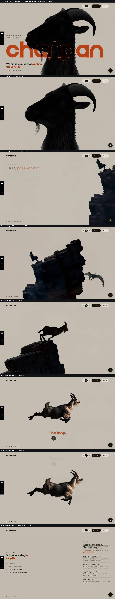
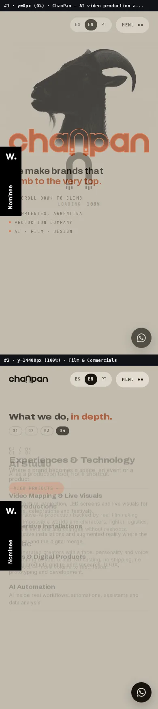

# UI Design System & Master Generation Blueprint: chanpan-com-ar

> **ChanPan · AI Video Production, Commercials & Creative Studio — Argentina** (https://chanpan.com.ar) — AI-driven video production, commercials, branded content, branding and 2D/3D animation. A creative studio from Corrientes, Argentina, wor...





---

## 1. Executive Visual Persona & Design Archetype

- **Brand Essence & Persona**: **ChanPan · AI Video Production, Commercials & Creative Studio — Argentina** (`https://chanpan.com.ar`). AI-driven video production, commercials, branded content, branding and 2D/3D animation. A creative studio from Corrientes, Argentina, wor...
- **Capture Provenance**: Live browser capture (`tier1_fast`, HTTP `200`, captured `2026-11-24`).
- **Visual Archetype**: **Light-Substrate Editorial & Modular Grid System (`#c1bbae` canvas, `#17130d` ink, `#f15a24` accent)**.
- **Anti-AI-Slop Differentiators**:
  - **Live-Computed Chromatic Polarity**: Anchors the viewport in `#c1bbae` (live computed `body` `background-color` (`computed_styles.json`)) paired with `#17130d` primary typography and `#f15a24` accents.
  - **Grounded Typographic Hierarchy**: Pairs `Archivo` for display copy (`ChanPan — AI video production and cr`) with `Inter` and `JetBrains Mono`.
  - **Calibrated Spatial Grid & Motion**: Combines `1440px` container bounds (`gap: 16px`, padding `79.2px`) with `cubic-bezier(.7,0,.2,1)` easing.

---

## 2. Spatial Architecture & Modular Grid Mathematics

### Viewport Allocation & Container Geometry
- **Captured Journey Filmstrips**: Desktop `1280×6624px` (`assets/desktop-journey.webp`, `8` keyframes up to `y=14400px` / doc `25422px`), Mobile `390×1744px` (`assets/mobile-journey.webp`, `2` keyframes).
- **Master Container Bounds**: `1440px` (full-bleed `100%` desktop stage measured on `1440px` viewport).
- **Canvas Lateral Padding & Spacing**: `79.2px` lateral canvas padding with `16px` grid gap.
- **Border Radius Scale**: `999px`, `50%`, `12px`, `14px`.

### Responsive Breakpoint Architecture
- **Desktop Layout**: Multi-column CSS Grid / Flexbox layout at `1440px` (`max-width: 1440px`, `gap: 16px`).
- **Mobile Layout**: Single-column vertical stack at `390px` viewport width with `79.2px` horizontal padding.
- **Extracted CSS Media Queries**: `@media (prefers-reduced-motion:reduce)`, `@media (max-width:860px)`.

---

## 3. Color System, Materiality & Atmospheric Lighting

### Semantic Palette & Source Grounding
| Semantic Role | Ground-Truth Value | Extracted Live / CSS Source |
|---|---|---|
| **Primary Canvas Substrate** | `#c1bbae` | live computed `body` `background-color` (`computed_styles.json`) |
| **Primary Typography Ink** | `#17130d` | live computed `h1` `color` (`computed_styles.json`) |
| **Elevated Surface / Card Substrate** | `#eee9de` | `var(--paper)` in `:root` |
| **Interactive Accent / Highlight** | `#f15a24` | `var(--brand)` in `:root` |
| **Secondary / Muted Copy** | `#524b3d` | live computed `button` `color` (`computed_styles.json`) |
| **Structural Hairline Border** | `#a6a094` | `var(--line)` in `:root` (`rgba(23,19,13,.16)`) |
| **Variable Token (`--brand-text`)** | `#a8360c` | `var(--brand-text)` in `:root` |
| **Variable Token (`--black`)** | `#0b0b0b` | `var(--black)` in `:root` |

### Sanitized Root CSS Variables (`ui-ux.md` Ground Truth)
| Variable Name | Extracted Value | Semantic Role |
|---|---|---|
| `--bg` | `#C1BBAE` | Canvas / Surface Token |
| `--ink` | `#17130D` | Typography Ink Token |
| `--ink-soft` | `#524B3D` | Typography Ink Token |
| `--brand` | `#F15A24` | Brand / Palette Token |
| `--brand-text` | `#A8360C` | Typography Ink Token |
| `--paper` | `#EEE9DE` | Canvas / Surface Token |
| `--line` | `rgba(23,19,13,.16)` | Color / Atmospheric Token |
| `--display` | `'Archivo',sans-serif` | Dimension / Scale Token |
| `--body` | `'Inter',system-ui,sans-serif` | Dimension / Scale Token |
| `--mono` | `'JetBrains Mono',ui-monospace,monospace` | Typography / Scale Token |
| `--mx` | `clamp(22px,5.5vw,88px)` | Dimension / Scale Token |
| `--band-bottom` | `0px` | Dimension / Scale Token |
| `--black` | `#0B0B0B` | Canvas / Surface Token |
| `--chanpan-com-ar-bg` | `#c1bbae` | Canvas Substrate (from live computed `body` `background-color` (`computed_styles.json`)) |
| `--chanpan-com-ar-ink` | `#17130d` | Primary Typography Ink (computed-derived) |
| `--chanpan-com-ar-surface` | `#eee9de` | Surface Substrate (computed-derived) |

---

## 4. Typographic Scale & Editorial Hierarchy

### Font Family Stacks
- **Display Typography**: `Archivo`.
- **Primary Body Stack**: `Inter`.
- **Technical / Metadata Stack**: `JetBrains Mono`.

### Typographic Scale & Rules (Live Computed & Stylesheet Grounded)
- **Hero Display (`H1`)**: live computed `h1` (`font-size: 32px`, `line-height: 32.64px`, `font-weight: 700`, `letter-spacing: -0.64px`); CSS variables `--display: 'Archivo',sans-serif`; rule `h1` (`font-size: clamp(38px,6.4vw,92px)`).
- **Section Heading (`H2`)**: live computed `h2` (`font-size: 52px`, `line-height: 53.04px`, `font-weight: 800`, `letter-spacing: -1.04px`); rule `h2` (`font-size: clamp(26px,3.2vw,42px)`, `font-weight: 800`).
- **Body Copy**: live computed `body` (`font-size: 16px`, `line-height: 25.6px`, `font-weight: 400`); CSS variables `--body: 'Inter',system-ui,sans-serif`; rule `body` (`line-height: 1.6`).
- **Metadata & Navigation Labels**: live computed `nav/a` (`font-size: 16px`, `line-height: 25.6px`, `font-weight: 400`); CSS variables `--mono: 'JetBrains Mono',ui-monospace,monospace`; rule `small` (`font-size: 9.5px`, `letter-spacing: .14em`, `font-weight: 600`).

---

## 5. Choreographed Motion & Interaction Physics

### Primary Easing Curves
- **Extracted Timing Functions**: `cubic-bezier(.7,0,.2,1)`, `cubic-bezier(.2,.8,.2,1)`.

### Per-Element Transition & Choreography Rules
- **Selector `#pre`**: `transition: opacity .8s ease, transform .9s cubic-bezier(.7,0,.2,1)` extracted from `chanpan-com-ar` stylesheet.
- **Selector `.pre-iso--fill`**: `transition: clip-path .35s ease` extracted from `chanpan-com-ar` stylesheet.
- **Selector `#canvas`**: `transition: opacity .8s ease` extracted from `chanpan-com-ar` stylesheet.
- **Extracted Easing Curve (`cubic-bezier(.7,0,.2,1)`)**: Governs interactive state transitions across `<header.hd>` and `<section.drive>`.
- **State & Hover Choreography**: Opacity and transform transitions on `<section.hero>` and `<section.drive>` interactive targets.
### Measured Runtime Scroll & Interaction Telemetry (`behavioral_journey_v2`)
- **Scroll Driver Mode**: `native` (max document height `25422px`, deepest scrollY reached `14400px` across `8` desktop keyframes).
- **Detected Scroll / Motion Libraries**: Native browser scroll / standard CSS transitions.
- **Nav / Drawer Probe (`MENU`)**: Triggered visual change (pixel diff `102.007`, captured in `assets/state-nav.webp`); revealed links: Home, Demo Reel, Services, Work, Contact.
- **Hover Physics (`primary_cta` · `LET'S TALK`)**: Computed transition `0.25s` / `cubic-bezier(0.2, 0.8, 0.2, 1)` (no static color/transform shift captured at rest).
- **Route Transition Architecture**: First internal navigation (`/CH/trabajos.html`) measured as `direct` in `12046ms`.

---

## 6. Component Wireframe & Structural DOM Map

### Visual Layout Schematic — Desktop (`1440px`, Grounded in `dom.html` & Landmark Bounding Boxes)
```
┌────────────────────────────────────────────────────────────────────────┐
│ DESKTOP VIEWPORT (1440px) — ChanPan · AI Video Production, Commercials │
│ ====================================================================== │
│ [ <header.hd> (1440x89px)             | Home · Demo Reel · Services  ] │
│ ---------------------------------------------------------------------- │
│ | HERO STAGE: <section.hero> (w=1440px)                              | │
│ | H1: ChanPan — AI video production and creative studio              | │
│ | Substrate: #c1bbae | Ink: #17130d | Accent: #f15a24                | │
│ ---------------------------------------------------------------------- │
│ | SHOWCASE GRID (<section.drive>) max-w: 1440px                      | │
│ | +------------------------------+  +------------------------------+ | │
│ | | First, perspective.          |  | Our terrain.                 | | │
│ | +------------------------------+  +------------------------------+ | │
│ ---------------------------------------------------------------------- │
│ | DETAIL MODULE (<section.drive:nth(2)>) — Twenty years climbing     | │
│ ---------------------------------------------------------------------- │
│ [ FOOTER (<footer.ft>         ) | https://chanpan.com.ar               │
└────────────────────────────────────────────────────────────────────────┘
```

### Visual Layout Schematic — Mobile Reflow (`390px`)
```
┌────────────────────────────────────────────────────────────────────────┐
│ MOBILE VIEWPORT REFLOW (390px) — Single-Column Stack (gap: 16px)       │
│ ====================================================================== │
│ [ HEADER BAR (<header.hd>             ) | Compact Menu (390px)         │
│ ---------------------------------------------------------------------- │
│ | HERO STAGE (<section.hero>) — 390px Vertical Lead                  | │
│ | H1: ChanPan — AI video production and creative studio              | │
│ ---------------------------------------------------------------------- │
│ | SHOWCASE STACK (<section.drive>) — 1-Col Stack                     | │
│ | [ Item 1: First, perspective.                                    ] | │
│ | [ Item 2: Our terrain.                                           ] | │
│ ---------------------------------------------------------------------- │
│ | DETAIL STACK (<section.drive:nth(2)>) — 1-Col (Twenty years climb) | │
│ ---------------------------------------------------------------------- │
│ [ FOOTER (<footer.ft>         ) | Stacked 390px Colophon               │
└────────────────────────────────────────────────────────────────────────┘
```

### Granular DOM Region Breakdown
1. **Brand Header & Navigation Bar (<header.hd> — `chanpan-com-ar`)**:
   - Landmark `<header class="hd">` (`1440x89px`) hosting `ChanPan · AI Video Production, Comme` navigation (`Home · Demo Reel · Services · Work · Contact`), DOM attributes (`data-clip="s1-loop"`, `data-clip="s2-scrub"`, `data-scrub`, `data-clip="s3-scrub"`), and stylesheet rule `html { -webkit-text-size-adjust:100% }`.
2. **Hero Stage & Focal Lead (<section.hero> — `ChanPan — AI video production and `)**:
   - Landmark `<section class="hero">` presenting display lead `ChanPan — AI video production and creative studio` and copy excerpt *"We make brands that climb to the very top."* over `#c1bbae` canvas and `#17130d` ink.
3. **Primary Showcase & Content Grid (<section.drive> — `First, perspective.`)**:
   - Landmark `<section class="drive">` rendering section `First, perspective.` with copy *"Corrientes, Argentina"*, asset references (`favicon.svg`, `favicon-32.png`, `apple-touch-icon.png`, `site.webmanifest`), and grid rule `body.is-loading { overflow:hidden }`.
4. **Interactive Detail & Feature Matrix (<section.drive:nth(2)> — `Our terrain.`)**:
   - Landmark `<section class="drive">` framing `Our terrain.` and `Twenty years climbing.` (*"Production company"*) with `#eee9de` surface cards, `#f15a24` accents, and `button { font:inherit;color:inherit }`.
5. **Colophon & Global Directory Footer (<footer.ft> — `https://chanpan.com.ar`)**:
   - Landmark `<footer class="ft">` anchoring `ChanPan · AI Video Production, C` footer links (`Home · Demo Reel · Services · Work · Contact`), copy *"AI · Film · Design"*, and `#a6a094` structural dividers.
### Full Vertical Scroll Sequence (Desktop `1440×900` Keyframes)
- **Step 01** (`y=0px`, `0%`): Active landmark `ChanPan — AI video production and creative studio` · sticky/fixed elements: `3`
- **Step 02** (`y=850px`, `3%`): Active landmark `Section @ 3%` · sticky/fixed elements: `5`
- **Step 03** (`y=2550px`, `10%`): Active landmark `First, perspective.` · sticky/fixed elements: `6`
- **Step 04** (`y=4250px`, `17%`): Active landmark `Section @ 17%` · sticky/fixed elements: `5`
- **Step 05** (`y=9350px`, `38%`): Active landmark `#salto` · sticky/fixed elements: `5`
- **Step 06** (`y=10200px`, `42%`): Active landmark `The leap.` · sticky/fixed elements: `5`
- **Step 07** (`y=11050px`, `45%`): Active landmark `The leap.` · sticky/fixed elements: `6`
- **Step 08** (`y=14400px`, `59%`): Active landmark `What we do, in depth.` · sticky/fixed elements: `5`

### Multi-Page Internal Route Map
- **Detail Route (`/CH/trabajos.html`)**: `https://chanpan.com.ar/CH/trabajos.html?c=ia&lang=en` — H1: `AI Studio`, scrollHeight `4572px`, transition `direct` (`12046ms`)
- **Detail Route (`/CH/mundo.html`)**: `https://chanpan.com.ar/CH/mundo.html?lang=en` — H1: `2 trips around the world.`, scrollHeight `1015px`, transition `direct` (`963ms`)

---

## 7. Master Zero-Shot AI Generation Prompt

```markdown
# Master Zero-Shot Frontend Generation Prompt: chanpan-com-ar (ChanPan · AI Video Production, Commercials & Creative Studio — Argentina)

You are a principal frontend architect and design systems engineer. Build a complete, production-ready web application replicating the exact design system, DOM landmarks, typographic hierarchy, color tokens, and motion physics of `chanpan-com-ar` (**ChanPan · AI Video Production, Commercials & Creative Studio — Argentina** — `https://chanpan.com.ar`).

### 1. Visual Archetype & Anti-AI-Slop Mandates
- **Archetype**: Light-Substrate Editorial & Modular Grid System (`#c1bbae` canvas, `#17130d` ink, `#f15a24` accent).
- **Identity & Domain Context**: AI-driven video production, commercials, branded content, branding and 2D/3D animation. A creative studio from Corrientes, Argentina, wor...
- **Primary Substrate**: `#c1bbae` (live computed `body` `background-color` (`computed_styles.json`)), **Primary Ink**: `#17130d`, **Accent / Highlight**: `#f15a24`.
- **Site-Specific Differentiators**:
  - **Live-Computed Chromatic Polarity**: Anchors the viewport in `#c1bbae` (live computed `body` `background-color` (`computed_styles.json`)) paired with `#17130d` primary typography and `#f15a24` accents.
  - **Grounded Typographic Hierarchy**: Pairs `Archivo` for display copy (`ChanPan — AI video production and cr`) with `Inter` and `JetBrains Mono`.
  - **Calibrated Spatial Grid & Motion**: Combines `1440px` container bounds (`gap: 16px`, padding `79.2px`) with `cubic-bezier(.7,0,.2,1)` easing.

### 2. Ground-Truth CSS Variables (`:root` Token Contract)
Declare and consume these exact custom properties extracted from `chanpan-com-ar` in your global stylesheet:

:root {
  /* ChanPan · AI Video Production, Commercials & Creative Studio — Argentina (chanpan-com-ar) — Live-Grounded CSS Variables */
  --bg: #C1BBAE; /* Canvas / Surface Token (chanpan-com-ar) */
  --ink: #17130D; /* Typography Ink Token (chanpan-com-ar) */
  --ink-soft: #524B3D; /* Typography Ink Token (chanpan-com-ar) */
  --brand: #F15A24; /* Brand / Palette Token (chanpan-com-ar) */
  --brand-text: #A8360C; /* Typography Ink Token (chanpan-com-ar) */
  --paper: #EEE9DE; /* Canvas / Surface Token (chanpan-com-ar) */
  --line: rgba(23,19,13,.16); /* Color / Atmospheric Token (chanpan-com-ar) */
  --display: 'Archivo',sans-serif; /* Dimension / Scale Token (chanpan-com-ar) */
  --body: 'Inter',system-ui,sans-serif; /* Dimension / Scale Token (chanpan-com-ar) */
  --mono: 'JetBrains Mono',ui-monospace,monospace; /* Typography / Scale Token (chanpan-com-ar) */
  --mx: clamp(22px,5.5vw,88px); /* Dimension / Scale Token (chanpan-com-ar) */
  --band-bottom: 0px; /* Dimension / Scale Token (chanpan-com-ar) */
  --black: #0B0B0B; /* Canvas / Surface Token (chanpan-com-ar) */
  --chanpan-com-ar-bg: #c1bbae; /* Canvas Substrate (from live computed `body` `background-color` (`computed_styles.json`)) (chanpan-com-ar) */
  --chanpan-com-ar-ink: #17130d; /* Primary Typography Ink (computed-derived) (chanpan-com-ar) */
  --chanpan-com-ar-surface: #eee9de; /* Surface Substrate (computed-derived) (chanpan-com-ar) */
}

### 3. Semantic Color & Materiality Contract
Map every surface, ink, and border strictly to these source-grounded tokens:
- **Primary Canvas Substrate**: `#c1bbae` — grounded in live computed `body` `background-color` (`computed_styles.json`)
- **Primary Typography Ink**: `#17130d` — grounded in live computed `h1` `color` (`computed_styles.json`)
- **Elevated Surface / Card Substrate**: `#eee9de` — grounded in `var(--paper)` in `:root`
- **Interactive Accent / Highlight**: `#f15a24` — grounded in `var(--brand)` in `:root`
- **Secondary / Muted Copy**: `#524b3d` — grounded in live computed `button` `color` (`computed_styles.json`)
- **Structural Hairline Border**: `#a6a094` — grounded in `var(--line)` in `:root` (`rgba(23,19,13,.16)`)
- **Variable Token (`--brand-text`)**: `#a8360c` — grounded in `var(--brand-text)` in `:root`
- **Variable Token (`--black`)**: `#0b0b0b` — grounded in `var(--black)` in `:root`

### 4. Spatial Grid, Container Bounds & Responsive Breakpoints
- **Desktop Viewport Reference**: `1280×6624px` (multi-frame vertical journey filmstrip (6624px), `1440px` standard desktop width).
- **Mobile Viewport Reference**: `390×1744px` (full-page live capture (1744px), `390px` standard mobile width).
- **Container Max-Width**: `1440px` (full-bleed `100%` desktop stage measured on `1440px` viewport)
- **Padding & Gutters**: `79.2px` lateral canvas padding with `16px` grid gap
- **Desktop Grid**: Multi-column CSS Grid / Flexbox layout at `1440px` (`max-width: 1440px`, `gap: 16px`)
- **Mobile Adaptation**: Single-column vertical stack at `390px` viewport width with `79.2px` horizontal padding
- **Media Queries**: `@media (prefers-reduced-motion:reduce)`, `@media (max-width:860px)`
- **Corner Radii**: `999px`, `50%`, `12px`, `14px`

### 5. Typography & Editorial Scale Contract
- **Display Font Stack**: `Archivo`
- **Body Font Stack**: `Inter`
- **Monospace / Technical Font Stack**: `JetBrains Mono`
- **H1 Display Rule**: live computed `h1` (`font-size: 32px`, `line-height: 32.64px`, `font-weight: 700`, `letter-spacing: -0.64px`); CSS variables `--display: 'Archivo',sans-serif`; rule `h1` (`font-size: clamp(38px,6.4vw,92px)`)
- **H2 Section Rule**: live computed `h2` (`font-size: 52px`, `line-height: 53.04px`, `font-weight: 800`, `letter-spacing: -1.04px`); rule `h2` (`font-size: clamp(26px,3.2vw,42px)`, `font-weight: 800`)
- **Body Copy Rule**: live computed `body` (`font-size: 16px`, `line-height: 25.6px`, `font-weight: 400`); CSS variables `--body: 'Inter',system-ui,sans-serif`; rule `body` (`line-height: 1.6`)
- **Metadata & Index Rule**: live computed `nav/a` (`font-size: 16px`, `line-height: 25.6px`, `font-weight: 400`); CSS variables `--mono: 'JetBrains Mono',ui-monospace,monospace`; rule `small` (`font-size: 9.5px`, `letter-spacing: .14em`, `font-weight: 600`)

### 6. Component Hierarchy, Verbatim Copy & Real DOM Landmarks
Scaffold `chanpan-com-ar` (`ChanPan · AI Video Production, Commercials & Creative Studio — Argentina`) with these exact structural regions, extracted copy, and CSS rules from `dom.html`:
1. **Brand Header & Navigation Bar (<header.hd> — `chanpan-com-ar`)**:
   - DOM & Selectors: Landmark `<header class="hd">` (`1440x89px`) hosting `ChanPan · AI Video Production, Comme` navigation (`Home · Demo Reel · Services · Work · Contact`), DOM attributes (`data-clip="s1-loop"`, `data-clip="s2-scrub"`, `data-scrub`, `data-clip="s3-scrub"`), and stylesheet rule `html { -webkit-text-size-adjust:100% }`.
   - Responsive Contract: Header `Brand Header & Navigation Bar (<header.hd> — `chanpan-com-ar`)` (`chanpan-com-ar`) adapts across `@media (prefers-reduced-motion:reduce)`, `@media (max-width:860px)` with `cubic-bezier(.7,0,.2,1)`, `cubic-bezier(.2,.8,.2,1)` transitions and links `Home · Demo Reel · Services · Work · Contact`.
2. **Hero Stage & Focal Lead (<section.hero> — `ChanPan — AI video production and `)**:
   - DOM & Selectors: Landmark `<section class="hero">` presenting display lead `ChanPan — AI video production and creative studio` and copy excerpt *"We make brands that climb to the very top."* over `#c1bbae` canvas and `#17130d` ink.
   - Responsive Contract: Hero stage (`1280×6624px` desktop / `390×1744px` mobile) sets `#c1bbae` background with `#17130d` headline `ChanPan — AI video production and creative studio`.
3. **Primary Showcase & Content Grid (<section.drive> — `First, perspective.`)**:
   - DOM & Selectors: Landmark `<section class="drive">` rendering section `First, perspective.` with copy *"Corrientes, Argentina"*, asset references (`favicon.svg`, `favicon-32.png`, `apple-touch-icon.png`, `site.webmanifest`), and grid rule `body.is-loading { overflow:hidden }`.
   - Responsive Contract: Showcase grid `Primary Showcase & Content Grid (<section.drive> — `First, perspective.`)` applies Multi-column CSS Grid / Flexbox layout at `1440px` (`max-width: 1440px`, `gap: 16px`) on desktop and Single-column vertical stack at `390px` viewport width with `79.2px` horizontal padding on mobile.
4. **Interactive Detail & Feature Matrix (<section.drive:nth(2)> — `Our terrain.`)**:
   - DOM & Selectors: Landmark `<section class="drive">` framing `Our terrain.` and `Twenty years climbing.` (*"Production company"*) with `#eee9de` surface cards, `#f15a24` accents, and `button { font:inherit;color:inherit }`.
   - Responsive Contract: Detail module `Interactive Detail & Feature Matrix (<section.drive:nth(2)> — `Our terrain.`)` uses `999px`, `50%`, `12px`, `14px` radii, `#f15a24` highlights, and assets (favicon.svg, favicon-32.png, apple-touch-icon.png).
5. **Colophon & Global Directory Footer (<footer.ft> — `https://chanpan.com.ar`)**:
   - DOM & Selectors: Landmark `<footer class="ft">` anchoring `ChanPan · AI Video Production, C` footer links (`Home · Demo Reel · Services · Work · Contact`), copy *"AI · Film · Design"*, and `#a6a094` structural dividers.
   - Responsive Contract: Footer `Colophon & Global Directory Footer (<footer.ft> — `https://chanpan.com.ar`)` aligns to `1440px` (full-bleed `100%` desktop stage measured on `1440px` viewport) with `79.2px` lateral canvas padding with `16px` grid gap and attributes (data-clip="s1-loop", data-clip="s2-scrub", data-scrub).

#### Verbatim DOM Copy Excerpts (`dom.html`)
- Copy Excerpt 1: *"We make brands that climb to the very top."*
- Copy Excerpt 2: *"Corrientes, Argentina"*
- Copy Excerpt 3: *"Production company"*
- Copy Excerpt 4: *"AI · Film · Design"*

### 7. Motion, Extracted Stylesheet Rules & Interaction Choreography
- **Primary Easing Functions**: `cubic-bezier(.7,0,.2,1)`, `cubic-bezier(.2,.8,.2,1)`
- **Extracted Stylesheet Rules (`chanpan-com-ar`)**:
- `html { -webkit-text-size-adjust:100% }`
- `body.is-loading { overflow:hidden }`
- `button { font:inherit;color:inherit }`
- `.sr { position:absolute;width:1px;height:1px;overflow:hidden;clip:rect(0 0 0 0... }`
- `.eyebrow b { color:var(--ink);font-weight:600 }`
- **Per-Selector Transition Rules**:
- **Selector `#pre`**: `transition: opacity .8s ease, transform .9s cubic-bezier(.7,0,.2,1)` extracted from `chanpan-com-ar` stylesheet.
- **Selector `.pre-iso--fill`**: `transition: clip-path .35s ease` extracted from `chanpan-com-ar` stylesheet.
- **Selector `#canvas`**: `transition: opacity .8s ease` extracted from `chanpan-com-ar` stylesheet.
- **Extracted Easing Curve (`cubic-bezier(.7,0,.2,1)`)**: Governs interactive state transitions across `<header.hd>` and `<section.drive>`.
- **State & Hover Choreography**: Opacity and transform transitions on `<section.hero>` and `<section.drive>` interactive targets.
### 7b. Full-Page Scroll Choreography, Interactive States & Multi-Page Routes
- **Scroll Mechanics**: Implement `native` vertical progression up to `25422px` across 8 distinct viewport chapters.
- **Vertical Chapter Sequence**: ChanPan — AI video producti... (0%) -> Section @ 3% (3%) -> First, perspective. (10%) -> Section @ 17% (17%) -> #salto (38%) -> The leap. (42%) -> The leap. (45%) -> What we do, in depth. (59%).
- **Navigation Drawer / Menu State**: Replicate interactive menu toggle (`MENU`) with Escape-to-close keyboard handling.
- **Multi-Page Routes**: Scaffold internal routes `/CH/trabajos.html` (detail, direct), `/CH/mundo.html` (detail, direct) sharing the global header/footer shell and design tokens.

### 8. Technical Deliverables
- Implement in Next.js (App Router) with TypeScript and Tailwind CSS consuming the `:root` custom properties defined above for `chanpan-com-ar`.
- Reproduce both the `1440px` desktop architecture and `390px` mobile breakpoint transitions, preserving semantic HTML5 landmarks (`<header>`, `<nav>`, `<main>`, `<section>`, `<footer>`) and `prefers-reduced-motion` accessibility guards.
```
---

## 8. Full-Page Scroll Journey, Interactive States & Subpage Inventory

### Desktop Scroll Keyframes (`1440×900` WebP)
| Step | Scroll Y | Progress | Active Landmark / Section | Sticky/Fixed | Visual Asset |
| :---: | :---: | :---: | :--- | :---: | :--- |
| `#01` | `0px` | `0%` | ChanPan — AI video production and creative st... | `3` | [desktop-step-01.webp](assets/desktop-step-01.webp) |
| `#02` | `850px` | `3%` | Section @ 3% | `5` | [desktop-step-02.webp](assets/desktop-step-02.webp) |
| `#03` | `2550px` | `10%` | First, perspective. | `6` | [desktop-step-03.webp](assets/desktop-step-03.webp) |
| `#04` | `4250px` | `17%` | Section @ 17% | `5` | [desktop-step-04.webp](assets/desktop-step-04.webp) |
| `#05` | `9350px` | `38%` | #salto | `5` | [desktop-step-05.webp](assets/desktop-step-05.webp) |
| `#06` | `10200px` | `42%` | The leap. | `5` | [desktop-step-06.webp](assets/desktop-step-06.webp) |
| `#07` | `11050px` | `45%` | The leap. | `6` | [desktop-step-07.webp](assets/desktop-step-07.webp) |
| `#08` | `14400px` | `59%` | What we do, in depth. | `5` | [desktop-step-08.webp](assets/desktop-step-08.webp) |

### Mobile Condensed Keyframes (`390×844` WebP)
| Step | Scroll Y | Progress | Active Landmark | Visual Asset |
| :---: | :---: | :---: | :--- | :--- |
| `#01` | `0px` | `0%` | ChanPan — AI video production and creativ... | [mobile-step-01.webp](assets/mobile-step-01.webp) |
| `#02` | `14400px` | `100%` | Film & Commercials | [mobile-step-02.webp](assets/mobile-step-02.webp) |

### Interactive UI State Captures (`1440×900` WebP)
| State Type | Trigger / Observation | Visual Asset |
| :--- | :--- | :--- |
| `nav_menu` | Nav/Menu opened (`MENU`, diff `102.007`) | [state-nav.webp](assets/state-nav.webp) |

### Internal Subpage Filmstrips (`1080px` Wide WebP)
| # | Template | Route URL | H1 / Title | Scroll Height | Transition | Filmstrip Asset |
| :-: | :---: | :--- | :--- | :---: | :---: | :--- |
| `1` | `detail` | `https://chanpan.com.ar/CH/trabajos.html?c=ia&lang=en` | AI Studio | `4572px` | `direct` (`12046ms`) | [subpage-01-ch-trabajos-html.webp](assets/subpage-01-ch-trabajos-html.webp) |
| `2` | `detail` | `https://chanpan.com.ar/CH/mundo.html?lang=en` | 2 trips around the world. | `1015px` | `direct` (`963ms`) | [subpage-02-ch-mundo-html.webp](assets/subpage-02-ch-mundo-html.webp) |

