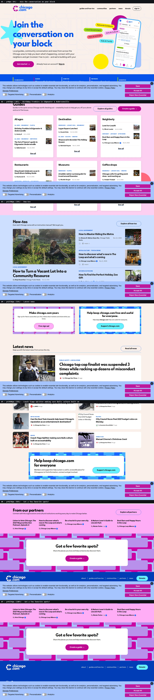
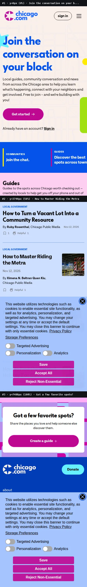

# UI Design System & Master Generation Blueprint: chicago-com

> **chicago.com** (https://chicago.com/) — Local guides, community conversation, and news from every Chicago newsroom, gathered in one place.





---

## 1. Executive Visual Persona & Design Archetype

- **Brand Essence & Persona**: **chicago.com** (`https://chicago.com/`). Local guides, community conversation, and news from every Chicago newsroom, gathered in one place.
- **Capture Provenance**: Live browser capture (`tier1_fast`, HTTP `200`, captured `2026-11-24`).
- **Visual Archetype**: **Light-Substrate Editorial & Modular Grid System (`#faf0eb` canvas, `#080808` ink, `#0000ff` accent)**.
- **Anti-AI-Slop Differentiators**:
  - **Live-Computed Chromatic Polarity**: Anchors the viewport in `#faf0eb` (live computed `section` `background-color` (`computed_styles.json`)) paired with `#080808` primary typography and `#0000ff` accents.
  - **Grounded Typographic Hierarchy**: Pairs `Tempo` for display copy (`Join the conversation on your block`) with `Tenon`.
  - **Calibrated Spatial Grid & Motion**: Combines `96rem` container bounds (`gap: var(--cdc--spacing--12)`, padding `8px`) with `cubic-bezier(.4,0,1,1)` easing.

---

## 2. Spatial Architecture & Modular Grid Mathematics

### Viewport Allocation & Container Geometry
- **Captured Journey Filmstrips**: Desktop `1280×5796px` (`assets/desktop-journey.webp`, `7` keyframes up to `y=4354px` / doc `5254px`), Mobile `390×2616px` (`assets/mobile-journey.webp`, `3` keyframes).
- **Master Container Bounds**: `96rem` (non-`@media` desktop container stylesheet rule).
- **Canvas Lateral Padding & Spacing**: `8px` lateral canvas padding with `var(--cdc--spacing--12)` grid gap.
- **Border Radius Scale**: `var(--cdc--radius--8)`, `50%`, `6.25rem`, `100%`.

### Responsive Breakpoint Architecture
- **Desktop Layout**: Multi-column CSS Grid / Flexbox layout at `1440px` (`max-width: 96rem`, `gap: var(--cdc--spacing--12)`).
- **Mobile Layout**: Single-column vertical stack at `390px` viewport width with `8px` horizontal padding.
- **Extracted CSS Media Queries**: `@media (min-width:48rem)`, `@media (min-width:64rem)`, `@media (max-width:47.9375rem)`, `@media (prefers-reduced-motion:no-preference)`.

---

## 3. Color System, Materiality & Atmospheric Lighting

### Semantic Palette & Source Grounding
| Semantic Role | Ground-Truth Value | Extracted Live / CSS Source |
|---|---|---|
| **Primary Canvas Substrate** | `#faf0eb` | live computed `section` `background-color` (`computed_styles.json`) |
| **Primary Typography Ink** | `#080808` | live computed `main` `color` (`computed_styles.json`) |
| **Elevated Surface / Card Substrate** | `#a5c4ff` | `var(--osano-dialog-background-color)` in `:root` |
| **Interactive Accent / Highlight** | `#0000ff` | `nButton-module-scss-module__mqy... { background-color: blue }` (`#0000ff`) |
| **Secondary / Muted Copy** | `#058a5e` | `var(--osano-gpc-foreground-color)` in `:root` |
| **Structural Hairline Border** | `#058a5e` | `var(--osano-gpc-border-color)` in `:root` |
| **Variable Token (`--osano-button-border-color`)** | `#be189e` | `var(--osano-button-border-color)` in `:root` |
| **Variable Token (`--osano-button-foreground-color`)** | `#ffffff` | `var(--osano-button-foreground-color)` in `:root` |
| **Variable Token (`--osano-dialog-foreground-color`)** | `#000000` | `var(--osano-dialog-foreground-color)` in `:root` |
| **Variable Token (`--osano-toggle-off-track-color`)** | `#a8a7a7` | `var(--osano-toggle-off-track-color)` in `:root` |

### Sanitized Root CSS Variables (`ui-ux.md` Ground Truth)
| Variable Name | Extracted Value | Semantic Role |
|---|---|---|
| `--osano-clear-dialog-background` | `rgba(0,0,0,0)` | Canvas / Surface Token |
| `--osano-theme` | `classic` | Brand / Palette Token |
| `--osano-button-border-color` | `#be189e` | Brand / Palette Token |
| `--osano-dialog-type` | `bar` | Typography / Scale Token |
| `--osano-display-position` | `bottom` | Design System Custom Token |
| `--osano-info-dialog-position` | `right` | Design System Custom Token |
| `--osano-widget-position` | `right` | Design System Custom Token |
| `--osano-opt-out-widget-position` | `left` | Design System Custom Token |
| `--osano-button-background-color` | `#be189e` | Canvas / Surface Token |
| `--osano-button-foreground-color` | `#ffffff` | Typography Ink Token |
| `--osano-dialog-background-color` | `#a5c4ff` | Canvas / Surface Token |
| `--osano-dialog-foreground-color` | `#000000` | Typography Ink Token |
| `--osano-info-dialog-overlay-color` | `rgba(0,0,0,0.45)` | Brand / Palette Token |
| `--osano-link-color` | `#000000` | Typography Ink Token |
| `--osano-toggle-off-track-color` | `#a8a7a7` | Brand / Palette Token |
| `--osano-toggle-off-thumb-color` | `#FFFFFF` | Brand / Palette Token |

---

## 4. Typographic Scale & Editorial Hierarchy

### Font Family Stacks
- **Display Typography**: `Tempo`.
- **Primary Body Stack**: `Tenon`.
- **Technical / Metadata Stack**: not declared in live computed styles (uses primary stack / `ui-monospace`).

### Typographic Scale & Rules (Live Computed & Stylesheet Grounded)
- **Hero Display (`H1`)**: live computed `h1` (`font-size: 80px`, `line-height: 88px`, `font-weight: 700`, `letter-spacing: -1.6px`); CSS variables `--osano-display-position: bottom`.
- **Section Heading (`H2`)**: live computed `h2` (`font-size: 36px`, `line-height: 42.012px`, `font-weight: 700`, `letter-spacing: -0.72px`).
- **Body Copy**: live computed `body` (`font-size: 16px`, `line-height: 24px`, `font-weight: 400`); CSS variables `--loginForm--state-body--font-size: var(--cdc--font-size--14)`, `--guide-body-gutter: 0px`, `--guide-body-pull: 0px`; rule `p` (`font-size: 16px`, `line-height: 22px`, `font-weight: 400`).
- **Metadata & Navigation Labels**: live computed `nav/a` (`font-size: 16px`, `line-height: 24px`, `font-weight: 400`); CSS variables `--font-mono: var(--font-dm-mono), ui-monospace, monospace`, `--text-xs: .75rem`, `--text-xs--line-height: calc(1 / .75)`.

---

## 5. Choreographed Motion & Interaction Physics

### Primary Easing Curves
- **Extracted Timing Functions**: `cubic-bezier(.4,0,1,1)`, `cubic-bezier(0,0,.2,1)`, `cubic-bezier(.4,0,.2,1)`.

### Per-Element Transition & Choreography Rules
- **Selector `edia (prefers-reduced-motion:no-p...`**: `transition: background-color .2s ease-in-out,color .2s ease-in-out` extracted from `chicago-com` stylesheet.
- **Selector `layer theme`**: `transition: .15s` extracted from `chicago-com` stylesheet.
- **Selector `.transition`**: `transition: var(--tw-ease,var(--default-transition-timing-function))` extracted from `chicago-com` stylesheet.
- **Extracted Easing Curve (`cubic-bezier(.4,0,1,1)`)**: Governs interactive state transitions across `<header.screen-reader-text>` and `<section.left-5>`.
- **State & Hover Choreography**: Opacity and transform transitions on `<section.fixed>` and `<section.left-5>` interactive targets.
### Measured Runtime Scroll & Interaction Telemetry (`behavioral_journey_v2`)
- **Scroll Driver Mode**: `native` (max document height `5254px`, deepest scrollY reached `4354px` across `7` desktop keyframes).
- **Detected Scroll / Motion Libraries**: Native browser scroll / standard CSS transitions.
- **Hover Physics (`primary_cta` · `Get started`)**: `color`: `rgb(255, 255, 255)` -> `rgb(8, 8, 8)`; `backgroundColor`: `rgb(190, 8, 145)` -> `rgb(255, 173, 247)` (`transition-duration: 0.2s, 0.2s`, `timing: ease-in-out, ease-in-out`).
- **Hover Physics (`first_card` · `COMMUNITIES Join the chat.`)**: Computed transition `0.5s, 0.5s, 0.2s` / `cubic-bezier(0.22, 1, 0.36, 1), cubic-bezier(0.22, 1, 0.36, 1), ease` (no static color/transform shift captured at rest).
- **Route Transition Architecture**: First internal navigation (`/news`) measured as `SPA` in `1997ms`.

---

## 6. Component Wireframe & Structural DOM Map

### Visual Layout Schematic — Desktop (`1440px`, Grounded in `dom.html` & Landmark Bounding Boxes)
```
┌────────────────────────────────────────────────────────────────────────┐
│ DESKTOP VIEWPORT (1440px) — chicago.com                                │
│ ====================================================================== │
│ [ <header.screen-reader- (1440x95px)  | Guides and how-tos · Communi ] │
│ ---------------------------------------------------------------------- │
│ | HERO STAGE: <section.fixed> (w=1440px)                             | │
│ | H1: Join the conversation on your block                            | │
│ | Substrate: #faf0eb | Ink: #080808 | Accent: #0000ff                | │
│ ---------------------------------------------------------------------- │
│ | SHOWCASE GRID (<section.left-5>) max-w: 96rem                      | │
│ | +------------------------------+  +------------------------------+ | │
│ | | Birthday Freebies in Edgewat |  | The Out of Towner's guide to | | │
│ | +------------------------------+  +------------------------------+ | │
│ ---------------------------------------------------------------------- │
│ | DETAIL MODULE (<article.z-50>) — Logan Square Lunches!             | │
│ ---------------------------------------------------------------------- │
│ [ FOOTER (<footer.flex>       ) | https://chicago.com/                 │
└────────────────────────────────────────────────────────────────────────┘
```

### Visual Layout Schematic — Mobile Reflow (`390px`)
```
┌────────────────────────────────────────────────────────────────────────┐
│ MOBILE VIEWPORT REFLOW (390px) — Single-Column Stack (gap: var(--cd)   │
│ ====================================================================== │
│ [ HEADER BAR (<header.screen-reader-te) | Compact Menu (390px)         │
│ ---------------------------------------------------------------------- │
│ | HERO STAGE (<section.fixed>) — 390px Vertical Lead                 | │
│ | H1: Join the conversation on your block                            | │
│ ---------------------------------------------------------------------- │
│ | SHOWCASE STACK (<section.left-5>) — 1-Col Stack                    | │
│ | [ Item 1: Birthday Freebies in Edgewater & Andersonville         ] | │
│ | [ Item 2: The Out of Towner's guide to Edgewater/Andersonville   ] | │
│ ---------------------------------------------------------------------- │
│ | DETAIL STACK (<article.z-50>) — 1-Col (Logan Square Lunch)         | │
│ ---------------------------------------------------------------------- │
│ [ FOOTER (<footer.flex>       ) | Stacked 390px Colophon               │
└────────────────────────────────────────────────────────────────────────┘
```

### Granular DOM Region Breakdown
1. **Brand Header & Navigation Bar (<header.screen-reader-text> — `chicago-com`)**:
   - Landmark `<header class="screen-reader-text">` (`1440x95px`) hosting `chicago.com` navigation (`Guides and how-tos · Communities · Partners · News · Donate`), DOM attributes (`data-headlessui-focus-visible`, `data-precedence="next"`, `data-precedence="next"`, `data-precedence="next"`), and stylesheet rule `h-module-scss-module__kr7T1a__hom... { padding-block:var(--cdc--spacing--32) }`.
2. **Hero Stage & Focal Lead (<section.fixed> — `Join the conversation on your bloc`)**:
   - Landmark `<section class="fixed">` presenting display lead `Join the conversation on your block` and copy excerpt *"Local guides, community conversation and news from across the Chi"* over `#faf0eb` canvas and `#080808` ink.
3. **Primary Showcase & Content Grid (<section.left-5> — `Birthday Freebies in Edgewater & A`)**:
   - Landmark `<section class="left-5">` rendering section `Birthday Freebies in Edgewater & Andersonville` with copy *"Communities Join the chat."*, asset references (`1k8qyjc-fu7el.css`, `18fnj9qumctti.css`, `1u4ghj5w6l3co.css`, `2u54wdv5bbzks.css`), and grid rule `erch-module-scss-module__kr7T1a__... { margin-block-end:0;padding-block-end:var(--cdc--spacing--8) }`.
4. **Interactive Detail & Feature Matrix (<article.z-50> — `The Out of Towner's guide to Edgew`)**:
   - Landmark `<article class="z-50">` framing `The Out of Towner's guide to Edgewater/Andersonville` and `Logan Square Lunches!` (*"Guides Discover the best spots across town."*) with `#a5c4ff` surface cards, `#0000ff` accents, and `rch-module-scss-module__kr7T1a__c... { gap:var(--cdc--spacing--32);display:grid }`.
5. **Colophon & Global Directory Footer (<footer.flex> — `https://chicago.com/`)**:
   - Landmark `<footer class="flex">` anchoring `chicago.com` footer links (`Guides and how-tos · Communities · Partners · News · Donate`), copy *"Discover the best spots across town."*, and `#058a5e` structural dividers.
### Full Vertical Scroll Sequence (Desktop `1440×900` Keyframes)
- **Step 01** (`y=0px`, `0%`): Active landmark `Join the conversation on your block` · sticky/fixed elements: `2`
- **Step 02** (`y=850px`, `20%`): Active landmark `Birthday Freebies in Edgewater & Andersonville` · sticky/fixed elements: `2`
- **Step 03** (`y=1700px`, `39%`): Active landmark `How-tos` · sticky/fixed elements: `2`
- **Step 04** (`y=2550px`, `59%`): Active landmark `Latest news` · sticky/fixed elements: `2`
- **Step 05** (`y=3400px`, `78%`): Active landmark `Coach Tiago Splitter making sure Bulls culture bu...` · sticky/fixed elements: `2`
- **Step 06** (`y=4250px`, `98%`): Active landmark `Got a few favorite spots?` · sticky/fixed elements: `2`
- **Step 07** (`y=4354px`, `100%`): Active landmark `Got a few favorite spots?` · sticky/fixed elements: `2`

### Multi-Page Internal Route Map
- **Listing Route (`/news`)**: `https://chicago.com/news` — H1: `News — chicago.com`, scrollHeight `2233px`, transition `SPA` (`1997ms`)
- **Detail Route (`/guides/search`)**: `https://chicago.com/guides/search` — H1: `Search Guides — chicago.com`, scrollHeight `5451px`, transition `direct` (`2075ms`)
- **About Route (`/about`)**: `https://chicago.com/about` — H1: `About — chicago.com`, scrollHeight `3562px`, transition `direct` (`733ms`)

---

## 7. Master Zero-Shot AI Generation Prompt

```markdown
# Master Zero-Shot Frontend Generation Prompt: chicago-com (chicago.com)

You are a principal frontend architect and design systems engineer. Build a complete, production-ready web application replicating the exact design system, DOM landmarks, typographic hierarchy, color tokens, and motion physics of `chicago-com` (**chicago.com** — `https://chicago.com/`).

### 1. Visual Archetype & Anti-AI-Slop Mandates
- **Archetype**: Light-Substrate Editorial & Modular Grid System (`#faf0eb` canvas, `#080808` ink, `#0000ff` accent).
- **Identity & Domain Context**: Local guides, community conversation, and news from every Chicago newsroom, gathered in one place.
- **Primary Substrate**: `#faf0eb` (live computed `section` `background-color` (`computed_styles.json`)), **Primary Ink**: `#080808`, **Accent / Highlight**: `#0000ff`.
- **Site-Specific Differentiators**:
  - **Live-Computed Chromatic Polarity**: Anchors the viewport in `#faf0eb` (live computed `section` `background-color` (`computed_styles.json`)) paired with `#080808` primary typography and `#0000ff` accents.
  - **Grounded Typographic Hierarchy**: Pairs `Tempo` for display copy (`Join the conversation on your block`) with `Tenon`.
  - **Calibrated Spatial Grid & Motion**: Combines `96rem` container bounds (`gap: var(--cdc--spacing--12)`, padding `8px`) with `cubic-bezier(.4,0,1,1)` easing.

### 2. Ground-Truth CSS Variables (`:root` Token Contract)
Declare and consume these exact custom properties extracted from `chicago-com` in your global stylesheet:

:root {
  /* chicago.com (chicago-com) — Live-Grounded CSS Variables */
  --osano-clear-dialog-background: rgba(0,0,0,0); /* Canvas / Surface Token (chicago-com) */
  --osano-theme: classic; /* Brand / Palette Token (chicago-com) */
  --osano-button-border-color: #be189e; /* Brand / Palette Token (chicago-com) */
  --osano-dialog-type: bar; /* Typography / Scale Token (chicago-com) */
  --osano-display-position: bottom; /* Design System Custom Token (chicago-com) */
  --osano-info-dialog-position: right; /* Design System Custom Token (chicago-com) */
  --osano-widget-position: right; /* Design System Custom Token (chicago-com) */
  --osano-opt-out-widget-position: left; /* Design System Custom Token (chicago-com) */
  --osano-button-background-color: #be189e; /* Canvas / Surface Token (chicago-com) */
  --osano-button-foreground-color: #ffffff; /* Typography Ink Token (chicago-com) */
  --osano-dialog-background-color: #a5c4ff; /* Canvas / Surface Token (chicago-com) */
  --osano-dialog-foreground-color: #000000; /* Typography Ink Token (chicago-com) */
  --osano-info-dialog-overlay-color: rgba(0,0,0,0.45); /* Brand / Palette Token (chicago-com) */
  --osano-link-color: #000000; /* Typography Ink Token (chicago-com) */
  --osano-toggle-off-track-color: #a8a7a7; /* Brand / Palette Token (chicago-com) */
  --osano-toggle-off-thumb-color: #FFFFFF; /* Brand / Palette Token (chicago-com) */
}

### 3. Semantic Color & Materiality Contract
Map every surface, ink, and border strictly to these source-grounded tokens:
- **Primary Canvas Substrate**: `#faf0eb` — grounded in live computed `section` `background-color` (`computed_styles.json`)
- **Primary Typography Ink**: `#080808` — grounded in live computed `main` `color` (`computed_styles.json`)
- **Elevated Surface / Card Substrate**: `#a5c4ff` — grounded in `var(--osano-dialog-background-color)` in `:root`
- **Interactive Accent / Highlight**: `#0000ff` — grounded in `nButton-module-scss-module__mqy... { background-color: blue }` (`#0000ff`)
- **Secondary / Muted Copy**: `#058a5e` — grounded in `var(--osano-gpc-foreground-color)` in `:root`
- **Structural Hairline Border**: `#058a5e` — grounded in `var(--osano-gpc-border-color)` in `:root`
- **Variable Token (`--osano-button-border-color`)**: `#be189e` — grounded in `var(--osano-button-border-color)` in `:root`
- **Variable Token (`--osano-button-foreground-color`)**: `#ffffff` — grounded in `var(--osano-button-foreground-color)` in `:root`
- **Variable Token (`--osano-dialog-foreground-color`)**: `#000000` — grounded in `var(--osano-dialog-foreground-color)` in `:root`
- **Variable Token (`--osano-toggle-off-track-color`)**: `#a8a7a7` — grounded in `var(--osano-toggle-off-track-color)` in `:root`

### 4. Spatial Grid, Container Bounds & Responsive Breakpoints
- **Desktop Viewport Reference**: `1280×5796px` (multi-frame vertical journey filmstrip (5796px), `1440px` standard desktop width).
- **Mobile Viewport Reference**: `390×2616px` (multi-frame vertical journey filmstrip (2616px), `390px` standard mobile width).
- **Container Max-Width**: `96rem` (non-`@media` desktop container stylesheet rule)
- **Padding & Gutters**: `8px` lateral canvas padding with `var(--cdc--spacing--12)` grid gap
- **Desktop Grid**: Multi-column CSS Grid / Flexbox layout at `1440px` (`max-width: 96rem`, `gap: var(--cdc--spacing--12)`)
- **Mobile Adaptation**: Single-column vertical stack at `390px` viewport width with `8px` horizontal padding
- **Media Queries**: `@media (min-width:48rem)`, `@media (min-width:64rem)`, `@media (max-width:47.9375rem)`, `@media (prefers-reduced-motion:no-preference)`
- **Corner Radii**: `var(--cdc--radius--8)`, `50%`, `6.25rem`, `100%`

### 5. Typography & Editorial Scale Contract
- **Display Font Stack**: `Tempo`
- **Body Font Stack**: `Tenon`
- **Monospace / Technical Font Stack**: not declared in live computed styles (uses primary stack / `ui-monospace`)
- **H1 Display Rule**: live computed `h1` (`font-size: 80px`, `line-height: 88px`, `font-weight: 700`, `letter-spacing: -1.6px`); CSS variables `--osano-display-position: bottom`
- **H2 Section Rule**: live computed `h2` (`font-size: 36px`, `line-height: 42.012px`, `font-weight: 700`, `letter-spacing: -0.72px`)
- **Body Copy Rule**: live computed `body` (`font-size: 16px`, `line-height: 24px`, `font-weight: 400`); CSS variables `--loginForm--state-body--font-size: var(--cdc--font-size--14)`, `--guide-body-gutter: 0px`, `--guide-body-pull: 0px`; rule `p` (`font-size: 16px`, `line-height: 22px`, `font-weight: 400`)
- **Metadata & Index Rule**: live computed `nav/a` (`font-size: 16px`, `line-height: 24px`, `font-weight: 400`); CSS variables `--font-mono: var(--font-dm-mono), ui-monospace, monospace`, `--text-xs: .75rem`, `--text-xs--line-height: calc(1 / .75)`

### 6. Component Hierarchy, Verbatim Copy & Real DOM Landmarks
Scaffold `chicago-com` (`chicago.com`) with these exact structural regions, extracted copy, and CSS rules from `dom.html`:
1. **Brand Header & Navigation Bar (<header.screen-reader-text> — `chicago-com`)**:
   - DOM & Selectors: Landmark `<header class="screen-reader-text">` (`1440x95px`) hosting `chicago.com` navigation (`Guides and how-tos · Communities · Partners · News · Donate`), DOM attributes (`data-headlessui-focus-visible`, `data-precedence="next"`, `data-precedence="next"`, `data-precedence="next"`), and stylesheet rule `h-module-scss-module__kr7T1a__hom... { padding-block:var(--cdc--spacing--32) }`.
   - Responsive Contract: Header `Brand Header & Navigation Bar (<header.screen-reader-text> — `chicago-com`)` (`chicago-com`) adapts across `@media (min-width:48rem)`, `@media (min-width:64rem)`, `@media (max-width:47.9375rem)`, `@media (prefers-reduced-motion:no-preference)` with `cubic-bezier(.4,0,1,1)`, `cubic-bezier(0,0,.2,1)`, `cubic-bezier(.4,0,.2,1)` transitions and links `Guides and how-tos · Communities · Partners · News · Donate`.
2. **Hero Stage & Focal Lead (<section.fixed> — `Join the conversation on your bloc`)**:
   - DOM & Selectors: Landmark `<section class="fixed">` presenting display lead `Join the conversation on your block` and copy excerpt *"Local guides, community conversation and news from across the Chi"* over `#faf0eb` canvas and `#080808` ink.
   - Responsive Contract: Hero stage (`1280×5796px` desktop / `390×2616px` mobile) sets `#faf0eb` background with `#080808` headline `Join the conversation on your block`.
3. **Primary Showcase & Content Grid (<section.left-5> — `Birthday Freebies in Edgewater & A`)**:
   - DOM & Selectors: Landmark `<section class="left-5">` rendering section `Birthday Freebies in Edgewater & Andersonville` with copy *"Communities Join the chat."*, asset references (`1k8qyjc-fu7el.css`, `18fnj9qumctti.css`, `1u4ghj5w6l3co.css`, `2u54wdv5bbzks.css`), and grid rule `erch-module-scss-module__kr7T1a__... { margin-block-end:0;padding-block-end:var(--cdc--spacing--8) }`.
   - Responsive Contract: Showcase grid `Primary Showcase & Content Grid (<section.left-5> — `Birthday Freebies in Edgewater & A`)` applies Multi-column CSS Grid / Flexbox layout at `1440px` (`max-width: 96rem`, `gap: var(--cdc--spacing--12)`) on desktop and Single-column vertical stack at `390px` viewport width with `8px` horizontal padding on mobile.
4. **Interactive Detail & Feature Matrix (<article.z-50> — `The Out of Towner's guide to Edgew`)**:
   - DOM & Selectors: Landmark `<article class="z-50">` framing `The Out of Towner's guide to Edgewater/Andersonville` and `Logan Square Lunches!` (*"Guides Discover the best spots across town."*) with `#a5c4ff` surface cards, `#0000ff` accents, and `rch-module-scss-module__kr7T1a__c... { gap:var(--cdc--spacing--32);display:grid }`.
   - Responsive Contract: Detail module `Interactive Detail & Feature Matrix (<article.z-50> — `The Out of Towner's guide to Edgew`)` uses `var(--cdc--radius--8)`, `50%`, `6.25rem`, `100%` radii, `#0000ff` highlights, and assets (1k8qyjc-fu7el.css, 18fnj9qumctti.css, 1u4ghj5w6l3co.css).
5. **Colophon & Global Directory Footer (<footer.flex> — `https://chicago.com/`)**:
   - DOM & Selectors: Landmark `<footer class="flex">` anchoring `chicago.com` footer links (`Guides and how-tos · Communities · Partners · News · Donate`), copy *"Discover the best spots across town."*, and `#058a5e` structural dividers.
   - Responsive Contract: Footer `Colophon & Global Directory Footer (<footer.flex> — `https://chicago.com/`)` aligns to `96rem` (non-`@media` desktop container stylesheet rule) with `8px` lateral canvas padding with `var(--cdc--spacing--12)` grid gap and attributes (data-headlessui-focus-visible, data-precedence="next", data-precedence="next").

#### Verbatim DOM Copy Excerpts (`dom.html`)
- Copy Excerpt 1: *"Local guides, community conversation and news from across the Chicago area to help..."*
- Copy Excerpt 2: *"Communities Join the chat."*
- Copy Excerpt 3: *"Guides Discover the best spots across town."*
- Copy Excerpt 4: *"Discover the best spots across town."*

### 7. Motion, Extracted Stylesheet Rules & Interaction Choreography
- **Primary Easing Functions**: `cubic-bezier(.4,0,1,1)`, `cubic-bezier(0,0,.2,1)`, `cubic-bezier(.4,0,.2,1)`
- **Extracted Stylesheet Rules (`chicago-com`)**:
- `h-module-scss-module__kr7T1a__hom... { padding-block:var(--cdc--spacing--32) }`
- `erch-module-scss-module__kr7T1a__... { margin-block-end:0;padding-block-end:var(--cdc--spacing--8) }`
- `rch-module-scss-module__kr7T1a__c... { gap:var(--cdc--spacing--32);display:grid }`
- `rch-module-scss-module__kr7T1a__f... { grid-template-columns:minmax(0,3fr) minmax(0,4fr) }`
- `Merch-module-scss-module__kr7T1a_... { aspect-ratio:4/5;position:relative }`
- **Per-Selector Transition Rules**:
- **Selector `edia (prefers-reduced-motion:no-p...`**: `transition: background-color .2s ease-in-out,color .2s ease-in-out` extracted from `chicago-com` stylesheet.
- **Selector `layer theme`**: `transition: .15s` extracted from `chicago-com` stylesheet.
- **Selector `.transition`**: `transition: var(--tw-ease,var(--default-transition-timing-function))` extracted from `chicago-com` stylesheet.
- **Extracted Easing Curve (`cubic-bezier(.4,0,1,1)`)**: Governs interactive state transitions across `<header.screen-reader-text>` and `<section.left-5>`.
- **State & Hover Choreography**: Opacity and transform transitions on `<section.fixed>` and `<section.left-5>` interactive targets.
### 7b. Full-Page Scroll Choreography, Interactive States & Multi-Page Routes
- **Scroll Mechanics**: Implement `native` vertical progression up to `5254px` across 7 distinct viewport chapters.
- **Vertical Chapter Sequence**: Join the conversation on yo... (0%) -> Birthday Freebies in Edgewa... (20%) -> How-tos (39%) -> Latest news (59%) -> Coach Tiago Splitter making... (78%) -> Got a few favorite spots? (98%) -> Got a few favorite spots? (100%).
- **Hover Micro-Interaction (`primary_cta`)**: Animate `color, backgroundColor` with `0.2s, 0.2s ease-in-out, ease-in-out`.
- **Multi-Page Routes**: Scaffold internal routes `/news` (listing, SPA), `/guides/search` (detail, direct), `/about` (about, direct) sharing the global header/footer shell and design tokens.

### 8. Technical Deliverables
- Implement in Next.js (App Router) with TypeScript and Tailwind CSS consuming the `:root` custom properties defined above for `chicago-com`.
- Reproduce both the `1440px` desktop architecture and `390px` mobile breakpoint transitions, preserving semantic HTML5 landmarks (`<header>`, `<nav>`, `<main>`, `<section>`, `<footer>`) and `prefers-reduced-motion` accessibility guards.
```
---

## 8. Full-Page Scroll Journey, Interactive States & Subpage Inventory

### Desktop Scroll Keyframes (`1440×900` WebP)
| Step | Scroll Y | Progress | Active Landmark / Section | Sticky/Fixed | Visual Asset |
| :---: | :---: | :---: | :--- | :---: | :--- |
| `#01` | `0px` | `0%` | Join the conversation on your block | `2` | [desktop-step-01.webp](assets/desktop-step-01.webp) |
| `#02` | `850px` | `20%` | Birthday Freebies in Edgewater & Andersonville | `2` | [desktop-step-02.webp](assets/desktop-step-02.webp) |
| `#03` | `1700px` | `39%` | How-tos | `2` | [desktop-step-03.webp](assets/desktop-step-03.webp) |
| `#04` | `2550px` | `59%` | Latest news | `2` | [desktop-step-04.webp](assets/desktop-step-04.webp) |
| `#05` | `3400px` | `78%` | Coach Tiago Splitter making sure Bulls cultur... | `2` | [desktop-step-05.webp](assets/desktop-step-05.webp) |
| `#06` | `4250px` | `98%` | Got a few favorite spots? | `2` | [desktop-step-06.webp](assets/desktop-step-06.webp) |
| `#07` | `4354px` | `100%` | Got a few favorite spots? | `2` | [desktop-step-07.webp](assets/desktop-step-07.webp) |

### Mobile Condensed Keyframes (`390×844` WebP)
| Step | Scroll Y | Progress | Active Landmark | Visual Asset |
| :---: | :---: | :---: | :--- | :--- |
| `#01` | `0px` | `0%` | Join the conversation on your block | [mobile-step-01.webp](assets/mobile-step-01.webp) |
| `#02` | `3744px` | `50%` | How to Master Riding the Metra | [mobile-step-02.webp](assets/mobile-step-02.webp) |
| `#03` | `7488px` | `100%` | Got a few favorite spots? | [mobile-step-03.webp](assets/mobile-step-03.webp) |

### Internal Subpage Filmstrips (`1080px` Wide WebP)
| # | Template | Route URL | H1 / Title | Scroll Height | Transition | Filmstrip Asset |
| :-: | :---: | :--- | :--- | :---: | :---: | :--- |
| `1` | `listing` | `https://chicago.com/news` | News — chicago.com | `2233px` | `SPA` (`1997ms`) | [subpage-01-news.webp](assets/subpage-01-news.webp) |
| `2` | `detail` | `https://chicago.com/guides/search` | Search Guides — chicago.com | `5451px` | `direct` (`2075ms`) | [subpage-02-guides-search.webp](assets/subpage-02-guides-search.webp) |
| `3` | `about` | `https://chicago.com/about` | About — chicago.com | `3562px` | `direct` (`733ms`) | [subpage-03-about.webp](assets/subpage-03-about.webp) |

