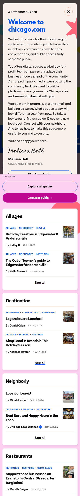

# UI Design System & Master Generation Blueprint: chicago-com

> **chicago.com** (https://chicago.com/) — Local guides, community conversation, and news from every Chicago newsroom, gathered in one place.


---

## 1. Executive Visual Persona & Design Archetype

- **Brand Essence & Persona**: **chicago.com** (`https://chicago.com/`). Local guides, community conversation, and news from every Chicago newsroom, gathered in one place.
- **Capture Provenance**: Live browser capture (`tier1_fast`, HTTP `200`, captured `2026-11-23`).
- **Visual Archetype**: **Light-Substrate Editorial & Modular Grid System (`#faf0eb` canvas, `#080808` ink, `#0000ff` accent)**.
- **Anti-AI-Slop Differentiators**:
  - **Live-Computed Chromatic Polarity**: Anchors the viewport in `#faf0eb` (live computed `section` `background-color` (`computed_styles.json`)) paired with `#080808` primary typography and `#0000ff` accents.
  - **Grounded Typographic Hierarchy**: Pairs `Tempo` for display copy (`Join the conversation on your block`) with `Tenon` and not declared in live computed styles (uses primary stack / `ui-monospace`).
  - **Calibrated Spatial Grid & Motion**: Combines `96rem` container bounds (`gap: var(--spacing)`, padding `8px`) with `cubic-bezier(.4,0,1,1)` easing.

---

## 2. Spatial Architecture & Modular Grid Mathematics



### Viewport Allocation & Container Geometry
- **Captured Viewport Dimensions**: Desktop `1440×2400px` (`assets/desktop.png`, clamped at 2400px live multi-section capture), Mobile `390×2400px` (`assets/mobile.png`, clamped at 2400px live multi-section capture).
- **Master Container Bounds**: `96rem` (non-`@media` desktop container stylesheet rule).
- **Canvas Lateral Padding & Spacing**: `8px` lateral canvas padding with `var(--spacing)` grid gap.
- **Border Radius Scale**: `100%`, `.25rem`, `6px`, `var(--radius-lg)`.

### Responsive Breakpoint Architecture
- **Desktop Layout**: Multi-column CSS Grid / Flexbox layout at `1440px` (`max-width: 96rem`, `gap: var(--spacing)`).
- **Mobile Layout**: Single-column vertical stack at `390px` viewport width with `8px` horizontal padding.
- **Extracted CSS Media Queries**: `@media (min-width:40rem)`, `@media (min-width:48rem)`, `@media (min-width:64rem)`, `@media (min-width:80rem)`.

---

## 3. Color System, Materiality & Atmospheric Lighting

### Semantic Palette & Source Grounding
| Semantic Role | Ground-Truth Value | Extracted Live / CSS Source |
|---|---|---|
| **Primary Canvas Substrate** | `#faf0eb` | live computed `section` `background-color` (`computed_styles.json`) |
| **Primary Typography Ink** | `#080808` | live computed `main` `color` (`computed_styles.json`) |
| **Elevated Surface / Card Substrate** | `#a5c4ff` | `var(--osano-dialog-background-color)` in `:root` |
| **Interactive Accent / Highlight** | `#0000ff` | `ners-module-scss-module__FoXfja... { color: blue }` (`#0000ff`) |
| **Secondary / Muted Copy** | `#058a5e` | `var(--osano-gpc-foreground-color)` in `:root` |
| **Structural Hairline Border** | `#058a5e` | `var(--osano-gpc-border-color)` in `:root` |
| **Variable Token (`--osano-button-border-color`)** | `#be189e` | `var(--osano-button-border-color)` in `:root` |
| **Variable Token (`--osano-button-foreground-color`)** | `#ffffff` | `var(--osano-button-foreground-color)` in `:root` |
| **Variable Token (`--osano-dialog-foreground-color`)** | `#000000` | `var(--osano-dialog-foreground-color)` in `:root` |
| **Variable Token (`--osano-toggle-off-track-color`)** | `#a8a7a7` | `var(--osano-toggle-off-track-color)` in `:root` |

### Sanitized Root CSS Variables (`ui-ux.md` Ground Truth)
| Variable Name | Extracted Value | Semantic Role |
|---|---|---|
| `--osano-clear-dialog-background` | `rgba(0,0,0,0)` | Canvas / Surface Token |
| `--osano-theme` | `classic` | Brand / Palette Token |
| `--osano-button-border-color` | `#be189e` | Brand / Palette Token |
| `--osano-dialog-type` | `bar` | Typography / Scale Token |
| `--osano-display-position` | `bottom` | Design System Custom Token |
| `--osano-info-dialog-position` | `right` | Design System Custom Token |
| `--osano-widget-position` | `right` | Design System Custom Token |
| `--osano-opt-out-widget-position` | `left` | Design System Custom Token |
| `--osano-button-background-color` | `#be189e` | Canvas / Surface Token |
| `--osano-button-foreground-color` | `#ffffff` | Typography Ink Token |
| `--osano-dialog-background-color` | `#a5c4ff` | Canvas / Surface Token |
| `--osano-dialog-foreground-color` | `#000000` | Typography Ink Token |
| `--osano-info-dialog-overlay-color` | `rgba(0,0,0,0.45)` | Brand / Palette Token |
| `--osano-link-color` | `#000000` | Typography Ink Token |
| `--osano-toggle-off-track-color` | `#a8a7a7` | Brand / Palette Token |
| `--osano-toggle-off-thumb-color` | `#FFFFFF` | Brand / Palette Token |

---

## 4. Typographic Scale & Editorial Hierarchy

### Font Family Stacks
- **Display Typography**: `Tempo`.
- **Primary Body Stack**: `Tenon`.
- **Technical / Metadata Stack**: not declared in live computed styles (uses primary stack / `ui-monospace`).

### Typographic Scale & Rules (Live Computed & Stylesheet Grounded)
- **Hero Display (`H1`)**: live computed `h1` (`font-size: 80px`, `line-height: 88px`, `font-weight: 700`, `letter-spacing: -1.6px`); CSS variables `--osano-display-position: bottom`.
- **Section Heading (`H2`)**: live computed `h3 (primary section heading)` (`font-size: 24px`, `line-height: 28.008px`, `font-weight: 700`, `letter-spacing: -0.48px`).
- **Body Copy**: live computed `body` (`font-size: 16px`, `line-height: 24px`, `font-weight: 400`); CSS variables `--loginForm--state-body--font-size: var(--cdc--font-size--14)`, `--guide-body-gutter: 0px`, `--guide-body-pull: 0px`; rule `p` (`font-size: 16px`, `line-height: 22px`, `font-weight: 400`).
- **Metadata & Navigation Labels**: live computed `nav/a` (`font-size: 16px`, `line-height: 24px`, `font-weight: 400`); CSS variables `--font-mono: var(--font-dm-mono), ui-monospace, monospace`, `--text-xs: .75rem`, `--text-xs--line-height: calc(1 / .75)`.

---

## 5. Choreographed Motion & Interaction Physics

### Primary Easing Curves
- **Extracted Timing Functions**: `cubic-bezier(.4,0,1,1)`, `cubic-bezier(0,0,.2,1)`, `cubic-bezier(.4,0,.2,1)`.

### Per-Element Transition & Choreography Rules
- **Selector `layer theme`**: `transition: .15s` extracted from `chicago-com` stylesheet.
- **Selector `.transition`**: `transition: var(--tw-ease,var(--default-transition-timing-function))` extracted from `chicago-com` stylesheet.
- **Selector `.transition-opacity`**: `transition: var(--tw-ease,var(--default-transition-timing-function))` extracted from `chicago-com` stylesheet.
- **Extracted Easing Curve (`cubic-bezier(.4,0,1,1)`)**: Governs interactive state transitions across `<header.osano-cm-window>` and `<section.osano-cm-window__dialog>`.
- **State & Hover Choreography**: Opacity and transform transitions on `<section.osano-visually-hidden>` and `<section.osano-cm-window__dialog>` interactive targets.

---

## 6. Component Wireframe & Structural DOM Map

### Visual Layout Schematic — Desktop (`1440px`, Grounded in `dom.html` & Landmark Bounding Boxes)
```
┌────────────────────────────────────────────────────────────────────────┐
│ DESKTOP VIEWPORT (1440px) — chicago.com                                │
│ ====================================================================== │
│ [ <header.osano-cm-windo (1440x95px)  | Guides and how-tos · Communi ] │
│ ---------------------------------------------------------------------- │
│ | HERO STAGE: <section.osano-visually-hidden> (w=1440px)             | │
│ | H1: Join the conversation on your block                            | │
│ | Substrate: #faf0eb | Ink: #080808 | Accent: #0000ff                | │
│ ---------------------------------------------------------------------- │
│ | SHOWCASE GRID (<section.osano-cm-window__) max-w: 96rem            | │
│ | +------------------------------+  +------------------------------+ | │
│ | | Birthday Freebies in Edgewat |  | The Out of Towner's guide to | | │
│ | +------------------------------+  +------------------------------+ | │
│ ---------------------------------------------------------------------- │
│ | DETAIL MODULE (<article.osano-cm-dialog>) — Logan Square Lunches!  | │
│ ---------------------------------------------------------------------- │
│ [ FOOTER (<footer.osano-cm-dia) | https://chicago.com/                 │
└────────────────────────────────────────────────────────────────────────┘
```

### Visual Layout Schematic — Mobile Reflow (`390px`)
```
┌────────────────────────────────────────────────────────────────────────┐
│ MOBILE VIEWPORT REFLOW (390px) — Single-Column Stack (gap: var(--sp)   │
│ ====================================================================== │
│ [ HEADER BAR (<header.osano-cm-window>) | Compact Menu (390px)         │
│ ---------------------------------------------------------------------- │
│ | HERO STAGE (<section.osano-visually-) — 390px Vertical Lead        | │
│ | H1: Join the conversation on your block                            | │
│ ---------------------------------------------------------------------- │
│ | SHOWCASE STACK (<section.osano-cm-wind) — 1-Col Stack              | │
│ | [ Item 1: Birthday Freebies in Edgewater & Andersonville         ] | │
│ | [ Item 2: The Out of Towner's guide to Edgewater/Andersonville   ] | │
│ ---------------------------------------------------------------------- │
│ | DETAIL STACK (<article.osano-cm-dialog) — 1-Col (Logan Square Lunch) │
│ ---------------------------------------------------------------------- │
│ [ FOOTER (<footer.osano-cm-dia) | Stacked 390px Colophon               │
└────────────────────────────────────────────────────────────────────────┘
```

### Granular DOM Region Breakdown
1. **Brand Header & Navigation Bar (<header.osano-cm-window> — `chicago-com`)**:
   - Landmark `<header class="osano-cm-window">` (`1440x95px`) hosting `chicago.com` navigation (`Guides and how-tos · Communities · Partners · News · Donate`), DOM attributes (`data-headlessui-focus-visible`, `data-precedence="next"`, `data-precedence="next"`, `data-precedence="next"`), and stylesheet rule `empo_67670ff0-module__FoiOvG__cla... { font-family:tempo,tempo Fallback }`.
2. **Hero Stage & Focal Lead (<section.osano-visually-hidden> — `Join the conversation on your bloc`)**:
   - Landmark `<section class="osano-visually-hidden">` presenting display lead `Join the conversation on your block` and copy excerpt *"Local guides, community conversation and news from across the Chi"* over `#faf0eb` canvas and `#080808` ink.
3. **Primary Showcase & Content Grid (<section.osano-cm-window__dialog> — `Birthday Freebies in Edgewater & A`)**:
   - Landmark `<section class="osano-cm-window__dialog">` rendering section `Birthday Freebies in Edgewater & Andersonville` with copy *"Communities Join the chat."*, asset references (`1k8qyjc-fu7el.css`, `18fnj9qumctti.css`, `1u4ghj5w6l3co.css`, `2u54wdv5bbzks.css`), and grid rule `tempo_67670ff0-module__FoiOvG__va... { --cdc--font--tempo:"tempo", "tempo Fallback" }`.
4. **Interactive Detail & Feature Matrix (<article.osano-cm-dialog> — `The Out of Towner's guide to Edgew`)**:
   - Landmark `<article class="osano-cm-dialog">` framing `The Out of Towner's guide to Edgewater/Andersonville` and `Logan Square Lunches!` (*"Guides Discover the best spots across town."*) with `#a5c4ff` surface cards, `#0000ff` accents, and `enon_c0bad38f-module__pLJ9aq__cla... { font-family:tenon,tenon Fallback }`.
5. **Colophon & Global Directory Footer (<footer.osano-cm-dialog--position_bottom> — `https://chicago.com/`)**:
   - Landmark `<footer class="osano-cm-dialog--position_bottom">` anchoring `chicago.com` footer links (`Guides and how-tos · Communities · Partners · News · Donate`), copy *"Discover the best spots across town."*, and `#058a5e` structural dividers.

---

## 7. Master Zero-Shot AI Generation Prompt

```markdown
# Master Zero-Shot Frontend Generation Prompt: chicago-com (chicago.com)

You are a principal frontend architect and design systems engineer. Build a complete, production-ready web application replicating the exact design system, DOM landmarks, typographic hierarchy, color tokens, and motion physics of `chicago-com` (**chicago.com** — `https://chicago.com/`).

### 1. Visual Archetype & Anti-AI-Slop Mandates
- **Archetype**: Light-Substrate Editorial & Modular Grid System (`#faf0eb` canvas, `#080808` ink, `#0000ff` accent).
- **Identity & Domain Context**: Local guides, community conversation, and news from every Chicago newsroom, gathered in one place.
- **Primary Substrate**: `#faf0eb` (live computed `section` `background-color` (`computed_styles.json`)), **Primary Ink**: `#080808`, **Accent / Highlight**: `#0000ff`.
- **Site-Specific Differentiators**:
  - **Live-Computed Chromatic Polarity**: Anchors the viewport in `#faf0eb` (live computed `section` `background-color` (`computed_styles.json`)) paired with `#080808` primary typography and `#0000ff` accents.
  - **Grounded Typographic Hierarchy**: Pairs `Tempo` for display copy (`Join the conversation on your block`) with `Tenon` and not declared in live computed styles (uses primary stack / `ui-monospace`).
  - **Calibrated Spatial Grid & Motion**: Combines `96rem` container bounds (`gap: var(--spacing)`, padding `8px`) with `cubic-bezier(.4,0,1,1)` easing.

### 2. Ground-Truth CSS Variables (`:root` Token Contract)
Declare and consume these exact custom properties extracted from `chicago-com` in your global stylesheet:

:root {
  /* chicago.com (chicago-com) — Live-Grounded CSS Variables */
  --osano-clear-dialog-background: rgba(0,0,0,0); /* Canvas / Surface Token (chicago-com) */
  --osano-theme: classic; /* Brand / Palette Token (chicago-com) */
  --osano-button-border-color: #be189e; /* Brand / Palette Token (chicago-com) */
  --osano-dialog-type: bar; /* Typography / Scale Token (chicago-com) */
  --osano-display-position: bottom; /* Design System Custom Token (chicago-com) */
  --osano-info-dialog-position: right; /* Design System Custom Token (chicago-com) */
  --osano-widget-position: right; /* Design System Custom Token (chicago-com) */
  --osano-opt-out-widget-position: left; /* Design System Custom Token (chicago-com) */
  --osano-button-background-color: #be189e; /* Canvas / Surface Token (chicago-com) */
  --osano-button-foreground-color: #ffffff; /* Typography Ink Token (chicago-com) */
  --osano-dialog-background-color: #a5c4ff; /* Canvas / Surface Token (chicago-com) */
  --osano-dialog-foreground-color: #000000; /* Typography Ink Token (chicago-com) */
  --osano-info-dialog-overlay-color: rgba(0,0,0,0.45); /* Brand / Palette Token (chicago-com) */
  --osano-link-color: #000000; /* Typography Ink Token (chicago-com) */
  --osano-toggle-off-track-color: #a8a7a7; /* Brand / Palette Token (chicago-com) */
  --osano-toggle-off-thumb-color: #FFFFFF; /* Brand / Palette Token (chicago-com) */
}

### 3. Semantic Color & Materiality Contract
Map every surface, ink, and border strictly to these source-grounded tokens:
- **Primary Canvas Substrate**: `#faf0eb` — grounded in live computed `section` `background-color` (`computed_styles.json`)
- **Primary Typography Ink**: `#080808` — grounded in live computed `main` `color` (`computed_styles.json`)
- **Elevated Surface / Card Substrate**: `#a5c4ff` — grounded in `var(--osano-dialog-background-color)` in `:root`
- **Interactive Accent / Highlight**: `#0000ff` — grounded in `ners-module-scss-module__FoXfja... { color: blue }` (`#0000ff`)
- **Secondary / Muted Copy**: `#058a5e` — grounded in `var(--osano-gpc-foreground-color)` in `:root`
- **Structural Hairline Border**: `#058a5e` — grounded in `var(--osano-gpc-border-color)` in `:root`
- **Variable Token (`--osano-button-border-color`)**: `#be189e` — grounded in `var(--osano-button-border-color)` in `:root`
- **Variable Token (`--osano-button-foreground-color`)**: `#ffffff` — grounded in `var(--osano-button-foreground-color)` in `:root`
- **Variable Token (`--osano-dialog-foreground-color`)**: `#000000` — grounded in `var(--osano-dialog-foreground-color)` in `:root`
- **Variable Token (`--osano-toggle-off-track-color`)**: `#a8a7a7` — grounded in `var(--osano-toggle-off-track-color)` in `:root`

### 4. Spatial Grid, Container Bounds & Responsive Breakpoints
- **Desktop Viewport Reference**: `1440×2400px` (clamped at 2400px live multi-section capture, `1440px` standard desktop width).
- **Mobile Viewport Reference**: `390×2400px` (clamped at 2400px live multi-section capture, `390px` standard mobile width).
- **Container Max-Width**: `96rem` (non-`@media` desktop container stylesheet rule)
- **Padding & Gutters**: `8px` lateral canvas padding with `var(--spacing)` grid gap
- **Desktop Grid**: Multi-column CSS Grid / Flexbox layout at `1440px` (`max-width: 96rem`, `gap: var(--spacing)`)
- **Mobile Adaptation**: Single-column vertical stack at `390px` viewport width with `8px` horizontal padding
- **Media Queries**: `@media (min-width:40rem)`, `@media (min-width:48rem)`, `@media (min-width:64rem)`, `@media (min-width:80rem)`
- **Corner Radii**: `100%`, `.25rem`, `6px`, `var(--radius-lg)`

### 5. Typography & Editorial Scale Contract
- **Display Font Stack**: `Tempo`
- **Body Font Stack**: `Tenon`
- **Monospace / Technical Font Stack**: not declared in live computed styles (uses primary stack / `ui-monospace`)
- **H1 Display Rule**: live computed `h1` (`font-size: 80px`, `line-height: 88px`, `font-weight: 700`, `letter-spacing: -1.6px`); CSS variables `--osano-display-position: bottom`
- **H2 Section Rule**: live computed `h3 (primary section heading)` (`font-size: 24px`, `line-height: 28.008px`, `font-weight: 700`, `letter-spacing: -0.48px`)
- **Body Copy Rule**: live computed `body` (`font-size: 16px`, `line-height: 24px`, `font-weight: 400`); CSS variables `--loginForm--state-body--font-size: var(--cdc--font-size--14)`, `--guide-body-gutter: 0px`, `--guide-body-pull: 0px`; rule `p` (`font-size: 16px`, `line-height: 22px`, `font-weight: 400`)
- **Metadata & Index Rule**: live computed `nav/a` (`font-size: 16px`, `line-height: 24px`, `font-weight: 400`); CSS variables `--font-mono: var(--font-dm-mono), ui-monospace, monospace`, `--text-xs: .75rem`, `--text-xs--line-height: calc(1 / .75)`

### 6. Component Hierarchy, Verbatim Copy & Real DOM Landmarks
Scaffold `chicago-com` (`chicago.com`) with these exact structural regions, extracted copy, and CSS rules from `dom.html`:
1. **Brand Header & Navigation Bar (<header.osano-cm-window> — `chicago-com`)**:
   - DOM & Selectors: Landmark `<header class="osano-cm-window">` (`1440x95px`) hosting `chicago.com` navigation (`Guides and how-tos · Communities · Partners · News · Donate`), DOM attributes (`data-headlessui-focus-visible`, `data-precedence="next"`, `data-precedence="next"`, `data-precedence="next"`), and stylesheet rule `empo_67670ff0-module__FoiOvG__cla... { font-family:tempo,tempo Fallback }`.
   - Responsive Contract: Header `Brand Header & Navigation Bar (<header.osano-cm-window> — `chicago-com`)` (`chicago-com`) adapts across `@media (min-width:40rem)`, `@media (min-width:48rem)`, `@media (min-width:64rem)`, `@media (min-width:80rem)` with `cubic-bezier(.4,0,1,1)`, `cubic-bezier(0,0,.2,1)`, `cubic-bezier(.4,0,.2,1)` transitions and links `Guides and how-tos · Communities · Partners · News · Donate`.
2. **Hero Stage & Focal Lead (<section.osano-visually-hidden> — `Join the conversation on your bloc`)**:
   - DOM & Selectors: Landmark `<section class="osano-visually-hidden">` presenting display lead `Join the conversation on your block` and copy excerpt *"Local guides, community conversation and news from across the Chi"* over `#faf0eb` canvas and `#080808` ink.
   - Responsive Contract: Hero stage (`1440×2400px` desktop / `390×2400px` mobile) sets `#faf0eb` background with `#080808` headline `Join the conversation on your block`.
3. **Primary Showcase & Content Grid (<section.osano-cm-window__dialog> — `Birthday Freebies in Edgewater & A`)**:
   - DOM & Selectors: Landmark `<section class="osano-cm-window__dialog">` rendering section `Birthday Freebies in Edgewater & Andersonville` with copy *"Communities Join the chat."*, asset references (`1k8qyjc-fu7el.css`, `18fnj9qumctti.css`, `1u4ghj5w6l3co.css`, `2u54wdv5bbzks.css`), and grid rule `tempo_67670ff0-module__FoiOvG__va... { --cdc--font--tempo:"tempo", "tempo Fallback" }`.
   - Responsive Contract: Showcase grid `Primary Showcase & Content Grid (<section.osano-cm-window__dialog> — `Birthday Freebies in Edgewater & A`)` applies Multi-column CSS Grid / Flexbox layout at `1440px` (`max-width: 96rem`, `gap: var(--spacing)`) on desktop and Single-column vertical stack at `390px` viewport width with `8px` horizontal padding on mobile.
4. **Interactive Detail & Feature Matrix (<article.osano-cm-dialog> — `The Out of Towner's guide to Edgew`)**:
   - DOM & Selectors: Landmark `<article class="osano-cm-dialog">` framing `The Out of Towner's guide to Edgewater/Andersonville` and `Logan Square Lunches!` (*"Guides Discover the best spots across town."*) with `#a5c4ff` surface cards, `#0000ff` accents, and `enon_c0bad38f-module__pLJ9aq__cla... { font-family:tenon,tenon Fallback }`.
   - Responsive Contract: Detail module `Interactive Detail & Feature Matrix (<article.osano-cm-dialog> — `The Out of Towner's guide to Edgew`)` uses `100%`, `.25rem`, `6px`, `var(--radius-lg)` radii, `#0000ff` highlights, and assets (1k8qyjc-fu7el.css, 18fnj9qumctti.css, 1u4ghj5w6l3co.css).
5. **Colophon & Global Directory Footer (<footer.osano-cm-dialog--position_bottom> — `https://chicago.com/`)**:
   - DOM & Selectors: Landmark `<footer class="osano-cm-dialog--position_bottom">` anchoring `chicago.com` footer links (`Guides and how-tos · Communities · Partners · News · Donate`), copy *"Discover the best spots across town."*, and `#058a5e` structural dividers.
   - Responsive Contract: Footer `Colophon & Global Directory Footer (<footer.osano-cm-dialog--position_bottom> — `https://chicago.com/`)` aligns to `96rem` (non-`@media` desktop container stylesheet rule) with `8px` lateral canvas padding with `var(--spacing)` grid gap and attributes (data-headlessui-focus-visible, data-precedence="next", data-precedence="next").

#### Verbatim DOM Copy Excerpts (`dom.html`)
- Copy Excerpt 1: *"Local guides, community conversation and news from across the Chicago area to help..."*
- Copy Excerpt 2: *"Communities Join the chat."*
- Copy Excerpt 3: *"Guides Discover the best spots across town."*
- Copy Excerpt 4: *"Discover the best spots across town."*

### 7. Motion, Extracted Stylesheet Rules & Interaction Choreography
- **Primary Easing Functions**: `cubic-bezier(.4,0,1,1)`, `cubic-bezier(0,0,.2,1)`, `cubic-bezier(.4,0,.2,1)`
- **Extracted Stylesheet Rules (`chicago-com`)**:
- `empo_67670ff0-module__FoiOvG__cla... { font-family:tempo,tempo Fallback }`
- `tempo_67670ff0-module__FoiOvG__va... { --cdc--font--tempo:"tempo", "tempo Fallback" }`
- `enon_c0bad38f-module__pLJ9aq__cla... { font-family:tenon,tenon Fallback }`
- `tenon_c0bad38f-module__pLJ9aq__va... { --cdc--font--tenon:"tenon", "tenon Fallback" }`
- `backdrop { box-sizing:border-box;border:0 solid;margin:0;padding:0 }`
- **Per-Selector Transition Rules**:
- **Selector `layer theme`**: `transition: .15s` extracted from `chicago-com` stylesheet.
- **Selector `.transition`**: `transition: var(--tw-ease,var(--default-transition-timing-function))` extracted from `chicago-com` stylesheet.
- **Selector `.transition-opacity`**: `transition: var(--tw-ease,var(--default-transition-timing-function))` extracted from `chicago-com` stylesheet.
- **Extracted Easing Curve (`cubic-bezier(.4,0,1,1)`)**: Governs interactive state transitions across `<header.osano-cm-window>` and `<section.osano-cm-window__dialog>`.
- **State & Hover Choreography**: Opacity and transform transitions on `<section.osano-visually-hidden>` and `<section.osano-cm-window__dialog>` interactive targets.

### 8. Technical Deliverables
- Implement in Next.js (App Router) with TypeScript and Tailwind CSS consuming the `:root` custom properties defined above for `chicago-com`.
- Reproduce both the `1440px` desktop architecture and `390px` mobile breakpoint transitions, preserving semantic HTML5 landmarks (`<header>`, `<nav>`, `<main>`, `<section>`, `<footer>`) and `prefers-reduced-motion` accessibility guards.
```
