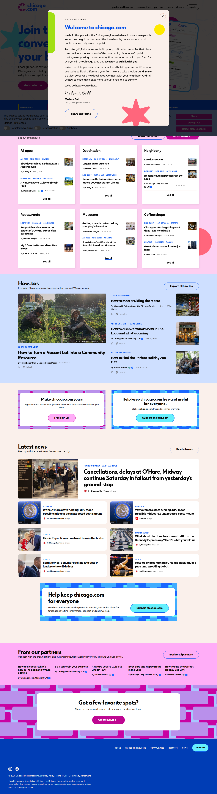

# UI Design System & Master Generation Blueprint: chicago-com

> **chicago.com** (https://chicago.com/) — Local guides, community conversation, and news from every Chicago newsroom, gathered in one place.



---

## 1. Executive Visual Persona & Design Archetype

- **Brand Essence & Persona**: **chicago.com** (`https://chicago.com/`). Local guides, community conversation, and news from every Chicago newsroom, gathered in one place.
- **Visual Archetype**: **High-Contrast Obsidian / Atmospheric Design System (`#fb2c36` canvas, `#c7d2ff` ink, `#00bb7f` accent)**.
- **Anti-AI-Slop Differentiators**:
  - **Source-Grounded Chromatic Polarity**: Anchors the viewport in `#fb2c36` (`var(--color-red-500)` in `:root`) paired with `#c7d2ff` primary typography and `#00bb7f` accents.
  - **Extracted Typographic Hierarchy**: Pairs `tempo` for display copy (`Primary Navigation`) with `tempo Fallback` and not declared in static CSS (uses primary stack / `ui-monospace`).
  - **Calibrated Spatial Grid & Motion**: Combines `63.9375rem` container bounds (`gap: var(--cdc--spacing--8)`, padding `var(--cdc--spacing--16)`) with `cubic-bezier(.4,0,1,1)` easing.

---

## 2. Spatial Architecture & Modular Grid Mathematics


### Viewport Allocation & Container Geometry
- **Captured Viewport Dimensions**: Desktop `1440×5261px` (`assets/desktop.png`, full-page scroll capture), Mobile `390×2400px` (`assets/mobile.png`, capped at 2400px multi-section capture).
- **Master Container Bounds**: `63.9375rem` extracted from `chicago-com` stylesheet.
- **Canvas Lateral Padding & Spacing**: `var(--cdc--spacing--16)` lateral canvas padding with `var(--cdc--spacing--8)` grid gap.
- **Border Radius Scale**: `6.25rem`, `var(--cdc--radius--16)`, `50%`, `100%`.

### Responsive Breakpoint Architecture
- **Desktop Layout**: Multi-column CSS Grid / Flexbox layout at `1440px` (`max-width: 63.9375rem`, `gap: var(--cdc--spacing--8)`).
- **Mobile Layout**: Single-column vertical stack at `390px` viewport width with `var(--cdc--spacing--16)` horizontal padding.
- **Extracted CSS Media Queries**: `@media (min-width:48rem)`, `@media (prefers-reduced-motion:no-preference)`, `@media (max-width:63.9375rem)`, `@media (min-width:64rem)`.

---

## 3. Color System, Materiality & Atmospheric Lighting

### Semantic Palette & Source Grounding
| Semantic Role | Ground-Truth Value | Extracted CSS Source / Selector |
|---|---|---|
| **Primary Canvas Substrate** | `#fb2c36` | `var(--color-red-500)` in `:root` |
| **Primary Typography Ink** | `#e40014` | `var(--color-red-600)` in `:root` |
| **Elevated Surface / Card Substrate** | `#f99c00` | `var(--color-amber-500)` in `:root` |
| **Interactive Accent / Highlight** | `#00bb7f` | `var(--color-emerald-500)` in `:root` |
| **Secondary / Muted Copy** | `#c7d2ff` | `var(--color-indigo-200)` in `:root` |
| **Structural Hairline Border** | `#a4b3ff` | `var(--color-indigo-300)` in `:root` |
| **Variable Token (`--color-gray-100`)** | `#f3f4f6` | `var(--color-gray-100)` in `:root` |
| **Variable Token (`--color-gray-200`)** | `#e5e7eb` | `var(--color-gray-200)` in `:root` |
| **Variable Token (`--color-gray-300`)** | `#d1d5dc` | `var(--color-gray-300)` in `:root` |
| **Variable Token (`--color-gray-700`)** | `#364153` | `var(--color-gray-700)` in `:root` |
| **Variable Token (`--color-zinc-100`)** | `#f4f4f5` | `var(--color-zinc-100)` in `:root` |
| **Variable Token (`--color-zinc-300`)** | `#d4d4d8` | `var(--color-zinc-300)` in `:root` |

### Sanitized Root CSS Variables (`ui-ux.md` Ground Truth)
| Variable Name | Extracted Value | Semantic Role |
|---|---|---|
| `--cdc--font--tempo` | `"tempo", "tempo Fallback"` | Typography / Scale Token |
| `--cdc--font--tenon` | `"tenon", "tenon Fallback"` | Typography / Scale Token |
| `--font-sans` | `var(--cdc--font--primary), ui-sans-serif, system-ui, sans-serif` | Typography / Scale Token |
| `--font-mono` | `var(--font-dm-mono), ui-monospace, monospace` | Typography / Scale Token |
| `--color-red-500` | `#fb2c36` | Brand / Palette Token |
| `--color-red-600` | `#e40014` | Brand / Palette Token |
| `--color-amber-500` | `#f99c00` | Brand / Palette Token |
| `--color-emerald-500` | `#00bb7f` | Brand / Palette Token |
| `--color-indigo-200` | `#c7d2ff` | Brand / Palette Token |
| `--color-indigo-300` | `#a4b3ff` | Brand / Palette Token |
| `--color-gray-100` | `#f3f4f6` | Brand / Palette Token |
| `--color-gray-200` | `#e5e7eb` | Brand / Palette Token |
| `--color-gray-300` | `#d1d5dc` | Brand / Palette Token |
| `--color-gray-700` | `#364153` | Brand / Palette Token |
| `--color-zinc-100` | `#f4f4f5` | Brand / Palette Token |
| `--color-zinc-300` | `#d4d4d8` | Brand / Palette Token |

---

## 4. Typographic Scale & Editorial Hierarchy

### Font Family Stacks
- **Display Typography**: `tempo`.
- **Primary Body Stack**: `tempo Fallback`.
- **Technical / Metadata Stack**: not declared in static CSS (uses primary stack / `ui-monospace`).

### Typographic Scale & Rules (Extracted from Stylesheet & Variables)
- **Hero Display (`H1`)**: CSS variables `--osano-display-position: bottom`.
- **Section Heading (`H2`)**: not explicitly declared on tag in static CSS (stylesheet font-size ladder: `var(--cdc--font-size--16)`, `var(--cdc--font-size--18)`, `2.5rem`, `3.5rem`, `1.1875rem`).
- **Body Copy**: CSS variables `--color-body: #46423b`, `--loginForm--state-body--color: var(--cdc--color--text-secondary)`, `--loginForm--state-body--font-size: var(--cdc--font-size--14)`; rule `p` (`font-size: 16px`, `line-height: 22px`, `font-weight: 400`).
- **Metadata & Navigation Labels**: CSS variables `--font-mono: var(--font-dm-mono), ui-monospace, monospace`, `--text-xs: .75rem`, `--text-xs--line-height: calc(1 / .75)`.

---

## 5. Choreographed Motion & Interaction Physics

### Primary Easing Curves
- **Extracted Timing Functions**: `cubic-bezier(.4,0,1,1)`, `cubic-bezier(0,0,.2,1)`, `cubic-bezier(.4,0,.2,1)`.

### Per-Element Transition & Choreography Rules
- **Selector `edia (prefers-reduced-motion:no-p...`**: `transition: background-color .2s ease-in-out,color .2s ease-in-out` extracted from `chicago-com` stylesheet.
- **Selector `layer theme`**: `transition: .15s` extracted from `chicago-com` stylesheet.
- **Selector `.transition`**: `transition: var(--tw-ease,var(--default-transition-timing-function))` extracted from `chicago-com` stylesheet.
- **Extracted Easing Curve (`cubic-bezier(.4,0,1,1)`)**: Governs interactive state transitions across `<header.osano-cm-window>` and `<section.osano-cm-window__dialog>`.
- **State & Hover Choreography**: Opacity and transform transitions on `<section.osano-visually-hidden>` and `<section.osano-cm-window__dialog>` interactive targets.

---

## 6. Component Wireframe & Structural DOM Map

### Visual Layout Schematic (Grounded in `dom.html` — `1440px` Desktop & `390px` Mobile Reflow)
```
┌────────────────────────────────────────────────────────────────────────┐
│ DESKTOP VIEWPORT (1440px) — chicago.com                                │
│ ====================================================================== │
│ [ <header.osano-cm-window> | Guides and how-tos · Communities · Par ]  │
│ ---------------------------------------------------------------------- │
│ | HERO STAGE: <section.osano-visually-hidden>                      |   │
│ | H1: Primary Navigation                                           |   │
│ | Substrate: #fb2c36    | Ink: #c7d2ff    | Accent: #00bb7f        |   │
│ ---------------------------------------------------------------------- │
│ | SHOWCASE GRID (<section.osano-cm-window__) max-w: 63.9375rem     |   │
│ | +------------------------------+  +------------------------------+ | │
│ | | Join the conversation on you |  | Guides                       | | │
│ | +------------------------------+  +------------------------------+ | │
│ ---------------------------------------------------------------------- │
│ | MOBILE VIEWPORT REFLOW (390px) — Single-Column Stack (gap: var(--) | │
│ | [<header.osano-cm-w] -> [<section.osano-vis] -> [<section.osano-cm-] │
│ ---------------------------------------------------------------------- │
│ [ FOOTER (<footer.osano-cm-dialo) | https://chicago.com/               │
└────────────────────────────────────────────────────────────────────────┘
```

### Granular DOM Region Breakdown
1. **Brand Header & Navigation Bar (<header.osano-cm-window> — `chicago-com`)**:
   - Landmark `<header class="osano-cm-window">` hosting `chicago.com` navigation (`Guides and how-tos · Communities · Partners · News · Donate`), DOM attributes (`data-precedence="next"`, `data-precedence="next"`, `data-precedence="next"`, `data-precedence="next"`), and stylesheet rule `module-scss-module__oyQcga__profi... { font-size:var(--cdc--font-size--18) }`.
2. **Hero Stage & Focal Lead (<section.osano-visually-hidden> — `Primary Navigation`)**:
   - Landmark `<section class="osano-visually-hidden">` presenting display lead `Primary Navigation` and copy excerpt *"Opens in a new window"* over `#fb2c36` canvas and `#c7d2ff` ink.
3. **Primary Showcase & Content Grid (<section.osano-cm-window__dialog> — `Join the conversation on your bloc`)**:
   - Landmark `<section class="osano-cm-window__dialog">` rendering section `Join the conversation on your block` with copy *"Opens an external website"*, asset references (`1027gyc7pyhue.css`, `3pi19zpjllrvw.css`, `2ffq2uh2507nl.css`, `3uvrwy_t3o4h_.css`), and grid rule `odule__oyQcga__profileCta:focus-v... { outline:2px solid var(--cdc--color--text-primary);outline-offset:2px }`.
4. **Interactive Detail & Feature Matrix (<article.osano-cm-dialog> — `Guides`)**:
   - Landmark `<article class="osano-cm-dialog">` framing `Guides` and `All ages` (*"Opens an external website in a new window"*) with `#f99c00` surface cards, `#00bb7f` accents, and `e-scss-module__oyQcga__profileCta... { background-color:var(--cdc--color--surface-brand);color:var(--cdc--color... }`.
5. **Colophon & Global Directory Footer (<footer.osano-cm-dialog--position_bottom> — `https://chicago.com/`)**:
   - Landmark `<footer class="osano-cm-dialog--position_bottom">` anchoring `chicago.com` footer links (`Guides and how-tos · Communities · Partners · News · Donate`), copy *"<!---->Close this consent banner<!---->"*, and `#a4b3ff` structural dividers.

---

## 7. Master Zero-Shot AI Generation Prompt

```markdown
# Master Zero-Shot Frontend Generation Prompt: chicago-com (chicago.com)

You are a principal frontend architect and design systems engineer. Build a complete, production-ready web application replicating the exact design system, DOM landmarks, typographic hierarchy, color tokens, and motion physics of `chicago-com` (**chicago.com** — `https://chicago.com/`).

### 1. Visual Archetype & Anti-AI-Slop Mandates
- **Archetype**: High-Contrast Obsidian / Atmospheric Design System (`#fb2c36` canvas, `#c7d2ff` ink, `#00bb7f` accent).
- **Identity & Domain Context**: Local guides, community conversation, and news from every Chicago newsroom, gathered in one place.
- **Primary Substrate**: `#fb2c36` (`var(--color-red-500)` in `:root`), **Primary Ink**: `#c7d2ff`, **Accent / Highlight**: `#00bb7f`.
- **Site-Specific Differentiators**:
  - **Source-Grounded Chromatic Polarity**: Anchors the viewport in `#fb2c36` (`var(--color-red-500)` in `:root`) paired with `#c7d2ff` primary typography and `#00bb7f` accents.
  - **Extracted Typographic Hierarchy**: Pairs `tempo` for display copy (`Primary Navigation`) with `tempo Fallback` and not declared in static CSS (uses primary stack / `ui-monospace`).
  - **Calibrated Spatial Grid & Motion**: Combines `63.9375rem` container bounds (`gap: var(--cdc--spacing--8)`, padding `var(--cdc--spacing--16)`) with `cubic-bezier(.4,0,1,1)` easing.

### 2. Ground-Truth CSS Variables (`:root` Token Contract)
Declare and consume these exact custom properties extracted from `chicago-com` in your global stylesheet:

:root {
  /* chicago.com (chicago-com) — Ground-Truth Extracted CSS Variables */
  --cdc--font--tempo: "tempo", "tempo Fallback"; /* Typography / Scale Token (chicago-com) */
  --cdc--font--tenon: "tenon", "tenon Fallback"; /* Typography / Scale Token (chicago-com) */
  --font-sans: var(--cdc--font--primary), ui-sans-serif, system-ui, sans-serif; /* Typography / Scale Token (chicago-com) */
  --font-mono: var(--font-dm-mono), ui-monospace, monospace; /* Typography / Scale Token (chicago-com) */
  --color-red-500: #fb2c36; /* Brand / Palette Token (chicago-com) */
  --color-red-600: #e40014; /* Brand / Palette Token (chicago-com) */
  --color-amber-500: #f99c00; /* Brand / Palette Token (chicago-com) */
  --color-emerald-500: #00bb7f; /* Brand / Palette Token (chicago-com) */
  --color-indigo-200: #c7d2ff; /* Brand / Palette Token (chicago-com) */
  --color-indigo-300: #a4b3ff; /* Brand / Palette Token (chicago-com) */
  --color-gray-100: #f3f4f6; /* Brand / Palette Token (chicago-com) */
  --color-gray-200: #e5e7eb; /* Brand / Palette Token (chicago-com) */
  --color-gray-300: #d1d5dc; /* Brand / Palette Token (chicago-com) */
  --color-gray-700: #364153; /* Brand / Palette Token (chicago-com) */
  --color-zinc-100: #f4f4f5; /* Brand / Palette Token (chicago-com) */
  --color-zinc-300: #d4d4d8; /* Brand / Palette Token (chicago-com) */
}

### 3. Semantic Color & Materiality Contract
Map every surface, ink, and border strictly to these source-grounded tokens:
- **Primary Canvas Substrate**: `#fb2c36` — grounded in `var(--color-red-500)` in `:root`
- **Primary Typography Ink**: `#e40014` — grounded in `var(--color-red-600)` in `:root`
- **Elevated Surface / Card Substrate**: `#f99c00` — grounded in `var(--color-amber-500)` in `:root`
- **Interactive Accent / Highlight**: `#00bb7f` — grounded in `var(--color-emerald-500)` in `:root`
- **Secondary / Muted Copy**: `#c7d2ff` — grounded in `var(--color-indigo-200)` in `:root`
- **Structural Hairline Border**: `#a4b3ff` — grounded in `var(--color-indigo-300)` in `:root`
- **Variable Token (`--color-gray-100`)**: `#f3f4f6` — grounded in `var(--color-gray-100)` in `:root`
- **Variable Token (`--color-gray-200`)**: `#e5e7eb` — grounded in `var(--color-gray-200)` in `:root`
- **Variable Token (`--color-gray-300`)**: `#d1d5dc` — grounded in `var(--color-gray-300)` in `:root`
- **Variable Token (`--color-gray-700`)**: `#364153` — grounded in `var(--color-gray-700)` in `:root`
- **Variable Token (`--color-zinc-100`)**: `#f4f4f5` — grounded in `var(--color-zinc-100)` in `:root`
- **Variable Token (`--color-zinc-300`)**: `#d4d4d8` — grounded in `var(--color-zinc-300)` in `:root`

### 4. Spatial Grid, Container Bounds & Responsive Breakpoints
- **Desktop Viewport Reference**: `1440×5261px` (full-page scroll capture, `1440px` standard desktop width).
- **Mobile Viewport Reference**: `390×2400px` (capped at 2400px multi-section capture, `390px` standard mobile width).
- **Container Max-Width**: `63.9375rem` extracted from `chicago-com` stylesheet
- **Padding & Gutters**: `var(--cdc--spacing--16)` lateral canvas padding with `var(--cdc--spacing--8)` grid gap
- **Desktop Grid**: Multi-column CSS Grid / Flexbox layout at `1440px` (`max-width: 63.9375rem`, `gap: var(--cdc--spacing--8)`)
- **Mobile Adaptation**: Single-column vertical stack at `390px` viewport width with `var(--cdc--spacing--16)` horizontal padding
- **Media Queries**: `@media (min-width:48rem)`, `@media (prefers-reduced-motion:no-preference)`, `@media (max-width:63.9375rem)`, `@media (min-width:64rem)`
- **Corner Radii**: `6.25rem`, `var(--cdc--radius--16)`, `50%`, `100%`

### 5. Typography & Editorial Scale Contract
- **Display Font Stack**: `tempo`
- **Body Font Stack**: `tempo Fallback`
- **Monospace / Technical Font Stack**: not declared in static CSS (uses primary stack / `ui-monospace`)
- **H1 Display Rule**: CSS variables `--osano-display-position: bottom`
- **H2 Section Rule**: not explicitly declared on tag in static CSS (stylesheet font-size ladder: `var(--cdc--font-size--16)`, `var(--cdc--font-size--18)`, `2.5rem`, `3.5rem`, `1.1875rem`)
- **Body Copy Rule**: CSS variables `--color-body: #fb2c36`, `--loginForm--state-body--color: var(--cdc--color--text-secondary)`, `--loginForm--state-body--font-size: var(--cdc--font-size--14)`; rule `p` (`font-size: 16px`, `line-height: 22px`, `font-weight: 400`)
- **Metadata & Index Rule**: CSS variables `--font-mono: var(--font-dm-mono), ui-monospace, monospace`, `--text-xs: .75rem`, `--text-xs--line-height: calc(1 / .75)`

### 6. Component Hierarchy, Verbatim Copy & Real DOM Landmarks
Scaffold `chicago-com` (`chicago.com`) with these exact structural regions, extracted copy, and CSS rules from `dom.html`:
1. **Brand Header & Navigation Bar (<header.osano-cm-window> — `chicago-com`)**:
   - DOM & Selectors: Landmark `<header class="osano-cm-window">` hosting `chicago.com` navigation (`Guides and how-tos · Communities · Partners · News · Donate`), DOM attributes (`data-precedence="next"`, `data-precedence="next"`, `data-precedence="next"`, `data-precedence="next"`), and stylesheet rule `module-scss-module__oyQcga__profi... { font-size:var(--cdc--font-size--18) }`.
   - Responsive Contract: Header `Brand Header & Navigation Bar (<header.osano-cm-window> — `chicago-com`)` (`chicago-com`) adapts across `@media (min-width:48rem)`, `@media (prefers-reduced-motion:no-preference)`, `@media (max-width:63.9375rem)`, `@media (min-width:64rem)` with `cubic-bezier(.4,0,1,1)`, `cubic-bezier(0,0,.2,1)`, `cubic-bezier(.4,0,.2,1)` transitions and links `Guides and how-tos · Communities · Partners · News · Donate`.
2. **Hero Stage & Focal Lead (<section.osano-visually-hidden> — `Primary Navigation`)**:
   - DOM & Selectors: Landmark `<section class="osano-visually-hidden">` presenting display lead `Primary Navigation` and copy excerpt *"Opens in a new window"* over `#fb2c36` canvas and `#c7d2ff` ink.
   - Responsive Contract: Hero stage (`1440×5261px` desktop / `390×2400px` mobile) sets `#fb2c36` background with `#c7d2ff` headline `Primary Navigation`.
3. **Primary Showcase & Content Grid (<section.osano-cm-window__dialog> — `Join the conversation on your bloc`)**:
   - DOM & Selectors: Landmark `<section class="osano-cm-window__dialog">` rendering section `Join the conversation on your block` with copy *"Opens an external website"*, asset references (`1027gyc7pyhue.css`, `3pi19zpjllrvw.css`, `2ffq2uh2507nl.css`, `3uvrwy_t3o4h_.css`), and grid rule `odule__oyQcga__profileCta:focus-v... { outline:2px solid var(--cdc--color--text-primary);outline-offset:2px }`.
   - Responsive Contract: Showcase grid `Primary Showcase & Content Grid (<section.osano-cm-window__dialog> — `Join the conversation on your bloc`)` applies Multi-column CSS Grid / Flexbox layout at `1440px` (`max-width: 63.9375rem`, `gap: var(--cdc--spacing--8)`) on desktop and Single-column vertical stack at `390px` viewport width with `var(--cdc--spacing--16)` horizontal padding on mobile.
4. **Interactive Detail & Feature Matrix (<article.osano-cm-dialog> — `Guides`)**:
   - DOM & Selectors: Landmark `<article class="osano-cm-dialog">` framing `Guides` and `All ages` (*"Opens an external website in a new window"*) with `#f99c00` surface cards, `#00bb7f` accents, and `e-scss-module__oyQcga__profileCta... { background-color:var(--cdc--color--surface-brand);color:var(--cdc--color... }`.
   - Responsive Contract: Detail module `Interactive Detail & Feature Matrix (<article.osano-cm-dialog> — `Guides`)` uses `6.25rem`, `var(--cdc--radius--16)`, `50%`, `100%` radii, `#00bb7f` highlights, and assets (1027gyc7pyhue.css, 3pi19zpjllrvw.css, 2ffq2uh2507nl.css).
5. **Colophon & Global Directory Footer (<footer.osano-cm-dialog--position_bottom> — `https://chicago.com/`)**:
   - DOM & Selectors: Landmark `<footer class="osano-cm-dialog--position_bottom">` anchoring `chicago.com` footer links (`Guides and how-tos · Communities · Partners · News · Donate`), copy *"<!---->Close this consent banner<!---->"*, and `#a4b3ff` structural dividers.
   - Responsive Contract: Footer `Colophon & Global Directory Footer (<footer.osano-cm-dialog--position_bottom> — `https://chicago.com/`)` aligns to `63.9375rem` extracted from `chicago-com` stylesheet with `var(--cdc--spacing--16)` lateral canvas padding with `var(--cdc--spacing--8)` grid gap and attributes (data-precedence="next", data-precedence="next", data-precedence="next").

#### Verbatim DOM Copy Excerpts (`dom.html`)
- Copy Excerpt 1: *"Opens in a new window"*
- Copy Excerpt 2: *"Opens an external website"*
- Copy Excerpt 3: *"Opens an external website in a new window"*
- Copy Excerpt 4: *"<!---->Close this consent banner<!---->"*

### 7. Motion, Extracted Stylesheet Rules & Interaction Choreography
- **Primary Easing Functions**: `cubic-bezier(.4,0,1,1)`, `cubic-bezier(0,0,.2,1)`, `cubic-bezier(.4,0,.2,1)`
- **Extracted Stylesheet Rules (`chicago-com`)**:
- `module-scss-module__oyQcga__profi... { font-size:var(--cdc--font-size--18) }`
- `odule__oyQcga__profileCta:focus-v... { outline:2px solid var(--cdc--color--text-primary);outline-offset:2px }`
- `e-scss-module__oyQcga__profileCta... { background-color:var(--cdc--color--surface-brand);color:var(--cdc--color... }`
- `css-module__oyQcga__profileCta:di... { background-color:0000 }`
- `Member-module-scss-module__yBZWIa... { background-color:var(--cdc--color--surface-primary);isolation:isolate;po... }`
- **Per-Selector Transition Rules**:
- **Selector `edia (prefers-reduced-motion:no-p...`**: `transition: background-color .2s ease-in-out,color .2s ease-in-out` extracted from `chicago-com` stylesheet.
- **Selector `layer theme`**: `transition: .15s` extracted from `chicago-com` stylesheet.
- **Selector `.transition`**: `transition: var(--tw-ease,var(--default-transition-timing-function))` extracted from `chicago-com` stylesheet.
- **Extracted Easing Curve (`cubic-bezier(.4,0,1,1)`)**: Governs interactive state transitions across `<header.osano-cm-window>` and `<section.osano-cm-window__dialog>`.
- **State & Hover Choreography**: Opacity and transform transitions on `<section.osano-visually-hidden>` and `<section.osano-cm-window__dialog>` interactive targets.

### 8. Technical Deliverables
- Implement in Next.js (App Router) with TypeScript and Tailwind CSS consuming the `:root` custom properties defined above for `chicago-com`.
- Reproduce both the `1440px` desktop architecture and `390px` mobile breakpoint transitions, preserving semantic HTML5 landmarks (`<header>`, `<nav>`, `<main>`, `<section>`, `<footer>`) and `prefers-reduced-motion` accessibility guards.
```
