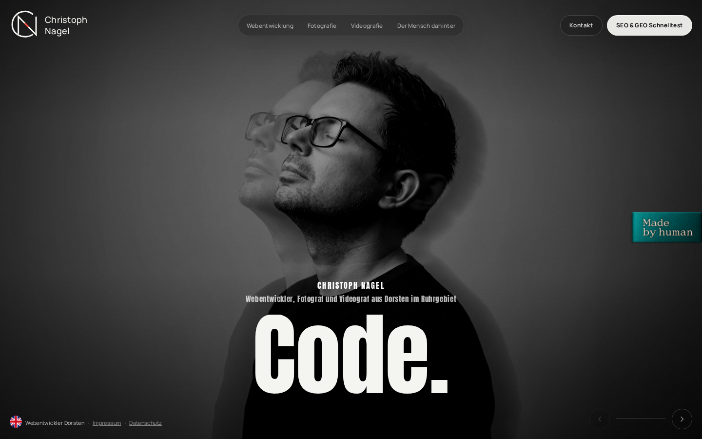
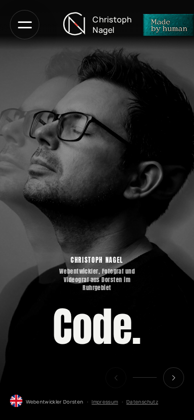

# UI Design System & Master Generation Blueprint: christoph-nagel-dev

> **Christoph Nagel · Webentwickler, Fotograf & Videograf in Dorsten** (https://christoph-nagel.dev/) — Christoph Nagel aus Dorsten: Webentwicklung mit WordPress, HTML, CSS und JavaScript. Einblicke in eigene Projekte, Fotografie und Videogr...



---

## 1. Executive Visual Persona & Design Archetype

- **Brand Essence & Persona**: **Christoph Nagel · Webentwickler, Fotograf & Videograf in Dorsten** (`https://christoph-nagel.dev/`). Christoph Nagel aus Dorsten: Webentwicklung mit WordPress, HTML, CSS und JavaScript. Einblicke in eigene Projekte, Fotografie und Videogr...
- **Capture Provenance**: Live browser capture (`tier1_fast`, HTTP `200`, captured `2026-11-23`).
- **Visual Archetype**: **Dark-Substrate WebGL / Canvas Interactive Experience (`#080808` / `#000000`)**.
- **Anti-AI-Slop Differentiators**:
  - **Live-Computed Chromatic Polarity**: Anchors the viewport in `#080808` (live computed `body` `background-color` (`computed_styles.json`)) paired with `#ffffff` primary typography and `#000000` accents.
  - **Grounded Typographic Hierarchy**: Pairs `Anton` for display copy (`CHRISTOPH NAGEL Webentwickler, Fotog`) with `Manrope` and not declared in live computed styles (uses primary stack / `ui-monospace`).
  - **Calibrated Spatial Grid & Motion**: Combines `1440px` container bounds (`gap: 28.8px`, padding `0.75rem`) with `cubic-bezier(0.19,1,0.22,1)` easing and GSAP Timeline & ScrollTrigger, HTML5 `<canvas>` Interactive Viewport Surface.

---

## 2. Spatial Architecture & Modular Grid Mathematics



### Viewport Allocation & Container Geometry
- **Captured Viewport Dimensions**: Desktop `1440×900px` (`assets/desktop.png`, single-viewport 100vh live capture (900px)), Mobile `390×844px` (`assets/mobile.png`, single-viewport 100vh live capture (844px)).
- **Master Container Bounds**: `1440px` (full-bleed `100%` desktop stage measured on `1440px` viewport).
- **Canvas Lateral Padding & Spacing**: `0.75rem` lateral canvas padding with `28.8px` grid gap.
- **Border Radius Scale**: `50%`, `999px`, `0.9rem`, `1.3rem`.

### Responsive Breakpoint Architecture
- **Desktop Layout**: Multi-column CSS Grid / Flexbox layout at `1440px` (`max-width: 1440px`, `gap: 28.8px`).
- **Mobile Layout**: Single-column vertical stack at `390px` viewport width with `0.75rem` horizontal padding.
- **Extracted CSS Media Queries**: `@media (min-width: 901px) and (max-width: 1937px)`, `@media (max-width: 900px)`, `@media (max-width: 620px)`, `@media (prefers-reduced-motion: reduce)`.

---

## 3. Color System, Materiality & Atmospheric Lighting

### Semantic Palette & Source Grounding
| Semantic Role | Ground-Truth Value | Extracted Live / CSS Source |
|---|---|---|
| **Primary Canvas Substrate** | `#080808` | live computed `body` `background-color` (`computed_styles.json`) |
| **Primary Typography Ink** | `#ffffff` | live computed `h1` `color` (`computed_styles.json`) |
| **Elevated Surface / Card Substrate** | `#0a0a0a` | `.site-shell { background: #0a0a0a }` |
| **Interactive Accent / Highlight** | `#000000` | live computed `a` `color` (`computed_styles.json`) |
| **Secondary / Muted Copy** | `#f4f4f1` | live computed `nav` `color` (`computed_styles.json`) |
| **Structural Hairline Border** | `#343434` | `var(--line)` in `:root` (`rgba(255, 255, 255, 0.18)`) |
| **Variable Token (`--red`)** | `#ff4b3e` | `var(--red)` in `:root` |

### Sanitized Root CSS Variables (`ui-ux.md` Ground Truth)
| Variable Name | Extracted Value | Semantic Role |
|---|---|---|
| `--bg` | `#080808` | Canvas / Surface Token |
| `--text` | `#f4f4f1` | Typography Ink Token |
| `--muted` | `rgba(244, 244, 241, 0.68)` | Color / Atmospheric Token |
| `--line` | `rgba(255, 255, 255, 0.18)` | Color / Atmospheric Token |
| `--glass` | `rgba(12, 12, 12, 0.38)` | Color / Atmospheric Token |
| `--red` | `#ff4b3e` | Color / Atmospheric Token |
| `--safe-top` | `max(1.25rem, env(safe-area-inset-top))` | Dimension / Scale Token |
| `--safe-right` | `max(1.25rem, env(safe-area-inset-right))` | Dimension / Scale Token |
| `--safe-bottom` | `max(1.25rem, env(safe-area-inset-bottom))` | Dimension / Scale Token |
| `--safe-left` | `max(1.25rem, env(safe-area-inset-left))` | Dimension / Scale Token |
| `--cursor-x` | `-120px` | Dimension / Scale Token |
| `--cursor-y` | `-120px` | Dimension / Scale Token |
| `--cursor-size` | `3.75rem` | Layout / Spatial Grid Token |
| `--label-width` | `150px` | Layout / Spatial Grid Token |
| `--label-top` | `52%` | Dimension / Scale Token |
| `--label-z-index` | `40` | Elevation / Border Token |

---

## 4. Typographic Scale & Editorial Hierarchy

### Font Family Stacks
- **Display Typography**: `Anton`.
- **Primary Body Stack**: `Manrope`.
- **Technical / Metadata Stack**: not declared in live computed styles (uses primary stack / `ui-monospace`).

### Typographic Scale & Rules (Live Computed & Stylesheet Grounded)
- **Hero Display (`H1`)**: live computed `h1` (`font-size: 15.2px`, `line-height: 22.04px`, `font-weight: 400`, `letter-spacing: 0.608px`); rule `.hero-title` (`font-size: clamp(4rem, 13vw, 12.8rem)`, `line-height: 0.84`, `letter-spacing: -0.005em`, `font-weight: 400`).
- **Section Heading (`H2`)**: live computed `h2` (`font-size: 187.2px`, `line-height: 157.248px`, `font-weight: 400`, `letter-spacing: -0.936px`); rule `h2` (`font-size: clamp(2.25rem, 4.25vw, 4.7rem)`, `line-height: 1.15`, `letter-spacing: -0.018em`, `font-weight: 400`).
- **Body Copy**: live computed `body` (`font-size: 16px`, `line-height: normal`, `font-weight: 400`); rule `p` (`font-size: clamp(0.9rem, 1vw, 1rem)`, `line-height: 1.68`).
- **Metadata & Navigation Labels**: live computed `nav/a` (`font-size: 16px`, `line-height: normal`, `font-weight: 400`); CSS variables `--label-width: 150px`, `--label-top: 52%`, `--label-z-index: 40`.

---

## 5. Choreographed Motion & Interaction Physics

### Primary Easing Curves
- **Extracted Timing Functions**: `cubic-bezier(0.19,1,0.22,1)`, `cubic-bezier(.2,.75,.2,1)`, `cubic-bezier(.15,.62,.28,1)`.

### Per-Element Transition & Choreography Rules
- **Selector `.skip-link`**: `transition: transform 180ms ease` extracted from `christoph-nagel-dev` stylesheet.
- **Selector `.content-shade`**: `transition: opacity 700ms ease` extracted from `christoph-nagel-dev` stylesheet.
- **Selector `.home-mark`**: `transition: background-color 200ms ease, border-color 200ms ease, transfor...` extracted from `christoph-nagel-dev` stylesheet.
- **Extracted Easing Curve (`cubic-bezier(0.19,1,0.22,1)`)**: Governs interactive state transitions across `<header.topbar>` and `<section.panel--content>`.
- **Runtime Interaction Engine**: Integrates GSAP Timeline & ScrollTrigger, HTML5 `<canvas>` Interactive Viewport Surface with `prefers-reduced-motion: reduce` fallback guards.

---

## 6. Component Wireframe & Structural DOM Map

### Visual Layout Schematic — Desktop (`1440px`, Grounded in `dom.html` & Landmark Bounding Boxes)
```
┌────────────────────────────────────────────────────────────────────────┐
│ DESKTOP VIEWPORT (1440px) — Christoph Nagel · Webentwickler, Fotograf  │
│ ====================================================================== │
│ [ <header.topbar> (1400x64px)         | Kontakt                      ] │
│ ---------------------------------------------------------------------- │
│ | HERO STAGE: <section.panel> (w=1440px)                             | │
│ | H1: CHRISTOPH NAGEL Webentwickler, Fotograf und Video...           | │
│ | Substrate: #080808 | Ink: #ffffff | Accent: #000000                | │
│ ---------------------------------------------------------------------- │
│ | SHOWCASE GRID (<section.panel--content>) max-w: 1440px             | │
│ | +------------------------------+  +------------------------------+ | │
│ | | Christoph Nagel Webentwickle |  | Code. Kamera. Klartext.      | | │
│ | +------------------------------+  +------------------------------+ | │
│ ---------------------------------------------------------------------- │
│ | DETAIL MODULE (<section.panel:nth(2)>) — Digitale Lösungen mit     | │
│ ---------------------------------------------------------------------- │
│ [ FOOTER (<footer.legal-links>) | https://christoph-nagel.dev/         │
└────────────────────────────────────────────────────────────────────────┘
```

### Visual Layout Schematic — Mobile Reflow (`390px`)
```
┌────────────────────────────────────────────────────────────────────────┐
│ MOBILE VIEWPORT REFLOW (390px) — Single-Column Stack (gap: 28.8px)     │
│ ====================================================================== │
│ [ HEADER BAR (<header.topbar>         ) | Compact Menu (390px)         │
│ ---------------------------------------------------------------------- │
│ | HERO STAGE (<section.panel>) — 390px Vertical Lead                 | │
│ | H1: CHRISTOPH NAGEL Webentwickler, Fotograf und Video...           | │
│ ---------------------------------------------------------------------- │
│ | SHOWCASE STACK (<section.panel--conten) — 1-Col Stack              | │
│ | [ Item 1: Christoph Nagel Webentwickler, Fotograf und Video...   ] | │
│ | [ Item 2: Code. Kamera. Klartext.                                ] | │
│ ---------------------------------------------------------------------- │
│ | DETAIL STACK (<section.panel:nth(2)>) — 1-Col (Digitale Lösungen ) | │
│ ---------------------------------------------------------------------- │
│ [ FOOTER (<footer.legal-links>) | Stacked 390px Colophon               │
└────────────────────────────────────────────────────────────────────────┘
```

### Granular DOM Region Breakdown
1. **Brand Header & Navigation Bar (<header.topbar> — `christoph-nagel-dev`)**:
   - Landmark `<header class="topbar">` (`1400x64px`) hosting `Christoph Nagel · Webentwickler, Fot` navigation (`Kontakt`), DOM attributes (`data-inline-css="/styles.css?v=8b9c708..."`, `data-inline-css="/assets/css/seo-check..."`, `data-inline-css="/assets/css/wind-labe..."`, `data-inline-css="/assets/css/site-enha..."`), and stylesheet rule `html { background: 080808; }`.
2. **Hero Stage & Focal Lead (<section.panel> — `CHRISTOPH NAGEL Webentwickler, Fot`)**:
   - Landmark `<section class="panel panel--intro">` presenting display lead `CHRISTOPH NAGEL Webentwickler, Fotograf und Video...` and copy excerpt *"Webentwickler, Fotograf und Videograf aus Dorsten im Ruhrgebiet"* over `#080808` canvas and `#ffffff` ink.
3. **Primary Showcase & Content Grid (<section.panel--content> — `Christoph Nagel Webentwickler, Fot`)**:
   - Landmark `<section class="panel panel--content">` rendering section `Christoph Nagel Webentwickler, Fotograf und Video...` with copy *"Code. Kamera. Klartext."*, asset references (`intro.jpg`, `anton-v27-latin-regular.woff2`, `site-media.js`, `llms.txt`), and grid rule `body { background: 080808; }`.
4. **Interactive Detail & Feature Matrix (<section.panel:nth(2)> — `Code. Kamera. Klartext.`)**:
   - Landmark `<section class="panel panel--content">` framing `Code. Kamera. Klartext.` and `Digitale Lösungen mit Substanz` (*"Seit 2001 beschäftige ich mich mit Webdesign und Webentwicklung. "*) with `#0a0a0a` surface cards, `#000000` accents, and `button { font: inherit; }`.
5. **Colophon & Global Directory Footer (<footer.legal-links> — `https://christoph-nagel.dev/`)**:
   - Landmark `<footer class="legal-links">` anchoring `Christoph Nagel · Webentwickler,` footer links (`Kontakt`), copy *"Auf Just a Web-Developer teile ich eigene Projekte, praktisc"*, and `#343434` structural dividers.

---

## 7. Master Zero-Shot AI Generation Prompt

```markdown
# Master Zero-Shot Frontend Generation Prompt: christoph-nagel-dev (Christoph Nagel · Webentwickler, Fotograf & Videograf in Dorsten)

You are a principal frontend architect and design systems engineer. Build a complete, production-ready web application replicating the exact design system, DOM landmarks, typographic hierarchy, color tokens, and motion physics of `christoph-nagel-dev` (**Christoph Nagel · Webentwickler, Fotograf & Videograf in Dorsten** — `https://christoph-nagel.dev/`).

### 1. Visual Archetype & Anti-AI-Slop Mandates
- **Archetype**: Dark-Substrate WebGL / Canvas Interactive Experience (`#080808` / `#000000`).
- **Identity & Domain Context**: Christoph Nagel aus Dorsten: Webentwicklung mit WordPress, HTML, CSS und JavaScript. Einblicke in eigene Projekte, Fotografie und Videogr...
- **Primary Substrate**: `#080808` (live computed `body` `background-color` (`computed_styles.json`)), **Primary Ink**: `#ffffff`, **Accent / Highlight**: `#000000`.
- **Site-Specific Differentiators**:
  - **Live-Computed Chromatic Polarity**: Anchors the viewport in `#080808` (live computed `body` `background-color` (`computed_styles.json`)) paired with `#ffffff` primary typography and `#000000` accents.
  - **Grounded Typographic Hierarchy**: Pairs `Anton` for display copy (`CHRISTOPH NAGEL Webentwickler, Fotog`) with `Manrope` and not declared in live computed styles (uses primary stack / `ui-monospace`).
  - **Calibrated Spatial Grid & Motion**: Combines `1440px` container bounds (`gap: 28.8px`, padding `0.75rem`) with `cubic-bezier(0.19,1,0.22,1)` easing and GSAP Timeline & ScrollTrigger, HTML5 `<canvas>` Interactive Viewport Surface.

### 2. Ground-Truth CSS Variables (`:root` Token Contract)
Declare and consume these exact custom properties extracted from `christoph-nagel-dev` in your global stylesheet:

:root {
  /* Christoph Nagel · Webentwickler, Fotograf & Videograf in Dorsten (christoph-nagel-dev) — Live-Grounded CSS Variables */
  --bg: #080808; /* Canvas / Surface Token (christoph-nagel-dev) */
  --text: #f4f4f1; /* Typography Ink Token (christoph-nagel-dev) */
  --muted: rgba(244, 244, 241, 0.68); /* Color / Atmospheric Token (christoph-nagel-dev) */
  --line: rgba(255, 255, 255, 0.18); /* Color / Atmospheric Token (christoph-nagel-dev) */
  --glass: rgba(12, 12, 12, 0.38); /* Color / Atmospheric Token (christoph-nagel-dev) */
  --red: #ff4b3e; /* Color / Atmospheric Token (christoph-nagel-dev) */
  --safe-top: max(1.25rem, env(safe-area-inset-top)); /* Dimension / Scale Token (christoph-nagel-dev) */
  --safe-right: max(1.25rem, env(safe-area-inset-right)); /* Dimension / Scale Token (christoph-nagel-dev) */
  --safe-bottom: max(1.25rem, env(safe-area-inset-bottom)); /* Dimension / Scale Token (christoph-nagel-dev) */
  --safe-left: max(1.25rem, env(safe-area-inset-left)); /* Dimension / Scale Token (christoph-nagel-dev) */
  --cursor-x: -120px; /* Dimension / Scale Token (christoph-nagel-dev) */
  --cursor-y: -120px; /* Dimension / Scale Token (christoph-nagel-dev) */
  --cursor-size: 3.75rem; /* Layout / Spatial Grid Token (christoph-nagel-dev) */
  --label-width: 150px; /* Layout / Spatial Grid Token (christoph-nagel-dev) */
  --label-top: 52%; /* Dimension / Scale Token (christoph-nagel-dev) */
  --label-z-index: 40; /* Elevation / Border Token (christoph-nagel-dev) */
}

### 3. Semantic Color & Materiality Contract
Map every surface, ink, and border strictly to these source-grounded tokens:
- **Primary Canvas Substrate**: `#080808` — grounded in live computed `body` `background-color` (`computed_styles.json`)
- **Primary Typography Ink**: `#ffffff` — grounded in live computed `h1` `color` (`computed_styles.json`)
- **Elevated Surface / Card Substrate**: `#0a0a0a` — grounded in `.site-shell { background: #0a0a0a }`
- **Interactive Accent / Highlight**: `#000000` — grounded in live computed `a` `color` (`computed_styles.json`)
- **Secondary / Muted Copy**: `#f4f4f1` — grounded in live computed `nav` `color` (`computed_styles.json`)
- **Structural Hairline Border**: `#343434` — grounded in `var(--line)` in `:root` (`rgba(255, 255, 255, 0.18)`)
- **Variable Token (`--red`)**: `#ff4b3e` — grounded in `var(--red)` in `:root`

### 4. Spatial Grid, Container Bounds & Responsive Breakpoints
- **Desktop Viewport Reference**: `1440×900px` (single-viewport 100vh live capture (900px), `1440px` standard desktop width).
- **Mobile Viewport Reference**: `390×844px` (single-viewport 100vh live capture (844px), `390px` standard mobile width).
- **Container Max-Width**: `1440px` (full-bleed `100%` desktop stage measured on `1440px` viewport)
- **Padding & Gutters**: `0.75rem` lateral canvas padding with `28.8px` grid gap
- **Desktop Grid**: Multi-column CSS Grid / Flexbox layout at `1440px` (`max-width: 1440px`, `gap: 28.8px`)
- **Mobile Adaptation**: Single-column vertical stack at `390px` viewport width with `0.75rem` horizontal padding
- **Media Queries**: `@media (min-width: 901px) and (max-width: 1937px)`, `@media (max-width: 900px)`, `@media (max-width: 620px)`, `@media (prefers-reduced-motion: reduce)`
- **Corner Radii**: `50%`, `999px`, `0.9rem`, `1.3rem`

### 5. Typography & Editorial Scale Contract
- **Display Font Stack**: `Anton`
- **Body Font Stack**: `Manrope`
- **Monospace / Technical Font Stack**: not declared in live computed styles (uses primary stack / `ui-monospace`)
- **H1 Display Rule**: live computed `h1` (`font-size: 15.2px`, `line-height: 22.04px`, `font-weight: 400`, `letter-spacing: 0.608px`); rule `.hero-title` (`font-size: clamp(4rem, 13vw, 12.8rem)`, `line-height: 0.84`, `letter-spacing: -0.005em`, `font-weight: 400`)
- **H2 Section Rule**: live computed `h2` (`font-size: 187.2px`, `line-height: 157.248px`, `font-weight: 400`, `letter-spacing: -0.936px`); rule `h2` (`font-size: clamp(2.25rem, 4.25vw, 4.7rem)`, `line-height: 1.15`, `letter-spacing: -0.018em`, `font-weight: 400`)
- **Body Copy Rule**: live computed `body` (`font-size: 16px`, `line-height: normal`, `font-weight: 400`); rule `p` (`font-size: clamp(0.9rem, 1vw, 1rem)`, `line-height: 1.68`)
- **Metadata & Index Rule**: live computed `nav/a` (`font-size: 16px`, `line-height: normal`, `font-weight: 400`); CSS variables `--label-width: 150px`, `--label-top: 52%`, `--label-z-index: 40`

### 6. Component Hierarchy, Verbatim Copy & Real DOM Landmarks
Scaffold `christoph-nagel-dev` (`Christoph Nagel · Webentwickler, Fotograf & Videograf in Dorsten`) with these exact structural regions, extracted copy, and CSS rules from `dom.html`:
1. **Brand Header & Navigation Bar (<header.topbar> — `christoph-nagel-dev`)**:
   - DOM & Selectors: Landmark `<header class="topbar">` (`1400x64px`) hosting `Christoph Nagel · Webentwickler, Fot` navigation (`Kontakt`), DOM attributes (`data-inline-css="/styles.css?v=8b9c708..."`, `data-inline-css="/assets/css/seo-check..."`, `data-inline-css="/assets/css/wind-labe..."`, `data-inline-css="/assets/css/site-enha..."`), and stylesheet rule `html { background: 080808; }`.
   - Responsive Contract: Header `Brand Header & Navigation Bar (<header.topbar> — `christoph-nagel-dev`)` (`christoph-nagel-dev`) adapts across `@media (min-width: 901px) and (max-width: 1937px)`, `@media (max-width: 900px)`, `@media (max-width: 620px)`, `@media (prefers-reduced-motion: reduce)` with `cubic-bezier(0.19,1,0.22,1)`, `cubic-bezier(.2,.75,.2,1)`, `cubic-bezier(.15,.62,.28,1)` transitions and links `Kontakt`.
2. **Hero Stage & Focal Lead (<section.panel> — `CHRISTOPH NAGEL Webentwickler, Fot`)**:
   - DOM & Selectors: Landmark `<section class="panel panel--intro">` presenting display lead `CHRISTOPH NAGEL Webentwickler, Fotograf und Video...` and copy excerpt *"Webentwickler, Fotograf und Videograf aus Dorsten im Ruhrgebiet"* over `#080808` canvas and `#ffffff` ink.
   - Responsive Contract: Hero stage (`1440×900px` desktop / `390×844px` mobile) sets `#080808` background with `#ffffff` headline `CHRISTOPH NAGEL Webentwickler, Fotograf und Video...`.
3. **Primary Showcase & Content Grid (<section.panel--content> — `Christoph Nagel Webentwickler, Fot`)**:
   - DOM & Selectors: Landmark `<section class="panel panel--content">` rendering section `Christoph Nagel Webentwickler, Fotograf und Video...` with copy *"Code. Kamera. Klartext."*, asset references (`intro.jpg`, `anton-v27-latin-regular.woff2`, `site-media.js`, `llms.txt`), and grid rule `body { background: 080808; }`.
   - Responsive Contract: Showcase grid `Primary Showcase & Content Grid (<section.panel--content> — `Christoph Nagel Webentwickler, Fot`)` applies Multi-column CSS Grid / Flexbox layout at `1440px` (`max-width: 1440px`, `gap: 28.8px`) on desktop and Single-column vertical stack at `390px` viewport width with `0.75rem` horizontal padding on mobile.
4. **Interactive Detail & Feature Matrix (<section.panel:nth(2)> — `Code. Kamera. Klartext.`)**:
   - DOM & Selectors: Landmark `<section class="panel panel--content">` framing `Code. Kamera. Klartext.` and `Digitale Lösungen mit Substanz` (*"Seit 2001 beschäftige ich mich mit Webdesign und Webentwicklung. "*) with `#0a0a0a` surface cards, `#000000` accents, and `button { font: inherit; }`.
   - Responsive Contract: Detail module `Interactive Detail & Feature Matrix (<section.panel:nth(2)> — `Code. Kamera. Klartext.`)` uses `50%`, `999px`, `0.9rem`, `1.3rem` radii, `#000000` highlights, and assets (intro.jpg, anton-v27-latin-regular.woff2, site-media.js).
5. **Colophon & Global Directory Footer (<footer.legal-links> — `https://christoph-nagel.dev/`)**:
   - DOM & Selectors: Landmark `<footer class="legal-links">` anchoring `Christoph Nagel · Webentwickler,` footer links (`Kontakt`), copy *"Auf Just a Web-Developer teile ich eigene Projekte, praktisc"*, and `#343434` structural dividers.
   - Responsive Contract: Footer `Colophon & Global Directory Footer (<footer.legal-links> — `https://christoph-nagel.dev/`)` aligns to `1440px` (full-bleed `100%` desktop stage measured on `1440px` viewport) with `0.75rem` lateral canvas padding with `28.8px` grid gap and attributes (data-inline-css="/styles.css?v=8b9c708...", data-inline-css="/assets/css/seo-check...", data-inline-css="/assets/css/wind-labe...").

#### Verbatim DOM Copy Excerpts (`dom.html`)
- Copy Excerpt 1: *"Webentwickler, Fotograf und Videograf aus Dorsten im Ruhrgebiet"*
- Copy Excerpt 2: *"Code. Kamera. Klartext."*
- Copy Excerpt 3: *"Seit 2001 beschäftige ich mich mit Webdesign und Webentwicklung. Seit 2014 arbeite..."*
- Copy Excerpt 4: *"Auf Just a Web-Developer teile ich eigene Projekte, praktische Code-Beispiele und..."*

### 7. Motion, Extracted Stylesheet Rules & Interaction Choreography
- **Primary Easing Functions**: `cubic-bezier(0.19,1,0.22,1)`, `cubic-bezier(.2,.75,.2,1)`, `cubic-bezier(.15,.62,.28,1)`
- **Extracted Stylesheet Rules (`christoph-nagel-dev`)**:
- `html { background: 080808; }`
- `body { background: 080808; }`
- `button { font: inherit; }`
- `h6 { font-family: "Anton", Impact, sans-serif; font-weight: 400; }`
- `a:focus-visible { outline: 2px solid fff; outline-offset: 4px; }`
- **Per-Selector Transition Rules**:
- **Selector `.skip-link`**: `transition: transform 180ms ease` extracted from `christoph-nagel-dev` stylesheet.
- **Selector `.content-shade`**: `transition: opacity 700ms ease` extracted from `christoph-nagel-dev` stylesheet.
- **Selector `.home-mark`**: `transition: background-color 200ms ease, border-color 200ms ease, transfor...` extracted from `christoph-nagel-dev` stylesheet.
- **Extracted Easing Curve (`cubic-bezier(0.19,1,0.22,1)`)**: Governs interactive state transitions across `<header.topbar>` and `<section.panel--content>`.
- **Runtime Interaction Engine**: Integrates GSAP Timeline & ScrollTrigger, HTML5 `<canvas>` Interactive Viewport Surface with `prefers-reduced-motion: reduce` fallback guards.

### 8. Technical Deliverables
- Implement in Next.js (App Router) with TypeScript and Tailwind CSS consuming the `:root` custom properties defined above for `christoph-nagel-dev`.
- Reproduce both the `1440px` desktop architecture and `390px` mobile breakpoint transitions, preserving semantic HTML5 landmarks (`<header>`, `<nav>`, `<main>`, `<section>`, `<footer>`) and `prefers-reduced-motion` accessibility guards.
```
