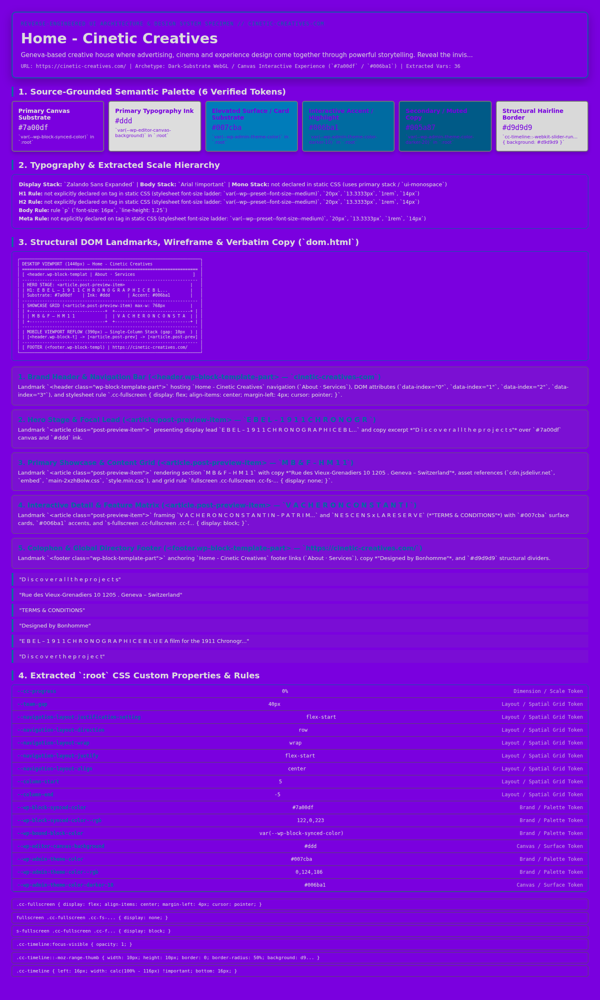
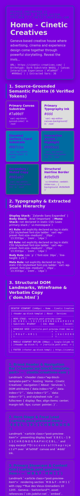

# UI Design System & Master Generation Blueprint: cinetic-creatives-com

> **Home - Cinetic Creatives** (https://cinetic-creatives.com/) — Geneva-based creative house where advertising, cinema and experience design come together through powerful storytelling. Reveal the invis...



---

## 1. Executive Visual Persona & Design Archetype

- **Brand Essence & Persona**: **Home - Cinetic Creatives** (`https://cinetic-creatives.com/`). Geneva-based creative house where advertising, cinema and experience design come together through powerful storytelling. Reveal the invis...
- **Visual Archetype**: **Dark-Substrate WebGL / Canvas Interactive Experience (`#7a00df` / `#006ba1`)**.
- **Anti-AI-Slop Differentiators**:
  - **Source-Grounded Chromatic Polarity**: Anchors the viewport in `#7a00df` (`var(--wp-block-synced-color)` in `:root`) paired with `#ddd` primary typography and `#006ba1` accents.
  - **Extracted Typographic Hierarchy**: Pairs `Zalando Sans Expanded` for display copy (`E B E L – 1 9 1 1 C H R O N O G R A `) with `Arial !important` and not declared in static CSS (uses primary stack / `ui-monospace`).
  - **Calibrated Spatial Grid & Motion**: Combines `768px` container bounds (`gap: 10px`, padding `10px`) with `cubic-bezier(.785,.135,.15,.86)` easing and GSAP Timeline & ScrollTrigger, Three.js / WebGL Canvas Pipeline.

---

## 2. Spatial Architecture & Modular Grid Mathematics



### Viewport Allocation & Container Geometry
- **Captured Viewport Dimensions**: Desktop `1440×2400px` (`assets/desktop.png`, capped at 2400px multi-section capture), Mobile `390×2400px` (`assets/mobile.png`, capped at 2400px multi-section capture).
- **Master Container Bounds**: `768px` extracted from `cinetic-creatives-com` stylesheet.
- **Canvas Lateral Padding & Spacing**: `10px` lateral canvas padding with `10px` grid gap.
- **Border Radius Scale**: `50%`, `5px`, `9999px`, `4px`.

### Responsive Breakpoint Architecture
- **Desktop Layout**: Multi-column CSS Grid / Flexbox layout at `1440px` (`max-width: 768px`, `gap: 10px`).
- **Mobile Layout**: Single-column vertical stack at `390px` viewport width with `10px` horizontal padding.
- **Extracted CSS Media Queries**: `@media (max-width: 768px)`, `@media (max-width:768px)`, `@media (max-width:1440px)`, `@media (max-width:1024px)`.

---

## 3. Color System, Materiality & Atmospheric Lighting

### Semantic Palette & Source Grounding
| Semantic Role | Ground-Truth Value | Extracted CSS Source / Selector |
|---|---|---|
| **Primary Canvas Substrate** | `#7a00df` | `var(--wp-block-synced-color)` in `:root` |
| **Primary Typography Ink** | `#ddd` | `var(--wp-editor-canvas-background)` in `:root` |
| **Elevated Surface / Card Substrate** | `#007cba` | `var(--wp-admin-theme-color)` in `:root` |
| **Interactive Accent / Highlight** | `#006ba1` | `var(--wp-admin-theme-color-darker-10)` in `:root` |
| **Secondary / Muted Copy** | `#005a87` | `var(--wp-admin-theme-color-darker-20)` in `:root` |
| **Structural Hairline Border** | `#d9d9d9` | `cc-timeline::-webkit-slider-run... { background: #d9d9d9 }` |

### Sanitized Root CSS Variables (`ui-ux.md` Ground Truth)
| Variable Name | Extracted Value | Semantic Role |
|---|---|---|
| `--cc-progress` | `0%` | Dimension / Scale Token |
| `--team-gap` | `40px` | Layout / Spatial Grid Token |
| `--navigation-layout-justification-setting` | `flex-start` | Layout / Spatial Grid Token |
| `--navigation-layout-direction` | `row` | Layout / Spatial Grid Token |
| `--navigation-layout-wrap` | `wrap` | Layout / Spatial Grid Token |
| `--navigation-layout-justify` | `flex-start` | Layout / Spatial Grid Token |
| `--navigation-layout-align` | `center` | Layout / Spatial Grid Token |
| `--column-start` | `5` | Layout / Spatial Grid Token |
| `--column-end` | `-5` | Layout / Spatial Grid Token |
| `--wp-block-synced-color` | `#7a00df` | Brand / Palette Token |
| `--wp-block-synced-color--rgb` | `122,0,223` | Brand / Palette Token |
| `--wp-bound-block-color` | `var(--wp-block-synced-color)` | Brand / Palette Token |
| `--wp-editor-canvas-background` | `#ddd` | Canvas / Surface Token |
| `--wp-admin-theme-color` | `#007cba` | Brand / Palette Token |
| `--wp-admin-theme-color--rgb` | `0,124,186` | Brand / Palette Token |
| `--wp-admin-theme-color-darker-10` | `#006ba1` | Canvas / Surface Token |

---

## 4. Typographic Scale & Editorial Hierarchy

### Font Family Stacks
- **Display Typography**: `Zalando Sans Expanded`.
- **Primary Body Stack**: `Arial !important`.
- **Technical / Metadata Stack**: not declared in static CSS (uses primary stack / `ui-monospace`).

### Typographic Scale & Rules (Extracted from Stylesheet & Variables)
- **Hero Display (`H1`)**: not explicitly declared on tag in static CSS (stylesheet font-size ladder: `var(--wp--preset--font-size--medium)`, `20px`, `13.3333px`, `1rem`, `14px`).
- **Section Heading (`H2`)**: not explicitly declared on tag in static CSS (stylesheet font-size ladder: `var(--wp--preset--font-size--medium)`, `20px`, `13.3333px`, `1rem`, `14px`).
- **Body Copy**: rule `p` (`font-size: 16px`, `line-height: 1.25`).
- **Metadata & Navigation Labels**: not explicitly declared on tag in static CSS (stylesheet font-size ladder: `var(--wp--preset--font-size--medium)`, `20px`, `13.3333px`, `1rem`, `14px`).

---

## 5. Choreographed Motion & Interaction Physics

### Primary Easing Curves
- **Extracted Timing Functions**: `cubic-bezier(.785,.135,.15,.86)`, `cubic-bezier(0.785,0.135,0.15,0.86)`.

### Per-Element Transition & Choreography Rules
- **Selector `figure[data-cc-video] .cc-timeline`**: `transition: opacity 0.2s` extracted from `cinetic-creatives-com` stylesheet.
- **Selector `ata-cc-video].cc-is-fullscreen .c...`**: `transition: opacity 0.3s` extracted from `cinetic-creatives-com` stylesheet.
- **Selector `-tab-nav .wp-block-navigation-ite...`**: `transition: color .3s cubic-bezier(.785,.135,.15,.86)` extracted from `cinetic-creatives-com` stylesheet.
- **Extracted Easing Curve (`cubic-bezier(.785,.135,.15,.86)`)**: Governs interactive state transitions across `<header.wp-block-template-part>` and `<article.post-preview-item>`.
- **Runtime Interaction Engine**: Integrates GSAP Timeline & ScrollTrigger, Three.js / WebGL Canvas Pipeline, Barba.js Page Transition Router with `prefers-reduced-motion: reduce` fallback guards.

---

## 6. Component Wireframe & Structural DOM Map

### Visual Layout Schematic (Grounded in `dom.html` — `1440px` Desktop & `390px` Mobile Reflow)
```
┌────────────────────────────────────────────────────────────────────────┐
│ DESKTOP VIEWPORT (1440px) — Home - Cinetic Creatives                   │
│ ====================================================================== │
│ [ <header.wp-block-templat | About · Services                       ]  │
│ ---------------------------------------------------------------------- │
│ | HERO STAGE: <article.post-preview-item>                          |   │
│ | H1: E B E L – 1 9 1 1 C H R O N O G R A P H I C E B L...         |   │
│ | Substrate: #7a00df    | Ink: #ddd       | Accent: #006ba1        |   │
│ ---------------------------------------------------------------------- │
│ | SHOWCASE GRID (<article.post-preview-item) max-w: 768px          |   │
│ | +------------------------------+  +------------------------------+ | │
│ | | M B & F – H M 1 1            |  | V A C H E R O N C O N S T A  | | │
│ | +------------------------------+  +------------------------------+ | │
│ ---------------------------------------------------------------------- │
│ | MOBILE VIEWPORT REFLOW (390px) — Single-Column Stack (gap: 10px  ) | │
│ | [<header.wp-block-t] -> [<article.post-prev] -> [<article.post-prev] │
│ ---------------------------------------------------------------------- │
│ [ FOOTER (<footer.wp-block-templ) | https://cinetic-creatives.com/     │
└────────────────────────────────────────────────────────────────────────┘
```

### Granular DOM Region Breakdown
1. **Brand Header & Navigation Bar (<header.wp-block-template-part> — `cinetic-creatives-com`)**:
   - Landmark `<header class="wp-block-template-part">` hosting `Home - Cinetic Creatives` navigation (`About · Services`), DOM attributes (`data-index="0"`, `data-index="1"`, `data-index="2"`, `data-index="3"`), and stylesheet rule `.cc-fullscreen { display: flex; align-items: center; margin-left: 4px; cursor: pointer; }`.
2. **Hero Stage & Focal Lead (<article.post-preview-item> — `E B E L – 1 9 1 1 C H R O N O G R `)**:
   - Landmark `<article class="post-preview-item">` presenting display lead `E B E L – 1 9 1 1 C H R O N O G R A P H I C E B L...` and copy excerpt *"D i s c o v e r a l l t h e p r o j e c t s"* over `#7a00df` canvas and `#ddd` ink.
3. **Primary Showcase & Content Grid (<article.post-preview-item> — `M B & F – H M 1 1`)**:
   - Landmark `<article class="post-preview-item">` rendering section `M B & F – H M 1 1` with copy *"Rue des Vieux-Grenadiers 10 1205 . Geneva – Switzerland"*, asset references (`cdn.jsdelivr.net`, `embed`, `main-2xzhBolw.css`, `style.min.css`), and grid rule `fullscreen .cc-fullscreen .cc-fs-... { display: none; }`.
4. **Interactive Detail & Feature Matrix (<article.post-preview-item> — `V A C H E R O N C O N S T A N T I `)**:
   - Landmark `<article class="post-preview-item">` framing `V A C H E R O N C O N S T A N T I N – P A T R I M...` and `N E S C E N S x L A R E S E R V E` (*"TERMS & CONDITIONS"*) with `#007cba` surface cards, `#006ba1` accents, and `s-fullscreen .cc-fullscreen .cc-f... { display: block; }`.
5. **Colophon & Global Directory Footer (<footer.wp-block-template-part> — `https://cinetic-creatives.com/`)**:
   - Landmark `<footer class="wp-block-template-part">` anchoring `Home - Cinetic Creatives` footer links (`About · Services`), copy *"Designed by Bonhomme"*, and `#d9d9d9` structural dividers.

---

## 7. Master Zero-Shot AI Generation Prompt

```markdown
# Master Zero-Shot Frontend Generation Prompt: cinetic-creatives-com (Home - Cinetic Creatives)

You are a principal frontend architect and design systems engineer. Build a complete, production-ready web application replicating the exact design system, DOM landmarks, typographic hierarchy, color tokens, and motion physics of `cinetic-creatives-com` (**Home - Cinetic Creatives** — `https://cinetic-creatives.com/`).

### 1. Visual Archetype & Anti-AI-Slop Mandates
- **Archetype**: Dark-Substrate WebGL / Canvas Interactive Experience (`#7a00df` / `#006ba1`).
- **Identity & Domain Context**: Geneva-based creative house where advertising, cinema and experience design come together through powerful storytelling. Reveal the invis...
- **Primary Substrate**: `#7a00df` (`var(--wp-block-synced-color)` in `:root`), **Primary Ink**: `#ddd`, **Accent / Highlight**: `#006ba1`.
- **Site-Specific Differentiators**:
  - **Source-Grounded Chromatic Polarity**: Anchors the viewport in `#7a00df` (`var(--wp-block-synced-color)` in `:root`) paired with `#ddd` primary typography and `#006ba1` accents.
  - **Extracted Typographic Hierarchy**: Pairs `Zalando Sans Expanded` for display copy (`E B E L – 1 9 1 1 C H R O N O G R A `) with `Arial !important` and not declared in static CSS (uses primary stack / `ui-monospace`).
  - **Calibrated Spatial Grid & Motion**: Combines `768px` container bounds (`gap: 10px`, padding `10px`) with `cubic-bezier(.785,.135,.15,.86)` easing and GSAP Timeline & ScrollTrigger, Three.js / WebGL Canvas Pipeline.

### 2. Ground-Truth CSS Variables (`:root` Token Contract)
Declare and consume these exact custom properties extracted from `cinetic-creatives-com` in your global stylesheet:

:root {
  /* Home - Cinetic Creatives (cinetic-creatives-com) — Ground-Truth Extracted CSS Variables */
  --cc-progress: 0%; /* Dimension / Scale Token (cinetic-creatives-com) */
  --team-gap: 40px; /* Layout / Spatial Grid Token (cinetic-creatives-com) */
  --navigation-layout-justification-setting: flex-start; /* Layout / Spatial Grid Token (cinetic-creatives-com) */
  --navigation-layout-direction: row; /* Layout / Spatial Grid Token (cinetic-creatives-com) */
  --navigation-layout-wrap: wrap; /* Layout / Spatial Grid Token (cinetic-creatives-com) */
  --navigation-layout-justify: flex-start; /* Layout / Spatial Grid Token (cinetic-creatives-com) */
  --navigation-layout-align: center; /* Layout / Spatial Grid Token (cinetic-creatives-com) */
  --column-start: 5; /* Layout / Spatial Grid Token (cinetic-creatives-com) */
  --column-end: -5; /* Layout / Spatial Grid Token (cinetic-creatives-com) */
  --wp-block-synced-color: #7a00df; /* Brand / Palette Token (cinetic-creatives-com) */
  --wp-block-synced-color--rgb: 122,0,223; /* Brand / Palette Token (cinetic-creatives-com) */
  --wp-bound-block-color: var(--wp-block-synced-color); /* Brand / Palette Token (cinetic-creatives-com) */
  --wp-editor-canvas-background: #ddd; /* Canvas / Surface Token (cinetic-creatives-com) */
  --wp-admin-theme-color: #007cba; /* Brand / Palette Token (cinetic-creatives-com) */
  --wp-admin-theme-color--rgb: 0,124,186; /* Brand / Palette Token (cinetic-creatives-com) */
  --wp-admin-theme-color-darker-10: #006ba1; /* Canvas / Surface Token (cinetic-creatives-com) */
}

### 3. Semantic Color & Materiality Contract
Map every surface, ink, and border strictly to these source-grounded tokens:
- **Primary Canvas Substrate**: `#7a00df` — grounded in `var(--wp-block-synced-color)` in `:root`
- **Primary Typography Ink**: `#ddd` — grounded in `var(--wp-editor-canvas-background)` in `:root`
- **Elevated Surface / Card Substrate**: `#007cba` — grounded in `var(--wp-admin-theme-color)` in `:root`
- **Interactive Accent / Highlight**: `#006ba1` — grounded in `var(--wp-admin-theme-color-darker-10)` in `:root`
- **Secondary / Muted Copy**: `#005a87` — grounded in `var(--wp-admin-theme-color-darker-20)` in `:root`
- **Structural Hairline Border**: `#d9d9d9` — grounded in `cc-timeline::-webkit-slider-run... { background: #d9d9d9 }`

### 4. Spatial Grid, Container Bounds & Responsive Breakpoints
- **Desktop Viewport Reference**: `1440×2400px` (capped at 2400px multi-section capture, `1440px` standard desktop width).
- **Mobile Viewport Reference**: `390×2400px` (capped at 2400px multi-section capture, `390px` standard mobile width).
- **Container Max-Width**: `768px` extracted from `cinetic-creatives-com` stylesheet
- **Padding & Gutters**: `10px` lateral canvas padding with `10px` grid gap
- **Desktop Grid**: Multi-column CSS Grid / Flexbox layout at `1440px` (`max-width: 768px`, `gap: 10px`)
- **Mobile Adaptation**: Single-column vertical stack at `390px` viewport width with `10px` horizontal padding
- **Media Queries**: `@media (max-width: 768px)`, `@media (max-width:768px)`, `@media (max-width:1440px)`, `@media (max-width:1024px)`
- **Corner Radii**: `50%`, `5px`, `9999px`, `4px`

### 5. Typography & Editorial Scale Contract
- **Display Font Stack**: `Zalando Sans Expanded`
- **Body Font Stack**: `Arial !important`
- **Monospace / Technical Font Stack**: not declared in static CSS (uses primary stack / `ui-monospace`)
- **H1 Display Rule**: not explicitly declared on tag in static CSS (stylesheet font-size ladder: `var(--wp--preset--font-size--medium)`, `20px`, `13.3333px`, `1rem`, `14px`)
- **H2 Section Rule**: not explicitly declared on tag in static CSS (stylesheet font-size ladder: `var(--wp--preset--font-size--medium)`, `20px`, `13.3333px`, `1rem`, `14px`)
- **Body Copy Rule**: rule `p` (`font-size: 16px`, `line-height: 1.25`)
- **Metadata & Index Rule**: not explicitly declared on tag in static CSS (stylesheet font-size ladder: `var(--wp--preset--font-size--medium)`, `20px`, `13.3333px`, `1rem`, `14px`)

### 6. Component Hierarchy, Verbatim Copy & Real DOM Landmarks
Scaffold `cinetic-creatives-com` (`Home - Cinetic Creatives`) with these exact structural regions, extracted copy, and CSS rules from `dom.html`:
1. **Brand Header & Navigation Bar (<header.wp-block-template-part> — `cinetic-creatives-com`)**:
   - DOM & Selectors: Landmark `<header class="wp-block-template-part">` hosting `Home - Cinetic Creatives` navigation (`About · Services`), DOM attributes (`data-index="0"`, `data-index="1"`, `data-index="2"`, `data-index="3"`), and stylesheet rule `.cc-fullscreen { display: flex; align-items: center; margin-left: 4px; cursor: pointer; }`.
   - Responsive Contract: Header `Brand Header & Navigation Bar (<header.wp-block-template-part> — `cinetic-creatives-com`)` (`cinetic-creatives-com`) adapts across `@media (max-width: 768px)`, `@media (max-width:768px)`, `@media (max-width:1440px)`, `@media (max-width:1024px)` with `cubic-bezier(.785,.135,.15,.86)`, `cubic-bezier(0.785,0.135,0.15,0.86)` transitions and links `About · Services`.
2. **Hero Stage & Focal Lead (<article.post-preview-item> — `E B E L – 1 9 1 1 C H R O N O G R `)**:
   - DOM & Selectors: Landmark `<article class="post-preview-item">` presenting display lead `E B E L – 1 9 1 1 C H R O N O G R A P H I C E B L...` and copy excerpt *"D i s c o v e r a l l t h e p r o j e c t s"* over `#7a00df` canvas and `#ddd` ink.
   - Responsive Contract: Hero stage (`1440×2400px` desktop / `390×2400px` mobile) sets `#7a00df` background with `#ddd` headline `E B E L – 1 9 1 1 C H R O N O G R A P H I C E B L...`.
3. **Primary Showcase & Content Grid (<article.post-preview-item> — `M B & F – H M 1 1`)**:
   - DOM & Selectors: Landmark `<article class="post-preview-item">` rendering section `M B & F – H M 1 1` with copy *"Rue des Vieux-Grenadiers 10 1205 . Geneva – Switzerland"*, asset references (`cdn.jsdelivr.net`, `embed`, `main-2xzhBolw.css`, `style.min.css`), and grid rule `fullscreen .cc-fullscreen .cc-fs-... { display: none; }`.
   - Responsive Contract: Showcase grid `Primary Showcase & Content Grid (<article.post-preview-item> — `M B & F – H M 1 1`)` applies Multi-column CSS Grid / Flexbox layout at `1440px` (`max-width: 768px`, `gap: 10px`) on desktop and Single-column vertical stack at `390px` viewport width with `10px` horizontal padding on mobile.
4. **Interactive Detail & Feature Matrix (<article.post-preview-item> — `V A C H E R O N C O N S T A N T I `)**:
   - DOM & Selectors: Landmark `<article class="post-preview-item">` framing `V A C H E R O N C O N S T A N T I N – P A T R I M...` and `N E S C E N S x L A R E S E R V E` (*"TERMS & CONDITIONS"*) with `#007cba` surface cards, `#006ba1` accents, and `s-fullscreen .cc-fullscreen .cc-f... { display: block; }`.
   - Responsive Contract: Detail module `Interactive Detail & Feature Matrix (<article.post-preview-item> — `V A C H E R O N C O N S T A N T I `)` uses `50%`, `5px`, `9999px`, `4px` radii, `#006ba1` highlights, and assets (cdn.jsdelivr.net, embed, main-2xzhBolw.css).
5. **Colophon & Global Directory Footer (<footer.wp-block-template-part> — `https://cinetic-creatives.com/`)**:
   - DOM & Selectors: Landmark `<footer class="wp-block-template-part">` anchoring `Home - Cinetic Creatives` footer links (`About · Services`), copy *"Designed by Bonhomme"*, and `#d9d9d9` structural dividers.
   - Responsive Contract: Footer `Colophon & Global Directory Footer (<footer.wp-block-template-part> — `https://cinetic-creatives.com/`)` aligns to `768px` extracted from `cinetic-creatives-com` stylesheet with `10px` lateral canvas padding with `10px` grid gap and attributes (data-index="0", data-index="1", data-index="2").

#### Verbatim DOM Copy Excerpts (`dom.html`)
- Copy Excerpt 1: *"D i s c o v e r a l l t h e p r o j e c t s"*
- Copy Excerpt 2: *"Rue des Vieux-Grenadiers 10 1205 . Geneva – Switzerland"*
- Copy Excerpt 3: *"TERMS & CONDITIONS"*
- Copy Excerpt 4: *"Designed by Bonhomme"*

### 7. Motion, Extracted Stylesheet Rules & Interaction Choreography
- **Primary Easing Functions**: `cubic-bezier(.785,.135,.15,.86)`, `cubic-bezier(0.785,0.135,0.15,0.86)`
- **Extracted Stylesheet Rules (`cinetic-creatives-com`)**:
- `.cc-fullscreen { display: flex; align-items: center; margin-left: 4px; cursor: pointer; }`
- `fullscreen .cc-fullscreen .cc-fs-... { display: none; }`
- `s-fullscreen .cc-fullscreen .cc-f... { display: block; }`
- `.cc-timeline:focus-visible { opacity: 1; }`
- `.cc-timeline::-moz-range-thumb { width: 10px; height: 10px; border: 0; border-radius: 50%; background: d9... }`
- **Per-Selector Transition Rules**:
- **Selector `figure[data-cc-video] .cc-timeline`**: `transition: opacity 0.2s` extracted from `cinetic-creatives-com` stylesheet.
- **Selector `ata-cc-video].cc-is-fullscreen .c...`**: `transition: opacity 0.3s` extracted from `cinetic-creatives-com` stylesheet.
- **Selector `-tab-nav .wp-block-navigation-ite...`**: `transition: color .3s cubic-bezier(.785,.135,.15,.86)` extracted from `cinetic-creatives-com` stylesheet.
- **Extracted Easing Curve (`cubic-bezier(.785,.135,.15,.86)`)**: Governs interactive state transitions across `<header.wp-block-template-part>` and `<article.post-preview-item>`.
- **Runtime Interaction Engine**: Integrates GSAP Timeline & ScrollTrigger, Three.js / WebGL Canvas Pipeline, Barba.js Page Transition Router with `prefers-reduced-motion: reduce` fallback guards.

### 8. Technical Deliverables
- Implement in Next.js (App Router) with TypeScript and Tailwind CSS consuming the `:root` custom properties defined above for `cinetic-creatives-com`.
- Reproduce both the `1440px` desktop architecture and `390px` mobile breakpoint transitions, preserving semantic HTML5 landmarks (`<header>`, `<nav>`, `<main>`, `<section>`, `<footer>`) and `prefers-reduced-motion` accessibility guards.
```
