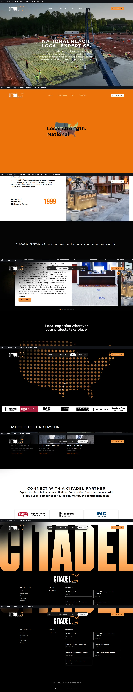
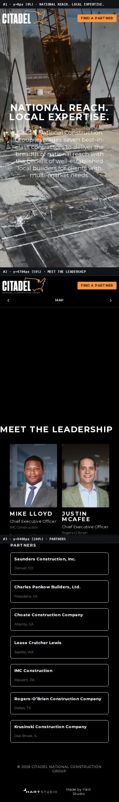

# UI Design System & Master Generation Blueprint: citadelgroup-org

> **Citadel National Construction Group · Nationwide Construction** (https://citadelgroup.org/) — Citadel connects leading regional construction firms into one nationwide network, combining local expertise with national resources to de...





---

## 1. Executive Visual Persona & Design Archetype

- **Brand Essence & Persona**: **Citadel National Construction Group · Nationwide Construction** (`https://citadelgroup.org/`). Citadel connects leading regional construction firms into one nationwide network, combining local expertise with national resources to de...
- **Capture Provenance**: Live browser capture (`tier1_fast`, HTTP `200`, captured `2026-11-24`).
- **Visual Archetype**: **Light-Gallery WebGL / Canvas Interactive Experience (`#ffffff` / `#ffa500`)**.
- **Anti-AI-Slop Differentiators**:
  - **Live-Computed Chromatic Polarity**: Anchors the viewport in `#ffffff` (live computed `body` `background-color` (`computed_styles.json`)) paired with `#000000` primary typography and `#ffa500` accents.
  - **Grounded Typographic Hierarchy**: Uses `Montserrat` across display (`NATIONAL REACH. LOCAL EXPERTISE.`) and body copy.
  - **Calibrated Spatial Grid & Motion**: Combines `1124px` container bounds (`gap: .25rem`, padding `1rem`) with `cubic-bezier(.22,1,.36,1)` easing and Three.js / WebGL Canvas Pipeline.

---

## 2. Spatial Architecture & Modular Grid Mathematics

### Viewport Allocation & Container Geometry
- **Captured Journey Filmstrips**: Desktop `1280×6624px` (`assets/desktop-journey.webp`, `8` keyframes up to `y=8978px` / doc `10119px`), Mobile `390×2616px` (`assets/mobile-journey.webp`, `3` keyframes).
- **Master Container Bounds**: `1124px` (measured widest bounded `<section>` landmark width on `1440px` desktop).
- **Canvas Lateral Padding & Spacing**: `1rem` lateral canvas padding with `.25rem` grid gap.
- **Border Radius Scale**: `999px`, `.25rem`, `.5rem`, `1rem`.

### Responsive Breakpoint Architecture
- **Desktop Layout**: Multi-column CSS Grid / Flexbox layout at `1440px` (`max-width: 1124px`, `gap: .25rem`).
- **Mobile Layout**: Single-column vertical stack at `390px` viewport width with `1rem` horizontal padding.
- **Extracted CSS Media Queries**: `@media (min-width:768px)`, `@media (min-width:1140px)`, `@media (min-width:767px)`, `@media (max-width:767px)`.

---

## 3. Color System, Materiality & Atmospheric Lighting

### Semantic Palette & Source Grounding
| Semantic Role | Ground-Truth Value | Extracted Live / CSS Source |
|---|---|---|
| **Primary Canvas Substrate** | `#ffffff` | live computed `body` `background-color` (`computed_styles.json`) |
| **Primary Typography Ink** | `#000000` | live computed `main` `color` (`computed_styles.json`) |
| **Elevated Surface / Card Substrate** | `#f7953e` | live computed `button` `background-color` (`computed_styles.json`) |
| **Interactive Accent / Highlight** | `#ffa500` | `.citadel-footer-brand-grid a:hover { color: orange }` (`#ffa500`) |
| **Secondary / Muted Copy** | `#555555` | `var(--resource-hub-text-muted)` in `:root` |
| **Structural Hairline Border** | `#aaa69e` | `var(--resource-hub-border)` in `:root` |
| **Variable Token (`--wp-block-synced-color`)** | `#7a00df` | `var(--wp-block-synced-color)` in `:root` |
| **Variable Token (`--wp-editor-canvas-background`)** | `#dddddd` | `var(--wp-editor-canvas-background)` in `:root` |
| **Variable Token (`--wp-admin-theme-color`)** | `#007cba` | `var(--wp-admin-theme-color)` in `:root` |
| **Variable Token (`--wp-admin-theme-color-darker-10`)** | `#006ba1` | `var(--wp-admin-theme-color-darker-10)` in `:root` |
| **Variable Token (`--wp-admin-theme-color-darker-20`)** | `#005a87` | `var(--wp-admin-theme-color-darker-20)` in `:root` |
| **Variable Token (`--citadel-dark-orange`)** | `#f87000` | `var(--citadel-dark-orange)` in `:root` |
| **Variable Token (`--citadel-medium-grey`)** | `#818486` | `var(--citadel-medium-grey)` in `:root` |
| **Variable Token (`--citadel-light-grey`)** | `#e3e3e4` | `var(--citadel-light-grey)` in `:root` |

### Sanitized Root CSS Variables (`ui-ux.md` Ground Truth)
| Variable Name | Extracted Value | Semantic Role |
|---|---|---|
| `--wp-block-synced-color` | `#7a00df` | Brand / Palette Token |
| `--wp-block-synced-color--rgb` | `122,0,223` | Brand / Palette Token |
| `--wp-bound-block-color` | `var(--wp-block-synced-color)` | Brand / Palette Token |
| `--wp-editor-canvas-background` | `#ddd` | Canvas / Surface Token |
| `--wp-admin-theme-color` | `#007cba` | Brand / Palette Token |
| `--wp-admin-theme-color--rgb` | `0,124,186` | Brand / Palette Token |
| `--wp-admin-theme-color-darker-10` | `#006ba1` | Canvas / Surface Token |
| `--wp-admin-theme-color-darker-10--rgb` | `0,107,160.5` | Canvas / Surface Token |
| `--wp-admin-theme-color-darker-20` | `#005a87` | Canvas / Surface Token |
| `--wp-admin-theme-color-darker-20--rgb` | `0,90,135` | Canvas / Surface Token |
| `--wp-admin-border-width-focus` | `2px` | Layout / Spatial Grid Token |
| `--wp-admin--admin-bar--position-offset` | `var(--wp-admin--admin-bar--height,0px)` | Dimension / Scale Token |
| `--citadel-orange` | `#f7953e` | Color / Atmospheric Token |
| `--citadel-dark-orange` | `#f87000` | Canvas / Surface Token |
| `--citadel-medium-grey` | `#818486` | Color / Atmospheric Token |
| `--citadel-light-grey` | `#e3e3e4` | Canvas / Surface Token |

---

## 4. Typographic Scale & Editorial Hierarchy

### Font Family Stacks
- **Display Typography**: `Montserrat`.
- **Primary Body Stack**: `Montserrat`.
- **Technical / Metadata Stack**: not declared in live computed styles (uses primary stack / `ui-monospace`).

### Typographic Scale & Rules (Live Computed & Stylesheet Grounded)
- **Hero Display (`H1`)**: live computed `h1` (`font-size: 48px`, `line-height: 48px`, `font-weight: 700`, `letter-spacing: 3.84px`).
- **Section Heading (`H2`)**: live computed `h2` (`font-size: 38.88px`, `line-height: 41.2128px`, `font-weight: 700`, `letter-spacing: 2.3328px`); rule `h2` (`font-size: clamp(2.9rem,2.9vw,3.9rem)`, `line-height: 1.02`).
- **Body Copy**: live computed `body` (`font-size: 16px`, `line-height: normal`, `font-weight: 400`); CSS variables `--font-citadel-body: "Montserrat", system-ui, sans-serif`; rule `p` (`font-size: .88rem`, `line-height: 1.35`).
- **Metadata & Navigation Labels**: live computed `nav/a` (`font-size: 16px`, `line-height: normal`, `font-weight: 400`).

---

## 5. Choreographed Motion & Interaction Physics

### Primary Easing Curves
- **Extracted Timing Functions**: `cubic-bezier(.22,1,.36,1)`.

### Per-Element Transition & Choreography Rules
- **Selector `.citadel-site-header`**: `transition: color .22s ease` extracted from `citadelgroup-org` stylesheet.
- **Selector `.logo-cover`**: `transition: background-color .36s ease,opacity .36s ease` extracted from `citadelgroup-org` stylesheet.
- **Selector `.citadel-site-nav-link`**: `transition: color .18s ease` extracted from `citadelgroup-org` stylesheet.
- **Extracted Easing Curve (`cubic-bezier(.22,1,.36,1)`)**: Governs interactive state transitions across `<header.citadel-site-header>` and `<section.citadel-about>`.
- **Runtime Interaction Engine**: Integrates Three.js / WebGL Canvas Pipeline with `prefers-reduced-motion: reduce` fallback guards.
### Measured Runtime Scroll & Interaction Telemetry (`behavioral_journey_v2`)
- **Scroll Driver Mode**: `native` (max document height `10119px`, deepest scrollY reached `8978px` across `8` desktop keyframes).
- **Detected Scroll / Motion Libraries**: `WebGL/Canvas`.
- **Hover Physics (`primary_cta` · `Citadel Construction Group`)**: Computed transition `0s` / `ease` (no static color/transform shift captured at rest).
- **Interactive Control Probe (`carousel_next` · `Next photo`)**: Triggered visual diff `29.582` (attr ` -> `, captured in `assets/state-interactive.webp`).

---

## 6. Component Wireframe & Structural DOM Map

### Visual Layout Schematic — Desktop (`1440px`, Grounded in `dom.html` & Landmark Bounding Boxes)
```
┌────────────────────────────────────────────────────────────────────────┐
│ DESKTOP VIEWPORT (1440px) — Citadel National Construction Group · Nati │
│ ====================================================================== │
│ [ <header.citadel-site-h (1440x91px)  | About · Case Studies · Map · ] │
│ ---------------------------------------------------------------------- │
│ | HERO STAGE: <section.citadel-hero> (w=1440px)                      | │
│ | H1: NATIONAL REACH. LOCAL EXPERTISE.                               | │
│ | Substrate: #ffffff | Ink: #000000 | Accent: #ffa500                | │
│ ---------------------------------------------------------------------- │
│ | SHOWCASE GRID (<section.citadel-about>) max-w: 1124px              | │
│ | +------------------------------+  +------------------------------+ | │
│ | | National Reach. Local Expert |  | Serving Clients With Nationa | | │
│ | +------------------------------+  +------------------------------+ | │
│ ---------------------------------------------------------------------- │
│ | DETAIL MODULE (<section.citadel-partners>) — Seven firms. One conn | │
│ ---------------------------------------------------------------------- │
│ [ FOOTER (<footer.site-footer-) | https://citadelgroup.org/            │
└────────────────────────────────────────────────────────────────────────┘
```

### Visual Layout Schematic — Mobile Reflow (`390px`)
```
┌────────────────────────────────────────────────────────────────────────┐
│ MOBILE VIEWPORT REFLOW (390px) — Single-Column Stack (gap: .25rem)     │
│ ====================================================================== │
│ [ HEADER BAR (<header.citadel-site-hea) | Compact Menu (390px)         │
│ ---------------------------------------------------------------------- │
│ | HERO STAGE (<section.citadel-hero>) — 390px Vertical Lead          | │
│ | H1: NATIONAL REACH. LOCAL EXPERTISE.                               | │
│ ---------------------------------------------------------------------- │
│ | SHOWCASE STACK (<section.citadel-about) — 1-Col Stack              | │
│ | [ Item 1: National Reach. Local Expertise.                       ] | │
│ | [ Item 2: Serving Clients With National Needs                    ] | │
│ ---------------------------------------------------------------------- │
│ | DETAIL STACK (<section.citadel-partner) — 1-Col (Seven firms. One c) │
│ ---------------------------------------------------------------------- │
│ [ FOOTER (<footer.site-footer-) | Stacked 390px Colophon               │
└────────────────────────────────────────────────────────────────────────┘
```

### Granular DOM Region Breakdown
1. **Brand Header & Navigation Bar (<header.citadel-site-header> — `citadelgroup-org`)**:
   - Landmark `<header class="citadel-site-header is-over-hero">` (`1440x91px`) hosting `Citadel National Construction Group ` navigation (`About · Case Studies · Map · Principals`), DOM attributes (`data-wp-strategy="async"`, `data-loaded="true"`, `data-module="scrollspy-nav"`, `data-logo-cover-surface="hidden"`), and stylesheet rule `font-primary { font-family:var(--font-primary) }`.
2. **Hero Stage & Focal Lead (<section.citadel-hero> — `NATIONAL REACH. LOCAL EXPERTISE.`)**:
   - Landmark `<section class="citadel-hero">` presenting display lead `NATIONAL REACH. LOCAL EXPERTISE.` and copy excerpt *"Citadel National Construction Group leverages seven best-in-class"* over `#ffffff` canvas and `#000000` ink.
3. **Primary Showcase & Content Grid (<section.citadel-about> — `National Reach. Local Expertise.`)**:
   - Landmark `<section class="citadel-about">` rendering section `National Reach. Local Expertise.` with copy *"L o c a l s t r e n g t h . N a t i o n a l s c a l e ."*, asset references (`www.googletagmanager.com`, `embed`, `theme-core.min.css`, `framework-md.min.css`), and grid rule `font-secondary { font-family:var(--font-secondary) }`.
4. **Interactive Detail & Feature Matrix (<section.citadel-partners> — `Serving Clients With National Need`)**:
   - Landmark `<section class="citadel-partners py-10">` framing `Serving Clients With National Needs` and `Seven firms. One connected construction network.` (*"L o c a l s t r e n g t h ."*) with `#f7953e` surface cards, `#ffa500` accents, and `font-open-sans { font-family:var(--font-base) }`.
5. **Colophon & Global Directory Footer (<footer.site-footer-meta> — `https://citadelgroup.org/`)**:
   - Landmark `<footer class="site-footer-meta">` anchoring `Citadel National Construction Gr` footer links (`About · Case Studies · Map · Principals`), copy *"N a t i o n a l s c a l e ."*, and `#aaa69e` structural dividers.
### Full Vertical Scroll Sequence (Desktop `1440×900` Keyframes)
- **Step 01** (`y=0px`, `0%`): Active landmark `NATIONAL REACH. LOCAL EXPERTISE.` · sticky/fixed elements: `2`
- **Step 02** (`y=850px`, `9%`): Active landmark `NATIONAL REACH. LOCAL EXPERTISE.` · sticky/fixed elements: `2`
- **Step 03** (`y=2550px`, `28%`): Active landmark `Seven firms. One connected construction network.` · sticky/fixed elements: `1`
- **Step 04** (`y=4250px`, `47%`): Active landmark `#map` · sticky/fixed elements: `1`
- **Step 05** (`y=5100px`, `57%`): Active landmark `MEET THE LEADERSHIP` · sticky/fixed elements: `1`
- **Step 06** (`y=6800px`, `76%`): Active landmark `MATT BREWER` · sticky/fixed elements: `1`
- **Step 07** (`y=8500px`, `95%`): Active landmark `WE ARE CITADEL` · sticky/fixed elements: `1`
- **Step 08** (`y=8978px`, `100%`): Active landmark `WE ARE CITADEL` · sticky/fixed elements: `1`

---

## 7. Master Zero-Shot AI Generation Prompt

```markdown
# Master Zero-Shot Frontend Generation Prompt: citadelgroup-org (Citadel National Construction Group · Nationwide Construction)

You are a principal frontend architect and design systems engineer. Build a complete, production-ready web application replicating the exact design system, DOM landmarks, typographic hierarchy, color tokens, and motion physics of `citadelgroup-org` (**Citadel National Construction Group · Nationwide Construction** — `https://citadelgroup.org/`).

### 1. Visual Archetype & Anti-AI-Slop Mandates
- **Archetype**: Light-Gallery WebGL / Canvas Interactive Experience (`#ffffff` / `#ffa500`).
- **Identity & Domain Context**: Citadel connects leading regional construction firms into one nationwide network, combining local expertise with national resources to de...
- **Primary Substrate**: `#ffffff` (live computed `body` `background-color` (`computed_styles.json`)), **Primary Ink**: `#000000`, **Accent / Highlight**: `#ffa500`.
- **Site-Specific Differentiators**:
  - **Live-Computed Chromatic Polarity**: Anchors the viewport in `#ffffff` (live computed `body` `background-color` (`computed_styles.json`)) paired with `#000000` primary typography and `#ffa500` accents.
  - **Grounded Typographic Hierarchy**: Uses `Montserrat` across display (`NATIONAL REACH. LOCAL EXPERTISE.`) and body copy.
  - **Calibrated Spatial Grid & Motion**: Combines `1124px` container bounds (`gap: .25rem`, padding `1rem`) with `cubic-bezier(.22,1,.36,1)` easing and Three.js / WebGL Canvas Pipeline.

### 2. Ground-Truth CSS Variables (`:root` Token Contract)
Declare and consume these exact custom properties extracted from `citadelgroup-org` in your global stylesheet:

:root {
  /* Citadel National Construction Group · Nationwide Construction (citadelgroup-org) — Live-Grounded CSS Variables */
  --wp-block-synced-color: #7a00df; /* Brand / Palette Token (citadelgroup-org) */
  --wp-block-synced-color--rgb: 122,0,223; /* Brand / Palette Token (citadelgroup-org) */
  --wp-bound-block-color: var(--wp-block-synced-color); /* Brand / Palette Token (citadelgroup-org) */
  --wp-editor-canvas-background: #ddd; /* Canvas / Surface Token (citadelgroup-org) */
  --wp-admin-theme-color: #007cba; /* Brand / Palette Token (citadelgroup-org) */
  --wp-admin-theme-color--rgb: 0,124,186; /* Brand / Palette Token (citadelgroup-org) */
  --wp-admin-theme-color-darker-10: #006ba1; /* Canvas / Surface Token (citadelgroup-org) */
  --wp-admin-theme-color-darker-10--rgb: 0,107,160.5; /* Canvas / Surface Token (citadelgroup-org) */
  --wp-admin-theme-color-darker-20: #005a87; /* Canvas / Surface Token (citadelgroup-org) */
  --wp-admin-theme-color-darker-20--rgb: 0,90,135; /* Canvas / Surface Token (citadelgroup-org) */
  --wp-admin-border-width-focus: 2px; /* Layout / Spatial Grid Token (citadelgroup-org) */
  --wp-admin--admin-bar--position-offset: var(--wp-admin--admin-bar--height,0px); /* Dimension / Scale Token (citadelgroup-org) */
  --citadel-orange: #f7953e; /* Color / Atmospheric Token (citadelgroup-org) */
  --citadel-dark-orange: #f87000; /* Canvas / Surface Token (citadelgroup-org) */
  --citadel-medium-grey: #818486; /* Color / Atmospheric Token (citadelgroup-org) */
  --citadel-light-grey: #e3e3e4; /* Canvas / Surface Token (citadelgroup-org) */
}

### 3. Semantic Color & Materiality Contract
Map every surface, ink, and border strictly to these source-grounded tokens:
- **Primary Canvas Substrate**: `#ffffff` — grounded in live computed `body` `background-color` (`computed_styles.json`)
- **Primary Typography Ink**: `#000000` — grounded in live computed `main` `color` (`computed_styles.json`)
- **Elevated Surface / Card Substrate**: `#f7953e` — grounded in live computed `button` `background-color` (`computed_styles.json`)
- **Interactive Accent / Highlight**: `#ffa500` — grounded in `.citadel-footer-brand-grid a:hover { color: orange }` (`#ffa500`)
- **Secondary / Muted Copy**: `#555555` — grounded in `var(--resource-hub-text-muted)` in `:root`
- **Structural Hairline Border**: `#aaa69e` — grounded in `var(--resource-hub-border)` in `:root`
- **Variable Token (`--wp-block-synced-color`)**: `#7a00df` — grounded in `var(--wp-block-synced-color)` in `:root`
- **Variable Token (`--wp-editor-canvas-background`)**: `#dddddd` — grounded in `var(--wp-editor-canvas-background)` in `:root`
- **Variable Token (`--wp-admin-theme-color`)**: `#007cba` — grounded in `var(--wp-admin-theme-color)` in `:root`
- **Variable Token (`--wp-admin-theme-color-darker-10`)**: `#006ba1` — grounded in `var(--wp-admin-theme-color-darker-10)` in `:root`
- **Variable Token (`--wp-admin-theme-color-darker-20`)**: `#005a87` — grounded in `var(--wp-admin-theme-color-darker-20)` in `:root`
- **Variable Token (`--citadel-dark-orange`)**: `#f87000` — grounded in `var(--citadel-dark-orange)` in `:root`
- **Variable Token (`--citadel-medium-grey`)**: `#818486` — grounded in `var(--citadel-medium-grey)` in `:root`
- **Variable Token (`--citadel-light-grey`)**: `#e3e3e4` — grounded in `var(--citadel-light-grey)` in `:root`

### 4. Spatial Grid, Container Bounds & Responsive Breakpoints
- **Desktop Viewport Reference**: `1280×6624px` (multi-frame vertical journey filmstrip (6624px), `1440px` standard desktop width).
- **Mobile Viewport Reference**: `390×2616px` (multi-frame vertical journey filmstrip (2616px), `390px` standard mobile width).
- **Container Max-Width**: `1124px` (measured widest bounded `<section>` landmark width on `1440px` desktop)
- **Padding & Gutters**: `1rem` lateral canvas padding with `.25rem` grid gap
- **Desktop Grid**: Multi-column CSS Grid / Flexbox layout at `1440px` (`max-width: 1124px`, `gap: .25rem`)
- **Mobile Adaptation**: Single-column vertical stack at `390px` viewport width with `1rem` horizontal padding
- **Media Queries**: `@media (min-width:768px)`, `@media (min-width:1140px)`, `@media (min-width:767px)`, `@media (max-width:767px)`
- **Corner Radii**: `999px`, `.25rem`, `.5rem`, `1rem`

### 5. Typography & Editorial Scale Contract
- **Display Font Stack**: `Montserrat`
- **Body Font Stack**: `Montserrat`
- **Monospace / Technical Font Stack**: not declared in live computed styles (uses primary stack / `ui-monospace`)
- **H1 Display Rule**: live computed `h1` (`font-size: 48px`, `line-height: 48px`, `font-weight: 700`, `letter-spacing: 3.84px`)
- **H2 Section Rule**: live computed `h2` (`font-size: 38.88px`, `line-height: 41.2128px`, `font-weight: 700`, `letter-spacing: 2.3328px`); rule `h2` (`font-size: clamp(2.9rem,2.9vw,3.9rem)`, `line-height: 1.02`)
- **Body Copy Rule**: live computed `body` (`font-size: 16px`, `line-height: normal`, `font-weight: 400`); CSS variables `--font-citadel-body: "Montserrat", system-ui, sans-serif`; rule `p` (`font-size: .88rem`, `line-height: 1.35`)
- **Metadata & Index Rule**: live computed `nav/a` (`font-size: 16px`, `line-height: normal`, `font-weight: 400`)

### 6. Component Hierarchy, Verbatim Copy & Real DOM Landmarks
Scaffold `citadelgroup-org` (`Citadel National Construction Group · Nationwide Construction`) with these exact structural regions, extracted copy, and CSS rules from `dom.html`:
1. **Brand Header & Navigation Bar (<header.citadel-site-header> — `citadelgroup-org`)**:
   - DOM & Selectors: Landmark `<header class="citadel-site-header is-over-hero">` (`1440x91px`) hosting `Citadel National Construction Group ` navigation (`About · Case Studies · Map · Principals`), DOM attributes (`data-wp-strategy="async"`, `data-loaded="true"`, `data-module="scrollspy-nav"`, `data-logo-cover-surface="hidden"`), and stylesheet rule `font-primary { font-family:var(--font-primary) }`.
   - Responsive Contract: Header `Brand Header & Navigation Bar (<header.citadel-site-header> — `citadelgroup-org`)` (`citadelgroup-org`) adapts across `@media (min-width:768px)`, `@media (min-width:1140px)`, `@media (min-width:767px)`, `@media (max-width:767px)` with `cubic-bezier(.22,1,.36,1)` transitions and links `About · Case Studies · Map · Principals`.
2. **Hero Stage & Focal Lead (<section.citadel-hero> — `NATIONAL REACH. LOCAL EXPERTISE.`)**:
   - DOM & Selectors: Landmark `<section class="citadel-hero">` presenting display lead `NATIONAL REACH. LOCAL EXPERTISE.` and copy excerpt *"Citadel National Construction Group leverages seven best-in-class"* over `#ffffff` canvas and `#000000` ink.
   - Responsive Contract: Hero stage (`1280×6624px` desktop / `390×2616px` mobile) sets `#ffffff` background with `#000000` headline `NATIONAL REACH. LOCAL EXPERTISE.`.
3. **Primary Showcase & Content Grid (<section.citadel-about> — `National Reach. Local Expertise.`)**:
   - DOM & Selectors: Landmark `<section class="citadel-about">` rendering section `National Reach. Local Expertise.` with copy *"L o c a l s t r e n g t h . N a t i o n a l s c a l e ."*, asset references (`www.googletagmanager.com`, `embed`, `theme-core.min.css`, `framework-md.min.css`), and grid rule `font-secondary { font-family:var(--font-secondary) }`.
   - Responsive Contract: Showcase grid `Primary Showcase & Content Grid (<section.citadel-about> — `National Reach. Local Expertise.`)` applies Multi-column CSS Grid / Flexbox layout at `1440px` (`max-width: 1124px`, `gap: .25rem`) on desktop and Single-column vertical stack at `390px` viewport width with `1rem` horizontal padding on mobile.
4. **Interactive Detail & Feature Matrix (<section.citadel-partners> — `Serving Clients With National Need`)**:
   - DOM & Selectors: Landmark `<section class="citadel-partners py-10">` framing `Serving Clients With National Needs` and `Seven firms. One connected construction network.` (*"L o c a l s t r e n g t h ."*) with `#f7953e` surface cards, `#ffa500` accents, and `font-open-sans { font-family:var(--font-base) }`.
   - Responsive Contract: Detail module `Interactive Detail & Feature Matrix (<section.citadel-partners> — `Serving Clients With National Need`)` uses `999px`, `.25rem`, `.5rem`, `1rem` radii, `#ffa500` highlights, and assets (www.googletagmanager.com, embed, theme-core.min.css).
5. **Colophon & Global Directory Footer (<footer.site-footer-meta> — `https://citadelgroup.org/`)**:
   - DOM & Selectors: Landmark `<footer class="site-footer-meta">` anchoring `Citadel National Construction Gr` footer links (`About · Case Studies · Map · Principals`), copy *"N a t i o n a l s c a l e ."*, and `#aaa69e` structural dividers.
   - Responsive Contract: Footer `Colophon & Global Directory Footer (<footer.site-footer-meta> — `https://citadelgroup.org/`)` aligns to `1124px` (measured widest bounded `<section>` landmark width on `1440px` desktop) with `1rem` lateral canvas padding with `.25rem` grid gap and attributes (data-wp-strategy="async", data-loaded="true", data-module="scrollspy-nav").

#### Verbatim DOM Copy Excerpts (`dom.html`)
- Copy Excerpt 1: *"Citadel National Construction Group leverages seven best-in-class contractors to d..."*
- Copy Excerpt 2: *"L o c a l s t r e n g t h . N a t i o n a l s c a l e ."*
- Copy Excerpt 3: *"L o c a l s t r e n g t h ."*
- Copy Excerpt 4: *"N a t i o n a l s c a l e ."*

### 7. Motion, Extracted Stylesheet Rules & Interaction Choreography
- **Primary Easing Functions**: `cubic-bezier(.22,1,.36,1)`
- **Extracted Stylesheet Rules (`citadelgroup-org`)**:
- `font-primary { font-family:var(--font-primary) }`
- `font-secondary { font-family:var(--font-secondary) }`
- `font-open-sans { font-family:var(--font-base) }`
- `font-trump { font-family:var(--font-trump) }`
- `text-dark { color:var(--color-dark) }`
- **Per-Selector Transition Rules**:
- **Selector `.citadel-site-header`**: `transition: color .22s ease` extracted from `citadelgroup-org` stylesheet.
- **Selector `.logo-cover`**: `transition: background-color .36s ease,opacity .36s ease` extracted from `citadelgroup-org` stylesheet.
- **Selector `.citadel-site-nav-link`**: `transition: color .18s ease` extracted from `citadelgroup-org` stylesheet.
- **Extracted Easing Curve (`cubic-bezier(.22,1,.36,1)`)**: Governs interactive state transitions across `<header.citadel-site-header>` and `<section.citadel-about>`.
- **Runtime Interaction Engine**: Integrates Three.js / WebGL Canvas Pipeline with `prefers-reduced-motion: reduce` fallback guards.
### 7b. Full-Page Scroll Choreography, Interactive States & Multi-Page Routes
- **Scroll Mechanics**: Implement `native` vertical progression up to `10119px` across 8 distinct viewport chapters using WebGL/Canvas.
- **Vertical Chapter Sequence**: NATIONAL REACH. LOCAL EXPER... (0%) -> NATIONAL REACH. LOCAL EXPER... (9%) -> Seven firms. One connected... (28%) -> #map (47%) -> MEET THE LEADERSHIP (57%) -> MATT BREWER (76%) -> WE ARE CITADEL (95%) -> WE ARE CITADEL (100%).

### 8. Technical Deliverables
- Implement in Next.js (App Router) with TypeScript and Tailwind CSS consuming the `:root` custom properties defined above for `citadelgroup-org`.
- Reproduce both the `1440px` desktop architecture and `390px` mobile breakpoint transitions, preserving semantic HTML5 landmarks (`<header>`, `<nav>`, `<main>`, `<section>`, `<footer>`) and `prefers-reduced-motion` accessibility guards.
```
---

## 8. Full-Page Scroll Journey, Interactive States & Subpage Inventory

### Desktop Scroll Keyframes (`1440×900` WebP)
| Step | Scroll Y | Progress | Active Landmark / Section | Sticky/Fixed | Visual Asset |
| :---: | :---: | :---: | :--- | :---: | :--- |
| `#01` | `0px` | `0%` | NATIONAL REACH. LOCAL EXPERTISE. | `2` | [desktop-step-01.webp](assets/desktop-step-01.webp) |
| `#02` | `850px` | `9%` | NATIONAL REACH. LOCAL EXPERTISE. | `2` | [desktop-step-02.webp](assets/desktop-step-02.webp) |
| `#03` | `2550px` | `28%` | Seven firms. One connected construction network. | `1` | [desktop-step-03.webp](assets/desktop-step-03.webp) |
| `#04` | `4250px` | `47%` | #map | `1` | [desktop-step-04.webp](assets/desktop-step-04.webp) |
| `#05` | `5100px` | `57%` | MEET THE LEADERSHIP | `1` | [desktop-step-05.webp](assets/desktop-step-05.webp) |
| `#06` | `6800px` | `76%` | MATT BREWER | `1` | [desktop-step-06.webp](assets/desktop-step-06.webp) |
| `#07` | `8500px` | `95%` | WE ARE CITADEL | `1` | [desktop-step-07.webp](assets/desktop-step-07.webp) |
| `#08` | `8978px` | `100%` | WE ARE CITADEL | `1` | [desktop-step-08.webp](assets/desktop-step-08.webp) |

### Mobile Condensed Keyframes (`390×844` WebP)
| Step | Scroll Y | Progress | Active Landmark | Visual Asset |
| :---: | :---: | :---: | :--- | :--- |
| `#01` | `0px` | `0%` | NATIONAL REACH. LOCAL EXPERTISE. | [mobile-step-01.webp](assets/mobile-step-01.webp) |
| `#02` | `4704px` | `50%` | MEET THE LEADERSHIP | [mobile-step-02.webp](assets/mobile-step-02.webp) |
| `#03` | `9408px` | `100%` | PARTNERS | [mobile-step-03.webp](assets/mobile-step-03.webp) |

### Interactive UI State Captures (`1440×900` WebP)
| State Type | Trigger / Observation | Visual Asset |
| :--- | :--- | :--- |
| `interactive_control` | Control `carousel_next` (`Next photo`, diff `29.582`) | [state-interactive.webp](assets/state-interactive.webp) |

