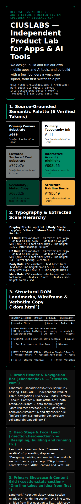

# UI Design System & Master Generation Blueprint: ciuslabs-com

> **CIUSLABS — Independent Product Lab for Apps & AI Tools** (https://ciuslabs.com/) — We design, build and run our own mobile apps and AI tools, and co-build with a few founders a year: one squad, from first sketch to a pro...


---

## 1. Executive Visual Persona & Design Archetype

- **Brand Essence & Persona**: **CIUSLABS — Independent Product Lab for Apps & AI Tools** (`https://ciuslabs.com/`). We design, build and run our own mobile apps and AI tools, and co-build with a few founders a year: one squad, from first sketch to a pro...
- **Visual Archetype**: **Dark-Substrate WebGL / Canvas Interactive Experience (`#000` / `#008b66`)**.
- **Anti-AI-Slop Differentiators**:
  - **Source-Grounded Chromatic Polarity**: Anchors the viewport in `#000` (`var(--color-black)` in `:root`) paired with `#fff` primary typography and `#008b66` accents.
  - **Extracted Typographic Hierarchy**: Pairs `appFont` for display copy (`Designing, building and running the `) with `appFont Fallback` and `SFMono-Regular`.
  - **Calibrated Spatial Grid & Motion**: Combines `var(--ds-max-width-page)` container bounds (`gap: var(--ds-space-xs)`, padding `var(--ds-space-gutter)`) with `cubic-bezier(.4,0,1,1)` easing and Lenis Smooth Scroll (`data-lenis`), Three.js / WebGL Canvas Pipeline.

---

## 2. Spatial Architecture & Modular Grid Mathematics



### Viewport Allocation & Container Geometry
- **Captured Viewport Dimensions**: Desktop `1440×10891px` (`assets/desktop.png`, full-page scroll capture), Mobile `390×2400px` (`assets/mobile.png`, capped at 2400px multi-section capture).
- **Master Container Bounds**: `var(--ds-max-width-page)` extracted from `ciuslabs-com` stylesheet.
- **Canvas Lateral Padding & Spacing**: `var(--ds-space-gutter)` lateral canvas padding with `var(--ds-space-xs)` grid gap.
- **Border Radius Scale**: `999px`, `var(--ds-radius-m)`, `var(--ds-radius-xs)`, `var(--ds-radius-full)`.

### Responsive Breakpoint Architecture
- **Desktop Layout**: Multi-column CSS Grid / Flexbox layout at `1440px` (`max-width: var(--ds-max-width-page)`, `gap: var(--ds-space-xs)`).
- **Mobile Layout**: Single-column vertical stack at `390px` viewport width with `var(--ds-space-gutter)` horizontal padding.
- **Extracted CSS Media Queries**: `@media (prefers-reduced-motion:reduce)`, `@media (min-width:640px)`, `@media (min-width:810px)`, `@media (min-width:1200px)`.

---

## 3. Color System, Materiality & Atmospheric Lighting

### Semantic Palette & Source Grounding
| Semantic Role | Ground-Truth Value | Extracted CSS Source / Selector |
|---|---|---|
| **Primary Canvas Substrate** | `#000` | `var(--color-black)` in `:root` |
| **Primary Typography Ink** | `#fff` | `var(--color-white)` in `:root` |
| **Elevated Surface / Card Substrate** | `#797e7e` | `var(--ds-mark-subtle)` in `:root` |
| **Interactive Accent / Highlight** | `#008b66` | `var(--ds-success)` in `:root` |
| **Secondary / Muted Copy** | `#003d2b` | `var(--ds-success-text)` in `:root` |
| **Structural Hairline Border** | `#f9b649` | `var(--ds-warning)` in `:root` |

### Sanitized Root CSS Variables (`ui-ux.md` Ground Truth)
| Variable Name | Extracted Value | Semantic Role |
|---|---|---|
| `--font-sans` | `var(--ds-font-sans)` | Typography / Scale Token |
| `--font-mono` | `var(--ds-font-mono)` | Typography / Scale Token |
| `--color-red-500` | `oklch(63.7% .237 25.331)` | Brand / Palette Token |
| `--color-blue-500` | `oklch(62.3% .214 259.815)` | Brand / Palette Token |
| `--color-gray-200` | `oklch(92.8% .006 264.531)` | Brand / Palette Token |
| `--color-gray-500` | `oklch(55.1% .027 264.364)` | Brand / Palette Token |
| `--color-zinc-100` | `oklch(96.7% .001 286.375)` | Brand / Palette Token |
| `--color-zinc-200` | `oklch(92% .004 286.32)` | Brand / Palette Token |
| `--color-zinc-700` | `oklch(37% .013 285.805)` | Brand / Palette Token |
| `--color-zinc-900` | `oklch(21% .006 285.885)` | Brand / Palette Token |
| `--color-neutral-200` | `oklch(92.2% 0 none)` | Brand / Palette Token |
| `--color-neutral-950` | `oklch(14.5% 0 none)` | Brand / Palette Token |
| `--color-black` | `#000` | Canvas / Surface Token |
| `--color-white` | `#fff` | Canvas / Surface Token |
| `--spacing` | `.25rem` | Layout / Spatial Grid Token |
| `--container-xs` | `20rem` | Layout / Spatial Grid Token |

---

## 4. Typographic Scale & Editorial Hierarchy

### Font Family Stacks
- **Display Typography**: `appFont`.
- **Primary Body Stack**: `appFont Fallback`.
- **Technical / Metadata Stack**: `SFMono-Regular`.

### Typographic Scale & Rules (Extracted from Stylesheet & Variables)
- **Hero Display (`H1`)**: CSS variables `--ds-text-h1-size: 48px`, `--ds-text-h1-line: 52px`, `--ds-text-h1-weight: 500`; rule `h1` (`font-size: 40px`, `line-height: 1.05`, `letter-spacing: -.035em`).
- **Section Heading (`H2`)**: CSS variables `--ds-text-h2-size: 36px`, `--ds-text-h2-line: 40px`, `--ds-text-h2-weight: 500`; rule `h2` (`font-size: 32px`, `line-height: 1.1`, `letter-spacing: -.025em`).
- **Body Copy**: CSS variables `--text-base: 1rem`, `--text-base--line-height: calc(1.5 / 1)`, `--ds-text-body-size: 16px`; rule `p` (`line-height: 18px`).
- **Metadata & Navigation Labels**: CSS variables `--font-mono: var(--ds-font-mono)`, `--text-xs: .75rem`, `--text-xs--line-height: calc(1 / .75)`.

---

## 5. Choreographed Motion & Interaction Physics

### Primary Easing Curves
- **Extracted Timing Functions**: `cubic-bezier(.4,0,1,1)`, `cubic-bezier(0,0,.2,1)`, `cubic-bezier(.4,0,.2,1)`.

### Per-Element Transition & Choreography Rules
- **Selector `layer theme`**: `transition: .15s` extracted from `ciuslabs-com` stylesheet.
- **Selector `.ds-popup`**: `transition: opacity var(--ds-duration-s) var(--ds-ease-s),scale var(--ds-d...` extracted from `ciuslabs-com` stylesheet.
- **Selector `.ds-popup[data-side=none]`**: `transition: none` extracted from `ciuslabs-com` stylesheet.
- **Extracted Easing Curve (`cubic-bezier(.4,0,1,1)`)**: Governs interactive state transitions across `<header.flex>` and `<section.stats-section>`.
- **Runtime Interaction Engine**: Integrates Lenis Smooth Scroll (`data-lenis`), Three.js / WebGL Canvas Pipeline with `prefers-reduced-motion: reduce` fallback guards.

---

## 6. Component Wireframe & Structural DOM Map

### Visual Layout Schematic (Grounded in `dom.html` — `1440px` Desktop & `390px` Mobile Reflow)
```
┌────────────────────────────────────────────────────────────────────────┐
│ DESKTOP VIEWPORT (1440px) — CIUSLABS — Independent Product Lab for App │
│ ====================================================================== │
│ [ <header.flex>            | Overview · Index · Archive · About · C ]  │
│ ---------------------------------------------------------------------- │
│ | HERO STAGE: <section.hero-section>                               |   │
│ | H1: Designing, building and running the products we own.         |   │
│ | Substrate: #000       | Ink: #fff       | Accent: #008b66        |   │
│ ---------------------------------------------------------------------- │
│ | SHOWCASE GRID (<section.stats-section>   ) max-w: var(--ds-max-w |   │
│ | +------------------------------+  +------------------------------+ | │
│ | | One line takes an idea from  |  | Discover                     | | │
│ | +------------------------------+  +------------------------------+ | │
│ ---------------------------------------------------------------------- │
│ | MOBILE VIEWPORT REFLOW (390px) — Single-Column Stack (gap: var(--) | │
│ | [<header.flex>] -> [<section.hero-sect] -> [<section.stats-sec] |    │
│ ---------------------------------------------------------------------- │
│ [ FOOTER (<footer.relative>     ) | https://ciuslabs.com/              │
└────────────────────────────────────────────────────────────────────────┘
```

### Granular DOM Region Breakdown
1. **Brand Header & Navigation Bar (<header.flex> — `ciuslabs-com`)**:
   - Landmark `<header class="flex shrink-0">` hosting `CIUSLABS — Independent Product Lab f` navigation (`Overview · Index · Archive · About · Contact`), DOM attributes (`data-brand="ciuslabs"`, `data-theme="light"`, `data-redirect-timezone="1"`, `data-scroll-behavior="smooth"`), and stylesheet rule `before { box-sizing:border-box;border:0 solid;margin:0;padding:0 }`.
2. **Hero Stage & Focal Lead (<section.hero-section> — `Designing, building and running th`)**:
   - Landmark `<section class="hero-section relative">` presenting display lead `Designing, building and running the products we own.` and copy excerpt *"Skip to main content"* over `#000` canvas and `#fff` ink.
3. **Primary Showcase & Content Grid (<section.stats-section> — `One line takes an idea from first `)**:
   - Landmark `<section class="stats-section relative">` rendering section `One line takes an idea from first question to liv...` with copy *"Products P r o d u c t s"*, asset references (`Logo.svg`, `horus.svg`, `ae4eeb438964a460.css`, `344affef6ccd7e28.css`), and grid rule `file-selector-button { box-sizing:border-box;border:0 solid;margin:0;padding:0 }`.
4. **Interactive Detail & Feature Matrix (<section.relative> — `Discover`)**:
   - Landmark `<section class="relative w-full">` framing `Discover` and `Architect` (*"Pricing P r i c i n g"*) with `#797e7e` surface cards, `#008b66` accents, and `strong { font-weight:bolder }`.
5. **Colophon & Global Directory Footer (<footer.relative> — `https://ciuslabs.com/`)**:
   - Landmark `<footer class="relative w-full">` anchoring `CIUSLABS — Independent Product L` footer links (`Overview · Index · Archive · About · Contact`), copy *"Contact C o n t a c t"*, and `#f9b649` structural dividers.

---

## 7. Master Zero-Shot AI Generation Prompt

```markdown
# Master Zero-Shot Frontend Generation Prompt: ciuslabs-com (CIUSLABS — Independent Product Lab for Apps & AI Tools)

You are a principal frontend architect and design systems engineer. Build a complete, production-ready web application replicating the exact design system, DOM landmarks, typographic hierarchy, color tokens, and motion physics of `ciuslabs-com` (**CIUSLABS — Independent Product Lab for Apps & AI Tools** — `https://ciuslabs.com/`).

### 1. Visual Archetype & Anti-AI-Slop Mandates
- **Archetype**: Dark-Substrate WebGL / Canvas Interactive Experience (`#000` / `#008b66`).
- **Identity & Domain Context**: We design, build and run our own mobile apps and AI tools, and co-build with a few founders a year: one squad, from first sketch to a pro...
- **Primary Substrate**: `#000` (`var(--color-black)` in `:root`), **Primary Ink**: `#fff`, **Accent / Highlight**: `#008b66`.
- **Site-Specific Differentiators**:
  - **Source-Grounded Chromatic Polarity**: Anchors the viewport in `#000` (`var(--color-black)` in `:root`) paired with `#fff` primary typography and `#008b66` accents.
  - **Extracted Typographic Hierarchy**: Pairs `appFont` for display copy (`Designing, building and running the `) with `appFont Fallback` and `SFMono-Regular`.
  - **Calibrated Spatial Grid & Motion**: Combines `var(--ds-max-width-page)` container bounds (`gap: var(--ds-space-xs)`, padding `var(--ds-space-gutter)`) with `cubic-bezier(.4,0,1,1)` easing and Lenis Smooth Scroll (`data-lenis`), Three.js / WebGL Canvas Pipeline.

### 2. Ground-Truth CSS Variables (`:root` Token Contract)
Declare and consume these exact custom properties extracted from `ciuslabs-com` in your global stylesheet:

:root {
  /* CIUSLABS — Independent Product Lab for Apps & AI Tools (ciuslabs-com) — Ground-Truth Extracted CSS Variables */
  --font-sans: var(--ds-font-sans); /* Typography / Scale Token (ciuslabs-com) */
  --font-mono: var(--ds-font-mono); /* Typography / Scale Token (ciuslabs-com) */
  --color-red-500: oklch(63.7% .237 25.331); /* Brand / Palette Token (ciuslabs-com) */
  --color-blue-500: oklch(62.3% .214 259.815); /* Brand / Palette Token (ciuslabs-com) */
  --color-gray-200: oklch(92.8% .006 264.531); /* Brand / Palette Token (ciuslabs-com) */
  --color-gray-500: oklch(55.1% .027 264.364); /* Brand / Palette Token (ciuslabs-com) */
  --color-zinc-100: oklch(96.7% .001 286.375); /* Brand / Palette Token (ciuslabs-com) */
  --color-zinc-200: oklch(92% .004 286.32); /* Brand / Palette Token (ciuslabs-com) */
  --color-zinc-700: oklch(37% .013 285.805); /* Brand / Palette Token (ciuslabs-com) */
  --color-zinc-900: oklch(21% .006 285.885); /* Brand / Palette Token (ciuslabs-com) */
  --color-neutral-200: oklch(92.2% 0 none); /* Brand / Palette Token (ciuslabs-com) */
  --color-neutral-950: oklch(14.5% 0 none); /* Brand / Palette Token (ciuslabs-com) */
  --color-black: #000; /* Canvas / Surface Token (ciuslabs-com) */
  --color-white: #fff; /* Canvas / Surface Token (ciuslabs-com) */
  --spacing: .25rem; /* Layout / Spatial Grid Token (ciuslabs-com) */
  --container-xs: 20rem; /* Layout / Spatial Grid Token (ciuslabs-com) */
}

### 3. Semantic Color & Materiality Contract
Map every surface, ink, and border strictly to these source-grounded tokens:
- **Primary Canvas Substrate**: `#000` — grounded in `var(--color-black)` in `:root`
- **Primary Typography Ink**: `#fff` — grounded in `var(--color-white)` in `:root`
- **Elevated Surface / Card Substrate**: `#797e7e` — grounded in `var(--ds-mark-subtle)` in `:root`
- **Interactive Accent / Highlight**: `#008b66` — grounded in `var(--ds-success)` in `:root`
- **Secondary / Muted Copy**: `#003d2b` — grounded in `var(--ds-success-text)` in `:root`
- **Structural Hairline Border**: `#f9b649` — grounded in `var(--ds-warning)` in `:root`

### 4. Spatial Grid, Container Bounds & Responsive Breakpoints
- **Desktop Viewport Reference**: `1440×10891px` (full-page scroll capture, `1440px` standard desktop width).
- **Mobile Viewport Reference**: `390×2400px` (capped at 2400px multi-section capture, `390px` standard mobile width).
- **Container Max-Width**: `var(--ds-max-width-page)` extracted from `ciuslabs-com` stylesheet
- **Padding & Gutters**: `var(--ds-space-gutter)` lateral canvas padding with `var(--ds-space-xs)` grid gap
- **Desktop Grid**: Multi-column CSS Grid / Flexbox layout at `1440px` (`max-width: var(--ds-max-width-page)`, `gap: var(--ds-space-xs)`)
- **Mobile Adaptation**: Single-column vertical stack at `390px` viewport width with `var(--ds-space-gutter)` horizontal padding
- **Media Queries**: `@media (prefers-reduced-motion:reduce)`, `@media (min-width:640px)`, `@media (min-width:810px)`, `@media (min-width:1200px)`
- **Corner Radii**: `999px`, `var(--ds-radius-m)`, `var(--ds-radius-xs)`, `var(--ds-radius-full)`

### 5. Typography & Editorial Scale Contract
- **Display Font Stack**: `appFont`
- **Body Font Stack**: `appFont Fallback`
- **Monospace / Technical Font Stack**: `SFMono-Regular`
- **H1 Display Rule**: CSS variables `--ds-text-h1-size: 48px`, `--ds-text-h1-line: 52px`, `--ds-text-h1-weight: 500`; rule `h1` (`font-size: 40px`, `line-height: 1.05`, `letter-spacing: -.035em`)
- **H2 Section Rule**: CSS variables `--ds-text-h2-size: 36px`, `--ds-text-h2-line: 40px`, `--ds-text-h2-weight: 500`; rule `h2` (`font-size: 32px`, `line-height: 1.1`, `letter-spacing: -.025em`)
- **Body Copy Rule**: CSS variables `--text-base: 1rem`, `--text-base--line-height: calc(1.5 / 1)`, `--ds-text-body-size: 16px`; rule `p` (`line-height: 18px`)
- **Metadata & Index Rule**: CSS variables `--font-mono: var(--ds-font-mono)`, `--text-xs: .75rem`, `--text-xs--line-height: calc(1 / .75)`

### 6. Component Hierarchy, Verbatim Copy & Real DOM Landmarks
Scaffold `ciuslabs-com` (`CIUSLABS — Independent Product Lab for Apps & AI Tools`) with these exact structural regions, extracted copy, and CSS rules from `dom.html`:
1. **Brand Header & Navigation Bar (<header.flex> — `ciuslabs-com`)**:
   - DOM & Selectors: Landmark `<header class="flex shrink-0">` hosting `CIUSLABS — Independent Product Lab f` navigation (`Overview · Index · Archive · About · Contact`), DOM attributes (`data-brand="ciuslabs"`, `data-theme="light"`, `data-redirect-timezone="1"`, `data-scroll-behavior="smooth"`), and stylesheet rule `before { box-sizing:border-box;border:0 solid;margin:0;padding:0 }`.
   - Responsive Contract: Header `Brand Header & Navigation Bar (<header.flex> — `ciuslabs-com`)` (`ciuslabs-com`) adapts across `@media (prefers-reduced-motion:reduce)`, `@media (min-width:640px)`, `@media (min-width:810px)`, `@media (min-width:1200px)` with `cubic-bezier(.4,0,1,1)`, `cubic-bezier(0,0,.2,1)`, `cubic-bezier(.4,0,.2,1)` transitions and links `Overview · Index · Archive · About · Contact`.
2. **Hero Stage & Focal Lead (<section.hero-section> — `Designing, building and running th`)**:
   - DOM & Selectors: Landmark `<section class="hero-section relative">` presenting display lead `Designing, building and running the products we own.` and copy excerpt *"Skip to main content"* over `#000` canvas and `#fff` ink.
   - Responsive Contract: Hero stage (`1440×10891px` desktop / `390×2400px` mobile) sets `#000` background with `#fff` headline `Designing, building and running the products we own.`.
3. **Primary Showcase & Content Grid (<section.stats-section> — `One line takes an idea from first `)**:
   - DOM & Selectors: Landmark `<section class="stats-section relative">` rendering section `One line takes an idea from first question to liv...` with copy *"Products P r o d u c t s"*, asset references (`Logo.svg`, `horus.svg`, `ae4eeb438964a460.css`, `344affef6ccd7e28.css`), and grid rule `file-selector-button { box-sizing:border-box;border:0 solid;margin:0;padding:0 }`.
   - Responsive Contract: Showcase grid `Primary Showcase & Content Grid (<section.stats-section> — `One line takes an idea from first `)` applies Multi-column CSS Grid / Flexbox layout at `1440px` (`max-width: var(--ds-max-width-page)`, `gap: var(--ds-space-xs)`) on desktop and Single-column vertical stack at `390px` viewport width with `var(--ds-space-gutter)` horizontal padding on mobile.
4. **Interactive Detail & Feature Matrix (<section.relative> — `Discover`)**:
   - DOM & Selectors: Landmark `<section class="relative w-full">` framing `Discover` and `Architect` (*"Pricing P r i c i n g"*) with `#797e7e` surface cards, `#008b66` accents, and `strong { font-weight:bolder }`.
   - Responsive Contract: Detail module `Interactive Detail & Feature Matrix (<section.relative> — `Discover`)` uses `999px`, `var(--ds-radius-m)`, `var(--ds-radius-xs)`, `var(--ds-radius-full)` radii, `#008b66` highlights, and assets (Logo.svg, horus.svg, ae4eeb438964a460.css).
5. **Colophon & Global Directory Footer (<footer.relative> — `https://ciuslabs.com/`)**:
   - DOM & Selectors: Landmark `<footer class="relative w-full">` anchoring `CIUSLABS — Independent Product L` footer links (`Overview · Index · Archive · About · Contact`), copy *"Contact C o n t a c t"*, and `#f9b649` structural dividers.
   - Responsive Contract: Footer `Colophon & Global Directory Footer (<footer.relative> — `https://ciuslabs.com/`)` aligns to `var(--ds-max-width-page)` extracted from `ciuslabs-com` stylesheet with `var(--ds-space-gutter)` lateral canvas padding with `var(--ds-space-xs)` grid gap and attributes (data-brand="ciuslabs", data-theme="light", data-redirect-timezone="1").

#### Verbatim DOM Copy Excerpts (`dom.html`)
- Copy Excerpt 1: *"Skip to main content"*
- Copy Excerpt 2: *"Products P r o d u c t s"*
- Copy Excerpt 3: *"Pricing P r i c i n g"*
- Copy Excerpt 4: *"Contact C o n t a c t"*

### 7. Motion, Extracted Stylesheet Rules & Interaction Choreography
- **Primary Easing Functions**: `cubic-bezier(.4,0,1,1)`, `cubic-bezier(0,0,.2,1)`, `cubic-bezier(.4,0,.2,1)`
- **Extracted Stylesheet Rules (`ciuslabs-com`)**:
- `before { box-sizing:border-box;border:0 solid;margin:0;padding:0 }`
- `file-selector-button { box-sizing:border-box;border:0 solid;margin:0;padding:0 }`
- `strong { font-weight:bolder }`
- `small { font-size:80% }`
- `sup { vertical-align:baseline;font-size:75%;line-height:0;position:relative }`
- **Per-Selector Transition Rules**:
- **Selector `layer theme`**: `transition: .15s` extracted from `ciuslabs-com` stylesheet.
- **Selector `.ds-popup`**: `transition: opacity var(--ds-duration-s) var(--ds-ease-s),scale var(--ds-d...` extracted from `ciuslabs-com` stylesheet.
- **Selector `.ds-popup[data-side=none]`**: `transition: none` extracted from `ciuslabs-com` stylesheet.
- **Extracted Easing Curve (`cubic-bezier(.4,0,1,1)`)**: Governs interactive state transitions across `<header.flex>` and `<section.stats-section>`.
- **Runtime Interaction Engine**: Integrates Lenis Smooth Scroll (`data-lenis`), Three.js / WebGL Canvas Pipeline with `prefers-reduced-motion: reduce` fallback guards.

### 8. Technical Deliverables
- Implement in Next.js (App Router) with TypeScript and Tailwind CSS consuming the `:root` custom properties defined above for `ciuslabs-com`.
- Reproduce both the `1440px` desktop architecture and `390px` mobile breakpoint transitions, preserving semantic HTML5 landmarks (`<header>`, `<nav>`, `<main>`, `<section>`, `<footer>`) and `prefers-reduced-motion` accessibility guards.
```
