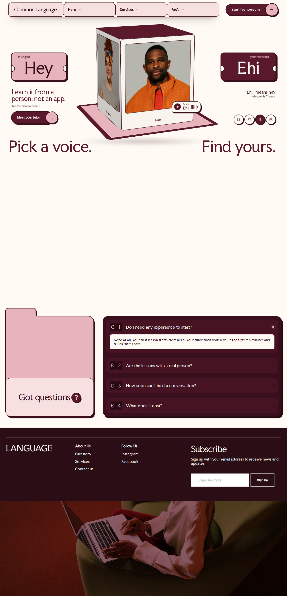
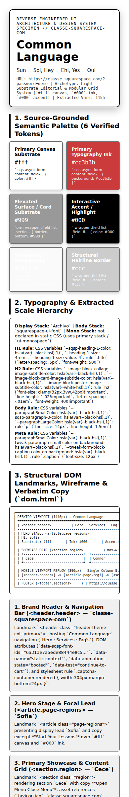

# UI Design System & Master Generation Blueprint: classe-squarespace-com

> **Common Language** (https://classe.squarespace.com/?password=demo) — Sun = Sol, Hey = Ehi, Yes = Oui



---

## 1. Executive Visual Persona & Design Archetype

- **Brand Essence & Persona**: **Common Language** (`https://classe.squarespace.com/?password=demo`). Sun = Sol, Hey = Ehi, Yes = Oui
- **Visual Archetype**: **Light-Substrate Editorial & Modular Grid System (`#fff` canvas, `#000` ink, `#000` accent)**.
- **Anti-AI-Slop Differentiators**:
  - **Source-Grounded Chromatic Polarity**: Anchors the viewport in `#fff` (`.sqs-async-form-content .field-... { color: #fff }`) paired with `#000` primary typography and `#000` accents.
  - **Extracted Typographic Hierarchy**: Pairs `Archivo` for display copy (`Sofía`) with `squarespace-ui-font` and not declared in static CSS (uses primary stack / `ui-monospace`).
  - **Calibrated Spatial Grid & Motion**: Combines `432px` container bounds (`gap: 24px`, padding `5px`) with `cubic-bezier(.22,1,.36,1)` easing and Three.js / WebGL Canvas Pipeline, Barba.js Page Transition Router.

---

## 2. Spatial Architecture & Modular Grid Mathematics



### Viewport Allocation & Container Geometry
- **Captured Viewport Dimensions**: Desktop `1440×2987px` (`assets/desktop.png`, full-page scroll capture), Mobile `390×2400px` (`assets/mobile.png`, capped at 2400px multi-section capture).
- **Master Container Bounds**: `432px` extracted from `classe-squarespace-com` stylesheet.
- **Canvas Lateral Padding & Spacing**: `5px` lateral canvas padding with `24px` grid gap.
- **Border Radius Scale**: `2px`, `30px`, `var(--r)`, `999px`.

### Responsive Breakpoint Architecture
- **Desktop Layout**: Multi-column CSS Grid / Flexbox layout at `1440px` (`max-width: 432px`, `gap: 24px`).
- **Mobile Layout**: Single-column vertical stack at `390px` viewport width with `5px` horizontal padding.
- **Extracted CSS Media Queries**: `@media screen and (max-width:432px)`, `@media screen and (min-width:433px)`, `@media (-webkit-min-device-pixel-ratio:2),(-webkit-min-device-pi...`, `@media only screen and (max-width:700px)`.

---

## 3. Color System, Materiality & Atmospheric Lighting

### Semantic Palette & Source Grounding
| Semantic Role | Ground-Truth Value | Extracted CSS Source / Selector |
|---|---|---|
| **Primary Canvas Substrate** | `#fff` | `.sqs-async-form-content .field-... { color: #fff }` |
| **Primary Typography Ink** | `#cc3b3b` | `.sqs-async-form-content .field-... { background: #cc3b3b }` |
| **Elevated Surface / Card Substrate** | `#999` | `orm-wrapper .field-list .sectio... { border-bottom: #999 }` |
| **Interactive Accent / Highlight** | `#000` | `-wrapper .field-list .field .fi... { color: #000 }` |
| **Secondary / Muted Copy** | `#fafafa` | `-wrapper .field-list .field .fi... { background: #fafafa }` |
| **Structural Hairline Border** | `#ccc` | `-wrapper .field-list .field .fi... { border: #ccc }` |

### Sanitized Root CSS Variables (`ui-ux.md` Ground Truth)
| Variable Name | Extracted Value | Semantic Role |
|---|---|---|
| `--tint` | `hsl(var(--accent-hsl))` | Canvas / Surface Token |
| `--tint-a` | `.35` | Canvas / Surface Token |
| `--gray` | `1` | Design System Custom Token |
| `--lift` | `18px` | Dimension / Scale Token |
| `--ink` | `var(--headingLargeColor, hsl(var(--darkAccent-hsl)))` | Typography Ink Token |
| `--wine` | `hsl(var(--accent-hsl))` | Color / Atmospheric Token |
| `--edge` | `hsl(var(--darkAccent-hsl))` | Color / Atmospheric Token |
| `--cream` | `hsl(var(--white-hsl))` | Color / Atmospheric Token |
| `--rose` | `hsl(var(--lightAccent-hsl))` | Color / Atmospheric Token |
| `--hi` | `hsl(var(--lightAccent-hsl))` | Color / Atmospheric Token |
| `--hi-text` | `hsl(var(--darkAccent-hsl))` | Typography Ink Token |
| `--stub` | `var(--wine)` | Design System Custom Token |
| `--sel-line` | `var(--edge)` | Design System Custom Token |
| `--sel-fill` | `var(--cream)` | Design System Custom Token |
| `--sel-size` | `11px` | Layout / Spatial Grid Token |
| `--sel-e` | `calc(var(--sel-size) / 2 - .75px)` | Dimension / Scale Token |

---

## 4. Typographic Scale & Editorial Hierarchy

### Font Family Stacks
- **Display Typography**: `Archivo`.
- **Primary Body Stack**: `squarespace-ui-font`.
- **Technical / Metadata Stack**: not declared in static CSS (uses primary stack / `ui-monospace`).

### Typographic Scale & Rules (Extracted from Stylesheet & Variables)
- **Hero Display (`H1`)**: CSS variables `--sqsp-heading-1-color: hsla(var(--black-hsl),1)`, `--heading-1-size: 4rem`, `--heading-1-size-value: 4`; rule `.title` (`letter-spacing: .5px`, `font-weight: 500`).
- **Section Heading (`H2`)**: CSS variables `--image-block-collage-image-subtitle-color: hsla(var(--black-hsl),1)`, `--image-block-card-image-subtitle-color: hsla(var(--black-hsl),1)`, `--image-block-poster-image-subtitle-color: hsla(var(--white-hsl),1)`; rule `h2` (`font-size: clamp(32px,3vw,42px)!important`, `line-height: 1.02!important`, `letter-spacing: -.01em`, `font-weight: 400!important`).
- **Body Copy**: CSS variables `--paragraphSmallColor: hsla(var(--black-hsl),1)`, `--sqsp-paragraph-3-color: hsla(var(--black-hsl),1)`, `--paragraphLargeColor: hsla(var(--black-hsl),1)`; rule `p` (`font-size: 14px`, `line-height: 1.5em`).
- **Metadata & Navigation Labels**: CSS variables `--paragraphSmallColor: hsla(var(--black-hsl),1)`, `--tweak-paragraph-small-color-on-background: hsla(var(--black-hsl),1)`, `--tweak-form-block-caption-color-on-background: hsla(var(--black-hsl),1)`; rule `.caption` (`font-size: 12px`).

---

## 5. Choreographed Motion & Interaction Physics

### Primary Easing Curves
- **Extracted Timing Functions**: `cubic-bezier(.22,1,.36,1)`, `cubic-bezier(.34,1.56,.64,1)`, `cubic-bezier(.65,0,.35,1)`.

### Per-Element Transition & Choreography Rules
- **Selector `per .field-list .field .field-ele...`**: `transition: background .1s ease-in` extracted from `classe-squarespace-com` stylesheet.
- **Selector `#novule-hero li.list-item`**: `transition: flex .6s var(--spring) var(--d) !important` extracted from `classe-squarespace-com` stylesheet.
- **Selector `#novule-hero .list-item-media`**: `transition: top .6s var(--spring) var(--d), left .6s var(--spring) var(--d...` extracted from `classe-squarespace-com` stylesheet.
- **Extracted Easing Curve (`cubic-bezier(.22,1,.36,1)`)**: Governs interactive state transitions across `<header.header>` and `<section.region>`.
- **Runtime Interaction Engine**: Integrates Three.js / WebGL Canvas Pipeline, Barba.js Page Transition Router with `prefers-reduced-motion: reduce` fallback guards.

---

## 6. Component Wireframe & Structural DOM Map

### Visual Layout Schematic (Grounded in `dom.html` — `1440px` Desktop & `390px` Mobile Reflow)
```
┌────────────────────────────────────────────────────────────────────────┐
│ DESKTOP VIEWPORT (1440px) — Common Language                            │
│ ====================================================================== │
│ [ <header.header>          | Hero · Services · Faq's                ]  │
│ ---------------------------------------------------------------------- │
│ | HERO STAGE: <article.page-regions>                               |   │
│ | H1: Sofía                                                        |   │
│ | Substrate: #fff       | Ink: #000       | Accent: #000           |   │
│ ---------------------------------------------------------------------- │
│ | SHOWCASE GRID (<section.region>          ) max-w: 432px          |   │
│ | +------------------------------+  +------------------------------+ | │
│ | | Cece                         |  | Connor                       | | │
│ | +------------------------------+  +------------------------------+ | │
│ ---------------------------------------------------------------------- │
│ | MOBILE VIEWPORT REFLOW (390px) — Single-Column Stack (gap: 24px  ) | │
│ | [<header.header>] -> [<article.page-regi] -> [<section.region>] |    │
│ ---------------------------------------------------------------------- │
│ [ FOOTER (<footer.sections>     ) | https://classe.squarespace.com/?pa │
└────────────────────────────────────────────────────────────────────────┘
```

### Granular DOM Region Breakdown
1. **Brand Header & Navigation Bar (<header.header> — `classe-squarespace-com`)**:
   - Landmark `<header class="header theme-col--primary">` hosting `Common Language` navigation (`Hero · Services · Faq's`), DOM attributes (`data-sqsp-font-ids="6a313e7a5ede88444e8c5..."`, `data-name="static-context"`, `data-animation-state="booted"`, `data-test="continue-to-cart"`), and stylesheet rule `.captcha-container.rendered { width:304px;margin-bottom:24px }`.
2. **Hero Stage & Focal Lead (<article.page-regions> — `Sofía`)**:
   - Landmark `<article class="page-regions">` presenting display lead `Sofía` and copy excerpt *"Start Your Lessons"* over `#fff` canvas and `#000` ink.
3. **Primary Showcase & Content Grid (<section.region> — `Cece`)**:
   - Landmark `<section class="region">` rendering section `Cece` with copy *"Open Menu Close Menu"*, asset references (`favicon.ico`, `classe.squarespace.com`, `images.squarespace-cdn.com`, `file.squarespace-cdn.com`), and grid rule `captcha-container.rendered.align-... { margin-left:auto;margin-right:auto }`.
4. **Interactive Detail & Feature Matrix (<section.page-section> — `Connor`)**:
   - Landmark `<section class="page-section user-items-list-section">` framing `Connor` and `Amélie` (*"Sun = Sol, Hey = Ehi, Yes = Oui"*) with `#999` surface cards, `#000` accents, and `.captcha-container.rendered.align... { margin-left:auto }`.
5. **Colophon & Global Directory Footer (<footer.sections> — `https://classe.squarespace.com/?password=demo`)**:
   - Landmark `<footer class="sections">` anchoring `Common Language` footer links (`Hero · Services · Faq's`), copy *"Sofía Spanish Sol means sun Meet Sofía"*, and `#ccc` structural dividers.

---

## 7. Master Zero-Shot AI Generation Prompt

```markdown
# Master Zero-Shot Frontend Generation Prompt: classe-squarespace-com (Common Language)

You are a principal frontend architect and design systems engineer. Build a complete, production-ready web application replicating the exact design system, DOM landmarks, typographic hierarchy, color tokens, and motion physics of `classe-squarespace-com` (**Common Language** — `https://classe.squarespace.com/?password=demo`).

### 1. Visual Archetype & Anti-AI-Slop Mandates
- **Archetype**: Light-Substrate Editorial & Modular Grid System (`#fff` canvas, `#000` ink, `#000` accent).
- **Identity & Domain Context**: Sun = Sol, Hey = Ehi, Yes = Oui
- **Primary Substrate**: `#fff` (`.sqs-async-form-content .field-... { color: #fff }`), **Primary Ink**: `#000`, **Accent / Highlight**: `#000`.
- **Site-Specific Differentiators**:
  - **Source-Grounded Chromatic Polarity**: Anchors the viewport in `#fff` (`.sqs-async-form-content .field-... { color: #fff }`) paired with `#000` primary typography and `#000` accents.
  - **Extracted Typographic Hierarchy**: Pairs `Archivo` for display copy (`Sofía`) with `squarespace-ui-font` and not declared in static CSS (uses primary stack / `ui-monospace`).
  - **Calibrated Spatial Grid & Motion**: Combines `432px` container bounds (`gap: 24px`, padding `5px`) with `cubic-bezier(.22,1,.36,1)` easing and Three.js / WebGL Canvas Pipeline, Barba.js Page Transition Router.

### 2. Ground-Truth CSS Variables (`:root` Token Contract)
Declare and consume these exact custom properties extracted from `classe-squarespace-com` in your global stylesheet:

:root {
  /* Common Language (classe-squarespace-com) — Ground-Truth Extracted CSS Variables */
  --tint: hsl(var(--accent-hsl)); /* Canvas / Surface Token (classe-squarespace-com) */
  --tint-a: .35; /* Canvas / Surface Token (classe-squarespace-com) */
  --gray: 1; /* Design System Custom Token (classe-squarespace-com) */
  --lift: 18px; /* Dimension / Scale Token (classe-squarespace-com) */
  --ink: var(--headingLargeColor, hsl(var(--darkAccent-hsl))); /* Typography Ink Token (classe-squarespace-com) */
  --wine: hsl(var(--accent-hsl)); /* Color / Atmospheric Token (classe-squarespace-com) */
  --edge: hsl(var(--darkAccent-hsl)); /* Color / Atmospheric Token (classe-squarespace-com) */
  --cream: hsl(var(--white-hsl)); /* Color / Atmospheric Token (classe-squarespace-com) */
  --rose: hsl(var(--lightAccent-hsl)); /* Color / Atmospheric Token (classe-squarespace-com) */
  --hi: hsl(var(--lightAccent-hsl)); /* Color / Atmospheric Token (classe-squarespace-com) */
  --hi-text: hsl(var(--darkAccent-hsl)); /* Typography Ink Token (classe-squarespace-com) */
  --stub: var(--wine); /* Design System Custom Token (classe-squarespace-com) */
  --sel-line: var(--edge); /* Design System Custom Token (classe-squarespace-com) */
  --sel-fill: var(--cream); /* Design System Custom Token (classe-squarespace-com) */
  --sel-size: 11px; /* Layout / Spatial Grid Token (classe-squarespace-com) */
  --sel-e: calc(var(--sel-size) / 2 - .75px); /* Dimension / Scale Token (classe-squarespace-com) */
}

### 3. Semantic Color & Materiality Contract
Map every surface, ink, and border strictly to these source-grounded tokens:
- **Primary Canvas Substrate**: `#fff` — grounded in `.sqs-async-form-content .field-... { color: #fff }`
- **Primary Typography Ink**: `#cc3b3b` — grounded in `.sqs-async-form-content .field-... { background: #cc3b3b }`
- **Elevated Surface / Card Substrate**: `#999` — grounded in `orm-wrapper .field-list .sectio... { border-bottom: #999 }`
- **Interactive Accent / Highlight**: `#000` — grounded in `-wrapper .field-list .field .fi... { color: #000 }`
- **Secondary / Muted Copy**: `#fafafa` — grounded in `-wrapper .field-list .field .fi... { background: #fafafa }`
- **Structural Hairline Border**: `#ccc` — grounded in `-wrapper .field-list .field .fi... { border: #ccc }`

### 4. Spatial Grid, Container Bounds & Responsive Breakpoints
- **Desktop Viewport Reference**: `1440×2987px` (full-page scroll capture, `1440px` standard desktop width).
- **Mobile Viewport Reference**: `390×2400px` (capped at 2400px multi-section capture, `390px` standard mobile width).
- **Container Max-Width**: `432px` extracted from `classe-squarespace-com` stylesheet
- **Padding & Gutters**: `5px` lateral canvas padding with `24px` grid gap
- **Desktop Grid**: Multi-column CSS Grid / Flexbox layout at `1440px` (`max-width: 432px`, `gap: 24px`)
- **Mobile Adaptation**: Single-column vertical stack at `390px` viewport width with `5px` horizontal padding
- **Media Queries**: `@media screen and (max-width:432px)`, `@media screen and (min-width:433px)`, `@media (-webkit-min-device-pixel-ratio:2),(-webkit-min-device-pi...`, `@media only screen and (max-width:700px)`
- **Corner Radii**: `2px`, `30px`, `var(--r)`, `999px`

### 5. Typography & Editorial Scale Contract
- **Display Font Stack**: `Archivo`
- **Body Font Stack**: `squarespace-ui-font`
- **Monospace / Technical Font Stack**: not declared in static CSS (uses primary stack / `ui-monospace`)
- **H1 Display Rule**: CSS variables `--sqsp-heading-1-color: hsla(var(--black-hsl),1)`, `--heading-1-size: 4rem`, `--heading-1-size-value: 4`; rule `.title` (`letter-spacing: .5px`, `font-weight: 500`)
- **H2 Section Rule**: CSS variables `--image-block-collage-image-subtitle-color: hsla(var(--black-hsl),1)`, `--image-block-card-image-subtitle-color: hsla(var(--black-hsl),1)`, `--image-block-poster-image-subtitle-color: hsla(var(--white-hsl),1)`; rule `h2` (`font-size: clamp(32px,3vw,42px)!important`, `line-height: 1.02!important`, `letter-spacing: -.01em`, `font-weight: 400!important`)
- **Body Copy Rule**: CSS variables `--paragraphSmallColor: hsla(var(--black-hsl),1)`, `--sqsp-paragraph-3-color: hsla(var(--black-hsl),1)`, `--paragraphLargeColor: hsla(var(--black-hsl),1)`; rule `p` (`font-size: 14px`, `line-height: 1.5em`)
- **Metadata & Index Rule**: CSS variables `--paragraphSmallColor: hsla(var(--black-hsl),1)`, `--tweak-paragraph-small-color-on-background: hsla(var(--black-hsl),1)`, `--tweak-form-block-caption-color-on-background: hsla(var(--black-hsl),1)`; rule `.caption` (`font-size: 12px`)

### 6. Component Hierarchy, Verbatim Copy & Real DOM Landmarks
Scaffold `classe-squarespace-com` (`Common Language`) with these exact structural regions, extracted copy, and CSS rules from `dom.html`:
1. **Brand Header & Navigation Bar (<header.header> — `classe-squarespace-com`)**:
   - DOM & Selectors: Landmark `<header class="header theme-col--primary">` hosting `Common Language` navigation (`Hero · Services · Faq's`), DOM attributes (`data-sqsp-font-ids="6a313e7a5ede88444e8c5..."`, `data-name="static-context"`, `data-animation-state="booted"`, `data-test="continue-to-cart"`), and stylesheet rule `.captcha-container.rendered { width:304px;margin-bottom:24px }`.
   - Responsive Contract: Header `Brand Header & Navigation Bar (<header.header> — `classe-squarespace-com`)` (`classe-squarespace-com`) adapts across `@media screen and (max-width:432px)`, `@media screen and (min-width:433px)`, `@media (-webkit-min-device-pixel-ratio:2),(-webkit-min-device-pi...`, `@media only screen and (max-width:700px)` with `cubic-bezier(.22,1,.36,1)`, `cubic-bezier(.34,1.56,.64,1)`, `cubic-bezier(.65,0,.35,1)` transitions and links `Hero · Services · Faq's`.
2. **Hero Stage & Focal Lead (<article.page-regions> — `Sofía`)**:
   - DOM & Selectors: Landmark `<article class="page-regions">` presenting display lead `Sofía` and copy excerpt *"Start Your Lessons"* over `#fff` canvas and `#000` ink.
   - Responsive Contract: Hero stage (`1440×2987px` desktop / `390×2400px` mobile) sets `#fff` background with `#000` headline `Sofía`.
3. **Primary Showcase & Content Grid (<section.region> — `Cece`)**:
   - DOM & Selectors: Landmark `<section class="region">` rendering section `Cece` with copy *"Open Menu Close Menu"*, asset references (`favicon.ico`, `classe.squarespace.com`, `images.squarespace-cdn.com`, `file.squarespace-cdn.com`), and grid rule `captcha-container.rendered.align-... { margin-left:auto;margin-right:auto }`.
   - Responsive Contract: Showcase grid `Primary Showcase & Content Grid (<section.region> — `Cece`)` applies Multi-column CSS Grid / Flexbox layout at `1440px` (`max-width: 432px`, `gap: 24px`) on desktop and Single-column vertical stack at `390px` viewport width with `5px` horizontal padding on mobile.
4. **Interactive Detail & Feature Matrix (<section.page-section> — `Connor`)**:
   - DOM & Selectors: Landmark `<section class="page-section user-items-list-section">` framing `Connor` and `Amélie` (*"Sun = Sol, Hey = Ehi, Yes = Oui"*) with `#999` surface cards, `#000` accents, and `.captcha-container.rendered.align... { margin-left:auto }`.
   - Responsive Contract: Detail module `Interactive Detail & Feature Matrix (<section.page-section> — `Connor`)` uses `2px`, `30px`, `var(--r)`, `999px` radii, `#000` highlights, and assets (favicon.ico, classe.squarespace.com, images.squarespace-cdn.com).
5. **Colophon & Global Directory Footer (<footer.sections> — `https://classe.squarespace.com/?password=demo`)**:
   - DOM & Selectors: Landmark `<footer class="sections">` anchoring `Common Language` footer links (`Hero · Services · Faq's`), copy *"Sofía Spanish Sol means sun Meet Sofía"*, and `#ccc` structural dividers.
   - Responsive Contract: Footer `Colophon & Global Directory Footer (<footer.sections> — `https://classe.squarespace.com/?password=demo`)` aligns to `432px` extracted from `classe-squarespace-com` stylesheet with `5px` lateral canvas padding with `24px` grid gap and attributes (data-sqsp-font-ids="6a313e7a5ede88444e8c5...", data-name="static-context", data-animation-state="booted").

#### Verbatim DOM Copy Excerpts (`dom.html`)
- Copy Excerpt 1: *"Start Your Lessons"*
- Copy Excerpt 2: *"Open Menu Close Menu"*
- Copy Excerpt 3: *"Sun = Sol, Hey = Ehi, Yes = Oui"*
- Copy Excerpt 4: *"Sofía Spanish Sol means sun Meet Sofía"*

### 7. Motion, Extracted Stylesheet Rules & Interaction Choreography
- **Primary Easing Functions**: `cubic-bezier(.22,1,.36,1)`, `cubic-bezier(.34,1.56,.64,1)`, `cubic-bezier(.65,0,.35,1)`
- **Extracted Stylesheet Rules (`classe-squarespace-com`)**:
- `.captcha-container.rendered { width:304px;margin-bottom:24px }`
- `captcha-container.rendered.align-... { margin-left:auto;margin-right:auto }`
- `.captcha-container.rendered.align... { margin-left:auto }`
- `form-content .form-wrapper .field... { line-height:normal }`
- `ontent .form-wrapper .field-list... { border:0;margin:0;padding:0 }`
- **Per-Selector Transition Rules**:
- **Selector `per .field-list .field .field-ele...`**: `transition: background .1s ease-in` extracted from `classe-squarespace-com` stylesheet.
- **Selector `#novule-hero li.list-item`**: `transition: flex .6s var(--spring) var(--d) !important` extracted from `classe-squarespace-com` stylesheet.
- **Selector `#novule-hero .list-item-media`**: `transition: top .6s var(--spring) var(--d), left .6s var(--spring) var(--d...` extracted from `classe-squarespace-com` stylesheet.
- **Extracted Easing Curve (`cubic-bezier(.22,1,.36,1)`)**: Governs interactive state transitions across `<header.header>` and `<section.region>`.
- **Runtime Interaction Engine**: Integrates Three.js / WebGL Canvas Pipeline, Barba.js Page Transition Router with `prefers-reduced-motion: reduce` fallback guards.

### 8. Technical Deliverables
- Implement in Next.js (App Router) with TypeScript and Tailwind CSS consuming the `:root` custom properties defined above for `classe-squarespace-com`.
- Reproduce both the `1440px` desktop architecture and `390px` mobile breakpoint transitions, preserving semantic HTML5 landmarks (`<header>`, `<nav>`, `<main>`, `<section>`, `<footer>`) and `prefers-reduced-motion` accessibility guards.
```
