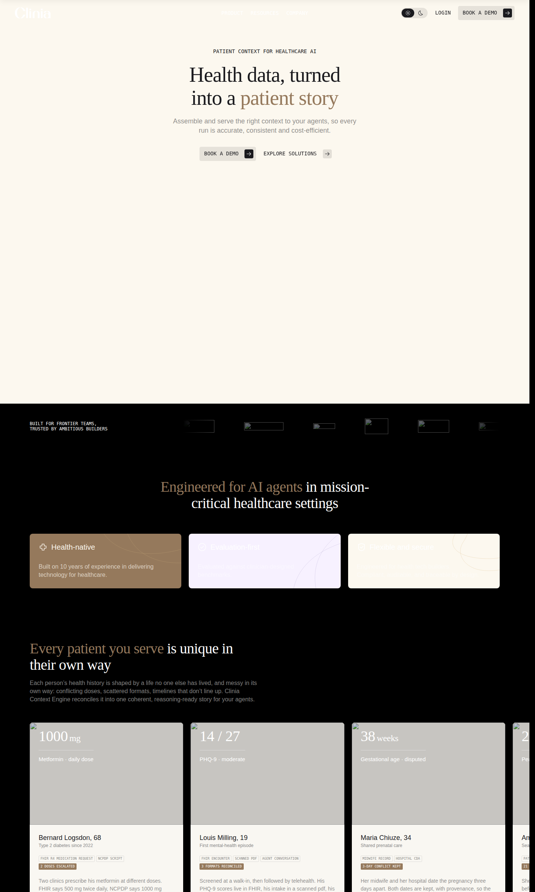
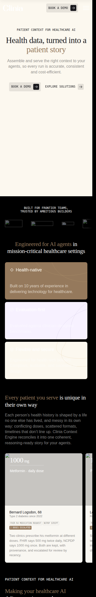

# UI Design System & Master Generation Blueprint: clinia-com

> **Patient Context for Healthcare AI · Clinia** (https://clinia.com) — Fragmented health data breaks AI. Clinia reconciles it into graph-based context so your healthcare AI agents stay reliable and support op...



---

## 1. Executive Visual Persona & Design Archetype

- **Brand Essence & Persona**: **Patient Context for Healthcare AI · Clinia** (`https://clinia.com`). Fragmented health data breaks AI. Clinia reconciles it into graph-based context so your healthcare AI agents stay reliable and support op...
- **Visual Archetype**: **Dark-Substrate WebGL / Canvas Interactive Experience (`#000` / `#ff5c00`)**.
- **Anti-AI-Slop Differentiators**:
  - **Source-Grounded Chromatic Polarity**: Anchors the viewport in `#000` (`var(--color-black)` in `:root`) paired with `#fff` primary typography and `#ff5c00` accents.
  - **Extracted Typographic Hierarchy**: Pairs `NaN Serf B Text` for display copy (`Health data, turned into a patient s`) with `Circular XX` and `Circular XX Mono`.
  - **Calibrated Spatial Grid & Motion**: Combines `1476px` container bounds (`gap: 5px`, padding `10px`) with `cubic-bezier(.16,1,.3,1)` easing and Three.js / WebGL Canvas Pipeline.

---

## 2. Spatial Architecture & Modular Grid Mathematics



### Viewport Allocation & Container Geometry
- **Captured Viewport Dimensions**: Desktop `1440×2400px` (`assets/desktop.png`, capped at 2400px multi-section capture), Mobile `390×2400px` (`assets/mobile.png`, capped at 2400px multi-section capture).
- **Master Container Bounds**: `1476px` extracted from `clinia-com` stylesheet.
- **Canvas Lateral Padding & Spacing**: `10px` lateral canvas padding with `5px` grid gap.
- **Border Radius Scale**: `var(--blossom-dot-radius)`, `var(--btn-radius)`, `12px`, `8px`.

### Responsive Breakpoint Architecture
- **Desktop Layout**: Multi-column CSS Grid / Flexbox layout at `1440px` (`max-width: 1476px`, `gap: 5px`).
- **Mobile Layout**: Single-column vertical stack at `390px` viewport width with `10px` horizontal padding.
- **Extracted CSS Media Queries**: `@media (min-width:768px)`, `@media (min-width:1024px)`, `@media (min-width:1200px)`, `@media (min-width:1441px)`.

---

## 3. Color System, Materiality & Atmospheric Lighting

### Semantic Palette & Source Grounding
| Semantic Role | Ground-Truth Value | Extracted CSS Source / Selector |
|---|---|---|
| **Primary Canvas Substrate** | `#000` | `var(--color-black)` in `:root` |
| **Primary Typography Ink** | `#fff` | `var(--color-white)` in `:root` |
| **Elevated Surface / Card Substrate** | `#1a1a1e` | `var(--color-primary)` in `:root` |
| **Interactive Accent / Highlight** | `#ff5c00` | `var(--color-secondary)` in `:root` |
| **Secondary / Muted Copy** | `#cca44f` | `var(--color-noble)` in `:root` |
| **Structural Hairline Border** | `#95795c` | `var(--color-trust)` in `:root` |
| **Variable Token (`--color-trust-dark`)** | `#53402c` | `var(--color-trust-dark)` in `:root` |
| **Variable Token (`--color-remedy`)** | `#fcf8ef` | `var(--color-remedy)` in `:root` |
| **Variable Token (`--color-remedy-dark`)** | `#ecd9b9` | `var(--color-remedy-dark)` in `:root` |
| **Variable Token (`--color-remedy-medium`)** | `#f2eee5` | `var(--color-remedy-medium)` in `:root` |
| **Variable Token (`--color-remedy-light`)** | `#f9f7f2` | `var(--color-remedy-light)` in `:root` |
| **Variable Token (`--color-aura`)** | `#f7f1ff` | `var(--color-aura)` in `:root` |
| **Variable Token (`--color-aura-dark`)** | `#cabbdb` | `var(--color-aura-dark)` in `:root` |

### Sanitized Root CSS Variables (`ui-ux.md` Ground Truth)
| Variable Name | Extracted Value | Semantic Role |
|---|---|---|
| `--color-transparent` | `transparent` | Brand / Palette Token |
| `--color-current` | `currentColor` | Brand / Palette Token |
| `--color-black` | `#000` | Canvas / Surface Token |
| `--color-white` | `#fff` | Canvas / Surface Token |
| `--color-primary` | `#1a1a1e` | Brand / Palette Token |
| `--color-secondary` | `#ff5c00` | Brand / Palette Token |
| `--color-vital` | `#ff5c00` | Brand / Palette Token |
| `--color-noble` | `#cca44f` | Brand / Palette Token |
| `--color-trust` | `#95795c` | Brand / Palette Token |
| `--color-trust-dark` | `#53402c` | Canvas / Surface Token |
| `--color-remedy` | `#fcf8ef` | Brand / Palette Token |
| `--color-remedy-dark` | `#ecd9b9` | Canvas / Surface Token |
| `--color-remedy-medium` | `#f2eee5` | Brand / Palette Token |
| `--color-remedy-light` | `#f9f7f2` | Canvas / Surface Token |
| `--color-aura` | `#f7f1ff` | Brand / Palette Token |
| `--color-aura-dark` | `#cabbdb` | Canvas / Surface Token |

---

## 4. Typographic Scale & Editorial Hierarchy

### Font Family Stacks
- **Display Typography**: `NaN Serf B Text`.
- **Primary Body Stack**: `Circular XX`.
- **Technical / Metadata Stack**: `Circular XX Mono`.

### Typographic Scale & Rules (Extracted from Stylesheet & Variables)
- **Hero Display (`H1`)**: not explicitly declared on tag in static CSS (stylesheet font-size ladder: `1em`, `80%`, `75%`, `100%`, `18px`).
- **Section Heading (`H2`)**: CSS variables `--has-subtitle: 0`, `--subtitle-height: 0px`; rule `h2` (`font-size: 22px`, `line-height: 1.1`).
- **Body Copy**: CSS variables `--ff-body: Circular XX,sans-serif`, `--body-text-color: light-dark(var(--color-primary),var(--color-white))`, `--body-bg-color: light-dark(var(--color-white),var(--gray-900))`.
- **Metadata & Navigation Labels**: CSS variables `--ff-mono: Circular XX Mono,monospace`, `--hsf-default-field-label__color: currentColor!important`, `--hsf-default-field-label__font-family: Circular XX,sans-serif!important`.

---

## 5. Choreographed Motion & Interaction Physics

### Primary Easing Curves
- **Extracted Timing Functions**: `cubic-bezier(.16,1,.3,1)`, `cubic-bezier(.785,.135,.15,.86)`, `cubic-bezier(.19,1,.22,1)`.

### Per-Element Transition & Choreography Rules
- **Selector `:where([data-blossom-dot-marker])`**: `transition: opacity .2s` extracted from `clinia-com` stylesheet.
- **Selector `data-blossom-dot-marker]`**: `transition: inline-size 250ms linear` extracted from `clinia-com` stylesheet.
- **Selector `tn.--cta:not(.pointer-events-none...`**: `transition: background-color 200ms linear` extracted from `clinia-com` stylesheet.
- **Extracted Easing Curve (`cubic-bezier(.16,1,.3,1)`)**: Governs interactive state transitions across `<header.site-header>` and `<main.flex-grow-1>`.
- **Runtime Interaction Engine**: Integrates Three.js / WebGL Canvas Pipeline with `prefers-reduced-motion: reduce` fallback guards.

---

## 6. Component Wireframe & Structural DOM Map

### Visual Layout Schematic (Grounded in `dom.html` — `1440px` Desktop & `390px` Mobile Reflow)
```
┌────────────────────────────────────────────────────────────────────────┐
│ DESKTOP VIEWPORT (1440px) — Patient Context for Healthcare AI · Clinia │
│ ====================================================================== │
│ [ <header.site-header>     | Documentation · Changelog · Blog · Tru ]  │
│ ---------------------------------------------------------------------- │
│ | HERO STAGE: <main.flex-grow-1>                                   |   │
│ | H1: Health data, turned into a patient story                     |   │
│ | Substrate: #000       | Ink: #fff       | Accent: #ff5c00        |   │
│ ---------------------------------------------------------------------- │
│ | SHOWCASE GRID (<main.flex-grow-1>        ) max-w: 1476px         |   │
│ | +------------------------------+  +------------------------------+ | │
│ | | Engineered for AI agents in  |  | Health-native                | | │
│ | +------------------------------+  +------------------------------+ | │
│ ---------------------------------------------------------------------- │
│ | MOBILE VIEWPORT REFLOW (390px) — Single-Column Stack (gap: 5px   ) | │
│ | [<header.site-heade] -> [<main.flex-grow-1>] -> [<main.flex-grow-1>] │
│ ---------------------------------------------------------------------- │
│ [ FOOTER (<footer.site-footer>  ) | https://clinia.com                 │
└────────────────────────────────────────────────────────────────────────┘
```

### Granular DOM Region Breakdown
1. **Brand Header & Navigation Bar (<header.site-header> — `clinia-com`)**:
   - Landmark `<header class="site-header position-fixed">` hosting `Patient Context for Healthcare AI · ` navigation (`Documentation · Changelog · Blog · Trust Center · About us`), DOM attributes (`data-env="production"`, `data-wp-strategy="async"`, `data-site-loader`, `data-site-transition`), and stylesheet rule `webkit-scrollbar { display:none }`.
2. **Hero Stage & Focal Lead (<main.flex-grow-1> — `Health data, turned into a patient`)**:
   - Landmark `<main class="flex-grow-1">` presenting display lead `Health data, turned into a patient story` and copy excerpt *"Product Clinia Context Engine Product A health-specific context l"* over `#000` canvas and `#fff` ink.
3. **Primary Showcase & Content Grid (<main.flex-grow-1> — `Engineered for AI agents in missio`)**:
   - Landmark `<main class="flex-grow-1">` rendering section `Engineered for AI agents in mission-critical heal...` with copy *"Clinia Context Engine"*, asset references (`humans.txt`, `xmlrpc.php`, `gtm.js`, `embed`), and grid rule `active { cursor:grabbing }`.
4. **Interactive Detail & Feature Matrix (<main.flex-grow-1> — `Health-native`)**:
   - Landmark `<main class="flex-grow-1">` framing `Health-native` and `Evaluation-first` (*"Product A health-specific context layer that sits between patient"*) with `#1a1a1e` surface cards, `#ff5c00` accents, and `blossom-dots>blossom-dot { display:none }`.
5. **Colophon & Global Directory Footer (<footer.site-footer> — `https://clinia.com`)**:
   - Landmark `<footer class="site-footer container-fluid">` anchoring `Patient Context for Healthcare A` footer links (`Documentation · Changelog · Blog · Trust Center · About us`), copy *"A health-specific context layer that sits between patient da"*, and `#95795c` structural dividers.

---

## 7. Master Zero-Shot AI Generation Prompt

```markdown
# Master Zero-Shot Frontend Generation Prompt: clinia-com (Patient Context for Healthcare AI · Clinia)

You are a principal frontend architect and design systems engineer. Build a complete, production-ready web application replicating the exact design system, DOM landmarks, typographic hierarchy, color tokens, and motion physics of `clinia-com` (**Patient Context for Healthcare AI · Clinia** — `https://clinia.com`).

### 1. Visual Archetype & Anti-AI-Slop Mandates
- **Archetype**: Dark-Substrate WebGL / Canvas Interactive Experience (`#000` / `#ff5c00`).
- **Identity & Domain Context**: Fragmented health data breaks AI. Clinia reconciles it into graph-based context so your healthcare AI agents stay reliable and support op...
- **Primary Substrate**: `#000` (`var(--color-black)` in `:root`), **Primary Ink**: `#fff`, **Accent / Highlight**: `#ff5c00`.
- **Site-Specific Differentiators**:
  - **Source-Grounded Chromatic Polarity**: Anchors the viewport in `#000` (`var(--color-black)` in `:root`) paired with `#fff` primary typography and `#ff5c00` accents.
  - **Extracted Typographic Hierarchy**: Pairs `NaN Serf B Text` for display copy (`Health data, turned into a patient s`) with `Circular XX` and `Circular XX Mono`.
  - **Calibrated Spatial Grid & Motion**: Combines `1476px` container bounds (`gap: 5px`, padding `10px`) with `cubic-bezier(.16,1,.3,1)` easing and Three.js / WebGL Canvas Pipeline.

### 2. Ground-Truth CSS Variables (`:root` Token Contract)
Declare and consume these exact custom properties extracted from `clinia-com` in your global stylesheet:

:root {
  /* Patient Context for Healthcare AI · Clinia (clinia-com) — Ground-Truth Extracted CSS Variables */
  --color-transparent: transparent; /* Brand / Palette Token (clinia-com) */
  --color-current: currentColor; /* Brand / Palette Token (clinia-com) */
  --color-black: #000; /* Canvas / Surface Token (clinia-com) */
  --color-white: #fff; /* Canvas / Surface Token (clinia-com) */
  --color-primary: #1a1a1e; /* Brand / Palette Token (clinia-com) */
  --color-secondary: #ff5c00; /* Brand / Palette Token (clinia-com) */
  --color-vital: #ff5c00; /* Brand / Palette Token (clinia-com) */
  --color-noble: #cca44f; /* Brand / Palette Token (clinia-com) */
  --color-trust: #95795c; /* Brand / Palette Token (clinia-com) */
  --color-trust-dark: #53402c; /* Canvas / Surface Token (clinia-com) */
  --color-remedy: #fcf8ef; /* Brand / Palette Token (clinia-com) */
  --color-remedy-dark: #ecd9b9; /* Canvas / Surface Token (clinia-com) */
  --color-remedy-medium: #f2eee5; /* Brand / Palette Token (clinia-com) */
  --color-remedy-light: #f9f7f2; /* Canvas / Surface Token (clinia-com) */
  --color-aura: #f7f1ff; /* Brand / Palette Token (clinia-com) */
  --color-aura-dark: #cabbdb; /* Canvas / Surface Token (clinia-com) */
}

### 3. Semantic Color & Materiality Contract
Map every surface, ink, and border strictly to these source-grounded tokens:
- **Primary Canvas Substrate**: `#000` — grounded in `var(--color-black)` in `:root`
- **Primary Typography Ink**: `#fff` — grounded in `var(--color-white)` in `:root`
- **Elevated Surface / Card Substrate**: `#1a1a1e` — grounded in `var(--color-primary)` in `:root`
- **Interactive Accent / Highlight**: `#ff5c00` — grounded in `var(--color-secondary)` in `:root`
- **Secondary / Muted Copy**: `#cca44f` — grounded in `var(--color-noble)` in `:root`
- **Structural Hairline Border**: `#95795c` — grounded in `var(--color-trust)` in `:root`
- **Variable Token (`--color-trust-dark`)**: `#53402c` — grounded in `var(--color-trust-dark)` in `:root`
- **Variable Token (`--color-remedy`)**: `#fcf8ef` — grounded in `var(--color-remedy)` in `:root`
- **Variable Token (`--color-remedy-dark`)**: `#ecd9b9` — grounded in `var(--color-remedy-dark)` in `:root`
- **Variable Token (`--color-remedy-medium`)**: `#f2eee5` — grounded in `var(--color-remedy-medium)` in `:root`
- **Variable Token (`--color-remedy-light`)**: `#f9f7f2` — grounded in `var(--color-remedy-light)` in `:root`
- **Variable Token (`--color-aura`)**: `#f7f1ff` — grounded in `var(--color-aura)` in `:root`
- **Variable Token (`--color-aura-dark`)**: `#cabbdb` — grounded in `var(--color-aura-dark)` in `:root`

### 4. Spatial Grid, Container Bounds & Responsive Breakpoints
- **Desktop Viewport Reference**: `1440×2400px` (capped at 2400px multi-section capture, `1440px` standard desktop width).
- **Mobile Viewport Reference**: `390×2400px` (capped at 2400px multi-section capture, `390px` standard mobile width).
- **Container Max-Width**: `1476px` extracted from `clinia-com` stylesheet
- **Padding & Gutters**: `10px` lateral canvas padding with `5px` grid gap
- **Desktop Grid**: Multi-column CSS Grid / Flexbox layout at `1440px` (`max-width: 1476px`, `gap: 5px`)
- **Mobile Adaptation**: Single-column vertical stack at `390px` viewport width with `10px` horizontal padding
- **Media Queries**: `@media (min-width:768px)`, `@media (min-width:1024px)`, `@media (min-width:1200px)`, `@media (min-width:1441px)`
- **Corner Radii**: `var(--blossom-dot-radius)`, `var(--btn-radius)`, `12px`, `8px`

### 5. Typography & Editorial Scale Contract
- **Display Font Stack**: `NaN Serf B Text`
- **Body Font Stack**: `Circular XX`
- **Monospace / Technical Font Stack**: `Circular XX Mono`
- **H1 Display Rule**: not explicitly declared on tag in static CSS (stylesheet font-size ladder: `1em`, `80%`, `75%`, `100%`, `18px`)
- **H2 Section Rule**: CSS variables `--has-subtitle: 0`, `--subtitle-height: 0px`; rule `h2` (`font-size: 22px`, `line-height: 1.1`)
- **Body Copy Rule**: CSS variables `--ff-body: Circular XX,sans-serif`, `--body-text-color: light-dark(var(--color-primary),var(--color-white))`, `--body-bg-color: light-dark(var(--color-white),var(--gray-900))`
- **Metadata & Index Rule**: CSS variables `--ff-mono: Circular XX Mono,monospace`, `--hsf-default-field-label__color: currentColor!important`, `--hsf-default-field-label__font-family: Circular XX,sans-serif!important`

### 6. Component Hierarchy, Verbatim Copy & Real DOM Landmarks
Scaffold `clinia-com` (`Patient Context for Healthcare AI · Clinia`) with these exact structural regions, extracted copy, and CSS rules from `dom.html`:
1. **Brand Header & Navigation Bar (<header.site-header> — `clinia-com`)**:
   - DOM & Selectors: Landmark `<header class="site-header position-fixed">` hosting `Patient Context for Healthcare AI · ` navigation (`Documentation · Changelog · Blog · Trust Center · About us`), DOM attributes (`data-env="production"`, `data-wp-strategy="async"`, `data-site-loader`, `data-site-transition`), and stylesheet rule `webkit-scrollbar { display:none }`.
   - Responsive Contract: Header `Brand Header & Navigation Bar (<header.site-header> — `clinia-com`)` (`clinia-com`) adapts across `@media (min-width:768px)`, `@media (min-width:1024px)`, `@media (min-width:1200px)`, `@media (min-width:1441px)` with `cubic-bezier(.16,1,.3,1)`, `cubic-bezier(.785,.135,.15,.86)`, `cubic-bezier(.19,1,.22,1)` transitions and links `Documentation · Changelog · Blog · Trust Center · About us`.
2. **Hero Stage & Focal Lead (<main.flex-grow-1> — `Health data, turned into a patient`)**:
   - DOM & Selectors: Landmark `<main class="flex-grow-1">` presenting display lead `Health data, turned into a patient story` and copy excerpt *"Product Clinia Context Engine Product A health-specific context l"* over `#000` canvas and `#fff` ink.
   - Responsive Contract: Hero stage (`1440×2400px` desktop / `390×2400px` mobile) sets `#000` background with `#fff` headline `Health data, turned into a patient story`.
3. **Primary Showcase & Content Grid (<main.flex-grow-1> — `Engineered for AI agents in missio`)**:
   - DOM & Selectors: Landmark `<main class="flex-grow-1">` rendering section `Engineered for AI agents in mission-critical heal...` with copy *"Clinia Context Engine"*, asset references (`humans.txt`, `xmlrpc.php`, `gtm.js`, `embed`), and grid rule `active { cursor:grabbing }`.
   - Responsive Contract: Showcase grid `Primary Showcase & Content Grid (<main.flex-grow-1> — `Engineered for AI agents in missio`)` applies Multi-column CSS Grid / Flexbox layout at `1440px` (`max-width: 1476px`, `gap: 5px`) on desktop and Single-column vertical stack at `390px` viewport width with `10px` horizontal padding on mobile.
4. **Interactive Detail & Feature Matrix (<main.flex-grow-1> — `Health-native`)**:
   - DOM & Selectors: Landmark `<main class="flex-grow-1">` framing `Health-native` and `Evaluation-first` (*"Product A health-specific context layer that sits between patient"*) with `#1a1a1e` surface cards, `#ff5c00` accents, and `blossom-dots>blossom-dot { display:none }`.
   - Responsive Contract: Detail module `Interactive Detail & Feature Matrix (<main.flex-grow-1> — `Health-native`)` uses `var(--blossom-dot-radius)`, `var(--btn-radius)`, `12px`, `8px` radii, `#ff5c00` highlights, and assets (humans.txt, xmlrpc.php, gtm.js).
5. **Colophon & Global Directory Footer (<footer.site-footer> — `https://clinia.com`)**:
   - DOM & Selectors: Landmark `<footer class="site-footer container-fluid">` anchoring `Patient Context for Healthcare A` footer links (`Documentation · Changelog · Blog · Trust Center · About us`), copy *"A health-specific context layer that sits between patient da"*, and `#95795c` structural dividers.
   - Responsive Contract: Footer `Colophon & Global Directory Footer (<footer.site-footer> — `https://clinia.com`)` aligns to `1476px` extracted from `clinia-com` stylesheet with `10px` lateral canvas padding with `5px` grid gap and attributes (data-env="production", data-wp-strategy="async", data-site-loader).

#### Verbatim DOM Copy Excerpts (`dom.html`)
- Copy Excerpt 1: *"Product Clinia Context Engine Product A health-specific context layer that sits be..."*
- Copy Excerpt 2: *"Clinia Context Engine"*
- Copy Excerpt 3: *"Product A health-specific context layer that sits between patient data and the AI..."*
- Copy Excerpt 4: *"A health-specific context layer that sits between patient data and the AI agents b..."*

### 7. Motion, Extracted Stylesheet Rules & Interaction Choreography
- **Primary Easing Functions**: `cubic-bezier(.16,1,.3,1)`, `cubic-bezier(.785,.135,.15,.86)`, `cubic-bezier(.19,1,.22,1)`
- **Extracted Stylesheet Rules (`clinia-com`)**:
- `webkit-scrollbar { display:none }`
- `active { cursor:grabbing }`
- `blossom-dots>blossom-dot { display:none }`
- `html { line-height:1.15;-webkit-text-size-adjust:100% }`
- `main { display:block }`
- **Per-Selector Transition Rules**:
- **Selector `:where([data-blossom-dot-marker])`**: `transition: opacity .2s` extracted from `clinia-com` stylesheet.
- **Selector `data-blossom-dot-marker]`**: `transition: inline-size 250ms linear` extracted from `clinia-com` stylesheet.
- **Selector `tn.--cta:not(.pointer-events-none...`**: `transition: background-color 200ms linear` extracted from `clinia-com` stylesheet.
- **Extracted Easing Curve (`cubic-bezier(.16,1,.3,1)`)**: Governs interactive state transitions across `<header.site-header>` and `<main.flex-grow-1>`.
- **Runtime Interaction Engine**: Integrates Three.js / WebGL Canvas Pipeline with `prefers-reduced-motion: reduce` fallback guards.

### 8. Technical Deliverables
- Implement in Next.js (App Router) with TypeScript and Tailwind CSS consuming the `:root` custom properties defined above for `clinia-com`.
- Reproduce both the `1440px` desktop architecture and `390px` mobile breakpoint transitions, preserving semantic HTML5 landmarks (`<header>`, `<nav>`, `<main>`, `<section>`, `<footer>`) and `prefers-reduced-motion` accessibility guards.
```
