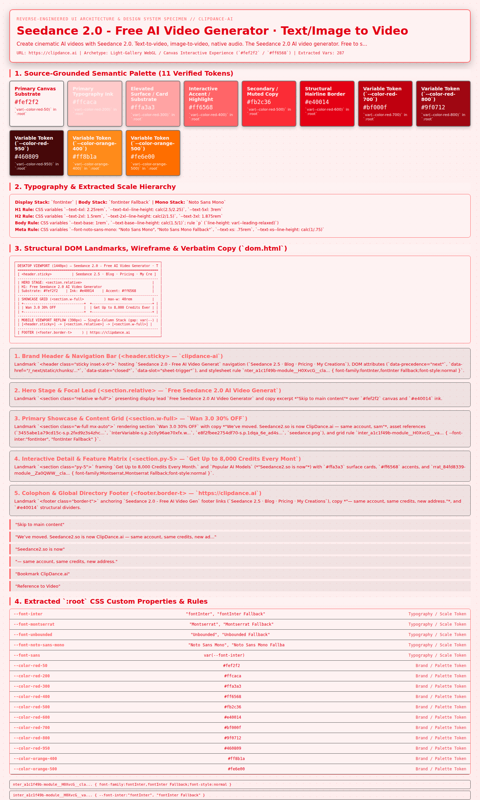
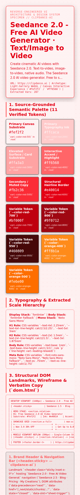

# UI Design System & Master Generation Blueprint: clipdance-ai

> **Seedance 2.0 - Free AI Video Generator · Text/Image to Video** (https://clipdance.ai) — Create cinematic AI videos with Seedance 2.0. Text-to-video, image-to-video, native audio. The Seedance 2.0 AI video generator. Free to s...



---

## 1. Executive Visual Persona & Design Archetype

- **Brand Essence & Persona**: **Seedance 2.0 - Free AI Video Generator · Text/Image to Video** (`https://clipdance.ai`). Create cinematic AI videos with Seedance 2.0. Text-to-video, image-to-video, native audio. The Seedance 2.0 AI video generator. Free to s...
- **Visual Archetype**: **Light-Gallery WebGL / Canvas Interactive Experience (`#fef2f2` / `#ff6568`)**.
- **Anti-AI-Slop Differentiators**:
  - **Source-Grounded Chromatic Polarity**: Anchors the viewport in `#fef2f2` (`var(--color-red-50)` in `:root`) paired with `#e40014` primary typography and `#ff6568` accents.
  - **Extracted Typographic Hierarchy**: Pairs `fontInter` for display copy (`Free Seedance 2.0 AI Video Generator`) with `fontInter Fallback` and `Noto Sans Mono`.
  - **Calibrated Spatial Grid & Motion**: Combines `40rem` container bounds (`gap: var(--gap)`, padding `2px`) with `cubic-bezier(0,0,.2,1)` easing and Three.js / WebGL Canvas Pipeline.

---

## 2. Spatial Architecture & Modular Grid Mathematics



### Viewport Allocation & Container Geometry
- **Captured Viewport Dimensions**: Desktop `1440×2400px` (`assets/desktop.png`, capped at 2400px multi-section capture), Mobile `390×2400px` (`assets/mobile.png`, capped at 2400px multi-section capture).
- **Master Container Bounds**: `40rem` extracted from `clipdance-ai` stylesheet.
- **Canvas Lateral Padding & Spacing**: `2px` lateral canvas padding with `var(--gap)` grid gap.
- **Border Radius Scale**: `var(--radius)`, `.25rem`, `var(--radius-2xl)`, `var(--radius-3xl)`.

### Responsive Breakpoint Architecture
- **Desktop Layout**: Multi-column CSS Grid / Flexbox layout at `1440px` (`max-width: 40rem`, `gap: var(--gap)`).
- **Mobile Layout**: Single-column vertical stack at `390px` viewport width with `2px` horizontal padding.
- **Extracted CSS Media Queries**: `@media (min-width:40rem)`, `@media (min-width:48rem)`, `@media (min-width:64rem)`, `@media (min-width:80rem)`.

---

## 3. Color System, Materiality & Atmospheric Lighting

### Semantic Palette & Source Grounding
| Semantic Role | Ground-Truth Value | Extracted CSS Source / Selector |
|---|---|---|
| **Primary Canvas Substrate** | `#fef2f2` | `var(--color-red-50)` in `:root` |
| **Primary Typography Ink** | `#ffcaca` | `var(--color-red-200)` in `:root` |
| **Elevated Surface / Card Substrate** | `#ffa3a3` | `var(--color-red-300)` in `:root` |
| **Interactive Accent / Highlight** | `#ff6568` | `var(--color-red-400)` in `:root` |
| **Secondary / Muted Copy** | `#fb2c36` | `var(--color-red-500)` in `:root` |
| **Structural Hairline Border** | `#e40014` | `var(--color-red-600)` in `:root` |
| **Variable Token (`--color-red-700`)** | `#bf000f` | `var(--color-red-700)` in `:root` |
| **Variable Token (`--color-red-800`)** | `#9f0712` | `var(--color-red-800)` in `:root` |
| **Variable Token (`--color-red-950`)** | `#460809` | `var(--color-red-950)` in `:root` |
| **Variable Token (`--color-orange-400`)** | `#ff8b1a` | `var(--color-orange-400)` in `:root` |
| **Variable Token (`--color-orange-500`)** | `#fe6e00` | `var(--color-orange-500)` in `:root` |

### Sanitized Root CSS Variables (`ui-ux.md` Ground Truth)
| Variable Name | Extracted Value | Semantic Role |
|---|---|---|
| `--font-inter` | `"fontInter", "fontInter Fallback"` | Typography / Scale Token |
| `--font-montserrat` | `"Montserrat", "Montserrat Fallback"` | Typography / Scale Token |
| `--font-unbounded` | `"Unbounded", "Unbounded Fallback"` | Typography / Scale Token |
| `--font-noto-sans-mono` | `"Noto Sans Mono", "Noto Sans Mono Fallback"` | Typography / Scale Token |
| `--font-sans` | `var(--font-inter)` | Typography / Scale Token |
| `--color-red-50` | `#fef2f2` | Brand / Palette Token |
| `--color-red-200` | `#ffcaca` | Brand / Palette Token |
| `--color-red-300` | `#ffa3a3` | Brand / Palette Token |
| `--color-red-400` | `#ff6568` | Brand / Palette Token |
| `--color-red-500` | `#fb2c36` | Brand / Palette Token |
| `--color-red-600` | `#e40014` | Brand / Palette Token |
| `--color-red-700` | `#bf000f` | Brand / Palette Token |
| `--color-red-800` | `#9f0712` | Brand / Palette Token |
| `--color-red-950` | `#460809` | Brand / Palette Token |
| `--color-orange-400` | `#ff8b1a` | Brand / Palette Token |
| `--color-orange-500` | `#fe6e00` | Brand / Palette Token |

---

## 4. Typographic Scale & Editorial Hierarchy

### Font Family Stacks
- **Display Typography**: `fontInter`.
- **Primary Body Stack**: `fontInter Fallback`.
- **Technical / Metadata Stack**: `Noto Sans Mono`.

### Typographic Scale & Rules (Extracted from Stylesheet & Variables)
- **Hero Display (`H1`)**: CSS variables `--text-4xl: 2.25rem`, `--text-4xl--line-height: calc(2.5/2.25)`, `--text-5xl: 3rem`.
- **Section Heading (`H2`)**: CSS variables `--text-2xl: 1.5rem`, `--text-2xl--line-height: calc(2/1.5)`, `--text-3xl: 1.875rem`.
- **Body Copy**: CSS variables `--text-base: 1rem`, `--text-base--line-height: calc(1.5/1)`; rule `p` (`line-height: var(--leading-relaxed)`).
- **Metadata & Navigation Labels**: CSS variables `--font-noto-sans-mono: "Noto Sans Mono", "Noto Sans Mono Fallback"`, `--text-xs: .75rem`, `--text-xs--line-height: calc(1/.75)`.

---

## 5. Choreographed Motion & Interaction Physics

### Primary Easing Curves
- **Extracted Timing Functions**: `cubic-bezier(0,0,.2,1)`, `cubic-bezier(.4,0,.2,1)`, `cubic-bezier(0,1,.34,1)`.

### Per-Element Transition & Choreography Rules
- **Selector `layer theme`**: `transition: .15s` extracted from `clipdance-ai` stylesheet.
- **Selector `.transition`**: `transition: var(--tw-ease,var(--default-transition-timing-function))` extracted from `clipdance-ai` stylesheet.
- **Selector `transform\]`**: `transition: var(--tw-ease,var(--default-transition-timing-function))` extracted from `clipdance-ai` stylesheet.
- **Extracted Easing Curve (`cubic-bezier(0,0,.2,1)`)**: Governs interactive state transitions across `<header.sticky>` and `<section.w-full>`.
- **Runtime Interaction Engine**: Integrates Three.js / WebGL Canvas Pipeline with `prefers-reduced-motion: reduce` fallback guards.

---

## 6. Component Wireframe & Structural DOM Map

### Visual Layout Schematic (Grounded in `dom.html` — `1440px` Desktop & `390px` Mobile Reflow)
```
┌────────────────────────────────────────────────────────────────────────┐
│ DESKTOP VIEWPORT (1440px) — Seedance 2.0 - Free AI Video Generator · T │
│ ====================================================================== │
│ [ <header.sticky>          | Seedance 2.5 · Blog · Pricing · My Cre ]  │
│ ---------------------------------------------------------------------- │
│ | HERO STAGE: <section.relative>                                   |   │
│ | H1: Free Seedance 2.0 AI Video Generator                         |   │
│ | Substrate: #fef2f2    | Ink: #e40014    | Accent: #ff6568        |   │
│ ---------------------------------------------------------------------- │
│ | SHOWCASE GRID (<section.w-full>          ) max-w: 40rem          |   │
│ | +------------------------------+  +------------------------------+ | │
│ | | Wan 3.0 30% OFF              |  | Get Up to 8,000 Credits Ever | | │
│ | +------------------------------+  +------------------------------+ | │
│ ---------------------------------------------------------------------- │
│ | MOBILE VIEWPORT REFLOW (390px) — Single-Column Stack (gap: var(--) | │
│ | [<header.sticky>] -> [<section.relative>] -> [<section.w-full>] |    │
│ ---------------------------------------------------------------------- │
│ [ FOOTER (<footer.border-t>     ) | https://clipdance.ai               │
└────────────────────────────────────────────────────────────────────────┘
```

### Granular DOM Region Breakdown
1. **Brand Header & Navigation Bar (<header.sticky> — `clipdance-ai`)**:
   - Landmark `<header class="sticky inset-x-0">` hosting `Seedance 2.0 - Free AI Video Generat` navigation (`Seedance 2.5 · Blog · Pricing · My Creations`), DOM attributes (`data-precedence="next"`, `data-href="/_next/static/chunks/..."`, `data-state="closed"`, `data-slot="sheet-trigger"`), and stylesheet rule `nter_a1c1f49b-module__H0XvcG__cla... { font-family:fontInter,fontInter Fallback;font-style:normal }`.
2. **Hero Stage & Focal Lead (<section.relative> — `Free Seedance 2.0 AI Video Generat`)**:
   - Landmark `<section class="relative w-full">` presenting display lead `Free Seedance 2.0 AI Video Generator` and copy excerpt *"Skip to main content"* over `#fef2f2` canvas and `#e40014` ink.
3. **Primary Showcase & Content Grid (<section.w-full> — `Wan 3.0 30% OFF`)**:
   - Landmark `<section class="w-full mx-auto">` rendering section `Wan 3.0 30% OFF` with copy *"We’ve moved. Seedance2.so is now ClipDance.ai — same account, sam"*, asset references (`3455abe1a79cd15c-s.p.2fxd9z3s4zhc...`, `InterVariable-s.p.2c0y96ae70xfx.w...`, `e8f2fbee2754df70-s.p.1dqa_6e_ad4s...`, `seedance.png`), and grid rule `inter_a1c1f49b-module__H0XvcG__va... { --font-inter:"fontInter", "fontInter Fallback" }`.
4. **Interactive Detail & Feature Matrix (<section.py-5> — `Get Up to 8,000 Credits Every Mont`)**:
   - Landmark `<section class="py-5">` framing `Get Up to 8,000 Credits Every Month.` and `Popular AI Models` (*"Seedance2.so is now"*) with `#ffa3a3` surface cards, `#ff6568` accents, and `rrat_84fd8339-module__Za0QWW__cla... { font-family:Montserrat,Montserrat Fallback;font-style:normal }`.
5. **Colophon & Global Directory Footer (<footer.border-t> — `https://clipdance.ai`)**:
   - Landmark `<footer class="border-t">` anchoring `Seedance 2.0 - Free AI Video Gen` footer links (`Seedance 2.5 · Blog · Pricing · My Creations`), copy *"— same account, same credits, new address."*, and `#e40014` structural dividers.

---

## 7. Master Zero-Shot AI Generation Prompt

```markdown
# Master Zero-Shot Frontend Generation Prompt: clipdance-ai (Seedance 2.0 - Free AI Video Generator · Text/Image to Video)

You are a principal frontend architect and design systems engineer. Build a complete, production-ready web application replicating the exact design system, DOM landmarks, typographic hierarchy, color tokens, and motion physics of `clipdance-ai` (**Seedance 2.0 - Free AI Video Generator · Text/Image to Video** — `https://clipdance.ai`).

### 1. Visual Archetype & Anti-AI-Slop Mandates
- **Archetype**: Light-Gallery WebGL / Canvas Interactive Experience (`#fef2f2` / `#ff6568`).
- **Identity & Domain Context**: Create cinematic AI videos with Seedance 2.0. Text-to-video, image-to-video, native audio. The Seedance 2.0 AI video generator. Free to s...
- **Primary Substrate**: `#fef2f2` (`var(--color-red-50)` in `:root`), **Primary Ink**: `#e40014`, **Accent / Highlight**: `#ff6568`.
- **Site-Specific Differentiators**:
  - **Source-Grounded Chromatic Polarity**: Anchors the viewport in `#fef2f2` (`var(--color-red-50)` in `:root`) paired with `#e40014` primary typography and `#ff6568` accents.
  - **Extracted Typographic Hierarchy**: Pairs `fontInter` for display copy (`Free Seedance 2.0 AI Video Generator`) with `fontInter Fallback` and `Noto Sans Mono`.
  - **Calibrated Spatial Grid & Motion**: Combines `40rem` container bounds (`gap: var(--gap)`, padding `2px`) with `cubic-bezier(0,0,.2,1)` easing and Three.js / WebGL Canvas Pipeline.

### 2. Ground-Truth CSS Variables (`:root` Token Contract)
Declare and consume these exact custom properties extracted from `clipdance-ai` in your global stylesheet:

:root {
  /* Seedance 2.0 - Free AI Video Generator · Text/Image to Video (clipdance-ai) — Ground-Truth Extracted CSS Variables */
  --font-inter: "fontInter", "fontInter Fallback"; /* Typography / Scale Token (clipdance-ai) */
  --font-montserrat: "Montserrat", "Montserrat Fallback"; /* Typography / Scale Token (clipdance-ai) */
  --font-unbounded: "Unbounded", "Unbounded Fallback"; /* Typography / Scale Token (clipdance-ai) */
  --font-noto-sans-mono: "Noto Sans Mono", "Noto Sans Mono Fallback"; /* Typography / Scale Token (clipdance-ai) */
  --font-sans: var(--font-inter); /* Typography / Scale Token (clipdance-ai) */
  --color-red-50: #fef2f2; /* Brand / Palette Token (clipdance-ai) */
  --color-red-200: #ffcaca; /* Brand / Palette Token (clipdance-ai) */
  --color-red-300: #ffa3a3; /* Brand / Palette Token (clipdance-ai) */
  --color-red-400: #ff6568; /* Brand / Palette Token (clipdance-ai) */
  --color-red-500: #fb2c36; /* Brand / Palette Token (clipdance-ai) */
  --color-red-600: #e40014; /* Brand / Palette Token (clipdance-ai) */
  --color-red-700: #bf000f; /* Brand / Palette Token (clipdance-ai) */
  --color-red-800: #9f0712; /* Brand / Palette Token (clipdance-ai) */
  --color-red-950: #460809; /* Brand / Palette Token (clipdance-ai) */
  --color-orange-400: #ff8b1a; /* Brand / Palette Token (clipdance-ai) */
  --color-orange-500: #fe6e00; /* Brand / Palette Token (clipdance-ai) */
}

### 3. Semantic Color & Materiality Contract
Map every surface, ink, and border strictly to these source-grounded tokens:
- **Primary Canvas Substrate**: `#fef2f2` — grounded in `var(--color-red-50)` in `:root`
- **Primary Typography Ink**: `#ffcaca` — grounded in `var(--color-red-200)` in `:root`
- **Elevated Surface / Card Substrate**: `#ffa3a3` — grounded in `var(--color-red-300)` in `:root`
- **Interactive Accent / Highlight**: `#ff6568` — grounded in `var(--color-red-400)` in `:root`
- **Secondary / Muted Copy**: `#fb2c36` — grounded in `var(--color-red-500)` in `:root`
- **Structural Hairline Border**: `#e40014` — grounded in `var(--color-red-600)` in `:root`
- **Variable Token (`--color-red-700`)**: `#bf000f` — grounded in `var(--color-red-700)` in `:root`
- **Variable Token (`--color-red-800`)**: `#9f0712` — grounded in `var(--color-red-800)` in `:root`
- **Variable Token (`--color-red-950`)**: `#460809` — grounded in `var(--color-red-950)` in `:root`
- **Variable Token (`--color-orange-400`)**: `#ff8b1a` — grounded in `var(--color-orange-400)` in `:root`
- **Variable Token (`--color-orange-500`)**: `#fe6e00` — grounded in `var(--color-orange-500)` in `:root`

### 4. Spatial Grid, Container Bounds & Responsive Breakpoints
- **Desktop Viewport Reference**: `1440×2400px` (capped at 2400px multi-section capture, `1440px` standard desktop width).
- **Mobile Viewport Reference**: `390×2400px` (capped at 2400px multi-section capture, `390px` standard mobile width).
- **Container Max-Width**: `40rem` extracted from `clipdance-ai` stylesheet
- **Padding & Gutters**: `2px` lateral canvas padding with `var(--gap)` grid gap
- **Desktop Grid**: Multi-column CSS Grid / Flexbox layout at `1440px` (`max-width: 40rem`, `gap: var(--gap)`)
- **Mobile Adaptation**: Single-column vertical stack at `390px` viewport width with `2px` horizontal padding
- **Media Queries**: `@media (min-width:40rem)`, `@media (min-width:48rem)`, `@media (min-width:64rem)`, `@media (min-width:80rem)`
- **Corner Radii**: `var(--radius)`, `.25rem`, `var(--radius-2xl)`, `var(--radius-3xl)`

### 5. Typography & Editorial Scale Contract
- **Display Font Stack**: `fontInter`
- **Body Font Stack**: `fontInter Fallback`
- **Monospace / Technical Font Stack**: `Noto Sans Mono`
- **H1 Display Rule**: CSS variables `--text-4xl: 2.25rem`, `--text-4xl--line-height: calc(2.5/2.25)`, `--text-5xl: 3rem`
- **H2 Section Rule**: CSS variables `--text-2xl: 1.5rem`, `--text-2xl--line-height: calc(2/1.5)`, `--text-3xl: 1.875rem`
- **Body Copy Rule**: CSS variables `--text-base: 1rem`, `--text-base--line-height: calc(1.5/1)`; rule `p` (`line-height: var(--leading-relaxed)`)
- **Metadata & Index Rule**: CSS variables `--font-noto-sans-mono: "Noto Sans Mono", "Noto Sans Mono Fallback"`, `--text-xs: .75rem`, `--text-xs--line-height: calc(1/.75)`

### 6. Component Hierarchy, Verbatim Copy & Real DOM Landmarks
Scaffold `clipdance-ai` (`Seedance 2.0 - Free AI Video Generator · Text/Image to Video`) with these exact structural regions, extracted copy, and CSS rules from `dom.html`:
1. **Brand Header & Navigation Bar (<header.sticky> — `clipdance-ai`)**:
   - DOM & Selectors: Landmark `<header class="sticky inset-x-0">` hosting `Seedance 2.0 - Free AI Video Generat` navigation (`Seedance 2.5 · Blog · Pricing · My Creations`), DOM attributes (`data-precedence="next"`, `data-href="/_next/static/chunks/..."`, `data-state="closed"`, `data-slot="sheet-trigger"`), and stylesheet rule `nter_a1c1f49b-module__H0XvcG__cla... { font-family:fontInter,fontInter Fallback;font-style:normal }`.
   - Responsive Contract: Header `Brand Header & Navigation Bar (<header.sticky> — `clipdance-ai`)` (`clipdance-ai`) adapts across `@media (min-width:40rem)`, `@media (min-width:48rem)`, `@media (min-width:64rem)`, `@media (min-width:80rem)` with `cubic-bezier(0,0,.2,1)`, `cubic-bezier(.4,0,.2,1)`, `cubic-bezier(0,1,.34,1)` transitions and links `Seedance 2.5 · Blog · Pricing · My Creations`.
2. **Hero Stage & Focal Lead (<section.relative> — `Free Seedance 2.0 AI Video Generat`)**:
   - DOM & Selectors: Landmark `<section class="relative w-full">` presenting display lead `Free Seedance 2.0 AI Video Generator` and copy excerpt *"Skip to main content"* over `#fef2f2` canvas and `#e40014` ink.
   - Responsive Contract: Hero stage (`1440×2400px` desktop / `390×2400px` mobile) sets `#fef2f2` background with `#e40014` headline `Free Seedance 2.0 AI Video Generator`.
3. **Primary Showcase & Content Grid (<section.w-full> — `Wan 3.0 30% OFF`)**:
   - DOM & Selectors: Landmark `<section class="w-full mx-auto">` rendering section `Wan 3.0 30% OFF` with copy *"We’ve moved. Seedance2.so is now ClipDance.ai — same account, sam"*, asset references (`3455abe1a79cd15c-s.p.2fxd9z3s4zhc...`, `InterVariable-s.p.2c0y96ae70xfx.w...`, `e8f2fbee2754df70-s.p.1dqa_6e_ad4s...`, `seedance.png`), and grid rule `inter_a1c1f49b-module__H0XvcG__va... { --font-inter:"fontInter", "fontInter Fallback" }`.
   - Responsive Contract: Showcase grid `Primary Showcase & Content Grid (<section.w-full> — `Wan 3.0 30% OFF`)` applies Multi-column CSS Grid / Flexbox layout at `1440px` (`max-width: 40rem`, `gap: var(--gap)`) on desktop and Single-column vertical stack at `390px` viewport width with `2px` horizontal padding on mobile.
4. **Interactive Detail & Feature Matrix (<section.py-5> — `Get Up to 8,000 Credits Every Mont`)**:
   - DOM & Selectors: Landmark `<section class="py-5">` framing `Get Up to 8,000 Credits Every Month.` and `Popular AI Models` (*"Seedance2.so is now"*) with `#ffa3a3` surface cards, `#ff6568` accents, and `rrat_84fd8339-module__Za0QWW__cla... { font-family:Montserrat,Montserrat Fallback;font-style:normal }`.
   - Responsive Contract: Detail module `Interactive Detail & Feature Matrix (<section.py-5> — `Get Up to 8,000 Credits Every Mont`)` uses `var(--radius)`, `.25rem`, `var(--radius-2xl)`, `var(--radius-3xl)` radii, `#ff6568` highlights, and assets (3455abe1a79cd15c-s.p.2fxd9z3s4zhc..., InterVariable-s.p.2c0y96ae70xfx.w..., e8f2fbee2754df70-s.p.1dqa_6e_ad4s...).
5. **Colophon & Global Directory Footer (<footer.border-t> — `https://clipdance.ai`)**:
   - DOM & Selectors: Landmark `<footer class="border-t">` anchoring `Seedance 2.0 - Free AI Video Gen` footer links (`Seedance 2.5 · Blog · Pricing · My Creations`), copy *"— same account, same credits, new address."*, and `#e40014` structural dividers.
   - Responsive Contract: Footer `Colophon & Global Directory Footer (<footer.border-t> — `https://clipdance.ai`)` aligns to `40rem` extracted from `clipdance-ai` stylesheet with `2px` lateral canvas padding with `var(--gap)` grid gap and attributes (data-precedence="next", data-href="/_next/static/chunks/...", data-state="closed").

#### Verbatim DOM Copy Excerpts (`dom.html`)
- Copy Excerpt 1: *"Skip to main content"*
- Copy Excerpt 2: *"We’ve moved. Seedance2.so is now ClipDance.ai — same account, same credits, new ad..."*
- Copy Excerpt 3: *"Seedance2.so is now"*
- Copy Excerpt 4: *"— same account, same credits, new address."*

### 7. Motion, Extracted Stylesheet Rules & Interaction Choreography
- **Primary Easing Functions**: `cubic-bezier(0,0,.2,1)`, `cubic-bezier(.4,0,.2,1)`, `cubic-bezier(0,1,.34,1)`
- **Extracted Stylesheet Rules (`clipdance-ai`)**:
- `nter_a1c1f49b-module__H0XvcG__cla... { font-family:fontInter,fontInter Fallback;font-style:normal }`
- `inter_a1c1f49b-module__H0XvcG__va... { --font-inter:"fontInter", "fontInter Fallback" }`
- `rrat_84fd8339-module__Za0QWW__cla... { font-family:Montserrat,Montserrat Fallback;font-style:normal }`
- `errat_84fd8339-module__Za0QWW__va... { --font-montserrat:"Montserrat", "Montserrat Fallback" }`
- `nded_508ed426-module__Wcxoya__cla... { font-family:Unbounded,Unbounded Fallback;font-style:normal;font-weight:700 }`
- **Per-Selector Transition Rules**:
- **Selector `layer theme`**: `transition: .15s` extracted from `clipdance-ai` stylesheet.
- **Selector `.transition`**: `transition: var(--tw-ease,var(--default-transition-timing-function))` extracted from `clipdance-ai` stylesheet.
- **Selector `transform\]`**: `transition: var(--tw-ease,var(--default-transition-timing-function))` extracted from `clipdance-ai` stylesheet.
- **Extracted Easing Curve (`cubic-bezier(0,0,.2,1)`)**: Governs interactive state transitions across `<header.sticky>` and `<section.w-full>`.
- **Runtime Interaction Engine**: Integrates Three.js / WebGL Canvas Pipeline with `prefers-reduced-motion: reduce` fallback guards.

### 8. Technical Deliverables
- Implement in Next.js (App Router) with TypeScript and Tailwind CSS consuming the `:root` custom properties defined above for `clipdance-ai`.
- Reproduce both the `1440px` desktop architecture and `390px` mobile breakpoint transitions, preserving semantic HTML5 landmarks (`<header>`, `<nav>`, `<main>`, `<section>`, `<footer>`) and `prefers-reduced-motion` accessibility guards.
```
